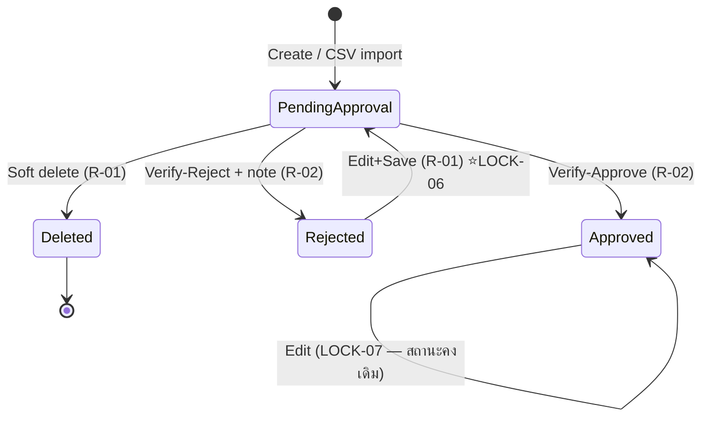

# BRD: Farmer Member Management (จัดการสมาชิกเกษตรกร)

| Field | Value |
|---|---|
| BRD ID | BRD-AGM-001 |
| Feature Name | Farmer Member Management (จัดการสมาชิกเกษตรกร) |
| BRD Type | Enhancement (Refactor Wave — regen จาก legacy code) |
| Version | 1.0 |
| Status | AI Reviewed — APPROVED |
| Module | AGM (Agriculture Management) / Farmer |
| Client | WKN (วังขนาย Sugar Group) |
| Owner | 2BSimple BA (Strike) |
| Stakeholders | ทีมทะเบียนชาวไร่ WKN, ฝ่ายส่งเสริม, 2BSimple Dev/QA |
| Created Date | 2026-07-20 |
| Last Updated | 2026-07-20 |

## Changelog
- v1.0 (2026-07-20): สร้าง BRD ผ่าน brd-generator-full (Fresh Mode, constraint mode — invariants.md LOCKED) จาก RIF_v2_F-AGM-001
- Recheck (2026-07-22): อัปเดตตาม authoritative spec (Refactor-Wave recheck) — email required (LOCK-08 superseded), quota_status คงค่า no_quota, เพิ่ม authoritative NFR budget (SER/VAL/CRE-UPT)

---

## Section 2: Business Context

### 2.1 ปัญหา / โอกาส
- **PAIN-01:** ระบบทะเบียนสมาชิกชาวไร่มีเฉพาะ legacy prototype นอกมาตรฐาน CUBE — ไม่มี CI Warm Light, ไม่มี sidebar shell มาตรฐาน
- **PAIN-02:** ไม่มีชุดเอกสาร BRD/FRD/Testcases — dev/QA ทำงานจาก code อย่างเดียว เกิด doc drift 100%
- **PAIN-03:** ไม่มี governance ตาม CUBE 4.0 — ไม่มี User Access ENC / DOA placeholder / Data Classification

ทะเบียนสมาชิกชาวไร่คือ **master data ต้นน้ำของทั้ง AGM** — Quota, การส่งอ้อยเข้าโรงงาน, และการจ่ายเงินชาวไร่ ล้วนอ้าง member_id จาก feature นี้ ความถูกต้องของทะเบียน (โดยเฉพาะ citizen_id) จึงกระทบทั้ง value chain

### 2.2 เป้าหมายทาง Business
- G1: ทะเบียนชาวไร่ถูกต้อง ตรวจสอบยืนยันโดยหัวหน้างานก่อนใช้งานต่อ (ผูก Quota ได้เฉพาะสมาชิก Approved)
- G2: รองรับการขึ้นทะเบียนจำนวนมากผ่าน CSV โดยไม่เสียข้อมูลแถวดีเมื่อบางแถวพัง
- G3: ยกระดับเป็นมาตรฐาน CUBE NATIVE ครบ chain เอกสาร + governance

### 2.3 ตัวชี้วัดความสำเร็จ (Success Metrics)
| Metric | Baseline ปัจจุบัน | Target | วัดยังไง/จากไหน | วัดเมื่อไหร่ |
|---|---|---|---|---|
| MET-01 อัตราสมาชิกค้างสถานะรอยืนยัน > 7 วัน | ต้องเก็บ baseline ก่อน launch | < 5% | Report สถานะสมาชิก (§18.3) นับ Pending อายุ > 7 วัน / ทั้งหมด | หลัง launch 30 วัน |
| MET-02 อัตราแถว CSV import สำเร็จ | ต้องเก็บ baseline ก่อน launch | ≥ 95% | สรุปผล import (created/total) จาก log FN-SEQ-AGM-110 batch | ทุกรอบ import, review รายเดือน |
| MET-03 สมาชิก Approved ที่ข้อมูลผิดจนต้องแก้ย้อนหลัง | ต้องเก็บ baseline ก่อน launch | < 2%/เดือน | Audit log การ edit หลัง verify (Immutable Master Data Log) | หลัง launch 60 วัน |
| MET-04 Invariants preserve จาก legacy | — | 100% | _COMPLIANCE_REPORT (Stage 4.5) | ก่อนส่งมอบ |

### 2.4 ที่มาของ Requirement
- Request จาก: Refactor Wave — คำสั่ง regen ชุดเอกสาร AGM ทั้งระบบ (Strike, 2026-07-20)
- Source: legacy code prototype (farmer-management.zip) → reverse ผ่าน legacy-sources-reverser

---

## Section 3: Scope

### 3.1 In Scope
- ทะเบียนสมาชิกชาวไร่: สร้าง / แก้ไข / ลบ (soft) / ดูรายการ+รายละเอียด+ประวัติ
- ตรวจสอบยืนยัน (Verify) รายคนและทั้งกลุ่ม พร้อมเหตุผลเมื่อปฏิเสธ
- ส่งใหม่หลังถูกปฏิเสธ (Rejected → แก้ไข → กลับเข้าคิวรอยืนยัน) ⭐ LOCK-06
- นำเข้า CSV จำนวนมาก + template download + error report
- แสดงสถานะโควตาของสมาชิก (อ่านจาก module Quota)
- Governance: User Access ENC + DOA placeholder + Data Classification

### 3.2 Out of Scope
- การสร้าง/จัดการโควตา (module Quota — feature ถัดไปของ AGM)
- การผูกแปลงไร่ / สัญญาส่งอ้อย / การเงินชาวไร่
- Mobile app / portal ให้ชาวไร่ลงทะเบียนเอง (self-service)
- Notification ภายนอก (SMS/email แจ้งชาวไร่) — legacy ไม่มี, ยังไม่เพิ่มรอบนี้
- การ migrate ข้อมูลจากระบบเดิม (แยกเป็นงาน data migration ต่างหาก)

### 3.3 Assumptions
- Thai Address Hierarchy master (จังหวัด/อำเภอ/ตำบล/ไปรษณีย์) ใช้ master กลางของ CUBE ที่มีอยู่แล้ว
- ผู้ใช้เป็น staff โรงงาน (registrar/supervisor) ไม่ใช่ชาวไร่โดยตรง
- 1 tenant = 1 โรงงาน ตาม multi-tenant RLS ของ CUBE NATIVE

### 3.4 Scope Lock ⭐ (สืบทอดจาก RIF §16.3 + invariants.md LOCKED 🔒)
scope_lock_ref: `invariants.md` (Refactor Wave — ไม่มีใบเซ็น; invariants ทำหน้าที่ scope constraint)

| LOCK-ID | ข้อความยืนยัน | อ้าง |
|---|---|---|
| LOCK-01 | ขอบเขต regen = ความสามารถ legacy 100% ห้ามตัด | invariants §1–§6 |
| LOCK-02 | State machine: Pending Approval → Approved / Rejected + soft delete | invariants §4 |
| LOCK-03 | Optimistic lock + idempotency ทุก mutation ต้องคงไว้ | invariants BR-05/06 |
| LOCK-04 | CSV contract 10 คอลัมน์ + partial success + error report ต้องคงไว้ | invariants BR-07 |
| LOCK-05 | เพิ่ม governance (ENC/DOA placeholder) ได้ ไม่ถือว่า scope drift | CUBE 4.0 standard |
| LOCK-06 | Rejected เปิดให้ส่งใหม่ได้ — แก้ไข+บันทึก → กลับ Pending Approval อัตโนมัติ | Strike 2026-07-20 (Q-01) |
| LOCK-07 | Approved แก้ได้ทุก field สถานะคงเดิม (ตาม legacy) | Strike 2026-07-20 (Q-02) |
| LOCK-08 | email = optional ⚠️ superseded — ดู note ใต้ตาราง | Strike 2026-07-20 (Q-03) |

ไม่มี SCOPE DRIFT — In Scope ทุกข้ออยู่ใต้ LOCK-01..08

> ⚠️ **Recheck reconciliation (2026-07-22, Refactor-Wave recheck vs authoritative spec):** LOCK-08 (email optional) ถูก **superseded โดย authoritative spec + as-built create form** → **email = REQUIRED** (ดู §6 field #6, §9 VR-03/VR-04). LOCK-06/07 (re-submit ผ่าน edit — rejected→pending / approved คงสถานะ) เป็นพฤติกรรม **additive เกิน authoritative FRD** (ซึ่งระบุ verify_status เปลี่ยนผ่าน Verify Modal เท่านั้น) — คงไว้แต่ **ต้องขอ owner sign-off**.

---

## Section 4: User Roles & Permissions

| Role | ดูรายการ/รายละเอียด | สร้าง | แก้ไข | ลบ (soft) | CSV Import | Verify เดี่ยว | Verify กลุ่ม |
|---|:---:|:---:|:---:|:---:|:---:|:---:|:---:|
| R-01 เจ้าหน้าที่ทะเบียนชาวไร่ (Farmer Registrar) | ✅ | ✅ | ✅ ทุกสถานะ (LOCK-07) | ✅ เฉพาะ Pending | ✅ | ❌ | ❌ |
| R-02 หัวหน้างานทะเบียน (Registrar Supervisor) | ✅ | ❌ | ❌ | ❌ | ❌ | ✅ เฉพาะ Pending | ✅ เฉพาะ Pending |

> 🔧 Governance checkpoint 1: matrix ทั้งชุดนี้ register เป็น **User Access ENC ที่ Policy Center** — ห้าม hardcode role ใน feature
> หมายเหตุ SoD: R-01 (Maker) และ R-02 (Checker) ต้องเป็นคนละบัญชี — คนสร้างห้าม verify ตัวเอง

---

## Section 5: User Journey (with COSO)

### 5.1 Happy Path — ขึ้นทะเบียน → ยืนยัน
| Step | การกระทำ | Maker | Checker | Approver | System |
|---|---|---|---|---|---|
| 1 | R-01 สร้างสมาชิกใหม่ (drawer) หรือ import CSV | R-01 | — | — | validate + gen member_id `FM-NNNNNN` + สถานะ Pending Approval + idempotency |
| 2 | R-02 เปิดรายการ กรอง "รอยืนยัน" เลือกเดี่ยว/กลุ่ม | — | R-02 | — | แสดงเฉพาะแถว selectable (Pending) |
| 3 | R-02 ตรวจข้อมูล → ยืนยัน (Approve) | — | R-02 | (placeholder DOA — TODO) | เปลี่ยนสถานะ Approved + บันทึก verified_by/at + optimistic lock |
| 4 | สมาชิก Approved พร้อมให้ module Quota อ้างอิง | — | — | — | quota_status เริ่ม no_quota |

### 5.2 Alternative Paths
| Path | Step | COSO |
|---|---|---|
| A1 ปฏิเสธ | R-02 เลือก Reject + กรอกเหตุผล (บังคับ) → สถานะ Rejected + verified_note | Checker=R-02, System บันทึก audit |
| A2 ส่งใหม่ (LOCK-06) | R-01 แก้ไขสมาชิก Rejected → บันทึกสำเร็จ → ระบบเปลี่ยนกลับ Pending Approval อัตโนมัติ + เคลียร์ verified_note เดิมเข้า history | Maker=R-01, System state change |
| A3 ลบ | R-01 ลบสมาชิก Pending → confirm modal → soft delete | Maker=R-01, System guard เฉพาะ Pending |
| A4 CSV บางแถวพัง | ระบบนำเข้าแถวดี รายงานแถวเสีย (row/field/message/data) ให้ download แก้แล้ว import ใหม่ | System partial success |
| A5 แก้ชนกัน | สอง user แก้/verify คนเดียวกัน → คนหลังเจอ CONFLICT → แจ้งรีเฟรช | System optimistic lock |

SoD check: ✅ Maker (R-01) ≠ Checker (R-02) ทุก approval step

---

## Section 6: Data Entity & Fields

### 6.1 Entity: farmer_member (หลัก)
| # | Field Name | Label UI | Input Type | ค่า/ตัวเลือก | จำเป็น | เงื่อนไข | หมายเหตุ |
|---|---|---|---|---|:---:|---|---|
| 1 | member_id | Member Id | AUTO | `FM-%06d` running | auto | gen หลังบันทึกสำเร็จ | unique, ห้ามแก้ |
| 2 | first_name | ชื่อ | TEXT | — | ✅ | — | |
| 3 | last_name | นามสกุล | TEXT | — | ✅ | — | |
| 4 | citizen_id | เลขบัตรประชาชน | TEXT | ตัวเลข 13 หลัก | ✅ | strip non-digit, unique ต่อ tenant | PII — Restricted, mask บน list |
| 5 | phone | เบอร์โทรศัพท์ | TEXT | ตัวเลข 9–12 หลัก | ✅ | strip non-digit | PII — Confidential |
| 6 | email | อีเมล | TEXT | email format | ✅ | required + validate format (blank → "กรุณากรอกอีเมล") | LOCK-08 (superseded by authoritative 2026-07-22): email = REQUIRED — ตรง as-built create form |
| 7 | address_line | ที่อยู่ | TEXTAREA | — | ✅ | — | alias legacy: address |
| 8 | province | จังหวัด | DROPDOWN-SINGLE | LOOKUP: M-01 | ✅ | cascade root | |
| 9 | district | อำเภอ | DROPDOWN-SINGLE | LOOKUP: M-01 (by province) | ✅ | disabled จนเลือกจังหวัด | |
| 10 | subdistrict | ตำบล | DROPDOWN-SINGLE | LOOKUP: M-01 (by district) | ✅ | disabled จนเลือกอำเภอ | |
| 11 | postal_code | รหัสไปรษณีย์ | AUTO | จากตำบล | auto | read-only | server validate ต้อง match ตำบล |
| 12 | verify_status | สถานะการยืนยัน | AUTO | Pending Approval / Approved / Rejected | auto | ดู §8 | badge เหลือง/เขียว/แดง |
| 13 | quota_status | สถานะโควตา | AUTO | `no_quota` (คงค่าเสมอ — authoritative) | auto | read-only cross-module | แสดงที่ detail · has_quota = Phase-2/Quota module (ถอดจาก Phase-1 scope, 2026-07-22) |
| 14 | verified_by / verified_at / verified_note | ข้อมูลการตรวจสอบ | AUTO | — | auto | note บังคับเมื่อ Rejected | audit |
| 15 | is_deleted / deleted_at / deleted_by | สถานะลบ | AUTO | — | auto | soft delete | ไม่แสดงใน list ปกติ |
| 16 | created_by/at, updated_by/at | Audit Fields | AUTO | — | auto | updated_at = optimistic lock token | มาตรฐานทุก entity |

### 6.2 Entity Relationship
```
m_address_hierarchy (M-01, master กลาง CUBE)
        ▲ (referenced by)
farmer_member ──(1:0..N)──▶ quota (module Quota — downstream, อ่าน quota_status)
farmer_member ──(1:N)──▶ farmer_member_history (audit timeline)
```
- FK: farmer_member.subdistrict_code → m_address_hierarchy
- farmer_member_history: บันทึกทุก event (create/edit/verify/reject/re-submit/delete) — Immutable Master Data Log (S01-07)

### 6.3 Enhancement Action Table (เทียบ legacy)
| Field/พฤติกรรม | ก่อน (legacy) | หลัง (regen) | Action |
|---|---|---|---|
| email | required | required (คงเดิม) | NO CHANGE — LOCK-08 optional ถูก superseded โดย authoritative (2026-07-22) |
| Rejected → แก้ไข | ไม่นิยาม | กลับ Pending อัตโนมัติ | ADD (LOCK-06) |
| verified_note เมื่อ re-submit | — | เก็บลง history แล้วเคลียร์จาก record | ADD |
| Data Classification per-column | ไม่มี | Restricted/Confidential/Internal | ADD (governance) |
| อื่น ๆ ทั้งหมด | ตาม invariants | คงเดิม 100% | NO CHANGE |

---

## Section 7: User Stories & Acceptance Criteria

| ID | Story | Acceptance Criteria (Given-When-Then) |
|---|---|---|
| US-01 | ในฐานะเจ้าหน้าที่ทะเบียน ฉันต้องการสร้างสมาชิกใหม่ เพื่อขึ้นทะเบียนชาวไร่เข้าระบบ | AC1: Given กรอกครบ+ถูก When บันทึก Then ได้ member_id FM-NNNNNN + สถานะ Pending Approval + toast แสดง ID · AC2: Given citizen_id ไม่ครบ 13 หลัก When บันทึก Then error รายช่อง ไม่บันทึก |
| US-02 | ในฐานะเจ้าหน้าที่ทะเบียน ฉันต้องการนำเข้าสมาชิกจาก CSV เพื่อขึ้นทะเบียนจำนวนมากในครั้งเดียว | AC1: Given ไฟล์ .csv ≤5MB ตาม template When upload Then แสดง progress + สรุป total/created/failed · AC2: Given บางแถวพัง When upload Then แถวดีถูกสร้าง แถวเสียมี error report (row/field/message/data) download ได้ · AC3: Given ไฟล์ไม่ใช่ .csv หรือ >5MB When เลือกไฟล์ Then block พร้อมข้อความ |
| US-03 | ในฐานะเจ้าหน้าที่ทะเบียน ฉันต้องการค้นหาสมาชิก เพื่อหาข้อมูลได้เร็ว | AC1: Given พิมพ์คำค้น When หยุดพิมพ์ 300ms Then กรองด้วย ชื่อ/นามสกุล/เบอร์/เลขบัตร/Member Id · AC2: Given ไม่พบ Then empty state + CTA เพิ่มสมาชิก/อัปโหลด CSV |
| US-04 | ในฐานะหัวหน้างาน ฉันต้องการตรวจสอบยืนยันสมาชิกรายคน เพื่อรับรองข้อมูลก่อนใช้งานต่อ | AC1: Given สมาชิก Pending When Approve Then สถานะ Approved + verified_by/at · AC2: Given เลือก Reject ไม่กรอกเหตุผล When ยืนยัน Then block บังคับกรอก · AC3: Given มีคนแก้ record ก่อน When ยืนยัน Then CONFLICT แจ้งรีเฟรช |
| US-05 | ในฐานะหัวหน้างาน ฉันต้องการยืนยันทั้งกลุ่ม เพื่อลดเวลาตรวจทีละคน | AC1: Given เลือกหลายแถว (เฉพาะ Pending เลือกได้) When Bulk Approve/Reject Then ประมวลผลรายคน รายงานสำเร็จ X ล้มเหลว Y · AC2: Given เลือก 0 แถว Then ปุ่ม disabled |
| US-06 | ในฐานะเจ้าหน้าที่ทะเบียน ฉันต้องการแก้ไขสมาชิกที่ถูกปฏิเสธแล้วส่งใหม่ เพื่อไม่ต้องสร้างซ้ำ | AC1: Given สมาชิก Rejected When แก้ไข+บันทึกสำเร็จ Then สถานะกลับ Pending Approval อัตโนมัติ + note เดิมย้ายเข้า history · AC2: Given สมาชิก Approved When แก้ไข Then บันทึกได้ สถานะคงเดิม (LOCK-07) |
| US-07 | ในฐานะเจ้าหน้าที่ทะเบียน ฉันต้องการลบสมาชิกที่ยังไม่ยืนยัน เพื่อจัดการรายการที่สร้างผิด | AC1: Given สมาชิก Pending When ลบ+confirm Then soft delete หายจาก list · AC2: Given สมาชิก Approved/Rejected Then ไม่มีปุ่มลบ / block พร้อมข้อความ |
| US-08 | ในฐานะผู้ใช้ ฉันต้องการดูรายละเอียด+ประวัติสมาชิก เพื่อเห็นความเป็นมาครบ | AC1: Given เปิด detail Then เห็น 3 การ์ด (ส่วนตัว/ที่อยู่/สถานะ+โควตา) + timeline สร้าง→แก้ไข→ตรวจสอบ · AC2: Given สถานะ Pending Then มีปุ่มตรวจสอบ (R-02) |

---

## Section 8: Status & Lifecycle



| State | Trigger | Next State | เงื่อนไข | ผู้ทำ |
|---|---|---|---|---|
| — | Create / CSV import | Pending Approval | ผ่าน validation | R-01 |
| Pending Approval | Approve | Approved | — | R-02 |
| Pending Approval | Reject | Rejected | ต้องมี verified_note | R-02 |
| Rejected | Edit + Save | Pending Approval | บันทึกสำเร็จ (LOCK-06) | R-01 |
| Pending Approval | Delete | Deleted (soft) | — | R-01 |
| Approved | Edit + Save | Approved | สถานะคงเดิม (LOCK-07) | R-01 |
| Approved / Rejected | Delete | ❌ ไม่อนุญาต | — | — |

---

## Section 9: Business Rules + Validation (with Tags)

### 9.1 Business Rules
| ID | Rule | Tag | ใครเปลี่ยน + บ่อยแค่ไหน + ระดับ |
|---|---|---|---|
| R01 | Member ID gen อัตโนมัติ format `FM-%06d` running ต่อ tenant | CONFIGURABLE | Admin นาน ๆ ครั้ง (เปลี่ยน prefix/format) → Admin Panel: Document Numbering 🤖 |
| R02 | สมาชิกใหม่ (create/CSV) เริ่มสถานะ Pending Approval เสมอ | FIXED | — |
| R03 | Verify (เดี่ยว/กลุ่ม) ทำได้เฉพาะสถานะ Pending Approval | FIXED | — |
| R04 | Reject ต้องกรอก verified_note | FIXED | — |
| R05 | ลบได้เฉพาะ Pending Approval และเป็น soft delete เท่านั้น | FIXED | — |
| R06 | ทุก mutation ใช้ optimistic lock (expected_updated_at) + idempotency key `{FN}:{id}:{user}` | FIXED (LOCK-03) | — |
| R07 | CSV: ไฟล์ .csv เท่านั้น, ≤ 5MB, header 10 คอลัมน์ตาม template | CONFIGURABLE | Admin นาน ๆ ครั้ง (ขนาดไฟล์/แถวสูงสุด) → Admin Panel 🤖 |
| R08 | CSV import = partial success — แถวดีสร้าง แถวเสียรายงาน + error report download | FIXED (LOCK-04) | — |
| R09 | postal_code กำหนดอัตโนมัติจากตำบล และ server ต้อง validate ให้ตรงตำบล | FIXED | — |
| R10 | citizen_id ต้อง unique ต่อ tenant — ซ้ำ → reject (form: error รายช่อง / CSV: error รายแถว "เลขบัตรซ้ำ") | FIXED | — |
| R11 | Rejected → แก้ไข+บันทึกสำเร็จ → กลับ Pending Approval อัตโนมัติ; verified_note เดิมย้ายเข้า history | FIXED (LOCK-06) | — |
| R12 | Approved แก้ได้ทุก field สถานะคงเดิม — ทุกการแก้ลง Immutable Log (Before/After) | FIXED (LOCK-07) | — |
| R13 | quota_status เป็นค่า read-only จาก module Quota — feature นี้ห้ามเขียน | FIXED | — |
| R14 | การอนุมัติ (Verify) เป็น pre-DOA placeholder: ฟิลด์ approver_role/approved_by/approval_chain + TODO — รอ DOA ENC wire | WARNING | รอ DOA engine — ดู §15 OQ-01 |

### 9.2 Validation Rules
| ID | Field/Action | เงื่อนไข | ประเภท | ข้อความ |
|---|---|---|---|---|
| VR-01 | citizen_id | ตัวเลข 13 หลักเป๊ะ (strip non-digit, maxLength 13) | Error | "เลขบัตรประชาชนต้องเป็นตัวเลข 13 หลัก" |
| VR-02 | phone | ตัวเลข 9–12 หลัก | Error | "เบอร์โทรศัพท์ต้องเป็นตัวเลข 9-12 หลัก" |
| VR-03 | email | required + รูปแบบ email (blank → error — authoritative 2026-07-22) | Error | "กรุณากรอกอีเมล" / "รูปแบบอีเมลไม่ถูกต้อง" |
| VR-04 | required fields | first_name, last_name, citizen_id, phone, email, address_line, province, district, subdistrict | Error | "กรุณากรอก[ชื่อฟิลด์]" |
| VR-05 | citizen_id unique | ตรวจซ้ำก่อนบันทึก | Error | "เลขบัตรประชาชนนี้มีในระบบแล้ว" |
| VR-06 | verify result | ต้องเลือก Approve/Reject | Error | "กรุณาเลือกผลการตรวจสอบ" |
| VR-07 | verified_note เมื่อ Reject | บังคับกรอก | Error | "จำเป็นต้องระบุเหตุผลเมื่อปฏิเสธ" |
| VR-08 | CSV file | .csv + ≤5MB | Prevent | "กรุณาเลือกไฟล์ CSV เท่านั้น" / "ขนาดไฟล์ต้องไม่เกิน 5MB" |
| VR-09 | CSV postal_code | ต้อง match ตำบล | Error (รายแถว) | "รหัสไปรษณีย์ไม่ตรงกับตำบล" |
| VR-10 | optimistic lock | expected_updated_at ไม่ตรง | Error | "ข้อมูลถูกแก้ไขโดยผู้อื่น กรุณารีเฟรชและลองใหม่อีกครั้ง" |
| VR-11 | cascade reset | เปลี่ยนจังหวัด → เคลียร์อำเภอ/ตำบล/ไปรษณีย์; เปลี่ยนอำเภอ → เคลียร์ตำบล/ไปรษณีย์ | Trigger | — |

### 9.5 สรุประดับความยืดหยุ่น
| Rule | Tag | ระดับ | เหตุผล | ที่มา |
|---|---|---|---|---|
| R01 (เลข Member ID) | CONFIGURABLE | Admin Panel — Document Numbering | prefix/format อาจต่างต่อ tenant, มีใน CUBE แล้ว | 🤖 AI-inferred |
| R07 (CSV limits) | CONFIGURABLE | Admin Panel — Import Config | limit เปลี่ยนนาน ๆ ครั้ง โดย admin | 🤖 AI-inferred |
| R14 (approval chain) | WARNING | Engine (DOA) — placeholder ก่อน | ตาม Approval Pattern ของ CUBE 4.0 | ✅ CUBE standard |
| ที่เหลือทั้งหมด | FIXED | Feature logic | ผูก LOCK / กฎหมาย / integrity | ✅ invariants LOCKED |

> 🤖 ทั้งสองข้อเป็นระดับ Admin Panel — ปล่อยผ่านได้ตามกติกา (ไม่ใช่ DYNAMIC/Engine) แต่ mark ไว้ให้ stakeholder เห็น

---

## Section 10: Edge Cases

### 10.1 จาก RIF/Legacy (ยืนยันแล้ว ☑)
| ID | กรณี | พฤติกรรมที่คาดหวัง |
|---|---|---|
| EC-01 ☑ | Verify/Edit ชนกัน (optimistic lock) | CONFLICT → แจ้งรีเฟรช ไม่ทับข้อมูล |
| EC-02 ☑ | ลบรายการที่ยืนยันแล้ว | block + "ลบได้เฉพาะรายการที่ยังไม่ได้ยืนยัน" |
| EC-03 ☑ | Reject ไม่ใส่เหตุผล | block บังคับกรอก |
| EC-04 ☑ | CSV บางแถวพัง | partial success + error report ครบทุกแถวเสีย |
| EC-05 ☑ | ค้นหาไม่เจอ | empty state + CTA |
| EC-06 ☑ | เลือกทั้งหมด | เลือกเฉพาะแถว Pending (selectable) |
| EC-07 ☑ | citizen_id ซ้ำ (form + CSV) | reject รายช่อง/รายแถว "เลขบัตรซ้ำ" |
| EC-08 ☑ | เปลี่ยนจังหวัดหลังเลือกตำบล | reset ลูกโซ่ |

### 10.2 จาก AI Pattern Matching (BA confirm ที่ SOW3.7)
| ID | หมวด | กรณี | พฤติกรรมแนะนำ |
|---|---|---|---|
| EC-09 ☐ | FU | CSV encoding ไม่ใช่ UTF-8 (ภาษาไทยเพี้ยน) | ตรวจ encoding, reject พร้อมข้อความแนะนำ save เป็น UTF-8 |
| EC-10 ☐ | FU | CSV header ไม่ตรง template / คอลัมน์ขาด-เกิน | reject ทั้งไฟล์ก่อน process พร้อมบอกคอลัมน์ที่ผิด |
| EC-11 ☐ | FU | CSV มีแถวซ้ำกันเองในไฟล์ (citizen_id เดียวกัน 2 แถว) | แถวแรกผ่าน แถวถัดไป error "ซ้ำภายในไฟล์" |
| EC-12 ☐ | CA | Bulk verify แล้วบางรายการถูกคนอื่น verify ไปก่อน | ข้ามรายการนั้น นับเป็น failed + เหตุผลใน summary |
| EC-13 ☐ | DI | ตำบลใน CSV สะกดไม่ตรง master | error รายแถว "ไม่พบตำบลใน[อำเภอ]" |
| EC-14 ☐ | ST | Re-submit วนซ้ำหลายรอบ (Rejected↔Pending) | อนุญาต ไม่จำกัดรอบ แต่ history เก็บครบทุกรอบ; widget นับ re-submit > 3 ครั้งเป็น anomaly |
| EC-15 ☐ | PM | R-01 พยายาม verify ตัวเอง (บัญชีเดียวกับผู้สร้าง) | block ตาม SoD "ผู้สร้างไม่สามารถตรวจสอบรายการของตนเอง" |
| EC-16 ☐ | CA | Double-click ปุ่มบันทึก | idempotency key กันสร้างซ้ำ (มีใน R06 แล้ว — ยืนยัน implement) |

⚠️ EC-15 กระทบสิทธิ์ → ยกเป็น Open Question OQ-02 ทันที

---

## Section 11: Impact Analysis / Regression Scope

| ด้าน | ผลกระทบ |
|---|---|
| ข้อมูลเดิม | ไม่มี migration ในรอบนี้ (Out of Scope) — schema ออกแบบรองรับ import ภายหลัง |
| พฤติกรรมที่เปลี่ยนจาก legacy | email required (LOCK-08 optional ถูก superseded 2026-07-22), Rejected re-submit (LOCK-06) — regression test ฟอร์ม create/edit + state machine |
| Downstream | Quota อ่าน member (Approved เท่านั้น) — ต้อง regression ตอน Quota พัฒนา |
| Regression Scope | ทุก flow ใน §5 + CSV contract (LOCK-04) + optimistic lock (LOCK-03) |

---

## Section 12: Dependencies

### 12.1 Value Stream Positioning + Downstream Impact Map ⭐
**Value Stream:** AGM — Farm-to-Factory (ขึ้นทะเบียนชาวไร่ → จัดสรรโควตา → สัญญา/ส่งเสริม → เก็บเกี่ยว → ส่งอ้อยเข้าโรงงาน → คำนวณเงินชาวไร่)
**ตำแหน่ง feature นี้:** ต้นน้ำสุด — VC1 "ขึ้นทะเบียนและรับรองชาวไร่" (รอ confirm กับ VS Bible AGM — OQ-03)

**Upstream:** ไม่มีเอกสารก่อนหน้า — trigger จากชาวไร่มาติดต่อ/รายชื่อจากฝ่ายส่งเสริม (นอกระบบ → form/CSV)

**Downstream Impact Map:**
| ปลายทาง | ข้อมูลที่ไหลไป | Trigger | ถ้าสมาชิกถูกแก้/ลบ/ปฏิเสธ แล้วไงต่อ |
|---|---|---|---|
| Quota (จัดสรรโควตา) | member_id, ชื่อ, สถานะ Approved | member Approved | Quota ผูกได้เฉพาะ Approved; สมาชิกที่มี quota แล้วห้าม soft delete (บังคับโดย R05 — ลบได้เฉพาะ Pending ซึ่งยังไม่มี quota) |
| สัญญาส่งอ้อย / ส่งเสริม | ข้อมูลติดต่อ + ที่อยู่ | อ้าง member_id | แก้ที่อยู่/เบอร์ → สัญญาใช้ค่าล่าสุด (lookup สด ไม่ snapshot) |
| การเงินชาวไร่ (จ่ายค่าอ้อย) | citizen_id (ยืนยันตัวตนรับเงิน) | งวดจ่ายเงิน | แก้ citizen_id หลัง Approved (LOCK-07) → Immutable Log + report anomaly (§18.5) เพื่อให้การเงินตรวจ |
| รายงานทะเบียนชาวไร่ | ทุก field | รายงานประจำงวด | soft-deleted ไม่นับในรายงาน active |

### 12.2 Dependencies
- M-01 Thai Address Hierarchy master (มีใน CUBE core)
- Policy Center: User Access ENC + Data Governance (DOA placeholder)
- Module Quota (อนาคต) — consumer ของ member data

### 12.3 Existing System Reference
| Rule | ระดับ | มีอยู่แล้ว? | Reference |
|---|---|:---:|---|
| R01 Document Numbering | Admin Panel | ✅ | CUBE Admin → System Config → Document Numbering |
| R07 Import Config | Admin Panel | ⚠️ บางส่วน | มี import framework กลาง — ต้องเพิ่ม config ต่อ entity |
| M-01 Address master | Master | ✅ | CUBE core master กลาง |
| R14 DOA | Engine | ⚠️ | DOA engine อยู่ Policy Center — feature นี้ทำ placeholder ตาม Approval Pattern |
| User Access ENC | Policy | ✅ | Policy Center — register matrix §4 |

---

## Section 13: Delivery Phases

| Phase | เนื้อหา | Rules |
|---|---|---|
| **Phase 1: Feature Launch** | ทะเบียน+verify+CSV ครบ, state machine, config table + seed (numbering ใช้ของกลาง), ENC registered, DOA placeholder, ห้าม hardcode | R01–R13 (R01/R07 ผ่าน config table ตั้งแต่วันแรก) |
| **Phase 2: Admin Panel** | หน้า Import Config (ขนาดไฟล์/แถวสูงสุด) ต่อยอด framework กลาง | R07 |
| **Phase 3: Rule Management** | — ไม่มี rule ระดับนี้ | — |
| **Phase 4: Engine Management** | Wire DOA ENC จริงแทน placeholder (approval chain การ verify) | R14 |

---

## Section 14: Dev Requirements Summary "ใบสั่ง"

### 14.1 Config Foundation
| โครงสร้าง | รองรับ | มีแล้ว? |
|---|---|---|
| Document Numbering config (prefix FM, %06d, ต่อ tenant) | R01 | ✅ ใช้ของกลาง — seed ค่า FM |
| Import config (entity=farmer_member, max_size=5MB, template columns) | R07 | ⚠️ เพิ่ม config ต่อ entity |
| ENC entry: farmer_member permission matrix | §4 | register ที่ Policy Center |
| Data Classification tags per column (§16) | governance | ทำใน schema |

### 14.2 ข้อกำหนดจาก Tag
- R01: ใช้ Document Numbering กลาง — **ไม่ต้องเขียน gen เอง**
- R07: limits อ่านจาก config — ห้าม hardcode 5MB ในโค้ด
- R14: สร้างฟิลด์ placeholder `approver_role`, `approved_by`, `approval_chain` + `// TODO: wire DOA ENC` — **ห้าม hardcode approval rule**

### 14.3 ข้อกำหนดจาก Edge Cases / Validation
- Optimistic lock ทุก mutation + error UX ตาม VR-10 (สำคัญสุด — LOCK-03)
- Idempotency key ทุก mutation `{FN}:{id}:{user}`
- CSV: validate header ทั้งไฟล์ก่อน → process รายแถว → partial success + error report (LOCK-04)
- Re-submit flow (LOCK-06): update สถานะใน transaction เดียวกับ save + ย้าย verified_note เข้า history
- SoD: block ผู้สร้าง verify record ตัวเอง (รอ confirm OQ-02 — เตรียม logic ไว้หลัง flag)

### 14.4 WARNING ที่รอข้อสรุป
| ประเด็น | หารือกับ | สถานะ |
|---|---|---|
| R14 DOA chain จริงของ WKN (ใครคือ approver ระดับถัดไป) | WKN + Policy team | ⚠️ รอ — dev ทำ placeholder ไปก่อน (ไม่ block Phase 1) |

### 14.5 Regression Scope
ตาม §11 — เน้น state machine (LOCK-06 เพิ่มเส้นใหม่) + CSV contract + optimistic lock

### 14.6 Screen Inventory + UI Signals (หยาบ — Design Authority อยู่ที่ FRD)
| # | ชื่อหน้า | ประเภทหยาบ | ผู้ใช้หลัก | หน้าที่ (business) | หมายเหตุ |
|---|---|---|---|---|---|
| P-01 | รายชื่อสมาชิกเกษตรกร | หน้ารายการ | R-01, R-02 | ค้นหา/กรอง/เลือกกลุ่ม/เข้าถึงทุก action | มี bulk select |
| P-02 | รายละเอียดสมาชิก | หน้ารายละเอียด | ทุก role | ดูข้อมูลครบ + ประวัติ + จุดเข้าแก้ไข/ตรวจสอบ | timeline history |
| OV-01 | สร้างสมาชิก | ฟอร์มสร้าง (ขั้นเดียว, overlay) | R-01 | กรอกข้อมูล 2 กลุ่ม (ส่วนตัว/ที่อยู่) | address cascade |
| OV-02 | แก้ไขสมาชิก | ฟอร์มแก้ไข (overlay) | R-01 | แก้ทุก field | โหลดค่าเดิม |
| OV-03 | นำเข้า CSV | หน้ายืนยัน/ผลลัพธ์ (overlay) | R-01 | เลือกไฟล์ → progress → สรุปผล+error report | template download |
| OV-04 | ตรวจสอบ (เดี่ยว/กลุ่ม) | หน้ายืนยัน (overlay) | R-02 | เลือกผล + เหตุผล | กลุ่มมี list รายชื่อ |
| OV-05 | ยืนยันการลบ | หน้ายืนยัน (overlay) | R-01 | confirm ก่อน soft delete | ⚠ warning tone |

~2 หน้า + 5 overlays
**UI Signals → FRD:** ไม่ใช่ Document/Transaction (ไม่มี print/ลายเซ็น) · เป็น Master Data list+detail · ไม่มี NON-STANDARD flag · badge สถานะ 3 สี · citizen_id ต้อง mask บน list (S02-04)

---

## Section 15: Open Questions

| ID | คำถาม | สถานะ | Owner |
|---|---|---|---|
| OQ-01 | DOA approval chain จริงของการ verify สมาชิก (WKN ต้องการกี่ระดับ) — Phase 4 | ⚠️ รอ | WKN + Policy team |
| OQ-02 | บังคับ SoD "ผู้สร้างห้าม verify ตัวเอง" (EC-15) — เปิดเลยหรือรอ WKN confirm | ⚠️ รอ | Strike/WKN |
| OQ-03 | ยืนยันตำแหน่ง VC ใน VS Bible AGM (ยังไม่มี Bible ของ AGM — แนะนำทำ vs-bible-intake เมื่อ regen ทั้งระบบ) | ⚠️ รอ | BA |

---

## Section 16: Security & Compliance

### 16.1 Preset: **P3 Master Data** (10 controls)
เหตุผล: farmer_member เป็น master data ที่มี PII (citizen_id) — P3 ครอบ Immutable Log + Data Masking + Classification ตรงความเสี่ยงหลัก

### 16.2 Applicable Standards
PDPA (ไทย) ✅ · ISO 27001 ✅ · COSO ✅ · อื่น ๆ ❌ (ไม่เข้าข่าย financial/OT)

### 16.3 Control Checklist
| Control | Req | Implementation Notes |
|---|:---:|---|
| S01-04 SoD Conflict Matrix | ✓ | R-01 Maker ≠ R-02 Checker; EC-15 block self-verify (รอ OQ-02) |
| S01-07 Immutable Master Data Log | ✓ | ทุก create/edit/verify/delete เก็บ Before/After ลง farmer_member_history — ห้ามลบ |
| S02-01 Password Policy | ✓ | ใช้ CUBE platform standard |
| S02-04 Data Masking | ✓ | citizen_id แสดง `1-XXXX-XXXX-XX-1` บน list; เต็มเฉพาะ detail + permission |
| S02-05 Data Classification Tags | ✓ | citizen_id=Restricted · phone/email/address=Confidential · ชื่อ/สถานะ=Internal (ลง FRD 04_DB per-column ตาม R10) |
| S03-02 Policy Versioning | ✓ | ENC matrix version ที่ Policy Center |
| S04-05 Standard Master Data Mapping | ✓ | ใช้ M-01 address master กลาง, field naming ตาม CUBE convention |
| S05-02 Audit Fields | ✓ | created/updated by/at ทุก entity |
| S06-03 Soft Delete Only | ✓ | R05 — ไม่มี hard delete |
| S07-01 Export Control | ○ | error report export มีแค่แถวเสีย — ไม่ export ทะเบียนทั้งชุดใน Phase 1 |

### 16.4 Risk Statement
| Risk | คำอธิบาย | Mitigated by |
|---|---|---|
| RS-01 | citizen_id รั่ว (PII Restricted) | S02-04, S02-05, S07-01 |
| RS-02 | แก้ข้อมูลหลัง Approved โดยไม่มีร่องรอย → จ่ายเงินผิดคน | S01-07, LOCK-07+Immutable Log, §18.5 anomaly |
| RS-03 | สร้างและ verify โดยคนเดียวกัน (ทุจริตขึ้นทะเบียนปลอม) | S01-04, EC-15 |

---

## Section 17: Health Check

### 17.1 SLA
| Step | SLA | Owner |
|---|---|---|
| Verify สมาชิกหลังสร้าง | ภายใน 3 วันทำการ | R-02 |
| List load / Save | p95 < 3s / < 1s 🔧 | System |
| CSV 1,000 แถว | < 60s 🔧 | System |

**Authoritative technical performance budget (Refactor-Wave recheck 2026-07-22 — เพิ่มเคียงข้าง business SLA):** reads **SER ≤ 500ms** · validation **VAL ≤ 300ms** · writes (create/update) **CRE/UPT ≤ 1500ms** (อ้าง authoritative FRD FN timeouts). Business SLA ข้างบนคงไว้ — budget นี้เป็นเกณฑ์เทคนิคต่อ operation (map ลง FRD 05_RULES §5.8 + 06_TESTS §6.6).

### 17.2 Control Points
| Control | จุดตรวจ |
|---|---|
| S01-07 Log | ทุก mutation เขียน history สำเร็จ (fail = block transaction) |
| S01-04 SoD | ตรวจ ณ verify action |
| VR-05 unique | ตรวจ ณ create/edit/CSV row |

### 17.3 KPI
| KPI | ประเภท | Target | คู่ Metric |
|---|---|---|---|
| Pending อายุ > 7 วัน | Speed/Compliance | < 5% | MET-01 |
| CSV success rate | Quality | ≥ 95% | MET-02 |
| Edit หลัง Approved | Quality/Anomaly | < 2%/เดือน | MET-03 |
| จำนวนสมาชิกใหม่/เดือน | Volume | baseline หลัง launch | — |

### 17.4 Threshold
| Threshold | Min/Max | Action เมื่อเกิน |
|---|---|---|
| CSV failed rate ต่อไฟล์ | > 20% | banner แนะนำตรวจ template/encoding + log |
| Re-submit ต่อสมาชิก | > 3 ครั้ง | flag anomaly (§18.5) ให้หัวหน้างานดู |
| Pending ค้าง | > 7 วัน | ขึ้น widget เตือน (§18.2) |

### 17.5 Throughput
Capacity: import 1,000 แถว/รอบ · สมาชิกรวมระดับ 50,000/tenant · ผู้ใช้พร้อมกัน 20 — stress point: bulk verify > 200 รายการ/ครั้ง (แนะนำ batch ฝั่ง server)

---

## Section 18: Monitoring

### 18.1 Reports Overview — Framework v2: จัดกลุ่ม **OP Operation** (owner = แผนกทะเบียนชาวไร่) ยกเว้น 18.4 = CL Closing
### 18.2 Dashboard Widgets
| Widget | อ้าง |
|---|---|
| นับสมาชิกตามสถานะ (Pending/Approved/Rejected) | KPI |
| Pending ค้าง > 7 วัน (รายการ+อายุ) | Threshold |
| ผล CSV import ล่าสุด (success rate) | MET-02 |

### 18.3 Performance Report — สรุปการขึ้นทะเบียน/verify รายเดือน: จำนวนใหม่, เวลาเฉลี่ย Pending→Approved, success rate CSV (OP)
### 18.4 Closing Report — งวดหีบอ้อย: จำนวนสมาชิก active/Approved ณ สิ้นงวด สำหรับกระทบยอดกับ Quota (CL)
### 18.5 Anomaly Report — edit citizen_id หลัง Approved, re-submit > 3 ครั้ง, self-verify attempts (OP)
### 18.6 Transaction Report — history log รายสมาชิก (จาก farmer_member_history) export ได้ตาม permission (TX)

---

## Appendix
- Screen List: ดู §14.6
- Glossary: AGM=Agriculture Management · Verify=การตรวจสอบยืนยันสมาชิกโดยหัวหน้างาน · Soft delete=ซ่อนจากระบบแต่คงใน DB
- Document Control: จัดเก็บใน AGM_F-AGM-001 pack · เอกสารถัดไป: FRD (frd-generator-v6)
