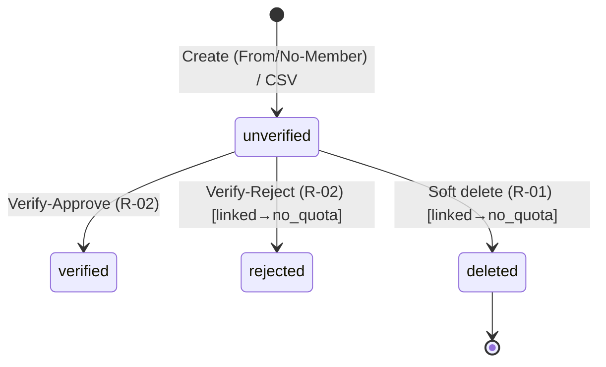

# BRD: Quota Management (จัดการโควตาชาวไร่)

| Field | Value |
|---|---|
| BRD ID | BRD-AGM-002 |
| Feature Name | Quota Management (จัดการโควตาชาวไร่) |
| BRD Type | Enhancement (Refactor Wave — regen จาก legacy code) |
| Version | 1.0 |
| Status | AI Reviewed — APPROVED |
| Module | AGM (Agriculture Management) / Quota |
| Client | WKN (วังขนาย Sugar Group) |
| Owner | 2BSimple BA (Strike) |
| Stakeholders | ทีมทะเบียนโควตา WKN, ฝ่ายส่งเสริม, 2BSimple Dev/QA |
| Created Date | 2026-07-20 |
| Related Feature | F-AGM-001 Farmer Member (cross-module: อ่าน member + เขียน quota_status) |

## Changelog
- v1.0 (2026-07-20): สร้าง BRD ผ่าน brd-generator-full (constraint mode — invariants.md LOCKED) จาก RIF_v2_F-AGM-002

---

## Section 2: Business Context

### 2.1 ปัญหา / โอกาส
- **PAIN-01:** ระบบทะเบียนโควตามีเฉพาะ legacy prototype นอกมาตรฐาน CUBE — ไม่มี Warm Light CI, ไม่มี sidebar shell, เลขบัตรโชว์เต็มในตาราง (PII รั่ว)
- **PAIN-02:** ไม่มีชุดเอกสาร BRD/FRD/Testcases — dev/QA ทำงานจาก code, doc drift 100%
- **PAIN-03:** ความสัมพันธ์กับทะเบียนสมาชิก (Farmer) ไม่มีเอกสาร contract ชัด — เสี่ยงเขียน quota_status ผิด/ซ้อน, ผูกโควตากับสมาชิกที่ยังไม่ Approved
- **PAIN-04:** ไม่มี governance ตาม CUBE 4.0 (ENC / DOA / Data Classification / optimistic lock UX)

โควตาคือ **สิทธิ์การส่งอ้อยของชาวไร่** — ต้นทางของสัญญาส่งอ้อยและการจ่ายเงิน. โควตาผูกกับสมาชิก 1:0..1 และเขียนสถานะโควตากลับไปที่ทะเบียนสมาชิก (quota_status) ความถูกต้องของ contract นี้กระทบทั้ง value chain

### 2.2 เป้าหมายทาง Business
- G1: ทะเบียนโควตาถูกต้อง ตรวจสอบยืนยันโดยหัวหน้างานก่อนใช้งานต่อ
- G2: คุม contract กับทะเบียนสมาชิก — ผูกได้เฉพาะสมาชิก Approved, 1 คน 1 โควตา, เขียน quota_status กลับถูกต้องทุกกรณี (create/reject/delete)
- G3: รองรับขึ้นทะเบียนจำนวนมากผ่าน CSV (No-Member) โดยไม่เสียแถวดีเมื่อบางแถวพัง
- G4: ยกระดับเป็นมาตรฐาน CUBE NATIVE ครบ chain เอกสาร + governance + PII masking

### 2.3 ตัวชี้วัดความสำเร็จ (Success Metrics)
| Metric | Baseline | Target | วัดจากไหน | เมื่อไหร่ |
|---|---|---|---|---|
| MET-01 โควตาค้างสถานะรออนุมัติ > 7 วัน | เก็บก่อน launch | < 5% | Report สถานะโควตา นับ unverified อายุ > 7 วัน | หลัง launch 30 วัน |
| MET-02 อัตราแถว CSV import สำเร็จ | เก็บก่อน launch | ≥ 95% | สรุปผล import (created/total) จาก batch log FN-SEQ-AGQ-170 | ทุกรอบ import |
| MET-03 ความไม่สอดคล้อง quota_status ระหว่าง Quota↔Farmer | เก็บก่อน launch | 0 เคส | Reconciliation report (§18.5) | รายเดือน |
| MET-04 Invariants preserve จาก legacy | — | 100% | _COMPLIANCE_REPORT (Stage 4.5) | ก่อนส่งมอบ |

### 2.4 ที่มาของ Requirement
- Request: Refactor Wave — regen ชุดเอกสาร AGM (Strike, 2026-07-20)
- Source: legacy code prototype (quota-management.zip) → reverse ผ่าน legacy-sources-reverser

---

## Section 3: Scope

### 3.1 In Scope
- ทะเบียนโควตา: สร้าง (From-Member + No-Member) / แก้ไข / ลบ (soft) / ดูรายการ+รายละเอียด+ประวัติ+ไฟล์แนบ
- ค้นหาสมาชิกเพื่อผูกโควตา + ตรวจ 1:0..1 + prefill
- ตรวจสอบยืนยัน (Verify) เดี่ยว/กลุ่ม พร้อมหมายเหตุ (optional)
- นำเข้า CSV (No-Member) + template + error report
- Cross-module write-back quota_status (has_quota / no_quota)
- ฟิลด์ครบ: personal + 2 ที่อยู่ (current + id_card) + bank/BAAC + เอกสารแนบ 2 ไฟล์
- Governance: User Access ENC + DOA placeholder + Data Classification + optimistic lock

### 3.2 Out of Scope
- การจัดสรร/คำนวณปริมาณโควตา (ตัน/ไร่) — legacy ไม่มี field ปริมาณ (รอบนี้เก็บทะเบียน)
- สัญญาส่งอ้อย / การเงินชาวไร่
- Mobile / self-service
- Data migration
- แก้ไขทะเบียนสมาชิก (เป็นของ F-AGM-001)

### 3.3 Assumptions
- Thai Address Hierarchy master (M-01) ใช้ master กลาง CUBE ที่มีอยู่
- ผู้ใช้เป็น staff โรงงาน (registrar/supervisor) ไม่ใช่ชาวไร่
- 1 tenant = 1 โรงงาน (RLS)
- Module Farmer (F-AGM-001) พร้อมให้ query member + รับ write quota_status

### 3.4 Scope Lock ⭐ (สืบทอดจาก invariants.md LOCKED 🔒)
scope_lock_ref: `invariants.md` (Refactor Wave — invariants = scope constraint)

| LOCK-ID | ข้อความยืนยัน | อ้าง |
|---|---|---|
| LOCK-01 | ขอบเขต regen = ความสามารถ legacy 100% ห้ามตัด | invariants §1–§6 |
| LOCK-02 | State machine: unverified → verified / rejected + soft delete | invariants §4 |
| LOCK-03 | quota_number ผู้ใช้กรอกเอง + unique ต่อ tenant (ไม่ auto) | invariants R1/V4 |
| LOCK-04 | 2 create modes: From-Member (1:0..1 + approved) + No-Member (standalone) | invariants R2/R3/R4 |
| LOCK-05 | Cross-module write-back: create-link→has_quota · reject/delete→no_quota | invariants R8/R9 |
| LOCK-06 | Optimistic lock (version) + idempotency key ทุก mutation | invariants R12 |
| LOCK-07 | CSV = No-Member only + partial success + error report | invariants R11 |
| LOCK-08 | ลบได้เฉพาะ unverified + soft delete | invariants R10 |
| LOCK-09 | verify note = optional (แม้ reject) ตาม legacy | invariants R7 (OQ-Q1 alignment) |
| LOCK-10 | เพิ่ม governance (ENC/DOA/masking) ได้ ไม่ถือ scope drift | CUBE 4.0 standard |
| LOCK-11 | email = optional | invariants §1 #7 |

ไม่มี SCOPE DRIFT — In Scope ทุกข้ออยู่ใต้ LOCK-01..11

---

## Section 4: User Roles & Permissions

| Role | ดูรายการ/detail | สร้าง | แก้ไข | ลบ (unverified) | CSV | Verify เดี่ยว | Verify กลุ่ม |
|---|:---:|:---:|:---:|:---:|:---:|:---:|:---:|
| R-01 เจ้าหน้าที่ทะเบียนโควตา | ✅ | ✅ | ✅ | ✅ | ✅ | ❌ | ❌ |
| R-02 หัวหน้างานโควตา | ✅ | ❌ | ❌ | ❌ | ❌ | ✅ เฉพาะ unverified | ✅ เฉพาะ unverified |

> 🔧 Governance: matrix register เป็น User Access ENC ที่ Policy Center — ห้าม hardcode role
> SoD: R-01 (Maker) ≠ R-02 (Checker) — ผู้สร้างห้าม verify ตัวเอง (OQ-Q6)

---

## Section 5: User Journey (with COSO)

### 5.1 Happy Path A — สร้างโควตา From-Member → ยืนยัน
| Step | การกระทำ | Maker | Checker | System |
|---|---|---|---|---|
| 1 | R-01 ค้นหาสมาชิก (Approved) → เลือก → prefill | R-01 | — | FN-AT-AGQ-154 ตรวจ 1:0..1 (ยังไม่มีโควตา) + FN-AT-AGQ-156 search |
| 2 | R-01 กรอกข้อมูลเพิ่ม (เลขโควตา, bank, เอกสาร) → บันทึก | R-01 | — | validate quota_number unique + gen quota_id + unverified + **member.quota_status→has_quota** (FN-SEQ-AGQ-166) |
| 3 | R-02 เปิดรายการ กรอง "รออนุมัติ" → เลือก → ตรวจสอบ | — | R-02 | เปลี่ยนสถานะ verified (FN-SEQ-AGQ-168) |

### 5.2 Happy Path B — สร้างโควตา No-Member (standalone)
| Step | การกระทำ | Maker | System |
|---|---|---|---|
| 1 | R-01 ข้ามการค้นหาสมาชิก กรอกข้อมูลเอง → บันทึก | R-01 | gen quota_id + unverified (FN-SEQ-AGQ-167) — ไม่เขียน quota_status (ไม่มี member) |

### 5.3 Alternative / Exception Paths
| Path | Step | COSO |
|---|---|---|
| A1 สมาชิกมีโควตาแล้ว | ค้นหา → เลือก → block "สมาชิกนี้มีโควต้าอยู่แล้ว" (1:0..1) | System guard |
| A2 ปฏิเสธ | R-02 Reject (+note optional) → rejected + **linked → member.quota_status→no_quota** | Checker, cross-module write |
| A3 ลบ | R-01 ลบ unverified → confirm → soft delete + **linked → no_quota** | Maker, guard unverified |
| A4 CSV No-Member บางแถวพัง | นำเข้าแถวดี รายงานแถวเสีย download | System partial success |
| A5 แก้ชนกัน | 2 user แก้ record เดียวกัน → คนหลัง CONFLICT (version) | System optimistic lock |
| A6 quota_number ซ้ำ | บันทึก → "เลขโควต้านี้ถูกใช้แล้ว" | System unique guard |

SoD check: ✅ Maker (R-01) ≠ Checker (R-02)

---

## Section 6: Data Entity & Fields

### 6.1 Entity: quota (หลัก)
| # | Field | Label UI | Input | ค่า/ตัวเลือก | จำเป็น | หมายเหตุ |
|---|---|---|---|---|:---:|---|
| 1 | quota_id | — | AUTO | internal | auto | PK |
| 2 | quota_number | เลขโควต้า | TEXT | ผู้ใช้กรอก | ✅ | unique ต่อ tenant (LOCK-03) |
| 3 | first_name | ชื่อ | TEXT | — | ✅ | |
| 4 | last_name | นามสกุล | TEXT | — | ✅ | |
| 5 | citizen_id | เลขบัตรประชาชน | TEXT | 13 หลัก | ✅ | PII Restricted, mask บน list |
| 6 | phone | เบอร์โทรศัพท์ | TEXT | 9–12 หลัก | ✅ | PII Confidential |
| 7 | email | อีเมล | TEXT | email | ❌ | LOCK-11 |
| 8 | birth_date | วันเกิด | DATE | — | ❌ | |
| 9 | marital_status | สถานะสมรส | DROPDOWN | โสด/สมรส/หย่าร้าง/หม้าย | ❌ | |
| 10 | number_of_children | จำนวนบุตร | NUMBER | ≥0 | ❌ | |
| 11 | beneficiary | ผู้รับผลประโยชน์ | TEXT | — | ❌ | |
| 12 | line_id | Line ID | TEXT | — | ❌ | |
| 13 | current_address + จ/อ/ต + postal | ที่อยู่ปัจจุบัน | TEXTAREA + DROPDOWN×3 + AUTO | LOOKUP M-01 | ✅ (จ/อ/ต) | cascade, postal auto |
| 14 | id_card_address + จ/อ/ต + postal | ที่อยู่ตามบัตร | TEXTAREA + DROPDOWN×3 + AUTO | LOOKUP M-01 | ✅ (จ/อ/ต) | cascade แยกชุด |
| 15 | bank | ธนาคาร | DROPDOWN | กรุงเทพ/กสิกร/ไทยพาณิชย์/กรุงไทย | ❌ | PII Confidential |
| 16 | bank_account_number | เลขที่บัญชี | TEXT | — | ❌ | PII Confidential |
| 17 | baac_account_number | เลขที่บัญชี ธ.ก.ส. | TEXT | — | ❌ | PII Confidential |
| 18 | citizen_id_file | สำเนาบัตรประชาชน | FILE | PDF/JPG/PNG ≤5MB | ❌ | เอกสารแนบ |
| 19 | house_registration_file | สำเนาทะเบียนบ้าน | FILE | PDF/JPG/PNG ≤5MB | ❌ | เอกสารแนบ |
| 20 | verify_status | สถานะ | AUTO | unverified/verified/rejected | auto | badge เหลือง/เขียว/แดง |
| 21 | linked_member_id | รหัสสมาชิก | AUTO/LOOKUP | FM-NNNNNN | ❌ | null = No-Member (cross-module FK) |
| 22 | verified_by/at/note | ข้อมูลตรวจสอบ | AUTO | note optional | auto | audit |
| 23 | is_deleted/deleted_at/by | สถานะลบ | AUTO | — | auto | soft delete |
| 24 | version | — | AUTO | int | auto | optimistic lock (LOCK-06) |
| 25 | created/updated by/at | Audit | AUTO | — | auto | |

### 6.2 Entity Relationship
```
farmer_member (F-AGM-001, master)  ──(1:0..1)──▶  quota
        ▲ อ่าน (เฉพาะ Approved) · เขียน quota_status กลับ
m_address_hierarchy (M-01) ◀── quota (current + id_card, 2 ชุด)
quota ──(1:N)──▶ quota_history (audit)
quota ──(1:N)──▶ quota_document (2 ไฟล์)
```
- FK: quota.linked_member_id → farmer_member.member_id (nullable)
- **Invariant: 1 farmer_member ↔ 0..1 quota** (LOCK-04)

### 6.3 Enhancement Action Table (เทียบ legacy)
| Field/พฤติกรรม | ก่อน (legacy) | หลัง (regen) | Action |
|---|---|---|---|
| citizen_id บน list | โชว์เต็ม | mask | ADD (PII governance) |
| optimistic lock | มี version แต่ UX ไม่ชัด | error UX ชัด | ENHANCE |
| approved-only link | ไม่ enforce | ตรวจ member Approved ก่อนผูก | ADD (contract) |
| Data Classification | ไม่มี | per-column | ADD (governance) |
| อื่น ๆ | ตาม invariants | คงเดิม 100% | NO CHANGE |

---

## Section 7: User Stories & Acceptance Criteria

| ID | Story | Acceptance Criteria (G-W-T) |
|---|---|---|
| US-01 | สร้างโควตาผูกสมาชิก | AC1: Given ค้นหาสมาชิก Approved ที่ยังไม่มีโควตา When เลือก+กรอก+บันทึก Then ได้ quota + unverified + member.quota_status=has_quota · AC2: Given สมาชิกมีโควตาแล้ว Then block "สมาชิกนี้มีโควต้าอยู่แล้ว" |
| US-02 | สร้างโควตา No-Member | AC1: Given ไม่ค้นหาสมาชิก กรอกเอง When บันทึก Then ได้ quota unverified โดยไม่ผูก member |
| US-03 | เลขโควตา unique | AC1: Given quota_number ซ้ำ When บันทึก Then error "เลขโควต้านี้ถูกใช้แล้ว" |
| US-04 | นำเข้า CSV No-Member | AC1: Given .csv When upload Then partial success + total/created/failed + error report · AC2: Given ไม่ใช่ .csv Then block |
| US-05 | ค้นหาโควตา | AC1: Given พิมพ์คำค้น Then กรองด้วย เลขโควตา/ชื่อ/นามสกุล/เบอร์/เลขบัตร/อีเมล |
| US-06 | Verify เดี่ยว | AC1: Given unverified When Approve Then verified · AC2: Given Reject Then rejected + linked→no_quota |
| US-07 | Verify กลุ่ม | AC1: Given เลือกหลาย unverified When Bulk verify Then รายงานสำเร็จ X ล้มเหลว Y |
| US-08 | แก้ไขโควตา | AC1: Given แก้+บันทึก Then optimistic lock ผ่าน · AC2: Given มีคนแก้ก่อน Then CONFLICT |
| US-09 | ลบโควตา | AC1: Given unverified When ลบ+confirm Then soft delete + linked→no_quota · AC2: Given verified/rejected Then ไม่มีปุ่มลบ |
| US-10 | ดูรายละเอียด+ไฟล์+ประวัติ | AC1: Given เปิด detail Then เห็น meta+member card + 3 tabs (ข้อมูลทั่วไป/ไฟล์/ประวัติ) |

---

## Section 8: Status & Lifecycle



| State | Trigger | Next | เงื่อนไข | ผู้ทำ | Cross-module |
|---|---|---|---|---|---|
| — | Create/CSV | unverified | validation | R-01 | From-Member: →has_quota |
| unverified | Approve | verified | — | R-02 | — |
| unverified | Reject | rejected | note optional | R-02 | linked→no_quota |
| unverified | Delete | deleted | soft | R-01 | linked→no_quota |
| verified/rejected | Delete/Verify | ❌ | — | — | — |

> OQ-Q3: rejected → แก้ไข → unverified (re-submit) — legacy ไม่มี, คงตาม legacy (ไม่ auto re-submit) รอ Strike

---

## Section 9: Business Rules + Validation (with Tags)

### 9.1 Business Rules
| ID | Rule | Tag |
|---|---|---|
| R01 | quota_number ผู้ใช้กรอก + unique ต่อ tenant (exclude self ตอน edit) | FIXED (LOCK-03) |
| R02 | 2 create modes: From-Member (1:0..1 + Approved) + No-Member | FIXED (LOCK-04) |
| R03 | สร้างใหม่ (form/CSV) เริ่ม unverified เสมอ | FIXED |
| R04 | Verify (เดี่ยว/กลุ่ม) เฉพาะ unverified | FIXED |
| R05 | verify note = optional แม้ reject | FIXED (LOCK-09 — OQ-Q1) |
| R06 | ลบเฉพาะ unverified + soft delete | FIXED (LOCK-08) |
| R07 | Cross-module write-back: create-link→has_quota · reject/delete→no_quota | FIXED (LOCK-05) |
| R08 | Quota ผูกได้เฉพาะสมาชิก **Approved** + 1:0..1 | FIXED (contract) |
| R09 | ทุก mutation optimistic lock (version) + idempotency `{FN}:{id}:{ts}` | FIXED (LOCK-06) |
| R10 | CSV = No-Member only + partial success + error report | FIXED (LOCK-07) |
| R11 | postal_code auto จากตำบล (ทั้ง 2 ที่อยู่) + server validate | FIXED |
| R12 | เอกสารแนบ PDF/JPG/PNG ≤ 5MB | CONFIGURABLE (Admin — ขนาด/ชนิด) |
| R13 | การ verify เป็น pre-DOA placeholder (approver fields + TODO) | WARNING (รอ DOA — OQ-Q5) |

### 9.2 Validation Rules
| ID | Field/Action | เงื่อนไข | ข้อความ |
|---|---|---|---|
| VR-01 | citizen_id | ตัวเลข 13 หลัก | "เลขบัตรประชาชนต้องเป็นตัวเลข 13 หลัก" |
| VR-02 | phone | ตัวเลข 9–12 หลัก | "เบอร์โทรศัพท์ต้องเป็นตัวเลข 9-12 หลัก" |
| VR-03 | email (เมื่อกรอก) | email format | "รูปแบบอีเมลไม่ถูกต้อง" |
| VR-04 | required | quota_number, ชื่อ, นามสกุล, เลขบัตร, เบอร์, จ/อ/ต (×2 ที่อยู่) | "กรุณากรอก/เลือก[ฟิลด์]" |
| VR-05 | quota_number unique | exclude self | "เลขโควต้านี้ถูกใช้แล้ว" |
| VR-06 | 1:0..1 member | ตรวจก่อนผูก | "สมาชิกนี้มีโควต้าอยู่แล้ว" |
| VR-07 | member Approved | ผูกได้เฉพาะ Approved | "ผูกได้เฉพาะสมาชิกที่อนุมัติแล้ว" |
| VR-08 | CSV file | .csv เท่านั้น | "กรุณาเลือกไฟล์ CSV เท่านั้น" |
| VR-09 | optimistic lock | version ไม่ตรง | "ข้อมูลถูกแก้ไขโดยผู้อื่น กรุณารีเฟรชและลองใหม่อีกครั้ง" |
| VR-10 | cascade reset | เปลี่ยนจังหวัด → เคลียร์อำเภอ/ตำบล/ไปรษณีย์ (แต่ละที่อยู่แยกกัน) | — |
| VR-11 | verify result | ต้องเลือก Approve/Reject | "กรุณาเลือกผลการตรวจสอบ" |

### 9.5 สรุประดับความยืดหยุ่น
| Rule | Tag | ระดับ |
|---|---|---|
| R12 (file limits) | CONFIGURABLE | Admin Panel — Upload Config |
| R13 (DOA chain) | WARNING | Engine (DOA) placeholder |
| ที่เหลือ | FIXED | ผูก LOCK/contract/integrity |

---

## Section 10: Edge Cases

### 10.1 จาก Legacy (ยืนยันแล้ว ☑)
| ID | กรณี | พฤติกรรม |
|---|---|---|
| EC-01 ☑ | สมาชิกมีโควตาแล้ว (1:0..1) | block "สมาชิกนี้มีโควต้าอยู่แล้ว" |
| EC-02 ☑ | quota_number ซ้ำ | "เลขโควต้านี้ถูกใช้แล้ว" |
| EC-03 ☑ | ลบ verified/rejected | ไม่มีปุ่มลบ / block |
| EC-04 ☑ | CSV บางแถวพัง | partial success + error report |
| EC-05 ☑ | ค้นหาไม่เจอ | empty state + CTA |
| EC-06 ☑ | เลือกทั้งหมด | เลือกเฉพาะ unverified |
| EC-07 ☑ | แก้ชนกัน (optimistic lock) | CONFLICT แจ้งรีเฟรช |
| EC-08 ☑ | Reject/Delete linked → member no_quota | write-back สำเร็จ |

### 10.2 จาก AI Pattern Matching (BA confirm SOW3.7)
| ID | หมวด | กรณี | พฤติกรรมแนะนำ |
|---|---|---|---|
| EC-09 ☐ | DI | CSV encoding ไม่ใช่ UTF-8 | reject + แนะนำ save UTF-8 |
| EC-10 ☐ | FU | CSV header ไม่ตรง template | reject ทั้งไฟล์ + บอกคอลัมน์ผิด |
| EC-11 ☐ | FU | CSV quota_number ซ้ำภายในไฟล์ | แถวแรกผ่าน แถวหลัง error |
| EC-12 ☐ | CA | Bulk verify บางรายการถูก verify ก่อน | ข้าม นับ failed + เหตุผล |
| EC-13 ☐ | DI | ตำบลใน CSV สะกดไม่ตรง master | error รายแถว |
| EC-14 ☐ | ST | สร้าง No-Member แล้วภายหลังต้องผูก member | (Phase 2) — รอบนี้ยังไม่มี re-link |
| EC-15 ☐ | PM | R-01 พยายาม verify ตัวเอง (SoD) | block "ผู้สร้างไม่สามารถตรวจสอบรายการของตนเอง" |
| EC-16 ☐ | CA | Double-click บันทึก | idempotency key กันซ้ำ |
| EC-17 ☐ | XT | reject/delete แต่ member ถูกลบไปแล้ว | write-back ข้าม + log (ไม่ error) |

⚠️ EC-15 → OQ-Q6

---

## Section 11: Impact Analysis / Regression Scope

| ด้าน | ผลกระทบ |
|---|---|
| ข้อมูลเดิม | ไม่มี migration รอบนี้ |
| พฤติกรรมเปลี่ยนจาก legacy | + masking, + approved-check, + optimistic UX — regression create/edit/verify |
| **Cross-module (สำคัญ)** | เขียน member.quota_status → ต้อง regression คู่กับ Farmer (create/reject/delete) — verify ว่า Farmer detail แสดง has_quota/no_quota ถูก |
| Regression Scope | ทุก flow §5 + CSV + optimistic lock + **cross-module write-back ทุกเส้น** |

---

## Section 12: Dependencies

### 12.1 Value Stream Positioning + Downstream Impact Map ⭐
**Value Stream:** AGM Farm-to-Factory (ทะเบียนสมาชิก → **จัดสรรโควตา** → สัญญา/ส่งเสริม → ส่งอ้อย → เงินชาวไร่)
**ตำแหน่ง:** VC2 "จัดสรรและรับรองโควตา" — ต่อจาก VC1 (Farmer Member)

**Upstream:** F-AGM-001 Farmer Member — query member (Approved), เขียน quota_status กลับ

**Downstream Impact Map:**
| ปลายทาง | ข้อมูลที่ไหลไป | Trigger | ถ้าโควตาถูกแก้/ลบ/ปฏิเสธ |
|---|---|---|---|
| **Farmer Member (upstream write)** | quota_status (has/no_quota) | create-link / reject / delete | member.quota_status อัปเดตตาม — ต้อง reconcile (MET-03) |
| สัญญาส่งอ้อย (อนาคต) | quota_number, linked_member_id | quota verified | สัญญาอ้าง quota ที่ verified เท่านั้น |
| การเงินชาวไร่ (อนาคต) | bank/BAAC account | งวดจ่าย | ข้อมูลบัญชีจากโควตา |

> **Write-back model (G1 — authoritative):** create-from-member **commit quota ก่อน** แล้วเขียน member.quota_status เป็น **step แยก idempotent (ไม่ rollback quota ถ้า write-back fail)** → auto-retry อัตโนมัติ + non-blocking banner "กำลังอัปเดตสถานะสมาชิก (จะ retry อัตโนมัติ)" · reject/delete → keep mutation ไว้ + retry การ revert แบบ idempotent

### 12.2 Dependencies
- M-01 Thai Address Hierarchy master (CUBE core)
- **F-AGM-001 Farmer Member API** — query member + write quota_status (cross-module)
- Policy Center: User Access ENC + DOA placeholder
- Central Import Framework (CSV)
- Document Storage (เอกสารแนบ)

### 12.3 Existing System Reference
| Rule | ระดับ | มีแล้ว? | Reference |
|---|---|:---:|---|
| M-01 Address | Master | ✅ | CUBE core |
| Farmer Member cross-module | Feature | ✅ | F-AGM-001 (เพิ่งทำ) |
| Import framework | Admin | ⚠️ บางส่วน | เพิ่ม config entity=quota |
| DOA | Engine | ⚠️ | placeholder |
| Document Storage | Service | ✅ | CUBE core |

---

## Section 13: Delivery Phases

| Phase | เนื้อหา | Rules |
|---|---|---|
| Phase 1: Feature Launch | ทะเบียน+verify+CSV+cross-module write-back ครบ, ENC registered, DOA placeholder, ห้าม hardcode | R01–R11 |
| Phase 2: Admin Panel | Upload config, Import config | R12 |
| Phase 3: Rule Mgmt | — | — |
| Phase 4: Engine Mgmt | Wire DOA ENC จริง | R13 |

---

## Section 14: Dev Requirements Summary "ใบสั่ง"

### 14.1 Config Foundation
| โครงสร้าง | รองรับ | มีแล้ว? |
|---|---|---|
| quota_number uniqueness index (ต่อ tenant) | R01 | ทำใน schema |
| Import config (entity=quota, No-Member, template) | R10 | เพิ่ม config |
| Upload config (PDF/JPG/PNG, 5MB) | R12 | เพิ่ม config |
| ENC entry: quota permission matrix | §4 | register Policy Center |
| **Cross-module API contract กับ Farmer** | R07/R08 | ⭐ wire query member + write quota_status |
| Data Classification tags | §16 | schema |

### 14.2 ข้อกำหนดจาก Tag
- R12: file limits อ่านจาก config — ห้าม hardcode
- R13: approver placeholder fields + `// TODO: wire DOA ENC`

### 14.3 ข้อกำหนดจาก Edge/Validation
- Optimistic lock ทุก mutation + VR-09 UX (LOCK-06)
- Idempotency key ทุก mutation
- CSV No-Member: validate header → process รายแถว → partial success (LOCK-07)
- **Cross-module write-back = step แยก idempotent หลัง mutation commit** (create/reject/delete) — **ไม่ rollback quota เมื่อ write-back fail** + async idempotent retry + compensating ถ้า member หาย (EC-17)
- SoD: block ผู้สร้าง verify record ตัวเอง (OQ-Q6 — หลัง flag)

### 14.4 WARNING ที่รอข้อสรุป
| ประเด็น | หารือกับ | สถานะ |
|---|---|---|
| verify note optional/mandatory (OQ-Q1) | WKN | ⚠️ คง optional (legacy) ไปก่อน |
| has_quota timing (OQ-Q2) | Strike | ⚠️ lock: create-link |
| re-submit rejected (OQ-Q3) | Strike | ⚠️ คงตาม legacy (ไม่ auto) |
| DOA chain (OQ-Q5) | WKN + Policy | ⚠️ placeholder |

### 14.5 Regression Scope
ตาม §11 — เน้น cross-module write-back + optimistic lock + CSV

### 14.6 Screen Inventory + UI Signals (หยาบ — Design Authority อยู่ที่ FRD)
| # | ชื่อหน้า | ประเภทหยาบ | ผู้ใช้ | หน้าที่ | หมายเหตุ |
|---|---|---|---|---|---|
| P-01 | รายชื่อโควตา | หน้ารายการ | R-01, R-02 | ค้นหา/กรอง/เลือกกลุ่ม/ทุก action | bulk select |
| P-02 | รายละเอียดโควตา | หน้ารายละเอียด | ทุก role | ดูข้อมูลครบ + member card + 3 tabs (ข้อมูล/ไฟล์/ประวัติ) | tabbed |
| OV-01 | สร้างโควตา | ฟอร์มสร้าง (ยาว, overlay) | R-01 | member search + 6 กลุ่มฟิลด์ + upload | 2 modes, section grouping, address ×2 |
| OV-02 | แก้ไขโควตา | ฟอร์มแก้ไข (overlay) | R-01 | แก้ทุก field | โหลดค่าเดิม + version |
| OV-03 | ตรวจสอบ (เดี่ยว/กลุ่ม) | หน้ายืนยัน (overlay) | R-02 | เลือกผล + note (optional) + warning reject | แสดง member link |
| OV-04 | ยืนยันการลบ | หน้ายืนยัน (overlay) | R-01 | confirm + warning cross-module | ⚠ warning tone |
| OV-05 | นำเข้า CSV | หน้ายืนยัน/ผล (overlay) | R-01 | No-Member only + progress + สรุป + error report | template download |

~2 หน้า + 5 overlays
**UI Signals → FRD:** Master Data list+detail · badge สถานะ 3 สี · citizen_id ต้อง mask บน list · form ยาว >6 fields → form sections · member search sub-flow ใน create · cross-module warning ใน verify/delete · ไฟล์แนบ · ไม่มี print/ลายเซ็น (ไม่ใช่ Document/Transaction)

---

## Section 15: Open Questions

| ID | คำถาม | สถานะ | Owner |
|---|---|---|---|
| OQ-Q1 | verify reject บังคับ note ไหม (align Farmer) หรือคง optional | ⚠️ คง optional | Strike/WKN |
| OQ-Q2 | has_quota เขียนตอน create-link หรือ verify | ⚠️ lock: create-link | Strike |
| OQ-Q3 | rejected → แก้ไข → unverified อัตโนมัติไหม | ⚠️ คงตาม legacy (ไม่ auto) | Strike |
| OQ-Q4 | quota_number บังคับ format ไหม | ⚠️ free-text + unique | Strike/WKN |
| OQ-Q5 | DOA approval chain จริง | ⚠️ Phase 4 | WKN + Policy |
| OQ-Q6 | SoD ผู้สร้างห้าม verify ตัวเอง | ⚠️ รอ | Strike/WKN |

---

## Section 16: Security & Compliance

### 16.1 Preset: P3 Master Data (มี PII เข้ม + bank + เอกสาร)
farmer PII (citizen_id) + bank/BAAC + เอกสารแนบ → P3 + เพิ่ม Document Access control

### 16.2 Applicable Standards
PDPA ✅ · ISO 27001 ✅ · COSO ✅

### 16.3 Control Checklist
| Control | Req | Implementation |
|---|---|---|
| S01-04 SoD | ✓ | R-01 ≠ R-02; EC-15 (OQ-Q6) |
| S01-07 Immutable Log | ✓ | ทุก mutation → quota_history (before/after) |
| S02-04 Data Masking | ✓ | citizen_id mask บน list; bank/BAAC mask ตาม permission |
| S02-05 Data Classification | ✓ | citizen_id=Restricted · phone/email/address/bank/BAAC=Confidential · ชื่อ/สถานะ=Internal |
| S03-02 Policy Versioning | ✓ | ENC matrix version |
| S04-05 Master Mapping | ✓ | M-01 + farmer_member FK |
| S05-02 Audit Fields | ✓ | created/updated by/at |
| S06-03 Soft Delete | ✓ | R06 |
| S07-01 Export Control | ○ | error report เท่านั้น Phase 1 |
| S08-02 Document Access | ✓ | เอกสารแนบเข้าถึงตาม permission + audit |

### 16.4 Risk Statement
| Risk | คำอธิบาย | Mitigated by |
|---|---|---|
| RS-01 | citizen_id/bank รั่ว | S02-04, S02-05, S08-02 |
| RS-02 | quota_status ไม่ sync กับ Farmer (double-write/lost) | write-back ใน transaction + reconcile report (MET-03) + optimistic lock |
| RS-03 | ผูกโควตากับสมาชิกที่ยังไม่ Approved | R08 approved-check |
| RS-04 | สร้าง+verify คนเดียวกัน | S01-04, EC-15 |

---

## Section 17: Health Check

### 17.1 SLA
| Step | SLA | Owner |
|---|---|---|
| Verify โควตาหลังสร้าง | ภายใน 3 วันทำการ | R-02 |
| List load / Save | p95 < 3s / < 1s | System |
| CSV 1,000 แถว | < 60s | System |
| Cross-module write-back | < 500ms (sync) | System |
| **NFR technical budget (authoritative)** | reads SER ≤ 500ms · validation VAL ≤ 300ms · writes CRE/UPT ≤ 1500ms · skeleton loader เมื่อ load > 200ms | System |

### 17.3 KPI
| KPI | Target | คู่ Metric |
|---|---|---|
| Unverified อายุ > 7 วัน | < 5% | MET-01 |
| CSV success rate | ≥ 95% | MET-02 |
| quota_status mismatch | 0 | MET-03 |

### 17.4 Threshold
| Threshold | Action |
|---|---|
| CSV failed > 20%/ไฟล์ | banner แนะนำตรวจ template |
| write-back fail (member service) | keep quota mutation (**ไม่ rollback**) + schedule async idempotent retry + `member_update_status=scheduled_retry` + non-blocking banner + log (ห้ามปล่อยเงียบ) |
| Unverified ค้าง > 7 วัน | widget เตือน |

---

## Section 18: Monitoring

### 18.1 Reports Overview — Framework v2: OP Operation (owner = แผนกทะเบียนโควตา)
### 18.2 Dashboard Widgets
| Widget | อ้าง |
|---|---|
| นับโควตาตามสถานะ | KPI |
| Unverified ค้าง > 7 วัน | Threshold |
| ผล CSV import ล่าสุด | MET-02 |
| **quota_status mismatch (Quota↔Farmer)** | MET-03 |
### 18.3 Performance Report — สร้าง/verify รายเดือน (OP)
### 18.4 Closing Report — โควตา verified ณ สิ้นงวด (CL)
### 18.5 Reconciliation Report — quota_status ระหว่าง Quota↔Farmer (สำคัญ — cross-module integrity)
### 18.6 Transaction Report — quota_history export ตาม permission (TX)

---

## Appendix
- Screen List: §14.6
- Glossary: BAAC=ธ.ก.ส. · No-Member=โควตาที่ไม่ผูกสมาชิก · has/no_quota=สถานะโควตาใน farmer_member · Verify=ตรวจสอบยืนยันโดยหัวหน้างาน
- Document Control: AGM_F-AGM-002 pack · เอกสารถัดไป: FRD (frd-generator-v6)
