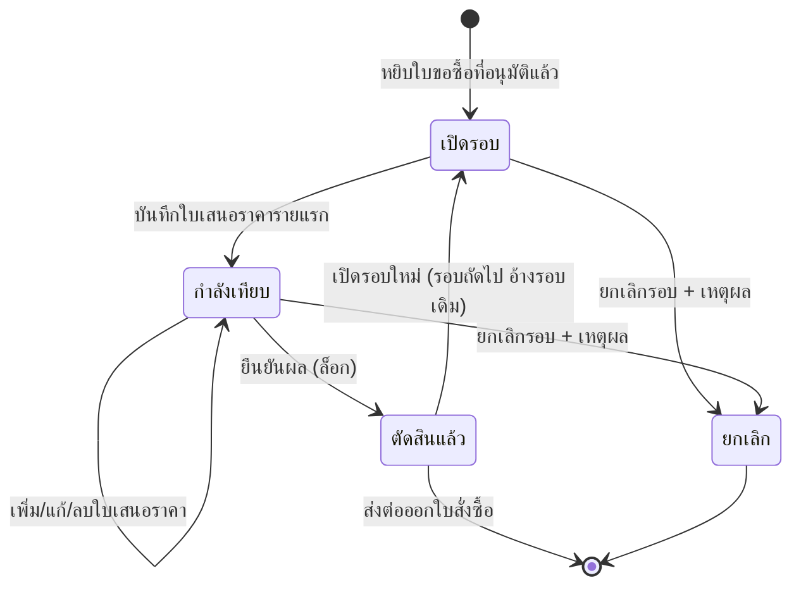

# BRD: Compare Vendors (เทียบราคาผู้ขาย)

## Section 1: Document Info
| หัวข้อ | รายละเอียด |
|---|---|
| Feature | F-PUR-COMPARE · เทียบราคาผู้ขาย (fid F073) |
| Module | Purchase (จัดซื้อ) · CUBE 4.0 Core ERP |
| ประเภท BRD | New Feature |
| Archetype | **console / master — ห้ามใช้ Q-document archetype** |
| Lane / Wave | CUBE-LANE-W2-PUR-LITE · P1 ลำดับ 2 (ทำหลัง F-PUR-PR ปิด `ba-done` แล้ว) · `--mode direction` |
| Input ที่ใช้ | RIF v2 · BASELINE · PREBRIEF + FN-01..20 · **HTML `1_HTML/F-PUR-COMPARE.html` (ผ่าน S3a/S3b/S3c)** · GOLDEN_RULES · CONTEXT_PACK W2-PUR §2.6 |
| Conflict priority | LOCK > RIF business intent > HTML หน้าจอจริง |
| วันที่ | 2026-09-10 (ปี ค.ศ. ทุกจุด) |
| ผู้จัดทำ | feature-lane-runner 2.4.1r (Phase A · BA direction) |
| สถานะ | **APPROVED** (Quality Gate C01–C23 — ดู §19) |

## Changelog
| Ver | วันที่ | รายละเอียด |
|---|---|---|
| 1.0 | 2026-09-10 | ฉบับแรก — Phase A direction · ออกพร้อมต้นแบบคอนโซล + ใบประกาศ 7C |

---

## Section 2: Business Context

### 2.1 ปัญหา / โอกาส
เมื่อใบขอซื้ออนุมัติแล้ว การเทียบราคาทุกวันนี้ทำในไฟล์ตารางส่วนตัวของเจ้าหน้าที่แต่ละคน ทำให้
(1) เกณฑ์ที่ใช้ตัดสินไม่เหมือนกัน (2) ไม่มีหลักฐานว่าทำไมจึงไม่เลือกรายที่ถูกที่สุด
(3) ผู้ตรวจสอบย้อนหลังไม่ได้ และ (4) ข้อมูลราคาที่เคยได้รับหายไปกับไฟล์ ไม่ถูกนำมาใช้รอบถัดไป

### 2.2 เป้าหมายทาง Business
1. รวมงานเทียบราคาไว้ที่คอนโซลเดียว ผูกกับใบขอซื้อที่อนุมัติแล้วโดยตรง
2. เทียบด้วยเกณฑ์เดียวกันทั้งองค์กร — ราคา · เงื่อนไขชำระเงิน · ระยะเวลาส่งมอบ · การรับประกัน
3. บังคับให้ทุกการเลือกที่ไม่ใช่ราคาต่ำสุดมีเหตุผลกำกับ และเก็บแบบเพิ่มอย่างเดียว
4. ส่งผลการเลือกต่อให้ใบสั่งซื้อได้ทันทีโดยไม่ต้องคีย์ซ้ำ

### 2.3 ตัวชี้วัดความสำเร็จ (วัดได้)
| # | ตัวชี้วัด | ฐานปัจจุบัน | เป้าหมาย | วิธีวัด |
|---|---|---|---|---|
| M1 | สัดส่วนใบขอซื้อที่มีการเทียบราคา ≥3 ราย (เฉพาะยอด > 100,000 บาท) | ไม่มีข้อมูล `[ASSUMED]` | ≥ 80% | นับ `cmp_quote` ต่อรอบ |
| M2 | สัดส่วนการเลือกที่ไม่ใช่ราคาต่ำสุด **และมีเหตุผลบันทึก** | ไม่มีข้อมูล | 100% | `cmp_award_line.is_lowest=false` → ต้องมี `reason` |
| M3 | เวลาเฉลี่ยจากใบขอซื้ออนุมัติถึงตัดสินผู้ชนะ | ~4 วันทำการ `[ASSUMED]` | ≤ 2 วันทำการ | `awarded_at − pr.approved_at` |
| M4 | ส่วนต่างเฉลี่ยจากราคาต่ำสุดที่องค์กรยอมจ่าย | ไม่มีข้อมูล | ติดตามเป็นแนวโน้ม (ไม่ตั้งเป้าตัวเลข) | Σ(`awarded_total − lowest_total`) / Σ`lowest_total` |

### 2.4 ที่มาของ Requirement
CONTEXT_PACK `W2-PUR.md` §2.6 · `briefs/P1/CHECKLIST.md` แถว F-PUR-COMPARE · GOLDEN_RULES · BASELINE เทียบ ERP มาตรฐาน

---

## Section 3: Scope

### 3.1 In Scope
| # | ขอบเขต | หลักฐานบน HTML |
|---|---|---|
| I1 | คิวงานเทียบราคาจากใบขอซื้อที่อนุมัติแล้ว | `renderQueue()` |
| I2 | เปิด/ปิดรอบเทียบราคา และเปิดรอบใหม่ต่อจากรอบเดิม | `openRoundConfirm()` · `confirmReopen()` |
| I3 | บันทึกใบเสนอราคาต่อผู้ขาย (หัว + ราคารายรายการ + ไฟล์แนบ) | `renderQuoteModal()` |
| I4 | ทำเครื่องหมาย "ผู้ขายไม่เสนอรายการนี้" | toggle รายบรรทัด |
| I5 | **ตารางเทียบเคียงข้าง 4 แกน + ไฮไลต์ค่าดีที่สุด + ส่วนต่าง %** | `renderMatrixTab()` |
| I6 | เลือกผู้ชนะทั้งใบ หรือแยกรายรายการ | `.mode-seg` + `awardCalc()` |
| I7 | บังคับเหตุผลเมื่อไม่ใช่ราคาต่ำสุด หรือมีผู้เสนอรายเดียว | `needReason` |
| I8 | ยืนยันผล → ล็อกรอบ + จุดเชื่อมไปออกใบสั่งซื้อ | `doAward()` |
| I9 | ยกเลิกรอบพร้อมเหตุผล · ประวัติเพิ่มอย่างเดียว | `doCancelRound()` · `pushHist()` |

### 3.2 Out of Scope
| # | ไม่ทำ | เจ้าของจริง |
|---|---|---|
| O1 | ออกใบสั่งซื้อ | W3 |
| O2 | พอร์ทัลให้ผู้ขายกรอกราคาเอง | ยังไม่มีในแผน |
| O3 | ประมูล/ต่อรองออนไลน์ | ยังไม่มีในแผน |
| O4 | คะแนนประเมินผู้ขายถ่วงน้ำหนักเข้าการตัดสิน | ฟีเจอร์ประเมินผู้ขาย (ยังไม่มีในแผน) |
| O5 | สัญญา/ข้อตกลงราคาระยะยาว | ยังไม่มีในแผน |
| O6 | **สายอนุมัติ · เลขที่เอกสาร · แบบพิมพ์ · การแจ้งเตือน** | **ไม่ใช่เอกสารธุรกรรม — ฟีเจอร์นี้ไม่มีทั้งสี่อย่าง** |
| O7 | เอกสาร FRD / Test Case / UI Brief | Phase B (ทีมย่อย) |

### 3.3 Assumptions
1. เทียบ 2–5 รายต่อรอบ (ระบบไม่จำกัด) · แนะนำ ≥3 รายเมื่อยอดสูง `[ASSUMED]`
2. เกณฑ์เทียบ 4 แกน (ราคา · เงื่อนไขชำระ · ระยะส่งมอบ · การรับประกัน) `[ASSUMED]`
3. ใบเสนอราคาบันทึกด้วยมือโดยเจ้าหน้าที่จัดซื้อ `[ASSUMED]`
4. เลือกผู้ชนะได้ทั้งใบหรือแยกรายรายการ `[ASSUMED]`
5. รูปแบบข้อมูลส่งต่อใบสั่งซื้อ `{pr_id, award_id, lines[]}` `[ASSUMED contract]`
6. หนึ่งรอบเทียบผูกกับหนึ่งใบขอซื้อ · หนึ่งสกุลเงิน (THB)

### 3.4 Scope Lock ⭐
| LOCK | ข้อความที่ล็อก | ที่มา | สืบทอดถึง |
|---|---|---|---|
| LOCK-CONSOLE | **เป็นคอนโซลปฏิบัติงาน ห้ามทำเป็นเอกสารธุรกรรม (ห้าม Q-document archetype)** | CONTEXT_PACK §2.6 | HTML ✅ · BRD §14.6 |
| LOCK-MATRIX | ต้องมีตารางเทียบ ราคา × เงื่อนไข × ระยะส่งมอบ ทั้งระดับใบและระดับรายการ | CONTEXT_PACK §2.6 | HTML ✅ · BRD §5,§14.6 |
| LOCK-AWARD | เลือกผู้ชนะพร้อมเหตุผล · บันทึกแบบเพิ่มอย่างเดียว | CONTEXT_PACK §2.6 | HTML ✅ · BRD §9 |
| LOCK-CSQ | ใบประกาศ 7C ชุดเดียว (ไม่มี DOA/แจ้งเตือน/ประเภทเอกสาร/แบบพิมพ์) | FEATURE_LIST chip `csq` | `5_DECLARATIONS/` ✅ |
| LOCK-FWD | ผลการเลือกส่งต่อใบสั่งซื้อ = อ้างอิงอ่อน + จุดเชื่อม ห้ามสร้างจอใบสั่งซื้อ | CONTEXT_PACK §2.6 | HTML ✅ · BRD §12 |
| LOCK-SR | ใบขอซื้อ · ผู้ขาย · สินค้า · หน่วยนับ = อ้างอิงอ่อน | GOLDEN_RULES ข้อ 4 | HTML ✅ · BRD §6 |
| LOCK-YEAR | ปี ค.ศ. · CI Warm Light · เมนูข้างเหมือนฟีเจอร์อื่นในโมดูลเดียวกัน | TASTE_LOG | HTML ✅ |

---

## Section 4: User Roles & Permissions
| Role | สิทธิ์ |
|---|---|
| เจ้าหน้าที่จัดซื้อ | เปิดรอบ · บันทึก/แก้/ลบใบเสนอราคา · เลือกผู้ชนะ · ยืนยันผล · ยกเลิกรอบ · เปิดรอบใหม่ |
| ผู้จัดการฝ่ายจัดซื้อ | ทุกอย่างของเจ้าหน้าที่ + ดูทุกรอบทุกหน่วยงาน |
| ผู้ขอซื้อ | ดูรอบของใบขอซื้อตัวเอง (อ่านอย่างเดียว) |
| ผู้ตรวจสอบ | ดูทุกอย่างรวมประวัติ แก้ไม่ได้ |

| การกระทำ | จนท.จัดซื้อ | ผจก.จัดซื้อ | ผู้ขอ | ผู้ตรวจสอบ |
|---|:--:|:--:|:--:|:--:|
| ดู | ✓ | ✓ | ✓ (ของตน) | ✓ |
| เปิดรอบ / บันทึกใบเสนอราคา | ✓ | ✓ | ✗ | ✗ |
| ยืนยันผลการเลือก | ✓ | ✓ | ✗ | ✗ |
| ยกเลิกรอบ | ✓ | ✓ | ✗ | ✗ |
> **ไม่มีการอนุมัติในฟีเจอร์นี้** — การยืนยันผลเป็นการกระทำเชิงปฏิบัติงาน ไม่ใช่การอนุมัติเอกสาร จึงไม่ผูกทะเบียนสายอนุมัติ

---

## Section 5: User Journey (พร้อมจุดควบคุม)
| # | ขั้นตอน | ผู้ทำ | จุดควบคุม |
|---|---|---|---|
| 1 | เลือกใบขอซื้อที่อนุมัติแล้วจากคิว → เปิดรอบเทียบราคา | จนท.จัดซื้อ | **C-01** เข้าคิวได้เฉพาะใบที่อนุมัติแล้ว |
| 2 | บันทึกใบเสนอราคาของผู้ขายแต่ละราย (ราคา เงื่อนไข ระยะส่งมอบ ไฟล์แนบ) | จนท.จัดซื้อ | **C-02** ต้องมีอย่างน้อย 1 รายการที่เสนอราคา > 0 · ผู้ขายซ้ำในรอบเดียวไม่ได้ |
| 3 | เปิดตารางเทียบ — ระบบไฮไลต์ค่าดีที่สุดรายแถวและรายแกน | ระบบ | **C-03** เกณฑ์เทียบเดียวกันทุกครั้ง ไม่ขึ้นกับผู้ทำ |
| 4 | เลือกโหมด (ทั้งใบ / แยกรายรายการ) แล้วเลือกผู้ชนะ | จนท.จัดซื้อ | **C-04** เลือกได้เฉพาะผู้ที่เสนอรายการนั้นจริง |
| 5 | ถ้าไม่ใช่ราคาต่ำสุด หรือมีผู้เสนอรายเดียว → ระบบบังคับเหตุผล | ระบบ | **C-05 (LOCK-AWARD)** ปุ่มยืนยันถูกปิดจนกว่าจะมีเหตุผล |
| 6 | ยืนยันผล → รอบถูกล็อก | จนท.จัดซื้อ | **C-06** ล็อกแก้ไม่ได้ · **C-07** บันทึกประวัติเพิ่มอย่างเดียว · ประทับผลลง 7C |
| 7 | ส่งผลต่อออกใบสั่งซื้อ (จุดเชื่อม) | จนท.จัดซื้อ | **C-08** ข้อมูลไปจากผลที่ล็อกแล้วเท่านั้น |

### Alternative paths
- **ยกเลิกรอบ** — เหตุผลบังคับ + ยืนยัน → ใบขอซื้อกลับเข้าคิว
- **เปิดรอบใหม่** — หลังตัดสินแล้วต้องการเปลี่ยน ต้องเปิดรอบใหม่ (คัดลอกใบเสนอราคาเดิมเป็นค่าตั้งต้น) รอบเดิมยังตรวจย้อนได้
- **ผู้ขายไม่เสนอบางรายการ** — เซลล์แสดง "ไม่เสนอ" · ไม่ถูกนับเป็นราคาต่ำสุด · เลือกผู้ชนะจากรายที่เสนอเท่านั้น

### Process Diagram


---

## Section 6: Data Entity & Fields

### 6.1 Entity Overview
| Entity | คำอธิบาย | ชนิด |
|---|---|---|
| `cmp_round` | รอบเทียบราคา (ผูกกับใบขอซื้อ 1 ใบ) | หลัก |
| `cmp_quote` | ใบเสนอราคาของผู้ขาย 1 ราย | ลูก (1:N) |
| `cmp_quote_line` | ราคารายรายการในใบเสนอราคา | ลูกของ quote (1:N) |
| `cmp_award_line` | ผลการเลือกผู้ชนะรายรายการ | ลูก (1:N) · **เพิ่มอย่างเดียว** |
| `cmp_history` | ประวัติทุกเหตุการณ์ | ลูก (1:N) · **เพิ่มอย่างเดียว** |

### 6.2 `cmp_round`
| Field | ชนิด | บังคับ | หมายเหตุ |
|---|---|:--:|---|
| `round_id` | id | ✓ | **ไม่ใช่เลขที่เอกสาร** — เป็นรหัสภายใน ไม่ผ่านเครื่องออกเลขกลาง |
| `pr_id` | ref(pr_header) | ✓ | **อ้างอิงอ่อน** |
| `round_seq` | int | ✓ | 1,2,3… ต่อใบขอซื้อ |
| `prev_round_id` | ref | ✗ | รอบก่อนหน้า (เมื่อเปิดรอบใหม่) |
| `status` | enum | ✓ | open \| comparing \| awarded \| cancelled |
| `award_mode` | enum | ✓ | whole \| split |
| `award_reason` | text | เงื่อนไข | **บังคับเมื่อไม่ใช่ราคาต่ำสุด หรือมีผู้เสนอรายเดียว** |
| `cancel_reason` | text | เงื่อนไข | บังคับเมื่อยกเลิก |
| `opened_by/at` `awarded_by/at` | — | — | |

### 6.3 `cmp_quote` / `cmp_quote_line`
| Field | ชนิด | บังคับ | หมายเหตุ |
|---|---|:--:|---|
| `vendor_id` | ref(vendor) | ✓ | **อ้างอิงอ่อน** · ห้ามซ้ำภายในรอบเดียวกัน |
| `vendor_quote_no` `quote_date` `valid_until` | string/date | ✗ | `valid_until < วันนี้` → ทำเครื่องหมายหมดอายุ |
| `payment_term` `lead_time_days` `warranty` | string/int/string | ✗ | 3 ใน 4 แกนของการเทียบ |
| `subtotal` `vat_amount` `grand_total` | decimal | ✓ | **คำนวณจากบรรทัด ห้ามพิมพ์เอง** |
| `attachments[]` | — | ✗ | ไฟล์ใบเสนอราคา |
| line: `pr_line_no` | int | ✓ | อ้างบรรทัดของใบขอซื้อ |
| line: `unit_price` `discount_pct` `vat_mode` `vat_pct` | — | ✓ | สามโหมดภาษีเหมือนใบขอซื้อ (none/add/included) |
| line: `available` | bool | ✓ | `false` = ผู้ขายไม่เสนอรายการนี้ → **ไม่ถูกนำไปหาราคาต่ำสุด** |

### 6.4 `cmp_award_line` (เพิ่มอย่างเดียว)
`round_id` · `pr_line_no` · `winner_vendor_id` · `winner_unit_price` · `lead_time_days` · `line_total` · `is_lowest` (bool) · `reason`

### 6.5 Relationship
```
cmp_round 1 ──< cmp_quote 1 ──< cmp_quote_line
          1 ──< cmp_award_line   (เพิ่มอย่างเดียว)
          1 ──< cmp_history      (เพิ่มอย่างเดียว)
cmp_round  ··> pr_header (F-PUR-PR) · vendor · item · uom   (อ้างอิงอ่อน)
cmp_round  ··> ใบสั่งซื้อ (W3)  [จุดเชื่อมทางเดียว — ยังไม่เปิดใช้]
```

---

## Section 7: User Stories & Acceptance Criteria

### S-01 · เทียบราคาให้จบในที่เดียว
- AC-01 คิวงานแสดงเฉพาะใบขอซื้อที่อนุมัติแล้ว พร้อมจำนวนใบเสนอราคาและอายุงาน (จำนวนวันตั้งแต่อนุมัติ)
- AC-02 คลิกใบที่ยังไม่มีรอบ → ถามยืนยันก่อนเปิดรอบ (ไม่เปิดเงียบ ๆ)
- AC-03 บันทึกใบเสนอราคาโดยไม่กรอกผู้ขาย หรือไม่มีรายการใดราคา > 0 → ปุ่มบันทึกถูกปิด
- AC-04 ผู้ขายที่บันทึกไปแล้วในรอบนั้นจะไม่ปรากฏในรายการให้เลือกซ้ำ

### S-02 · เห็นภาพเปรียบเทียบได้ในหน้าจอเดียว
- AC-05 ตารางเทียบมีแถวเป็นรายการของใบขอซื้อ และคอลัมน์เป็นผู้ขายแต่ละราย
- AC-06 ค่าที่ดีที่สุดของแต่ละแถวถูกไฮไลต์ · ถ้าเท่ากันหลายรายให้ไฮไลต์ทุกราย
- AC-07 แถวสรุปแสดง ยอดสุทธิ · ส่วนต่างจากราคาต่ำสุดเป็น % · เงื่อนไขชำระ · ระยะส่งมอบ · การรับประกัน · อายุใบเสนอราคา
- AC-08 ผู้ขายที่ไม่เสนอบางรายการแสดงว่า "ไม่เสนอ" และยอดรวมระบุว่าไม่ครบทุกรายการ

### S-03 · การตัดสินที่ตรวจสอบได้
- AC-09 สลับโหมด "ทั้งใบ" / "แยกรายรายการ" ได้โดยไม่ต้องเริ่มใหม่
- AC-10 เลือกที่ไม่ใช่ราคาต่ำสุด **หรือ** มีผู้เสนอรายเดียว → ระบบแสดงเหตุผลว่าทำไมต้องอธิบาย และปิดปุ่มยืนยันจนกว่าจะกรอก (≥3 ตัวอักษร)
- AC-11 ยืนยันผล → รอบล็อกทันที ปุ่มแก้/ลบใบเสนอราคาหายไป พร้อมข้อความอธิบายวิธีแก้ (เปิดรอบใหม่)
- AC-12 หน้าผลแสดงชัดว่า "เป็นราคาต่ำสุดหรือไม่" และแสดงเหตุผลที่บันทึกไว้

### S-04 · แก้ไขได้อย่างโปร่งใส
- AC-13 เปิดรอบใหม่ได้จากรอบที่ตัดสินแล้ว · รอบใหม่คัดลอกใบเสนอราคาเดิมมาเป็นค่าตั้งต้น · รอบเดิมยังอ่านได้
- AC-14 ยกเลิกรอบต้องมีเหตุผลและผ่านหน้าต่างยืนยันที่บอกว่าย้อนกลับไม่ได้

---

## Section 8: Status & Lifecycle
| จาก | เหตุการณ์ | ไป | เงื่อนไข | ผลข้างเคียง |
|---|---|---|---|---|
| เปิดรอบ | บันทึกใบเสนอราคารายแรก | กำลังเทียบ | — | ประวัติ +1 |
| กำลังเทียบ | ยืนยันผล | ตัดสินแล้ว | เลือกครบ + เหตุผลครบเมื่อเข้าเงื่อนไข | ล็อกรอบ · เขียน `cmp_award_line` · ประทับผล 7C (DC) |
| เปิดรอบ/กำลังเทียบ | ยกเลิกรอบ | ยกเลิก | มีเหตุผล | ประทับผล 7C (EC แบบประหยัดจากการหยุด) |
| ตัดสินแล้ว | เปิดรอบใหม่ | (รอบใหม่) กำลังเทียบ | — | สร้าง `round_seq+1` อ้าง `prev_round_id` |
| กำลังเทียบ | ลบใบเสนอราคารายสุดท้าย | เปิดรอบ | — | ประวัติ +1 |
> **ตัดสินแล้ว = ล็อกถาวร** ไม่มีเส้นทางกลับไปแก้รอบเดิม

---

## Section 9: Business Rules + Validation

### 9.1 Business Rules
| BR | กติกา | ระดับ |
|---|---|---|
| BR-01 | เข้าคิวเทียบราคาได้เฉพาะใบขอซื้อที่อนุมัติแล้ว | ตายตัว |
| BR-02 | หนึ่งผู้ขายบันทึกใบเสนอราคาได้ครั้งเดียวต่อรอบ | ตายตัว |
| BR-03 | รายการที่ผู้ขาย "ไม่เสนอ" ไม่ถูกนำไปคิดราคาต่ำสุด และเลือกเป็นผู้ชนะรายการนั้นไม่ได้ | ตายตัว |
| BR-04 | **เลือกผู้ชนะที่ไม่ใช่ราคาต่ำสุด หรือมีผู้เสนอรายเดียว → ต้องมีเหตุผล** | ตายตัว (จุดควบคุมหลัก) |
| BR-05 | ยืนยันผลแล้วรอบล็อกถาวร · การเปลี่ยนใจต้องเปิดรอบใหม่ที่อ้างรอบเดิม | ตายตัว |
| BR-06 | ประวัติเพิ่มอย่างเดียว ไม่มีลบถาวร | ตายตัว |
| BR-07 | ฟีเจอร์นี้ **ไม่มีการอนุมัติ ไม่มีเลขที่เอกสาร ไม่มีแบบพิมพ์** | ตายตัว (archetype guard) |
| BR-08 | จำนวนผู้ขายขั้นต่ำที่ควรเทียบตามช่วงยอด | ยืดหยุ่น — เป็นคำแนะนำบนจอ ยังไม่บังคับ (OQ-02) |
| BR-09 | เกณฑ์เทียบ 4 แกน | ยืดหยุ่น — เพิ่มแกนได้ในเฟสถัดไปโดยไม่กระทบโครง |
| BR-10 | ใบเสนอราคาหมดอายุ = เตือน ไม่บล็อกการยืนยัน | ยืดหยุ่น (OQ-03) |

### 9.2 Validation Rules
| V | กติกา | ข้อความ |
|---|---|---|
| V-01 | ต้องเลือกผู้ขาย | ช่องผู้ขายถูกทำเครื่องหมายและปุ่มบันทึกถูกปิด |
| V-02 | ต้องมีอย่างน้อย 1 รายการที่เสนอราคา > 0 | "ต้องมีอย่างน้อย 1 รายการที่ผู้ขายเสนอราคามากกว่า 0" |
| V-03 | เลือกผู้ชนะไม่ครบทุกรายการ (โหมดแยกรายรายการ) → ยืนยันไม่ได้ | ปุ่มยืนยันถูกปิด |
| V-04 | เหตุผล ≥ 3 ตัวอักษรเมื่อเข้าเงื่อนไข BR-04 | ปุ่มยืนยันถูกปิด + กล่องเตือนอธิบายเหตุผลที่ต้องกรอก |
| V-05 | เหตุผลการยกเลิกรอบ ≥ 3 ตัวอักษร | ปุ่มยืนยันถูกปิด |
| V-06 | `valid_until` ก่อนวันนี้ → ทำเครื่องหมายหมดอายุทั้งการ์ดและในตารางเทียบ | "วันที่นี้ผ่านมาแล้ว — ใบเสนอราคาจะถูกทำเครื่องหมายว่าหมดอายุ" |
| V-07 | ส่วนลดรายบรรทัด 0–100% | จำกัดที่ช่องกรอก |

### 9.5 สรุประดับความยืดหยุ่น
ตายตัว 7 ข้อ (BR-01..07) · ยืดหยุ่น 3 ข้อ (BR-08..10)
**ไม่มีตัวเลขนโยบายฝังในฟีเจอร์** — จำนวนผู้ขายขั้นต่ำและช่วงยอดเป็นข้อความแนะนำบนจอ ไม่ใช่กติกาบังคับในโค้ด

---

## Section 10: Edge Cases
### ยืนยันแล้ว (☑)
☑ ผู้ขายไม่เสนอบางรายการ · ☑ มีผู้เสนอรายเดียว · ☑ ยอดสุทธิเท่ากันสองราย · ☑ ใบเสนอราคาหมดอายุ ·
☑ รายการนอกทะเบียนสินค้า (มาจากใบขอซื้อ) · ☑ ลบใบเสนอราคารายสุดท้าย · ☑ เปิดรอบใหม่หลังตัดสินแล้ว
### รอเคาะ (☐)
☐ ใบขอซื้อถูกยกเลิกหลังเปิดรอบแล้ว (มีจุดเชื่อมในโค้ด · ต้องผูกสถานะจริงตอน Phase B)
☐ ผู้ใช้สองคนแก้รอบเดียวกันพร้อมกัน → คนแรกชนะ อีกคนได้ข้อความว่าข้อมูลเปลี่ยนแล้ว (Phase B)
☐ ผู้ขายแก้ราคาหลังส่งใบเสนอราคา → บันทึกทับ หรือเก็บเป็นเวอร์ชัน (OQ-04)
☐ สกุลเงินต่างกันระหว่างผู้ขาย (ปัจจุบัน THB อย่างเดียว)

---

## Section 12: System Context & Cross-Module Impact

### 12.1 Value Stream & Downstream Impact
```
ใบขอซื้อ (F-PUR-PR) ──► [เทียบราคาผู้ขาย F-PUR-COMPARE] ──► ใบสั่งซื้อ (W3) ──► รับของ ──► ตั้งหนี้ ──► จ่ายเงิน
```
| ปลายทาง | ได้อะไร | สถานะรอบนี้ |
|---|---|---|
| ใบสั่งซื้อ (W3) | ผู้ชนะรายรายการ + ราคา + ระยะส่งมอบ (แยกใบตามผู้ขายเมื่อเลือกแบบแยกรายรายการ) | **จุดเชื่อมเท่านั้น** |
| 7C ประทับผล | "ตัดสินผู้ชนะ" (การตัดสินใจปลายทาง) · "ยกเลิกรอบ" (ประหยัดจากการหยุด) | ประกาศแล้ว |

### 12.2 Dependencies
| Dependency | สถานะ | วิธีจัดการ |
|---|---|---|
| ใบขอซื้อ F-PUR-PR | ปิด `ba-done` แล้วในเลนเดียวกัน | **อ้างอิงอ่อน** — อ่านใบที่อนุมัติแล้วเท่านั้น |
| ทะเบียนผู้ขาย · สินค้า · หน่วยนับ | เสร็จแล้ว | อ้างอิงอ่อน — ตัวเลือกเท่านั้น |
| ใบสั่งซื้อ W3 | ยังไม่มี | จุดเชื่อมทางเดียว ห้ามทำแทน ห้ามรอ |
| เครื่องประทับผล 7C | กลาง | ประกาศผ่านใบประกาศ ห้าม hardcode |
| **สายอนุมัติ / เลขเอกสาร / แจ้งเตือน / แบบพิมพ์** | ไม่เกี่ยวข้อง | **ฟีเจอร์นี้ไม่ผูกทั้งสี่** (ตรง chip `csq`) |

---

## Section 13: Delivery Phases
| Phase | ขอบเขต | สถานะ |
|---|---|---|
| **Phase A (รอบนี้)** | ทิศทาง + คอนโซลต้นแบบ + BRD + ใบประกาศ 7C | ✅ จบที่ `ba-done` |
| Phase A′ | ทีมปรับแต่งหน้าจอจนนิ่ง + ผ่าน re-gate | ⏳ |
| Phase B | FRD Pack · Test Case & UAT · UI Brief · Dev Pack | ⏳ |
| Phase C | ต่อเครื่อง 7C จริง + ส่งผลไปใบสั่งซื้อจริง (หลัง W3) | ภายหลัง |

---

## Section 14: Dev Requirements Summary "ใบสั่ง"

### 14.1 Config Foundation
ไม่มีค่านโยบายในฟีเจอร์ · เกณฑ์จำนวนผู้ขายขั้นต่ำเป็นข้อความแนะนำ ยังไม่ผูกการตั้งค่ากลาง (OQ-02)

### 14.2 ข้อกำหนดจากใบประกาศ
| ใบประกาศ | สิ่งที่ต้องต่อ |
|---|---|
| 7C | 2 เหตุการณ์: `master.changed` (การตัดสินปลายทาง) · `doc.cancelled` (ประหยัดจากการหยุด) · **ห้ามประกาศท่อที่มาอัตโนมัติซ้ำ** |
> ไม่มีใบประกาศอื่น — ถ้าตอน Phase B พบว่าต้องมีสายอนุมัติหรือเลขเอกสาร ให้ถือเป็น **ความต่างจากแผน** ต้องกลับมาที่ BA ก่อน

### 14.3 ข้อกำหนดจากการตรวจสอบ
V-01..V-07 ต้องบังคับที่ชั้นบริการด้วย · ยอดทั้งหมดคำนวณฝั่งเซิร์ฟเวอร์ · `cmp_award_line` และ `cmp_history` เขียนเพิ่มอย่างเดียว ·
ล็อกรอบต้องบังคับที่ชั้นบริการ ไม่ใช่แค่ซ่อนปุ่ม

### 14.4 WARNING ที่รอข้อสรุป
1. สถานะใบขอซื้อที่เปลี่ยนหลังเปิดรอบ (ยกเลิก/แก้) ยังไม่ผูกจริง — มีจุดเชื่อมในโค้ดรอ Phase B
2. รูปแบบข้อมูลส่งต่อใบสั่งซื้อยังเป็นสัญญาที่สมมติไว้ `[ASSUMED contract]`
3. การแก้ราคาโดยผู้ขายหลังส่งใบเสนอราคา (ทับ vs เก็บเวอร์ชัน) ยังไม่เคาะ

### 14.6 Screen Inventory + UI Signals
| # | ส่วนของจอ | รูปแบบ | องค์ประกอบ |
|---|---|---|---|
| SC-1 | คิวงานเทียบราคา | Pattern A แนวตั้ง (แผงซ้าย 328px sticky) | การ์ดต่องาน · ค้นหา + กรอง 2 ช่อง · ว่าง/กำลังโหลด/ผิดพลาด |
| SC-2 | หัวรอบ | card | เลขที่ใบขอซื้อ · สถานะรอบ · รอบที่ · ปุ่มยกเลิกรอบ/เปิดรอบใหม่ · 3 แท็บทำงาน |
| SC-3 | แท็บใบเสนอราคา | card list | การ์ดต่อผู้ขาย + ตารางราคา + ยอดสุทธิ + เตือนหมดอายุ |
| SC-4 | **แท็บตารางเทียบ** ★ | ตารางเคียงข้าง (scroll แนวนอนได้) | แถว=รายการ คอลัมน์=ผู้ขาย · ไฮไลต์ค่าดีที่สุด · 6 แถวสรุป · คอลัมน์ราคาซื้อครั้งก่อน |
| SC-5 | แท็บผลการเลือก | form + สรุป | สลับโหมด · เลือกผู้ชนะ · การ์ดสรุป 4 ใบ · เหตุผล (บังคับตามเงื่อนไข) · ปุ่มยืนยัน |
| SC-6 | ประวัติ | timeline | เพิ่มอย่างเดียว ทุกเหตุการณ์ |
| SC-7 | หน้าต่างยืนยัน/เหตุผล | Pattern D | เปิดรอบ · ลบใบเสนอราคา · ยืนยันผล · เปิดรอบใหม่ · ยกเลิกรอบ |
> **ไม่มี**: wizard 5 ขั้น · view drawer 4 แท็บ · แท็บแบบพิมพ์ · แท็บลายเซ็น · ตัวเลือกผู้อนุมัติ — ตรงตาม LOCK-CONSOLE

---

## Section 15: Open Questions
| OQ | คำถาม | ค่าที่ใช้ไปก่อน | ผู้ตอบ |
|---|---|---|---|
| OQ-01 | ต้องให้ผู้จัดการเห็นชอบผลการเลือกก่อนออกใบสั่งซื้อหรือไม่ | ไม่ต้อง (การควบคุมอยู่ที่สายอนุมัติของใบสั่งซื้อแทน) | เจ้าของกระบวนการจัดซื้อ |
| OQ-02 | บังคับจำนวนผู้ขายขั้นต่ำตามช่วงยอดหรือไม่ | แนะนำบนจอ ไม่บังคับ | ฝ่ายกำกับ/ตรวจสอบ |
| OQ-03 | ใบเสนอราคาหมดอายุควรบล็อกการยืนยันหรือไม่ | เตือนอย่างเดียว | เจ้าของกระบวนการ |
| OQ-04 | ผู้ขายแก้ราคา → บันทึกทับ หรือเก็บเป็นเวอร์ชัน | บันทึกทับ + ประวัติ | สถาปนิกระบบ |
| OQ-05 | นำคะแนนประเมินผู้ขายมาถ่วงน้ำหนักในเฟสถัดไปหรือไม่ | ยังไม่ทำ | เจ้าของกระบวนการ |
| OQ-06 | รองรับหลายสกุลเงินเมื่อใด | THB อย่างเดียว | สถาปนิกระบบ |

---

## Section 16: Security & Compliance
### 16.1 Security Preset
**Internal-Sensitive** — ราคาที่ผู้ขายเสนอเป็นข้อมูลเชิงพาณิชย์ที่ผู้ขายรายอื่นไม่ควรเห็น

### 16.2 Applicable Standards
| มาตรฐาน | เกี่ยวข้องอย่างไร |
|---|---|
| COSO Internal Control | จุดควบคุม C-01..C-08 · เหตุผลบังคับเมื่อไม่เลือกราคาต่ำสุด |
| การกำกับดูแลการจัดซื้อ | ร่องรอยการตัดสินใจตรวจย้อนได้ · รอบล็อกหลังตัดสิน |
| PDPA | ไม่มีข้อมูลส่วนบุคคลอ่อนไหว (มีเพียงชื่อผู้ปฏิบัติงานภายใน) |

### 16.3 Control Checklist
| # | การควบคุม | สถานะ |
|---|---|---|
| S-01 | ราคาของผู้ขายรายหนึ่งต้องไม่รั่วไปยังผู้ขายรายอื่น | ✅ เป็นข้อมูลภายใน ไม่มีช่องทางให้ผู้ขายเข้าถึง |
| S-02 | เหตุผลบังคับเมื่อไม่ใช่ราคาต่ำสุด | ✅ บนจอ · ต้องบังคับซ้ำที่ชั้นบริการ (Phase B) |
| S-03 | รอบล็อกหลังตัดสิน | ✅ บนจอ · ต้องบังคับซ้ำที่ชั้นบริการ |
| S-04 | ประวัติเพิ่มอย่างเดียว | ✅ |
| S-05 | สิทธิ์ดู/แก้ตามบทบาท | ⏳ ผูกทะเบียนบทบาทกลางใน Phase B |

### 16.4 Risk Statement
ความเสี่ยงหลักคือ **การเลือกผู้ขายด้วยเหตุผลที่ไม่ถูกบันทึก** ซึ่งเป็นช่องทางทุจริตคลาสสิกในงานจัดซื้อ —
ปิดด้วย BR-04 (เหตุผลบังคับ) + BR-05 (ล็อกหลังตัดสิน) + BR-06 (ประวัติเพิ่มอย่างเดียว)
ความเสี่ยงรองคือการเทียบด้วยผู้ขายรายเดียวเป็นประจำ — รอบนี้เตือนบนจอและบังคับเหตุผล แต่ยังไม่บังคับจำนวนขั้นต่ำ (OQ-02)

## Section 17: Health Check
| หัวข้อ | ค่า |
|---|---|
| SLA เปิดคอนโซล | ≤ 1.5 วินาที `[ASSUMED]` |
| SLA คำนวณตารางเทียบ | ≤ 1 วินาที ที่ 10 ผู้ขาย × 50 รายการ |
| จุดควบคุม | รอบค้างเกิน 5 วันทำการ · รอบที่เทียบด้วยผู้ขายรายเดียว · สัดส่วนการเลือกที่ไม่ใช่ราคาต่ำสุดสูงผิดปกติรายบุคคล |
| KPI | M1–M4 ใน §2.3 |
| ปริมาณงาน | ประมาณ 200–500 รอบ/เดือน `[ASSUMED]` |

## Section 18: Monitoring
| รายงาน | เนื้อหา |
|---|---|
| รอบเทียบราคาค้าง | แยกตามอายุงานและเจ้าหน้าที่ |
| การเลือกที่ไม่ใช่ราคาต่ำสุด | ยอดส่วนต่างสะสม + เหตุผลยอดนิยม + แยกรายบุคคล (ใช้ตรวจสอบ) |
| จำนวนผู้ขายเฉลี่ยต่อรอบ | แยกตามช่วงยอด |
| อัตราชนะของผู้ขายแต่ละราย | ดูการกระจุกตัว |
| ราคาย้อนหลังต่อสินค้า | ใช้เป็นข้อมูลอ้างอิงรอบถัดไป |

---

## Section 19: Quality Gate C01–C23 → **APPROVED**
| # | เกณฑ์ | ผล |
|---|---|---|
| C01 | ข้อมูลเอกสารครบ | ✅ |
| C02 | ปัญหา/โอกาสมุมธุรกิจ | ✅ |
| C03 | ตัวชี้วัดวัดได้ | ✅ M1–M4 |
| C04 | In/Out of Scope ชัด | ✅ I1–I9 / O1–O7 |
| C05 | Assumption มาร์ก `[ASSUMED]` | ✅ 6 ข้อ |
| C06 | Scope Lock สืบทอดครบ | ✅ 7 LOCK |
| C07 | Roles + Permission Matrix สอดคล้อง | ✅ |
| C08 | Journey มีจุดควบคุมกำกับ | ✅ C-01..C-08 |
| C09 | Alternative path ครบ | ✅ 3 เส้น |
| C10 | แผนภาพสถานะตรงกับตาราง transition | ✅ |
| C11 | Entity ครบ + ระบุบังคับ/คำนวณ | ✅ |
| C12 | ระบุความสัมพันธ์แบบอ้างอิงอ่อนชัด | ✅ |
| C13 | User Story มีเกณฑ์ยอมรับทดสอบได้ | ✅ AC-01..14 |
| C14 | แยกกติกาตายตัว/ยืดหยุ่น | ✅ §9.5 |
| C15 | ไม่มีตัวเลขนโยบายฝังในฟีเจอร์ | ✅ |
| C16 | Validation มีข้อความผู้ใช้อ่านรู้เรื่อง | ✅ V-01..07 |
| C17 | Edge case แยกยืนยันแล้ว/รอเคาะ | ✅ 7 / 4 |
| C18 | ระบุผลกระทบปลายน้ำ | ✅ §12.1 |
| C19 | Dependency ข้ามเลนไม่รอ ไม่ทำแทน | ✅ §12.2 |
| C20 | Open Questions มีค่าที่ใช้ไปก่อน + ผู้ตอบ | ✅ OQ-01..06 |
| C21 | ความมั่นคงปลอดภัย + ข้อความความเสี่ยง | ✅ §16 |
| C22 | Screen Inventory ตรง HTML ที่ผ่านการตรวจแล้ว | ✅ §14.6 |
| C23 | ใบประกาศครบตามชิป (`csq` ชุดเดียว) และไม่มีความต่างที่ไม่ได้บันทึก | ✅ 1/1 · ไม่มี DIVERGENCE |

**สรุป: 23/23 ผ่าน → BRD APPROVED (2026-09-10)**

---

## Appendix A · Screen List
`1_HTML/F-PUR-COMPARE.html` (ไฟล์เดียว ~95 KB) — คอนโซลหน้าเดียว ไม่มีเส้นทางย่อย

## Appendix B · Glossary
| คำ | ความหมาย |
|---|---|
| รอบเทียบราคา | ชุดงานหนึ่งครั้งที่เทียบราคาผู้ขายสำหรับใบขอซื้อหนึ่งใบ |
| เลือกแยกรายรายการ (split award) | ให้ผู้ขายต่างรายชนะคนละรายการในใบขอซื้อเดียวกัน |
| ค่าดีที่สุด | ค่าที่ได้เปรียบที่สุดของแกนนั้น (ราคาต่ำสุด · ส่งมอบเร็วสุด) |
| อ้างอิงอ่อน | อ้างข้อมูลหลักในรูปตัวเลือก โดยไม่ผูกคีย์ |

## Appendix C · Document Control
| ไฟล์ | ที่อยู่ |
|---|---|
| ต้นแบบคอนโซล | `1_HTML/F-PUR-COMPARE.html` |
| ทิศทาง | `0_DIRECTION/` |
| ใบประกาศ | `5_DECLARATIONS/CSQ_BRIEF_F-PUR-COMPARE.md` |
| รายงานการตรวจ | `0_DIRECTION/_UX_CHECK_REPORT.md` · `_COVERAGE_R1.md` · `_TECH_CHECK.md` |
