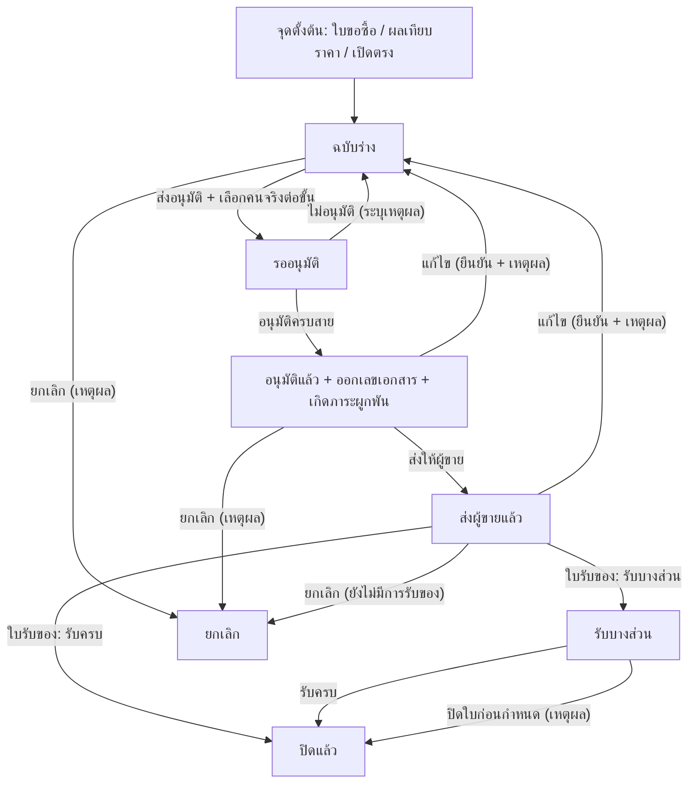
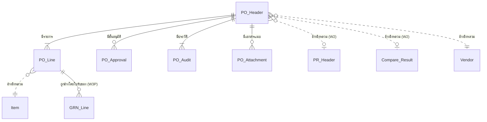
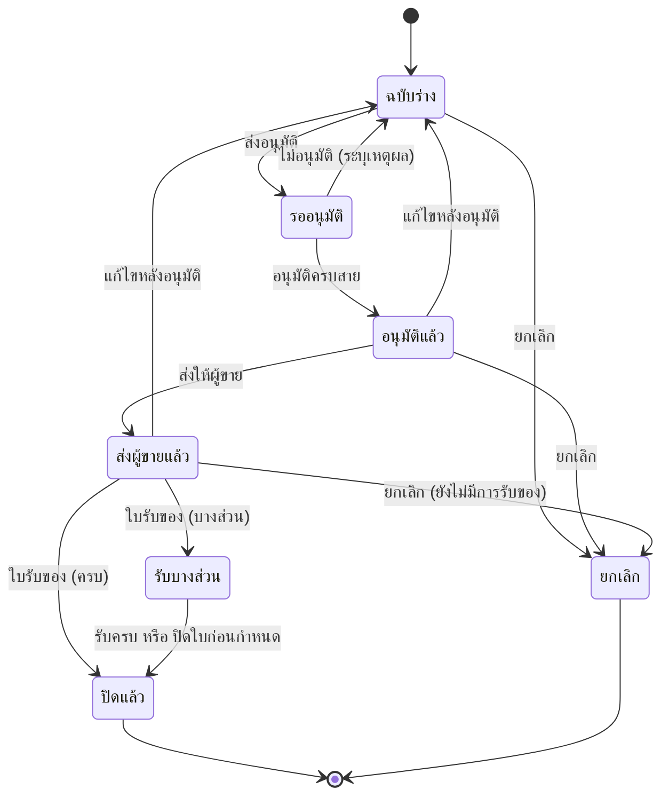

# BRD: PO ใบสั่งซื้อ (Purchase Order)

| Field | Value |
|---|---|
| BRD ID | BRD-PUR-078 |
| Feature Name | PO ใบสั่งซื้อ (Purchase Order) |
| Feature Code | `F-PUR-PO` (fid F078) |
| BRD Type | **New Feature** |
| Version | 1.0 |
| Status | **AI Reviewed — APPROVED** (ดู Quality Gate ท้ายเอกสาร) |
| Module | Purchase |
| Wave | W3P (ลำดับ 1 ของเลน CUBE-LANE-W3-LITE) |
| Owner | Strike (BA) |
| Stakeholders | ฝ่ายจัดซื้อ · ฝ่ายคลัง · การเงินและบัญชี · เจ้าของงบประมาณ |
| Created Date | 2026-09-10 |
| Last Updated | 2026-09-10 |
| Input ที่ใช้ | `0_DIRECTION/PREBRIEF_F-PUR-PO.md` · `FUNCTION_CHECKLIST_F-PUR-PO.md` · `BASELINE_F-PUR-PO.md` · **`1_HTML/F-PUR-PO.html` (HTML-first — สกัด Screen Inventory จากหน้าจอจริง)** · `5_DECLARATIONS/*` · CONTEXT_PACK W3-LITE · GOLDEN_RULES · workflow_graph.json |
| Mode | Fresh Mode + **Lane Mode (no-ask)** — ทุกจุดที่ไม่ชัดใช้ default ของ pack แล้วมาร์ก `[ASSUMED]` |

## Changelog
- v1.0 (2026-09-10): สร้าง BRD ผ่าน brd-generator-full (HTML-first · Lane Mode) — ผ่าน Quality Gate C01–C23

> **ปี ค.ศ. ล้วนทุกจุดในเอกสารและในระบบ** (กติกาเลน · TASTE_LOG)

---

# Section 2: Business Context

## 2.1 ปัญหา / โอกาส

ทุกวันนี้การสั่งซื้อของบริษัทหยุดอยู่ที่ "ใบขอซื้อได้รับอนุมัติ" แล้วฝ่ายจัดซื้อไปตกลงกับผู้ขายนอกระบบ (โทร/อีเมล) ทำให้เกิดปัญหา 4 ข้อซ้ำ ๆ

1. **ไม่รู้ว่าผูกพันไปเท่าไหร่แล้ว** — เงินที่ตกลงซื้อไปแล้วแต่ยังไม่รับของ ไม่มีที่ไหนแสดงยอดรวม ทำให้เจ้าของงบเห็นแค่ยอดที่จ่ายจริง ตัดสินใจช้าและเสี่ยงใช้งบเกิน
2. **คลังไม่รู้ว่าจะมีของอะไรเข้ามา** — ตอนของมาถึงหน้าคลังต้องโทรถามจัดซื้อว่าสั่งอะไรไว้ จำนวนเท่าไหร่ ทำให้รับของช้าและรับผิดจำนวนได้
3. **อนุมัติไม่ทิ้งร่องรอย** — ใครอนุมัติวงเงินเท่าไหร่ ตอนไหน ไม่มีหลักฐานที่ตรวจย้อนได้ เป็นช่องโหว่ทั้งด้าน SoD และการตรวจสอบภายใน
4. **แก้ราคาหลังตกลงแล้วเงียบ** — ผู้ขายขอปรับราคา จัดซื้อแก้ในไฟล์ตัวเองโดยไม่มีใครอนุมัติซ้ำ

**โอกาส:** PO คือ "จุดเกิดภาระผูกพัน" ตัวเดียวที่เชื่อม 3 ฝ่ายเข้าด้วยกัน — ทำให้ถูกจุดนี้จุดเดียว ได้ทั้งการควบคุมงบ การรับของที่ถูกต้อง และหลักฐานการอนุมัติครบในคราวเดียว

## 2.2 เป้าหมายทาง Business

| # | เป้าหมาย | ทำไมสำคัญ |
|---|---|---|
| G1 | ทำให้ทุกการสั่งซื้อเกิดในระบบและมีเลขเอกสารเดียวที่ทุกฝ่ายอ้างถึงได้ | ตัดการสั่งซื้อนอกระบบให้เป็นศูนย์ |
| G2 | ทำให้เห็นภาระผูกพันคงค้างได้ตลอดเวลา | เจ้าของงบตัดสินใจบนตัวเลขที่รวมของที่ยังไม่มาแล้ว |
| G3 | ทำให้การอนุมัติตามวงเงินเป็นระบบและตรวจย้อนได้ | ปิดช่องโหว่ SoD และรองรับการตรวจสอบภายใน |
| G4 | ส่งต่อข้อมูลให้คลังรับของได้โดยไม่ต้องถามจัดซื้อ | ลดเวลารับของและความผิดพลาดของจำนวน |
| G5 | บังคับให้การแก้ไขหลังอนุมัติต้องผ่านการอนุมัติใหม่ | ป้องกันการเปลี่ยนเงื่อนไขเงียบ ๆ |

## 2.3 ตัวชี้วัดความสำเร็จ (Success Metrics) — บังคับวัดได้

| # | ตัวชี้วัด | Baseline (ปัจจุบัน) | Target | วิธีวัด | คู่ใน §17.3 |
|---|---|---|---|---|---|
| M1 | สัดส่วนการสั่งซื้อที่มีใบสั่งซื้อในระบบ | ~55% (ประมาณจากใบรับของที่อ้าง PO ได้) | ≥ 95% ภายใน 3 เดือนหลังใช้งาน | ใบรับของที่อ้าง PO ได้ ÷ ใบรับของทั้งหมด | KPI-01 |
| M2 | เวลาเฉลี่ยจากส่งอนุมัติถึงอนุมัติครบสาย | ไม่มีข้อมูล (ทำนอกระบบ) → วัดจริงเดือนแรกเป็น baseline | ≤ 1 วันทำการ | `approved_at − submitted_at` เฉลี่ยต่อเดือน | KPI-02 |
| M3 | สัดส่วนใบที่ถูกแก้หลังอนุมัติ | ไม่มีข้อมูล → วัดเดือนแรกเป็น baseline | ≤ 8% ของใบที่อนุมัติทั้งหมด | นับ event "แก้ไขหลังอนุมัติ" ÷ ใบที่อนุมัติ | KPI-03 |
| M4 | สัดส่วนใบที่เลยกำหนดรับของ | ~20% (ประมาณจากบันทึกฝ่ายคลัง) | ≤ 10% | ใบสถานะ ส่งผู้ขายแล้ว/รับบางส่วน ที่ `needDate < วันนี้` ÷ ใบที่เปิดอยู่ | KPI-04 |
| M5 | ความถูกต้องของยอดภาระผูกพันคงค้าง | ไม่มีตัวเลขนี้เลย | คลาดเคลื่อน ≤ 2% เทียบการนับมือรายเดือน | เทียบยอดในระบบกับการกระทบยอดด้วยมือปลายเดือน | KPI-05 |

## 2.4 ที่มาของ Requirement

| ที่มา | สาระ |
|---|---|
| `briefs/W3P/CHECKLIST.md` แถว F-PUR-PO | ขอบเขตรอบนี้ (Q-document เต็ม · commitment · เปิดจาก PR หรือเปิดตรง · Compare Vendors soft-ref · DOA วงเงิน slot picker คนจริง · doccfg + pdfdoc · forward-wire ตรวจงบ · 5 สถานะ · แก้หลัง approve = re-approve) |
| `knowledge/CONTEXT_PACK/W3-LITE.md` | กติกาเลน + OQ defaults |
| `BASELINE_F-PUR-PO.md` | เทียบ ERP standard (SAP S/4HANA MM · Odoo 18 · D365 SCM · Oracle NetSuite · ERPNext) → must-have 15 ข้อ |
| `PREBRIEF_F-PUR-PO.md` | scenario S-01..S-20 · BR-01..BR-20 · data dict เต็ม |
| `1_HTML/F-PUR-PO.html` | ต้นแบบที่ผ่าน gate แล้ว — ใช้สกัด Screen Inventory (§14.6) |

---

# Section 3: Scope

## 3.1 In Scope

| # | ขอบเขต |
|---|---|
| IS-01 | สร้างใบสั่งซื้อได้ 3 ทาง: จากใบขอซื้อ · จากผลเทียบราคา · เปิดตรงไม่ผ่านใบขอซื้อ |
| IS-02 | รายการสินค้า/บริการหลายบรรทัด พร้อมจำนวน หน่วย ราคา ส่วนลดบรรทัด ภาษีต่อบรรทัด ส่วนลดท้ายบิล และภาษีหัก ณ ที่จ่าย |
| IS-03 | สายอนุมัติตามวงเงิน โดยผู้ส่งเลือก **คนจริง** ต่อขั้น |
| IS-04 | ส่งใบสั่งซื้อให้ผู้ขาย พร้อมออกเอกสาร A4 |
| IS-05 | ติดตามการรับของสะสมต่อบรรทัด และปิดใบเมื่อรับครบ |
| IS-06 | ปิดใบก่อนรับครบ (short-close) พร้อมเหตุผล |
| IS-07 | ยกเลิกใบก่อนมีการรับของ พร้อมเหตุผล |
| IS-08 | แก้ไขหลังอนุมัติผ่านการยืนยัน แล้วเดินสายอนุมัติใหม่ |
| IS-09 | ประวัติการเปลี่ยนแปลงแบบต่อท้ายอย่างเดียว |
| IS-10 | แนบเอกสารประกอบเข้ากับใบสั่งซื้อ |
| IS-11 | ประกาศการอนุมัติ · การแจ้งเตือน · ผลกระทบ 7C · เลขเอกสาร · แบบพิมพ์ ผ่านใบประกาศ 5 ฉบับ |

## 3.2 Out of Scope

| # | ไม่อยู่ในรอบนี้ | เหตุผล |
|---|---|---|
| OS-01 | ใบขอซื้อของจริง (F072) และหน้าเทียบราคาของจริง (F073) | คนละเลน (W2) — รอบนี้อ้างอิงแบบจำลองตามสัญญาที่ตกลงไว้ |
| OS-02 | ระบบควบคุมงบประมาณของจริง (F117) | อยู่ W7 — รอบนี้แสดงผลตรวจงบเป็นข้อมูลจำลองเท่านั้น |
| OS-03 | ใบรับของ (F079) และการเคลื่อนไหวสต๊อกจริง | เป็น feature ถัดไปในเลนเดียวกัน |
| OS-04 | การลงบัญชี / ตั้งหนี้ / จ่ายเงิน | ใบสั่งซื้อเป็นภาระผูกพัน ไม่ใช่รายการบัญชี — เกิดที่ใบรับของและใบแจ้งหนี้ (W5) |
| OS-05 | สัญญาซื้อระยะยาวและการเรียกของเป็นงวด (Blanket PO) | backlog — BASELINE N-01 |
| OS-06 | ต้นทุนแฝง (landed cost) · การตีมูลค่าตามอัตราแลกเปลี่ยน · ส่งตรงถึงลูกค้า · จ้างผลิต · สร้างใบสั่งซื้ออัตโนมัติจากจุดสั่งเติม | backlog — BASELINE N-03..N-07 |
| OS-07 | การเก็บใบสั่งซื้อเป็นเวอร์ชันแยกใบ | รอบนี้ใช้ประวัติค่าก่อน-หลังแทน (OQ-PO-02) |

## 3.3 Assumptions

| # | ข้อสมมติ | มาร์ก |
|---|---|---|
| A1 | รับเกินจำนวนที่สั่งได้ไม่เกินเปอร์เซ็นต์ที่ตั้งไว้ต่อผู้เช่า ค่าตั้งต้น 0% | **`[ASSUMED]` OQ-PO-01 — เจ้าภาพ Strike** |
| A2 | สัญญาข้อมูลจากใบขอซื้อ (เลขที่ · ผู้ขอ · หน่วยงาน · ศูนย์ต้นทุน · รายการ · วันที่ต้องการ · ยอดคงเหลือ) | **`[ASSUMED contract]` — รอ F072 ปิด** |
| A3 | สัญญาข้อมูลจากผลเทียบราคา (เลขที่ · ผู้ชนะ · ราคาที่ชนะรายรายการ) | **`[ASSUMED contract]` — รอ F073 ปิด** |
| A4 | ผู้ขาย สินค้า หน่วยนับ คลัง ศูนย์ต้นทุน มีอยู่แล้วในทะเบียนกลางและอ้างอิงแบบหลวม | LD-4C-02 (DONE) |
| A5 | รอบนี้ทำงานบนสกุลเงินเดียว — ช่องสกุลเงินมีไว้รองรับอนาคต แต่ยังไม่มีตรรกะแปลงค่า | `[AI-DRAFT]` |

## 3.4 Scope Lock

- **Scope Lock Ref:** ไม่ผ่าน chain ใบเซ็นลูกค้า — **N/A — internal lane** (feature นี้เข้าเลนผ่าน Central Plan ไม่ใช่ผ่านใบเซ็น SCOPE_CONFIRM)
- **Locked Decisions (ห้าม override ตลอด chain):**

| LOCK-ID | ข้อยืนยัน | อ้างเอกสาร |
|---|---|---|
| LOCK-01 | ทะเบียนหลักทุกตัว (ผู้ขาย · สินค้า · หน่วย · คลัง/ตำแหน่ง · ศูนย์ต้นทุน) เป็นการอ้างอิงแบบหลวม เลือกผ่านตัวเลือกค้นหา ไม่บังคับความสัมพันธ์ และเว้นว่างได้ | `LD-4C-02` · GOLDEN_RULES §4 |
| LOCK-02 | ตอนส่งอนุมัติต้องเลือก **คนจริง** ต่อขั้น (รูป + ตำแหน่ง + ชื่อ) — ห้ามแสดงรหัสตำแหน่งบนหน้าจอ และห้ามฝังสายอนุมัติในโค้ดของ feature | `DOA-UI-LOCK 2026-08-17` · GOLDEN_RULES §3 |
| LOCK-03 | เลขเอกสารออกจากทะเบียนเอกสารกลางเท่านั้น รูปแบบ `PO-YYYY-NNNN` (ปี ค.ศ.) และห้ามเปลี่ยนเลขหลังออกแล้ว | CONTEXT_PACK §2.3 · `DOCCFG_BRIEF` |
| LOCK-04 | ประวัติและความเคลื่อนไหวเป็นแบบต่อท้ายอย่างเดียว ไม่มีการลบถาวร | GOLDEN_RULES §4 · CONTEXT_PACK §2.8 |
| LOCK-05 | เกณฑ์และตัวเลขแจ้งเตือนทุกตัวอยู่ในกฎกลาง/การตั้งค่า ไม่อยู่ในโค้ดของ feature | CONTEXT_PACK §2.8 |
| LOCK-06 | ปี ค.ศ. ล้วนทุกจุด ทั้งหน้าจอและเอกสารพิมพ์ | TASTE_LOG · GOLDEN_RULES §1 |
| LOCK-07 | ใบสั่งซื้อไม่ลงบัญชี — ภาระผูกพันไม่ใช่รายการบัญชีจริง | CONTEXT_PACK §2.6 · `CSQ_BRIEF §3` |

- **Scope Drift:** **ไม่มี** — ทุกข้อใน In Scope สืบย้อนไปที่ CHECKLIST W3P หรือ BASELINE must-have ได้ทั้งหมด (ตรวจแล้วใน `_COVERAGE_R1.md` §7 scope creep = 0)

---

# Section 4: User Roles & Permissions

## 4.1 Roles ที่เกี่ยวข้อง

| Role | คำอธิบาย |
|---|---|
| เจ้าหน้าที่จัดซื้อ | ผู้สร้างและดูแลใบสั่งซื้อของหน่วยงานตนเอง |
| หัวหน้าแผนกจัดซื้อ | ดูแลใบสั่งซื้อทั้งแผนก และเป็นผู้อนุมัติขั้นแรก |
| ผู้อำนวยการสายงาน | ผู้อนุมัติขั้นที่สองเมื่อยอดเข้าเกณฑ์ |
| ประธานเจ้าหน้าที่ฝ่ายการเงิน | ผู้อนุมัติขั้นสูงสุดเมื่อยอดเข้าเกณฑ์ |
| เจ้าหน้าที่คลัง | ใช้ใบสั่งซื้อเป็นต้นทางในการรับของ (อ่านอย่างเดียวในระบบนี้) |
| บัญชีและการเงิน | ดูภาระผูกพันและดาวน์โหลดเอกสาร (อ่านอย่างเดียว) |
| ผู้ดูแลระบบ | ดูประวัติทั้งหมด (อ่านอย่างเดียว) |

## 4.2 Permission Matrix

| Action | จัดซื้อ | หน.จัดซื้อ | ผอ.สายงาน | CFO | คลัง | บัญชี | ผู้ดูแล |
|---|:---:|:---:|:---:|:---:|:---:|:---:|:---:|
| สร้าง / แก้ร่าง | ✅ | ✅ | ❌ | ❌ | ❌ | ❌ | ❌ |
| ส่งอนุมัติ | ✅ | ✅ | ❌ | ❌ | ❌ | ❌ | ❌ |
| อนุมัติ / ส่งกลับแก้ / ปฏิเสธ | ❌ | ✅ * | ✅ * | ✅ * | ❌ | ❌ | ❌ |
| ส่งให้ผู้ขาย | ✅ | ✅ | ❌ | ❌ | ❌ | ❌ | ❌ |
| แก้ไขหลังอนุมัติ | ✅ | ✅ | ❌ | ❌ | ❌ | ❌ | ❌ |
| ยกเลิก | ✅ | ✅ | ❌ | ❌ | ❌ | ❌ | ❌ |
| ปิดใบก่อนกำหนด | ✅ | ✅ | ❌ | ❌ | ❌ | ❌ | ❌ |
| ดูใบสั่งซื้อ | ✅ | ✅ | ✅ | ✅ | ✅ ** | ✅ | ✅ |
| ดาวน์โหลดเอกสาร | ✅ | ✅ | ✅ | ✅ | ✅ | ✅ | ✅ |
| ดูประวัติทั้งหมด | ✅ | ✅ | ✅ | ✅ | ✅ | ✅ | ✅ |

\* เฉพาะใบที่ตนเองถูกเลือกเป็นผู้อนุมัติในขั้นนั้น และต้องไม่ใช่ผู้ส่งอนุมัติใบเดียวกัน (แยกหน้าที่)
\*\* คลังเห็นเฉพาะใบที่สถานะตั้งแต่ "ส่งผู้ขายแล้ว" ขึ้นไป

---

# Section 5: User Journey (with COSO)

> COSO ใช้ค่าตั้งต้นของ Purchase Module จาก `knowledge/coso-defaults.md` (Lane Mode — ไม่ถาม) และปรับให้เข้ากับ DOA 3 ช่วงวงเงินของเลนนี้

## 5.1 Happy Path — เปิดใบสั่งซื้อจากใบขอซื้อจนปิดใบ

| Step | ผู้ทำ | ทำอะไร | COSO Role | จุดควบคุม |
|---|---|---|---|---|
| 1 | เจ้าหน้าที่จัดซื้อ | เลือกจุดตั้งต้น (จากใบขอซื้อ) แล้วเลือกใบที่อนุมัติแล้ว | Maker | ระบบดึงเฉพาะใบขอซื้อที่อนุมัติแล้ว |
| 2 | เจ้าหน้าที่จัดซื้อ | กรอกข้อมูลหลัก: ผู้ขาย · วันที่ · กำหนดรับ · เงื่อนไขชำระ · คลังปลายทาง · ศูนย์ต้นทุน | Maker | ตรวจครบทุกช่องบังคับก่อนไปขั้นถัดไป |
| 3 | ระบบ | แสดงผลตรวจงบประมาณของศูนย์ต้นทุนนั้น | System | เตือนเมื่อยอดอาจเกินวงเงินคงเหลือ (ยังไม่บล็อกในรอบนี้) |
| 4 | เจ้าหน้าที่จัดซื้อ | ใส่รายการ จำนวน ราคา ส่วนลด ภาษี | Maker | ห้ามแถวว่าง ห้ามสินค้า+หน่วยซ้ำ ห้ามจำนวนเป็นศูนย์ |
| 5 | ระบบ | คำนวณยอดก่อนภาษี ภาษี ยอดสุทธิ และเสนอชั้นอนุมัติตามยอดสุทธิ | System | สูตรเดียวทั้งระบบ ไม่คำนวณซ้ำที่อื่น |
| 6 | เจ้าหน้าที่จัดซื้อ | แนบเอกสารประกอบ | Maker | เก็บที่คลังเอกสารกลาง |
| 7 | เจ้าหน้าที่จัดซื้อ | ตรวจทานแล้วกด "บันทึกและส่งอนุมัติ" | Maker | ถ้ายอดเกินยอดคงเหลือของใบขอซื้อ ปุ่มส่งถูกปิด (บันทึกร่างได้) |
| 8 | เจ้าหน้าที่จัดซื้อ | เลือก **คนจริง** ต่อขั้นอนุมัติ | Maker | ต้องครบทุกขั้นจึงส่งได้ · ผู้ส่งอนุมัติใบตนเองไม่ได้ |
| 9 | หัวหน้าแผนกจัดซื้อ | อนุมัติขั้นที่ 1 | **Approver** | บันทึกผู้อนุมัติ เวลา และความเห็น |
| 10 | ผู้อำนวยการ / CFO | อนุมัติขั้นถัดไปเมื่อยอดเข้าเกณฑ์ | **Approver** | เดินตามลำดับ ข้ามขั้นไม่ได้ |
| 11 | ระบบ | ออกเลขเอกสาร `PO-YYYY-NNNN` และบันทึกภาระผูกพัน | System | เลขออกครั้งเดียว เปลี่ยนไม่ได้ |
| 12 | เจ้าหน้าที่จัดซื้อ | ส่งใบสั่งซื้อให้ผู้ขาย | Maker | บันทึกช่องทาง วัน-เวลา และผู้ส่ง + เก็บสำเนาเอกสาร |
| 13 | ระบบ (จากใบรับของ) | บันทึกยอดรับสะสมต่อบรรทัด | System | จัดซื้อแก้ยอดนี้ด้วยมือไม่ได้ |
| 14 | ระบบ | ปิดใบเมื่อทุกบรรทัดรับครบ | System | สถานะเปลี่ยนอัตโนมัติ |

## 5.2 Alternative Paths

### 5.2.1 Reject Path — ผู้อนุมัติไม่อนุมัติ
| Step | ผู้ทำ | ทำอะไร | COSO Role |
|---|---|---|---|
| R1 | ผู้อนุมัติขั้นปัจจุบัน | กด "ไม่อนุมัติ" และระบุเหตุผล (บังคับ) | Approver |
| R2 | ระบบ | ย้ายใบกลับเป็นฉบับร่าง เก็บสายอนุมัติรอบเดิมเข้าประวัติ | System |
| R3 | เจ้าหน้าที่จัดซื้อ | แก้แล้วส่งอนุมัติใหม่ | Maker |

### 5.2.2 Re-approval Path — แก้ไขหลังอนุมัติ (Transition Guard)
| Step | ผู้ทำ | ทำอะไร | COSO Role |
|---|---|---|---|
| RA1 | เจ้าหน้าที่จัดซื้อ | กด "แก้ไข" ที่ใบซึ่งอนุมัติหรือส่งผู้ขายแล้ว | Maker |
| RA2 | ระบบ | เตือนว่าจะกลับเป็นฉบับร่างและต้องอนุมัติใหม่ พร้อมบังคับเลือกประเภทเหตุผลและกรอกเหตุผล | System (**จุดควบคุมสำคัญ**) |
| RA3 | ระบบ | ล้างผลอนุมัติเดิม เก็บเข้าประวัติ และบันทึกเหตุผลลงในประวัติ | System |
| RA4 | ผู้อนุมัติ | เดินสายอนุมัติใหม่ตามยอดใหม่ | Approver |

### 5.2.3 Short-close Path — ปิดใบก่อนรับครบ
| Step | ผู้ทำ | ทำอะไร | COSO Role |
|---|---|---|---|
| SC1 | เจ้าหน้าที่จัดซื้อ | กด "ปิดใบก่อนกำหนด" ที่ใบสถานะรับบางส่วน | Maker |
| SC2 | ระบบ | แสดงยอดค้างรับที่จะถูกยกเลิก + บังคับเหตุผล | System |
| SC3 | ระบบ | ปิดใบ ยกเลิกยอดค้าง และปลดภาระผูกพันส่วนที่เหลือ | System |

## 5.3 Process Diagram



---

# Section 6: Data Entity & Fields

## 6.1 Entity Overview

| Entity | คำอธิบาย | ความสัมพันธ์ |
|---|---|---|
| `PO_Header` | หัวใบสั่งซื้อ 1 ใบ | 1 : N กับ `PO_Line` · 1 : N กับ `PO_Approval` · 1 : N กับ `PO_Audit` · 1 : N กับ `PO_Attachment` |
| `PO_Line` | รายการสินค้า/บริการต่อบรรทัด | N : 1 กับ `PO_Header` |
| `PO_Approval` | ขั้นอนุมัติที่ถูกบันทึกไว้ ณ เวลาที่ส่ง | N : 1 กับ `PO_Header` |
| `PO_Audit` | ประวัติแบบต่อท้ายอย่างเดียว | N : 1 กับ `PO_Header` |
| `PO_Attachment` | เอกสารแนบ | N : 1 กับ `PO_Header` |

## 6.2 Entity: `PO_Header`

| Field | ชนิด | บังคับ | Default | ที่มา | Validation |
|---|---|:---:|---|---|---|
| `po_id` | รหัสภายใน | ✅ | ระบบสร้าง | ระบบ | ไม่ซ้ำ |
| `po_no` | ข้อความ | ⬜ (มีเมื่ออนุมัติ) | ว่าง | ทะเบียนเอกสารกลาง | รูปแบบ `PO-YYYY-NNNN` (ค.ศ.) · เปลี่ยนไม่ได้ |
| `status` | รายการค่า | ✅ | ฉบับร่าง | ระบบ | ตาม §8 เท่านั้น |
| `source_type` | รายการค่า | ✅ | เปิดตรง | ผู้ใช้ | เปิดตรง / จากใบขอซื้อ / จากผลเทียบราคา |
| `pr_ref` | อ้างอิงหลวม | ⬜ | — | ใบขอซื้อ (W2) | **ไม่บังคับ** — เปิดตรงได้ |
| `compare_ref` | อ้างอิงหลวม | ⬜ | — | ผลเทียบราคา (W2) | ไม่บังคับ |
| `vendor_ref` | อ้างอิงหลวม | ✅ | — | ทะเบียนผู้ขาย | ไม่บังคับความสัมพันธ์ · เตือนเมื่อผู้ขายถูกระงับ |
| `vendor_contact` | ข้อความ | ⬜ | ดึงจากผู้ขาย | ทะเบียนผู้ขาย | — |
| `doc_date` | วันที่ (ค.ศ.) | ✅ | วันนี้ | ผู้ใช้ | ย้อนหลังได้ไม่เกินจำนวนวันที่กฎกลางกำหนด |
| `need_date` | วันที่ (ค.ศ.) | ✅ | วันนี้ + จำนวนวันนำตั้งต้น | ผู้ใช้ | ≥ `doc_date` |
| `payment_term_ref` | อ้างอิงหลวม | ✅ | จากผู้ขาย | ทะเบียนเงื่อนไขชำระ | — |
| `currency` | รายการค่า | ✅ | สกุลเงินหลัก | ระบบ | รอบนี้ใช้สกุลเดียว |
| `warehouse_ref` | อ้างอิงหลวม | ✅ | คลังหลักของผู้ใช้ | ทะเบียนคลัง | — |
| `ship_to_address` | ข้อความยาว | ✅ | ดึงจากคลัง | ผู้ใช้ | — |
| `cost_center_ref` | อ้างอิงหลวม | ⬜ | จากหน่วยงานผู้ใช้ | ทะเบียนศูนย์ต้นทุน | เว้นว่างได้ |
| `buyer` | ผู้ใช้ | ✅ | ผู้สร้าง | ทะเบียนพนักงาน | — |
| `external_ref` | ข้อความ | ⬜ | — | ผู้ใช้ | — |
| `note` | ข้อความยาว | ⬜ | — | ผู้ใช้ | — |
| `header_discount` | จำนวน/เปอร์เซ็นต์ | ⬜ | 0 | ผู้ใช้ | ≥ 0 และไม่เกินยอดรวม |
| `wht_enabled` / `wht_pct` | ตรรกะ / เปอร์เซ็นต์ | ⬜ | ปิด / 3% | ผู้ใช้ | ฐานคำนวณ = ยอดก่อนภาษี |
| `amount_before_vat` · `vat_amount` · `grand_total` · `payable_total` | จำนวน (คำนวณ) | — | — | สูตร §9 | อ่านอย่างเดียว |
| `doa_entry_ref` | อ้างอิง | ⬜ | — | ทะเบียน DOA | บันทึกตอนส่งอนุมัติ |
| `submitted_by` / `submitted_at` | ผู้ใช้ / เวลา | ⬜ | — | ระบบ | — |
| `approved_by` / `approved_at` | ผู้ใช้ / เวลา | ⬜ | — | ระบบ | เติมเมื่ออนุมัติครบสาย |
| `sent_at` / `sent_by` / `sent_via` | เวลา / ผู้ใช้ / ข้อความ | ⬜ | — | ระบบ + ผู้ใช้ | — |
| `reapprove_reason` | ข้อความ | ✅ เมื่อแก้หลังอนุมัติ | — | ผู้ใช้ | บังคับ |
| `cancel_info` / `close_info` | กลุ่มข้อมูล (ผู้ทำ · เวลา · ประเภทเหตุผล · เหตุผล) | ✅ เมื่อยกเลิก/ปิดใบ | — | ผู้ใช้ | บังคับ |
| `price_override` / `override_note` | ตรรกะ / ข้อความ | ✅ เมื่อมีการแก้ราคา | เท็จ | ระบบ + ผู้ใช้ | บังคับเหตุผลเมื่อเป็นจริง |
| `created_by` · `created_at` · `updated_by` · `updated_at` | audit fields | ✅ | ระบบ | ระบบ | — |

## 6.3 Entity: `PO_Line`

| Field | ชนิด | บังคับ | Default | Validation |
|---|---|:---:|---|---|
| `line_no` | เลข | ✅ | อัตโนมัติ | เรียง/ย้ายได้ |
| `line_type` | รายการค่า | ✅ | สินค้า | สินค้า / บริการ |
| `item_ref` | อ้างอิงหลวม | ✅ | — | เลือกจากทะเบียนสินค้า หรือพิมพ์เองได้ |
| `description` | ข้อความ | ⬜ | ดึงจากสินค้า | แก้ทับได้ |
| `qty_ordered` | จำนวน | ✅ | 1 | > 0 |
| `uom_ref` | อ้างอิงหลวม | ✅ | หน่วยหลักของสินค้า | เปลี่ยนหน่วยแล้วราคาเปลี่ยนตาม |
| `unit_price` | จำนวน | ✅ | ราคาของหน่วยนั้น | ≥ 0 · แก้แล้วต้องมีเหตุผล |
| `line_discount` | จำนวน/เปอร์เซ็นต์ | ⬜ | 0 | ไม่เกินยอดบรรทัด |
| `vat_mode` / `vat_pct` | รายการค่า / เปอร์เซ็นต์ | ✅ | ตามกลุ่มภาษีของสินค้า / 7% | ไม่คิด / บวกเพิ่ม / รวมแล้ว — เลือกได้อย่างเดียว |
| `line_need_date` | วันที่ (ค.ศ.) | ⬜ | ตามหัวเอกสาร | ≥ `doc_date` |
| `line_cost_center_ref` | อ้างอิงหลวม | ⬜ | ตามหัวเอกสาร | เว้นว่างได้ |
| `qty_received` | จำนวน (อ่านอย่างเดียว) | — | 0 | **เขียนโดยใบรับของเท่านั้น** |
| `qty_open` | จำนวน (คำนวณ) | — | = `qty_ordered` | `qty_ordered − qty_received` ไม่ต่ำกว่า 0 |
| `over_receipt_tolerance_pct` | เปอร์เซ็นต์ | ⬜ | จากการตั้งค่าต่อผู้เช่า (0%) | **`[ASSUMED]` OQ-PO-01** |
| `line_status` | รายการค่า (คำนวณ) | — | เปิด | เปิด / รับบางส่วน / รับครบ / ปิดก่อนกำหนด |
| `line_note` | ข้อความ | ⬜ | — | — |

## 6.4 Entity: `PO_Approval` · `PO_Audit` · `PO_Attachment`

| Entity | Field หลัก |
|---|---|
| `PO_Approval` | `step_no` · `position_ref` (ตำแหน่งที่ทะเบียน DOA กำหนด) · `person_ref` (**คนจริงที่ถูกเลือก**) · `status` (รอ/อนุมัติ/ไม่อนุมัติ/ยกเลิก) · `decided_by` · `decided_at` · `comment` — **บันทึกเป็นภาพนิ่งตอนกดส่ง แก้ทะเบียน DOA ทีหลังไม่กระทบใบที่ส่งไปแล้ว** |
| `PO_Audit` | `event` · `actor` · `occurred_at` · `note` · `before_value` · `after_value` — **ต่อท้ายอย่างเดียว ลบ/แก้ไม่ได้** |
| `PO_Attachment` | `file_name` · `file_size` · `uploaded_by` · `uploaded_at` · `doc_center_ref` |

## 6.5 Entity Relationship



---

# Section 7: User Stories & Acceptance Criteria

> ทุก story อธิบายความสามารถเดียว — **ไม่มีคำว่า "และ" ในคำบรรยาย story** (C05)

| ID | Story | Acceptance Criteria |
|---|---|---|
| S-01 | ในฐานะเจ้าหน้าที่จัดซื้อ ฉันต้องการเปิดใบสั่งซื้อจากใบขอซื้อที่อนุมัติแล้ว เพื่อไม่ต้องพิมพ์รายการซ้ำ | เลือกใบขอซื้อได้เฉพาะใบที่อนุมัติแล้ว · รายการถูกดึงมาครบทุกบรรทัด · เลขใบขอซื้อปรากฏบนใบสั่งซื้อ |
| S-02 | ในฐานะเจ้าหน้าที่จัดซื้อ ฉันต้องการเปิดใบสั่งซื้อได้โดยไม่ต้องมีใบขอซื้อ เพื่อรองรับการซื้อเร่งด่วน | ไม่มีจุดใดบังคับให้เลือกใบขอซื้อ · บันทึกและส่งอนุมัติได้ตามปกติ |
| S-03 | ในฐานะเจ้าหน้าที่จัดซื้อ ฉันต้องการรับผู้ชนะจากผลเทียบราคามาตั้งต้น เพื่อลดการคีย์ราคาผิด | ผู้ขายผู้ชนะถูกเลือกให้อัตโนมัติ · ราคาที่ชนะถูกใส่รายรายการ · เลขใบเทียบราคาแสดงบนใบ |
| S-04 | ในฐานะเจ้าหน้าที่จัดซื้อ ฉันต้องการเลือกผู้อนุมัติเป็นคนจริงต่อขั้น เพื่อให้รู้ว่าใบนี้รอใครอยู่ | แต่ละขั้นแสดงรูป ตำแหน่ง ชื่อ · ส่งไม่ได้ถ้ายังมีขั้นที่ไม่ได้เลือกคน · ไม่ปรากฏรหัสตำแหน่งบนหน้าจอ |
| S-05 | ในฐานะผู้อนุมัติ ฉันต้องการเห็นยอดสุทธิก่อนตัดสินใจ เพื่ออนุมัติบนข้อมูลที่ครบ | หน้าต่างอนุมัติแสดงยอดสุทธิ จำนวนรายการ และการแก้ราคา (ถ้ามี) |
| S-06 | ในฐานะผู้อนุมัติ ฉันต้องการส่งใบกลับให้แก้พร้อมเหตุผล เพื่อให้ผู้ยื่นรู้ว่าต้องแก้อะไร | กดไม่อนุมัติแล้วต้องกรอกเหตุผลก่อน · ใบกลับเป็นฉบับร่าง · เหตุผลปรากฏในประวัติ |
| S-07 | ในฐานะเจ้าหน้าที่จัดซื้อ ฉันต้องการส่งใบสั่งซื้อให้ผู้ขายจากในระบบ เพื่อให้มีหลักฐานว่าส่งเมื่อไร | บันทึกช่องทาง วัน-เวลา ผู้ส่ง · สถานะเปลี่ยนเป็นส่งผู้ขายแล้ว |
| S-08 | ในฐานะเจ้าหน้าที่จัดซื้อ ฉันต้องการพิมพ์ใบสั่งซื้อเป็นเอกสาร A4 เพื่อส่งให้ผู้ขายที่ไม่รับอีเมล | เอกสารมีหัวบริษัท ผู้ขาย รายการ ยอดรวม ช่องลงนาม · ปีเป็น ค.ศ. ทุกจุด |
| S-09 | ในฐานะเจ้าหน้าที่จัดซื้อ ฉันต้องการเห็นยอดค้างรับรายบรรทัด เพื่อติดตามผู้ขาย | แสดงจำนวนสั่ง รับแล้วสะสม คงเหลือรับ ต่อบรรทัด · แก้ยอดรับด้วยมือไม่ได้ |
| S-10 | ในฐานะเจ้าหน้าที่จัดซื้อ ฉันต้องการปิดใบก่อนรับครบพร้อมเหตุผล เพื่อไม่ให้ใบค้างระบบตลอดไป | ทำได้เฉพาะสถานะรับบางส่วน · บังคับเหตุผล · ยอดค้างรับถูกยกเลิก |
| S-11 | ในฐานะหัวหน้าแผนกจัดซื้อ ฉันต้องการให้การแก้ไขหลังอนุมัติต้องอนุมัติใหม่ เพื่อปิดช่องโหว่การเปลี่ยนเงื่อนไขเงียบ ๆ | กดแก้แล้วขึ้นคำเตือนยืนยัน · บังคับเหตุผล · ใบกลับเป็นฉบับร่าง · ผลอนุมัติเดิมถูกเก็บเข้าประวัติ |
| S-12 | ในฐานะเจ้าของงบประมาณ ฉันต้องการเห็นภาระผูกพันคงค้างรวม เพื่อวางแผนการใช้งบ | หน้ารายการแสดงยอดภาระผูกพันคงค้างที่คำนวณจากยอดค้างรับของใบที่อนุมัติแล้ว |
| S-13 | ในฐานะผู้ตรวจสอบ ฉันต้องการเห็นประวัติทุกเหตุการณ์ของใบ เพื่อตรวจย้อนได้ | ประวัติบันทึกทุกการสร้าง แก้ อนุมัติ ส่ง รับของ ยกเลิก ปิดใบ · ไม่มีปุ่มลบ |
| S-14 | ในฐานะเจ้าหน้าที่จัดซื้อ ฉันต้องการถูกเตือนเมื่อกำลังเปิดใบซ้ำ เพื่อไม่ให้สั่งของซ้ำโดยไม่ตั้งใจ | เตือนเมื่อผู้ขายและรายการใกล้เคียงกับใบที่เปิดในช่วงเวลาใกล้กัน · เตือนอย่างเดียว ไม่บล็อก |
| S-15 | ในฐานะเจ้าหน้าที่จัดซื้อ ฉันต้องการตั้งเปอร์เซ็นต์รับเกินต่อบรรทัด เพื่อรองรับสินค้าที่ตัดแบ่งไม่ลงตัว | ตั้งค่าได้ต่อบรรทัด · ค่าตั้งต้นมาจากการตั้งค่าต่อผู้เช่า · ใบรับของใช้ค่านี้เป็นเพดาน |

---

# Section 8: Status & Lifecycle

## 8.1 State Diagram



## 8.2 State Transition Table

| จาก | ไป | ใครกด | เงื่อนไข | ผลข้างเคียง |
|---|---|---|---|---|
| — | ฉบับร่าง | จัดซื้อ | สร้างใบใหม่ | ยังไม่มีเลขเอกสาร ยังไม่เกิดภาระผูกพัน |
| ฉบับร่าง | รออนุมัติ | จัดซื้อ | ผ่านทุกช่องบังคับ + ทุกขั้นมีคนจริง + ไม่เกินยอดคงเหลือของใบขอซื้อ | บันทึกภาพนิ่งของสายอนุมัติ |
| รออนุมัติ | ฉบับร่าง | ผู้อนุมัติ | ระบุเหตุผล | เก็บสายอนุมัติรอบเดิมเข้าประวัติ |
| รออนุมัติ | อนุมัติแล้ว | ผู้อนุมัติทุกขั้น | อนุมัติครบตามลำดับ | **ออกเลขเอกสาร** + **เกิดภาระผูกพัน** + เก็บสำเนาเอกสาร |
| อนุมัติแล้ว | ส่งผู้ขายแล้ว | จัดซื้อ | — | บันทึกช่องทาง/เวลา/ผู้ส่ง + เก็บสำเนาเอกสารที่ส่งออก |
| อนุมัติแล้ว / ส่งผู้ขายแล้ว | ฉบับร่าง | จัดซื้อ | ยืนยันคำเตือน + ระบุเหตุผล | ล้างผลอนุมัติ เก็บเข้าประวัติ |
| ส่งผู้ขายแล้ว | รับบางส่วน | ระบบ (ใบรับของ) | รับไม่ครบทุกบรรทัด | อัพเดตยอดรับสะสม |
| ส่งผู้ขายแล้ว / รับบางส่วน | ปิดแล้ว | ระบบ (ใบรับของ) | รับครบทุกบรรทัด | ปลดภาระผูกพัน |
| รับบางส่วน | ปิดแล้ว | จัดซื้อ | ระบุเหตุผล (ปิดใบก่อนกำหนด) | ยกเลิกยอดค้างรับ + ปลดภาระผูกพันส่วนที่เหลือ |
| ฉบับร่าง / อนุมัติแล้ว / ส่งผู้ขายแล้ว | ยกเลิก | จัดซื้อ | ระบุเหตุผล + **ยังไม่มีการรับของ** | ปลดภาระผูกพัน |
| รับบางส่วน | ยกเลิก | — | **ไม่รองรับ** | ต้องใช้ปิดใบก่อนกำหนดแทน |
| ปิดแล้ว / ยกเลิก | — | — | สถานะปลายทาง | อ่านอย่างเดียว |

---

# Section 9: Business Rules + Validation

## 9.1 Business Rules

| Rule ID | Rule | Tag | Type | เหตุผล Tag |
|---|---|:---:|---|---|
| R01 | สถานะเริ่มต้นของใบใหม่คือฉบับร่าง | FIXED | Constant | ตรรกะธุรกิจไม่เปลี่ยน |
| R02 | ใบสั่งซื้อต้องมีอย่างน้อย 1 รายการจึงส่งอนุมัติได้ | FIXED | Constant | ไม่มีเหตุให้เปลี่ยน |
| R03 | ผู้ขาย วันที่เอกสาร วันที่ต้องการรับ ผู้จัดซื้อ เงื่อนไขชำระ และที่อยู่จัดส่ง เป็นช่องบังคับ | FIXED | Constant | ชุดข้อมูลขั้นต่ำของเอกสาร |
| R04 | เปิดใบสั่งซื้อโดยไม่มีใบขอซื้อได้ | FIXED | Constant | ข้อกำหนดตรงจาก CHECKLIST |
| R05 | จำนวนสั่งต้องมากกว่า 0 | FIXED | Constant | — |
| R06 | ราคาต่อหน่วยต้องไม่ติดลบ และส่วนลดบรรทัดต้องไม่เกินยอดบรรทัด | FIXED | Constant | — |
| R07 | **ชั้นอนุมัติตัดสินจากยอดสุทธิของใบ: ≤ 100,000 → 1 ขั้น · 100,001–1,000,000 → 2 ขั้น · > 1,000,000 → 3 ขั้น** | **CONFIGURABLE** | Amount | จุดตัดวงเงินเปลี่ยนตามนโยบาย — **ตั้งที่ทะเบียน DOA ไม่ใช่ในโค้ด feature** |
| R08 | ทุกขั้นอนุมัติต้องระบุคนจริง ห้ามใช้รหัสตำแหน่งแทน | FIXED | Constant | LOCK-02 |
| R09 | ผู้ส่งอนุมัติเป็นผู้อนุมัติใบเดียวกันไม่ได้ | FIXED | Constant | แยกหน้าที่ (SoD) |
| R10 | **รับเกินจำนวนที่สั่งได้ไม่เกินเปอร์เซ็นต์ที่ตั้งไว้ ค่าตั้งต้น 0%** | **CONFIGURABLE** | Threshold | **`[ASSUMED]` OQ-PO-01** — ตั้งต่อผู้เช่า และปรับได้ต่อบรรทัด |
| R11 | ภาระผูกพันเกิดเมื่ออนุมัติครบสาย ไม่ใช่ตอนสร้างใบ | FIXED | Constant | นิยามทางบัญชีบริหาร |
| R12 | แก้ไขใบที่อนุมัติหรือส่งผู้ขายแล้ว ต้องยืนยันและระบุเหตุผล แล้วเดินสายอนุมัติใหม่ | FIXED | Constant | LOCK · ข้อกำหนดตรงจาก CHECKLIST |
| R13 | ยกเลิกได้เฉพาะเมื่อยังไม่มีการรับของ | FIXED | Constant | ความเคลื่อนไหวสต๊อกลบไม่ได้ |
| R14 | ปิดใบก่อนกำหนดทำได้เฉพาะสถานะรับบางส่วน และต้องระบุเหตุผล | FIXED | Constant | — |
| R15 | ยอดรับสะสมต่อบรรทัดเขียนโดยใบรับของเท่านั้น | FIXED | Constant | LOCK-04 |
| R16 | ใบรับของเปิดได้เฉพาะใบสั่งซื้อสถานะส่งผู้ขายแล้วหรือรับบางส่วน | FIXED | Constant | ป้องกันรับของก่อนอนุมัติ |
| R17 | **ผลตรวจงบประมาณแสดงผลเพื่อเตือน แต่ยังไม่บล็อกการอนุมัติในรอบนี้** | **WARNING** | Policy | ระบบควบคุมงบยังไม่มีจริง (W7) — **ต้องเคาะก่อนขึ้น production** |
| R18 | ทุกการเปลี่ยนแปลงบันทึกประวัติแบบต่อท้ายอย่างเดียว ไม่มีการลบถาวร | FIXED | Constant | LOCK-04 |
| R19 | ทะเบียนหลักทุกตัวอ้างอิงแบบหลวม เลือกค่าที่ถูกระงับได้แต่ระบบต้องเตือน | FIXED | Constant | LOCK-01 |
| R20 | **เตือนเมื่อพบใบสั่งซื้อที่ผู้ขายและรายการใกล้เคียงกันภายในช่วงวันที่กำหนด — เตือนอย่างเดียว** | **CONFIGURABLE** | Threshold | ช่วงวันและวิธีเทียบอยู่ในกฎกลาง (LOCK-05) |
| R21 | ปีที่แสดงทุกจุดเป็น ค.ศ. | FIXED | Constant | LOCK-06 |
| R22 | เลขเอกสารออกจากทะเบียนกลางตอนอนุมัติครบสาย และเปลี่ยนไม่ได้ | FIXED | Constant | LOCK-03 |
| R23 | **สูตรยอด: ยอดบรรทัด = จำนวน × ราคา − ส่วนลดบรรทัด · ภาษี 3 โหมด (ไม่คิด/บวกเพิ่ม/รวมแล้ว) · ยอดสุทธิ = ยอดหลังภาษี − ส่วนลดท้ายบิล · ฐานภาษีหัก ณ ที่จ่าย = ยอดก่อนภาษี** | **DYNAMIC** | Formula | โครงสร้างส่วนลด/ภาษีอาจปรับเป็นขั้นบันไดในอนาคต |
| R24 | **เวลาที่ยอมรับได้สำหรับการอนุมัติแต่ละขั้น** | **WARNING** | SLA | ยังไม่มีมติ — ดู Q3 |

## 9.2 Validation Rules

| VR ID | Field/Action | เงื่อนไข | ประเภท | ข้อความ |
|---|---|---|---|---|
| VR01 | ผู้ขาย | บังคับ | Error | กรุณาเลือกผู้ขาย |
| VR02 | วันที่ต้องการรับของ | ≥ วันที่เอกสาร | Error | ต้องไม่ก่อนวันที่เอกสาร |
| VR03 | เงื่อนไขการชำระเงิน | บังคับ | Error | เลือกเงื่อนไขชำระเงิน |
| VR04 | ที่อยู่จัดส่ง | บังคับ ไม่เป็นช่องว่าง | Error | ระบุที่อยู่จัดส่ง |
| VR05 | รายการสินค้า | ≥ 1 บรรทัดที่มีสินค้า จำนวน > 0 ราคา > 0 | Error | กรุณาเพิ่มรายการสินค้าอย่างน้อย 1 รายการ |
| VR06 | รายการสินค้า | ไม่มีแถวที่ยังไม่เลือกสินค้า | Error | มีแถวที่ยังไม่ได้เลือกสินค้า — เลือกหรือลบแถวก่อน |
| VR07 | รายการสินค้า | สินค้า + หน่วย ต้องไม่ซ้ำกัน | Error | สินค้า+หน่วยซ้ำ |
| VR08 | จำนวนสั่ง | > 0 | Error | จำนวนต้องมากกว่า 0 |
| VR09 | ขั้นอนุมัติ | ทุกขั้นมีคนจริง | Error | เลือกผู้อนุมัติให้ครบทุกขั้น |
| VR10 | เหตุผล (ไม่อนุมัติ/ยกเลิก/ปิดใบ/แก้หลังอนุมัติ) | ไม่เป็นช่องว่าง | Error | กรุณาระบุเหตุผล |
| VR11 | เหตุผลการแก้ราคา | บังคับเมื่อมีบรรทัดที่แก้ราคา | Error | ระบุเหตุผลการแก้ราคาก่อนบันทึก |
| VR12 | ยอดสุทธิ vs ยอดคงเหลือของใบขอซื้อ | ยอดสุทธิ ≤ ยอดคงเหลือ | **Error (บล็อกการส่งอนุมัติ)** | เกินยอดคงเหลือของใบขอซื้อ — บันทึกร่างได้ ส่งอนุมัติไม่ได้ |
| VR13 | ยอดสุทธิ vs วงเงินงบคงเหลือ | ยอดสุทธิ ≤ วงเงินคงเหลือ | **Warning (ไม่บล็อก)** | คำเตือน — อาจเกินวงเงินงบ (ข้อมูลจำลอง) |
| VR14 | ผู้ขาย | สถานะไม่ถูกระงับ | Warning | คำเตือน ผู้ขายรายนี้ถูกระงับในทะเบียนผู้ขาย |
| VR15 | ใบขอซื้อต้นทาง | สถานะยังเป็นอนุมัติแล้ว | Warning | ใบขอซื้อต้นทางถูกยกเลิก — ตรวจสอบก่อนส่งอนุมัติ |
| VR16 | ใบสั่งซื้อซ้ำ | ผู้ขาย + รายการ + ช่วงวันใกล้กัน | Warning | คำเตือน — อาจเป็นใบซ้ำ |
| VR17 | การยกเลิก | ต้องยังไม่มีการรับของ | Error | มีการรับของแล้ว — ยกเลิกไม่ได้ ให้ใช้ปิดใบก่อนกำหนด |
| VR18 | การส่งซ้ำ | กันการกดปุ่มส่งซ้ำ | Trigger | ปุ่มถูกปิดระหว่างบันทึก |

## 9.5 สรุประดับความยืดหยุ่น

| Rule ID | Tag | ใครเปลี่ยน | บ่อยแค่ไหน | ระดับ | marker |
|---|:---:|---|---|---|:---:|
| R07 จุดตัดวงเงินอนุมัติ | CONFIGURABLE | ผู้ดูแลนโยบาย | ปีละ 1–2 ครั้ง | หน้าตั้งค่า DOA กลาง | ✅ |
| R10 เปอร์เซ็นต์รับเกิน | CONFIGURABLE | ผู้ดูแลระบบต่อผู้เช่า | นาน ๆ ครั้ง | การตั้งค่าต่อผู้เช่า + ปรับต่อบรรทัดได้ | 🤖 → **OQ-PO-01** |
| R20 เกณฑ์เตือนใบซ้ำ | CONFIGURABLE | ผู้ดูแลระบบ | นาน ๆ ครั้ง | กฎกลาง (NC rules) | 🤖 → **Q4** |
| R23 สูตรส่วนลด/ภาษี | DYNAMIC | ฝ่ายบัญชี | ตามกฎหมาย/นโยบาย | หน้าจัดการกฎ | ✅ |
| R17 ตรวจงบบล็อกหรือไม่ | WARNING | เจ้าของงบ + เจ้าของ F117 | — | ⚠️ **รอมติ — Q2** | 🤖 |
| R24 เวลาอนุมัติที่ยอมรับได้ | WARNING | หัวหน้าจัดซื้อ | — | ⚠️ **รอมติ — Q3** | 🤖 |
| R01–R06 · R08 · R09 · R11–R16 · R18 · R19 · R21 · R22 | FIXED | — | — | ฝังในระบบ | ✅ |

> **marker:** ✅ = ตัดสินแล้ว · 🤖 = AI เสนอค่าเอง (ระดับสูง) → **ทุกตัวมี Open Question คู่ใน §15 แล้ว** (C23)

---

# Section 10: Edge Cases

## 10.1 Edge Cases ที่ requirement ระบุ (default ☑)

- ☑ **E01** ใบขอซื้อต้นทางถูกยกเลิกระหว่างที่ใบสั่งซื้อยังเป็นร่าง → เตือนและชี้กลับ ไม่บล็อกอัตโนมัติ (ต้นทางเป็นข้อมูลจำลอง)
- ☑ **E02** ยอดใบสั่งซื้อเกินยอดคงเหลือของใบขอซื้อ → **บล็อกการส่งอนุมัติ** บันทึกร่างได้
- ☑ **E03** ยอดเกินวงเงินงบคงเหลือ → เตือนอย่างเดียว ยังส่งอนุมัติได้ (R17)
- ☑ **E04** ผู้ขายถูกระงับในทะเบียน → เตือนแต่เลือกได้ (อ้างอิงแบบหลวม)
- ☑ **E05** แก้ราคาด้วยมือ → บังคับเหตุผล และผู้อนุมัติเห็นบรรทัดที่แก้
- ☑ **E06** แก้ไขหลังอนุมัติ → กลับเป็นร่าง เดินสายอนุมัติใหม่ตามยอดใหม่
- ☑ **E07** ผู้ขายส่งไม่ครบและไม่ส่งแล้ว → ปิดใบก่อนกำหนดพร้อมเหตุผล
- ☑ **E08** ยกเลิกใบที่รับของไปแล้วบางส่วน → **ไม่รองรับ** ปุ่มถูกปิด ให้ใช้ปิดใบก่อนกำหนด
- ☑ **E09** เปิดใบซ้ำกับผู้ขายรายเดิม รายการเดิม ในช่วงเวลาใกล้กัน → เตือน ไม่บล็อก
- ☑ **E10** รับเกินจำนวนสั่ง → ใบรับของบล็อกเมื่อเกินเปอร์เซ็นต์ที่ตั้งไว้ (ค่าตั้งต้น 0%)
- ☑ **E11** บรรทัดประเภทบริการ → ไม่มีผลกับสต๊อก การรับของจัดการต่างจากสินค้า (รอเคาะที่ใบรับของ)

## 10.2 Edge Cases จาก AI Pattern Matching (default ☐ — ต้อง confirm)

- ☐ **E12** ผู้อนุมัติที่ถูกเลือกลาออก/ย้ายแผนกระหว่างที่ใบยังรออนุมัติ → ควรให้ผู้ส่งเปลี่ยนคนได้โดยไม่ต้องเริ่มใหม่หรือไม่
- ☐ **E13** ผู้ขายตอบกลับว่าส่งของไม่ทันตามกำหนด → ควรมีวิธีเลื่อนกำหนดรับของโดยไม่ต้องอนุมัติใหม่หรือไม่ (ปัจจุบันนับเป็นการแก้ไข → ต้องอนุมัติใหม่)
- ☐ **E14** สินค้าถูกลบ/ปิดใช้งานจากทะเบียนหลังใบถูกอนุมัติ → แสดงค่าที่บันทึกไว้ในใบต่อไป (อ้างอิงแบบหลวม) — ยืนยันว่าถูกต้อง
- ☐ **E15** ยอดสุทธิเปลี่ยนจนข้ามจุดตัดวงเงินระหว่างแก้ไข → สายอนุมัติเปลี่ยนจำนวนขั้น ยืนยันว่าให้เปลี่ยนอัตโนมัติ
- ☐ **E16** อนุมัติครบสายแต่ยังไม่ส่งผู้ขายเป็นเวลานาน → ควรมีการเตือนหรือไม่
- ☐ **E17** เอกสารแนบขนาดใหญ่/ประเภทไฟล์ที่ไม่อนุญาต → เพดานขนาดและชนิดไฟล์อยู่ที่คลังเอกสารกลาง ยืนยันว่าไม่ต้องกำหนดซ้ำที่นี่
- ☐ **E18** ใบสั่งซื้อที่เลยกำหนดรับของนานมาก → ควรปิดอัตโนมัติหรือแค่เตือน

---

# Section 11: Impact Analysis / Regression Scope

**N/A — New Feature** (ไม่มีของเดิมให้เทียบ) · ผลกระทบข้ามระบบดูที่ §12.1

---

# Section 12: System Context & Cross-Module Impact

## 12.1 Value Stream & Downstream Impact

**Positioning:** feature นี้อยู่ใน Value Stream **Procure-to-Pay (P2P)** — ก่อนหน้า: ใบขอซื้อที่อนุมัติแล้ว / ผลเทียบราคา · ถัดไป: การรับของ

**Document Flow Chain:**
```
งบประมาณ/แผน → ใบขอซื้อ (F072 · W2) → เทียบราคา (F073 · W2) → [ใบสั่งซื้อ ← feature นี้]
   → ใบรับของ (F079 · W3P) → เก็บเข้าตำแหน่ง (F081 · W3Q) → ใบแจ้งหนี้/ตั้งหนี้ (W5) → จ่ายเงิน (W5)
```

**Upstream (รับจากไหน):**

| ต้นทาง | ข้อมูล/trigger ที่รับ | ถ้าต้นทางไม่มี/ผิด |
|---|---|---|
| ใบขอซื้อ (F072 · W2) `[ASSUMED contract]` | เลขที่ · ผู้ขอ · หน่วยงาน · ศูนย์ต้นทุน · รายการ+จำนวน+หน่วย · วันที่ต้องการ · ยอดคงเหลือ | **ไม่มีก็เปิดใบตรงได้** (R04) · ถ้าถูกยกเลิกภายหลัง → เตือนและชี้กลับ (E01) |
| ผลเทียบราคา (F073 · W2) soft-ref | เลขที่ · ผู้ชนะ · ราคาที่ชนะรายรายการ | ไม่มีก็กรอกผู้ขาย/ราคาเองได้ |
| ทะเบียนผู้ขาย/สินค้า/หน่วย/คลัง/ศูนย์ต้นทุน (DONE) | ค่าให้เลือกและค่าตั้งต้น | อ้างอิงแบบหลวม — ค่าที่หายไปยังแสดงค่าที่บันทึกไว้ ไม่พัง (LOCK-01) |
| ทะเบียน DOA (F-DLG-001) | ตำแหน่งต่อขั้นตามช่วงวงเงิน | ไม่มี entry → ส่งอนุมัติไม่ได้ · แก้ทะเบียนทีหลังไม่กระทบใบที่ส่งไปแล้ว |
| ทะเบียนเอกสารกลาง (F-DOCCFG) | รูปแบบเลข `PO-YYYY-NNNN` + นโยบายเก็บสำเนา | ไม่มี → ออกเลขไม่ได้ = อนุมัติไม่จบ |

**Downstream Impact Map (ทุกแถวตอบ "แล้วไงต่อ"):**

| ปลายทาง | ข้อมูลที่ไหลไป | Trigger (สถานะไหน) | ถ้าใบนี้ถูกแก้/ยกเลิกกลางทาง |
|---|---|---|---|
| **ใบรับของ (F079 · W3P)** | เลขที่ใบสั่งซื้อ · ผู้ขาย · คลังปลายทาง · รายการ+จำนวนสั่ง+ยอดค้างรับ+เปอร์เซ็นต์รับเกิน | สถานะ **ส่งผู้ขายแล้ว** ขึ้นไป | **แก้ไขหลังอนุมัติ** → ใบกลับเป็นร่าง ใบรับของเปิดใหม่ไม่ได้จนกว่าจะอนุมัติและส่งใหม่ · **ยกเลิก** → เปิดรับของไม่ได้ · **ปิดใบก่อนกำหนด** → ยอดค้างรับถูกยกเลิก เปิดรับของต่อไม่ได้ |
| **ระบบควบคุมงบ (F117 · W7)** *(ยังไม่มีจริง)* | ศูนย์ต้นทุน · หมวดงบ · ยอดภาระผูกพันที่เพิ่ม/ลด | **อนุมัติแล้ว** (เพิ่ม) · **ยกเลิก/ปิดใบก่อนกำหนด** (ลดส่วนที่เหลือ) | ยอดผูกพันต้องถูกปรับตามทันที มิฉะนั้นเจ้าของงบเห็นตัวเลขเกินจริง |
| **7C Consequence (ENG-CSQ)** | เหตุการณ์ + มูลค่า (ท่อการเงินและต้นทุน) | อนุมัติ · ยกเลิก · ปิดใบก่อนกำหนด · ปรับยอดหลังอนุมัติ · ปิดใบเมื่อรับครบ | ทุกการเปลี่ยนแปลงต้องยิงเหตุการณ์ปรับค่า ไม่งั้นตัวเลขผลกระทบสะสมเพี้ยน |
| **ศูนย์แจ้งเตือน (ENG-NOTIFY)** | เหตุการณ์ 10 รายการตาม `NTF_BRIEF` | ทุก transition + เตือนตามกำหนดเวลา | ยกเลิกหลังส่งผู้ขายแล้ว ต้องแจ้งผู้ขายด้วย |
| **ทะเบียนเอกสารกลาง (F-DOCCFG)** | คำขอเลขเอกสาร + สำเนาเอกสาร | อนุมัติครบ · ส่งให้ผู้ขาย | เลขเดิมคงอยู่เสมอ แม้ใบถูกแก้หรือยกเลิก |
| **ผู้ขาย (ภายนอก)** | เอกสาร A4 | ส่งให้ผู้ขาย | แก้หลังส่งแล้ว ต้องส่งฉบับแก้ไขให้ผู้ขายอีกครั้ง |
| **บัญชีแยกประเภท (W5)** | **ไม่มี** | — | ใบสั่งซื้อไม่ลงบัญชี (LOCK-07) |

**ผลกระทบแนวขวาง:**
- **สต๊อก:** ใบสั่งซื้อไม่ขยับสต๊อก แต่เป็นตัวตั้งความคาดหวัง "ของที่กำลังจะเข้า" ให้คลังวางแผนพื้นที่และกำลังคน
- **บัญชี/งบ:** เกิดภาระผูกพัน (ยังไม่ใช่ค่าใช้จ่าย) — ต้องแยกให้ชัดในรายงานงบ ไม่ปนกับยอดที่ใช้จริง
- **รายงานที่ต้องเห็นข้อมูลนี้:** รายงานภาระผูกพันคงค้าง · รายงานใบสั่งซื้อเลยกำหนดรับ · รายงานผลการอนุมัติตามวงเงิน · รายงานการแก้ไขหลังอนุมัติ

## 12.2 Module & External Dependencies

- **Module:** ทะเบียนผู้ขาย · ทะเบียนสินค้า/หน่วยนับ · ทะเบียนคลัง/ตำแหน่ง · ทะเบียนศูนย์ต้นทุน · ทะเบียนเงื่อนไขชำระ · ทะเบียนพนักงาน · ทะเบียน DOA · ทะเบียนเอกสารกลาง · คลังเอกสารกลาง · ศูนย์แจ้งเตือน · เครื่องประเมินผลกระทบ 7C
- **External:** บริการอีเมลสำหรับส่งเอกสารให้ผู้ขาย · บริการสร้างไฟล์เอกสาร A4

## 12.3 Existing System Reference

| Rule ID | ระดับ | มีอยู่แล้ว? | Reference |
|---|---|:---:|---|
| R07 จุดตัดวงเงินอนุมัติ | หน้าตั้งค่ากลาง | ✅ | หน้า DOA กลาง (F-DLG-001) — ตั้งตาม `DOA_BRIEF_F-PUR-PO.md` §3 |
| R22 เลขเอกสาร | หน้าตั้งค่ากลาง | ✅ | Document Configuration (F003/F-DOCCFG) — ลงทะเบียนตาม `DOCCFG_BRIEF_F-PUR-PO.md` |
| R10 เปอร์เซ็นต์รับเกิน | การตั้งค่าต่อผู้เช่า | ❌ | **ต้องสร้างใหม่** — ยังไม่มีที่เก็บค่านี้ |
| R20 เกณฑ์เตือนใบซ้ำ | กฎกลาง (NC rules) | ⚠️ บางส่วน | มีที่เก็บกฎกลางแล้ว แต่ยังไม่มีรายการนี้ |
| R17 ตรวจงบ | ระบบควบคุมงบ | ❌ | Budget Control (F117 · W7) ยังไม่มี — รอบนี้เป็นข้อมูลจำลอง |
| การแจ้งเตือน 10 เหตุการณ์ | ศูนย์แจ้งเตือน | ✅ | Notification System (F004) — ลงทะเบียนตาม `NTF_BRIEF_F-PUR-PO.md` |
| ผลกระทบ 7C | เครื่องประเมิน 7C | ✅ | F-CSQ-01 — ลงทะเบียนตาม `CSQ_BRIEF_F-PUR-PO.md` |

---

# Section 13: Delivery Phases

| Phase | ขอบเขต | เงื่อนไขเริ่ม | ผลลัพธ์ |
|---|---|---|---|
| **P1 — แกนเอกสาร** | สร้าง/แก้ร่าง · รายการสินค้า+การคำนวณ · เลขเอกสาร · ประวัติ · หน้ารายการ+ค้นหา | ทะเบียนหลักและทะเบียนเอกสารกลางพร้อม | เปิดใบและบันทึกร่างได้ |
| **P2 — การอนุมัติ** | สายอนุมัติตามวงเงิน · เลือกคนจริงต่อขั้น · อนุมัติ/ส่งกลับ/ปฏิเสธ · แยกหน้าที่ | ทะเบียน DOA ตั้งค่าแล้ว | ใบเดินจากร่างถึงอนุมัติแล้วได้ |
| **P3 — ส่งผู้ขาย + เอกสาร** | ส่งให้ผู้ขาย · เอกสาร A4 · เก็บสำเนา · แจ้งเตือน | P2 เสร็จ + แบบพิมพ์พร้อม | ผู้ขายได้รับเอกสารจากระบบ |
| **P4 — ติดตามการรับของ** | ยอดรับสะสม · สถานะรับบางส่วน/ปิดแล้ว · ปิดใบก่อนกำหนด · ภาระผูกพันคงค้าง | ใบรับของ (F079) พร้อมส่งข้อมูลกลับ | วงจรครบและปิดใบได้ |
| **P5 — เชื่อมงบ** | เชื่อมระบบควบคุมงบจริง แทนข้อมูลจำลอง | Budget Control (F117 · W7) พร้อม | ตรวจงบจริง (และตัดสินว่าบล็อกหรือไม่ ตาม Q2) |

---

# Section 14: Dev Requirements Summary "ใบสั่ง"

## 14.1 Config Foundation

| # | ต้องมีก่อน | เจ้าของ |
|---|---|---|
| CF-01 | ลงทะเบียนประเภทเอกสาร `PO` รูปแบบ `PO-YYYY-NNNN` รีเซ็ตรายปี ขอบเขตทั้งบริษัท เก็บสำเนา 2 จังหวะ | Document Configuration |
| CF-02 | สร้าง DOA entry `DOA-PUR-PO-01` แบบมีวงเงิน 3 ช่วง เรียงตามลำดับ | หน้า DOA กลาง |
| CF-03 | เพิ่มค่าตั้งต้นเปอร์เซ็นต์รับเกินต่อผู้เช่า (ค่าเริ่มต้น 0%) | การตั้งค่าระบบ |
| CF-04 | เพิ่มเกณฑ์เตือนใบซ้ำ (ช่วงวัน) ในกฎกลาง | กฎกลาง |
| CF-05 | ลงทะเบียนเหตุการณ์แจ้งเตือน 10 รายการ | ศูนย์แจ้งเตือน |
| CF-06 | ลงทะเบียนโปรไฟล์ผลกระทบ 7C `CSQ-PUR-PO` | เครื่องประเมิน 7C |

## 14.2 ข้อกำหนดจาก Tag

| Tag | Rule | ต้องทำอะไร |
|---|---|---|
| CONFIGURABLE | R07 | อ่านชั้นอนุมัติจากทะเบียน DOA ทุกครั้งที่กดส่ง แล้วบันทึกเป็นภาพนิ่ง — **ห้ามเขียนจุดตัดวงเงินในโค้ด feature** |
| CONFIGURABLE | R10 | อ่านค่าตั้งต้นจากการตั้งค่าต่อผู้เช่า และให้ปรับต่อบรรทัดได้ |
| CONFIGURABLE | R20 | อ่านช่วงวันจากกฎกลาง |
| DYNAMIC | R23 | ทำสูตรเป็นจุดเดียวที่แก้ได้ ห้ามคำนวณซ้ำที่หน้าจออื่น |
| WARNING | R17 · R24 | ยังไม่ตัดสิน — ทำเป็นจุดเสียบไว้ก่อน ดู §14.4 |

## 14.3 ข้อกำหนดจาก Edge Cases / Validation

| # | ต้องทำ |
|---|---|
| DR-01 | ปุ่มส่งอนุมัติต้องถูก **ปิดจริง** เมื่อยอดเกินยอดคงเหลือของใบขอซื้อ ไม่ใช่แค่เตือน (E02/VR12) |
| DR-02 | ผลตรวจงบต้อง **ไม่** ปิดปุ่ม (E03/VR13) — ต่างจาก DR-01 โดยตั้งใจ |
| DR-03 | การแก้ไขหลังอนุมัติต้องผ่านหน้าต่างยืนยันเสมอ และเก็บผลอนุมัติเดิมเข้าประวัติ (E06/R12) |
| DR-04 | ปุ่มยกเลิกต้องถูกซ่อนเมื่อมีการรับของแล้ว และมีการตรวจซ้ำฝั่งเซิร์ฟเวอร์ (E08/VR17) |
| DR-05 | ยอดรับสะสมต้องไม่มีทางแก้จากหน้าใบสั่งซื้อเลย (R15) |
| DR-06 | ค่าที่อ้างทะเบียนหลักต้องเก็บสำเนาข้อความไว้ในใบด้วย เพื่อให้ใบเก่ายังอ่านออกเมื่อทะเบียนเปลี่ยน (E14/LOCK-01) |
| DR-07 | ทุกวันที่ที่ระบบ render ต้องเป็น ค.ศ. รวมถึงในเอกสาร A4 (R21) |
| DR-08 | กันการกดปุ่มส่งซ้ำด้วยการปิดปุ่มระหว่างบันทึก (VR18) |

## 14.4 WARNING ที่รอข้อสรุป

| Rule | ประเด็น | แผนหารือ |
|---|---|---|
| **R17** | ตรวจงบไม่ผ่าน → บล็อกการอนุมัติ หรือเตือนแล้วให้ผ่านได้ | **หารือกับเจ้าของงบประมาณ + เจ้าของ F117 ก่อนเริ่ม Phase P5** · ผู้ตัดสิน: Strike + เจ้าของ F117 · กำหนด: ก่อน W7 เริ่ม · ทางเลือกตั้งต้นในรอบนี้ = เตือนอย่างเดียว (เพราะระบบงบยังไม่มีจริง จึงยังบล็อกไม่ได้อย่างมีเหตุผล) |
| **R24** | เวลาที่ยอมรับได้ต่อขั้นอนุมัติ และจะเตือน/ส่งต่ออัตโนมัติหรือไม่ | **หารือกับหัวหน้าแผนกจัดซื้อในรอบวางแผน Phase P2** · ผู้ตัดสิน: หัวหน้าจัดซื้อ + Strike · กำหนด: ก่อน P2 ปิด · ตั้งต้น: วัดจริง 1 เดือนแรกแล้วค่อยตั้งเกณฑ์ (ดู M2) |

## 14.5 Regression Scope

**N/A — New Feature**

## 14.6 Screen Inventory + UI Signals (หยาบ — ส่งต่อ FRD)

> BRD ไม่ตัดสิน layout — spec จริงอยู่ที่ FRD · รายการนี้**สกัดจากต้นแบบจริง** `1_HTML/F-PUR-PO.html` ที่ผ่าน gate แล้ว

| # | ชื่อหน้า | ประเภทหยาบ | ผู้ใช้หลัก | หน้าที่ของหน้า | หมายเหตุ |
|---|---|---|---|---|---|
| P-01 | รายการใบสั่งซื้อ | หน้ารายการ | จัดซื้อ · หัวหน้าจัดซื้อ · บัญชี | ค้นหา ติดตาม และดูภาพรวมภาระผูกพัน | มีตัวเลขสรุป 4 ตัว · กรอง 3 แกน (สถานะเอกสาร · การรับของ · ผู้จัดซื้อ) |
| P-02 | สร้าง/แก้ใบสั่งซื้อ | ฟอร์มหลายขั้น (5 ขั้น) | จัดซื้อ | เลือกจุดตั้งต้น → ข้อมูลหลัก → รายการ → เอกสารแนบ → ตรวจสอบและยืนยัน | ขั้นรายการเป็นตารางกรอกมาตรฐานของระบบ |
| P-03 | รายละเอียดใบสั่งซื้อ | หน้ารายละเอียดแบบแท็บ | ทุก role | ดูข้อมูล สถานะ การรับของ เอกสาร การอนุมัติ ประวัติ | 5 แท็บ: รายละเอียด · การรับของ · ตัวอย่างเอกสาร · ลายเซ็น/อนุมัติ · ประวัติ |
| P-04 | ตัวอย่างเอกสาร A4 | หน้าพิมพ์ | จัดซื้อ · ผู้ขาย (ปลายทาง) | ดู/ดาวน์โหลด/พิมพ์เอกสาร | แท็บย่อยของ P-03 |
| P-05 | หน้าต่างส่งอนุมัติ | หน้าต่างยืนยัน | จัดซื้อ | เลือกคนจริงต่อขั้นอนุมัติ | **สำคัญที่สุดของ feature** |
| P-06 | หน้าต่างอนุมัติ | หน้าต่างยืนยัน | ผู้อนุมัติ | ดูสรุปแล้วอนุมัติพร้อมความเห็น | |
| P-07 | หน้าต่างระบุเหตุผล | หน้าต่างยืนยัน | จัดซื้อ · ผู้อนุมัติ | ไม่อนุมัติ · ยกเลิก · ปิดใบก่อนกำหนด · ยืนยันแก้ไขหลังอนุมัติ | ใช้โครงเดียวกัน 4 กรณี |
| P-08 | หน้าต่างส่งให้ผู้ขาย | หน้าต่างยืนยัน | จัดซื้อ | เลือกช่องทางแล้วยืนยันการส่ง | |

**รวมโดยประมาณ:** ~8 หน้า/ส่วน (หน้ารายการ 1 · ฟอร์มหลายขั้น 1 · รายละเอียด 1 พร้อม 5 แท็บ · หน้าต่างยืนยัน 4)

**UI Signals ให้ FRD:**
- **Document/Transaction (มีผู้อนุมัติ + พิมพ์ + ลายเซ็น): ใช่** — ต้องใช้โครงเอกสารธุรกรรมมาตรฐานเต็มรูปแบบ
- **ต้องการพิมพ์/เอกสาร A4:** P-03 (แท็บตัวอย่างเอกสาร) → P-04
- **NON-STANDARD flag:** **ไม่มี** — ไม่มีจุดใดที่ขัดกับมาตรฐานกลาง
- **จุดที่ต้องระวังตอนทำ FRD:** การเลือกคนจริงต่อขั้น (ห้ามลดรูปเป็นรหัสตำแหน่ง) · การปิดปุ่มส่งเมื่อเกินยอดใบขอซื้อ (ต้องปิดจริง) · แถวขยายของตารางรายการต้องเป็นแถวเดียว

---

# Section 15: Open Questions

| # | คำถาม | สถานะ | เจ้าภาพ | คำตอบ/ค่าตั้งต้นที่ใช้ไปก่อน |
|---|---|:---:|---|---|
| **Q1** | เปอร์เซ็นต์รับเกินที่ยอมรับได้ ควรเป็นเท่าไร และตั้งระดับใด (ต่อผู้เช่า/ต่อผู้ขาย/ต่อสินค้า) | ⚠️ รอ | **Strike** | **`[ASSUMED]` OQ-PO-01** — ตั้งต่อผู้เช่า ค่าเริ่มต้น 0% ปรับต่อบรรทัดได้ |
| **Q2** | ตรวจงบไม่ผ่าน ควรบล็อกการอนุมัติหรือเตือนแล้วให้ผ่าน | ⚠️ รอ | Strike + เจ้าของ F117 | รอบนี้เตือนอย่างเดียว (R17) |
| **Q3** | เวลาที่ยอมรับได้ต่อขั้นอนุมัติ และจะส่งต่ออัตโนมัติเมื่อเกินหรือไม่ | ⚠️ รอ | หัวหน้าจัดซื้อ + Strike | ยังไม่ตั้งเกณฑ์ — วัดจริง 1 เดือนแรก (R24) |
| **Q4** | เกณฑ์ตัดสินว่า "ใบซ้ำ" ควรกว้างแค่ไหน (กี่วัน · เทียบระดับใบหรือระดับบรรทัด) | ⚠️ รอ | Strike | ค่าตั้งต้น: ผู้ขายเดียวกัน + มีรายการซ้ำ + ห่างกันไม่เกินช่วงวันในกฎกลาง (R20) |
| **Q5** | ใครมีสิทธิ์ปิดใบก่อนกำหนด และต้องผ่านการอนุมัติด้วยหรือไม่ | ⚠️ รอ | Strike | รอบนี้: จัดซื้อผู้รับผิดชอบ + หัวหน้าจัดซื้อ ไม่ต้องอนุมัติ |
| **Q6** | ใบขอซื้อต้นทางถูกยกเลิกระหว่างทาง ควรบล็อกหรือเตือน | ⚠️ รอ | Strike + เจ้าของ F072 | รอบนี้: เตือน (ต้นทางยังเป็นข้อมูลจำลอง) |
| **Q7** | บรรทัดประเภทบริการ ควรรับของด้วยใบรับของ หรือปิดบรรทัดด้วยการยืนยันงานเสร็จ | ⚠️ รอ | Strike + เจ้าของ F079 | รอเคาะพร้อมใบรับของ |
| **Q8** | ควรเก็บใบสั่งซื้อเป็นเวอร์ชันแยกใบ (ฉบับที่ 1/2) แบบ ERP สากลหรือไม่ | ⚠️ รอ | Strike | รอบนี้: ใช้ประวัติค่าก่อน-หลัง + อนุมัติใหม่ (OQ-PO-02) |
| **Q9** | ผู้อนุมัติที่ถูกเลือกไม่อยู่แล้ว ควรให้เปลี่ยนคนระหว่างรออนุมัติได้หรือไม่ | ⚠️ รอ | Strike | ยังไม่รองรับ (E12) |

---

# Section 16: Security & Compliance

## 16.1 Security Preset

**Preset เลือก:** **P2 — Approval/Workflow (14 controls)**
**เหตุผล:** เป็นเอกสารธุรกรรมที่มีสายอนุมัติหลายขั้นตามวงเงิน จึงใช้ P1 (Standard Transaction) เป็นฐานแล้วเพิ่มการควบคุมเฉพาะเรื่องการมอบอำนาจและการเก็บประวัตินโยบาย

## 16.2 Applicable Standards

| Standard | Applicable? | เหตุผล |
|---|:---:|---|
| ISO 27001 | ✅ | มีการควบคุมสิทธิ์และบันทึกการเข้าถึง |
| SOX | ✅ | เป็นจุดควบคุมการอนุมัติวงเงินและการแยกหน้าที่ |
| PDPA | ✅ | มีข้อมูลบุคคล (ผู้ติดต่อผู้ขาย · ผู้อนุมัติ) แต่ไม่ใช่ข้อมูลอ่อนไหว |
| PCI DSS | ❌ | ไม่มีข้อมูลบัตรหรือการชำระเงิน |
| GDPR | ❌ | ไม่มีเจ้าของข้อมูลในสหภาพยุโรปในขอบเขตนี้ |
| ISO 9001 | ✅ | เป็นเอกสารควบคุมในกระบวนการจัดซื้อ |

## 16.3 Control Checklist

| Control ID | Standard | Control | Required | Implementation Notes |
|---|---|---|:---:|---|
| S01-01 | SOX | เพดานอำนาจอนุมัติ | ✓ Must | ชั้นอนุมัติตามยอดสุทธิ อ่านจากทะเบียน DOA (R07) |
| S01-02 | SOX | ผู้สร้างต้องไม่ใช่ผู้อนุมัติ | ✓ Must | R09 — ตรวจทั้งหน้าจอและฝั่งเซิร์ฟเวอร์ |
| S01-03 | SOX | การมอบอำนาจชั่วคราว | ✓ Must | ทะเบียน DOA เป็นเจ้าของ — feature แค่ resolve ตอนส่ง |
| S01-04 | ISO 27001 | ตารางความขัดแย้งของสิทธิ์ | ✓ Must | ใช้ §4.2 เป็นฐาน |
| S01-06 | ISO 9001 | เพดานความคลาดเคลื่อนที่ยอมรับได้ | ✓ Must | เปอร์เซ็นต์รับเกินต่อบรรทัด (R10) |
| S01-07 | SOX | บันทึกค่าก่อน-หลังของข้อมูลหลักแบบลบไม่ได้ | ✓ Must | ประวัติต่อท้ายอย่างเดียว (R18) เก็บ before/after ของการแก้ |
| S02-01 | ISO 27001 | นโยบายรหัสผ่าน | ✓ Must | ใช้ของระบบกลาง |
| S02-03 | ISO 27001 | การจัดการเซสชัน | ✓ Must | ใช้ของระบบกลาง |
| S03-02 | SOX | เก็บประวัติเวอร์ชันของนโยบาย | ✓ Must | แก้ทะเบียน DOA ต้องไม่กระทบใบที่ส่งไปแล้ว (ภาพนิ่งสายอนุมัติ) |
| S04-05 | ISO 9001 | มาตรฐานการอ้างอิงข้อมูลหลัก | ✓ Must | อ้างอิงแบบหลวมทุกทะเบียน (LOCK-01) |
| S04-06 | ISO 9001 | กฎเวลาและการส่งต่อ | ⚠️ รอ | ผูกกับ R24 (Q3) |
| S06-03 | ISO 27001 | เนื้อหาบันทึกตรวจสอบมาตรฐาน (ใคร/อะไร/เมื่อไร/ที่ไหน/ผลลัพธ์) | ✓ Must | โครง `PO_Audit` §6.4 |
| S11-02 | ISO 27001 | อ้างอิงเหตุผลทุกการกระทำที่เปลี่ยนสถานะสำคัญ | ✓ Must | บังคับเหตุผลใน 4 กรณี (VR10) |
| S14-02 | ISO 27001 | ตรวจความถูกต้องของข้อมูลนำเข้า | ✓ Must | VR01–VR18 ต้องตรวจซ้ำฝั่งเซิร์ฟเวอร์ |

## 16.4 Risk Statement

| Risk ID | Risk | Mitigated by Control |
|---|---|---|
| RK-01 | อนุมัติเกินอำนาจ | S01-01 · S01-03 · S03-02 |
| RK-02 | คนเดียวสร้างและอนุมัติเอง | S01-02 · S01-04 |
| RK-03 | เปลี่ยนเงื่อนไขหลังอนุมัติโดยไม่มีใครรู้ | S01-07 · S11-02 (R12) |
| RK-04 | ปฏิเสธความรับผิด (ไม่ยอมรับว่าเป็นคนทำ) | S06-03 |
| RK-05 | รับของเกินที่สั่งแล้วจ่ายเงินเกิน | S01-06 (R10) |
| RK-06 | ใช้งบเกินโดยไม่รู้ตัว | ⚠️ ยังลดความเสี่ยงไม่เต็มที่ในรอบนี้ (R17 · Q2) — **ความเสี่ยงคงเหลือที่ต้องยอมรับจนกว่า Phase P5** |

---

# Section 17: Health Check

## 17.1 SLA

| Step | SLA | Owner | Action when breached |
|---|---|---|---|
| ส่งอนุมัติ → อนุมัติขั้นที่ 1 | **⚠️ รอเคาะ (Q3)** — ตั้งต้นเก็บข้อมูล 1 เดือน | หัวหน้าแผนกจัดซื้อ | ยังไม่ตั้งการส่งต่ออัตโนมัติ |
| อนุมัติครบ → ส่งให้ผู้ขาย | 1 วันทำการ | เจ้าหน้าที่จัดซื้อ | แจ้งเตือนผู้รับผิดชอบ |
| กำหนดรับของ → รับของครบ | ตามวันที่ต้องการรับของของแต่ละใบ | เจ้าหน้าที่จัดซื้อ | แจ้งเตือนเมื่อใกล้ถึงและเมื่อเลยกำหนด |

## 17.2 Control Points

| Control ID | Where | When | Result |
|---|---|---|---|
| S01-01 | ตอนกดส่งอนุมัติ | ทุกครั้ง | อ่านชั้นอนุมัติจากทะเบียน DOA แล้วบันทึกภาพนิ่ง |
| S01-02 | ตอนกดอนุมัติ | ทุกครั้ง | ปิดสิทธิ์ถ้าผู้อนุมัติเป็นผู้ส่งอนุมัติเอง |
| S01-06 | ตอนรับของ (ฝั่งใบรับของ) | ทุกครั้ง | บล็อกเมื่อเกินเปอร์เซ็นต์ที่ตั้งไว้ |
| S01-07 | ตอนแก้ไขหลังอนุมัติ | ทุกครั้ง | บันทึกค่าก่อน-หลัง + เหตุผล + ล้างผลอนุมัติเดิม |
| S06-03 | ทุกการเปลี่ยนสถานะ | ทุกครั้ง | บันทึกประวัติต่อท้าย |

## 17.3 KPI

| KPI | Category | Target | Measure | คู่ใน §2.3 |
|---|---|---|---|---|
| KPI-01 สัดส่วนการซื้อที่มีใบสั่งซื้อในระบบ | Adoption | ≥ 95% | ใบรับของที่อ้างใบสั่งซื้อได้ ÷ ใบรับของทั้งหมด | M1 |
| KPI-02 เวลาอนุมัติเฉลี่ย | Speed | ≤ 1 วันทำการ | `approved_at − submitted_at` | M2 |
| KPI-03 สัดส่วนใบที่ถูกแก้หลังอนุมัติ | Quality | ≤ 8% | เหตุการณ์แก้หลังอนุมัติ ÷ ใบที่อนุมัติ | M3 |
| KPI-04 สัดส่วนใบเลยกำหนดรับ | Delivery | ≤ 10% | ใบเปิดอยู่ที่ `need_date < วันนี้` ÷ ใบเปิดอยู่ | M4 |
| KPI-05 ความคลาดเคลื่อนของยอดภาระผูกพัน | Accuracy | ≤ 2% | เทียบกับการกระทบยอดด้วยมือรายเดือน | M5 |

## 17.4 Threshold

| Metric | Min | Max | Action |
|---|---|---|---|
| เวลาอนุมัติเฉลี่ย | — | 2 วันทำการ | แจ้งหัวหน้าแผนกจัดซื้อ |
| สัดส่วนใบที่ถูกแก้หลังอนุมัติ | — | 15% | ทบทวนคุณภาพการเจรจากับผู้ขาย |
| สัดส่วนใบเลยกำหนดรับ | — | 20% | ทบทวนผู้ขายที่ส่งช้า |
| จำนวนใบรออนุมัติค้างพร้อมกัน | — | 20 ใบ | แจ้งเตือนหัวหน้าแผนก |
| ยอดภาระผูกพันคงค้างต่อศูนย์ต้นทุน | — | 80% ของงบคงเหลือ | แจ้งเจ้าของงบ (หลัง Phase P5) |

> เกณฑ์ทุกตัวในตารางนี้อยู่ในกฎกลาง/การตั้งค่า **ไม่ฝังในโค้ดของ feature** (LOCK-05)

## 17.5 Throughput

- ปริมาณที่คาดหวัง: ~120 ใบ/วันในช่วงพีคปลายเดือน · ~40 ใบ/วันโดยเฉลี่ย
- Baseline ปัจจุบัน: ~35 ใบ/วัน (จากการนับใบสั่งซื้อนอกระบบ)
- จุดที่ต้องทดสอบภาระ: 300 ใบ/วัน และใบที่มี 200 บรรทัด → ตรวจเวลาคำนวณยอดและเวลาโหลดหน้ารายการ

---

# Section 18: Monitoring

## 18.1 Reports Overview

| Report | Type | Frequency |
|---|---|---|
| ภาระผูกพันคงค้างตามศูนย์ต้นทุน | Performance | รายวัน |
| ใบสั่งซื้อเลยกำหนดรับของ | Performance | รายวัน |
| สรุปการอนุมัติตามช่วงวงเงิน | Closing | รายเดือน |
| การแก้ไขหลังอนุมัติ | Anomaly | ทันทีที่เกิด |
| ประวัติใบสั่งซื้อรายใบ | Transaction | ตามต้องการ |

## 18.2 Dashboard Widgets

| Widget | Source KPI | Threshold |
|---|---|---|
| จำนวนใบรออนุมัติ | — | > 20 → แดง |
| จำนวนใบค้างรับของ | KPI-04 | — |
| ยอดภาระผูกพันคงค้าง | KPI-05 | > 80% ของงบคงเหลือ → แดง (หลัง P5) |
| จำนวนใบเลยกำหนดรับ | KPI-04 | > 20% → แดง |
| เวลาอนุมัติเฉลี่ย | KPI-02 | > 2 วัน → เหลือง |

> 4 ตัวแรกมีอยู่แล้วบนหน้ารายการของต้นแบบ (`_shots/01_list.png`)

## 18.3 Performance Report
- ยอดภาระผูกพันแยกตามศูนย์ต้นทุนและหมวดงบ
- ใบสั่งซื้อเปิดอยู่แยกตามผู้ขาย พร้อมจำนวนวันค้าง
- 10 อันดับผู้ขายที่มียอดผูกพันสูงสุด

## 18.4 Closing Report
- ยอดสั่งซื้อรวมรายเดือนแยกตามหมวดสินค้าและศูนย์ต้นทุน
- จำนวนใบและมูลค่าที่แต่ละชั้นวงเงินอนุมัติ
- สัดส่วนใบที่ปิดครบ ปิดก่อนกำหนด และยกเลิก พร้อมเหตุผลยอดนิยม

## 18.5 Anomaly Report
- ใบที่ถูกแก้ไขหลังอนุมัติมากกว่า 1 ครั้ง
- ใบที่อนุมัติครบภายในเวลาสั้นผิดปกติหลังส่ง (ต่ำกว่า 1 นาที)
- ใบที่ยอดสุทธิเปลี่ยนจนข้ามชั้นวงเงินหลังอนุมัติ
- ใบที่ผู้ขายถูกระงับแต่ยังถูกเลือก
- ใบซ้ำที่ถูกเตือนแล้วยังส่งอนุมัติ

## 18.6 Transaction Report
- ประวัติเต็มรายใบ: ทุกเหตุการณ์ ผู้ทำ เวลา และเหตุผล
- ประวัติการเปลี่ยนสถานะ พร้อมค่าก่อน-หลังของการแก้ไข
- ประวัติสายอนุมัติทุกรอบ รวมรอบที่ถูกตีกลับ

---

# Appendix

## A. Screen List

| Screen | Layout Hint | ใครเข้าถึง | Component Family |
|---|---|---|---|
| รายการใบสั่งซื้อ | หน้ารายการเต็มความสูง | จัดซื้อ · หัวหน้า · บัญชี · คลัง | ตัวเลขสรุป + ตัวกรอง + ตาราง + แบ่งหน้า |
| สร้าง/แก้ใบสั่งซื้อ | ฟอร์มหลายขั้นแบบแผงเลื่อน | จัดซื้อ | ตัวบอกขั้น + ฟอร์ม + ตารางกรอกรายการ + พื้นที่แนบไฟล์ |
| รายละเอียดใบสั่งซื้อ | แผงเลื่อนแบบแท็บ | ทุก role | แท็บ + กลุ่มข้อมูล + ตารางรายการ + ไทม์ไลน์ |
| ตัวอย่างเอกสาร A4 | หน้ากระดาษ A4 | จัดซื้อ | เอกสารพิมพ์ + ช่องลงนาม |
| หน้าต่างส่งอนุมัติ | หน้าต่างยืนยัน | จัดซื้อ | รายการขั้นอนุมัติ + ตัวเลือกค้นหาคน |
| หน้าต่างอนุมัติ / ระบุเหตุผล / ส่งผู้ขาย | หน้าต่างยืนยัน | ตาม role | สรุป + ช่องกรอก + ปุ่มยืนยัน |

## B. Glossary

| คำ | ความหมาย |
|---|---|
| ใบสั่งซื้อ (PO) | เอกสารที่บริษัทผูกพันจะซื้อสินค้า/บริการจากผู้ขายตามรายการ ราคา และกำหนดส่งที่ระบุ |
| ภาระผูกพัน (Commitment) | เงินที่ตกลงซื้อไปแล้วแต่ยังไม่ได้รับของและยังไม่ได้จ่าย |
| ปิดใบก่อนกำหนด (Short-close) | การปิดใบทั้งที่ยังรับของไม่ครบ เพื่อยกเลิกยอดค้างรับที่จะไม่มาแล้ว |
| อนุมัติใหม่ (Re-approval) | การที่ใบต้องเดินสายอนุมัติซ้ำหลังถูกแก้ไขภายหลังอนุมัติแล้ว |
| การแยกหน้าที่ (SoD) | หลักการที่ผู้สร้างเอกสารต้องไม่ใช่ผู้อนุมัติเอกสารเดียวกัน |
| อ้างอิงแบบหลวม (Soft-reference) | การอ้างข้อมูลจากทะเบียนอื่นโดยไม่บังคับความสัมพันธ์ เว้นว่างได้ และไม่พังเมื่อต้นทางเปลี่ยน |
| การมอบอำนาจ (DOA) | ทะเบียนกลางที่กำหนดว่าเอกสารแต่ละประเภทและแต่ละช่วงวงเงินต้องผ่านตำแหน่งใดบ้าง |
| ต่อท้ายอย่างเดียว (Append-only) | การบันทึกที่เพิ่มได้อย่างเดียว แก้หรือลบของเดิมไม่ได้ |

## C. Document Control

| Version | Date | Author | Changes |
|---|---|---|---|
| 1.0 | 2026-09-10 | Strike (ผ่าน brd-generator-full · Lane Mode) | ฉบับแรก — สร้างจาก PREBRIEF + BASELINE + ต้นแบบ HTML ที่ผ่าน gate |

---

# ✅ Quality Gate Result (Step 7 · New Feature = C01–C23)

**ตรวจเมื่อ:** 2026-09-10 · **ผู้ตรวจ:** brd-generator-full (built-in gate)

| # | เกณฑ์ | ผล | หลักฐาน |
|---|---|:---:|---|
| C01 | Business Objective ชัดเจน วัดผลได้ | ✅ | §2.2 G1–G5 ผูกกับ §2.3 M1–M5 ทุกข้อ |
| C02 | User Roles ครบ | ✅ | §4.1 7 roles + §4.2 permission matrix 10 action |
| C03 | Scope In/Out ชัด ไม่คลุมเครือ | ✅ | §3.1 IS-01..11 · §3.2 OS-01..07 พร้อมเหตุผลรายข้อ |
| C04 | User Journey มี COSO ครบทุก step | ✅ | §5.1 14 step ระบุ Maker/Approver/System · §5.2 3 alternative paths |
| C05 | Story description ไม่มีคำว่า "และ" | ✅ | §7 S-01..S-15 ตรวจแล้วไม่มีคำว่า "และ" ในคำบรรยาย story |
| C06 | Acceptance Criteria ทดสอบได้ทุก story | ✅ | §7 ทุกแถวเป็นข้อความที่ตัดสินผ่าน/ไม่ผ่านได้ |
| C07 | Data Entity ครบ field + validation | ✅ | §6.2–6.4 · header 30 field · line 17 field · ทุก field มีชนิด/บังคับ/ที่มา/validation |
| C08 | Entity Relationship ชัด | ✅ | §6.5 แผนภาพ ER รวมความสัมพันธ์แบบหลวมข้ามเลน |
| C09 | Status & Lifecycle ครบทุก transition | ✅ | §8.1 แผนภาพ · §8.2 ตาราง 12 transition รวมเส้นที่ถูกปฏิเสธ |
| C10 | ทุก rule ที่มีตัวเลข/เงื่อนไข ติด Tag แล้ว | ✅ | §9.1 R07/R10/R20/R23 = CONFIGURABLE/DYNAMIC · R17/R24 = WARNING · ที่เหลือ FIXED ครบ 24 ข้อ |
| C11 | Validation Rules ครบทุก field บังคับ | ✅ | §9.2 VR01–VR18 ครอบทุกช่องบังคับใน §6.2 |
| C12 | Business Rules ไม่ขัดกันเอง | ✅ | ตรวจคู่ที่เสี่ยง: R12 (แก้ต้องอนุมัติใหม่) ↔ R22 (เลขไม่เปลี่ยน) — ไม่ขัด · R13 (ยกเลิกก่อนรับของ) ↔ R14 (ปิดใบหลังรับบางส่วน) — แบ่งเส้นชัด |
| C13 | Edge Cases ครบหมวด | ✅ | §10.1 ยืนยันแล้ว 11 ข้อ (ครบหมวด: ปริมาณ · สถานะ · เอกสารต้นทาง · ทะเบียนหลัก · สิทธิ์/อนุมัติ · เวลา) · §10.2 รอยืนยัน 7 ข้อ |
| C14 | Dependencies ระบุครบ | ✅ | §12.2 module 11 ตัว + external 2 ตัว |
| C15 | Delivery Phases สมเหตุผล มีเงื่อนไขเริ่ม | ✅ | §13 P1–P5 ทุก phase ระบุเงื่อนไขเริ่มและผลลัพธ์ |
| C16 | Security Preset เหมาะกับ feature | ✅ | §16.1 P2 Approval/Workflow (14 controls) พร้อมเหตุผล |
| C17 | Health/Monitoring ครบ | ✅ | §17 SLA/Control/KPI/Threshold/Throughput · §18 Reports 5 + Widgets 5 |
| C18 | WARNING ทุกข้อมีแผนหารือ | ✅ | §14.4 R17 และ R24 ระบุผู้ตัดสิน กำหนดเวลา และค่าตั้งต้นที่ใช้ไปก่อน |
| C19 | Section 14 ใบสั่งครบ | ✅ | §14.1 CF-01..06 · §14.2 ตาม Tag · §14.3 DR-01..08 · §14.4 WARNING · §14.6 Screen Inventory 8 หน้า |
| C20 | **Scope Lock — §3.4 ครบ ไม่มี scope เกินแบบเงียบ** | ✅ | §3.4 LOCK-01..07 อ้างเอกสารต้นทางทุกข้อ · Scope Drift = ไม่มี (ยืนยันด้วย `_COVERAGE_R1.md` scope creep = 0) · ระบุชัดว่าไม่ผ่าน chain ใบเซ็น = N/A — internal lane |
| C21 | **Value Stream — §12.1 มี upstream + Downstream Impact Map ตอบ "แล้วไงต่อ" ทุกแถว** | ✅ | §12.1 upstream 5 แถว · downstream 7 แถว ทุกแถวมีคอลัมน์ "ถ้าใบนี้ถูกแก้/ยกเลิกกลางทาง" · มีผลกระทบแนวขวาง 3 ด้าน |
| C22 | **ตัวชี้วัด §2.3 ทุกตัวมี baseline/target/วิธีวัด + มีคู่ใน §17.3** | ✅ | M1–M5 ครบทั้ง 3 ช่อง (ตัวที่ยังไม่มี baseline ระบุวิธีเก็บ baseline ชัด) · จับคู่ KPI-01..05 ครบ |
| C23 | **§9.5 marker 🤖/✅ ครบ — 🤖 ระดับสูงลง OQ แล้ว** | ✅ | §9.5 marker ครบทุกแถว · 🤖 มี 3 ตัว (R10 → Q1 · R20 → Q4 · R17/R24 → Q2/Q3) ลง §15 ครบทุกตัว |

## 🎯 Verdict: **APPROVED** (23/23 ผ่าน · 0 ต้องแก้)

**หมายเหตุประกอบ:**
1. เอกสารนี้ทำแบบ **HTML-first** — Screen Inventory §14.6 สกัดจากต้นแบบจริงที่ผ่าน gate ทั้ง 3 ด่าน (`_UX_CHECK_REPORT.md` PASS · `_COVERAGE_R1.md` PASS · `_TECH_CHECK.md` PASS) ไม่ใช่การจินตนาการหน้าจอ
2. **Conflict Priority ที่ใช้:** LOCK (§3.4) > เจตนาทางธุรกิจจาก CHECKLIST/PREBRIEF > หน้าจอจริงใน HTML — ไม่พบข้อขัดแย้งที่ต้องตัดสินในรอบนี้
3. **ความเสี่ยงคงเหลือที่ต้องยอมรับ:** RK-06 (ใช้งบเกินโดยไม่รู้ตัว) ยังลดไม่เต็มที่จนกว่าจะถึง Phase P5 — เป็นผลจากการที่ระบบควบคุมงบยังไม่มีจริง ไม่ใช่ข้อบกพร่องของการออกแบบ
4. **สิ่งที่ต้องเคาะก่อนเข้า FRD:** Q1 (เปอร์เซ็นต์รับเกิน) และ Q2 (ตรวจงบบล็อกหรือไม่) — ทั้งคู่กระทบตรรกะที่ FRD ต้องเขียนให้ชัด
