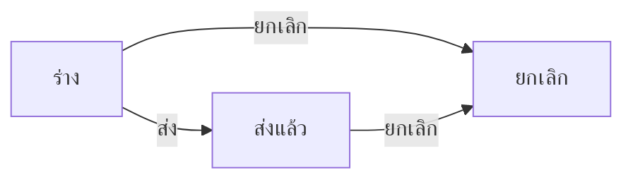

# BRD: แบบประเมินความพึงพอใจลูกค้า (Customer Satisfaction Evaluation)

| Field | Value |
|---|---|
| BRD ID | BRD-TMP-001 (ชั่วคราว) |
| Feature | F-TMP-001 แบบประเมินความพึงพอใจลูกค้า (รหัส feature ชั่วคราว — รอเลขจริง) |
| BRD Type | New Feature (แบบ 2 · ดึงข้อมูลเดิม — ชื่อบริษัทจาก Organization) |
| Version | 1.0 |
| Status | **APPROVED (Prebrief Mode · Lane / unattended)** — DEC แทน Scope Lock จนมีใบเซ็นลูกค้า |
| Module | Sales · ลูกค้าสัมพันธ์ (Core Cube) |
| Customer form | FM-SAL-06 Rev.00: 01/07/2569 (`แบบประเมินความพึงพอใจลูกค้า.docx`) |
| Request | REQ-TMP-001 (ชั่วคราว — รอเลขจริงจาก F186) |
| Input | PREBRIEF_REQ-TMP-001_v2 · FORM_SPEC.json (12 ช่อง) · DECISIONS.lock (13 DEC · พร้อมเริ่มทำ · AI-DEFAULT 10) · feature.html (audit FAIL 0 · e2e: [NO-BROWSER] ยังไม่รัน) |
| Created | 2026-10-08 |

## Changelog
- v1.0 (2026-10-08): สร้างผ่าน brd-generator-full v2.3 Prebrief Mode (doc-master-pipeline ขั้น 7 · โหมดไม่เฝ้า)

---

## 1. Business Context
### 1.1 ปัญหา / โอกาส
ฝ่ายขายเก็บความพึงพอใจของห้าง/ร้านค้าคู่ค้าด้วยแบบฟอร์มกระดาษ/Word FM-SAL-06 — ผลอยู่กระจัดกระจาย รวมคะแนนไม่ได้ · ชื่อบริษัทบนกระดาษไม่ตรงกันเอง (หัวเรื่อง "จำกัด (มหาชน)" vs ข้อ 2 "จำกัด") · ช่วงปีทับกัน (1-3 / 3-5)
### 1.2 เป้าหมาย
1. ขึ้นแบบฟอร์มเป็นเอกสารในระบบ ช่องตรงกระดาษ 1:1 ลูกค้าจำแบบเดิมได้ (PDF Replica FM-SAL-06)
2. คะแนน 9 หัวข้อเป็นตัวเลข 1–5 ครบทุกข้อ ส่งออก CSV ได้ — ผู้จัดการฝ่ายขายเห็นทุกใบ
3. ชื่อบริษัทดึงจาก Organization ค่าเดียว (แก้ความไม่ตรงในต้นฉบับ)
### 1.3 ตัวชี้วัด
ไม่มีใน input → **OQ-01** (ห้ามแต่งตัวเลข)
### 1.4 ที่มา
แบบฟอร์มลูกค้า FM-SAL-06 (docx) → FORM_SPEC 12 ช่อง · gate 10 หมวด ตอบโดย AI ตาม unattended-policy (AI-DEFAULT ทุกหมวด · รอลูกค้ายืนยัน)

## 2. Scope
### 2.1 In Scope
- รายการแบบประเมิน (ค้นหา · กรอง สถานะ/ประเภทธุรกิจ · CSV) · สร้าง/แก้ร่าง wizard 3 ขั้น · ดูรายละเอียด 4 แท็บ (รายละเอียด › PDF Preview › ลายเซ็น / อนุมัติ › ประวัติ)
- ส่วนที่ 1 ข้อมูลทั่วไป (ข้อ 1–4) · ส่วนที่ 2 คะแนน 9 หัวข้อ (1–5) · ส่วนที่ 3 ข้อเสนอแนะ
- ส่งแบบประเมิน (ไม่มีสายพิจารณา — DEC-03) · ยกเลิก (เหตุผลบังคับ) · แนบไฟล์ · PDF FM-SAL-06 Replica ทุกสถานะ · เลขที่ CSE จาก ENG-DOC-NUM
### 2.2 Out of Scope
- ให้ห้าง/ร้านค้าตอบเองผ่านลิงก์/portal (ผู้ประเมิน = ผู้บันทึกในระบบ · OQ-04) · รายงานสรุปคะแนน/แดชบอร์ด · ส่งผลต่อ CRM/Customer master (DEC-02) · ทำซ้ำเอกสาร · ประกาศ (DEC-10)
### 2.3 Assumptions
- Organization.legal_name + โลโก้มีใน Core · Customer master (Sales › Customer) ใช้เป็นตัวช่วยเลือกชื่อร้าน (ไม่บังคับ)
### 2.4 Scope Lock (ชั่วคราว = DECISIONS.lock · ยังไม่มีใบเซ็น → OQ-02)
| DEC | หมวด | มติ | ที่มา |
|---|---|---|---|
| DEC-01 | G1 | ไม่เปลี่ยนค่าในระบบเมื่อส่ง | AI-DEFAULT |
| DEC-02 | G1 | ไม่ส่งต่อระบบอื่นรอบนี้ (ประกาศ event ไว้ใน FRD แต่ไม่ยิง) | AI-DEFAULT |
| DEC-03 | G2 | ไม่มีสายพิจารณา — กระดาษมีช่องลงชื่อแค่ "ผู้ประเมิน" | AI-DEFAULT |
| DEC-04 | G3 | ไม่มีสูตร/ค่าคงที่บนกระดาษ · ชื่อบริษัทหัวเรื่อง + ข้อ 2 ดึง Organization.legal_name ค่าเดียวกัน | AI-DEFAULT |
| DEC-05 | G4 | ไม่มีรายการซ้ำ (ตาราง 9 หัวข้อคงที่) | AI-DEFAULT |
| DEC-06 | G5 | ช่องตรงกระดาษ 1:1 · ไม่เพิ่มช่อง | AI-DEFAULT |
| DEC-07 | G6 | ช่องลงชื่อผู้ประเมิน 1 ช่อง · ข้อความ "ส่งในระบบ วันที่ เวลา" ไม่ใช้ภาพ | AI-DEFAULT |
| DEC-08 | G8 | มองเห็น: เจ้าของ · admin role ฝ่ายขาย (role-mgr-sales) เห็นทั้งหมด | AI-DEFAULT |
| DEC-09 | G9 | ออกเลขเมื่อบันทึกครั้งแรก · รหัส CSE | AI-DEFAULT |
| DEC-10 | G10 | แนบไฟล์ ✓ · CSV ✓ · ทำซ้ำ ✗ · ประกาศ ✗ | AI-DEFAULT |
| DEC-11 | VALID | ชื่อบริษัททั้งสองจุดจาก Organization.legal_name (ต้นฉบับ "จำกัด (มหาชน)" ≠ "จำกัด") | FORM_SPEC |
| DEC-12 | VALID | ระยะเวลาเลือกได้ 1 ตัว · ตีความ 1–<3 / 3–5 / >5 ปี (คำบนกระดาษคงเดิม) | FORM_SPEC |
| DEC-13 | VALID | คะแนนจำนวนเต็ม 1–5 · ครบ 9 ข้อก่อนส่ง | FORM_SPEC |
หมายเหตุ G7 (ยกเลิก): ไม่มีสายพิจารณา จึงไม่มี DEC แยก — ใช้ค่า gate: ยกเลิกได้โดยเจ้าของ + admin role · สถานะ ร่าง/ส่งแล้ว · เหตุผลบังคับ [AI-DEFAULT]

## 3. Roles & Permissions (COSO)
| Role | COSO | ทำอะไร |
|---|---|---|
| เจ้าหน้าที่ขาย (ผู้ประเมิน/ผู้บันทึก) | Maker | สร้าง/แก้ร่างของตน · ส่ง · ยกเลิกของตน |
| role-mgr-sales (ผู้จัดการฝ่ายขาย) | Monitor (admin role) | เห็นทุกใบ · ยกเลิกได้ · CSV |
| ระบบ | — | ออกเลข · snapshot ชื่อบริษัท · render PDF |

| Action | Maker | role-mgr-sales | อื่น |
|---|:-:|:-:|:-:|
| ดูใบ | ของตน | ทั้งหมด | ✗ |
| สร้าง/แก้ร่าง | ✓ ของตน | – | – |
| ส่ง | ✓ ของตน | – | – |
| ยกเลิก | ✓ ของตน | ✓ | – |
SoD: ไม่มีขั้นพิจารณา (DEC-03) — การควบคุมคือ audit append-only + admin role ตรวจย้อนหลัง

## 4. User Journey
### 4.1 Happy Path
1. ผู้บันทึก: สร้าง → ข้อ 1 เลือกร้านจากทะเบียนลูกค้า/พิมพ์ชื่อ → ข้อ 3 ประเภทธุรกิจ → ข้อ 4 ระยะเวลา → ให้คะแนน 9 หัวข้อ → ข้อเสนอแนะ (ไม่บังคับ) → แนบไฟล์ (ไม่บังคับ) → ตรวจสอบ → บันทึกและส่ง → **ส่งแล้ว** (ได้เลข CSE ตอนบันทึกครั้งแรก)
### 4.2 Alternative
- บันทึกแบบร่าง (ต้องมีชื่อห้าง/ร้านค้า) → กลับมาแก้ → ส่ง
- ยกเลิก (ร่าง/ส่งแล้ว) โดยเจ้าของหรือผู้จัดการฝ่ายขาย พร้อมเหตุผล

## 5. Data (จาก FORM_SPEC — ป้ายตามกระดาษ)
### 5.1 customer_satisfaction (header)
| ช่องบนกระดาษ | field | ชนิด | ที่มา | บังคับ |
|---|---|---|---|:-:|
| (เลขที่ — footer ระบบ) | doc_no | text | auto ENG-DOC-NUM | ✓ |
| 1. ชื่อห้าง/ร้านค้า: | store_name (+ customer_id ถ้าเลือกจากทะเบียน) | text / ref | user | ✓ |
| 2. ชื่อบริษัทคู่ค้า: | header_snapshot.legal_name | text | system Organization (อ่านอย่างเดียว) | ✓ |
| 3. ประเภทธุรกิจของบริษัทคู่ค้า: | business_type | enum(hypermarket, supermarket, wholesales, convenience) | user | ✓ ส่ง |
| 4. ระยะเวลาที่ทำธุรกิจกับบริษัทคู่ค้า: | relationship_years | enum(lt1, 1-3, 3-5, gt5) | user | ✓ ส่ง |
| ตาราง 9 หัวข้อ · คะแนน (1-5) | rating_quality · rating_on_time_delivery · rating_stock_replenishment · rating_communication · rating_trade_terms · rating_marketing_support · rating_after_sales · rating_sales_professionalism · rating_overall | smallint 1–5 | user | ✓ ส่ง |
| ข้อเสนอแนะ | suggestion | text | user | – |
| ผู้ประเมิน (ลงชื่อ) | owner_id + submitted_at | ref / timestamp | system | ✓ ส่ง |
### 5.2 audit (append-only) · 5.3 ไฟล์แนบ → Document Center

## 6. User Stories
| ID | Story | AC หลัก |
|---|---|---|
| S-01 | ผู้บันทึกระบุห้าง/ร้านค้า | เลือกจากทะเบียน หรือพิมพ์เอง · บังคับ |
| S-02 | ผู้บันทึกเลือกประเภทธุรกิจ | เลือก 1 จาก 4 |
| S-03 | ผู้บันทึกเลือกระยะเวลาที่ทำธุรกิจ | เลือก 1 จาก 4 |
| S-04 | ผู้บันทึกให้คะแนน 9 หัวข้อ | 1–5 จำนวนเต็ม · ครบ 9 ก่อนส่ง |
| S-05 | ผู้บันทึกเขียนข้อเสนอแนะ | ไม่บังคับ · PDF ตัดบรรทัด |
| S-06 | ผู้บันทึกแนบไฟล์ | PDF/JPG/PNG ≤10 MB |
| S-07 | ผู้บันทึกส่งแบบประเมิน | ครบตามกฎ → ส่งแล้ว · ลงชื่อ "ส่งในระบบ" |
| S-08 | ผู้บันทึกบันทึกร่าง | ได้เลข CSE ตอนบันทึกครั้งแรก |
| S-09 | ผู้ใช้พิมพ์ PDF FM-SAL-06 | ทุกสถานะ · ร่างมีป้าย "ร่าง" |
| S-10 | เจ้าของหรือผู้จัดการยกเลิก | เหตุผลบังคับ |
| S-11 | ผู้จัดการฝ่ายขายดูทุกใบ | ไม่เห็น = คนอื่น |
| S-12 | ผู้จัดการฝ่ายขายส่งออก CSV | ตามตัวกรอง |

## 7. Status & Lifecycle
| จาก | Action | ไป | ใคร |
|---|---|---|---|
| — | บันทึกครั้งแรก | draft | Maker |
| draft | ส่ง | submitted | Maker |
| draft / submitted | ยกเลิก | cancelled | Maker / role-mgr-sales |
submitted = ล็อกแก้ไข

## 8. Business Rules + Validation
| ID | Rule | Tag | Type |
|---|---|:-:|---|
| BR-01 | ชื่อบริษัท (หัวเรื่อง + ข้อ 2) = Organization.legal_name snapshot ตอนออกเลข | CONFIGURABLE | Master (DEC-04 · DEC-11) [AI-DEFAULT] |
| BR-02 | ประเภทธุรกิจ/ระยะเวลา เลือกได้ 1 ตัว | FIXED | DEC-12 |
| BR-03 | คะแนน 1–5 จำนวนเต็ม ครบ 9 ข้อก่อนส่ง · ร่างไม่บังคับ | FIXED | DEC-13 |
| BR-04 | ส่งแล้ว = เสร็จ (ไม่มีขั้นพิจารณา) · แก้ไม่ได้ | FIXED | DEC-03 [AI-DEFAULT] |
| BR-05 | ออกเลขตอนบันทึกครั้งแรก · no-gap ✗ | CONFIGURABLE | DEC-09 · F-DOCCFG |
| BR-06 | ร่างเห็นเฉพาะเจ้าของ (+ role-mgr-sales) | FIXED | DEC-08 |
| BR-07 | ยกเลิก: เจ้าของ/role-mgr-sales · ร่างหรือส่งแล้ว · เหตุผลบังคับ | CONFIGURABLE | G7 [AI-DEFAULT] |
| BR-08 | ช่องลงชื่อ PDF = ผู้ประเมิน 1 ช่อง วนจากข้อมูล (ไม่ fix) | FIXED | DEC-07 |
| BR-09 | ช่อง 1:1 ไม่เพิ่มช่อง · คำบนกระดาษคงเดิม | FIXED | DEC-06 |

| VR | ช่อง | เงื่อนไข | ข้อความ |
|---|---|---|---|
| VR-01 | store_name | required (ร่าง+ส่ง) | กรุณาระบุชื่อห้าง/ร้านค้า |
| VR-02 | business_type | required (ส่ง) | กรุณาเลือกประเภทธุรกิจ 1 ข้อ |
| VR-03 | relationship_years | required (ส่ง) | กรุณาเลือกระยะเวลาที่ทำธุรกิจ 1 ข้อ |
| VR-04 | rating_* ×9 | 1–5 ครบ (ส่ง) | ยังไม่ได้ให้คะแนน N หัวข้อ — ต้องครบ 9 หัวข้อ (คะแนน 1–5) ก่อนส่ง |
| VR-05 | เหตุผลยกเลิก | required | กรุณาระบุเหตุผล |
| VR-06 | ไฟล์แนบ | pdf/jpg/png ≤10 MB | ไฟล์ไม่ผ่านเงื่อนไข |
### 8.5 ระดับความยืดหยุ่น
BR-01 → Organization master (✅ มีอยู่แล้ว) · BR-05 → F-DOCCFG (✅) · BR-07 → ค่าตั้งของ feature (🤖 เสนอ → OQ-02)

## 9. Edge Cases
| EC | กรณี | ผล |
|---|---|---|
| EC-01 | ร้านยังไม่อยู่ในทะเบียนลูกค้า | พิมพ์ชื่อเอง customer_id ว่าง |
| EC-02 | ระยะเวลา 3 ปีพอดี | เลือก "3-5 ปี" (DEC-12) |
| EC-03 | ให้คะแนนไม่ครบแล้วกดส่ง | บล็อก + แถวแดง |
| EC-04 | ข้อเสนอแนะยาวมาก | PDF dense ยัง 1 หน้า (รอยืนยันเมื่อ render ได้ — NO-BROWSER) |
| EC-05 | Organization เปลี่ยนชื่อหลังออกเลข | ใบเดิมใช้ header_snapshot |
| EC-06 | แบบเอกสารปิดใช้ (F-DOCCFG) | ปุ่มสร้าง disabled + แถบแดง |
| EC-07 | ส่ง/ยกเลิกชนกัน (stale) | 409 สถานะไม่เปลี่ยน |
| EC-08 | DOA กลางเพิ่มขั้นให้แบบเอกสารนี้ภายหลัง | เป็นงาน enhancement (ทำ DOA_BRIEF + state รอพิจารณา) — prototype มี hook รองรับ |

## 10. Value Stream & Downstream Impact
Positioning: Sales › ลูกค้าสัมพันธ์ — เยี่ยมร้าน/ดูแลคู่ค้า → **แบบประเมิน (feature นี้)** → [รายงานความพึงพอใจ — ปิดรอบนี้]
| ปลายทาง | ข้อมูล | Trigger | หมายเหตุ |
|---|---|---|---|
| ผู้จัดการฝ่ายขาย | แจ้งมีแบบประเมินใหม่ | submitted | ENG-NOTIFY `cse_submitted` |
| CRM / Customer master | คะแนนต่อลูกค้า | submitted | **ปิดรอบนี้ (DEC-02)** — ประกาศ event ใน FRD ไม่ยิง |
| F-DOCCFG / ENG-DOC-STORE | PDF | — | ไม่เก็บสำเนา (snapshot ✗) |
| รายงาน | คะแนนเฉลี่ยต่อหัวข้อ/ประเภทธุรกิจ | — | Report area อ่าน (Phase 2) |

## 11. Delivery
Phase 1 = §2.1 · Phase 2 (เสนอ) = รายงานสรุปคะแนน · ให้ร้านค้าตอบเองผ่านลิงก์ · ผูกคะแนนเข้า Customer

## 12. Dev Summary "ใบสั่ง"
- Config: Organization.legal_name/logo (✅) · doc_type CSE (F-DOCCFG) · DOA entry ไม่ต้องตั้ง (DEC-03)
- Declaration: DOCCFG_BRIEF · MDOC_BRIEF · NTF_BRIEF (ฉบับจริงหลัง FRD) · ไม่มี DOA_BRIEF
- Screen Inventory: P-01 รายการ · P-02 สร้าง/แก้ (drawer wide 3 ขั้น) · P-03 ดู (drawer 4 แท็บ) · M-01 ส่ง · M-02 ยกเลิก · M-03 ทิ้งข้อมูล
- UI Signals: เอกสาร + พิมพ์ = ใช่ · Q-form

## 13. Open Questions
| OQ | คำถาม | เจ้าของ | Block? |
|---|---|---|---|
| OQ-01 | ตัวชี้วัดความสำเร็จ (จำนวนแบบประเมิน/เดือน · คะแนนเฉลี่ยเป้าหมาย) | ลูกค้า | ไม่ |
| OQ-02 | ลูกค้าเซ็นยืนยัน DEC-01..10 (AI-DEFAULT) — โดยเฉพาะ ไม่มีสายพิจารณา · ใครยกเลิกได้ · ผู้จัดการฝ่ายขายเห็นทุกใบ | ทีม BA → ลูกค้า | ก่อน UAT |
| OQ-03 | รหัสคำขอ/feature/BRD ชั่วคราว (REQ-TMP-001 · F-TMP-001) → เลขจริง · function_code taxonomy | ทีม BA | ก่อน register |
| OQ-04 | ผู้ประเมิน = ผู้บันทึกในระบบ ใช่ไหม (หรือให้ร้านค้าตอบเองผ่านลิงก์) | ลูกค้า | ก่อน UAT |
| OQ-05 | ชื่อบริษัทที่ถูกต้อง "จำกัด" หรือ "จำกัด (มหาชน)" (ระบบใช้ค่าจาก Organization) | ลูกค้า | ไม่ |

## 14. Security & Compliance
Preset: Standard Internal · PII: ไม่มีช่อง PII บนกระดาษ (ชื่อผู้บันทึกเป็นข้อมูลพนักงานในระบบ) · ข้อมูลตัวอย่างใน prototype เป็นข้อมูลสมมติ · Audit append-only ทุก action · ไฟล์แนบตาม Document Center

## 15. Health Check / Monitoring
SLA: ไม่มีขั้นพิจารณา · KPI เสนอ (รอ OQ-01): จำนวนแบบประเมินที่ส่ง/เดือน · คะแนนเฉลี่ยรายหัวข้อ · ร่างค้างเกิน N วัน

## 16. AI Review Report
| ข้อ | ผล |
|---|---|
| C01 Objective · C02 Roles · C03 Scope · C04 Journey | ✅ |
| C05 Story ไม่มี "และ" · C06 AC (ใน FRD 06 Given/When/Then) | ✅ |
| C07 Data · C08 Audit fields · C09 Status | ✅ |
| C10 Tag ครบ · C11 ความยืดหยุ่น · C12 Validation | ✅ |
| C13 Edge cases · C14 แยก FORM_SPEC/AI | ✅ |
| C15 Dependencies · C16 Registry (FEATURE_REGISTRY: ไม่มี feature เดิมตรง → เสนอใหม่) · C17 Delivery | ✅ |
| C18 WARNING มีแผน (OQ-01..05) · C19 ใบสั่ง | ✅ |
| C20 Scope Lock = DEC ครบ 13 + OQ-02 รอใบเซ็น (Prebrief Mode) | ✅ |
| C21 Value stream · C22 ตัวชี้วัด → OQ-01 (Prebrief Mode ห้ามแต่งตัวเลข) · C23 marker | ✅ |
| PE01 COSO · PE02 SoD (ไม่มีขั้นพิจารณา — audit + admin role) · PE03 Security · PE04 Health · PE05 Cross-section | ✅ |
**สถานะ: ✅ APPROVED** — พร้อมเข้า frd-generator-v6

## Appendix — Screen List
P-01 `#/customer-satisfaction` · P-02 `#/customer-satisfaction/new` (+ แก้ร่างจากเมนู) · P-03 `#/customer-satisfaction/view/:id`
