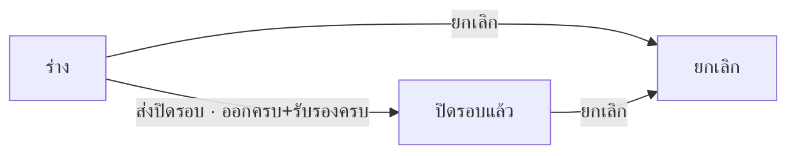

# BRD: รายงานการเข้า-ออก ห้อง server (Server Room Access Log)

| Field | Value |
|---|---|
| BRD ID | BRD-ITS-SRAL-001 |
| Feature | F-TMP-006 รายงานการเข้า-ออก ห้อง server (รหัสชั่วคราว — feature ใหม่ใต้ IT Support · เสนอใน _BATCH_REPORT) |
| BRD Type | New Feature (แบบ 1 · Standalone — ชื่อพนักงาน/ฝ่ายเลือกจาก F-EMP-001 ได้ แต่เก็บเป็นค่าในเอกสาร) |
| Version | 1.0 |
| Status | **APPROVED (Prebrief Mode · Lane · unattended)** — DEC แทน Scope Lock จนมีใบเซ็นลูกค้า · มติทั้งหมด AI-DEFAULT |
| Module | IT Support (Core) |
| Customer form | FM-ITS-09 Rev.00 : 01/07/2569 (ฝ่ายเทคโนโลยีสารสนเทศ) |
| Request | REQ-TMP-006 (ชั่วคราว — รอเลขจริงจาก F186) |
| Input | PREBRIEF_REQ-TMP-006_v2 · FORM_SPEC.json (9 ช่อง) · DECISIONS.lock (14 DEC · พร้อมเริ่มทำ) · feature.html (audit FAIL 0 · jsdom smoke 46/46 · NO-BROWSER) |
| Created | 2026-10-10 |

## Changelog
- v1.0 (2026-10-10): สร้างผ่าน brd-generator-full v2.3 Prebrief Mode (doc-master-pipeline ขั้น 7 · โหมดไม่เฝ้า)

---

## 1. Business Context
### 1.1 ปัญหา / โอกาส
ฝ่าย IT คุมการเข้า-ออกห้อง server ด้วยแบบฟอร์ม Excel/กระดาษ FM-ITS-09 (21 แถวต่อแผ่น) — ไม่รู้ทันทีว่าใครยังอยู่ในห้อง · ลืมลงเวลาออก · ลายเซ็นผู้รับรองตามหลังหรือไม่มี · ค้นย้อนหลังว่าใครเข้าเมื่อไรเพราะอะไรได้ยาก (ใช้ตอบ audit ด้าน IT security)
### 1.2 เป้าหมาย
1. ขึ้นแบบฟอร์มเป็นเอกสารในระบบ ช่องตรงกระดาษ 1:1 (PDF Replica — ตาราง 9 คอลัมน์)
2. ทุกการเข้าห้องมีลายเซ็นผู้เข้า (ลงชื่อในระบบ) และผู้รับรอง = เจ้าหน้าที่ IT ที่ไม่ใช่ผู้เข้าคนเดียวกัน (SoD)
3. เห็นทันทีว่าใครยังอยู่ในห้อง / อยู่นานเกินเกณฑ์ (เกณฑ์จากการตั้งค่า ไม่ hardcode) · ปิดรอบได้เมื่อทุกแถวออกครบและรับรองครบ
### 1.3 ตัวชี้วัด
ไม่มีใน input → **OQ-01** (ห้ามแต่งตัวเลข)
### 1.4 ที่มา
แบบฟอร์มลูกค้า FM-ITS-09 (xlsx) → FORM_SPEC 9 ช่อง (แถวซ้ำ 1 กลุ่ม 21 แถว · ลายเซ็นต่อแถว 2 จุด) · gate 10 หมวด ตอบเองตาม unattended-policy = AI-DEFAULT ทั้งหมด

## 2. Scope
### 2.1 In Scope
- รายการรายงาน (แท็บสถานะ · ค้นหา · กรองสถานะรับรอง/ผู้บันทึก · CSV) · สร้าง/แก้ร่าง wizard 3 ขั้น (ตารางกรอกการเข้า-ออก) · ดูรายละเอียด 4 แท็บ (รายละเอียด › PDF › ลายเซ็น/รับรอง › ประวัติ)
- ลายเซ็นผู้เข้า = ลงชื่อในระบบตอนบันทึก · รับรองรายแถวโดยเจ้าหน้าที่ IT (≠ ผู้เข้า)
- ตรวจเวลา (ออกก่อนเข้า = บล็อก · อยู่นานเกินเกณฑ์ = เตือน) · แจ้งเจ้าหน้าที่ IT เมื่อมีแถวรอรับรอง / อยู่เกินเวลา (ENG-NOTIFY)
- ส่งปิดรอบ (ไม่มีขั้นอนุมัติ = ปิดทันที · ต้องออกครบ + รับรองครบ) · ยกเลิก (เหตุผลบังคับ)
- แนบไฟล์ · PDF FM-ITS-09 Replica 2 หน้า (R10) ทุกสถานะ · เลขที่ SRAL จาก ENG-DOC-NUM
### 2.2 Out of Scope
- เชื่อมระบบประตู/บัตรผ่าน/กล้อง (DEC-02 · เสนอ Phase 2) · ขออนุมัติล่วงหน้าก่อนเข้าห้อง (DEC-03 รอยืนยัน OQ-02) · หลายห้อง server ในใบเดียว (กระดาษไม่มีช่องห้อง) · ทำซ้ำเอกสาร · ลายมือชื่อภาพ
### 2.3 Assumptions
- ผู้บันทึก/เจ้าของรายงาน = เจ้าหน้าที่ IT ผู้ดูแลห้อง · บุคคลภายนอก (ผู้รับเหมา) ให้เจ้าหน้าที่ IT บันทึกแทน แล้ว "ลงชื่อในระบบ" ในนามผู้เข้า · ServerRoomAccessConfig.max_stay_hours ยังไม่มี → ต้องสร้าง (OQ-04) · 1 ใบ = 1 รอบ (ปกติ 1 เดือน)
### 2.4 Scope Lock (ชั่วคราว = DECISIONS.lock · ยังไม่มีใบเซ็น → OQ-02)
| DEC | หมวด | มติ | ที่มา |
|---|---|---|---|
| DEC-01 | G1 | ไม่เปลี่ยนค่าในระบบ | AI-DEFAULT |
| DEC-02 | G1 | ไม่ส่งต่อระบบอื่นรอบนี้ (ไม่เชื่อมระบบประตู/บัตร) | AI-DEFAULT |
| DEC-03 | G2 | ไม่มีการอนุมัติเอกสาร (กระดาษไม่มีช่องผู้อนุมัติท้ายใบ) — ไม่มี DOA · ลายเซ็นผู้รับรองเป็นการรับรองรายแถว | AI-DEFAULT |
| DEC-04 | G3 | ออกก่อนเข้า = บล็อก · อยู่นานเกิน max_stay_hours (ค่าเริ่ม 12 ชม. จาก config) / แถวค้างซ้อน = เตือน · ปิดรอบต้องออกครบ + รับรองครบ · ผู้รับรอง ≠ ผู้เข้า | AI-DEFAULT |
| DEC-05 | G4 | ไม่จำกัดแถว · PDF ≥ 21 แถวตามกระดาษ | AI-DEFAULT |
| DEC-06 | G5 | ช่อง 1:1 (9 คอลัมน์) ไม่เพิ่มช่อง | AI-DEFAULT |
| DEC-07 | G6 | ไม่มีช่องลงชื่อท้ายใบ · ลายเซ็นผู้เข้า/ผู้รับรอง = ข้อความระบบต่อแถว (ชื่อ + วันเวลา) · ไม่ใช้ภาพ | AI-DEFAULT |
| DEC-08 | G8 | เจ้าของ · admin role ฝ่าย IT เห็นทั้งหมด | AI-DEFAULT |
| DEC-09 | G9 | ออกเลขตอนบันทึกครั้งแรก · รหัส SRAL | AI-DEFAULT |
| DEC-10 | G10 | แนบไฟล์ ✓ · CSV ✓ · ทำซ้ำ ✗ · ประกาศ ✗ | AI-DEFAULT |
| DEC-11 | VALID | ลูกค้ายืนยันว่าต้องขออนุมัติก่อนเข้าห้องหรือไม่ (รอบนี้ = รับรองต่อแถว ไม่มี DOA) | FORM_SPEC |
| DEC-12 | VALID | วันเวลาออกต้องไม่ก่อนวันเวลาเข้า → บล็อก · อยู่ในห้องเกิน 12 ชม. → เตือน | FORM_SPEC |
| DEC-13 | VALID | ผู้รับรอง = เจ้าหน้าที่ IT ผู้ดูแลห้อง และไม่ใช่ผู้เข้าคนเดียวกัน (SoD) | FORM_SPEC |
| DEC-14 | VALID | ตัดช่องว่างท้ายหัวคอลัมน์ "เหตุผลการเข้าใช้" | FORM_SPEC |

## 3. Roles & Permissions (COSO)
| Role | COSO | ทำอะไร |
|---|---|---|
| เจ้าหน้าที่ IT ผู้บันทึก (role-it-officer · เจ้าของรายงาน) | Maker | สร้าง/แก้ร่าง (บันทึกการเข้า-ออก) · รับรองแถวของคนอื่น · ส่งปิดรอบ · ยกเลิกของตัวเอง |
| เจ้าหน้าที่ IT ผู้รับรอง (role-it-officer) | Checker (รายแถว) | รับรองแถวที่ผู้เข้าออกแล้ว · รับรองแถวของตัวเองไม่ได้ |
| admin role ฝ่าย IT (ผู้ดูแลห้อง server) | Monitor + Checker | เห็นทุกใบ · รับรองแถวของเจ้าหน้าที่ IT ที่เข้าห้องเอง · รับแจ้งเตือน · ยกเลิกได้ |
| ผู้อนุมัติ | — | ไม่มีรอบนี้ (DEC-03) — ถ้าลูกค้ายืนยัน (OQ-02) = enhancement + DOA_BRIEF |

| Action | Maker (owner) | admin role IT | คนอื่น |
|---|:-:|:-:|:-:|
| ดูใบ | ของตน | ทั้งหมด | ✗ |
| สร้าง/แก้ร่าง | ✓ ของตน | – | – |
| รับรองแถว (ผู้เข้า ≠ ตัวเอง · ออกแล้ว · ร่าง) | ✓ | ✓ | ✗ |
| ส่งปิดรอบ | ✓ ของตน | – | – |
| ยกเลิก (ร่าง/ปิดรอบแล้ว) | ✓ ของตน | ✓ | ✗ |
SoD: ผู้รับรองต้องไม่ใช่ผู้เข้าคนเดียวกัน (preventive · ตรวจฝั่ง server) · ไม่มีขั้นอนุมัติเอกสาร → ระดับเอกสารใช้ detective control (แจ้งเตือน + audit append-only)

## 4. User Journey
### 4.1 Happy Path
1. เจ้าหน้าที่ IT สร้างรายงานต้นเดือน → แถวแรกวันนี้/เวลาปัจจุบัน → เลือกชื่อพนักงาน (ฝ่ายเติมให้) หรือพิมพ์ชื่อบุคคลภายนอก → เหตุผลการเข้าใช้ → บันทึกแบบร่าง (ได้เลข SRAL · ลายเซ็นผู้เข้า = ลงชื่อในระบบ)
2. ผู้เข้าออกจากห้อง → เปิดแก้ร่าง บันทึกวันที่/เวลาที่ออก
3. เจ้าหน้าที่ IT ที่ไม่ใช่ผู้เข้า กด "รับรอง" ในแถว (แท็บรายละเอียดหรือลายเซ็น/รับรอง)
4. ครบรอบ + ทุกแถวออกครบ/รับรองครบ → ส่งปิดรอบ → **ปิดรอบแล้ว** (ล็อกแก้ไข) · PDF 2 หน้าพร้อมพิมพ์
### 4.2 Alternative
- ยังไม่บันทึกออก / ยังไม่รับรอง → ปุ่มส่งปิดรอบบล็อก + บอกจำนวนที่ค้าง
- เวลาออกก่อนเวลาเข้า → บันทึกไม่ได้
- อยู่ในห้องเกิน 12 ชม. → แถวไฮไลต์ + แจ้งผู้ดูแล (sral_overstay) ไม่บล็อก
- ยกเลิก (ร่าง/ปิดรอบแล้ว) โดยเจ้าของหรือ admin role · เหตุผลบังคับ

## 5. Data (จาก FORM_SPEC — ป้ายตามกระดาษ)
### 5.1 server_room_access (header)
| ช่อง | field | ชนิด | ที่มา | บังคับ |
|---|---|---|---|:-:|
| เลขที่ (ระบบเพิ่ม · footer) | doc_no | text | auto ENG-DOC-NUM | ✓ |
| วันที่สร้าง | doc_date | date | auto | ✓ |
| ผู้บันทึก | owner_id → snapshot | ref | system F-EMP-001 | ✓ |
### 5.2 server_room_access_entry (แถวซ้ำ — 1 แถว/การเข้าห้อง 1 ครั้ง)
| ช่องบนกระดาษ | field | ชนิด | บังคับ |
|---|---|---|:-:|
| ชื่อ–นามสกุล | visitor_name (+ visitor_emp_id ถ้าเป็นพนักงาน) | text ≤ 120 · ref F-EMP-001 nullable | ✓ |
| ฝ่าย/แผนก | visitor_department | text ≤ 120 (พนักงาน = เติมจาก Employee แก้ได้) | ✓ |
| วันที่เข้า · เวลาที่เข้า | in_date · in_time | date · time (HH:MM) | ✓ |
| วันที่ออก · เวลาที่ออก | out_date · out_time | date · time · nullable ระหว่างอยู่ในห้อง | ปิดรอบ ✓ |
| เหตุผลการเข้าใช้ | purpose | text ≤ 300 | ✓ |
| ลายเซ็นผู้เข้า | visitor_signed_by · visitor_signed_at | ref ผู้บันทึก + timestamp (ข้อความ "ลงชื่อในระบบ") | ✓ auto |
| ลายเซ็นผู้รับรอง | certified_by · certified_at | ref F-EMP-001 (role-it-officer) + timestamp | ปิดรอบ ✓ |
### 5.3 attachments → Document Center (ไฟล์ระดับใบ)

## 6. User Stories
| ID | Story | AC หลัก |
|---|---|---|
| S-01 | เจ้าหน้าที่ IT เปิดรายงานของรอบ | แถวแรกวันนี้/เวลาปัจจุบัน · บันทึกได้เลข SRAL |
| S-02 | เจ้าหน้าที่ IT บันทึกการเข้าห้อง | ชื่อ/ฝ่าย/วันเวลาเข้า/เหตุผล บังคับ · ลงชื่อผู้เข้าในระบบอัตโนมัติ |
| S-03 | เจ้าหน้าที่ IT บันทึกเวลาออก | ออกก่อนเข้า = บล็อก · เกินเวลา = เตือน |
| S-04 | เจ้าหน้าที่ IT รับรองแถว | ผู้รับรอง ≠ ผู้เข้า · แถวต้องออกแล้ว · ชื่อ+เวลาลงแถว |
| S-05 | เจ้าหน้าที่ IT ส่งปิดรอบ | ออกครบ + รับรองครบ · 0 ขั้น = ปิดทันที ล็อกแก้ไข |
| S-06 | ผู้ใช้พิมพ์ PDF FM-ITS-09 | 2 หน้า · หัวตารางซ้ำ · ≥21 แถว · หน้า X/2 |
| S-07 | เจ้าของ/ผู้ดูแลยกเลิกใบ | ร่างหรือปิดรอบแล้ว · เหตุผลบังคับ |
| S-08 | ผู้ดูแลดูทุกใบ + CSV | แท็บสถานะ · กรองสถานะรับรอง/ผู้บันทึก |

## 7. Status & Lifecycle
| จาก | Action | ไป | ใคร |
|---|---|---|---|
| — | บันทึกครั้งแรก | draft | Maker |
| draft | บันทึก (เพิ่ม/แก้แถว · บันทึกออก) | draft | Maker |
| draft | รับรองแถว | draft | role-it-officer (≠ ผู้เข้า) |
| draft | ส่งปิดรอบ (ออกครบ + รับรองครบ) | submitted (ปิดรอบแล้ว) | Maker |
| draft / submitted | ยกเลิก | cancelled | Maker / admin role |
submitted = ล็อกแก้ไข (ยกเลิกได้เพื่อทำใบใหม่) · แถวที่รับรองแล้วแก้ไข/ลบไม่ได้

## 8. Business Rules + Validation
| ID | Rule | Tag | Type |
|---|---|:-:|---|
| BR-01 | เกณฑ์เวลาอยู่ในห้องอ่านจาก ServerRoomAccessConfig.max_stay_hours (ค่าเริ่ม 12) | CONFIGURABLE | Threshold (DEC-04) |
| BR-02 | อยู่นานเกินเกณฑ์ / ผู้เข้าคนเดิมมีแถวค้างซ้อน = เตือน ไม่บล็อก | CONFIGURABLE [AI-DEFAULT] | Policy (DEC-04 · DEC-12) |
| BR-03 | วันเวลาออกก่อนวันเวลาเข้า = บล็อก | FIXED | Logic (DEC-12) |
| BR-04 | ลายเซ็นผู้เข้า = ลงชื่อในระบบตอนบันทึก (ผู้บันทึก + เวลา) · ไม่ใช้ภาพ | FIXED | DEC-07 |
| BR-05 | รับรองรายแถวได้เฉพาะ role-it-officer · ไม่ใช่ผู้เข้าคนเดียวกัน · แถวออกแล้ว · เอกสารเป็นร่าง | FIXED [AI-DEFAULT] | SoD (DEC-13) |
| BR-06 | ส่งปิดรอบได้เมื่อทุกแถวมีเวลาออกและผู้รับรอง · ไม่มีขั้นอนุมัติ (ไม่มี DOA) | FIXED [AI-DEFAULT] | DEC-03 · DEC-04 · DEC-11 |
| BR-07 | ออกเลขตอนบันทึกครั้งแรก · no-gap ✗ | CONFIGURABLE | DOCCFG (DEC-09) |
| BR-08 | ร่างเห็นเฉพาะเจ้าของ (+ admin role) | FIXED | Visibility (DEC-08) |
| BR-09 | ยกเลิกได้ที่ draft / submitted โดยเจ้าของหรือ admin role · เหตุผลบังคับ | FIXED [AI-DEFAULT] | G7 |
| BR-10 | PDF ≥ 21 แถว · 12 แถว/หน้า · หัวตารางซ้ำ · ไม่มีบล็อกลงชื่อท้ายใบ | FIXED | DEC-05 · DEC-07 · R10 |
| BR-11 | แถวที่รับรองแล้วแก้ไข/ลบไม่ได้ | FIXED [AI-DEFAULT] | Integrity |

| VR | ช่อง | เงื่อนไข | ข้อความ |
|---|---|---|---|
| VR-01 | ใบ | ≥ 1 แถวที่บันทึก | บันทึกการเข้าห้องอย่างน้อย 1 ครั้ง |
| VR-02 | visitor_name · visitor_department · in_date · in_time · purpose | required · เวลา HH:MM | กรอกชื่อ–นามสกุล · ฝ่าย/แผนก · วันที่และเวลาที่เข้า (HH:MM) · เหตุผลการเข้าใช้ ให้ครบทุกแถวที่บันทึก |
| VR-03 | out_date · out_time | กรอกคู่กัน · ≥ วันเวลาเข้า | วันเวลาที่ออกต้องไม่ก่อนวันเวลาที่เข้า |
| VR-04 | in_date · out_date | ≤ วันนี้ | (ปฏิทินปิดวันอนาคต) |
| VR-05 | เหตุผลยกเลิก | required | กรุณาระบุเหตุผล |
| VR-06 | ส่งปิดรอบ | status = draft · ผู้ส่ง = เจ้าของ · ออกครบ + รับรองครบ | ยังส่งปิดรอบไม่ได้ — ยังไม่บันทึกเวลาออก N รายการ · ยังไม่รับรอง N รายการ |

### 8.5 ระดับความยืดหยุ่น
BR-01/02 → ServerRoomAccessConfig (Admin) · แจ้งเตือน → ENG-NOTIFY preference · BR-07 → F-DOCCFG

## 9. Edge Cases
| EC | กรณี | ผล |
|---|---|---|
| EC-01 | ผู้เข้ายังอยู่ในห้อง (ไม่มีเวลาออก) | บันทึกร่างได้ · รับรองไม่ได้ · ปิดรอบไม่ได้ |
| EC-02 | อยู่ข้ามคืน (เข้า 20:00 ออกวันถัดไป 09:30) | ใช้วันที่ออกคนละวันได้ · คำนวณชั่วโมงข้ามวัน |
| EC-03 | อยู่เกิน 12 ชม. | ไฮไลต์ + sral_overstay · ไม่บล็อก |
| EC-04 | เจ้าหน้าที่ IT เข้าห้องเอง | ต้องให้เจ้าหน้าที่ IT คนอื่น/admin role รับรอง |
| EC-05 | บุคคลภายนอก (ผู้รับเหมา) | พิมพ์ชื่อเอง · ฝ่าย = ชื่อบริษัท · ไม่มี visitor_emp_id |
| EC-06 | > 24 แถว | PDF หน้า 3 อัตโนมัติ หัวตารางซ้ำ · dense |
| EC-07 | ส่ง/แก้ชนกัน (stale) | 409 → toast รีเฟรช |
| EC-08 | แบบเอกสารปิดใช้ (F-DOCCFG) | ปุ่มสร้าง disabled |
| EC-09 | ลูกค้าต้องการขออนุมัติก่อนเข้า | enhancement: DOA_BRIEF + field สายพิจารณา · template แบบพิมพ์รองรับช่องลงชื่อไว้แล้ว |

## 10. Value Stream & Downstream Impact
Positioning: IT Security Operations — คุมการเข้า-ออกห้อง server (feature นี้) ↔ ตรวจเช็คห้อง server ประจำวัน (F-TMP-002 คอลัมน์ "ทะเบียนคุมเข้าออก")
| ปลายทาง | ข้อมูล | Trigger | หมายเหตุ |
|---|---|---|---|
| ระบบประตู/บัตรผ่าน | — | — | **ปิดรอบนี้ (DEC-02)** · Phase 2 |
| ENG-NOTIFY | sral_certify_pending · sral_overstay · sral_submitted · sral_cancelled | ตาม FN | |
| ENG-DOC-STORE | PDF snapshot | ไม่เก็บค่าเริ่ม (snapshot flags = ✗) | ปรับได้ที่ F-DOCCFG |
| Report | สถิติการเข้าห้องรายเดือน / ผู้รับเหมา | — | Report area อ่าน |

## 11. Delivery
Phase 1 = §2.1 · Phase 2 (เสนอ) = ขออนุมัติก่อนเข้าห้อง (ถ้าลูกค้ายืนยัน) · เชื่อมระบบประตู/บัตร · หลายห้อง server (master ห้อง)

## 12. Dev Summary "ใบสั่ง"
- Config: ServerRoomAccessConfig.max_stay_hours (ค่าเริ่ม 12) · doc_type SRAL · ไม่มี DOA entry (DEC-03)
- Declaration: NTF_BRIEF · DOCCFG_BRIEF · MDOC_BRIEF (ไม่มี DOA_BRIEF — ไม่มีการอนุมัติ)
- Screen Inventory: P-01 รายการ · P-02 สร้าง/แก้ (drawer wide 3 ขั้น · ตารางกรอกการเข้า-ออก) · P-03 ดู (drawer 4 แท็บ) · M-01 รับรองรายแถว · M-02 ส่งปิดรอบ · M-03 ยกเลิก · M-04 ทิ้งข้อมูล
- UI Signals: เอกสาร + พิมพ์ = ใช่ · อนุมัติ = ไม่ · รับรองรายแถว = ใช่ · Q-form (โครง DOA ของ archetype dormant)

## 13. Open Questions
| OQ | คำถาม | เจ้าของ | Block? |
|---|---|---|---|
| OQ-01 | ตัวชี้วัดความสำเร็จ (% แถวรับรองภายในวัน · จำนวนครั้งลืมบันทึกออก) | ลูกค้า (ฝ่าย IT) | ไม่ |
| OQ-02 | ลูกค้าเซ็นยืนยัน DEC-01..14 (AI-DEFAULT) — โดยเฉพาะ ไม่มีขออนุมัติก่อนเข้า (DEC-03/11) · ผู้รับรอง ≠ ผู้เข้า | Strike → ลูกค้า | ก่อน UAT |
| OQ-03 | role-it-officer (ผู้รับรอง) และ admin role ฝ่าย IT ยังไม่มีใน doa-roles-contract / RBAC — ใช้ role ใด | Strike + พี่เบิร์ด | ก่อน wire |
| OQ-04 | ServerRoomAccessConfig ยังไม่มีใน Core — สร้างที่ Settings ของ IT Support | พี่เบิร์ด | ก่อน dev |
| OQ-05 | บุคคลภายนอกต้องเก็บเลขบัตร/บริษัทเพิ่มไหม (กระดาษไม่มี — ไม่เพิ่มรอบนี้ · ระวัง PDPA) | ลูกค้า | ไม่ |
| OQ-06 | 1 ใบ = 1 เดือน หรือ 1 ห้อง/เดือน (มีหลายห้อง server ไหม) | ลูกค้า | ไม่ |
| OQ-07 | function_code taxonomy ของ SRAL (ใส่ F01 ชั่วคราว) · F-TMP-006 → รหัส feature จริงใน FEATURE_REGISTRY | Strike | ก่อน register |

## 14. Security & Compliance
Preset: Standard Internal (IT security log) · PII: ชื่อผู้เข้า/ผู้รับรอง (pdpa) — ข้อมูลตัวอย่างใน prototype เป็นชื่อสมมติ · ไม่มีรหัสผ่าน/credential ในเอกสาร · Audit append-only ทุก action (รวมรับรองรายแถว) · ไฟล์แนบตาม file_policy Document Center (≤20MB · pdf/doc/xls/img)

## 15. Health Check / Monitoring
SLA: ไม่กำหนดรอบนี้ (OQ-01) · KPI เสนอ: แถวรอรับรองเกิน 1 วัน · ผู้ที่ยังอยู่ในห้อง ณ ปัจจุบัน · จำนวนครั้งเกินเวลา/เดือน

## 16. AI Review (brd-generator-full §7.3 · Prebrief Mode)
C01–C23 + PE01–PE05: ผ่าน · C20 Scope Lock = DEC ครบ 14 ข้อ + OQ-02 รอใบเซ็น ✅ · C22 ตัวชี้วัด → OQ-01 (ไม่มีใน input · ไม่แต่งตัวเลข) ✅ · PE02 SoD: ผู้รับรอง ≠ ผู้เข้า (preventive) + ระดับเอกสารใช้ detective control บันทึกเหตุผลใน §3 ✅ → **สถานะ: APPROVED**

## Appendix — Screen List
P-01 `#/server-room-access` · P-02 `#/server-room-access/create` · `/edit/:id` · P-03 `#/server-room-access/view/:id`
