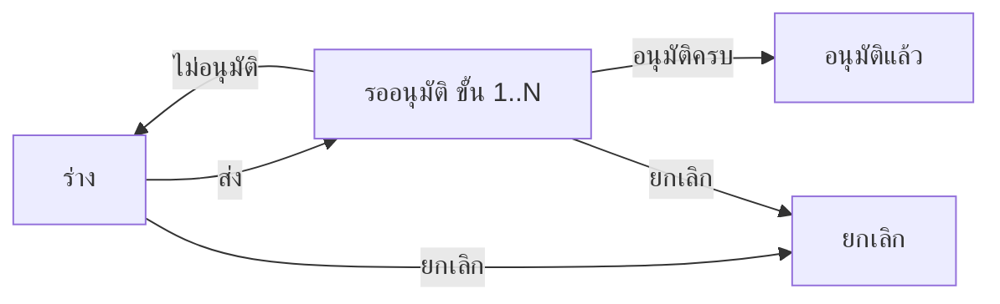

# BRD: แบบฟอร์ม Change Request (Change Request Form)

| Field | Value |
|---|---|
| BRD ID | BRD-TMP-005 (ชั่วคราว) |
| Feature | F-TMP-005 แบบฟอร์ม Change Request (รหัส feature ชั่วคราว — รอรหัสจริง) |
| BRD Type | New Feature (แบบ 2 · ดึงข้อมูลเดิม — ชื่อ/ตำแหน่งจาก HR · Employee) |
| Version | 1.0 |
| Status | **APPROVED (Prebrief Mode · Lane/unattended)** — DEC แทน Scope Lock จนมีใบเซ็นลูกค้า |
| Module | IT Support (Core Cube) — ใกล้เคียง FEATURE_REGISTRY "IT Support (—)" |
| Customer form | FM-ITS-07 Change Request Form · Rev.00 : 01/07/2569 |
| Request | REQ-TMP-005 (ชั่วคราว — รอเลขจริงจาก F186) |
| Input | PREBRIEF_REQ-TMP-005_v2 · FORM_SPEC.json (11 ช่อง · ☐ ประเภทของการเปลี่ยนแปลง 5) · DECISIONS.lock (17 DEC · พร้อมเริ่มทำ · AI-DEFAULT 11) · feature.html (html-generator v9.4 · audit FAIL 0) |
| Created / Updated | 2026-10-10 |

## Changelog
- v1.0 (2026-10-10): สร้างผ่าน brd-generator-full v2.3 Prebrief Mode (doc-master-pipeline ขั้น 7 · โหมดไม่เฝ้า)

---

## 1. Business Context
### 1.1 ปัญหา / โอกาส
การเปลี่ยนแปลงด้าน IT (อัปเดตซอฟต์แวร์ เปลี่ยนฮาร์ดแวร์ ปรับเครือข่าย/ความปลอดภัย) ขอด้วยแบบฟอร์มกระดาษ FM-ITS-07 (xlsx) — ลงนาม 3 ช่อง (ผู้ขอซื้อ · ตรวจสอบโดย · อนุมัติโดย) ส่งต่อด้วยมือ · กระดาษไม่มีเลขที่ · ตรวจย้อนหลังไม่ได้ว่าการเปลี่ยนแปลงใดได้รับอนุมัติเมื่อไร ใครอนุมัติ กระทบระบบใด และมีแผนสำรองข้อมูล/ทดสอบหรือไม่
### 1.2 เป้าหมาย
1. ขึ้นแบบฟอร์มเป็นเอกสารในระบบ ช่องตรงกระดาษ 1:1 · PDF Replica ลูกค้าจำแบบเดิมได้
2. ตรวจสอบ/อนุมัติตามสาย DOA กลาง (dynamic · ค่าเริ่ม 2 ขั้น) แทนการเดินเอกสาร
3. มีทะเบียนคำขอเปลี่ยนแปลงพร้อมผลกระทบและแผนดำเนินการ ค้นย้อนหลังได้ · ฝ่าย IT ได้รับแจ้งเมื่ออนุมัติครบ
### 1.3 ตัวชี้วัด
ไม่มีใน input → **OQ-01** (ห้ามแต่งตัวเลข) · เสนอให้วัด: เวลาตั้งแต่ส่งถึงอนุมัติครบ · % การเปลี่ยนแปลงที่มีคำขออนุมัติก่อนทำ — ต้องเก็บ baseline ก่อน launch
### 1.4 ที่มา
แบบฟอร์มลูกค้า FM-ITS-07 (xlsx · หัวฟอร์มพิมพ์อังกฤษ "Change Request Form") → FORM_SPEC 11 ช่อง + ☐ ประเภทของการเปลี่ยนแปลง 5 · gate 10 หมวดตอบเองตาม unattended-policy (AI-DEFAULT ทุกหมวด)

## 2. Scope
### 2.1 In Scope
- รายการคำขอ (ค้นหา · กรองสถานะ/ประเภท · แท็บ ทั้งหมด/รอฉันพิจารณา/คำขอของฉัน · CSV) · สร้าง/แก้ร่าง wizard 3 ขั้น · ดูรายละเอียด 4 แท็บ (รายละเอียด › PDF › ลายเซ็น/อนุมัติ › ประวัติ)
- ส่งอนุมัติ DOA (ค่าเริ่ม 2 ขั้น "ตรวจสอบโดย" → "อนุมัติโดย" · เลือกคนต่อขั้น) · อนุมัติ / ไม่อนุมัติ→กลับร่าง · ยกเลิก (เหตุผลบังคับ)
- แจ้งเจ้าหน้าที่ IT เมื่ออนุมัติครบ · แนบไฟล์ · PDF FM-ITS-07 Replica ทุกสถานะ · เลขที่ ITCR จาก ENG-DOC-NUM
### 2.2 Out of Scope
- บันทึกผลการดำเนินการเปลี่ยนแปลง / ปิดงาน (กระดาษไม่มีช่อง — OQ-04) · ปฏิทินการเปลี่ยนแปลง (change calendar) · CAB หลายคนพร้อมกัน · เชื่อมทะเบียนทรัพย์สิน/CMDB · ทำซ้ำเอกสาร (DEC-11) · ประกาศ (DEC-11) · ส่งต่อระบบอื่น (DEC-02)
### 2.3 Assumptions
- ชื่อ-นามสกุล/ตำแหน่ง/ผู้บังคับบัญชามีใน HR · Employee + ผังองค์กร · มี role ผู้จัดการฝ่าย IT (role-mgr-it) และเจ้าหน้าที่ IT (role-it-officer) — ทั้งสองยังไม่อยู่ใน DOA contract → OQ-03
### 2.4 Scope Lock (ชั่วคราว = DECISIONS.lock · ยังไม่มีใบเซ็น → OQ-02)
| DEC | หมวด | มติ | ที่มา |
|---|---|---|---|
| DEC-01 | G1 | อนุมัติแล้วไม่เปลี่ยนค่าในระบบ | AI-DEFAULT |
| DEC-02 | G1 | ไม่ส่งต่อระบบอื่นรอบนี้ (ประกาศ event ไว้ใน FRD แต่ไม่ยิง) | AI-DEFAULT |
| DEC-03 | G2 | DOA dynamic · ค่าเริ่ม 2 ขั้น role-line-manager ("ตรวจสอบโดย") → role-mgr-it ("อนุมัติโดย") · ไม่มีวงเงิน | AI-DEFAULT |
| DEC-04 | G3 | วันที่ต้องการส่งมอบก่อนวันที่ขอ = เตือน · ประเภท ≥1 (เลือกหลายข้อได้) · อื่นๆ ต้องระบุ | AI-DEFAULT |
| DEC-05 | G4 | ไม่มีรายการซ้ำบนกระดาษ (ไม่เกี่ยว) | AI-DEFAULT |
| DEC-06 | G5 | ช่องตรงกระดาษ 1:1 · ไม่เพิ่มช่อง | AI-DEFAULT |
| DEC-07 | G6 | ลายเซ็นแถวล่าง 1 ช่องต่อขั้น DOA · ข้อความ "ส่ง/พิจารณาในระบบ" ไม่ใช้ภาพ | AI-DEFAULT |
| DEC-08 | G7 | ไม่อนุมัติ = กลับร่างเลขเดิม · ยกเลิก: เจ้าของ + admin role · ร่าง/รออนุมัติ · เหตุผลบังคับ | AI-DEFAULT |
| DEC-09 | G8 | เจ้าของ · ผู้อนุมัติเห็นหลังส่ง · admin role (ฝ่าย IT) เห็นทั้งหมด | AI-DEFAULT |
| DEC-10 | G9 | ออกเลขตอนบันทึกครั้งแรก · รหัส ITCR | AI-DEFAULT |
| DEC-11 | G10 | แนบไฟล์ ✓ · CSV ✓ · ทำซ้ำ ✗ · ประกาศ ✗ | AI-DEFAULT |
| DEC-12 | VALID | แก้คำสะกด ตําแหน่ง → ตำแหน่ง | FORM_SPEC |
| DEC-13 | VALID | ป้ายลงชื่อ "ผู้ขอซื้อ" คงคำตามกระดาษ · OQ ลูกค้า | FORM_SPEC |
| DEC-14 | VALID | วันที่ต้องการส่งมอบ ≥ วันที่ขอ (เตือน) | FORM_SPEC |
| DEC-15 | VALID | ติ๊ก อื่นๆ = ต้องระบุข้อความ | FORM_SPEC |
| DEC-16 | VALID | ประเภทของการเปลี่ยนแปลง เลือกอย่างน้อย 1 ข้อ (บล็อก) | FORM_SPEC |
| DEC-17 | VALID | กระดาษไม่มีช่องเลขที่ → ระบบออกเลข แสดงที่ footer แบบพิมพ์ + หัวหน้าจอ ไม่เพิ่มแถว | FORM_SPEC |

## 3. Roles & Permissions (COSO)
| Role | COSO | ทำอะไร |
|---|---|---|
| พนักงาน (ผู้ขอ — "ผู้ขอซื้อ" บนกระดาษ) | Maker | สร้าง/แก้ร่างของตน · ส่ง · ยกเลิกของตน (ร่าง/รออนุมัติ) |
| role-line-manager ("ตรวจสอบโดย") | Checker | ขั้น DOA 1: อนุมัติ/ไม่อนุมัติ |
| role-mgr-it ("อนุมัติโดย" · ผู้จัดการฝ่าย IT) | Approver | ขั้น DOA 2: อนุมัติ/ไม่อนุมัติ [AI-DEFAULT · role ยังไม่อยู่ใน contract] |
| role-it-officer (เจ้าหน้าที่ IT · admin role ฝ่าย IT) | admin view | เห็นทุกใบ · ได้รับแจ้งเมื่ออนุมัติครบ · ยกเลิกได้ (ร่าง/รออนุมัติ) [AI-DEFAULT · role ยังไม่อยู่ใน contract] |

| Action | Maker | L-Mgr | IT Mgr | IT Officer |
|---|:-:|:-:|:-:|:-:|
| ดูใบ | ของตน | หลังส่ง (อยู่ในสาย) | หลังส่ง (อยู่ในสาย) | ทั้งหมด |
| สร้าง/แก้ร่าง | ✓ ของตน | – | – | – |
| อนุมัติ/ไม่อนุมัติ | – | ขั้น 1 | ขั้น 2 | – |
| ยกเลิก | ✓ ของตน | – | – | ✓ |
SoD: ผู้ขออนุมัติใบตัวเองไม่ได้ (BR-DOA-04) · ผู้ตรวจสอบ ≠ ผู้อนุมัติ (ขั้นแยก)

## 4. User Journey
### 4.1 Happy Path
| # | Step | Maker | Checker/Approver | System |
|---|---|---|---|---|
| 1 | กด "สร้างคำขอ" → กรอกเรื่องที่ต้องการ · ติ๊กประเภทของการเปลี่ยนแปลง · วันที่/สถานที่ส่งมอบ · รายละเอียด · วัตถุประสงค์ · ระบบที่ได้รับผลกระทบ · แผนการดำเนินการ | ผู้ขอ | – | ดึงชื่อ/ตำแหน่ง/ผู้พิจารณาเริ่มต้น |
| 2 | แนบไฟล์ (ถ้ามี) → ตรวจสอบและยืนยัน → บันทึก | ผู้ขอ | – | ออกเลข ITCR (ENG-DOC-NUM) |
| 3 | ส่งอนุมัติ เลือกผู้พิจารณาต่อขั้น | ผู้ขอ | – | resolve DOA + freeze approval_chain |
| 4 | ตรวจสอบ → อนุมัติ | – | role-line-manager | ไปขั้น 2 |
| 5 | อนุมัติ | – | role-mgr-it | ครบทุกขั้น → อนุมัติแล้ว · แจ้งเจ้าหน้าที่ IT (itcr_approved_for_it) · เก็บ PDF |
### 4.2 Alternative
- ไม่อนุมัติ (ขั้นใดก็ได้) → กลับร่างเลขเดิม + เหตุผล → ผู้ขอแก้ ส่งใหม่ (resolve สายใหม่ เริ่มขั้น 1)
- ยกเลิก (ร่าง/รออนุมัติ) โดยเจ้าของหรือเจ้าหน้าที่ IT · เหตุผลบังคับ · ถ้ารออนุมัติ แจ้งผู้พิจารณาขั้นปัจจุบัน (itcr_cancelled)
- วันที่ต้องการส่งมอบก่อนวันที่ขอ → เตือน ส่งได้

## 5. Data (จาก FORM_SPEC — ป้ายตามกระดาษ)
### 5.1 change_request (header)
| ช่องบนกระดาษ | field | ชนิด | ที่มา | บังคับ |
|---|---|---|---|:-:|
| (ไม่มีบนกระดาษ) เลขที่ | doc_no | text | auto ENG-DOC-NUM | ✓ |
| วันที่ | request_date | date | auto | ✓ |
| ตำแหน่ง | position_snapshot | text | system HR · Employee (อ่านอย่างเดียว) | ✓ |
| ชื่อ-นามสกุล | employee_id → name_snapshot | ref | system HR · Employee | ✓ |
| วันที่ต้องการส่งมอบ | due_date | date | user | ✓ |
| สถานที่ส่งมอบ | delivery_location | text(200) | user | ✓ |
| เรื่องที่ต้องการ | subject | text(200) | user | ✓ |
| ประเภทของการเปลี่ยนแปลง ☐×5 | change_types | enum[] (software · hardware · network · security · other) | user | ✓ ≥1 |
| อื่นๆ | change_type_other | text(200) | user | เมื่อติ๊ก อื่นๆ |
| รายละเอียดของการเปลี่ยนแปลง: | change_detail | text | user | ✓ |
| วัตถุประสงค์ของการเปลี่ยนแปลง: | objective | text | user | ✓ |
| ระบบที่ได้รับผลกระทบและ ผลกระทบที่อาจเกิดขึ้น: | impact | text | user | ✓ |
| แผนการดำเนินการ: | action_plan | text | user | ✓ |
| + DOA fields | approval_status · doa_ref · approval_chain (jsonb snapshot) · approved_by · approved_at | | DOA | |
| + returned_reason · returned_by · returned_at · header_snapshot | | | DEC-08 · DOCCFG | |
### 5.2 attachments → Document Center (ไฟล์ระดับใบ)

## 6. User Stories
| ID | Story | AC หลัก |
|---|---|---|
| S-01 | ผู้ขอสร้างคำขอเปลี่ยนแปลง | ช่องบังคับครบตาม VR · ชื่อ/ตำแหน่งระบบใส่ · บันทึกได้เลข ITCR |
| S-02 | ผู้ขอเลือกประเภทของการเปลี่ยนแปลงได้หลายข้อ | ต้องเลือก ≥1 · อื่นๆ ต้องระบุ · PDF ติ๊กตรงที่เลือก |
| S-03 | ผู้ขอระบุวันที่/สถานที่ส่งมอบ | วันที่ก่อนวันที่ขอ = เตือน ไม่บล็อก |
| S-04 | ผู้ขอระบุผลกระทบและแผนการดำเนินการ | บังคับทั้ง 4 ช่องรายละเอียด · คำอธิบายตามกระดาษแสดงใต้ช่อง |
| S-05 | ผู้ขอแนบไฟล์ประกอบ | ไฟล์ pdf/doc/xls/รูป ≤20MB · ผิดชนิดแจ้งเตือน |
| S-06 | ผู้ขอส่งอนุมัติ | slot ต่อขั้นตาม DOA (ค่าเริ่ม 2) · ค่าเริ่มจากผัง · ผู้ขอไม่อยู่ในรายชื่อ · บังคับเลือกครบ |
| S-07 | ผู้พิจารณาอนุมัติคำขอ | ปุ่มเฉพาะผู้พิจารณาขั้นปัจจุบัน · เรียงขั้น · ครบทุกขั้น = อนุมัติแล้ว + แจ้ง IT |
| S-08 | ผู้พิจารณาไม่อนุมัติคำขอ | เหตุผลบังคับ · กลับร่างเลขเดิม · แบนเนอร์เหตุผลในร่าง |
| S-09 | ผู้ขอยกเลิกคำขอ | ร่าง/รออนุมัติ · เหตุผลบังคับ |
| S-10 | พิมพ์ PDF FM-ITS-07 | ทุกสถานะ 1 หน้า A4 · ลายเซ็น = ผู้ขอซื้อ + 1 ช่องต่อขั้น DOA |
| S-11 | เจ้าหน้าที่ IT ดูคำขอทุกใบ | กรองสถานะ/ประเภท · ส่งออก CSV |

## 7. Status & Lifecycle
| จาก | Action | ไป | ใคร |
|---|---|---|---|
| — | บันทึกครั้งแรก | draft | Maker |
| draft | ส่ง | pending (ขั้น 1) | Maker |
| pending | อนุมัติขั้น n<N | pending (ขั้น n+1) | ผู้พิจารณาขั้น n |
| pending | อนุมัติขั้น N | approved (อนุมัติแล้ว) | ขั้น N |
| pending | ไม่อนุมัติ | draft (เลขเดิม · returned_*) | ผู้พิจารณาขั้นปัจจุบัน |
| draft / pending | ยกเลิก | cancelled | Maker / role-it-officer |
approved = ล็อกแก้ไข · ไม่มียกเลิกหลังอนุมัติ (DEC-08)

## 8. Business Rules + Validation
| ID | Rule | Tag | Type |
|---|---|:-:|---|
| BR-01 | ประเภทของการเปลี่ยนแปลง เลือกได้หลายข้อ อย่างน้อย 1 ข้อ | FIXED | Validation (DEC-04/16) [AI-DEFAULT] |
| BR-02 | ติ๊ก อื่นๆ ต้องระบุข้อความ | FIXED | Validation (DEC-15) |
| BR-03 | วันที่ต้องการส่งมอบก่อนวันที่ขอ = เตือน ไม่บล็อก | CONFIGURABLE | Policy (DEC-04/14) [AI-DEFAULT] |
| BR-04 | สายอนุมัติ resolve จาก DOA ตอนส่ง แล้ว freeze · จำนวนขั้นตาม DOA กลาง (ค่าเริ่ม 2) | FIXED | DOA (BR-DOA-02 · DEC-03) |
| BR-05 | ไม่อนุมัติ → draft เลขเดิม · resolve ใหม่ตอนส่งรอบถัดไป | FIXED | DEC-08 (BR-DOA-03) [AI-DEFAULT] |
| BR-06 | ออกเลขตอนบันทึกครั้งแรก · รหัส ITCR · no-gap ✗ | CONFIGURABLE | DOCCFG (DEC-10) |
| BR-07 | ร่างเห็นเฉพาะเจ้าของ (+ admin IT) | FIXED | Visibility #109 (DEC-09) |
| BR-08 | ช่องลงชื่อ PDF = ผู้ขอซื้อ + 1 ช่องต่อขั้น DOA · แถวละ ≤4 | FIXED (จำนวน = DOA) | DEC-07/13 |
| BR-09 | อนุมัติแล้วไม่เปลี่ยนค่าในระบบ · ไม่ส่งต่อระบบอื่น · แจ้ง role-it-officer ผ่าน ENG-NOTIFY | FIXED | DEC-01/02 |
| BR-10 | ป้ายช่องตามกระดาษ 1:1 · แก้สะกด "ตำแหน่ง" · คงคำ "ผู้ขอซื้อ" · เลขที่แสดงที่ footer | FIXED | DEC-06/12/13/17 |
| BR-11 | Doc. No./Rev. ของแบบพิมพ์อ่านจาก F-DOCCFG print_config (FM-ITS-07 · Rev.00 : 01/07/2569) | CONFIGURABLE | DOCCFG |

| VR | ช่อง | เงื่อนไข | ข้อความ |
|---|---|---|---|
| VR-01 | subject | required | ระบุเรื่องที่ต้องการ |
| VR-02 | change_types | ≥1 | เลือกประเภทของการเปลี่ยนแปลงอย่างน้อย 1 ข้อ |
| VR-03 | change_type_other | required เมื่อ other | ระบุประเภทอื่นๆ |
| VR-04 | due_date | required | เลือกวันที่ต้องการส่งมอบ |
| VR-05 | delivery_location | required | ระบุสถานที่ส่งมอบ |
| VR-06 | change_detail | required | ระบุรายละเอียดของการเปลี่ยนแปลง |
| VR-07 | objective | required | ระบุวัตถุประสงค์ของการเปลี่ยนแปลง |
| VR-08 | impact | required | ระบุระบบที่ได้รับผลกระทบและผลกระทบที่อาจเกิดขึ้น |
| VR-09 | action_plan | required | ระบุแผนการดำเนินการ |
| VR-10 | slot ผู้พิจารณา | ทุกขั้นต้องเลือก · ≠ ผู้ขอ | กรุณาเลือกผู้พิจารณา |
| VR-11 | เหตุผล ไม่อนุมัติ/ยกเลิก | required | กรุณาระบุเหตุผล |

### 8.5 ระดับความยืดหยุ่น
BR-03 → Admin Panel (นโยบาย Change Request) · BR-04 → DOA กลาง · BR-06/11 → F-DOCCFG

## 9. Edge Cases
| EC | กรณี | ผล |
|---|---|---|
| EC-01 | วันที่ต้องการส่งมอบก่อนวันที่ขอ (DEC-14) | เตือนในฟอร์ม/ตรวจสอบ · ส่งได้ · view แสดงป้าย "ก่อนวันที่ขอ" |
| EC-02 | ติ๊ก อื่นๆ แต่ไม่ระบุ (DEC-15) | บล็อกถัดไป · ช่อง invalid |
| EC-03 | ไม่ติ๊กประเภทใดเลย (DEC-16) | บล็อกถัดไป · ข้อความใต้กลุ่ม |
| EC-04 | ข้อความรายละเอียด/แผนยาวหลายบรรทัด | PDF เพิ่มบรรทัด + dense ยัง 1 หน้า (ทดสอบ 4/2/2/4 บรรทัด) |
| EC-05 | DOA ตั้ง 6 ขั้น | ช่องลงชื่อ 7 ช่อง 2 แถว (4+3) · 1 หน้า |
| EC-06 | ผู้ขอเป็นผู้จัดการฝ่าย IT เอง หรือไม่มีผู้บังคับบัญชา | slot ห้ามเลือกตัวเอง ต้องเลือกคนอื่น (BR-DOA-04) |
| EC-07 | แก้ DOA ระหว่างใบรออนุมัติ | ใบเดิมใช้สาย snapshot |
| EC-08 | ส่ง/อนุมัติชนกัน (stale) | 409 → toast รีเฟรช สถานะไม่เปลี่ยน |
| EC-09 | แบบเอกสารปิดใช้ (F-DOCCFG) | ปุ่มสร้าง disabled |
| EC-10 | ผู้อนุมัติเปิด route ใบร่างของคนอื่น | ไม่เปิด (ไม่มีสิทธิ์) |
| EC-11 | ไม่อนุมัติที่ขั้น 2 หลังขั้น 1 อนุมัติแล้ว | กลับร่างทั้งใบ · ส่งใหม่เริ่มขั้น 1 |

## 10. Value Stream & Downstream Impact
Positioning: IT Service / Change Management — คำขอ (feature นี้) → อนุมัติ → ฝ่าย IT ดำเนินการนอกระบบตามแผน
| ปลายทาง | ข้อมูล | Trigger | หมายเหตุ |
|---|---|---|---|
| เจ้าหน้าที่ IT (คิวงาน) | คำขอที่อนุมัติ | approved | ENG-NOTIFY itcr_approved_for_it — ภายใน feature |
| ผู้พิจารณาขั้นปัจจุบัน | คำขอถูกยกเลิก | pending → cancelled | ENG-NOTIFY itcr_cancelled |
| ทะเบียนการเปลี่ยนแปลง/CMDB (ถ้ามีในอนาคต) | การเปลี่ยนแปลงที่อนุมัติ | approved | **ปิดรอบนี้ (DEC-02)** — ประกาศ event `itcr.approved` ใน FRD ไม่ยิง |
| F-DOCCFG / ENG-DOC-STORE | PDF snapshot | approved_final | |
แล้วไงต่อ: การเปลี่ยนแปลงจริงยังทำนอกระบบโดยฝ่าย IT แต่หลักฐาน (ใครขอ เปลี่ยนอะไร กระทบอะไร แผนอะไร ใครอนุมัติ) อยู่ครบในระบบ

## 11. Delivery
Phase 1 = ทุกอย่างใน §2.1 · Phase 2 (เสนอ) = บันทึกผลการดำเนินการ/ปิดงาน + ปฏิทินการเปลี่ยนแปลง (รอ OQ-04)

## 12. Dev Summary "ใบสั่ง"
- Config: DOA entry F-TMP-005 (doa_type itcr · 2 ขั้น) · doc_type ITCR (F-DOCCFG · print_config FM-ITS-07) · role-mgr-it · role-it-officer
- Declaration: DOA_BRIEF · NTF_BRIEF · DOCCFG_BRIEF · MDOC_BRIEF (ฉบับจริงหลัง FRD)
- Screen Inventory: P-01 รายการ `#/change-request` · P-02 สร้าง/แก้ `#/change-request/create` · `#/change-request/edit/:id` (drawer wide 3 ขั้น) · P-03 ดู `#/change-request/view/:id` (drawer 4 แท็บ) · M-01..05 modal ส่ง/อนุมัติ/ไม่อนุมัติ/ยกเลิก/ทิ้งข้อมูล
- UI Signals: เอกสาร + พิมพ์ + ลายเซ็น = ใช่ · archetype Q-form

## 13. Open Questions
| OQ | คำถาม | เจ้าของ | Block? |
|---|---|---|---|
| OQ-01 | ตัวชี้วัดความสำเร็จ + baseline | ลูกค้า | ไม่ |
| OQ-02 | ลูกค้าเซ็นยืนยัน DEC-01..11 (AI-DEFAULT ทุกข้อ) — โดยเฉพาะ 2 ขั้น ตรวจสอบโดย=ผู้บังคับบัญชา · อนุมัติโดย=ผู้จัดการฝ่าย IT · ไม่อนุมัติกลับร่าง · เลือกประเภทได้หลายข้อ | ทีม BA → ลูกค้า | ก่อน UAT |
| OQ-03 | role-mgr-it และ role-it-officer ไม่อยู่ใน DOA roles contract — ต้องเพิ่มที่ DOA กลาง/RBAC | ทีม BA + พี่เบิร์ด | ก่อน wire |
| OQ-04 | ต้องการบันทึกผลการดำเนินการ/ปิดงานในระบบหรือไม่ (กระดาษไม่มีช่อง ผู้ดำเนินการ) | ลูกค้า | ไม่ |
| OQ-05 | ป้ายลงชื่อ "ผู้ขอซื้อ" ควรเป็น "ผู้ขอ/ผู้ร้องขอ" หรือไม่ (น่าจะคัดลอกจากฟอร์มขอซื้อ) · "ตรวจสอบโดย" เป็นผู้บังคับบัญชาหรือเจ้าหน้าที่ IT | ลูกค้า | ก่อน UAT |
| OQ-06 | รหัส feature จริงแทน F-TMP-005 · function_code taxonomy ของ MDOC · ชื่อเมนูไทย (หัวฟอร์มเป็นอังกฤษล้วน) | ทีม BA | ก่อน register |

## 14. Security & Compliance
Preset: Standard Internal + IT Change Control · PII: ชื่อผู้ขอ (pdpa) — ข้อมูลตัวอย่างใน prototype/แบบพิมพ์เป็นชื่อสมมติ · audit append-only ทุก action · **ห้ามใส่รหัสผ่าน/คีย์/ค่าเชื่อมต่อระบบในรายละเอียดหรือแผน** (microcopy เตือน + ตรวจตอนรีวิว) · SoD ผู้ขอ≠ผู้อนุมัติ · ผู้ตรวจสอบ≠ผู้อนุมัติ · ไฟล์แนบตาม file_policy Document Center

## 15. Health Check / Monitoring
SLA: ไม่กำหนดรอบนี้ (WARNING → OQ-01) · KPI เสนอ: คำขอรออนุมัติเกิน N วัน · คำขอที่วันส่งมอบผ่านไปแล้วแต่ยังไม่อนุมัติ · Widget: คิวคำขอที่อนุมัติแล้วตามประเภทการเปลี่ยนแปลง

## Appendix — Screen List
P-01 `#/change-request` · P-02 `#/change-request/create` · `#/change-request/edit/:id` · P-03 `#/change-request/view/:id`

---

## AI Review Report (brd-generator-full v2.3 · Prebrief Mode)
| ข้อ | ผล |
|---|---|
| C01 Business objective | ✅ §1.2 |
| C02 Roles ครบ | ✅ §3 |
| C03–C04 Scope in/out | ✅ §2 |
| C05 Story ไม่มี "และ" | ✅ S-01..S-11 |
| C06–C09 AC ≥2 · Journey · Status · Data | ✅ |
| C10 Rule มี Tag | ✅ BR-01..11 |
| C11–C13 VR · Edge cases ครบหมวด | ✅ VR-01..11 · EC-01..11 |
| C14–C17 Flexibility · Delivery · Registry (WARN: feature ใหม่ ไม่มีรหัส → OQ-06) | ✅ / ⚠️ C16 ยอมรับใน Prebrief Mode |
| C18 WARNING มีแผน | ✅ OQ-01..06 |
| C19 ใบสั่ง | ✅ §12 |
| C20 Scope Lock = DEC ครบ 17 + OQ-02 รอใบเซ็น | ✅ |
| C21 Value stream ตอบ "แล้วไงต่อ" | ✅ §10 |
| C22 ตัวชี้วัด | ✅ (Prebrief Mode: ไม่มีใน input → OQ-01 ห้ามแต่ง) |
| C23 marker | ✅ [AI-DEFAULT] ที่ BR |
| PE01 COSO ทุก step · PE02 SoD · PE03 Security · PE04 SLA/KPI (WARNING→OQ) · PE05 cross-section | ✅ |

**สถานะ: ✅ APPROVED** → พร้อมเข้า frd-generator-v6
