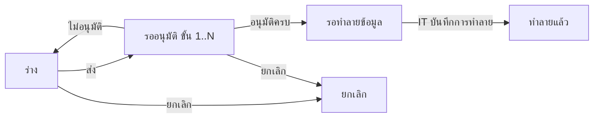

# BRD: แบบฟอร์มการขอทำลายข้อมูล (Data Destruction Request Form)

| Field | Value |
|---|---|
| BRD ID | BRD-TMP-003 (ชั่วคราว) |
| Feature | F-TMP-003 แบบฟอร์มการขอทำลายข้อมูล (รหัส feature ชั่วคราว — รอรหัสจริง) |
| BRD Type | New Feature (แบบ 2 · ดึงข้อมูลเดิม — ชื่อ/ตำแหน่งจาก HR · Employee) |
| Version | 1.0 |
| Status | **APPROVED (Prebrief Mode · Lane/unattended)** — DEC แทน Scope Lock จนมีใบเซ็นลูกค้า |
| Module | IT Support (Core Cube) — ใกล้เคียง FEATURE_REGISTRY "IT Support (—)" |
| Customer form | FM-ITS-02 แบบฟอร์มการขอทำลายข้อมูล · Rev.00 : 01/07/2569 |
| Request | REQ-TMP-003 (ชั่วคราว — รอเลขจริงจาก F186) |
| Input | PREBRIEF_REQ-TMP-003_v2 · FORM_SPEC.json (10 ช่อง · ☐ 3 กลุ่ม) · DECISIONS.lock (17 DEC · พร้อมเริ่มทำ · AI-DEFAULT 11) · feature.html (html-generator v9.4 · audit FAIL 0) |
| Created / Updated | 2026-10-10 |

## Changelog
- v1.0 (2026-10-10): สร้างผ่าน brd-generator-full v2.3 Prebrief Mode (doc-master-pipeline ขั้น 7 · โหมดไม่เฝ้า)

---

## 1. Business Context
### 1.1 ปัญหา / โอกาส
พนักงานขอให้ฝ่าย IT ทำลายข้อมูลที่หมดความจำเป็นด้วยแบบฟอร์มกระดาษ FM-ITS-02 (xlsx) — ลงนาม 4 ช่อง (ผู้ร้องขอ · ตรวจสอบ · เจ้าหน้าที่ IT · อนุมัติ) ส่งต่อด้วยมือ · ช่องเลขที่ "DRITS." เว้นว่างไม่มีเลขรันจริง · ตรวจย้อนหลังไม่ได้ว่าข้อมูลชุดใดถูกทำลายเมื่อไร ใครอนุมัติ ใครทำ (หลักฐานการทำลายข้อมูลตามนโยบายเก็บรักษา/PDPA)
### 1.2 เป้าหมาย
1. ขึ้นแบบฟอร์มเป็นเอกสารในระบบ ช่องตรงกระดาษ 1:1 · PDF Replica ลูกค้าจำแบบเดิมได้
2. ตรวจสอบ/อนุมัติตามสาย DOA กลาง (dynamic · ค่าเริ่ม 2 ขั้น) แทนการเดินเอกสาร
3. เจ้าหน้าที่ IT เห็นคิวคำขอที่อนุมัติแล้ว และบันทึกการทำลาย (ช่อง เจ้าหน้าที่ IT) เป็นหลักฐาน append-only
### 1.3 ตัวชี้วัด
ไม่มีใน input → **OQ-01** (ห้ามแต่งตัวเลข) · เสนอให้วัด: เวลาตั้งแต่ส่งถึงทำลายแล้ว · % คำขอที่มีหลักฐานการทำลายครบ — ต้องเก็บ baseline ก่อน launch
### 1.4 ที่มา
แบบฟอร์มลูกค้า FM-ITS-02 (xlsx · ชื่อไฟล์ "แบบฟอร์มการขอทำลายข้อมูลเอกสารประจำปี" · หัวฟอร์ม "แบบฟอร์มการขอทำลายข้อมูล") → FORM_SPEC 10 ช่อง + ☐ ประเภทข้อมูล 10 · เหตุผล 4 · วิธีการ 4 · gate 10 หมวดตอบเองตาม unattended-policy (AI-DEFAULT ทุกหมวด)

## 2. Scope
### 2.1 In Scope
- รายการคำขอ (ค้นหา · กรองสถานะ/ประเภทข้อมูล · แท็บ ทั้งหมด/รอฉันพิจารณา/คำขอของฉัน · CSV) · สร้าง/แก้ร่าง wizard 3 ขั้น · ดูรายละเอียด 4 แท็บ (รายละเอียด › PDF › ลายเซ็น/อนุมัติ › ประวัติ)
- ส่งอนุมัติ DOA (ค่าเริ่ม 2 ขั้น "ตรวจสอบ" → "อนุมัติ" · เลือกคนต่อขั้น) · อนุมัติ / ไม่อนุมัติ→กลับร่าง · ยกเลิก (เหตุผลบังคับ)
- เจ้าหน้าที่ IT บันทึก "ทำลายแล้ว" (ช่อง เจ้าหน้าที่ IT) หลังอนุมัติครบ
- แนบไฟล์ · PDF FM-ITS-02 Replica ทุกสถานะ · เลขที่ DRITS จาก ENG-DOC-NUM
### 2.2 Out of Scope
- ระบบลบ/ทำลายข้อมูลอัตโนมัติในโปรแกรมปลายทาง (การทำลายจริงทำนอกระบบโดยเจ้าหน้าที่ IT) · ตารางอายุการเก็บรักษาข้อมูล (retention schedule) · ทะเบียนชุดข้อมูล (data inventory) · ทำซ้ำเอกสาร (DEC-11) · ประกาศ (DEC-11) · ส่งต่อระบบอื่น (DEC-02)
### 2.3 Assumptions
- ชื่อ-นามสกุล/ตำแหน่ง/ผู้บังคับบัญชามีใน HR · Employee + ผังองค์กร · มี role ผู้จัดการฝ่าย IT (role-mgr-it) และเจ้าหน้าที่ IT (role-it-officer) — ทั้งสองยังไม่อยู่ใน DOA contract → OQ-03
### 2.4 Scope Lock (ชั่วคราว = DECISIONS.lock · ยังไม่มีใบเซ็น → OQ-02)
| DEC | หมวด | มติ | ที่มา |
|---|---|---|---|
| DEC-01 | G1 | อนุมัติแล้วไม่เปลี่ยนค่าในระบบ | AI-DEFAULT |
| DEC-02 | G1 | ไม่ส่งต่อระบบอื่นรอบนี้ (ประกาศ event ไว้ใน FRD แต่ไม่ยิง) | AI-DEFAULT |
| DEC-03 | G2 | DOA dynamic · ค่าเริ่ม 2 ขั้น role-line-manager ("ตรวจสอบ") → role-mgr-it ("อนุมัติ") · ไม่มีวงเงิน | AI-DEFAULT |
| DEC-04 | G3 | ถึง ≥ จาก (บังคับ) · ถึง เกินวันที่ขอ = เตือน · อื่นๆ ต้องระบุ · ≥1 ต่อกลุ่ม (เลือกได้หลายข้อ) | AI-DEFAULT |
| DEC-05 | G4 | ไม่มีรายการซ้ำบนกระดาษ (ไม่เกี่ยว) | AI-DEFAULT |
| DEC-06 | G5 | ช่องตรงกระดาษ 1:1 · ไม่เพิ่มช่อง | AI-DEFAULT |
| DEC-07 | G6 | ลายเซ็นแถวล่าง 1 ช่องต่อขั้น DOA · ข้อความ "ส่ง/พิจารณาในระบบ" ไม่ใช้ภาพ | AI-DEFAULT |
| DEC-08 | G7 | ไม่อนุมัติ = กลับร่างเลขเดิม · ยกเลิก: เจ้าของ + admin role · ร่าง/รออนุมัติ · เหตุผลบังคับ | AI-DEFAULT |
| DEC-09 | G8 | เจ้าของ · ผู้อนุมัติเห็นหลังส่ง · admin role (ฝ่าย IT) เห็นทั้งหมด | AI-DEFAULT |
| DEC-10 | G9 | ออกเลขตอนบันทึกครั้งแรก · รหัส DRITS | AI-DEFAULT |
| DEC-11 | G10 | แนบไฟล์ ✓ · CSV ✓ · ทำซ้ำ ✗ · ประกาศ ✗ | AI-DEFAULT |
| DEC-12 | VALID | แก้คำสะกด ตําแหน่ง → ตำแหน่ง | FORM_SPEC |
| DEC-13 | VALID | แก้คำสะกด อนุมัมติ → อนุมัติ | FORM_SPEC |
| DEC-14 | VALID | แสดง ☐ ครบทุกตัวเลือก (ต้นฉบับขาด ☐ หน้า "เข้ารหัสและทำลายข้อมูลอย่างปลอดภัย") | FORM_SPEC |
| DEC-15 | VALID | ถึง ≥ จาก (บังคับ) · ถึง ไม่เกินวันที่ขอ (เตือน) | FORM_SPEC |
| DEC-16 | VALID | ติ๊ก อื่นๆ(โปรดระบุ) = ต้องระบุข้อความ | FORM_SPEC |
| DEC-17 | VALID | เลือกอย่างน้อย 1 ต่อกลุ่ม (ประเภทข้อมูล · เหตุผล · วิธีการ) | FORM_SPEC |

## 3. Roles & Permissions (COSO)
| Role | COSO | ทำอะไร |
|---|---|---|
| พนักงาน (ผู้ร้องขอ) | Maker | สร้าง/แก้ร่างของตน · ส่ง · ยกเลิกของตน (ร่าง/รออนุมัติ) |
| role-line-manager ("ตรวจสอบ") | Checker | ขั้น DOA 1: อนุมัติ/ไม่อนุมัติ |
| role-mgr-it ("อนุมัติ" · ผู้จัดการฝ่าย IT) | Approver | ขั้น DOA 2: อนุมัติ/ไม่อนุมัติ [AI-DEFAULT · role ยังไม่อยู่ใน contract] |
| role-it-officer (เจ้าหน้าที่ IT · admin role ฝ่าย IT) | Executor + admin view | เห็นทุกใบ · บันทึก "ทำลายแล้ว" · ยกเลิกได้ (ร่าง/รออนุมัติ) [AI-DEFAULT · role ยังไม่อยู่ใน contract] |

| Action | Maker | L-Mgr | IT Mgr | IT Officer |
|---|:-:|:-:|:-:|:-:|
| ดูใบ | ของตน | หลังส่ง (อยู่ในสาย) | หลังส่ง (อยู่ในสาย) | ทั้งหมด |
| สร้าง/แก้ร่าง | ✓ ของตน | – | – | – |
| อนุมัติ/ไม่อนุมัติ | – | ขั้น 1 | ขั้น 2 | – |
| บันทึกการทำลายแล้ว | – | – | – | ✓ (สถานะรอทำลาย) |
| ยกเลิก | ✓ ของตน | – | – | ✓ |
SoD: ผู้ร้องขออนุมัติใบตัวเองไม่ได้ (BR-DOA-04) · ผู้ทำลาย (Executor) ≠ ผู้อนุมัติ (บทบาทแยก)

## 4. User Journey
### 4.1 Happy Path
| # | Step | Maker | Checker/Approver | System |
|---|---|---|---|---|
| 1 | กด "สร้างคำขอ" → กรอกรายละเอียดข้อมูล · โปรแกรม · ติ๊กประเภทข้อมูล · ช่วงเวลา จาก/ถึง · ติ๊กเหตุผล · ติ๊กวิธีการ | ผู้ร้องขอ | – | ดึงชื่อ/ตำแหน่ง/ผู้พิจารณาเริ่มต้น |
| 2 | แนบไฟล์ (ถ้ามี) → ตรวจสอบและยืนยัน → บันทึก | ผู้ร้องขอ | – | ออกเลข DRITS (ENG-DOC-NUM) |
| 3 | ส่งอนุมัติ เลือกผู้พิจารณาต่อขั้น | ผู้ร้องขอ | – | resolve DOA + freeze approval_chain |
| 4 | ตรวจสอบ → อนุมัติ | – | role-line-manager | ไปขั้น 2 |
| 5 | อนุมัติ | – | role-mgr-it | ครบทุกขั้น → รอทำลายข้อมูล · แจ้งเจ้าหน้าที่ IT (drits_ready_for_it) |
| 6 | ทำลายข้อมูลนอกระบบ → กด "บันทึกการทำลายแล้ว" | – | role-it-officer (Executor) | บันทึก performed_by/at · แจ้งผู้ร้องขอ (drits_destroyed) · เก็บ PDF |
### 4.2 Alternative
- ไม่อนุมัติ (ขั้นใดก็ได้) → กลับร่างเลขเดิม + เหตุผล → ผู้ร้องขอแก้ ส่งใหม่ (resolve สายใหม่)
- ยกเลิก (ร่าง/รออนุมัติ) โดยเจ้าของหรือเจ้าหน้าที่ IT · เหตุผลบังคับ · ถ้ารออนุมัติ แจ้งผู้พิจารณา (drits_cancelled)
- ช่วงเวลาของข้อมูล "ถึง" หลังวันที่ขอ → เตือน ส่งได้ · "ถึง" ก่อน "จาก" → บล็อก

## 5. Data (จาก FORM_SPEC — ป้ายตามกระดาษ)
### 5.1 data_destruction_request (header)
| ช่องบนกระดาษ | field | ชนิด | ที่มา | บังคับ |
|---|---|---|---|:-:|
| เลขที่เอกสาร (DRITS.) | doc_no | text | auto ENG-DOC-NUM | ✓ |
| วันที่ | req_date | date | auto | ✓ |
| ชื่อ-นามสกุล | employee_id → name_snapshot | ref | system HR · Employee (อ่านอย่างเดียว) | ✓ |
| ตำแหน่ง | position_snapshot | text | system HR · Employee | ✓ |
| รายละเอียดของข้อมูลที่ต้องการทำลาย | detail | text | user | ✓ |
| โปรแกรม | program | text(500) | user | ✓ |
| ประเภทข้อมูล ☐×10 | data_types | enum[] (customer · employee · finance · contract · inventory · system · marketing · internal_doc · sales · other) | user | ✓ ≥1 |
| ช่วงเวลาของข้อมูล จาก / ถึง | period_from · period_to | date | user | ✓ |
| เหตุผลในการทำลายข้อมูล ☐×4 | destroy_reasons | enum[] (retention_expired · duplicate_obsolete · authority_order · other) | user | ✓ ≥1 |
| อื่นๆ(โปรดระบุ) (เหตุผล) | destroy_reason_other | text(200) | user | เมื่อติ๊ก อื่นๆ |
| วิธีการทำลายข้อมูล ☐×4 | destroy_methods | enum[] (permanent_delete · encrypt_destroy · licensed_software · other) | user | ✓ ≥1 |
| อื่นๆ(โปรดระบุ) (วิธีการ) | destroy_method_other | text(200) | user | เมื่อติ๊ก อื่นๆ |
| เจ้าหน้าที่ IT | performed_by · performed_at · done_note | ref/datetime/text | system (IT) | หลังอนุมัติ |
| + DOA fields | approval_status · doa_ref · approval_chain (jsonb snapshot) · approved_by · approved_at | | DOA | |
| + returned_reason · returned_by · returned_at · header_snapshot | | | DEC-08 · DOCCFG | |
### 5.2 attachments → Document Center (ไฟล์ระดับใบ)

## 6. User Stories
| ID | Story | AC หลัก |
|---|---|---|
| S-01 | ผู้ร้องขอสร้างคำขอทำลายข้อมูล | ช่องบังคับครบตาม VR · ชื่อ/ตำแหน่งระบบใส่ · บันทึกได้เลข DRITS |
| S-02 | ผู้ร้องขอเลือกประเภทข้อมูลได้หลายข้อ | ต้องเลือก ≥1 · PDF ติ๊กตรงที่เลือก |
| S-03 | ผู้ร้องขอระบุช่วงเวลาของข้อมูล | ถึง ≥ จาก (บล็อก) · ถึง หลังวันที่ขอ = เตือน |
| S-04 | ผู้ร้องขอเลือกเหตุผลการทำลาย | ≥1 · อื่นๆ ต้องระบุข้อความ |
| S-05 | ผู้ร้องขอเลือกวิธีการทำลาย | ≥1 · อื่นๆ ต้องระบุข้อความ · ☐ ครบ 4 ตัวเลือก |
| S-06 | ผู้ร้องขอแนบไฟล์ประกอบ | ไฟล์ pdf/doc/xls/รูป ≤20MB · ผิดชนิดแจ้งเตือน |
| S-07 | ผู้ร้องขอส่งอนุมัติ | slot ต่อขั้นตาม DOA (ค่าเริ่ม 2) · ค่าเริ่มจากผัง · ผู้ร้องขอไม่อยู่ในรายชื่อ · บังคับเลือกครบ |
| S-08 | ผู้พิจารณาอนุมัติคำขอ | ปุ่มเฉพาะผู้พิจารณาขั้นปัจจุบัน · เรียงขั้น · ครบทุกขั้น = รอทำลายข้อมูล |
| S-09 | ผู้พิจารณาไม่อนุมัติคำขอ | เหตุผลบังคับ · กลับร่างเลขเดิม · แบนเนอร์เหตุผลในร่าง |
| S-10 | เจ้าหน้าที่ IT บันทึกการทำลายแล้ว | เฉพาะ role-it-officer · สถานะรอทำลาย · ช่อง เจ้าหน้าที่ IT ใน PDF มีชื่อ+เวลา |
| S-11 | ผู้ร้องขอยกเลิกคำขอ | ร่าง/รออนุมัติ · เหตุผลบังคับ |
| S-12 | พิมพ์ PDF FM-ITS-02 | ทุกสถานะ 1 หน้า A4 · ลายเซ็น = ผู้ร้องขอ + 1 ช่องต่อขั้น DOA + เจ้าหน้าที่ IT |
| S-13 | เจ้าหน้าที่ IT ดูคำขอทุกใบ | กรองสถานะ/ประเภทข้อมูล · ส่งออก CSV |

## 7. Status & Lifecycle
| จาก | Action | ไป | ใคร |
|---|---|---|---|
| — | บันทึกครั้งแรก | draft | Maker |
| draft | ส่ง | pending (ขั้น 1) | Maker |
| pending | อนุมัติขั้น n<N | pending (ขั้น n+1) | ผู้พิจารณาขั้น n |
| pending | อนุมัติขั้น N | approved (รอทำลายข้อมูล) | ขั้น N |
| pending | ไม่อนุมัติ | draft (เลขเดิม · returned_*) | ผู้พิจารณาขั้นปัจจุบัน |
| approved | บันทึกการทำลายแล้ว | done (ทำลายแล้ว) | role-it-officer |
| draft / pending | ยกเลิก | cancelled | Maker / role-it-officer |
approved/done = ล็อกแก้ไข · ไม่มียกเลิกหลังอนุมัติ (DEC-08)

## 8. Business Rules + Validation
| ID | Rule | Tag | Type |
|---|---|:-:|---|
| BR-01 | ประเภทข้อมูล · เหตุผล · วิธีการ เลือกได้หลายข้อ อย่างน้อย 1 ข้อต่อกลุ่ม | FIXED | Validation (DEC-04/17) [AI-DEFAULT] |
| BR-02 | ติ๊ก อื่นๆ(โปรดระบุ) ต้องระบุข้อความ | FIXED | Validation (DEC-16) |
| BR-03 | ช่วงเวลาของข้อมูล ถึง ต้องไม่ก่อน จาก | FIXED | Validation (DEC-15) |
| BR-04 | ช่วงเวลาของข้อมูล ถึง หลังวันที่ขอ = เตือน ไม่บล็อก | CONFIGURABLE | Policy (DEC-04/15) [AI-DEFAULT] |
| BR-05 | สายอนุมัติ resolve จาก DOA ตอนส่ง แล้ว freeze · จำนวนขั้นตาม DOA กลาง (ค่าเริ่ม 2) | FIXED | DOA (BR-DOA-02 · DEC-03) |
| BR-06 | ไม่อนุมัติ → draft เลขเดิม · resolve ใหม่ตอนส่งรอบถัดไป | FIXED | DEC-08 (BR-DOA-03) [AI-DEFAULT] |
| BR-07 | ออกเลขตอนบันทึกครั้งแรก · รหัส DRITS · no-gap ✗ | CONFIGURABLE | DOCCFG (DEC-10) |
| BR-08 | ร่างเห็นเฉพาะเจ้าของ (+ admin IT) | FIXED | Visibility #109 (DEC-09) |
| BR-09 | ช่องลงชื่อ PDF = ผู้ร้องขอ + 1 ช่องต่อขั้น DOA + เจ้าหน้าที่ IT · แถวละ ≤4 | FIXED (จำนวน = DOA) | DEC-07 |
| BR-10 | "บันทึกการทำลายแล้ว" ทำได้เมื่อ approved และเป็น role-it-officer เท่านั้น | FIXED | Control [AI-DEFAULT] |
| BR-11 | อนุมัติแล้วไม่เปลี่ยนค่าในระบบ · ไม่ส่งต่อระบบอื่น | FIXED | DEC-01/02 |
| BR-12 | ป้ายช่องตามกระดาษ 1:1 · แก้สะกด "ตำแหน่ง" "อนุมัติ" · ☐ ครบทุกตัวเลือก | FIXED | DEC-06/12/13/14 |
| BR-13 | Doc. No./Rev. ของแบบพิมพ์อ่านจาก F-DOCCFG print_config (FM-ITS-02 · Rev.00 : 01/07/2569) | CONFIGURABLE | DOCCFG |

| VR | ช่อง | เงื่อนไข | ข้อความ |
|---|---|---|---|
| VR-01 | detail | required | ระบุรายละเอียดของข้อมูลที่ต้องการทำลาย |
| VR-02 | program | required | ระบุโปรแกรมที่เก็บข้อมูล |
| VR-03 | data_types | ≥1 | เลือกประเภทข้อมูลอย่างน้อย 1 ข้อ |
| VR-04 | period_from | required | เลือกวันที่เริ่มต้นของข้อมูล |
| VR-05 | period_to | required · ≥ period_from | เลือกวันที่สิ้นสุดของข้อมูล / วันที่ "ถึง" ต้องไม่ก่อนวันที่ "จาก" |
| VR-06 | destroy_reasons | ≥1 | เลือกเหตุผลอย่างน้อย 1 ข้อ |
| VR-07 | destroy_reason_other | required เมื่อ other | โปรดระบุเหตุผลอื่นๆ |
| VR-08 | destroy_methods | ≥1 | เลือกวิธีการอย่างน้อย 1 ข้อ |
| VR-09 | destroy_method_other | required เมื่อ other | โปรดระบุวิธีการอื่นๆ |
| VR-10 | slot ผู้พิจารณา | ทุกขั้นต้องเลือก · ≠ ผู้ร้องขอ | กรุณาเลือกผู้พิจารณา |
| VR-11 | เหตุผล ไม่อนุมัติ/ยกเลิก | required | กรุณาระบุเหตุผล |

### 8.5 ระดับความยืดหยุ่น
BR-04 → Admin Panel (นโยบายคำขอทำลายข้อมูล) · BR-05 → DOA กลาง · BR-07/13 → F-DOCCFG

## 9. Edge Cases
| EC | กรณี | ผล |
|---|---|---|
| EC-01 | ช่วงเวลา ถึง ก่อน จาก (DEC-15) | บล็อกถัดไป · ช่อง "ถึง" invalid |
| EC-02 | ช่วงเวลา ถึง หลังวันที่ขอ (DEC-15) | เตือนในฟอร์ม/ตรวจสอบ · ส่งได้ · view แสดงป้าย "หลังวันที่ขอ" |
| EC-03 | ติ๊ก อื่นๆ แต่ไม่ระบุ (DEC-16) | บล็อกถัดไป · ช่อง invalid |
| EC-04 | รายละเอียดยาวเกิน 3 บรรทัด / โปรแกรมเกิน 2 บรรทัดบนกระดาษ | PDF เพิ่มบรรทัด + dense ยัง 1 หน้า (ทดสอบ 6/3 บรรทัด) |
| EC-05 | DOA ตั้ง 6 ขั้น | ช่องลงชื่อ 8 ช่อง 2 แถว (4+4) · 1 หน้า |
| EC-06 | ผู้ร้องขอเป็นผู้บังคับบัญชาสูงสุด (ไม่มี mgr) หรือเป็นผู้จัดการฝ่าย IT เอง | slot ว่าง/ห้ามเลือกตัวเอง ต้องเลือกคนอื่น (BR-DOA-04) |
| EC-07 | แก้ DOA ระหว่างใบรออนุมัติ | ใบเดิมใช้สาย snapshot |
| EC-08 | ส่ง/อนุมัติชนกัน (stale) | 409 → toast รีเฟรช สถานะไม่เปลี่ยน |
| EC-09 | แบบเอกสารปิดใช้ (F-DOCCFG) | ปุ่มสร้าง disabled |
| EC-10 | ผู้อนุมัติเปิด route ใบร่างของคนอื่น | ไม่เปิด (ไม่มีสิทธิ์) |
| EC-11 | ไม่อนุมัติที่ขั้น 2 หลังขั้น 1 อนุมัติแล้ว | กลับร่างทั้งใบ · ส่งใหม่เริ่มขั้น 1 |

## 10. Value Stream & Downstream Impact
Positioning: Data Governance / IT Service — คำขอ (feature นี้) → อนุมัติ → เจ้าหน้าที่ IT ทำลายข้อมูล → หลักฐานการทำลาย
| ปลายทาง | ข้อมูล | Trigger | หมายเหตุ |
|---|---|---|---|
| เจ้าหน้าที่ IT (คิวงาน) | คำขอที่อนุมัติ | approved | ENG-NOTIFY drits_ready_for_it — ภายใน feature |
| ผู้ร้องขอ | ผลการทำลาย | done | ENG-NOTIFY drits_destroyed |
| ทะเบียนข้อมูล/Retention (ถ้ามีในอนาคต) | ชุดข้อมูลที่ทำลาย | done | **ปิดรอบนี้ (DEC-02)** — ประกาศ event `drits.destroyed` ใน FRD ไม่ยิง |
| F-DOCCFG / ENG-DOC-STORE | PDF snapshot | approved_final | |
แล้วไงต่อ: การทำลายจริงทำนอกระบบเหมือนเดิม แต่หลักฐาน (ใครขอ ใครอนุมัติ ใครทำ เมื่อไร) อยู่ครบในระบบ

## 11. Delivery
Phase 1 = ทุกอย่างใน §2.1 · Phase 2 (เสนอ) = เชื่อมทะเบียนชุดข้อมูล/retention schedule + เตือนข้อมูลครบกำหนดทำลาย

## 12. Dev Summary "ใบสั่ง"
- Config: DOA entry F-TMP-003 (doa_type drits · 2 ขั้น) · doc_type DRITS (F-DOCCFG · print_config FM-ITS-02) · role-mgr-it · role-it-officer
- Declaration: DOA_BRIEF · NTF_BRIEF · DOCCFG_BRIEF · MDOC_BRIEF (ฉบับจริงหลัง FRD)
- Screen Inventory: P-01 รายการ `#/data-destruction` · P-02 สร้าง/แก้ `#/data-destruction/create` · `#/data-destruction/edit/:id` (drawer wide 3 ขั้น) · P-03 ดู `#/data-destruction/view/:id` (drawer 4 แท็บ) · M-01..06 modal ส่ง/อนุมัติ/ไม่อนุมัติ/ยกเลิก/บันทึกการทำลาย/ทิ้งข้อมูล
- UI Signals: เอกสาร + พิมพ์ + ลายเซ็น = ใช่ · archetype Q-form

## 13. Open Questions
| OQ | คำถาม | เจ้าของ | Block? |
|---|---|---|---|
| OQ-01 | ตัวชี้วัดความสำเร็จ + baseline | ลูกค้า | ไม่ |
| OQ-02 | ลูกค้าเซ็นยืนยัน DEC-01..11 (AI-DEFAULT ทุกข้อ) — โดยเฉพาะ 2 ขั้น ตรวจสอบ=ผู้บังคับบัญชา · อนุมัติ=ผู้จัดการฝ่าย IT · ไม่อนุมัติกลับร่าง | ทีม BA → ลูกค้า | ก่อน UAT |
| OQ-03 | role-mgr-it และ role-it-officer ไม่อยู่ใน DOA roles contract — ต้องเพิ่มที่ DOA กลาง/RBAC | ทีม BA + พี่เบิร์ด | ก่อน wire |
| OQ-04 | "เจ้าหน้าที่ IT" บนกระดาษอยู่ระหว่าง ตรวจสอบ กับ อนุมัติ — เป็นผู้ทำลายหลังอนุมัติ (ค่าเริ่ม) หรือเป็นขั้นตรวจทางเทคนิคก่อนอนุมัติ? | ลูกค้า | ก่อน UAT |
| OQ-05 | "อนุมัติ" บนกระดาษคือผู้จัดการฝ่าย IT หรือเจ้าของข้อมูล/ผู้บริหาร? · รหัส feature จริงแทน F-TMP-003 | ลูกค้า / ทีม BA | ก่อน UAT |
| OQ-06 | function_code taxonomy ของ MDOC · ชื่อไฟล์ลูกค้า "…เอกสารประจำปี" กับหัวฟอร์ม "แบบฟอร์มการขอทำลายข้อมูล" ใช้ชื่อไหนในเมนู | ทีม BA | ก่อน register |

## 14. Security & Compliance
Preset: Standard Internal + Data Governance · PII: ชื่อผู้ร้องขอ (pdpa) — ข้อมูลตัวอย่างใน prototype/แบบพิมพ์เป็นชื่อสมมติ · คำขอเป็นหลักฐานการทำลายข้อมูล (PDPA ม.33/37 ลบหรือทำลายเมื่อพ้นระยะเก็บ) → audit append-only ทุก action · ห้ามแนบข้อมูลที่จะทำลายเข้าระบบ (แนบได้เฉพาะรายการ/หลักฐาน) · ห้ามใส่รหัสผ่าน/คีย์เข้ารหัสในคำขอ · SoD ผู้ร้องขอ≠ผู้อนุมัติ · ผู้ทำลาย≠ผู้อนุมัติ · ไฟล์แนบตาม file_policy Document Center

## 15. Health Check / Monitoring
SLA: ไม่กำหนดรอบนี้ (WARNING → OQ-01) · KPI เสนอ: คำขอรออนุมัติเกิน N วัน · คำขอรอทำลายเกิน N วันหลังอนุมัติ · Widget: คิวงานเจ้าหน้าที่ IT ตามประเภทข้อมูล

## Appendix — Screen List
P-01 `#/data-destruction` · P-02 `#/data-destruction/create` · `#/data-destruction/edit/:id` · P-03 `#/data-destruction/view/:id`

---

## AI Review Report (brd-generator-full v2.3 · Prebrief Mode)
| ข้อ | ผล |
|---|---|
| C01 Business objective | ✅ §1.2 |
| C02 Roles ครบ | ✅ §3 |
| C03–C04 Scope in/out | ✅ §2 |
| C05 Story ไม่มี "และ" | ✅ S-01..S-13 |
| C06–C09 AC ≥2 · Journey · Status · Data | ✅ |
| C10 Rule มี Tag | ✅ BR-01..13 |
| C11–C13 VR · Edge cases ครบหมวด | ✅ VR-01..11 · EC-01..11 |
| C14–C17 Flexibility · Delivery · Registry (WARN: feature ใหม่ ไม่มีรหัส → OQ-05) | ✅ / ⚠️ C16 ยอมรับใน Prebrief Mode |
| C18 WARNING มีแผน | ✅ OQ-01..06 |
| C19 ใบสั่ง | ✅ §12 |
| C20 Scope Lock = DEC ครบ 17 + OQ-02 รอใบเซ็น | ✅ |
| C21 Value stream ตอบ "แล้วไงต่อ" | ✅ §10 |
| C22 ตัวชี้วัด | ✅ (Prebrief Mode: ไม่มีใน input → OQ-01 ห้ามแต่ง) |
| C23 marker | ✅ [AI-DEFAULT] ที่ BR |
| PE01 COSO ทุก step · PE02 SoD · PE03 Security · PE04 SLA/KPI (WARNING→OQ) · PE05 cross-section | ✅ |

**สถานะ: ✅ APPROVED** → พร้อมเข้า frd-generator-v6
