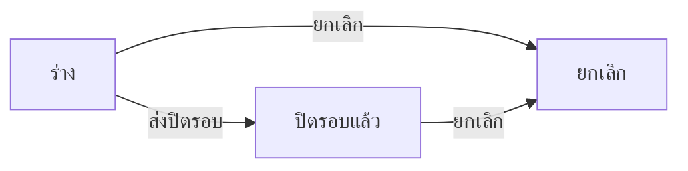

# BRD: แบบฟอร์มตรวจเช็คความเรียบร้อยห้อง Server (Server Room Check)

| Field | Value |
|---|---|
| BRD ID | BRD-ITS-SRC-001 |
| Feature | F-TMP-002 แบบฟอร์มตรวจเช็คความเรียบร้อยห้อง Server (รหัสชั่วคราว — feature ใหม่ใต้ IT Support · เสนอใน _BATCH_REPORT) |
| BRD Type | New Feature (แบบ 2 · ดึงข้อมูลเดิม — ชื่อผู้ตรวจสอบจาก F-EMP-001) |
| Version | 1.1 |
| Status | **APPROVED (Prebrief Mode · Lane · unattended)** — DEC แทน Scope Lock จนมีใบเซ็นลูกค้า · มติทั้งหมด AI-DEFAULT |
| Module | IT Support (Core) |
| Customer form | FM-ITS-10 Rev.00 : 01/07/2569 (ฝ่ายเทคโนโลยีสารสนเทศ) |
| Request | REQ-TMP-002 (ชั่วคราว — รอเลขจริงจาก F186) |
| Input | PREBRIEF_REQ-TMP-002_v2 · FORM_SPEC.json (11 ช่อง) · DECISIONS.lock (13 DEC · พร้อมเริ่มทำ) · feature.html (audit FAIL 0 · jsdom smoke 33/33 · NO-BROWSER) |
| Created | 2026-10-10 |

## Changelog
- v1.0 (2026-10-10): สร้างผ่าน brd-generator-full v2.3 Prebrief Mode (doc-master-pipeline ขั้น 7 · โหมดไม่เฝ้า)
- v1.1 (2026-10-10): ตัดเส้นทางผู้ตรวจทานแบบ dynamic ออกจาก scope ให้ตรง DEC-03 (ไม่มีการอนุมัติ) — เป็น enhancement ถ้าลูกค้ายืนยัน

---

## 1. Business Context
### 1.1 ปัญหา / โอกาส
ฝ่าย IT ตรวจห้อง Server ทุกวันด้วยแบบฟอร์ม Excel/กระดาษ FM-ITS-10 (30 แถวต่อแผ่น ≈ 1 เดือน) — ค่าอุณหภูมิ/ความชื้นที่หลุดเกณฑ์ ไม่มีใครเห็นทันที · ไม่มีประวัติย้อนหลังที่ค้นได้ · ชื่อผู้ตรวจเขียนมือ · ไม่มีหลักฐานแนบ (ภาพเกจ/ใบแจ้งซ่อม)
### 1.2 เป้าหมาย
1. ขึ้นแบบฟอร์มเป็นเอกสารในระบบ ช่องตรงกระดาษ 1:1 (PDF Replica — หัวตาราง 2 แถวพร้อมเกณฑ์)
2. ระบบเตือนทันทีเมื่อค่านอกเกณฑ์ / อุปกรณ์ไม่ปกติ / ไม่มีทะเบียนคุมเข้าออก (เกณฑ์จากการตั้งค่า ไม่ hardcode)
3. ผู้ตรวจสอบแต่ละวัน = ผู้ใช้ที่บันทึก (ไม่ต้องเซ็นมือ) · ผู้ดูแลห้อง Server เห็นทุกใบ
### 1.3 ตัวชี้วัด
ไม่มีใน input → **OQ-01** (ห้ามแต่งตัวเลข)
### 1.4 ที่มา
แบบฟอร์มลูกค้า FM-ITS-10 (xlsx) → FORM_SPEC 11 ช่อง (แถวซ้ำ 1 กลุ่ม 30 แถว · ตัวเลือก 5 · ค่าคงที่ 2) · gate 10 หมวด ตอบเองตาม unattended-policy = AI-DEFAULT ทั้งหมด

## 2. Scope
### 2.1 In Scope
- รายการใบตรวจเช็ค (แท็บสถานะ · ค้นหา · กรองผลตรวจ/ผู้บันทึก · CSV) · สร้าง/แก้ร่าง wizard 3 ขั้น (ตารางกรอกรายวัน) · ดูรายละเอียด 4 แท็บ (รายละเอียด › PDF › ลายเซ็น/อนุมัติ › ประวัติ)
- เตือนเกณฑ์ (ไฮไลต์แถว · ไม่บล็อก) · แจ้งผู้ดูแลเมื่อพบผิดปกติ (ENG-NOTIFY)
- ส่งปิดรอบ (ไม่มีขั้นอนุมัติ = ปิดทันที) · ยกเลิก (เหตุผลบังคับ)
- แนบไฟล์ · PDF FM-ITS-10 Replica 2 หน้า (R10) ทุกสถานะ · เลขที่ SRC จาก ENG-DOC-NUM
### 2.2 Out of Scope
- เปิด IT Ticket อัตโนมัติเมื่อพบผิดปกติ (DEC-02 · เสนอ Phase 2) · ดึงค่าอุณหภูมิ/ความชื้นจาก sensor/IoT · หลายห้อง Server ในใบเดียว (กระดาษไม่มีช่องห้อง) · ทำซ้ำเอกสาร · ผู้ตรวจทาน/อนุมัติ (DEC-03 รอยืนยัน OQ-02)
### 2.3 Assumptions
- ชื่อผู้ตรวจสอบจาก F-EMP-001 (ผู้ใช้ที่บันทึกแถว) · ServerRoomCheckConfig (temp_min_c/temp_max_c/rh_min/rh_max) ยังไม่มี → ต้องสร้าง (OQ-04) · 1 ใบ = 1 รอบการตรวจ (ปกติ 1 เดือน)
### 2.4 Scope Lock (ชั่วคราว = DECISIONS.lock · ยังไม่มีใบเซ็น → OQ-02)
| DEC | หมวด | มติ | ที่มา |
|---|---|---|---|
| DEC-01 | G1 | ไม่เปลี่ยนค่าในระบบ | AI-DEFAULT |
| DEC-02 | G1 | ไม่ส่งต่อระบบอื่นรอบนี้ (ไม่เปิด IT Ticket อัตโนมัติ) | AI-DEFAULT |
| DEC-03 | G2 | ไม่มีการอนุมัติ (กระดาษไม่มีช่องผู้อนุมัติ) — ไม่มี DOA · ต้องการผู้ตรวจทาน = enhancement (OQ-02) | AI-DEFAULT |
| DEC-04 | G3 | เกณฑ์ 18-27°C / 40-55 %RH อ่านจาก ServerRoomCheckConfig · นอกเกณฑ์ / ไม่ปกติ / ไม่มีทะเบียน / วันที่ซ้ำ = เตือน ไม่บล็อก | AI-DEFAULT |
| DEC-05 | G4 | ไม่จำกัดแถว · PDF ≥ 30 แถวตามกระดาษ | AI-DEFAULT |
| DEC-06 | G5 | ช่อง 1:1 (11 คอลัมน์) ไม่เพิ่มช่อง | AI-DEFAULT |
| DEC-07 | G6 | ไม่มีช่องลงชื่อท้ายใบ · ผู้ตรวจสอบ = ชื่อจากระบบต่อแถว · ไม่ใช้ภาพ | AI-DEFAULT |
| DEC-08 | G8 | เจ้าของ · admin role ฝ่าย IT เห็นทั้งหมด | AI-DEFAULT |
| DEC-09 | G9 | ออกเลขตอนบันทึกครั้งแรก · รหัส SRC | AI-DEFAULT |
| DEC-10 | G10 | แนบไฟล์ ✓ · CSV ✓ · ทำซ้ำ ✗ · ประกาศ ✗ | AI-DEFAULT |
| DEC-11 | VALID | ลูกค้ายืนยันว่าต้องมีผู้ตรวจทานประจำเดือนหรือไม่ | FORM_SPEC |
| DEC-12 | VALID | ความดันถังดับเพลิงเก็บเป็นข้อความ (รอยืนยันรูปแบบ) | FORM_SPEC |
| DEC-13 | VALID | ค่านอกช่วง = เตือน + แนะนำหมายเหตุ ไม่บล็อก | FORM_SPEC |

## 3. Roles & Permissions (COSO)
| Role | COSO | ทำอะไร |
|---|---|---|
| เจ้าหน้าที่ IT (ผู้บันทึก/ผู้ตรวจสอบ) | Maker | สร้าง/แก้ร่าง (บันทึกผลรายวัน) · ส่งปิดรอบ · ยกเลิกของตัวเอง |
| admin role ฝ่าย IT (ผู้ดูแลห้อง Server) | Monitor (Checker เชิงติดตาม) | เห็นทุกใบ · รับแจ้งเตือนผิดปกติ · ยกเลิกได้ |
| ผู้ตรวจทาน | — | ไม่มีรอบนี้ (DEC-03) — ถ้าลูกค้ายืนยัน (OQ-02) = enhancement + DOA_BRIEF |

| Action | Maker (owner) | admin role IT | คนอื่น |
|---|:-:|:-:|:-:|
| ดูใบ | ของตน | ทั้งหมด | ✗ |
| สร้าง/แก้ร่าง | ✓ ของตน | – | – |
| ส่งปิดรอบ | ✓ ของตน | – | – |
| ยกเลิก (ร่าง/ปิดรอบแล้ว) | ✓ ของตน | ✓ | ✗ |
SoD: ไม่มีขั้นอนุมัติ → การควบคุมเป็นแบบ detective (แจ้งเตือนผู้ดูแล + audit append-only) — ความเสี่ยงยอมรับได้สำหรับบันทึกตรวจเช็ค ถ้าลูกค้าต้องการ preventive ให้เพิ่มขั้นที่ DOA (OQ-02)

## 4. User Journey
### 4.1 Happy Path
1. เจ้าหน้าที่ IT สร้างใบต้นเดือน → แถวแรกวันนี้ ค่าเริ่ม มี/ปกติ → กรอกความดันถังดับเพลิง · อุณหภูมิ · ความชื้น → บันทึกแบบร่าง (ได้เลข SRC)
2. วันถัดไปเปิดแก้ร่าง → "เพิ่มวันตรวจ" (ยกค่าความดันจากวันก่อน) → บันทึก · ทำทุกวันจนครบรอบ
3. ครบรอบ → ส่งปิดรอบ → **ปิดรอบแล้ว** (ล็อกแก้ไข) · PDF 2 หน้าพร้อมพิมพ์
### 4.2 Alternative
- ค่านอกเกณฑ์/ไม่ปกติ/ไม่มีทะเบียน → แถวไฮไลต์ + ประโยคเตือน · บันทึกได้ · ระบบแจ้ง admin role (src_abnormal_found)
- วันที่ซ้ำในใบเดียว → เตือน ไม่บล็อก
- ยกเลิก (ร่าง/ปิดรอบแล้ว) โดยเจ้าของหรือ admin role · เหตุผลบังคับ

## 5. Data (จาก FORM_SPEC — ป้ายตามกระดาษ)
### 5.1 server_room_check (header)
| ช่อง | field | ชนิด | ที่มา | บังคับ |
|---|---|---|---|:-:|
| เลขที่ (ระบบเพิ่ม · footer) | doc_no | text | auto ENG-DOC-NUM | ✓ |
| วันที่สร้าง | doc_date | date | auto | ✓ |
| ผู้บันทึก | owner_id → snapshot | ref | system F-EMP-001 | ✓ |
| เกณฑ์หัวตาราง (18-27°C · 40-55 %RH) | criteria_snapshot | jsonb | ServerRoomCheckConfig ณ บันทึก | ✓ |
### 5.2 server_room_check_row (แถวซ้ำ — 1 แถว/วัน)
| ช่องบนกระดาษ | field | ชนิด | บังคับ |
|---|---|---|:-:|
| วันที่ (DD/MM/YYYY) | check_date | date (พ.ศ. ในจอ/PDF) | ✓ |
| ทะเบียนคุมเข้าออก (มี / ไม่มี) | access_log | enum yes/no (ค่าเริ่ม มี) | ✓ |
| ถังดับเพลิง (ความดัน) | extinguisher_pressure | text ≤ 30 (รูปแบบรอยืนยัน DEC-12) | ✓ |
| อุณหภูมิ (18-27°C) | temperature_c | numeric(4,1) | ✓ |
| ความชื้นสัมพัทธ์ (40-55 %RH) | humidity_rh | numeric(4,1) | ✓ |
| เครื่องปรับอากาศ / กล้องวงจรปิด / MDB / PDU (ปกติ / ไม่ปกติ) | aircon · cctv · mdb · pdu | enum normal/abnormal (ค่าเริ่ม ปกติ) | ✓ |
| หมายเหตุ | remark | text ≤ 500 | – |
| ผู้ตรวจสอบ | checked_by → name snapshot | ref F-EMP-001 (ผู้บันทึกแถว) | ✓ auto |
### 5.3 attachments → Document Center (ไฟล์ระดับใบ)

## 6. User Stories
| ID | Story | AC หลัก |
|---|---|---|
| S-01 | เจ้าหน้าที่ IT เปิดใบตรวจเช็คของรอบ | แถวแรกวันนี้ ค่าเริ่ม มี/ปกติ · บันทึกได้เลข SRC |
| S-02 | เจ้าหน้าที่ IT บันทึกผลตรวจของวัน | วันที่/ความดัน/อุณหภูมิ/ความชื้น บังคับ · ผู้ตรวจสอบเติมจากระบบ |
| S-03 | ระบบเตือนค่าที่หลุดเกณฑ์ | ไฮไลต์แถว + ประโยคสรุป · ไม่บล็อก · เกณฑ์จาก config |
| S-04 | ผู้ดูแลห้อง Server รับแจ้งเมื่อพบผิดปกติ | src_abnormal_found ถึง admin role |
| S-05 | เจ้าหน้าที่ IT ส่งปิดรอบ | 0 ขั้น = ปิดทันที ล็อกแก้ไข · มีขั้น = slot เลือกคนต่อขั้น |
| S-06 | ผู้ใช้พิมพ์ PDF FM-ITS-10 | 2 หน้า · หัวตารางซ้ำ · ≥30 แถว · หน้า X/2 |
| S-07 | เจ้าของ/ผู้ดูแลยกเลิกใบ | ร่างหรือปิดรอบแล้ว · เหตุผลบังคับ |
| S-08 | ผู้ดูแลดูทุกใบ + CSV | แท็บสถานะ · กรองผลตรวจ/ผู้บันทึก |

## 7. Status & Lifecycle
| จาก | Action | ไป | ใคร |
|---|---|---|---|
| — | บันทึกครั้งแรก | draft | Maker |
| draft | บันทึก (เพิ่ม/แก้แถว) | draft | Maker |
| draft | ส่งปิดรอบ | submitted (ปิดรอบแล้ว) | Maker |
| draft / submitted | ยกเลิก | cancelled | Maker / admin role |
submitted = ล็อกแก้ไข (ยกเลิกได้เพื่อทำใบใหม่)

## 8. Business Rules + Validation
| ID | Rule | Tag | Type |
|---|---|:-:|---|
| BR-01 | เกณฑ์อุณหภูมิ/ความชื้นอ่านจาก ServerRoomCheckConfig (ค่าเริ่ม = หัวตารางกระดาษ) · snapshot ลงใบตอนบันทึก | CONFIGURABLE | Threshold (DEC-04) |
| BR-02 | นอกเกณฑ์ / อุปกรณ์ไม่ปกติ / ไม่มีทะเบียน = แถวผิดปกติ → เตือน ไม่บล็อก | CONFIGURABLE [AI-DEFAULT] | Policy (DEC-04 · DEC-13) |
| BR-03 | พบแถวผิดปกติใหม่ → แจ้ง admin role (src_abnormal_found) | CONFIGURABLE | Notify |
| BR-04 | ผู้ตรวจสอบของแถว = ผู้ใช้ที่บันทึกแถวนั้น (แก้มือไม่ได้) | FIXED | DEC-07 |
| BR-05 | ส่ง = ปิดรอบทันที · ไม่มีขั้นอนุมัติ (ไม่มี DOA) · ต้องการผู้ตรวจทาน = enhancement | FIXED [AI-DEFAULT] | DEC-03 · DEC-11 |
| BR-06 | ออกเลขตอนบันทึกครั้งแรก · no-gap ✗ | CONFIGURABLE | DOCCFG (DEC-09) |
| BR-07 | ร่างเห็นเฉพาะเจ้าของ (+ admin role) | FIXED | Visibility (DEC-08) |
| BR-08 | ยกเลิกได้ที่ draft / submitted โดยเจ้าของหรือ admin role · เหตุผลบังคับ | FIXED [AI-DEFAULT] | G7 |
| BR-09 | PDF ≥ 30 แถว · 16 แถว/หน้า · หัวตารางซ้ำ · ไม่มีบล็อกลงชื่อท้ายใบ | FIXED | DEC-05 · DEC-07 · R10 |
| BR-10 | ความดันถังดับเพลิงเก็บเป็นข้อความ (ไม่ตรวจหน่วย) | FIXED [AI-DEFAULT] | DEC-12 |

| VR | ช่อง | เงื่อนไข | ข้อความ |
|---|---|---|---|
| VR-01 | ใบ | ≥ 1 แถวที่บันทึก | บันทึกผลตรวจอย่างน้อย 1 วัน |
| VR-02 | check_date · extinguisher_pressure · temperature_c · humidity_rh | required · อุณหภูมิ/ความชื้นเป็นตัวเลข | กรอกวันที่ · ความดันถังดับเพลิง · อุณหภูมิ · ความชื้น (ตัวเลข) ให้ครบทุกแถวที่บันทึก |
| VR-03 | check_date | ≤ วันนี้ | (ปฏิทินปิดวันอนาคต) |
| VR-04 | เหตุผลยกเลิก/ส่งกลับ | required | กรุณาระบุเหตุผล |
| VR-05 | ส่งปิดรอบ | status = draft · ผู้ส่ง = เจ้าของ | (ไม่มีปุ่มสำหรับคนอื่น) |

### 8.5 ระดับความยืดหยุ่น
BR-01/02 → ServerRoomCheckConfig (Admin) · BR-03 → ENG-NOTIFY preference · BR-06 → F-DOCCFG

## 9. Edge Cases
| EC | กรณี | ผล |
|---|---|---|
| EC-01 | ค่านอกเกณฑ์ (เช่น 28.6°C) | แถวไฮไลต์ · ประโยค "พบผิดปกติ N วัน" · บันทึก/ส่งได้ |
| EC-02 | วันที่ซ้ำในใบ | เตือน "วันที่ซ้ำ" ไม่บล็อก |
| EC-03 | 31 แถว (เดือน 31 วัน) | PDF 2 หน้า (16+15) |
| EC-04 | > 32 แถว | PDF หน้า 3 อัตโนมัติ หัวตารางซ้ำ · dense |
| EC-05 | ลูกค้าต้องการผู้ตรวจทานภายหลัง | enhancement: DOA_BRIEF + field สายพิจารณา · template แบบพิมพ์รองรับช่องลงชื่อไว้แล้ว |
| EC-06 | ส่ง/แก้ชนกัน (stale) | 409 → toast รีเฟรช |
| EC-07 | แบบเอกสารปิดใช้ (F-DOCCFG) | ปุ่มสร้าง disabled |
| EC-08 | ไม่ใช่ฝ่าย IT เปิดดู | ไม่เห็นใบ (ไม่ใช่เจ้าของ/ผู้ดูแล) |

## 10. Value Stream & Downstream Impact
Positioning: IT Operations — ตรวจห้อง Server ประจำวัน (feature นี้) → [แจ้งซ่อม/IT Ticket — ปิดรอบนี้]
| ปลายทาง | ข้อมูล | Trigger | หมายเหตุ |
|---|---|---|---|
| IT Support › Ticket | แถวผิดปกติ | บันทึก | **ปิดรอบนี้ (DEC-02)** — แจ้งผ่าน ENG-NOTIFY เท่านั้น · Phase 2 เสนอเปิด Ticket |
| ENG-NOTIFY | src_abnormal_found · src_submitted · src_cancelled | ตาม FN | |
| ENG-DOC-STORE | PDF snapshot | ไม่เก็บค่าเริ่ม (snapshot flags = ✗) | ปรับได้ที่ F-DOCCFG |
| Report | สถิติผิดปกติรายเดือน | — | Report area อ่าน |

## 11. Delivery
Phase 1 = §2.1 · Phase 2 (เสนอ) = เปิด IT Ticket จากแถวผิดปกติ · หลายห้อง Server (master ห้อง) · ดึงค่าจาก sensor

## 12. Dev Summary "ใบสั่ง"
- Config: ServerRoomCheckConfig (ค่าเริ่มตามหัวตารางกระดาษ) · doc_type SRC · ไม่มี DOA entry (DEC-03)
- Declaration: NTF_BRIEF · DOCCFG_BRIEF · MDOC_BRIEF (ไม่มี DOA_BRIEF — ไม่มีการอนุมัติ)
- Screen Inventory: P-01 รายการ · P-02 สร้าง/แก้ (drawer wide 3 ขั้น · ตารางกรอกรายวัน) · P-03 ดู (drawer 4 แท็บ) · M-01..05 modal ส่งปิดรอบ/ตรวจทาน/ส่งกลับ/ยกเลิก/ทิ้งข้อมูล
- UI Signals: เอกสาร + พิมพ์ = ใช่ · อนุมัติ = ไม่ · Q-form (โครง DOA ของ archetype dormant)

## 13. Open Questions
| OQ | คำถาม | เจ้าของ | Block? |
|---|---|---|---|
| OQ-01 | ตัวชี้วัดความสำเร็จ (% วันที่ตรวจครบ · เวลาตอบสนองเมื่อผิดปกติ) | ลูกค้า (ฝ่าย IT) | ไม่ |
| OQ-02 | ลูกค้าเซ็นยืนยัน DEC-01..13 (AI-DEFAULT) — โดยเฉพาะ ไม่มีผู้ตรวจทาน (DEC-03/11) · เตือนไม่บล็อก | Strike → ลูกค้า | ก่อน UAT |
| OQ-03 | admin role ฝ่าย IT (ผู้ดูแลห้อง Server) ยังไม่มีใน DOA roles contract / RBAC — ใช้ role ใด | Strike + พี่เบิร์ด | ก่อน wire |
| OQ-04 | ServerRoomCheckConfig ยังไม่มีใน Core — สร้างที่ไหน (Settings ของ IT Support) | พี่เบิร์ด | ก่อน dev |
| OQ-05 | รูปแบบความดันถังดับเพลิง (ตัวเลข+หน่วย หรือ ปกติ/ไม่ปกติ) | ลูกค้า | ไม่ |
| OQ-06 | 1 ใบ = 1 เดือน หรือ 1 ห้อง/เดือน (มีหลายห้อง Server ไหม) | ลูกค้า | ไม่ |
| OQ-07 | function_code taxonomy ของ SRC (ใส่ F01 ชั่วคราว) · F-TMP-002 → รหัส feature จริงใน FEATURE_REGISTRY | Strike | ก่อน register |

## 14. Security & Compliance
Preset: Standard Internal · PII: ชื่อผู้ตรวจสอบ (pdpa) — ข้อมูลตัวอย่างใน prototype เป็นชื่อสมมติ · ไม่มีรหัสผ่าน/credential ในเอกสาร · Audit append-only ทุก action · ไฟล์แนบตาม file_policy Document Center (≤20MB · pdf/doc/xls/img)

## 15. Health Check / Monitoring
SLA: ไม่กำหนดรอบนี้ (OQ-01) · KPI เสนอ: วันที่ไม่ได้ตรวจในรอบ · จำนวนวันผิดปกติ/เดือน · Widget: อุณหภูมิ/ความชื้นรายวันเทียบเกณฑ์

## 16. AI Review (brd-generator-full §7.3 · Prebrief Mode)
C01–C23 + PE01–PE05: ผ่าน · C20 Scope Lock = DEC ครบ 13 ข้อ + OQ-02 รอใบเซ็น ✅ · C22 ตัวชี้วัด → OQ-01 (ไม่มีใน input · ไม่แต่งตัวเลข) ✅ · PE02 SoD: ไม่มีขั้นอนุมัติ — ใช้ detective control (แจ้งเตือน + audit) บันทึกเหตุผลใน §3 ✅ → **สถานะ: APPROVED**

## Appendix — Screen List
P-01 `#/server-room-check` · P-02 `#/server-room-check/create` · `/edit/:id` · P-03 `#/server-room-check/view/:id`
