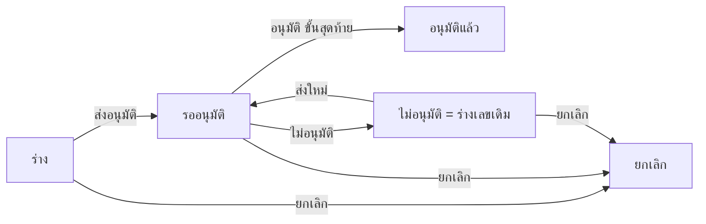

# BRD: แบบฟอร์มรายงานผลการสอบทานคำขอซื้อและใบสั่งซื้อค้างนาน (PR/PO Outstanding Review Report)

| Field | Value |
|---|---|
| BRD ID | BRD-PUR-PPO-001 |
| Feature | F-TMP-005 (รหัสชั่วคราว) รายงานผลการสอบทาน PR/PO ค้างนาน |
| BRD Type | New Feature (แบบ 2 · ดึงข้อมูลเดิม: ผู้จัดทำ/หน่วยงาน/หน่วยนับ) |
| Version | 1.0 |
| Status | **APPROVED (Prebrief Mode · Lane)** — DEC แทน Scope Lock จนมีใบเซ็นลูกค้า |
| Module | Purchase (Core Cube · Operation) |
| Customer | แบบฟอร์มลูกค้า FM-PUR-03 (ชีต 1 พิมพ์ FM-PUR-003 · Rev. 02 : 16/6/2026) แผนกจัดซื้อ |
| Request | REQ-TMP-005 (ชั่วคราว — รอเลขจริงจาก F186) |
| Input | PREBRIEF_REQ-TMP-005_v2 · FORM_SPEC.json (17 ช่อง · ERROR 0) · DECISIONS.lock (16 DEC · พร้อมเริ่มทำ) · feature.html (audit FAIL 0 · smoke 47/47 · [NO-BROWSER] e2e ยังไม่รัน) |
| Created / Updated | 2026-10-10 |

## Changelog
- v1.0 (2026-10-10): สร้างผ่าน brd-generator-full Prebrief Mode (doc-master-pipeline ขั้น 7 · โหมดไม่เฝ้า)

---

## 1. Business Context
### 1.1 ปัญหา / โอกาส
ฝ่ายจัดซื้อสอบทานคำขอซื้อ (PR) และใบสั่งซื้อ (PO) ที่ค้างนานด้วยกระดาษ/Excel FM-PUR-03 (ตาราง 8 แถว) — เลข PR/PO ผู้ขาย รายละเอียด พิมพ์เอง · สาเหตุคงค้างและแนวทางแก้ไขกระจายในไฟล์ ไม่มีประวัติ · ผู้มีอำนาจอนุมัติลงนามบนกระดาษ ค้นย้อนหลังยาก · ไฟล์มี 2 ชีต 2 Rev. ไม่แน่ใจว่าใช้ฉบับไหน
### 1.2 เป้าหมาย
1. ขึ้นแบบฟอร์มเป็นเอกสารในระบบ ช่อง/ตารางตรงกระดาษ 1:1 (13 คอลัมน์) ลูกค้าจำแบบเดิมได้ (PDF Replica)
2. ผู้จัดทำ/ตำแหน่ง ดึงจากผู้ล็อกอิน · หน่วยงาน/ฝ่ายขอซื้อ จากผังองค์กร · หน่วย จาก UOM Master · ตรวจความครบถ้วนต่อแถวทันที
3. ผู้มีอำนาจอนุมัติ (ผู้จัดการจัดซื้อ) อนุมัติผ่านสาย DOA กลาง (dynamic) · ไม่อนุมัติ = กลับร่างแก้ได้
### 1.3 ตัวชี้วัด
ไม่มีใน input → **OQ-01** (ห้ามแต่งตัวเลข)
### 1.4 ที่มา
แบบฟอร์มลูกค้า FM-PUR-03 (xlsx · 2 ชีต · ชีต 1 A4 แนวนอน Rev.02 = ต้นแบบ) → FORM_SPEC 17 ช่อง (ระบบ 5 · กรอก 11 · ระบบใส่ 1) · แถวซ้ำ 1 กลุ่ม 8 แถว · ลายเซ็น 2 (ผู้จัดทำ · ผู้มีอำนาจอนุมัติ) · anomalies 5 · gate 10 หมวด = AI-DEFAULT ทั้งหมด (โหมดไม่เฝ้า)

## 2. Scope
### 2.1 In Scope
- รายการรายงาน (segmented ทั้งหมด/รอฉันอนุมัติ · ค้นหาเลขที่/ผู้จัดทำ/เลข PR-PO/ผู้ขาย · กรองสถานะ/เดือน · CSV ระดับรายการ)
- สร้าง/แก้ไข wizard 3 ขั้น: วันที่รายงาน + หน่วยงาน → ตารางรายการ 12 ช่อง (เลขที่ PR · เลขที่ PO · วันที่สั่งซื้อ · วันที่รับ สินค้า/บริการ · ผู้ผลิต ผู้จัดจำหน่าย · รายละเอียด · จำนวนสั่งซื้อ · หน่วย · ฝ่าย/แผนกขอซื้อ · สาเหตุคงค้าง · สถานะปัจจุบัน · แนวทางการแก้ไข) · เพิ่ม/ลบแถว · บันทึกร่าง
- ส่งอนุมัติ DOA (เลือกคนต่อขั้น) · อนุมัติ / ไม่อนุมัติ (กลับร่างเลขเดิม) · ยกเลิก (เหตุผลบังคับ)
- แนบไฟล์ · PDF FM-PUR-03 Replica 2 หน้าทุกสถานะ · เลขที่ PPO จาก ENG-DOC-NUM
### 2.2 Out of Scope
- ดึงรายการ PR/PO ค้างจากระบบอัตโนมัติ · ปิด/ยกเลิก PR-PO จากรายงาน (PR F072 · PO F078 · Supplier master ยังไม่มีในระบบ · DEC-01/02 · OQ-04) · คอลัมน์อายุค้าง (วัน)/มูลค่า/เกณฑ์ "ค้างนาน" (กระดาษไม่มี · DEC-15 · OQ-03) · ทำซ้ำเอกสาร (DEC-11) · ประกาศ · แบบพิมพ์เกิน 24 แถว (OQ-08)
### 2.3 Assumptions
- ข้อมูลผู้จัดทำ/ตำแหน่ง/สังกัดมีใน F-EMP-001 / F-ORG-001 · ผู้มีอำนาจอนุมัติ = ผู้จัดการจัดซื้อของหน่วยงานผู้จัดทำ (resolve role-mgr-pur ตามผังองค์กร · OQ-05) · หน่วยนับมีใน UOM Master (F-PRODUCT-MASTER-001) · เลข PR/PO/ผู้ขาย เป็นข้อความอ้างอิง (soft reference) จนกว่า F072/F078 ขึ้นระบบ
### 2.4 Scope Lock (ชั่วคราว = DECISIONS.lock · ยังไม่มีใบเซ็น → OQ-02)
| DEC | หมวด | มติ | ที่มา |
|---|---|---|---|
| DEC-01 | G1 | อนุมัติแล้วไม่เปลี่ยนค่าในระบบ (ไม่ปิด/ยกเลิก PR-PO) | AI-DEFAULT |
| DEC-02 | G1 | ไม่ส่งต่อระบบอื่นรอบนี้ (ประกาศ event ใน FRD ไม่ยิง) | AI-DEFAULT |
| DEC-03 | G2 | DOA dynamic · ค่าเริ่ม 1 ขั้น role-mgr-pur (ผู้มีอำนาจอนุมัติ) · ไม่มีวงเงิน | AI-DEFAULT |
| DEC-04 | G3 | ไม่มีค่าคงที่/สูตรบนกระดาษ · เกณฑ์ "ค้างนาน" ไม่แต่ง (PurchaseConfig.outstanding_days เสนอ) · บังคับต่อแถว: PR หรือ PO ≥1 · รายละเอียด · จำนวน>0 · หน่วย · ฝ่าย/แผนก · สาเหตุ · สถานะ · แนวทาง · มี PO → วันที่สั่งซื้อ + ผู้ผลิต · วันที่รับ ≥ วันที่สั่งซื้อ · วันที่รายงาน/สั่งซื้อ ≤ วันนี้ · สั่งซื้อ ≤ วันที่รายงาน · เลขซ้ำ = เตือน · ≥1 แถว | AI-DEFAULT |
| DEC-05 | G4 | ไม่จำกัดแถว · PDF ≥8 แถวตามกระดาษ | AI-DEFAULT |
| DEC-06 | G5 | ช่อง 1:1 ไม่เพิ่มช่อง | AI-DEFAULT |
| DEC-07 | G6 | ลายเซ็นแถวล่าง 1 ช่อง/ขั้น DOA · ข้อความ "ส่ง/พิจารณาในระบบ" | AI-DEFAULT |
| DEC-08 | G7 | ไม่อนุมัติ = กลับร่างเลขเดิม · ยกเลิก: เจ้าของ + admin · ร่าง/รออนุมัติ · เหตุผลบังคับ | AI-DEFAULT |
| DEC-09 | G8 | เจ้าของ · ผู้อนุมัติเห็นหลังส่ง · admin (role-mgr-pur) เห็นทั้งหมด | AI-DEFAULT |
| DEC-10 | G9 | ออกเลขตอนบันทึกครั้งแรก · รหัส PPO | AI-DEFAULT |
| DEC-11 | G10 | แนบไฟล์ ✓ · CSV ✓ · ทำซ้ำ ✗ · ประกาศ ✗ | AI-DEFAULT |
| DEC-12 | VALID | ต้นแบบชีต 1 (Rev.02) · รหัสฟอร์ม/Rev อ่านจาก doccfg · ให้ลูกค้ายืนยัน (FM-PUR-003 vs FM-PUR-03 · Rev.02 16/6/2026 vs Rev.00 01/07/2569) | FORM_SPEC |
| DEC-13 | VALID | วันที่รับ ว่างได้ · ถ้ากรอกต้องไม่ก่อนวันที่สั่งซื้อ (บล็อก) · ตีความ = กำหนดรับ/รับจริง (รอยืนยัน) | FORM_SPEC |
| DEC-14 | VALID | PR หรือ PO ≥1 (บล็อก) · มี PO → วันที่สั่งซื้อ + ผู้ผลิต บังคับ · เลขซ้ำในใบ → เตือน | FORM_SPEC |
| DEC-15 | VALID | ไม่มีคอลัมน์อายุค้าง/มูลค่า/งวด/เกณฑ์ — คง 1:1 · เสนอลูกค้ายืนยัน | FORM_SPEC |
| DEC-16 | VALID | ผลพิจารณาเก็บในระบบ (DOA) · แบบพิมพ์ "พิจารณาในระบบ" + ชื่อ ตำแหน่ง วันที่ | FORM_SPEC |

## 3. Roles & Permissions (COSO)
| Role | COSO | ทำอะไร |
|---|---|---|
| ผู้จัดทำรายงาน (เจ้าหน้าที่จัดซื้อ) | Maker | สร้าง/แก้ไขรายงานของตน · ส่ง · ยกเลิกของตัวเอง (ร่าง/รออนุมัติ/ไม่อนุมัติ) |
| role-mgr-pur (ผู้มีอำนาจอนุมัติ · ผู้จัดการจัดซื้อของหน่วยงาน) | Approver | ขั้น 1 อนุมัติ / ไม่อนุมัติ |
| role-mgr-pur ระดับฝ่าย (admin role ของหน่วยงานเจ้าของเอกสาร) | Admin view | เห็นทั้งหมด · ยกเลิกได้ · CSV |

| Action | Maker | Approver | Admin |
|---|:-:|:-:|:-:|
| ดูรายงาน | ของตน | หลังส่ง (อยู่ในสาย) | ทั้งหมด |
| สร้าง/แก้ไข | ✓ ของตน (ร่าง/ไม่อนุมัติ) | – | – |
| ตัดสินขั้น | – | ขั้นของตน | ขั้นของตน (ถ้า DOA ตั้งเพิ่ม) |
| ยกเลิก | ✓ ของตน | – | ✓ |
SoD: ผู้จัดทำพิจารณารายงานตัวเองไม่ได้ (BR-DOA-04)

## 4. User Journey
### 4.1 Happy Path
1. รอบสอบทาน ผู้จัดทำ: สร้าง → วันที่รายงาน (ค่าเริ่ม = วันนี้) · หน่วยงาน (ค่าเริ่ม = สังกัด) → เพิ่ม PR/PO ที่ค้าง (เลขที่ · วันที่ · ผู้ขาย · รายละเอียด · จำนวน · หน่วย · ฝ่ายขอซื้อ) + สาเหตุคงค้าง · สถานะปัจจุบัน · แนวทางการแก้ไข → บันทึกร่าง (ได้เลข PPO)
2. ส่งอนุมัติ → ผู้มีอำนาจอนุมัติ "อนุมัติ" → ปิดรายงาน · PDF เก็บสำเนา (approved_final)
### 4.2 Alternative
- PR ที่ยังไม่ออก PO → กรอกเฉพาะเลขที่ PR · วันที่สั่งซื้อ/ผู้ผลิตว่างได้ · นับ "ยังไม่ออก PO" ในสรุป
- ผู้มีอำนาจอนุมัติ "ไม่อนุมัติ" (เหตุผลบังคับ) → ร่างเลขเดิม + แถบเหตุผล → ผู้จัดทำแก้ ส่งใหม่ (resolve สายใหม่)
- เลขที่ PR/PO ซ้ำในรายงาน → เตือนในแถว (ไม่บล็อก)
- ยกเลิก (ร่าง/รออนุมัติ/ไม่อนุมัติ) โดยเจ้าของหรือ admin

## 5. Data (จาก FORM_SPEC — ป้ายตามกระดาษ)
### 5.1 pr_po_outstanding_review (header)
| ช่องบนกระดาษ | field | ชนิด | ที่มา | บังคับ |
|---|---|---|---|:-:|
| (เลขที่ — ระบบเพิ่มใน footer) | doc_no | text | auto ENG-DOC-NUM | ✓ |
| หัวกระดาษ โลโก้/ชื่อบริษัท | header_snapshot | jsonb | system F-ORG-001 (snapshot ตอนออกเลข) | ✓ |
| วันที่รายงาน : | report_date | date | user (≤ วันนี้ · ค่าเริ่มวันนี้) | ✓ |
| หน่วยงาน : | org_unit_id + org_unit_name snapshot | ref | system F-ORG-001 (ค่าเริ่ม = สังกัดผู้จัดทำ) | ✓ |
| ผู้จัดทำรายงาน : · ตำแหน่ง : | preparer_id + name/position snapshot | ref | system F-EMP-001 (ผู้ล็อกอิน) | ✓ |
| ผู้จัดทำ : (ลงชื่อ) | submitted_at | timestamp | ระบบ | ✓ เมื่อส่ง |
| ผู้มีอำนาจอนุมัติ (ลงชื่อ) | approval_chain | jsonb | DOA | ✓ เมื่อส่ง |
| + DOA fields | approval_status · doa_entry_ref · approver_role · approved_by · approved_at | | DOA | |
| + returned_reason · returned_by · returned_at | | | DEC-08 | |
### 5.2 pr_po_outstanding_review_item (แถว 1..n)
| ช่องบนกระดาษ | field | ชนิด | หมายเหตุ |
|---|---|---|---|
| ลำดับ | seq | smallint | auto |
| เลขที่ PR | pr_no | text | soft ref (F072 ยังไม่มี) · PR หรือ PO ≥1 |
| เลขที่ PO | po_no | text | soft ref (F078 ยังไม่มี) · ว่าง = ยังไม่ออก PO |
| วันที่สั่งซื้อ | order_date | date | บังคับเมื่อมี PO · ≤ วันนี้ · ≤ report_date |
| วันที่รับ สินค้า/บริการ | receive_date | date | ว่างได้ · ≥ order_date · อนาคตได้ |
| ผู้ผลิต ผู้จัดจำหน่าย | vendor_name | text | บังคับเมื่อมี PO (Supplier master ยังไม่มี) |
| รายละเอียด | description | text | ✓ |
| จำนวนสั่งซื้อ | order_qty | numeric(18,3) | > 0 |
| หน่วย | uom_code + uom_name snapshot | ref uom_master | ✓ |
| ฝ่าย/แผนก ขอซื้อสินค้า/บริการ | request_org_unit_id + name snapshot | ref OrgUnit | ✓ |
| สาเหตุคงค้าง | outstanding_reason | text | ✓ |
| สถานะปัจจุบัน | current_status | text | ✓ (ข้อความ — ไม่ใช่สถานะเอกสาร) |
| แนวทางการแก้ไข | corrective_action | text | ✓ |
### 5.3 attachments → Document Center (ระดับรายงาน)

## 6. User Stories
| ID | Story | AC หลัก |
|---|---|---|
| S-01 | ผู้จัดทำสร้างรายงานสอบทาน | วันที่รายงาน + หน่วยงาน บังคับ · ≥1 แถว · บันทึกได้เลข PPO |
| S-02 | ผู้จัดทำบันทึก PR/PO ที่ค้าง | PR หรือ PO ≥1 · มี PO → วันที่สั่งซื้อ + ผู้ผลิต บังคับ · หน่วย/ฝ่ายเลือกจากระบบ |
| S-03 | ผู้จัดทำบันทึกสาเหตุ/สถานะ/แนวทาง | 3 ช่องข้อความบังคับทุกแถว |
| S-04 | ผู้จัดทำเห็นเลขซ้ำ/ยังไม่ออก PO | เตือนในแถว + การ์ดสรุป "ยังไม่ออก PO n รายการ" (ไม่บล็อก) |
| S-05 | ผู้จัดทำส่งอนุมัติ | slot ตามจำนวนขั้น DOA · ค่าเริ่มจาก resolve · ตัวเองไม่อยู่ในรายชื่อ |
| S-06 | ผู้มีอำนาจอนุมัติอนุมัติ | ปุ่มเฉพาะผู้พิจารณาขั้นปัจจุบัน · เรียงขั้น · ครบ = อนุมัติแล้ว ล็อกแก้ไข |
| S-07 | ผู้มีอำนาจอนุมัติไม่อนุมัติ | เหตุผลบังคับ → ร่างเลขเดิม · ผู้จัดทำเห็นเหตุผล |
| S-08 | พิมพ์/ดาวน์โหลด PDF FM-PUR-03 | 2 หน้าทุกสถานะ · ตาราง 12+12 แถว (ขั้นต่ำ 8 ตามกระดาษ) · ลายเซ็น = ผู้จัดทำ + 1 ช่อง/ขั้น DOA |
| S-09 | ยกเลิกเอกสาร | เจ้าของ/admin · ร่าง/รออนุมัติ/ไม่อนุมัติ · เหตุผลบังคับ |
| S-10 | admin ดูทุกรายงาน + CSV ระดับรายการ | กรองสถานะ/เดือน |

## 7. Status & Lifecycle
| จาก | Action | ไป | ใคร |
|---|---|---|---|
| — | บันทึกครั้งแรก | draft | Maker |
| draft / returned | แก้ไข | (เดิม) | Maker |
| draft / returned | ส่ง | pending (ขั้น 1) | Maker |
| pending | อนุมัติ ขั้น n<N | pending (ขั้น n+1) | ผู้พิจารณาขั้น n |
| pending | อนุมัติ ขั้น N | approved | ขั้น N |
| pending | ไม่อนุมัติ | returned (= ร่าง เลขเดิม) | ผู้พิจารณาขั้นปัจจุบัน |
| draft / pending / returned | ยกเลิก | cancelled | Maker / Admin |
approved = ล็อกแก้ไข ยกเลิกไม่ได้

## 8. Business Rules + Validation
| ID | Rule | Tag | Type |
|---|---|:-:|---|
| BR-01 | หน่วยงาน และ ฝ่าย/แผนกขอซื้อ เลือกจากผังองค์กร (F-ORG-001) · snapshot ชื่อ | FIXED | Master (DEC-04) |
| BR-02 | หน่วย เลือกจาก UOM Master · snapshot ชื่อ | FIXED | Master (DEC-04) |
| BR-03 | แต่ละแถวต้องมี เลขที่ PR หรือ PO อย่างน้อย 1 · ≥1 แถว | FIXED | DEC-14 (VALID) |
| BR-04 | มีเลขที่ PO → วันที่สั่งซื้อ และ ผู้ผลิต/ผู้จัดจำหน่าย บังคับ | FIXED | DEC-14 (VALID) |
| BR-05 | บังคับ รายละเอียด · จำนวนสั่งซื้อ > 0 · หน่วย · ฝ่าย/แผนก · สาเหตุคงค้าง · สถานะปัจจุบัน · แนวทางการแก้ไข | FIXED [AI-DEFAULT] | DEC-04 |
| BR-06 | วันที่รายงาน ≤ วันนี้ · วันที่สั่งซื้อ ≤ วันนี้ และ ≤ วันที่รายงาน · วันที่รับ ≥ วันที่สั่งซื้อ (อนาคตได้) | FIXED | DEC-04 · DEC-13 |
| BR-07 | เลขที่ PR หรือ PO ซ้ำในรายงานเดียวกัน → เตือน (ไม่บล็อก) | FIXED [AI-DEFAULT] | DEC-14 |
| BR-08 | เกณฑ์ "ค้างนาน" (จำนวนวัน) อ่านจาก PurchaseConfig.outstanding_days เมื่อลูกค้ายืนยัน — รอบนี้ไม่ใช้ตรวจ/ไม่บล็อก | CONFIGURABLE [AI-DEFAULT] | DEC-04 · DEC-15 |
| BR-09 | สายอนุมัติ resolve จาก DOA ตอนส่ง แล้ว freeze | FIXED | DOA (BR-DOA-02) |
| BR-10 | ไม่อนุมัติ → returned เลขเดิม · resolve ใหม่ตอนส่งรอบถัดไป | FIXED | DEC-08 |
| BR-11 | ออกเลขตอนบันทึกครั้งแรก · no-gap ✗ | CONFIGURABLE | DOCCFG (DEC-10) |
| BR-12 | ร่างเห็นเฉพาะเจ้าของ (+ admin) | FIXED | DEC-09 |
| BR-13 | ช่องลงชื่อ PDF = ผู้จัดทำ + 1 ช่องต่อขั้น DOA (dynamic) · แถวละ ≤4 · คำตัดสินตาม role (role-mgr-pur = อนุมัติ/ไม่อนุมัติ) | FIXED (จำนวน = DOA) | DEC-03 · DEC-07 · DEC-16 |
| BR-14 | ช่องตามกระดาษ 1:1 (ชีต 1 Rev.02) · รหัสฟอร์ม/Rev จาก doccfg | FIXED [AI-DEFAULT] | DEC-06 · DEC-12 |
| BR-15 | อนุมัติแล้วไม่ปิด/ยกเลิก PR-PO และไม่ส่งต่อ (ประกาศ event `ppo.approved` ไม่ยิง) | FIXED [AI-DEFAULT] | DEC-01 · DEC-02 |

| VR | ช่อง | เงื่อนไข | ข้อความ |
|---|---|---|---|
| VR-01 | report_date | required · ≤ วันนี้ | เลือกวันที่รายงาน / วันที่รายงานเป็นวันในอนาคตไม่ได้ |
| VR-02 | org_unit | required | เลือกหน่วยงาน |
| VR-03 | items | ≥1 แถว | บันทึก PR/PO ค้างอย่างน้อย 1 รายการ |
| VR-04 | pr_no · po_no | อย่างน้อย 1 | ระบุเลขที่ PR หรือ PO อย่างน้อย 1 |
| VR-05 | order_date | required เมื่อมี PO · ≤ วันนี้ · ≤ report_date | มีเลขที่ PO ต้องระบุวันที่สั่งซื้อ / วันที่สั่งซื้อเป็นวันในอนาคตไม่ได้ / วันที่สั่งซื้อต้องไม่หลังวันที่รายงาน |
| VR-06 | receive_date | ≥ order_date | วันที่รับต้องไม่ก่อนวันที่สั่งซื้อ |
| VR-07 | vendor_name | required เมื่อมี PO | มีเลขที่ PO ต้องระบุผู้ผลิต/ผู้จัดจำหน่าย |
| VR-08 | description · uom · request_dept | required | ระบุรายละเอียด / เลือกหน่วย / เลือกฝ่าย/แผนก |
| VR-09 | order_qty | required · > 0 | ระบุจำนวนสั่งซื้อ / จำนวนต้องมากกว่า 0 |
| VR-10 | outstanding_reason · current_status · corrective_action | required | ระบุสาเหตุคงค้าง / ระบุสถานะปัจจุบัน / ระบุแนวทางการแก้ไข |
| VR-11 | slot ผู้พิจารณา | ครบทุกขั้น · ≠ ผู้จัดทำ | กรุณาเลือกผู้พิจารณา |
| VR-12 | เหตุผล ไม่อนุมัติ/ยกเลิก | required | กรุณาระบุเหตุผล |

### 8.5 ระดับความยืดหยุ่น
BR-08 → PurchaseConfig (Purchase Configuration — ยังไม่มี · OQ-03) · BR-11 → F-DOCCFG · BR-13 → DOA กลาง

## 9. Edge Cases
| EC | กรณี | ผล |
|---|---|---|
| EC-01 | แถวว่างทั้งแถว | ตัดทิ้งตอนบันทึก (ถ้ามีแถวอื่น) |
| EC-02 | PR ยังไม่ออก PO | กรอกเฉพาะ PR · นับ "ยังไม่ออก PO" · PDF ช่อง PO ว่าง |
| EC-03 | เลขที่ PR/PO ซ้ำในรายงาน | เตือน (อาจคนละรายการ) |
| EC-04 | วันที่รับเป็นวันในอนาคต | ผ่าน (= กำหนดรับ · DEC-13) |
| EC-05 | หน่วย/หน่วยงานถูกปิดใช้หลังบันทึก | แถวเดิมคง snapshot · แก้แถวต้องเลือกค่าที่ active |
| EC-06 | ผู้จัดทำเป็นผู้จัดการจัดซื้อเอง | resolve ไปผู้จัดการฝ่าย · ตัวเองไม่อยู่ในรายชื่อ |
| EC-07 | แก้ DOA ระหว่างรออนุมัติ | ใช้สาย snapshot |
| EC-08 | ส่ง/ตัดสินชนกัน (stale) | 409 → toast รีเฟรช |
| EC-09 | แบบเอกสารปิดใช้ (F-DOCCFG) | ปุ่มสร้าง disabled + แถบแดง |
| EC-10 | แถวเกิน 24 (12 + 12) | แบบพิมพ์แสดง 24 แถวแรก + เตือนในจอ แนะนำ CSV → OQ-08 |
| EC-11 | ข้อความยาวในคอลัมน์แคบ (แบบพิมพ์) | ตัดบรรทัดในช่อง · dense เมื่อ > 12 แถว · ล้น A4 ได้ถ้าทุกแถวยาวมาก → OQ-08 |

## 10. Value Stream & Downstream Impact
Positioning: Purchase Operation — PR (F072) → PO (F078) → รับสินค้า (GRN) · **feature นี้** = รายงานสอบทานรายการที่ค้างในสายนั้น (ควบคุมภายใน)
| ปลายทาง | ข้อมูล | Trigger | หมายเหตุ |
|---|---|---|---|
| PR / PO (ปิด/ยกเลิก/เร่งรัด) | แนวทางการแก้ไขต่อรายการ | approved | **ปิดรอบนี้ (DEC-01/02)** — ประกาศ event `ppo.approved` ไม่ยิง · PR/PO ยังไม่มีในระบบ |
| F-DOCCFG / ENG-DOC-STORE | PDF snapshot | approved_final | |
| รายงาน / Audit ภายใน | จำนวนรายการค้างต่อหน่วยงาน/สาเหตุ | — | Report area อ่าน |

## 11. Delivery
Phase 1 = §2.1 ทั้งหมด · Phase 2 (เสนอ) = ดึงรายการค้างจาก PR/PO อัตโนมัติ (เมื่อ F072/F078 ขึ้นระบบ) · คอลัมน์อายุค้าง/มูลค่า + เกณฑ์จาก PurchaseConfig · ผูก Supplier master · แบบพิมพ์ใบต่อหน้า 3+

## 12. Dev Summary "ใบสั่ง"
- Config: DOA entry F-TMP-005 (role-mgr-pur) · doc_type PPO · (เสนอ) PurchaseConfig.outstanding_days
- Declaration: DOA_BRIEF · NTF_BRIEF (ppo_cancelled) · DOCCFG_BRIEF · MDOC_BRIEF
- Screen Inventory: P-01 รายการ · P-02 สร้าง/แก้ไข (drawer wide 3 ขั้น) · P-03 ดู (drawer 4 แท็บ) · M-01..05 ส่ง/อนุมัติ/ไม่อนุมัติ/ยกเลิก/ทิ้งข้อมูล
- UI Signals: เอกสาร + พิมพ์ + ลายเซ็น = ใช่ · Q-form (report) · แถวรายการเป็นตาราง

## 13. Open Questions
| OQ | คำถาม | เจ้าของ | Block? |
|---|---|---|---|
| OQ-01 | ตัวชี้วัด (จำนวน/อายุ PR-PO ค้างต่อรอบ · % แก้ไขได้ตามแนวทาง) | ลูกค้า | ไม่ |
| OQ-02 | ลูกค้าเซ็นยืนยัน DEC-01..11 (AI-DEFAULT) — โดยเฉพาะ ผู้มีอำนาจอนุมัติ = ผู้จัดการจัดซื้อ · ไม่ปิด PR-PO · ไม่มีทำซ้ำ | Strike → ลูกค้า | ก่อน UAT |
| OQ-03 | เพิ่มคอลัมน์อายุค้าง (วัน)/มูลค่า/งวดที่สอบทาน และเกณฑ์ "ค้างนาน" กี่วัน (PurchaseConfig) ไหม (DEC-15) | ลูกค้า + พี่เบิร์ด | ไม่ (Phase 2) |
| OQ-04 | เมื่อ PR (F072)/PO (F078)/Supplier ขึ้นระบบ — เปลี่ยนเลขที่/ผู้ขายเป็น search-select + ดึงรายการค้างอัตโนมัติ | พี่เบิร์ด | ไม่ |
| OQ-05 | role-mgr-pur resolve ตามหน่วยงานผู้จัดทำได้ไหม (relative) · admin role ระดับฝ่าย | Strike + พี่เบิร์ด | ก่อน wire |
| OQ-06 | รหัสฟอร์ม/Rev ที่ถูกต้อง: FM-PUR-003 vs FM-PUR-03 · Rev.02 16/6/2026 (ค.ศ.) ลงวันที่ก่อน Rev.00 01/07/2569 · ชีต 2 แนวตั้งยังใช้ไหม (DEC-12) | ลูกค้า | ก่อน UAT |
| OQ-07 | "วันที่รับ สินค้า/บริการ" = วันกำหนดรับ หรือวันรับจริง (DEC-13) | ลูกค้า | ไม่ |
| OQ-08 | รายการเกิน 24 แถวต่อรายงาน / ข้อความยาวมาก — แบบพิมพ์ต้องเพิ่มหน้าใบต่อไหม (thai-doc R10 ออกแบบ 2 หน้า · ต้นฉบับแนวนอน → แนวตั้ง) | Strike → ลูกค้า | ไม่ |
| OQ-09 | function_code taxonomy ของ PPO (ใช้ F01 ชั่วคราว) · ได้รหัส feature จริง | Strike | ก่อน register |

## 14. Security & Compliance
Preset: Standard Operation · PII: ชื่อผู้จัดทำ/ผู้อนุมัติ (snapshot) — ข้อมูลตัวอย่าง prototype เป็นชื่อสมมติ/เลข PR-PO สมมติ (PR-TEST-/PO-TEST-)/ผู้ขายสมมติ · Audit append-only ทุก action · SoD ผู้จัดทำ≠ผู้อนุมัติ · ไฟล์แนบตาม file_policy Document Center

## 15. Health Check / Monitoring
SLA: ไม่กำหนดรอบนี้ (→ OQ-01) · KPI เสนอ: รายงานที่ยังไม่ส่งหลังรอบ · รายการ "ยังไม่ออก PO" ต่อรอบ · รายการที่ปรากฏซ้ำหลายรอบ

## 16. AI Review (C01–C23 · PE01–PE05)
C01 ✅ · C02 ✅ · C05 ✅ story ละ 1 การกระทำ · C10 ✅ ทุก BR มี Tag · C13 ✅ EC 11 · C18 ✅ WARNING → OQ · C19 ✅ §12 · C20 ✅ DEC ครบ 16 + OQ-02 รอใบเซ็น · C21 ✅ §10 · C22 ⚠️→OQ-01 (ไม่มีตัวชี้วัดใน input — ห้ามแต่ง) · C23 ✅ · PE01–PE05 ✅ · **สถานะ: APPROVED (Prebrief Mode)**

## Appendix — Screen List
P-01 `#/pr-po-outstanding` · P-02 `#/pr-po-outstanding/create` · `/edit/:id` · P-03 `#/pr-po-outstanding/view/:id`
