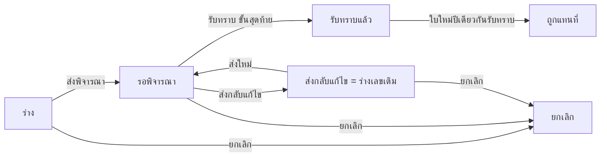

# BRD: แบบฟอร์มเปิดเผยผลประโยชน์ทับซ้อนของแผนกจัดซื้อ ประจำปี (Annual Conflict of Interest Disclosure — Purchasing)

| Field | Value |
|---|---|
| BRD ID | BRD-PUR-COI-001 |
| Feature | F-TMP-006 (รหัสชั่วคราว) แบบฟอร์มเปิดเผยผลประโยชน์ทับซ้อนของแผนกจัดซื้อ ประจำปี |
| BRD Type | New Feature (แบบ 2 · ดึงข้อมูลเดิม — ชื่อ/ตำแหน่ง/ผู้บังคับบัญชาจากระบบ) |
| Version | 1.0 |
| Status | **APPROVED (Prebrief Mode · Lane)** — DEC แทน Scope Lock จนมีใบเซ็นลูกค้า |
| Module | Purchase (Core Cube · Governance ของแผนกจัดซื้อ) |
| Customer | แบบฟอร์มลูกค้า FM-PUR-04 REV.00 : 01/07/2569 (แผนกจัดซื้อ) |
| Request | REQ-TMP-006 (ชั่วคราว — รอเลขจริงจาก F186) |
| Input | PREBRIEF_REQ-TMP-006_v2 · FORM_SPEC.json (10 ช่อง · ERROR 0) · DECISIONS.lock (18 DEC · พร้อมเริ่มทำ) · feature.html (audit FAIL 0 · smoke jsdom 39/39 · [NO-BROWSER] e2e ยังไม่รัน) |
| Data Classification | **Confidential** — ข้อมูลความสัมพันธ์ครอบครัว/ธุรกิจของพนักงาน |
| Created / Updated | 2026-10-10 |

## Changelog
- v1.0 (2026-10-10): สร้างผ่าน brd-generator-full v2.3 Prebrief Mode (doc-master-pipeline ขั้น 7 · โหมดไม่เฝ้า)

---

## 1. Business Context
### 1.1 ปัญหา / โอกาส
แผนกจัดซื้อให้พนักงานกรอกแบบฟอร์มเปิดเผยผลประโยชน์ทับซ้อน FM-PUR-04 (Word) ทุกปี — พิมพ์ปี "2569" ตายตัวในหัวเรื่องและชื่อไฟล์ (ต้องทำฟอร์มใหม่ทุกปี) · ติ๊ก ☐ ไม่มี / ☐ มี ได้ทั้งสองช่องหรือไม่ติ๊กเลย · ติ๊ก "มี" แต่ไม่กรอกรายละเอียดได้ · กรอบ "ข้อคิดเห็นของผู้บังคับบัญชา" มีคำ "ฝ่ายกฎหมาย" ใต้ช่องลงชื่อ (ไม่ชัดว่าใครลงนาม) · ไม่มีช่องทางแจ้งการเปลี่ยนแปลงระหว่างปีตามที่ถ้อยคำรับรองกำหนด · กระดาษเก็บรวมกันทำให้ข้อมูลลับเข้าถึงได้กว้างเกินจำเป็น
### 1.2 เป้าหมาย
1. ขึ้นแบบฟอร์มเป็นเอกสารในระบบ ถ้อยคำและช่องตรงกระดาษ 1:1 ลูกค้าจำแบบเดิมได้ (PDF Replica) · ปีเป็นค่าตัวแปรรอบปี ไม่ต้องทำฟอร์มใหม่ทุกปี
2. บังคับเลือก ไม่มี/มี 1 ข้อ · มี = รายละเอียดบังคับ · ยืนยันถ้อยคำรับรองก่อนส่ง
3. ผู้บังคับบัญชารับทราบ (พร้อมข้อคิดเห็น) ผ่านสาย DOA กลาง (dynamic) · ตอบ "มี" → แจ้งฝ่ายกฎหมาย/กำกับดูแลทันที
4. จำกัดการมองเห็นข้อมูลลับ (เจ้าของ · ผู้พิจารณา · ฝ่ายกฎหมาย/กำกับดูแล) · แจ้งเปลี่ยนแปลงระหว่างปีด้วยใบใหม่ที่อ้างใบเดิม
### 1.3 ตัวชี้วัด
ไม่มีใน input → **OQ-01** (ห้ามแต่งตัวเลข)
### 1.4 ที่มา
แบบฟอร์มลูกค้า FM-PUR-04 (.docx) → FORM_SPEC 10 ช่อง (ระบบ 5 · กรอก 2 · ระบบใส่ 3) · ตัวเลือก 1 (ไม่มี/มี) · ค่าคงที่ 2 (ปี · ถ้อยคำรับรอง) · ลายเซ็น 2 · anomalies 7 · gate 10 หมวด = AI-DEFAULT ทั้งหมด (โหมดไม่เฝ้า)

## 2. Scope
### 2.1 In Scope
- รายการแบบเปิดเผย (segmented ทั้งหมด/รอฉันพิจารณา · ค้นหาเลขที่/ผู้เปิดเผย/ตำแหน่ง/ปี · กรองสถานะ/ผลการเปิดเผย · CSV ไม่มีรายละเอียด)
- ยื่น/แก้ไข wizard 3 ขั้น: ข้าพเจ้า + ตำแหน่ง + ปี (จากระบบ) · ถ้อยคำรับรอง (จาก config) → ☐ ไม่มี / ☐ มี + รายละเอียด → ถ้อยคำท้าย + ยืนยัน → แนบไฟล์ → ตรวจสอบ · บันทึกร่างได้
- ส่งพิจารณา DOA (เลือกคนต่อขั้น) · ผู้บังคับบัญชา รับทราบ (ข้อคิดเห็น) / ส่งกลับแก้ไข (เหตุผลบังคับ) = กลับร่างเลขเดิม · ยกเลิก (เหตุผลบังคับ)
- ตอบ "มี" + ส่ง → แจ้ง coi_conflict_declared ถึง role-compliance (in-app · ไม่มีรายละเอียดในข้อความ)
- 1 คน มีใบที่มีผล 1 ใบต่อปี: มีใบปีนี้แล้ว → เตือน (ไม่บล็อก) · ใบใหม่อ้างใบเดิม · รับทราบแล้วใบเดิม = ถูกแทนที่ · เมนู "แจ้งเปลี่ยนแปลง"
- แนบไฟล์ · PDF FM-PUR-04 Replica 1 หน้าทุกสถานะ · เลขที่ COI จาก ENG-DOC-NUM
### 2.2 Out of Scope
- ทะเบียนผลประโยชน์ทับซ้อนกลาง / เชื่อมผู้ขายใน Vendor master เพื่อกันการจัดซื้อกับผู้ขายที่เกี่ยวข้อง (DEC-01/02 → OQ-04) · บังคับยื่นทุกคน/ติดตามผู้ยังไม่ยื่น (ประกาศ ✗ — OQ-05) · หน้าตั้งค่า CoiDisclosureConfig (เสนอ feature ใหม่ OQ-06) · ทำซ้ำเอกสาร (G10 ✗) · โครงรายละเอียดแยกช่อง (G5 1:1 — OQ-07)
### 2.3 Assumptions
- ชื่อ/คำนำหน้า/ตำแหน่ง/ผู้บังคับบัญชามีในข้อมูลพนักงาน (HR Employee) / ผังองค์กร (F-ORG-001) · ปีรอบและถ้อยคำรับรองอ่านจาก CoiDisclosureConfig (ค่าเริ่ม = ปีปัจจุบัน พ.ศ. · ถ้อยคำบนกระดาษ) · ผู้เปิดเผย = ผู้สร้างใบ (กรอกของตัวเองเท่านั้น)
### 2.4 Scope Lock (ชั่วคราว = DECISIONS.lock · ยังไม่มีใบเซ็น → OQ-02)
| DEC | หมวด | มติ | ที่มา |
|---|---|---|---|
| DEC-01 | G1 | รับทราบแล้วไม่เปลี่ยนค่าในระบบ | AI-DEFAULT |
| DEC-02 | G1 | ไม่ส่งต่อระบบอื่นรอบนี้ (ประกาศ event ใน FRD ไม่ยิง) | AI-DEFAULT |
| DEC-03 | G2 | DOA dynamic · ค่าเริ่ม 1 ขั้น role-line-manager (ผู้บังคับบัญชา) · ไม่มีวงเงิน | AI-DEFAULT |
| DEC-04 | G3 | ปี = CoiDisclosureConfig.current_year (ห้าม hardcode 2569) · ถ้อยคำรับรองจาก config + snapshot · เลือก 1 ข้อ (บล็อก) · มี → รายละเอียด ≥10 ตัวอักษร (บล็อก) · ยืนยันถ้อยคำ (บล็อก) · ชื่อ/ตำแหน่งจากระบบ · 1 คน 1 ใบที่มีผลต่อปี (ซ้ำ = เตือน · ใบใหม่อ้างใบเดิม) · ข้อคิดเห็นกรอกเฉพาะผู้พิจารณา | AI-DEFAULT |
| DEC-05 | G4 | ไม่มีแถวซ้ำ · PDF เส้นประรายละเอียด/ข้อคิดเห็นขั้นต่ำ 3 บรรทัดตามกระดาษ | AI-DEFAULT |
| DEC-06 | G5 | ช่อง 1:1 ไม่เพิ่มช่อง · ไม่มีคำสะกดผิดชัดเจน | AI-DEFAULT |
| DEC-07 | G6 | ลายเซ็นแถวล่าง 1 ช่อง/ขั้น DOA · ข้อความ "ส่ง/พิจารณาในระบบ" · คำตัดสินผูก role (รับทราบ/ส่งกลับแก้ไข) | AI-DEFAULT |
| DEC-08 | G7 | ส่งกลับแก้ไข = กลับร่างเลขเดิม · ยกเลิก: เจ้าของ + admin · ร่าง/รอพิจารณา · เหตุผลบังคับ | AI-DEFAULT |
| DEC-09 | G8 | เจ้าของ · ผู้พิจารณาเห็นหลังส่ง · admin = role-compliance (ฝ่ายกฎหมาย/กำกับดูแล) เห็นทั้งหมด — ผู้จัดการฝ่ายจัดซื้อไม่เห็นทั้งหมดโดยตำแหน่ง | AI-DEFAULT |
| DEC-10 | G9 | ออกเลขตอนบันทึกครั้งแรก · รหัส COI | AI-DEFAULT |
| DEC-11 | G10 | แนบไฟล์ ✓ · CSV ✓ (ไม่มีรายละเอียด) · ทำซ้ำ ✗ · ประกาศ ✗ | AI-DEFAULT |
| DEC-12 | VALID | ปีเป็นค่าตัวแปรรอบปี · 1 คนมีใบที่มีผล 1 ใบต่อปี | FORM_SPEC |
| DEC-13 | VALID | กรอบผู้บังคับบัญชามี 1 ช่องลงนาม → ค่าเริ่ม 1 ขั้น ผู้บังคับบัญชา · "ฝ่ายกฎหมาย" = role-compliance เห็นทุกใบ · ถ้าต้องลงนามด้วย → เพิ่มขั้นที่ DOA กลาง (ไม่แก้ feature) | FORM_SPEC |
| DEC-14 | VALID | เลือก ไม่มี/มี ได้ 1 ข้อ และต้องเลือกก่อนส่ง | FORM_SPEC |
| DEC-15 | VALID | มี → รายละเอียดบังคับ · ไม่มี → ล้าง/ซ่อนรายละเอียด | FORM_SPEC |
| DEC-16 | VALID | ข้อมูลลับ: จำกัดการมองเห็น · CSV/รายการรวมไม่มีรายละเอียด · ตัวอย่างใช้ชื่อสมมติ | FORM_SPEC |
| DEC-17 | VALID | แจ้งเปลี่ยนแปลงระหว่างปี = ใบใหม่ของปีเดียวกัน (เลขใหม่ อ้างเลขใบเดิม) | FORM_SPEC |
| DEC-18 | VALID | ถ้อยคำยึดไฟล์ต้นฉบับ (textbox "ฝ่ายกฎหมาย"/"วันที่" ที่ภาพตัดหาย) | FORM_SPEC |

## 3. Roles & Permissions (COSO)
| Role | COSO | ทำอะไร |
|---|---|---|
| ผู้เปิดเผย (พนักงานแผนกจัดซื้อ) | Maker | ยื่น/แก้ไขของตัวเอง · ส่ง · ยกเลิกของตัวเอง (ร่าง/รอพิจารณา/ส่งกลับ) · แจ้งเปลี่ยนแปลง |
| role-line-manager (ผู้บังคับบัญชาตรง · relative role) | Approver (Checker) | ขั้น 1 รับทราบ (ข้อคิดเห็น) / ส่งกลับแก้ไข |
| role-compliance (ฝ่ายกฎหมาย/กำกับดูแล) | Monitor + Admin view | เห็นทั้งหมด · ยกเลิกได้ · CSV · รับแจ้ง coi_conflict_declared · (ขั้นพิจารณาเพิ่มถ้าลูกค้ายืนยัน OQ-03) |

| Action | Maker | Line manager | Compliance |
|---|:-:|:-:|:-:|
| ดูใบ | ของตน | หลังส่ง (อยู่ในสาย) | ทั้งหมด |
| สร้าง/แก้ไข | ✓ ของตน (ร่าง/ส่งกลับ) | – | – |
| ตัดสินขั้น | – | ขั้นของตน | ขั้นของตน (ถ้าเพิ่ม) |
| ยกเลิก | ✓ ของตน | – | ✓ |
| CSV | ใบที่เห็น | ใบที่เห็น | ทั้งหมด (ไม่มีรายละเอียด) |
SoD: ผู้เปิดเผย (ผู้ส่ง) พิจารณาใบตัวเองไม่ได้ (BR-DOA-04) · ผู้จัดการฝ่ายจัดซื้อเห็นเฉพาะใบที่ตนเป็นผู้พิจารณา

## 4. User Journey
### 4.1 Happy Path
1. ผู้เปิดเผย: ยื่นแบบเปิดเผย → อ่านถ้อยคำรับรอง (ชื่อ/ตำแหน่ง/ปีจากระบบ) → เลือก ไม่มี/มี (+ รายละเอียด) → ยืนยันถ้อยคำ → แนบไฟล์ → ตรวจสอบ → บันทึกและส่งพิจารณา (ได้เลข COI)
2. ผู้บังคับบัญชารับทราบ (ข้อคิดเห็น) → รับทราบแล้ว · PDF เก็บสำเนา (approved_final)
### 4.2 Alternative
- ตอบ "มี" → ส่งแล้วระบบแจ้งฝ่ายกฎหมาย/กำกับดูแล (ไม่ใส่รายละเอียดในข้อความ)
- ส่งกลับแก้ไข (เหตุผลบังคับ) → ร่างเลขเดิม + แถบเหตุผล → ผู้เปิดเผยแก้ ส่งใหม่
- มีใบปีนี้แล้ว (แจ้งเปลี่ยนแปลงระหว่างปี) → เตือน · ใบใหม่อ้างใบเดิม → รับทราบแล้วใบเดิมแสดง "ถูกแทนที่"
- บันทึกร่างได้ก่อนเลือก/ยืนยัน · ส่งได้เมื่อครบ
- ยกเลิก (ร่าง/รอพิจารณา/ส่งกลับ) โดยเจ้าของหรือฝ่ายกฎหมาย/กำกับดูแล

## 5. Data (จาก FORM_SPEC — ป้ายตามกระดาษ)
### 5.1 coi_disclosure (header)
| ช่องบนกระดาษ | field | ชนิด | ที่มา | บังคับ |
|---|---|---|---|:-:|
| (เลขที่ — ระบบเพิ่มใน footer) | doc_no | text | auto ENG-DOC-NUM | ✓ |
| โลโก้หัวกระดาษ | header_snapshot | jsonb | system F-ORG-001 (snapshot ตอนออกเลข) | ✓ |
| ประจำปี 2569 | disclosure_year | int (พ.ศ.) | auto CoiDisclosureConfig.current_year | ✓ |
| ข้าพเจ้า นาย/นาง/นางสาว | declarant_id + title/name snapshot | ref · text | system HR Employee | ✓ |
| ตำแหน่ง | declarant_position | text | system snapshot ตอนส่ง | ✓ |
| ย่อหน้ารับรอง 2 ย่อหน้า | statement_text_snapshot · statement_version | text | CoiDisclosureConfig (snapshot ตอนส่ง) | ✓ |
| ☐ ไม่มี / ☐ มี (กรุณาระบุรายละเอียดด้านล่าง) | has_conflict | enum(none, has) | user | ✓ เมื่อส่ง |
| รายละเอียด (3 บรรทัด) | conflict_detail | text (Confidential) | user | ✓ เมื่อ has |
| (ยืนยันถ้อยคำรับรอง — แทนลายมือ) | confirmed_at | datetime | user (ติ๊กยืนยัน) | ✓ เมื่อส่ง |
| ลงชื่อ: … วันที่: … | submitted_by · submitted_at | ref · datetime | auto (ตอนส่ง) | ✓ |
| ข้อคิดเห็นของผู้บังคับบัญชา | approval_chain[].comment | text (Confidential) | ผู้พิจารณา | – |
| (ลงชื่อ) (ชื่อ) ฝ่ายกฎหมาย วันที่ | approval_chain | jsonb | DOA | ✓ เมื่อส่ง |
| + DOA fields | approval_status · doa_ref · approver_role · approved_by · approved_at | | DOA | |
| + supersedes_no · superseded_by_no | text | DEC-17 | – |
| + returned_reason · returned_by · returned_at | | | DEC-08 | |
### 5.2 attachments → Document Center (ระดับใบ · สิทธิ์ตาม canSee)

## 6. User Stories
| ID | Story | AC หลัก |
|---|---|---|
| S-01 | ผู้เปิดเผยยื่นแบบเปิดเผยประจำปี | ชื่อ/ตำแหน่ง/ปีจากระบบ (แก้ไม่ได้) · บันทึกร่างได้เลข COI |
| S-02 | ผู้เปิดเผยเลือก ไม่มี / มี | เลือกได้ 1 ข้อ · ไม่เลือก = บล็อกส่ง · เปลี่ยนเป็นไม่มี = ล้างรายละเอียด |
| S-03 | ผู้เปิดเผยระบุรายละเอียดเมื่อ มี | บังคับ ≥10 ตัวอักษร · error ที่ช่อง · ป้ายข้อมูลลับ |
| S-04 | ผู้เปิดเผยยืนยันถ้อยคำรับรอง | ไม่ติ๊ก = บล็อกส่ง · ถ้อยคำ snapshot ลงใบตอนส่ง |
| S-05 | ผู้เปิดเผยส่งพิจารณา | slot ตามจำนวนขั้น DOA · ค่าเริ่ม = ผู้บังคับบัญชาตรง · ตัวเองไม่อยู่ในรายชื่อ |
| S-06 | ผู้บังคับบัญชารับทราบพร้อมข้อคิดเห็น | ปุ่มเฉพาะผู้พิจารณาขั้นปัจจุบัน · ข้อคิดเห็นไม่บังคับ · พิมพ์ในกรอบ |
| S-07 | ผู้บังคับบัญชาส่งกลับแก้ไข | เหตุผลบังคับ → ร่างเลขเดิม · ผู้เปิดเผยแก้แล้วส่งใหม่ |
| S-08 | ฝ่ายกฎหมาย/กำกับดูแลรับแจ้งเมื่อมีผลประโยชน์ทับซ้อน | ส่งใบที่ตอบ มี → coi_conflict_declared (in-app · ไม่มีรายละเอียดลับ) |
| S-09 | ผู้เปิดเผยแจ้งเปลี่ยนแปลงระหว่างปี | ใบใหม่อ้างใบเดิม · เตือนซ้ำไม่บล็อก · รับทราบแล้วใบเดิม = ถูกแทนที่ |
| S-10 | พิมพ์/ดาวน์โหลด PDF FM-PUR-04 | 1 หน้าทุกสถานะ · ปีจากใบ · ☑ ตามข้อมูล · ลายเซ็น = ผู้เปิดเผย + 1 ช่อง/ขั้น (คำตัดสินตาม role) · เฉพาะผู้มีสิทธิ์ |
| S-11 | ยกเลิกเอกสาร | เจ้าของ/ฝ่ายกฎหมาย · ร่าง/รอพิจารณา/ส่งกลับ · เหตุผลบังคับ |
| S-12 | ฝ่ายกฎหมาย/กำกับดูแลดูทุกใบ + CSV | กรองสถานะ/ผล · CSV ไม่มีรายละเอียด/ข้อคิดเห็น |

## 7. Status & Lifecycle
| จาก | Action | ไป | ใคร |
|---|---|---|---|
| — | บันทึกครั้งแรก | draft | Maker |
| draft / returned | แก้ไข | (เดิม) | Maker |
| draft / returned | ส่ง (เลือก + รายละเอียด + ยืนยันครบ) | pending (ขั้น 1) | Maker |
| pending | รับทราบ ขั้น n<N | pending (ขั้น n+1) | ผู้พิจารณาขั้น n |
| pending | รับทราบ ขั้น N | approved (+ ใบเดิมที่อ้าง → superseded flag) | ขั้น N |
| pending | ส่งกลับแก้ไข | returned (= ร่าง เลขเดิม) | ผู้พิจารณาขั้นปัจจุบัน |
| draft / pending / returned | ยกเลิก | cancelled | Maker / Compliance |
approved = ล็อกแก้ไข ยกเลิกไม่ได้ (เปลี่ยนแปลง = ยื่นใบใหม่)

## 8. Business Rules + Validation
| ID | Rule | Tag | Type |
|---|---|:-:|---|
| BR-01 | ปีรอบการเปิดเผย = CoiDisclosureConfig.current_year (ค่าเริ่ม = ปี พ.ศ. ปัจจุบัน) snapshot ลงใบ · ห้าม hardcode | CONFIGURABLE | Master (DEC-04/12) |
| BR-02 | ถ้อยคำรับรอง 2 ย่อหน้าอ่านจาก CoiDisclosureConfig.statement_text · snapshot ตอนส่ง (ใบเก่าแสดงถ้อยคำเดิม) | CONFIGURABLE | DEC-04 |
| BR-03 | เลือก ไม่มี/มี ได้ 1 ข้อ ต้องเลือกก่อนส่ง | FIXED | DEC-14 (VALID) |
| BR-04 | มี → รายละเอียดบังคับ ≥ detail_min (10) ตัวอักษร · ไม่มี → ล้างรายละเอียด | FIXED (ความยาว CONFIGURABLE) | DEC-15 |
| BR-05 | ต้องยืนยันถ้อยคำรับรองก่อนส่ง | FIXED [AI-DEFAULT] | DEC-04 |
| BR-06 | ชื่อ/คำนำหน้า/ตำแหน่งดึงจากข้อมูลพนักงาน snapshot ตอนส่ง แก้เองไม่ได้ | FIXED | DEC-04 |
| BR-07 | 1 คนมีใบที่มีผล 1 ใบต่อปี · มีใบปีเดียวกัน (ไม่นับยกเลิก/ถูกแทนที่) → เตือน ไม่บล็อก · ใบใหม่อ้างใบเดิม · ใบใหม่รับทราบ → ใบเดิม superseded | FIXED [AI-DEFAULT] | DEC-04/17 |
| BR-08 | ตอบ มี + ส่ง → coi_conflict_declared ถึง role-compliance (in-app เท่านั้น · ไม่มีรายละเอียด) | CONFIGURABLE | DEC-13/16 · NTF |
| BR-09 | สายพิจารณา resolve จาก DOA ตอนส่ง แล้ว freeze · ค่าเริ่ม 1 ขั้น role-line-manager | FIXED (จำนวน = DOA) | DOA (BR-DOA-02) · DEC-03 |
| BR-10 | ส่งกลับแก้ไข → returned เลขเดิม · resolve ใหม่ตอนส่งรอบถัดไป | FIXED | DEC-08 |
| BR-11 | ออกเลขตอนบันทึกครั้งแรก · no-gap ✗ | CONFIGURABLE | DOCCFG (DEC-10) |
| BR-12 | มองเห็น: เจ้าของ · ผู้พิจารณาหลังส่ง · role-compliance ทั้งหมด · ร่างเห็นเฉพาะเจ้าของ (+ compliance) | FIXED | DEC-09/16 |
| BR-13 | CSV/รายการรวมไม่มีรายละเอียดและข้อคิดเห็น · PDF ออกได้เฉพาะผู้ที่เห็นใบ | FIXED | DEC-16 |
| BR-14 | ช่องลงชื่อ PDF = ผู้เปิดเผย + 1 ช่องต่อขั้น DOA (dynamic) · แถวละ ≤4 · คำตัดสินตาม role (รับทราบ/ส่งกลับแก้ไข) | FIXED (จำนวน = DOA) | DEC-03 · DEC-07 |
| BR-15 | ข้อคิดเห็นของผู้บังคับบัญชากรอกได้เฉพาะผู้พิจารณาตอนพิจารณา · พิมพ์ในกรอบรายขั้น | FIXED | DEC-04 |
| BR-16 | ช่องตามกระดาษ 1:1 ไม่เพิ่มช่อง | FIXED [AI-DEFAULT] | DEC-06 |

| VR | ช่อง | เงื่อนไข | ข้อความ |
|---|---|---|---|
| VR-01 | has_conflict | required (ตอนส่ง) | กรุณาเลือก ไม่มี หรือ มี |
| VR-02 | conflict_detail | required ≥10 ตัวอักษร เมื่อ มี | ระบุรายละเอียดอย่างน้อย 10 ตัวอักษร |
| VR-03 | confirmed | required (ตอนส่ง) | กรุณายืนยันถ้อยคำรับรองก่อนส่ง |
| VR-04 | slot ผู้พิจารณา | ครบทุกขั้น · ≠ ผู้เปิดเผย | กรุณาเลือกผู้พิจารณา |
| VR-05 | เหตุผล ส่งกลับแก้ไข/ยกเลิก | required | กรุณาระบุเหตุผล |
| VR-06 | ส่งจากหน้าดู (ร่างไม่ครบ) | ครบ VR-01..03 | เลือก ไม่มี/มี กรอกรายละเอียด และยืนยันถ้อยคำรับรองก่อนส่ง |

### 8.5 ระดับความยืดหยุ่น
BR-01/02/04 → หน้าตั้งค่า CoiDisclosureConfig (เสนอ feature ใหม่ · OQ-06) · BR-08 → ENG-NOTIFY preference · BR-09/14 → DOA กลาง (เพิ่มขั้นฝ่ายกฎหมาย OQ-03) · BR-11 → F-DOCCFG

## 9. Edge Cases
| EC | กรณี | ผล |
|---|---|---|
| EC-01 | ติ๊ก มี แล้วเปลี่ยนเป็น ไม่มี | รายละเอียดถูกล้าง/ซ่อน |
| EC-02 | มี + รายละเอียด 9 ตัวอักษร | บล็อก ชี้ช่อง |
| EC-03 | ร่างที่ยังไม่ยืนยันถ้อยคำ แล้วกดส่งจากหน้าดู | เตือน + เปิดแก้ไข |
| EC-04 | มีใบปีนี้ที่รับทราบแล้ว แล้วยื่นใหม่ | เตือน ไม่บล็อก · ใบใหม่อ้างใบเดิม · รับทราบแล้วใบเดิม = ถูกแทนที่ |
| EC-05 | ผู้บังคับบัญชาตรงว่าง (ไม่มี mgr ในผังองค์กร) | slot ว่าง → ผู้ส่งต้องเลือกเอง (บล็อกจนเลือก) |
| EC-06 | DOA กลางเพิ่มขั้นฝ่ายกฎหมาย | slot/ช่องลงชื่อเพิ่มตามจริง (ไม่ fix) |
| EC-07 | แก้ DOA ระหว่างใบรอพิจารณา | ใช้สาย snapshot |
| EC-08 | ส่ง/ตัดสินชนกัน (stale) | 409 → toast รีเฟรช |
| EC-09 | แบบเอกสารปิดใช้ (F-DOCCFG) | ปุ่มสร้าง disabled + แถบแดง |
| EC-10 | ข้ามปี (config เปลี่ยนเป็นปีใหม่) | ใบเดิมคงปีเดิม · ใบใหม่ใช้ปีใหม่ · ถ้อยคำเดิม snapshot |
| EC-11 | ผู้จัดการฝ่ายจัดซื้อเปิดลิงก์ใบที่ตนไม่ได้พิจารณา | ไม่เห็น (403) |
| EC-12 | รายละเอียดหลายบรรทัดเกิน 3 บรรทัด | PDF ต่อบรรทัดเส้นประ + dense (ยังพยายาม 1 หน้า) |

## 10. Value Stream & Downstream Impact
Positioning: Procure-to-Pay › Governance (Conflict of Interest) — เปิดเผยประจำปี (**feature นี้**) → [ทะเบียนผลประโยชน์ทับซ้อน / ตรวจผู้ขายที่เกี่ยวข้องตอนจัดซื้อ — ปิดรอบนี้]
| ปลายทาง | ข้อมูล | Trigger | หมายเหตุ |
|---|---|---|---|
| ฝ่ายกฎหมาย/กำกับดูแล (ENG-NOTIFY) | เลขที่ · ปี · ชื่อผู้เปิดเผย (ไม่มีรายละเอียด) | ส่งใบที่ตอบ มี | coi_conflict_declared ✓ รอบนี้ |
| Master › Supplier / Vendor · PO/Comparison | ผู้ขายที่เกี่ยวข้องกับพนักงาน | approved | **ปิดรอบนี้ (DEC-02)** — ประกาศ event `coi.disclosure_acknowledged` ไม่ยิง |
| Policy Center › Data Classification | ระดับ Confidential | — | ใช้ระดับ Confidential ของ policy กลาง |
| F-DOCCFG / ENG-DOC-STORE | PDF snapshot | approved_final | |
| รายงาน (Compliance) | % พนักงานยื่นแล้ว · จำนวนตอบ มี | — | Report area อ่าน (ไม่มีรายละเอียด) |

## 11. Delivery
Phase 1 = §2.1 ทั้งหมด · Phase 2 (เสนอ) = ทะเบียน COI กลาง + เชื่อม Vendor master (เตือนตอนจัดซื้อกับผู้ขายที่เกี่ยวข้อง) · เปิดรอบยื่นประจำปี + ติดตามผู้ยังไม่ยื่น · หน้าตั้งค่า CoiDisclosureConfig

## 12. Dev Summary "ใบสั่ง"
- Config: CoiDisclosureConfig (current_year · statement_text + version · detail_min — ค่าเริ่มตามกระดาษ) · DOA entry F-TMP-006 (role-line-manager · OQ เพิ่ม role-compliance) · doc_type COI
- Declaration: DOA_BRIEF · NTF_BRIEF (coi_conflict_declared · coi_cancelled) · DOCCFG_BRIEF · MDOC_BRIEF
- Screen Inventory: P-01 รายการ · P-02 ยื่น/แก้ไข (drawer wide 3 ขั้น) · P-03 ดู (drawer 4 แท็บ) · M-01..05 ส่ง/รับทราบ/ส่งกลับแก้ไข/ยกเลิก/ทิ้งข้อมูล
- UI Signals: เอกสาร + พิมพ์ + ลายเซ็น = ใช่ · Q-form · Confidential

## 13. Open Questions
| OQ | คำถาม | เจ้าของ | Block? |
|---|---|---|---|
| OQ-01 | ตัวชี้วัด (% พนักงานยื่นครบ · ระยะเวลารับทราบ) | ลูกค้า | ไม่ |
| OQ-02 | ลูกค้าเซ็นยืนยัน DEC-01..11 (AI-DEFAULT) — โดยเฉพาะสาย 1 ขั้นผู้บังคับบัญชา · admin = ฝ่ายกฎหมาย/กำกับดูแล · ส่งกลับแก้ไข = กลับร่าง | Strike → ลูกค้า | ก่อน UAT |
| OQ-03 | คำ "ฝ่ายกฎหมาย" ใต้ช่องลงชื่อในกรอบผู้บังคับบัญชา: ฝ่ายกฎหมายต้องลงนามเป็นขั้นที่ 2 ไหม (เพิ่ม role-compliance ที่ DOA กลาง) · ฝ่ายกฎหมาย = role-compliance ใช่ไหม | ลูกค้า + พี่เบิร์ด | ก่อน wire |
| OQ-04 | ต้องการทะเบียน COI กลาง + เตือนตอนจัดซื้อกับผู้ขายที่เกี่ยวข้องไหม (Phase 2) | ลูกค้า + พี่เบิร์ด | ไม่ |
| OQ-05 | ใช้กับแผนกอื่นด้วยไหม · ต้องเปิดรอบ/ติดตามผู้ยังไม่ยื่นไหม | ลูกค้า | ไม่ |
| OQ-06 | CoiDisclosureConfig อยู่ที่ไหน (Purchase Configuration หรือ Policy Center) | พี่เบิร์ด | ก่อน dev |
| OQ-07 | ต้องการแยกรายละเอียดเป็นช่อง (ความสัมพันธ์ · ชื่อบุคคล · กิจการ · ตำแหน่ง) ไหม (G5 คงข้อความอิสระ) | ลูกค้า | ไม่ |
| OQ-08 | function_code taxonomy ของ COI (ใช้ F01 ชั่วคราว) · ได้รหัส feature จริง | Strike | ก่อน register |

## 14. Security & Compliance
Preset: **Confidential (PDPA — ข้อมูลส่วนบุคคลของพนักงานและญาติ)** · PII: ชื่อผู้เปิดเผย · รายละเอียดความสัมพันธ์/บุคคลที่สาม · ข้อคิดเห็น — เข้าถึงตาม BR-12 เท่านั้น · ไม่ส่งรายละเอียดทาง email/notification · CSV ไม่มีรายละเอียด · PDF/ไฟล์แนบตรวจสิทธิ์ทุกครั้ง · Audit append-only ทุก action (รวมการเปิดดู — เสนอ) · SoD ผู้เปิดเผย≠ผู้พิจารณา · prototype/แบบพิมพ์ใช้ชื่อสมมติทั้งหมด

## 15. Health Check / Monitoring
SLA: ไม่กำหนดรอบนี้ (→ OQ-01) · KPI เสนอ: ใบรอพิจารณาเกิน N วัน · จำนวนใบที่ตอบ มี ต่อปี · Widget: % ยื่นแล้วต่อรอบปี (ไม่มีรายละเอียด)

## 16. AI Review (C01–C23 · PE01–PE05)
C01 ✅ · C02 ✅ · C05 ✅ story ละ 1 การกระทำ · C10 ✅ ทุก BR มี Tag · C13 ✅ EC 12 · C18 ✅ WARNING → OQ · C19 ✅ §12 · C20 ✅ DEC ครบ 18 + OQ-02 รอใบเซ็น · C21 ✅ §10 · C22 ⚠️→OQ-01 (ไม่มีตัวชี้วัดใน input — ห้ามแต่ง) · C23 ✅ · PE01–PE05 ✅ · **สถานะ: APPROVED (Prebrief Mode)**

## Appendix — Screen List
P-01 `#/coi-disclosure` · P-02 `#/coi-disclosure/create` · `/create/change-:id` · `/edit/:id` · P-03 `#/coi-disclosure/view/:id`
