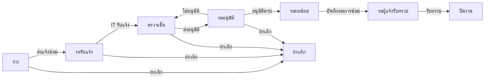

# BRD: แบบฟอร์มใบแจ้งซ่อมอุปกรณ์คอมพิวเตอร์

| Field | Value |
|---|---|
| BRD ID | BRD-TMP-004 (ชั่วคราว) |
| Feature | F-TMP-004 แบบฟอร์มใบแจ้งซ่อมอุปกรณ์คอมพิวเตอร์ (รหัส feature ชั่วคราว — รอรหัสจริง) |
| BRD Type | New Feature (แบบ 2 · ดึงข้อมูลเดิม — ชื่อ/ตำแหน่งจาก HR · Employee) |
| Version | 1.0 |
| Status | **APPROVED (Prebrief Mode · Lane/unattended)** — DEC แทน Scope Lock จนมีใบเซ็นลูกค้า |
| Module | IT Support (Core Cube) — ใกล้เคียง FEATURE_REGISTRY "IT Support › Ticket (—)" |
| Customer form | FM-ITS-06 แบบฟอร์มใบแจ้งซ่อมอุปกรณ์คอมพิวเตอร์ · Rev.00 : 01/07/2569 |
| Request | REQ-TMP-004 (ชั่วคราว — รอเลขจริงจาก F186) |
| Input | PREBRIEF_REQ-TMP-004_v2 · FORM_SPEC.json (17 ช่อง · ลายเซ็น 6) · DECISIONS.lock (18 DEC · พร้อมเริ่มทำ · AI-DEFAULT 11) · feature.html (html-generator v9.4 · audit FAIL 0) |
| Created / Updated | 2026-10-10 |

## Changelog
- v1.0 (2026-10-10): สร้างผ่าน brd-generator-full v2.3 Prebrief Mode (doc-master-pipeline ขั้น 7 · โหมดไม่เฝ้า)

---

## 1. Business Context
### 1.1 ปัญหา / โอกาส
พนักงานแจ้งซ่อมอุปกรณ์คอมพิวเตอร์ด้วยแบบฟอร์มกระดาษ FM-ITS-06 (xlsx) — ลงนาม 6 จุด (ผู้แจ้งซ่อม · ผู้รับแจ้ง · ผู้ดำเนินการ · อนุมัติโดย · ผู้ดำเนินการ · ผู้แจ้งซ่อม) ส่งต่อด้วยมือ · ไม่มีเลขที่รันจริง · ติดตามไม่ได้ว่าใบอยู่ขั้นไหน (รอรับแจ้ง / ส่งเคลม / รออนุมัติ / ซ่อมเสร็จ) · ข้อมูลการส่งเคลม/สั่งซื้อกระจายอยู่ในกระดาษ
### 1.2 เป้าหมาย
1. ขึ้นแบบฟอร์มเป็นเอกสารในระบบ ช่องตรงกระดาษ 1:1 · PDF Replica ลูกค้าจำแบบเดิมได้
2. ให้ฝ่าย IT รับแจ้ง บันทึกผลตรวจเช็ค (รวมส่งเคลม/ส่งซ่อม/สั่งซื้อ) และผลการซ่อมในใบเดียว
3. อนุมัติผลตรวจเช็คตามสาย DOA กลาง (dynamic) แทนการเดินเอกสาร · ผู้แจ้งรับทราบผลในระบบ
### 1.3 ตัวชี้วัด
ไม่มีใน input → **OQ-01** (ห้ามแต่งตัวเลข) · เสนอให้วัด: เวลาตั้งแต่แจ้งถึงปิดงาน · % ใบที่ซ่อมเสร็จก่อนวันที่ต้องการส่งมอบ · จำนวนใบส่งเคลมในประกัน — ต้องเก็บ baseline ก่อน launch
### 1.4 ที่มา
แบบฟอร์มลูกค้า FM-ITS-06 (xlsx · หัวฟอร์ม = ชื่อไฟล์) → FORM_SPEC 17 ช่อง + ☐ ประเภท 4 + ☐ ผลตรวจเช็ค 5 + ☐ ผลการซ่อม 2 + ลายเซ็น 6 · gate 10 หมวดตอบเองตาม unattended-policy (AI-DEFAULT ทุกหมวด)

## 2. Scope
### 2.1 In Scope
- รายการใบแจ้งซ่อม (ค้นหา · กรองสถานะ/ประเภท · แท็บ ทั้งหมด/งานที่ต้องทำ/ใบแจ้งซ่อมของฉัน · CSV) · สร้าง/แก้ร่าง wizard 3 ขั้น (ส่วนที่ 1) · ดูรายละเอียด 4 แท็บ (รายละเอียด › PDF › ลายเซ็น/อนุมัติ › ประวัติ)
- ส่งแจ้งซ่อม → ฝ่าย IT รับแจ้ง → บันทึกผลตรวจเช็ค (ส่วนที่ 2) → ส่งอนุมัติ DOA (ค่าเริ่ม 1 ขั้น "อนุมัติโดย" · เลือกคนต่อขั้น) · อนุมัติ / ไม่อนุมัติ→กลับร่างผลตรวจเช็ค
- ฝ่าย IT บันทึกผลการซ่อม → ผู้แจ้งซ่อมรับทราบ → ปิดงาน · ยกเลิก (ก่อนอนุมัติ · เหตุผลบังคับ)
- แนบไฟล์ · PDF FM-ITS-06 Replica 2 หน้าทุกสถานะ · เลขที่ CRR จาก ENG-DOC-NUM
### 2.2 Out of Scope
- ผูกทะเบียนทรัพย์สิน (รหัสทรัพย์สินผู้ใช้กรอกเอง) · สร้างใบขอซื้อ/PR จากตัวเลือก "สั่งซื้ออุปกรณ์" · ติดตามงานกับร้านเคลมภายนอก · มอบหมาย/SLA ของฝ่าย IT · ทำซ้ำเอกสาร (DEC-11) · ประกาศ (DEC-11) · ส่งต่อระบบอื่น (DEC-02)
### 2.3 Assumptions
- ชื่อ-นามสกุล/ตำแหน่ง/ผู้บังคับบัญชามีใน HR · Employee + ผังองค์กร · มี role สำหรับเจ้าหน้าที่ฝ่าย IT (role-it-officer — ยังไม่อยู่ใน DOA contract → OQ-03)
### 2.4 Scope Lock (ชั่วคราว = DECISIONS.lock · ยังไม่มีใบเซ็น → OQ-02)
| DEC | หมวด | มติ | ที่มา |
|---|---|---|---|
| DEC-01 | G1 | อนุมัติแล้วไม่เปลี่ยนค่าในระบบ | AI-DEFAULT |
| DEC-02 | G1 | ไม่ส่งต่อระบบอื่นรอบนี้ (ประกาศ event ไว้ใน FRD แต่ไม่ยิง) | AI-DEFAULT |
| DEC-03 | G2 | DOA dynamic · ค่าเริ่ม 1 ขั้น role-line-manager ("อนุมัติโดย") · ไม่มีวงเงิน | AI-DEFAULT |
| DEC-04 | G3 | เกินเกณฑ์ = เตือน · วันที่ส่งมอบ ≥ วันที่แจ้ง (เตือน) · อื่นๆ ต้องระบุ · ประเภทเลือก 1 · ชุดเคลมบังคับเมื่อเลือกส่งบริษัท/สั่งซื้อ · ถึง ≥ ระยะเวลา (เตือน) · ซ่อมไม่ได้ต้องระบุรายละเอียด | AI-DEFAULT |
| DEC-05 | G4 | ไม่มีรายการซ้ำบนกระดาษ (ไม่เกี่ยว) | AI-DEFAULT |
| DEC-06 | G5 | ช่องตรงกระดาษ 1:1 · ไม่เพิ่มช่อง | AI-DEFAULT |
| DEC-07 | G6 | ช่อง อนุมัติโดย = 1 ช่องต่อขั้น DOA · ข้อความ "ส่ง/พิจารณาในระบบ" ไม่ใช้ภาพ | AI-DEFAULT |
| DEC-08 | G7 | ไม่อนุมัติ = กลับร่างผลตรวจเช็คเลขเดิม · ยกเลิก: เจ้าของ + admin role · ก่อนอนุมัติ · เหตุผลบังคับ | AI-DEFAULT |
| DEC-09 | G8 | เจ้าของ · ผู้อนุมัติเห็นหลังส่ง · admin role (ฝ่าย IT) เห็นทั้งหมด | AI-DEFAULT |
| DEC-10 | G9 | ออกเลขตอนบันทึกครั้งแรก · รหัส CRR | AI-DEFAULT |
| DEC-11 | G10 | แนบไฟล์ ✓ · CSV ✓ · ทำซ้ำ ✗ · ประกาศ ✗ | AI-DEFAULT |
| DEC-12 | VALID | แก้คำสะกด ตําแหน่ง → ตำแหน่ง | FORM_SPEC |
| DEC-13 | VALID | แก้คำสะกด ส่งเครม → ส่งเคลม | FORM_SPEC |
| DEC-14 | VALID | แก้คำสะกด สั้งซื้อ → สั่งซื้อ | FORM_SPEC |
| DEC-15 | VALID | ชุดบรรทัดใต้ สั่งซื้ออุปกรณ์ คงคำ "ร้านค้าที่ส่งเคลม / วันที่ส่งเคลม" ตามกระดาษ → OQ-04 | FORM_SPEC |
| DEC-16 | VALID | ถึง ≥ ระยะเวลา (เตือน) | FORM_SPEC |
| DEC-17 | VALID | วันที่ต้องการส่งมอบ ≥ วันที่แจ้ง (เตือน) | FORM_SPEC |
| DEC-18 | VALID | ติ๊ก อื่นๆ = ต้องระบุข้อความ | FORM_SPEC |

## 3. Roles & Permissions (COSO)
| Role | COSO | ทำอะไร |
|---|---|---|
| พนักงาน (ผู้แจ้งซ่อม) | Maker | สร้าง/แก้ร่างของตน · ส่งแจ้งซ่อม · ยกเลิกของตน (ก่อนอนุมัติ) · รับทราบผลการซ่อม |
| role-it-officer (เจ้าหน้าที่ IT · ผู้รับแจ้ง/ผู้ดำเนินการ · admin role ฝ่าย IT) | Executor + Maker ของส่วนที่ 2 + admin view | เห็นทุกใบ · รับแจ้ง · บันทึกผลตรวจเช็คและส่งอนุมัติ · บันทึกผลการซ่อม · ยกเลิกได้ (ก่อนอนุมัติ) [AI-DEFAULT · role ยังไม่อยู่ใน contract] |
| role-line-manager ("อนุมัติโดย" — ผู้บังคับบัญชาของผู้ส่งอนุมัติ) | Approver | ขั้น DOA: อนุมัติ/ไม่อนุมัติผลตรวจเช็ค |

| Action | ผู้แจ้งซ่อม | IT | ผู้อนุมัติ |
|---|:-:|:-:|:-:|
| ดูใบ | ของตน | ทั้งหมด | เมื่ออยู่ในสาย (หลังส่งอนุมัติ) |
| สร้าง/แก้ร่าง · ส่งแจ้งซ่อม | ✓ ของตน | – | – |
| รับแจ้ง · บันทึกผลตรวจเช็ค · ส่งอนุมัติ | – | ✓ | – |
| อนุมัติ/ไม่อนุมัติ | – | – | ขั้นที่ตนเป็นผู้พิจารณา |
| บันทึกผลการซ่อม | – | ✓ (รอผลซ่อม) | – |
| รับทราบผล | ✓ ของตน | – | – |
| ยกเลิก | ✓ ของตน | ✓ | – |
SoD: ผู้ส่งอนุมัติ (เจ้าหน้าที่ IT) อนุมัติใบที่ตนส่งไม่ได้ (BR-DOA-04) · ผู้อนุมัติ ≠ ผู้ดำเนินการ · ผู้แจ้งซ่อมรับทราบผลเป็น detective control ปิดงาน

## 4. User Journey
### 4.1 Happy Path
| # | Step | Maker | Checker/Approver | System |
|---|---|---|---|---|
| 1 | กด "แจ้งซ่อม" → เลือกประเภท · รายการ · รหัสทรัพย์สิน · อาการเสีย · วันที่/สถานที่ส่งมอบ | ผู้แจ้งซ่อม | – | ดึงชื่อ/ตำแหน่ง · วันที่ |
| 2 | แนบไฟล์ (ถ้ามี) → ตรวจสอบและยืนยัน → บันทึกและส่งแจ้งซ่อม | ผู้แจ้งซ่อม | – | ออกเลข CRR (ENG-DOC-NUM) · แจ้งฝ่าย IT (crr_reported) |
| 3 | รับแจ้ง | – | role-it-officer | บันทึก received_by/at · แจ้งผู้แจ้ง (crr_received) |
| 4 | บันทึกผลตรวจเช็ค (วันที่ซ่อม · ผลตรวจเช็ค · ชุดเคลม) → ส่งอนุมัติ เลือกผู้พิจารณาต่อขั้น | – | role-it-officer | resolve DOA + freeze approval_chain |
| 5 | พิจารณา → อนุมัติ | – | role-line-manager | ครบทุกขั้น → รอผลซ่อม (DOA แจ้งผล doa_result) |
| 6 | บันทึกผลการซ่อม (แก้ไขเรียบร้อย / ไม่สามารถแก้ไขได้ + รายละเอียด) | – | role-it-officer | แจ้งผู้แจ้ง (crr_repaired) |
| 7 | รับทราบผล | ผู้แจ้งซ่อม | – | ปิดงาน · เก็บ PDF snapshot |
### 4.2 Alternative
- ไม่อนุมัติ → กลับร่างผลตรวจเช็ค (สถานะ ตรวจเช็ค) เลขเดิม + เหตุผล → IT แก้ ส่งใหม่ (resolve สายใหม่)
- ยกเลิก (ร่าง/รอรับแจ้ง/ตรวจเช็ค/รออนุมัติ) โดยเจ้าของหรือฝ่าย IT · เหตุผลบังคับ · ถ้ารออนุมัติ แจ้งผู้พิจารณา (crr_cancelled)
- วันที่ต้องการส่งมอบก่อนวันที่แจ้ง / วันสิ้นสุดก่อนวันเริ่ม → เตือน ส่งได้

## 5. Data (จาก FORM_SPEC — ป้ายตามกระดาษ)
### 5.1 repair_request (header)
| ช่องบนกระดาษ | field | ชนิด | ที่มา | บังคับ |
|---|---|---|---|:-:|
| เลขที่เอกสาร | doc_no | text | auto ENG-DOC-NUM | ✓ |
| วันที่ (หัวตาราง) | doc_date | date | auto (บันทึกครั้งแรก) | ✓ |
| วันที่ (ส่วนที่ 1) | report_date | datetime | auto (ส่งแจ้งซ่อม) | ✓ |
| ตำแหน่ง | position_snapshot | text | system HR · Employee (อ่านอย่างเดียว) | ✓ |
| ชื่อ-นามสกุล | employee_id → name_snapshot | ref | system HR · Employee | ✓ |
| วันที่ต้องการส่งมอบ | due_date | date | user | ✓ |
| สถานที่ส่งมอบ | delivery_location | text(200) | user | ✓ |
| ประเภท ☐×4 | device_type | enum (notebook · workstation · printer · other) | user | ✓ |
| อื่นๆ ….. | device_type_other | text(200) | user | เมื่อ other |
| รายการ | item_name | text(200) | user | ✓ |
| รหัสทรัพย์สิน | asset_code | text(50) | user | – |
| อาการเสีย / ปัญหา | problem | text | user | ✓ |
| ผู้รับแจ้ง | received_by · received_at | ref/datetime | system (IT) | เมื่อรับแจ้ง |
| วันที่ดำเนินการซ่อม | repair_date | date | IT | ✓ ส่วนที่ 2 |
| ผลของการตรวจเช็ค/ซ่อม ☐×5 | check_result | enum (done · in_progress · claim_warranty · send_out_no_warranty · purchase_replace) | IT | ✓ ส่วนที่ 2 |
| ระยะเวลา … ถึง … | claim_period_from · claim_period_to | date | IT | เมื่อ 3 ตัวเลือกล่าง |
| ระบุร้านค้าที่ส่งเคลม | claim_vendor | text(200) | IT | เมื่อ 3 ตัวเลือกล่าง |
| วันที่ส่งเคลม | claim_date | date | IT | เมื่อ 3 ตัวเลือกล่าง |
| ผู้ดำเนินการ (ส่วนที่ 2) | inspected_by · approval_submitted_at | ref/datetime | system | เมื่อส่งอนุมัติ |
| ผลการซ่อม ☐×2 | repair_result | enum (fixed · unfixable) | IT | ✓ ปิดงาน |
| บรรทัดใต้ผลการซ่อม | repair_note | text | IT | เมื่อ unfixable |
| ผู้ดำเนินการ (ผลการซ่อม) | repaired_by · repaired_at | ref/datetime | system | |
| ผู้แจ้งซ่อม (รับทราบ) | acknowledged_at | datetime | system | |
| + DOA fields | approval_status · doa_ref · approval_chain (jsonb snapshot) · approved_by · approved_at | | DOA | |
| + returned_reason · returned_by · returned_at · header_snapshot | | | DEC-08 · DOCCFG | |
### 5.2 attachments → Document Center (ไฟล์ระดับใบ)

## 6. User Stories
| ID | Story | AC หลัก |
|---|---|---|
| S-01 | ผู้แจ้งซ่อมสร้างใบแจ้งซ่อม | ช่องบังคับครบตาม VR · ชื่อ/ตำแหน่งระบบใส่ · บันทึกได้เลข CRR |
| S-02 | ผู้แจ้งซ่อมเลือกประเภทอุปกรณ์ | เลือก 1 · อื่นๆ ต้องระบุข้อความ · PDF ติ๊กตรงที่เลือก |
| S-03 | ผู้แจ้งซ่อมแนบไฟล์ประกอบ | ไฟล์ pdf/doc/xls/รูป ≤20MB · ผิดชนิดแจ้งเตือน |
| S-04 | ผู้แจ้งซ่อมส่งแจ้งซ่อม | จากร่างเท่านั้น · ฝ่าย IT ได้รับแจ้ง · ล็อกแก้ไขส่วนที่ 1 |
| S-05 | เจ้าหน้าที่ IT รับแจ้ง | เฉพาะ role-it-officer · ช่อง ผู้รับแจ้ง มีชื่อ+เวลา |
| S-06 | เจ้าหน้าที่ IT บันทึกผลตรวจเช็ค | ผลตรวจเช็คเลือก 1 · 3 ตัวเลือกล่างบังคับชุดเคลม · บันทึกได้หลายครั้งก่อนส่ง |
| S-07 | เจ้าหน้าที่ IT ส่งอนุมัติผลตรวจเช็ค | slot ต่อขั้นตาม DOA · ค่าเริ่มจากผัง · ผู้ส่งไม่อยู่ในรายชื่อ · บังคับเลือกครบ |
| S-08 | ผู้อนุมัติอนุมัติผลตรวจเช็ค | ปุ่มเฉพาะผู้พิจารณาขั้นปัจจุบัน · ครบทุกขั้น = รอผลซ่อม |
| S-09 | ผู้อนุมัติไม่อนุมัติผลตรวจเช็ค | เหตุผลบังคับ · กลับ ตรวจเช็ค เลขเดิม · แบนเนอร์เหตุผล |
| S-10 | เจ้าหน้าที่ IT บันทึกผลการซ่อม | เลือก 1 · ไม่สามารถแก้ไขได้ ต้องระบุรายละเอียด |
| S-11 | ผู้แจ้งซ่อมรับทราบผล | เฉพาะเจ้าของ · สถานะรอผู้แจ้งรับทราบ → ปิดงาน |
| S-12 | ผู้แจ้งซ่อมยกเลิกใบแจ้งซ่อม | ก่อนอนุมัติ · เหตุผลบังคับ |
| S-13 | พิมพ์ PDF FM-ITS-06 | ทุกสถานะ 2 หน้า A4 · ลายเซ็น 6 จุดตามกระดาษ · ช่อง อนุมัติโดย = 1 ช่องต่อขั้น DOA |
| S-14 | ฝ่าย IT ดูใบทุกใบ | กรองสถานะ/ประเภท · ส่งออก CSV |

## 7. Status & Lifecycle
| จาก | Action | ไป | ใคร |
|---|---|---|---|
| — | บันทึกครั้งแรก | draft | Maker |
| draft | ส่งแจ้งซ่อม | reported | Maker |
| reported | รับแจ้ง | inspecting | role-it-officer |
| inspecting | บันทึกผลตรวจเช็ค | inspecting | role-it-officer |
| inspecting | ส่งอนุมัติ | pending (ขั้น 1) | role-it-officer |
| pending | อนุมัติขั้น n<N | pending (ขั้น n+1) | ผู้พิจารณาขั้น n |
| pending | อนุมัติขั้น N | approved (รอผลซ่อม) | ขั้น N |
| pending | ไม่อนุมัติ | inspecting (เลขเดิม · returned_*) | ผู้พิจารณาขั้นปัจจุบัน |
| approved | บันทึกผลการซ่อม | repaired | role-it-officer |
| repaired | รับทราบผล | closed | Maker |
| draft / reported / inspecting / pending | ยกเลิก | cancelled | Maker / role-it-officer |
approved/repaired/closed = ล็อกแก้ไข · ไม่มียกเลิกหลังอนุมัติ (DEC-08) · `inspecting` = ร่างผลตรวจเช็คของขั้นอนุมัติ (DOA ส่งได้จากสถานะนี้เท่านั้น)

## 8. Business Rules + Validation
| ID | Rule | Tag | Type |
|---|---|:-:|---|
| BR-01 | ประเภทอุปกรณ์เลือก 1 ข้อ (1 ใบ = 1 อุปกรณ์) | FIXED | Validation (DEC-04) [AI-DEFAULT] |
| BR-02 | ติ๊ก อื่นๆ ต้องระบุข้อความ | FIXED | Validation (DEC-18) |
| BR-03 | วันที่ต้องการส่งมอบก่อนวันที่แจ้ง / วันสิ้นสุดก่อนวันเริ่ม = เตือน ไม่บล็อก | CONFIGURABLE | Policy (DEC-04/16/17) [AI-DEFAULT] |
| BR-04 | ผลตรวจเช็ค 3 ตัวเลือกล่าง (ส่งบริษัทในประกัน · นอกประกัน · สั่งซื้อ/เปลี่ยน) ต้องกรอก ระยะเวลา-ถึง · ร้านค้า · วันที่ส่งเคลม | FIXED | Validation (DEC-04) [AI-DEFAULT] |
| BR-05 | สายอนุมัติ resolve จาก DOA ตอนส่งอนุมัติผลตรวจเช็ค แล้ว freeze · จำนวนขั้นตาม DOA กลาง · role-line-manager resolve จากผู้ส่ง | FIXED | DOA (BR-DOA-02 · DEC-03) |
| BR-06 | ไม่อนุมัติ → inspecting เลขเดิม · ล้างสาย · resolve ใหม่ตอนส่งรอบถัดไป | FIXED | DEC-08 (BR-DOA-03) [AI-DEFAULT] |
| BR-07 | ออกเลขตอนบันทึกครั้งแรก · รหัส CRR · no-gap ✗ | CONFIGURABLE | DOCCFG (DEC-10) |
| BR-08 | ร่างเห็นเฉพาะเจ้าของ (+ admin IT) · ผู้อนุมัติเห็นเมื่ออยู่ในสาย | FIXED | Visibility #109 (DEC-09) |
| BR-09 | ช่องลงชื่อ PDF: คู่ส่วนที่ 1 (ผู้แจ้งซ่อม/ผู้รับแจ้ง) · ผู้ดำเนินการ + 1 ช่องต่อขั้น DOA · คู่ผลการซ่อม (ผู้ดำเนินการ/ผู้แจ้งซ่อม) · แถวละ ≤4 | FIXED (จำนวน = DOA) | DEC-07 |
| BR-10 | รับแจ้ง · ผลตรวจเช็ค · ส่งอนุมัติ · ผลการซ่อม ทำได้เฉพาะ role-it-officer ตามสถานะ · รับทราบผลเฉพาะเจ้าของ | FIXED | Control [AI-DEFAULT] |
| BR-11 | ผลการซ่อม ไม่สามารถแก้ไขได้ ต้องระบุรายละเอียด | FIXED | Validation (DEC-04) [AI-DEFAULT] |
| BR-12 | อนุมัติแล้วไม่เปลี่ยนค่าในระบบ · ไม่ส่งต่อระบบอื่น (ทะเบียนทรัพย์สิน/PR) | FIXED | DEC-01/02 |
| BR-13 | ป้ายช่องตามกระดาษ 1:1 · แก้สะกด ตำแหน่ง/ส่งเคลม/สั่งซื้อ · คงคำ "ร้านค้าที่ส่งเคลม" ใต้ตัวเลือกสั่งซื้อ | FIXED | DEC-06/12/13/14/15 |
| BR-14 | Rev. ของแบบพิมพ์อ่านจาก F-DOCCFG print_config (Rev.00 : 01/07/2569) | CONFIGURABLE | DOCCFG |

| VR | ช่อง | เงื่อนไข | ข้อความ |
|---|---|---|---|
| VR-01 | device_type | required | เลือกประเภทอุปกรณ์ |
| VR-02 | device_type_other | required เมื่อ other | ระบุประเภทอุปกรณ์อื่นๆ |
| VR-03 | item_name | required | ระบุรายการ |
| VR-04 | problem | required | ระบุอาการเสีย / ปัญหา |
| VR-05 | due_date | required | เลือกวันที่ต้องการส่งมอบ |
| VR-06 | delivery_location | required | ระบุสถานที่ส่งมอบ |
| VR-07 | repair_date | required (ส่วนที่ 2) | เลือกวันที่ดำเนินการซ่อม |
| VR-08 | check_result | required | เลือกผลของการตรวจเช็ค/ซ่อม |
| VR-09 | claim_period_from / to / vendor / date | required เมื่อ 3 ตัวเลือกล่าง | เลือกวันเริ่ม · เลือกวันสิ้นสุด · ระบุร้านค้าที่ส่งเคลม · เลือกวันที่ส่งเคลม |
| VR-10 | slot ผู้พิจารณา | ทุกขั้นต้องเลือก · ≠ ผู้ส่ง | กรุณาเลือกผู้พิจารณา |
| VR-11 | repair_result | required | เลือกผลการซ่อม |
| VR-12 | repair_note | required เมื่อ unfixable | ระบุรายละเอียดเมื่อแก้ไขไม่ได้ |
| VR-13 | เหตุผล ไม่อนุมัติ/ยกเลิก | required | กรุณาระบุเหตุผล |

### 8.5 ระดับความยืดหยุ่น
BR-03 → Admin Panel (นโยบายแจ้งซ่อม) · BR-05 → DOA กลาง · BR-07/14 → F-DOCCFG

## 9. Edge Cases
| EC | กรณี | ผล |
|---|---|---|
| EC-01 | วันที่ต้องการส่งมอบก่อนวันที่แจ้ง (DEC-17) | เตือน · ส่งได้ · view แสดงป้าย "ก่อนวันที่แจ้ง" |
| EC-02 | ติ๊ก อื่นๆ แต่ไม่ระบุ (DEC-18) | บล็อกถัดไป · ช่อง invalid |
| EC-03 | เลือกส่งเคลมแต่ไม่กรอกร้านค้า/วันที่ | บล็อกบันทึกผลตรวจเช็ค |
| EC-04 | วันสิ้นสุด < วันเริ่ม (DEC-16) | เตือน ไม่บล็อก · view แสดงป้าย |
| EC-05 | เปลี่ยนผลตรวจเช็คจากส่งเคลมเป็นซ่อมเสร็จ | ล้างชุดเคลม · PDF ชุดเคลมเว้นว่าง |
| EC-06 | อาการเสีย/ผลการซ่อมยาวเกิน 2 บรรทัดบนกระดาษ | PDF เพิ่มบรรทัด + dense ยัง 2 หน้า (ทดสอบ 5/4 บรรทัด) |
| EC-07 | DOA ตั้ง 6 ขั้น | ช่องลงชื่อส่วนที่ 2 = 7 ช่อง 2 แถว (4+3) · ยัง 2 หน้า |
| EC-08 | ผู้ส่งอนุมัติเป็นหัวหน้าสูงสุด (ไม่มี mgr) | slot ว่าง ต้องเลือกเอง |
| EC-09 | แก้ DOA ระหว่างใบรออนุมัติ | ใบเดิมใช้สาย snapshot |
| EC-10 | ส่ง/อนุมัติชนกัน (stale) | 409 → toast รีเฟรช สถานะไม่เปลี่ยน |
| EC-11 | แบบเอกสารปิดใช้ (F-DOCCFG) | ปุ่มแจ้งซ่อม disabled |
| EC-12 | ผู้อนุมัติเปิด route ใบร่างของคนอื่น | ไม่เปิด (ไม่มีสิทธิ์) |
| EC-13 | ผลการซ่อม ไม่สามารถแก้ไขได้ | ต้องระบุรายละเอียด · ปิดงานได้หลังผู้แจ้งรับทราบ (ข้อเสนอจัดซื้อทดแทนทำนอกระบบ — OQ-05) |
| EC-14 | อุปกรณ์ไม่มีป้ายทรัพย์สิน | รหัสทรัพย์สินว่างได้ · PDF ช่องว่าง |

## 10. Value Stream & Downstream Impact
Positioning: IT Service — แจ้งซ่อม (feature นี้) → ฝ่าย IT ตรวจเช็ค → อนุมัติแนวทาง → ซ่อม/เคลม → ผู้แจ้งรับทราบ
| ปลายทาง | ข้อมูล | Trigger | หมายเหตุ |
|---|---|---|---|
| ฝ่าย IT (คิวงาน) | ใบแจ้งซ่อมใหม่ | reported | ENG-NOTIFY crr_reported — ภายใน feature |
| ผู้แจ้งซ่อม | รับแจ้งแล้ว / ผลการซ่อม | inspecting / repaired | ENG-NOTIFY crr_received · crr_repaired |
| ทะเบียนทรัพย์สิน (Asset) | ประวัติซ่อมต่อรหัสทรัพย์สิน | closed | **ปิดรอบนี้ (DEC-02)** — ประกาศ event `crr.closed` ใน FRD ไม่ยิง |
| PR / จัดซื้อ (สั่งซื้ออุปกรณ์) | รายการที่ต้องซื้อ | approved + purchase_replace | ปิดรอบนี้ → OQ-05 |
| F-DOCCFG / ENG-DOC-STORE | PDF snapshot | approved_final | |
แล้วไงต่อ: ทุกแถวที่ปิดรอบนี้ = ฝ่าย IT/จัดซื้อ/บัญชีทรัพย์สินทำนอกระบบตามเดิม (ไม่มีข้อมูลหาย เพราะใบแจ้งซ่อมเก็บครบในระบบ ค้นตามรหัสทรัพย์สินได้)

## 11. Delivery
Phase 1 = ทุกอย่างใน §2.1 · Phase 2 (เสนอ) = ผูกทะเบียนทรัพย์สิน (ประวัติซ่อม) + เปิด PR จากตัวเลือกสั่งซื้อ + SLA ฝ่าย IT

## 12. Dev Summary "ใบสั่ง"
- Config: DOA entry F-TMP-004 (doa_type crr) · doc_type CRR (F-DOCCFG · print_config FM-ITS-06 · 2 หน้า) · role-it-officer
- Declaration: DOA_BRIEF · NTF_BRIEF · DOCCFG_BRIEF · MDOC_BRIEF (ฉบับจริงหลัง FRD)
- Screen Inventory: P-01 รายการ `#/repair-request` · P-02 สร้าง/แก้ `#/repair-request/create` · `#/repair-request/edit/:id` (drawer wide 3 ขั้น) · P-03 ดู `#/repair-request/view/:id` (drawer 4 แท็บ) · M-01..10 modal ส่งแจ้งซ่อม/รับแจ้ง/ผลตรวจเช็ค/ส่งอนุมัติ/อนุมัติ/ไม่อนุมัติ/ยกเลิก/ผลการซ่อม/รับทราบผล/ทิ้งข้อมูล
- UI Signals: เอกสาร + พิมพ์ + ลายเซ็น = ใช่ · archetype Q-form

## 13. Open Questions
| OQ | คำถาม | เจ้าของ | Block? |
|---|---|---|---|
| OQ-01 | ตัวชี้วัดความสำเร็จ + baseline | ลูกค้า | ไม่ |
| OQ-02 | ลูกค้าเซ็นยืนยัน DEC-01..11 (AI-DEFAULT ทุกข้อ) — โดยเฉพาะ "อนุมัติโดย" = ผู้บังคับบัญชาของเจ้าหน้าที่ IT 1 ขั้น · อนุมัติทุกใบ (รวมซ่อมเสร็จเอง) · ไม่อนุมัติกลับร่างผลตรวจเช็ค · ประเภทเลือก 1 | ทีม BA → ลูกค้า | ก่อน UAT |
| OQ-03 | role-it-officer (เจ้าหน้าที่ IT ผู้รับแจ้ง/ผู้ดำเนินการ · admin ฝ่าย IT) ไม่อยู่ใน DOA roles contract — ต้องเพิ่มที่ DOA กลาง/RBAC | ทีม BA + พี่เบิร์ด | ก่อน wire |
| OQ-04 | บรรทัดใต้ตัวเลือก "สั่งซื้ออุปกรณ์ / เปลี่ยนอุปกรณ์" ควรเป็น ร้านค้าที่สั่งซื้อ / วันที่สั่งซื้อ หรือคง "ส่งเคลม" (DEC-15) | ลูกค้า | ก่อน UAT |
| OQ-05 | เชื่อม ทะเบียนทรัพย์สิน / PR / IT Ticket เมื่อไร · รหัส feature จริงแทน F-TMP-004 | ทีม BA | ไม่ |
| OQ-06 | ลำดับขั้นตอนจริง: อนุมัติก่อนซ่อมทุกกรณี หรือเฉพาะส่งเคลม/สั่งซื้อ (ตอนนี้อนุมัติทุกใบตามกระดาษ) · function_code taxonomy ของ MDOC | ลูกค้า / ทีม BA | ก่อน register |

## 14. Security & Compliance
Preset: Standard Internal · PII: ชื่อผู้แจ้งซ่อม (pdpa) — ข้อมูลตัวอย่างใน prototype/แบบพิมพ์เป็นชื่อสมมติ · ห้ามกรอกรหัสผ่านเครื่องในใบแจ้งซ่อม (ส่งมอบรหัสนอกเอกสาร) · Audit append-only ทุก action · SoD ผู้ส่งอนุมัติ≠ผู้อนุมัติ · ไฟล์แนบตาม file_policy Document Center

## 15. Health Check / Monitoring
SLA: ไม่กำหนดรอบนี้ (WARNING → OQ-01) · KPI เสนอ: ใบรอรับแจ้งเกิน 1 วันทำการ · ใบรอผลซ่อมเกินวันที่ต้องการส่งมอบ · ใบรอผู้แจ้งรับทราบเกิน 3 วัน · Widget: คิวงาน IT ตามสถานะ/ประเภทอุปกรณ์

## Appendix — Screen List
P-01 `#/repair-request` · P-02 `#/repair-request/create` · `#/repair-request/edit/:id` · P-03 `#/repair-request/view/:id`

---

## AI Review Report (brd-generator-full v2.3 · Prebrief Mode)
| ข้อ | ผล |
|---|---|
| C01 Business objective | ✅ §1.2 |
| C02 Roles ครบ | ✅ §3 |
| C03–C04 Scope in/out | ✅ §2 |
| C05 Story ไม่มี "และ" | ✅ S-01..S-14 |
| C06–C09 AC ≥2 · Journey · Status · Data | ✅ |
| C10 Rule มี Tag | ✅ BR-01..14 |
| C11–C13 VR · Edge cases ครบหมวด | ✅ VR-01..13 · EC-01..14 |
| C14–C17 Flexibility · Delivery · Registry (WARN: feature ใหม่ ไม่มีรหัส → OQ-05) | ✅ / ⚠️ C16 ยอมรับใน Prebrief Mode |
| C18 WARNING มีแผน | ✅ OQ-01..06 |
| C19 ใบสั่ง | ✅ §12 |
| C20 Scope Lock = DEC ครบ 18 + OQ-02 รอใบเซ็น | ✅ |
| C21 Value stream ตอบ "แล้วไงต่อ" | ✅ §10 |
| C22 ตัวชี้วัด | ✅ (Prebrief Mode: ไม่มีใน input → OQ-01 ห้ามแต่ง) |
| C23 marker | ✅ [AI-DEFAULT] ที่ BR |
| PE01 COSO ทุก step · PE02 SoD · PE03 Security · PE04 SLA/KPI (WARNING→OQ) · PE05 cross-section | ✅ |

**สถานะ: ✅ APPROVED** → พร้อมเข้า frd-generator-v6
