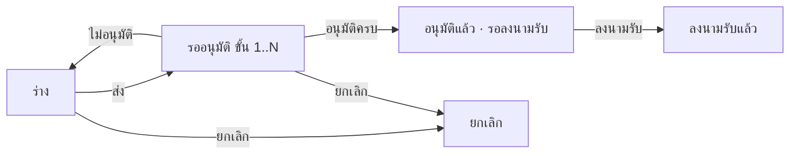

# BRD: ใบคำร้องขอดำเนินการด้านเอกสาร (Document Action Request · DAR Form)

| Field | Value |
|---|---|
| BRD ID | BRD-TMP-007 (ชั่วคราว) |
| Feature | F-TMP-007 ใบคำร้องขอดำเนินการด้านเอกสาร (รหัส feature ชั่วคราว — รอรหัสจริง) |
| BRD Type | New Feature (แบบ 2 · ดึงข้อมูลเดิม — ผู้เขียน/ฝ่าย/แผนกจาก HR · Employee · หน่วยงานแจกจ่ายจาก Organization) |
| Version | 1.0 |
| Status | **APPROVED (Prebrief Mode · Lane/unattended)** — DEC แทน Scope Lock จนมีใบเซ็นลูกค้า |
| Module | Policy Center · Document Control (แผนกบริหารองค์กร และกำกับดูแล · CCC) — FEATURE_REGISTRY "Policy Center · governance คร่อมทุก module" |
| Customer form | FM-CCC-03 ใบคำร้องขอดำเนินการด้านเอกสาร / Document Action Request (DAR Form ) · Rev.00 : 01/07/2569 |
| Request | REQ-TMP-007 (ชั่วคราว — รอเลขจริงจาก F186) |
| Input | PREBRIEF_REQ-TMP-007_v2 · FORM_SPEC.json (17 ช่อง · ตัวเลือก 5 กลุ่ม · แถวซ้ำ 14 · ลายเซ็น 6) · DECISIONS.lock (16 DEC · พร้อมเริ่มทำ · AI-DEFAULT 11) · feature.html (html-generator v9.4 · audit FAIL 0) · print/ (thai-doc v2.2 Replica R9 + R10 2 หน้า) |
| Created / Updated | 2026-10-10 |

## Changelog
- v1.0 (2026-10-10): สร้างผ่าน brd-generator-full v2.3 Prebrief Mode (doc-master-pipeline ขั้น 7 · โหมดไม่เฝ้า)

---

## 1. Business Context
### 1.1 ปัญหา / โอกาส
การขอขึ้นทะเบียน แก้ไข หรือยกเลิกเอกสารควบคุม (DOA · Policy · WI · Form) ใช้ใบ DAR กระดาษ FM-CCC-03 (xlsx แนวนอน) ยื่นถึง Document Control Center — ลงนามผู้จัดทำ + ผู้พิจารณาหลายช่อง ส่งต่อด้วยมือ · ระบุหน่วยงานที่ต้องได้รับแจกจ่าย 27 ช่อง และให้ผู้รับลงนามรับเอกสารควบคุม · ตรวจย้อนหลังยากว่าเอกสารฉบับใดแก้อะไร มีผลเมื่อไร ใครอนุมัติ แจกจ่ายให้ใคร และรับแล้วหรือยัง
### 1.2 เป้าหมาย
1. ขึ้นใบ DAR เป็นเอกสารในระบบ ช่องตรงกระดาษ 1:1 · PDF Replica ลูกค้าจำแบบเดิมได้ (A4 แนวตั้ง 2 หน้า)
2. พิจารณา/อนุมัติตามสาย DOA กลาง (dynamic · ค่าเริ่ม 4 ขั้น) แทนการเดินเอกสาร
3. มีทะเบียนคำร้องด้านเอกสาร พร้อมรายละเอียดเดิม/ใหม่ เอกสารที่ต้องทบทวนตาม หน่วยงานที่แจกจ่าย และหลักฐานลงนามรับ ค้นย้อนหลังได้
### 1.3 ตัวชี้วัด
ไม่มีใน input → **OQ-01** (ห้ามแต่งตัวเลข) · เสนอให้วัด: เวลาตั้งแต่ส่งถึงอนุมัติครบ · เวลาตั้งแต่อนุมัติถึงลงนามรับ · % ใบ DAR ที่วันบังคับใช้ผ่านไปก่อนอนุมัติ — ต้องเก็บ baseline ก่อน launch
### 1.4 ที่มา
แบบฟอร์มลูกค้า FM-CCC-03 (xlsx · print area A1:DM32 A4 แนวนอน 1 หน้า) → FORM_SPEC 17 ช่อง + ตัวเลือก 5 กลุ่ม (วัตถุประสงค์ 4 · ISSUE 4 · ที่มา 4 · แจกจ่าย 27 · วิธีรับ 2) · gate 10 หมวดตอบเองตาม unattended-policy (AI-DEFAULT ทุกหมวด) · ไม่มีข้อมูลตัวอย่าง/ข้อมูลส่วนบุคคลในไฟล์

## 2. Scope
### 2.1 In Scope
- รายการใบ DAR (ค้นหา · กรองสถานะ/วัตถุประสงค์ · แท็บ ทั้งหมด/รอฉันดำเนินการ/ใบ DAR ของฉัน · CSV) · สร้าง/แก้ร่าง wizard 3 ขั้น · ดูรายละเอียด 4 แท็บ (รายละเอียด › PDF › ลายเซ็น/อนุมัติ › ประวัติ)
- รายการเอกสารที่ต้องดำเนินการจัดทำ/ทบทวนเพิ่มเติม ไม่จำกัดแถว (DEC-05) · หน่วยงานแจกจ่าย 27 ช่องตามกระดาษ (DEC-12) · วิธีรับ E-mail/Paper + ระบุ E-Mail
- ส่งอนุมัติ DOA (ค่าเริ่ม 4 ขั้น ผู้ตรวจสอบ → ผู้อนุมัติ → ผู้ควบคุมเอกสาร → ผู้จัดการฝ่ายสำนักเลขานุการบริษัท · เลือกคนต่อขั้น) · อนุมัติ / ไม่อนุมัติ→กลับร่าง · ยกเลิก (เหตุผลบังคับ)
- อนุมัติครบ → แจ้งหน่วยงานที่แจกจ่าย + อีเมลที่ระบุ (dar_distributed) · ลงนามรับเอกสารควบคุม (ข้อความระบบ · dar_received)
- แนบไฟล์ · PDF FM-CCC-03 Replica ทุกสถานะ (2 หน้า) · เลขที่ DAR จาก ENG-DOC-NUM (พิมพ์ที่ DAR.No.)
### 2.2 Out of Scope
- ขึ้นทะเบียน/แก้ไข/ยกเลิกเอกสารควบคุมจริงในทะเบียนเอกสาร (Master List / Policy Center · Policy Document) — ทำนอกระบบนี้ (DEC-01/02 · เสนอเชื่อมเป็นงานต่อยอด) · ทำซ้ำเอกสาร (DEC-11) · ประกาศ (DEC-11) · ตารางผู้มีอำนาจอนุมัติด้านเอกสาร (อยู่ที่ DOA กลาง)
### 2.3 Assumptions
- ผู้เขียน/ฝ่าย/แผนก/ผู้บังคับบัญชามีใน HR · Employee + ผังองค์กร · รายการหน่วยงานแจกจ่ายอ่านจาก Organization (รอบนี้ mock 27 ช่องตามกระดาษ)
- role-doc-controller (ผู้ควบคุมเอกสาร / Document Control Center) และ role-mgr-ocs (ผู้จัดการฝ่ายสำนักเลขานุการบริษัท) ยังไม่อยู่ใน DOA contract → OQ-03
### 2.4 Scope Lock (ชั่วคราว = DECISIONS.lock · ยังไม่มีใบเซ็น → OQ-02)
| DEC | หมวด | มติ | ที่มา |
|---|---|---|---|
| DEC-01 | G1 | อนุมัติแล้วไม่เปลี่ยนค่าในระบบ | AI-DEFAULT |
| DEC-02 | G1 | ไม่ส่งต่อระบบอื่นรอบนี้ (ประกาศ event ไว้ใน FRD แต่ไม่ยิง) | AI-DEFAULT |
| DEC-03 | G2 | สายอนุมัติตั้งที่ DOA กลาง (dynamic) · ค่าเริ่ม 4 ขั้น: role-line-manager, role-mgr-bu, role-doc-controller, role-mgr-ocs · วงเงิน: ไม่มี | AI-DEFAULT |
| DEC-04 | G3 | ผู้ใช้กรอกเอง · เกินเกณฑ์ = เตือน · วัตถุประสงค์ เลือก 1 ข้อ (บล็อก) · ISSUE เลือก 1 ข้อ (บล็อก) · วัตถุประสงค์ = แก้ไขเอกสาร → ต้องกรอก Revision / ISSUE เดิม และ ใหม่ (บล็อก) · ขึ้นทะเบียนใหม่ / อื่นๆ → ต้องกรอก Revision / ISSUE ใหม่ (บล็อก) · ที่มา = อื่นๆ → ต้องกรอก รายละเอียด (บล็อก) · หน่วยงานที่ต้องได้รับการแจกจ่าย เลือกอย่างน้อย 1 (บล็อก) · วิธีรับ เลือกอย่างน้อย 1 (บล็อก) · วิธีรับ = E-mail → ต้องระบุ E-Mail รูปแบบถูกต้องอย่างน้อย 1 ที่อยู่ (บล็อก) · วันที่บังคับใช้เอกสาร ก่อนวันที่เขียนใบ DAR → เตือน ไม่บล็อก · แถวเอกสารที่ต้องจัดทำ/ทบทวน: กรอก Document No. หรือ ชื่อเอกสาร ช่องใดช่องหนึ่ง ต้องกรอกอีกช่อง (บล็อก) | AI-DEFAULT |
| DEC-05 | G4 | รายการเอกสารที่ต้องดำเนินการจัดทำ/ทบทวนเพิ่มเติม: ไม่จำกัดจำนวนแถว · PDF อย่างน้อย 14 แถวตามกระดาษ | AI-DEFAULT |
| DEC-06 | G5 | ช่องตรงกระดาษ 1:1 · ไม่เพิ่มช่อง (เช่น หมายเหตุ) | AI-DEFAULT |
| DEC-07 | G6 | ลายเซ็นแถวล่าง 1 ช่องต่อขั้น DOA · ไม่ใช้ภาพลายมือชื่อ (ข้อความส่งในระบบ/พิจารณาในระบบ) | AI-DEFAULT |
| DEC-08 | G7 | ไม่อนุมัติ = กลับเป็นร่าง แก้แล้วส่งใหม่ · ยกเลิกได้โดย owner, admin_role สถานะ draft, pending · ต้องมีเหตุผล | AI-DEFAULT |
| DEC-09 | G8 | มองเห็น: เจ้าของ · ผู้อนุมัติเห็นหลังส่ง · admin role เห็นทั้งหมด | AI-DEFAULT |
| DEC-10 | G9 | ออกเลขเมื่อบันทึกครั้งแรก · รหัส DAR | AI-DEFAULT |
| DEC-11 | G10 | ของเสริม (กระดาษไม่มี): แนบไฟล์, ส่งออก CSV | AI-DEFAULT |
| DEC-12 | VALID | กฎตรวจจากตัวอย่างลูกค้า: คง 27 ช่องตามกระดาษ (G5) · ป้ายชุดที่ 2 ต่อท้าย "(2)" ในระบบ · ลูกค้ายืนยันว่าเป็นอีกบริษัท/หน่วยธุรกิจหรือพิมพ์ซ้ำ (พบ: หัวคอลัมน์ชุด V–AA (ขาย SAL · อีคอมเมิร์ซ ECM · ผลิตภัณฑ์ PRO · ส่งเสริมการค้า TMK · การเกษตร AGR · สื่อสารการตลาด MKC) ซ้ำกับชุด P–U) | FORM_SPEC |
| DEC-13 | VALID | กฎตรวจจากตัวอย่างลูกค้า: ไม่เพิ่มช่อง (G5) · ให้อธิบายในกล่อง Revision / ISSUE ใหม่ → บังคับกรอก F13 เมื่อเลือก อื่นๆ (พบ: มี ☐ อื่นๆ แต่ไม่มีช่องให้ระบุ) | FORM_SPEC |
| DEC-14 | VALID | กฎตรวจจากตัวอย่างลูกค้า: 4 ตัวเลือก เลือก 1 (พบ: ตัวเลือก WI อยู่ในข้อความหัวคอลัมน์ (DOA · Policy · WI · Form) แต่ภาพแสดงกรอบ ☐ 4 กรอบ) | FORM_SPEC |
| DEC-15 | VALID | กฎตรวจจากตัวอย่างลูกค้า: วันที่บังคับใช้ ต้องไม่ก่อนวันที่เขียนใบ DAR → เตือน ไม่บล็อก (พบ: กระดาษไม่กำหนดเงื่อนไขวันที่) | FORM_SPEC |
| DEC-16 | VALID | กฎตรวจจากตัวอย่างลูกค้า: เลือก E-mail ต้องกรอกอย่างน้อย 1 ที่อยู่ รูปแบบถูกต้อง → บล็อก (พบ: ไม่มีรูปแบบกำหนด) | FORM_SPEC |

## 3. Roles & Permissions (COSO)
| Role | COSO | ทำอะไร |
|---|---|---|
| พนักงาน (ผู้จัดทำ / ผู้เขียนใบ DAR) | Maker | สร้าง/แก้ร่างของตน · ส่ง · ยกเลิกของตน (ร่าง/รออนุมัติ) |
| role-line-manager ("ผู้ตรวจสอบ") | Checker | ขั้น DOA 1: อนุมัติ/ไม่อนุมัติ |
| role-mgr-bu ("ผู้อนุมัติ") | Approver | ขั้น DOA 2: อนุมัติ/ไม่อนุมัติ |
| role-doc-controller ("ผู้ควบคุมเอกสาร" · Document Control Center) | Approver + admin role | ขั้น DOA 3 · เห็นทุกใบ · ยกเลิกได้ (ร่าง/รออนุมัติ) · บันทึกลงนามรับเอกสารควบคุม [AI-DEFAULT · role ยังไม่อยู่ใน contract] |
| role-mgr-ocs ("ผู้จัดการฝ่ายสำนักเลขานุการบริษัท") | Approver | ขั้น DOA 4: อนุมัติ/ไม่อนุมัติ [AI-DEFAULT · role ยังไม่อยู่ใน contract] |

| Action | Maker | L-Mgr | BU Mgr | Doc Controller (admin) | OCS Mgr |
|---|:-:|:-:|:-:|:-:|:-:|
| ดูใบ | ของตน | หลังส่ง (อยู่ในสาย) | หลังส่ง (อยู่ในสาย) | ทั้งหมด | หลังส่ง (อยู่ในสาย) |
| สร้าง/แก้ร่าง | ✓ ของตน | – | – | – | – |
| อนุมัติ/ไม่อนุมัติ | – | ขั้น 1 | ขั้น 2 | ขั้น 3 | ขั้น 4 |
| ยกเลิก | ✓ ของตน | – | – | ✓ | – |
| บันทึกลงนามรับเอกสารควบคุม | – | – | – | ✓ (หลังอนุมัติครบ) | – |
SoD: ผู้จัดทำอนุมัติใบตัวเองไม่ได้ (BR-DOA-04) · ผู้ตรวจสอบ/ผู้อนุมัติแยกขั้น · ผู้จัดทำบันทึกลงนามรับใบตัวเองไม่ได้

## 4. User Journey
### 4.1 Happy Path
| # | Step | Maker | Checker/Approver | System |
|---|---|---|---|---|
| 1 | กด "สร้างใบ DAR" → เลือกวัตถุประสงค์ · ISSUE · Document No. · Revision · ชื่อเอกสาร · วันบังคับใช้ · ขั้นตอนใน PL/WI · ที่มา + รายละเอียด | ผู้จัดทำ | – | ดึงถึง/ผู้เขียน/ฝ่าย/แผนก/ผู้พิจารณาเริ่มต้น |
| 2 | กรอก Revision / ISSUE เดิม-ใหม่ · เพิ่มเอกสารที่ต้องจัดทำ/ทบทวนเพิ่มเติม · ติ๊กหน่วยงานแจกจ่าย · วิธีรับ + E-Mail | ผู้จัดทำ | – | ตรวจ VR สด |
| 3 | แนบไฟล์ (ถ้ามี) → ตรวจสอบและยืนยัน → บันทึก | ผู้จัดทำ | – | ออกเลข DAR (ENG-DOC-NUM) |
| 4 | ส่งอนุมัติ เลือกผู้พิจารณาต่อขั้น | ผู้จัดทำ | – | resolve DOA + freeze approval_chain |
| 5 | พิจารณาเรียงขั้น 1→4 | – | role-line-manager → role-mgr-bu → role-doc-controller → role-mgr-ocs | ครบทุกขั้น → อนุมัติแล้ว · แจ้งหน่วยงานแจกจ่าย + อีเมล (dar_distributed) · เก็บ PDF |
| 6 | บันทึกลงนามรับเอกสารควบคุม (เลือกผู้รับ) | – | role-doc-controller | สถานะ ลงนามรับแล้ว · แจ้งผู้จัดทำ + ผู้ควบคุมเอกสาร (dar_received) |
### 4.2 Alternative
- ไม่อนุมัติ (ขั้นใดก็ได้) → กลับร่างเลขเดิม + เหตุผล → ผู้จัดทำแก้ ส่งใหม่ (resolve สายใหม่ เริ่มขั้น 1)
- ยกเลิก (ร่าง/รออนุมัติ) โดยเจ้าของหรือ Document Control Center · เหตุผลบังคับ · ถ้ารออนุมัติ แจ้งผู้พิจารณาขั้นปัจจุบัน (dar_cancelled)
- วันบังคับใช้ก่อนวันที่เขียนใบ DAR → เตือน ส่งได้ (DEC-15)

## 5. Data (จาก FORM_SPEC — ป้ายตามกระดาษ)
### 5.1 document_action_request (header)
| ช่องบนกระดาษ | field | ชนิด | ที่มา | บังคับ |
|---|---|---|---|:-:|
| DAR.No. (F05) | doc_no | text | auto ENG-DOC-NUM | ✓ |
| ถึง : Document Control Center | — | ค่าคงที่บนกระดาษ | config | — |
| วันที่เขียนใบ DAR (F01) | dar_date | date | auto | ✓ |
| ผู้เขียนใบ DAR (F02) | employee_id → name_snapshot | ref | system HR · Employee (อ่านอย่างเดียว) | ✓ |
| ฝ่าย (F03) · แผนก (F04) | division_snapshot · department_snapshot | text | system HR · Employee | ✓ |
| Document No. (F06) | target_doc_no | text(50) | user | – (ขึ้นทะเบียนใหม่อาจยังไม่มีเลข) |
| Revision (F07) | target_revision | text(30) | user | – |
| วัตถุประสงค์ ☐×4 | purpose | enum (new · revise · cancel · other) | user | ✓ เลือก 1 |
| ISSUE ☐×4 | issue_type | enum (doa · policy · wi · form) | user | ✓ เลือก 1 |
| ชื่อเอกสาร (F08) | target_doc_name | text(300) | user | ✓ |
| วันที่บังคับใช้เอกสาร (F09) | effective_date | date | user | – (ก่อน dar_date = เตือน) |
| เอกสารที่จัดทำ/แก้ไขอยู่ขั้นตอนใดใน PL/WI (F11) | pl_wi_step | text(200) | user | – |
| ที่มาของการจัดทำ/แก้ไขเอกสาร ☐×4 | origin | enum (car · ic · ia · other) | user | – |
| รายละเอียด (F10) | origin_detail | text(300) | user | เมื่อ origin = other |
| Revision / ISSUE เดิม (F12) | change_before | text | user | เมื่อ purpose = revise |
| Revision / ISSUE ใหม่ (F13) | change_after | text | user | เมื่อ purpose = revise/new/other |
| หน่วยงาน/ตำแหน่ง ที่ต้องได้รับการแจกจ่ายเอกสาร ☐×27 | distribution_units | ref[] (Organization unit) | user | ✓ ≥1 |
| หมายเหตุ (F16) | distribution_remark | text | user | – |
| วิธีการรับเอกสาร ☐×2 | receive_methods | enum[] (email · paper) | user | ✓ ≥1 |
| ระบุ E-Mail (F17) | distribution_emails | text (comma list) | user | เมื่อ email · รูปแบบถูก ≥1 |
| ลงนามรับเอกสารควบคุม | received_by · received_at · received_recorded_by | ref · datetime | system (event ลงนามรับ) | – |
| + DOA fields | approval_status · doa_ref · approval_chain (jsonb snapshot) · approved_by · approved_at | | DOA | |
| + returned_reason · returned_by · returned_at · header_snapshot | | | DEC-08 · DOCCFG | |
### 5.2 dar_related_document (แถวซ้ำ — ไม่จำกัด · PDF ≥14)
| ช่องบนกระดาษ | field | ชนิด | บังคับ |
|---|---|---|:-:|
| Document No. (F14) | doc_no | text(50) | ครบคู่ |
| ชื่อเอกสาร (F15) | doc_name | text(300) | ครบคู่ |
### 5.3 attachments → Document Center (ไฟล์ระดับใบ)

## 6. User Stories
| ID | Story | AC หลัก |
|---|---|---|
| S-01 | ผู้จัดทำสร้างใบ DAR | ช่องบังคับครบตาม VR · ถึง/ผู้เขียน/ฝ่าย/แผนกระบบใส่ · บันทึกได้เลข DAR |
| S-02 | ผู้จัดทำเลือกวัตถุประสงค์ | เลือก 1 ข้อ · แก้ไขเอกสาร → บังคับเดิม+ใหม่ · ขึ้นทะเบียนใหม่/อื่นๆ → บังคับใหม่ · ยกเลิก → ไม่บังคับ |
| S-03 | ผู้จัดทำเลือก ISSUE | เลือก 1 ข้อ (DOA · Policy · WI · Form) · PDF ติ๊กตรง |
| S-04 | ผู้จัดทำระบุที่มาของการจัดทำ/แก้ไข | อื่นๆ → บังคับรายละเอียด · PDF แสดงรายละเอียด |
| S-05 | ผู้จัดทำระบุวันที่บังคับใช้เอกสาร | ก่อนวันที่เขียนใบ DAR = เตือน ไม่บล็อก |
| S-06 | ผู้จัดทำเพิ่มเอกสารที่ต้องจัดทำ/ทบทวนเพิ่มเติม | เพิ่ม/ลบแถวได้ไม่จำกัด · กรอกช่องเดียว = บล็อก · PDF ≥14 แถว ส่วนเกินขึ้นตารางต่อหน้า 2 |
| S-07 | ผู้จัดทำเลือกหน่วยงานที่ต้องได้รับการแจกจ่าย | ≥1 จาก 27 ช่อง · ชุดซ้ำติด (2) |
| S-08 | ผู้จัดทำเลือกวิธีการรับเอกสาร | ≥1 · E-mail → บังคับ E-Mail รูปแบบถูก ≥1 ที่อยู่ |
| S-09 | ผู้จัดทำแนบไฟล์ประกอบ | ไฟล์ pdf/doc/xls/รูป ≤20MB · ผิดชนิดแจ้งเตือน |
| S-10 | ผู้จัดทำส่งอนุมัติ | slot ต่อขั้นตาม DOA (ค่าเริ่ม 4) · ค่าเริ่มจากผัง · ผู้จัดทำไม่อยู่ในรายชื่อ · บังคับเลือกครบ |
| S-11 | ผู้พิจารณาอนุมัติใบ DAR | ปุ่มเฉพาะผู้พิจารณาขั้นปัจจุบัน · เรียงขั้น · ครบทุกขั้น = อนุมัติแล้ว + แจ้งแจกจ่าย |
| S-12 | ผู้พิจารณาไม่อนุมัติใบ DAR | เหตุผลบังคับ · กลับร่างเลขเดิม · แบนเนอร์เหตุผลในร่าง |
| S-13 | ผู้จัดทำยกเลิกใบ DAR | ร่าง/รออนุมัติ · เหตุผลบังคับ |
| S-14 | ผู้ควบคุมเอกสารบันทึกลงนามรับเอกสารควบคุม | เฉพาะใบอนุมัติแล้ว · บังคับเลือกผู้รับ · สถานะ ลงนามรับแล้ว · PDF แสดงข้อความระบบ |
| S-15 | พิมพ์ PDF FM-CCC-03 | ทุกสถานะ 2 หน้า A4 · ลายเซ็น = ผู้จัดทำ + 1 ช่องต่อขั้น DOA · หน้า 1/2 · 2/2 |
| S-16 | Document Control Center ดูใบ DAR ทุกใบ | กรองสถานะ/วัตถุประสงค์ · ส่งออก CSV |

## 7. Status & Lifecycle
| จาก | Action | ไป | ใคร |
|---|---|---|---|
| — | บันทึกครั้งแรก | draft | Maker |
| draft | ส่ง | pending (ขั้น 1) | Maker |
| pending | อนุมัติขั้น n<N | pending (ขั้น n+1) | ผู้พิจารณาขั้น n |
| pending | อนุมัติขั้น N | approved (อนุมัติแล้ว · รอลงนามรับ) | ขั้น N |
| pending | ไม่อนุมัติ | draft (เลขเดิม · returned_*) | ผู้พิจารณาขั้นปัจจุบัน |
| approved | ลงนามรับเอกสารควบคุม | received (ลงนามรับแล้ว) | role-doc-controller |
| draft / pending | ยกเลิก | cancelled | Maker / role-doc-controller |
approved/received = ล็อกแก้ไข · ไม่มียกเลิกหลังอนุมัติ (DEC-08)

## 8. Business Rules + Validation
| ID | Rule | Tag | Type |
|---|---|:-:|---|
| BR-01 | วัตถุประสงค์ เลือก 1 ข้อ (ขึ้นทะเบียนใหม่ · แก้ไขเอกสาร · ยกเลิก · อื่นๆ) | FIXED | Validation (DEC-04) [AI-DEFAULT] |
| BR-02 | ISSUE เลือก 1 ข้อ (DOA · Policy · WI · Form) | FIXED | Validation (DEC-04/14) [AI-DEFAULT] |
| BR-03 | แก้ไขเอกสาร → ต้องกรอก Revision / ISSUE เดิม และ ใหม่ · ขึ้นทะเบียนใหม่ / อื่นๆ → ต้องกรอก ใหม่ | FIXED | Validation (DEC-04/13) [AI-DEFAULT] |
| BR-04 | ที่มา = อื่นๆ → ต้องกรอกรายละเอียด | FIXED | Validation (DEC-04) [AI-DEFAULT] |
| BR-05 | หน่วยงานที่ต้องได้รับการแจกจ่าย ≥1 · วิธีรับ ≥1 · E-mail → E-Mail รูปแบบถูก ≥1 ที่อยู่ | FIXED | Validation (DEC-04/16) [AI-DEFAULT] |
| BR-06 | วันที่บังคับใช้เอกสาร ก่อนวันที่เขียนใบ DAR = เตือน ไม่บล็อก | CONFIGURABLE | Policy (DEC-04/15) [AI-DEFAULT] |
| BR-07 | แถวเอกสารที่ต้องจัดทำ/ทบทวน: กรอก Document No. หรือ ชื่อเอกสาร ช่องใดช่องหนึ่ง ต้องกรอกอีกช่อง · ไม่จำกัดแถว · PDF ≥14 | FIXED | Validation (DEC-04/05) [AI-DEFAULT] |
| BR-08 | สายอนุมัติ resolve จาก DOA ตอนส่ง แล้ว freeze · จำนวนขั้นตาม DOA กลาง (ค่าเริ่ม 4) · ไม่มีวงเงิน | FIXED | DOA (BR-DOA-02 · DEC-03) [AI-DEFAULT] |
| BR-09 | ไม่อนุมัติ → draft เลขเดิม · resolve ใหม่ตอนส่งรอบถัดไป | FIXED | DEC-08 (BR-DOA-03) [AI-DEFAULT] |
| BR-10 | ออกเลขตอนบันทึกครั้งแรก · รหัส DAR · no-gap ✗ | CONFIGURABLE | DOCCFG (DEC-10) [AI-DEFAULT] |
| BR-11 | ร่างเห็นเฉพาะเจ้าของ (+ admin Document Control Center) · ผู้พิจารณาเห็นหลังส่ง | FIXED | Visibility #109 (DEC-09) [AI-DEFAULT] |
| BR-12 | ช่องลงชื่อ PDF = ผู้จัดทำ + 1 ช่องต่อขั้น DOA · แถวละ ≤4 · ไม่ใช้ภาพลายมือชื่อ | FIXED (จำนวน = DOA) | DEC-07 [AI-DEFAULT] |
| BR-13 | อนุมัติแล้วไม่เปลี่ยนค่าในระบบ · ไม่ส่งต่อระบบอื่น · แจ้งหน่วยงานแจกจ่าย + อีเมลผ่าน ENG-NOTIFY | FIXED | DEC-01/02 [AI-DEFAULT] |
| BR-14 | ป้ายช่องตามกระดาษ 1:1 · หน่วยงานแจกจ่าย 27 ช่อง (ชุดซ้ำติด "(2)") · ไม่เพิ่มช่อง | FIXED | DEC-06/12 [AI-DEFAULT] |
| BR-15 | ลงนามรับเอกสารควบคุม = ข้อความระบบหลังอนุมัติครบ · ไม่ใช่ขั้น DOA · บันทึกโดย Document Control Center | FIXED | DEC-07 · FORM_SPEC [AI-DEFAULT] |
| BR-16 | Doc. No./Rev. ของแบบพิมพ์อ่านจาก F-DOCCFG print_config (FM-CCC-03 · Rev.00 : 01/07/2569) | CONFIGURABLE | DOCCFG |
| BR-17 | แนบไฟล์ ✓ · CSV ✓ · ทำซ้ำ ✗ · ประกาศ ✗ | FIXED | DEC-11 [AI-DEFAULT] |

| VR | ช่อง | เงื่อนไข | ข้อความ |
|---|---|---|---|
| VR-01 | purpose | required (1) | เลือกวัตถุประสงค์ 1 ข้อ |
| VR-02 | issue_type | required (1) | เลือก ISSUE 1 ข้อ |
| VR-03 | target_doc_name | required | ระบุชื่อเอกสาร |
| VR-04 | origin_detail | required เมื่อ origin = other | ระบุรายละเอียดที่มาอื่นๆ |
| VR-05 | change_before | required เมื่อ purpose = revise | แก้ไขเอกสาร — ระบุ Revision / ISSUE เดิม |
| VR-06 | change_after | required เมื่อ purpose = revise/new/other | ระบุ Revision / ISSUE ใหม่ |
| VR-07 | dar_related_document | ครบคู่ต่อแถว | ระบุชื่อเอกสาร / ระบุ Document No. |
| VR-08 | distribution_units | ≥1 | เลือกหน่วยงานที่ต้องได้รับการแจกจ่ายอย่างน้อย 1 หน่วยงาน |
| VR-09 | receive_methods | ≥1 | เลือกวิธีการรับเอกสารอย่างน้อย 1 วิธี |
| VR-10 | distribution_emails | required + รูปแบบ เมื่อ email | ระบุ E-Mail อย่างน้อย 1 ที่อยู่ / รูปแบบ E-Mail ไม่ถูกต้อง |
| VR-11 | slot ผู้พิจารณา | ทุกขั้นต้องเลือก · ≠ ผู้จัดทำ | กรุณาเลือกผู้พิจารณา |
| VR-12 | เหตุผล ไม่อนุมัติ/ยกเลิก | required | กรุณาระบุเหตุผล |
| VR-13 | ผู้รับเอกสาร (ลงนามรับ) | required | กรุณาเลือกผู้รับเอกสาร |

### 8.5 ระดับความยืดหยุ่น
BR-06 → Admin Panel (นโยบายเอกสารควบคุม) · BR-08 → DOA กลาง · BR-10/16 → F-DOCCFG · รายการหน่วยงานแจกจ่าย → Organization

## 9. Edge Cases
| EC | กรณี | ผล |
|---|---|---|
| EC-01 | วันบังคับใช้ก่อนวันที่เขียนใบ DAR (DEC-15) | เตือนในฟอร์ม/ตรวจสอบ · ส่งได้ · view แสดงป้าย "ก่อนวันที่เขียนใบ DAR" |
| EC-02 | ติ๊กที่มา อื่นๆ แต่ไม่ระบุรายละเอียด | บล็อกถัดไป · ช่อง invalid |
| EC-03 | วัตถุประสงค์ อื่นๆ — กระดาษไม่มีช่องระบุ (DEC-13) | บังคับอธิบายใน Revision / ISSUE ใหม่ |
| EC-04 | ISSUE "WI" อยู่ในหัวคอลัมน์แต่ภาพมี ☐ 4 กรอบ (DEC-14) | แสดง 4 ตัวเลือก DOA · Policy · WI · Form |
| EC-05 | หน่วยงานแจกจ่ายชุด V–AA ซ้ำชุด P–U (DEC-12) | คง 27 ช่อง · ชุดที่ 2 ติด "(2)" · OQ-04 ลูกค้ายืนยัน |
| EC-06 | E-Mail หลายที่อยู่ / รูปแบบผิด (DEC-16) | คั่นด้วย , ; เว้นวรรค · ที่อยู่ใดผิด = บล็อก |
| EC-07 | ยกเลิก E-mail หลังกรอก E-Mail | ล้างช่อง E-Mail · ไม่พิมพ์บน PDF |
| EC-08 | เอกสารเกี่ยวข้องเกิน 14 แถว / แก้ไขหลายบรรทัด | PDF 2 หน้าเหมือนเดิม · ตารางต่อหน้า 2 (หัวตารางซ้ำ) · >18 แถว = dense |
| EC-09 | แถวเอกสารเกี่ยวข้องกรอกช่องเดียว | บล็อก · ข้อความในแถว |
| EC-10 | DOA ตั้ง 6 ขั้น | ช่องลงชื่อ 7 ช่อง 2 แถว (4+3) · dense · ยัง 2 หน้า |
| EC-11 | ผู้จัดทำเป็นผู้พิจารณาในสายเอง (เช่น ผู้ควบคุมเอกสารยื่นเอง) | slot ห้ามเลือกตัวเอง ต้องเลือกคนอื่น (BR-DOA-04) |
| EC-12 | แก้ DOA ระหว่างใบรออนุมัติ | ใบเดิมใช้สาย snapshot |
| EC-13 | ส่ง/อนุมัติชนกัน (stale) | 409 → toast รีเฟรช สถานะไม่เปลี่ยน |
| EC-14 | แบบเอกสารปิดใช้ (F-DOCCFG) | ปุ่มสร้าง disabled |
| EC-15 | ผู้พิจารณาเปิด route ใบร่างของคนอื่น | ไม่เปิด (ไม่มีสิทธิ์) |
| EC-16 | ไม่อนุมัติที่ขั้น 3 หลังขั้น 1–2 อนุมัติแล้ว | กลับร่างทั้งใบ · ส่งใหม่เริ่มขั้น 1 |
| EC-17 | วัตถุประสงค์ ยกเลิก / ขึ้นทะเบียนใหม่ ยังไม่มี Document No. | Document No. ไม่บังคับ · PDF เว้นว่าง |

## 10. Value Stream & Downstream Impact
Positioning: Governance / Document Control — คำร้อง (feature นี้) → อนุมัติตาม DOA → แจกจ่าย → ลงนามรับ · การขึ้นทะเบียน/แก้ทะเบียนเอกสารควบคุมจริงทำนอกระบบ
| ปลายทาง | ข้อมูล | Trigger | หมายเหตุ |
|---|---|---|---|
| หน่วยงานที่แจกจ่าย + อีเมลที่ระบุ | ใบ DAR ที่อนุมัติ (เอกสาร · วัตถุประสงค์ · วันบังคับใช้) | approved | ENG-NOTIFY dar_distributed (บังคับ) |
| ผู้จัดทำ + ผู้ควบคุมเอกสาร | ลงนามรับแล้ว | approved → received | ENG-NOTIFY dar_received |
| ผู้พิจารณาขั้นปัจจุบัน | ใบถูกยกเลิก | pending → cancelled | ENG-NOTIFY dar_cancelled |
| ทะเบียนเอกสารควบคุม (Policy Center · Policy Document / Master List) | เอกสารที่ขึ้นทะเบียน/แก้ไข/ยกเลิก | approved | **ปิดรอบนี้ (DEC-02)** — ประกาศ event `dar.approved` ใน FRD ไม่ยิง · เสนอเชื่อมเป็นงานต่อยอด |
| F-DOCCFG / ENG-DOC-STORE | PDF snapshot | approved_final | |
แล้วไงต่อ: Document Control Center ยังปรับทะเบียนเอกสารนอกระบบ แต่หลักฐาน (ใครขอ ทำอะไรกับเอกสารฉบับไหน เปลี่ยนอะไร มีผลเมื่อไร ใครอนุมัติ แจกจ่ายให้ใคร ใครรับ) อยู่ครบในระบบ

## 11. Delivery
Phase 1 = ทุกอย่างใน §2.1 · Phase 2 (เสนอ) = เชื่อมทะเบียนเอกสารควบคุม (ขึ้นทะเบียน/เปลี่ยน revision อัตโนมัติเมื่ออนุมัติ) + ผู้รับในหน่วยงานแจกจ่ายกดลงนามรับเอง (OQ-05)

## 12. Dev Summary "ใบสั่ง"
- Config: DOA entry F-TMP-007 (doa_type dar · 4 ขั้น) · doc_type DAR (F-DOCCFG · print_config FM-CCC-03 · 2 หน้า) · role-doc-controller · role-mgr-ocs · รายการหน่วยงานแจกจ่าย (Organization)
- Declaration: DOA_BRIEF · NTF_BRIEF · DOCCFG_BRIEF · MDOC_BRIEF (ฉบับจริงหลัง FRD)
- Screen Inventory: P-01 รายการ `#/dar` · P-02 สร้าง/แก้ `#/dar/create` · `#/dar/edit/:id` (drawer wide 3 ขั้น) · P-03 ดู `#/dar/view/:id` (drawer 4 แท็บ) · M-01..06 modal ส่ง/อนุมัติ/ไม่อนุมัติ/ยกเลิก/ลงนามรับ/ทิ้งข้อมูล
- UI Signals: เอกสาร + พิมพ์ + ลายเซ็น = ใช่ · archetype Q-form

## 13. Open Questions
| OQ | คำถาม | เจ้าของ | Block? |
|---|---|---|---|
| OQ-01 | ตัวชี้วัดความสำเร็จ + baseline | ลูกค้า | ไม่ |
| OQ-02 | ลูกค้าเซ็นยืนยัน DEC-01..11 (AI-DEFAULT ทุกข้อ) — โดยเฉพาะสาย 4 ขั้น (ผู้ตรวจสอบ=ผู้บังคับบัญชา · ผู้อนุมัติ=ผู้บริหารสายงาน · ผู้ควบคุมเอกสาร · ผู้จัดการฝ่ายสำนักเลขานุการบริษัท) · ไม่อนุมัติกลับร่าง · กติกาตรวจ DEC-04 | ทีม BA → ลูกค้า | ก่อน UAT |
| OQ-03 | role-doc-controller และ role-mgr-ocs ไม่อยู่ใน DOA roles contract — ต้องเพิ่มที่ DOA กลาง/RBAC · "ตารางผู้มีอำนาจอนุมัติด้านเอกสาร" บนกระดาษ = DOA entry นี้หรือไม่ | ทีม BA + พี่เบิร์ด | ก่อน wire |
| OQ-04 | หน่วยงานแจกจ่ายชุด V–AA ซ้ำชุด P–U — เป็นอีกบริษัท/หน่วยธุรกิจ หรือพิมพ์ซ้ำ (DEC-12) | ลูกค้า | ก่อน UAT |
| OQ-05 | ลงนามรับเอกสารควบคุม: ให้ผู้รับในหน่วยงานแจกจ่ายกดรับเอง (ต้องขยายการมองเห็น G8) หรือ Document Control Center บันทึกแทน (รอบนี้) | ลูกค้า | ไม่ |
| OQ-06 | เชื่อมทะเบียนเอกสารควบคุม (Policy Center) เมื่ออนุมัติ — รอบถัดไปหรือไม่ | ลูกค้า + ทีม BA | ไม่ |
| OQ-07 | รหัส feature จริงแทน F-TMP-007 · function_code taxonomy ของ MDOC | ทีม BA | ก่อน register |

## 14. Security & Compliance
Preset: Standard Internal + Document Control (ISO-style) · PII: ชื่อผู้จัดทำ/ผู้รับ + อีเมลผู้รับ (pdpa) — ข้อมูลตัวอย่างใน prototype/แบบพิมพ์เป็นชื่อสมมติ + example.com · audit append-only ทุก action · ห้ามใส่รหัสผ่าน/คีย์ในรายละเอียด · SoD ผู้จัดทำ≠ผู้พิจารณา · ผู้จัดทำบันทึกลงนามรับใบตัวเองไม่ได้ · ไฟล์แนบตาม file_policy Document Center

## 15. Health Check / Monitoring
SLA: ไม่กำหนดรอบนี้ (WARNING → OQ-01) · KPI เสนอ: ใบ DAR รออนุมัติเกิน N วัน · ใบที่วันบังคับใช้ผ่านไปแล้วแต่ยังไม่อนุมัติ · ใบอนุมัติแล้วแต่ยังไม่ลงนามรับเกิน N วัน · Widget: จำนวนใบตามวัตถุประสงค์/ISSUE ต่อเดือน

## Appendix — Screen List
P-01 `#/dar` · P-02 `#/dar/create` · `#/dar/edit/:id` · P-03 `#/dar/view/:id`

---

## AI Review Report (brd-generator-full v2.3 · Prebrief Mode)
| ข้อ | ผล |
|---|---|
| C01 Business objective | ✅ §1.2 |
| C02 Roles ครบ | ✅ §3 |
| C03–C04 Scope in/out | ✅ §2 |
| C05 Story ไม่มี "และ" | ✅ S-01..S-16 |
| C06–C09 AC ≥2 · Journey · Status · Data | ✅ |
| C10 Rule มี Tag | ✅ BR-01..17 |
| C11–C13 VR · Edge cases ครบหมวด | ✅ VR-01..13 · EC-01..17 |
| C14–C17 Flexibility · Delivery · Registry (WARN: feature ใหม่ ไม่มีรหัส → OQ-07) | ✅ / ⚠️ C16 ยอมรับใน Prebrief Mode |
| C18 WARNING มีแผน | ✅ OQ-01..07 |
| C19 ใบสั่ง | ✅ §12 |
| C20 Scope Lock = DEC ครบ 16 + OQ-02 รอใบเซ็น | ✅ |
| C21 Value stream ตอบ "แล้วไงต่อ" | ✅ §10 |
| C22 ตัวชี้วัด | ✅ (Prebrief Mode: ไม่มีใน input → OQ-01 ห้ามแต่ง) |
| C23 marker | ✅ [AI-DEFAULT] ที่ BR |
| PE01 COSO ทุก step · PE02 SoD · PE03 Security · PE04 SLA/KPI (WARNING→OQ) · PE05 cross-section | ✅ |

**สถานะ: ✅ APPROVED** → พร้อมเข้า frd-generator-v6
