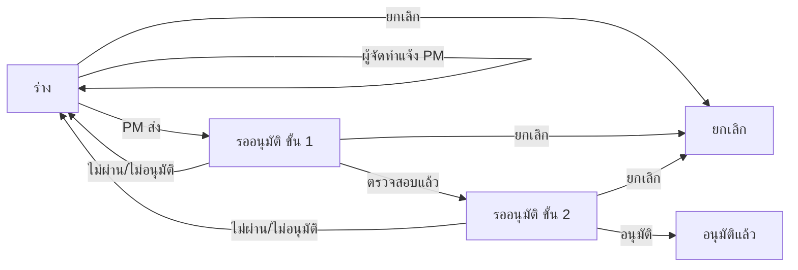

# BRD: รายงานความคืบหน้าโครงการ (Project Progress Report)

| Field | Value |
|---|---|
| BRD ID | BRD-PDM-PPR-001 |
| Feature | F-TMP-005 รายงานความคืบหน้าโครงการ (รหัส feature ชั่วคราว — รอลงทะเบียน) |
| BRD Type | New Feature (แบบ 1 · Standalone — อ่านข้อมูลจาก F-TMP-004 แผนโครงการ) |
| Version | 1.0 |
| Status | **APPROVED (Prebrief Mode · Lane)** — DEC แทน Scope Lock จนมีใบเซ็นลูกค้า |
| Module | ยังไม่มี module Project ใน FEATURE_REGISTRY → ใช้ Budget (DOA module) / เอกสารทั่วไป (MDOC) ชั่วคราว (เหมือน F-TMP-004) · แผนกเจ้าของแบบ: ฝ่ายพัฒนาโครงการ |
| Customer form | FM-PDM-02 Rev.00 : 01/07/2569 (docx Letter 4 หน้า → แบบพิมพ์ระบบ A4 2 หน้า) |
| Request | REQ-TMP-005 (ชั่วคราว — รอเลขจริงจาก F186) |
| Input | PREBRIEF_REQ-TMP-005_v2 · FORM_SPEC.json (35 ช่อง · แถวซ้ำ 5 กลุ่ม · ☐ 3 ตัวเลือก · ลงชื่อ 4 จุด) · DECISIONS.lock (20 DEC · พร้อมเริ่มทำ · AI-DEFAULT 15) · feature.html (audit FAIL 0 · self_audit PASS · e2e 21/21 + flow 20/20) |
| Created / Updated | 2026-10-11 |

## Changelog
- v1.0 (2026-10-11): สร้างผ่าน brd-generator-full v2.3 Prebrief Mode · Lane (doc-master-pipeline ขั้น 7 · unattended)

---

## 1. Business Context
### 1.1 ปัญหา / โอกาส
ฝ่ายพัฒนาโครงการรายงานความคืบหน้าโครงการด้วยไฟล์ Word FM-PDM-02 (ข้อมูลโครงการ 5 ช่อง + 6 ข้อ: สรุปสถานะ · ผลการดำเนินงาน · แผน vs ผลจริง · ปัญหา/ความเสี่ยง · แผนรอบถัดไป · ประเด็นที่ต้องการการตัดสินใจ + ลงชื่อ 4 จุด) — กรอกซ้ำข้อมูลจากแผนโครงการทุกรอบ · ผู้บริหารไม่เห็นภาพรวมสถานะทุกโครงการ · ประเด็น "ต้องการการตัดสินใจเร่งด่วน" ไปถึงผู้บริหารช้าเพราะต้องรอเอกสารเวียน
### 1.2 เป้าหมาย
1. ขึ้นแบบฟอร์มเป็นเอกสารในระบบ ช่องตรงกระดาษ 1:1 (PDF Replica FM-PDM-02 2 หน้า) ลูกค้าจำแบบเดิมได้
2. ผูกรายงานกับแผนโครงการที่อนุมัติแล้ว (F-TMP-004 · PJP) — ดึงชื่อโครงการ/ผู้จัดการโครงการ และเติมกิจกรรม/ระยะเวลา/งบ/KPI ตามแผนเป็นค่าเริ่ม
3. ผู้จัดการโครงการส่ง → ผู้ตรวจสอบ → ผู้อนุมัติ ตาม DOA กลาง (dynamic) · สถานะ "ล่าช้า หรือมีปัญหา" แจ้งผู้บริหารทันทีตอนส่ง
### 1.3 ตัวชี้วัด
ไม่มีใน input → **OQ-01** (ห้ามแต่งตัวเลข)
### 1.4 ที่มา
แบบฟอร์มลูกค้า FM-PDM-02 (docx เปล่า ไม่มีข้อมูลบุคคล) → FORM_SPEC 35 ช่อง · ตาราง 5 กลุ่ม (9/8/11/10/11 แถว) · ☐ สรุปสถานะ 3 ตัวเลือก · ลงชื่อ 4 จุด (ผู้จัดทำ · ผู้จัดการโครงการ · ผู้ตรวจสอบ · ผู้อนุมัติ) · gate 10 หมวดตอบโดย AI ตาม unattended-policy (AI-DEFAULT รอลูกค้ายืนยัน) · เอกสารพี่น้อง FM-PDM-01 แผนโครงการ (J004 · F-TMP-004)

## 2. Scope
### 2.1 In Scope
- รายการรายงาน (ค้นหา · กรองสถานะเอกสาร/สถานะโครงการ · CSV) · สร้าง/แก้ร่าง wizard 3 ขั้น (การ์ด ①–⑦ ตามข้อของกระดาษ) · ดูรายละเอียด 4 แท็บ (รายละเอียด · PDF Preview · ลายเซ็น/อนุมัติ · ประวัติ)
- ข้อมูลโครงการ (lookup รหัสโครงการเฉพาะ PJP อนุมัติแล้ว · ชื่อ/PM ดึงจากแผน) · รอบการรายงาน (ตั้งแต่–ถึง) · วันที่รายงาน · ข้อ 1–6 ครบทุกช่อง · แถวซ้ำไม่จำกัด · เติมค่าเริ่มจากแผนโครงการ
- ส่งอนุมัติโดยผู้จัดการโครงการ (ผู้จัดทำอื่น = บันทึกร่างแล้วแจ้ง PM) · DOA dynamic ค่าเริ่ม 2 ขั้น · ไม่อนุมัติ → กลับร่าง · ยกเลิก (เหตุผลบังคับ) · แนบไฟล์ · PDF FM-PDM-02 ทุกสถานะ · เลขที่ PPR จาก ENG-DOC-NUM
### 2.2 Out of Scope
- เขียนกลับแผนโครงการ (อัปเดตสถานะกิจกรรม/งบใน PJP) · ส่งต่อ Budget/ระบบอื่น (DEC-01/02) · ทำซ้ำเอกสาร · ประกาศ (DEC-15) · dashboard รวมทุกโครงการ (Phase 2) · ตั้งรอบรายงานอัตโนมัติ/เตือนครบรอบ
### 2.3 Assumptions
- แผนโครงการที่อนุมัติแล้วมีใน F-TMP-004 (อ่านผ่าน API ของ feature เจ้าของ) · ผู้จัดการโครงการ = project_manager_id ของแผน
- ข้อมูลผู้จัดทำ/ตำแหน่ง/หน่วยงาน มีใน HR · Employee · ผู้รับผิดชอบในตาราง = พนักงานในระบบ (lookup)
- ไม่มี module "Project" ใน FEATURE_REGISTRY → เสนอใน _BATCH_REPORT (OQ-04)
### 2.4 Scope Lock (ชั่วคราว = DECISIONS.lock · ยังไม่มีใบเซ็น → OQ-02)
| DEC | หมวด | มติ | ที่มา |
|---|---|---|---|
| DEC-01 | G1 | อนุมัติแล้วไม่เปลี่ยนค่าในระบบ (อ่าน PJP เพื่อเติมค่าเริ่มเท่านั้น ไม่เขียนกลับ) | AI-DEFAULT |
| DEC-02 | G1 | ไม่ส่งต่อระบบอื่นรอบนี้ (ประกาศ event ใน FRD แต่ไม่ยิง) | AI-DEFAULT |
| DEC-03 | G2 | DOA dynamic · ค่าเริ่ม 2 ขั้น: role-line-manager ของผู้จัดการโครงการ (ผู้ตรวจสอบ) → role-gm (ผู้อนุมัติ) · ไม่มีวงเงิน · ช่องผู้จัดการโครงการ = ผู้ส่ง (ไม่ใช่ขั้น DOA) | AI-DEFAULT |
| DEC-04 | G3 | lookup PJP อนุมัติแล้ว + เติมค่าเริ่ม · รอบ/%/งบ/ล่าช้าไม่มีปัญหา = บล็อก · ไม่มีประเด็นตัดสินใจ/รอบทับ/งบจริงเกินแผน/วันที่รายงานก่อนสิ้นรอบ/กำหนดเสร็จก่อนวันที่รายงาน = เตือน · ส่งได้เฉพาะ PM | AI-DEFAULT |
| DEC-05 | G4 | ผลการดำเนินงาน ไม่จำกัด · PDF ≥ 9 แถว | AI-DEFAULT |
| DEC-06 | G4 | KPI โครงการ ไม่จำกัด · PDF ≥ 8 แถว (เลข 1.–8.) | AI-DEFAULT |
| DEC-07 | G4 | ปัญหา อุปสรรค และความเสี่ยง ไม่จำกัด · PDF ≥ 11 แถว | AI-DEFAULT |
| DEC-08 | G4 | แผนงานในรอบถัดไป ไม่จำกัด · PDF ≥ 10 แถว | AI-DEFAULT |
| DEC-09 | G4 | ประเด็นที่ต้องการการตัดสินใจ ไม่จำกัด · PDF ≥ 11 แถว | AI-DEFAULT |
| DEC-10 | G5 | ช่องตรงกระดาษ 1:1 · ไม่เพิ่มช่อง · ผู้รับผิดชอบ/กำหนดแล้วเสร็จ เก็บแยก แสดงรวม 1 คอลัมน์ | AI-DEFAULT |
| DEC-11 | G6 | บล็อกลงชื่อ = ผู้จัดทำ + ผู้จัดการโครงการ + 1 ช่องต่อขั้น DOA · ข้อความ "จัดทำ/ส่ง/พิจารณาในระบบ" ไม่ใช้ภาพ | AI-DEFAULT |
| DEC-12 | G7 | ไม่อนุมัติ = กลับร่างเลขเดิม · ยกเลิก: เจ้าของ + admin · ร่าง/รออนุมัติ · เหตุผลบังคับ | AI-DEFAULT |
| DEC-13 | G8 | ผู้จัดทำ · ผู้จัดการโครงการของโครงการนั้น · ผู้อนุมัติหลังส่ง · admin ฝ่ายพัฒนาโครงการเห็นทั้งหมด | AI-DEFAULT |
| DEC-14 | G9 | ออกเลขตอนบันทึกครั้งแรก · รหัส PPR | AI-DEFAULT |
| DEC-15 | G10 | แนบไฟล์ ✓ · CSV ✓ · ทำซ้ำ ✗ · ประกาศ ✗ | AI-DEFAULT |
| DEC-16 | VALID | คำอธิบาย ☐ ล่าช้า หรือมีปัญหา บนกระดาษคัดลอกประโยคของ ☐ มีความเสี่ยงซ้ำ → แบบพิมพ์คงถ้อยคำ 1:1 · หน้าจอแสดงส่วนเฉพาะ (OQ-05) | FORM_SPEC |
| DEC-17 | VALID | % สำเร็จ 0–100 (บล็อก) | FORM_SPEC |
| DEC-18 | VALID | ล่าช้า หรือมีปัญหา → ปัญหา ≥ 1 (บล็อก) · ประเด็นตัดสินใจ ≥ 1 (เตือน) · มีความเสี่ยง → ปัญหา ≥ 1 (เตือน) | FORM_SPEC |
| DEC-19 | VALID | รอบ ถึง ≥ ตั้งแต่ (บล็อก) · วันที่รายงานก่อนสิ้นรอบ = เตือน · รอบทับรายงานเดิมของโครงการเดียวกัน = เตือน | FORM_SPEC |
| DEC-20 | VALID | ผู้รับผิดชอบ / กำหนดแล้วเสร็จ เก็บ owner + due_date แสดง "ชื่อ / วันที่" | FORM_SPEC |

## 3. Roles & Permissions (COSO)
| Role | COSO | ทำอะไร |
|---|---|---|
| ผู้จัดทำรายงาน (Prepared by · พนักงานในโครงการ) | Maker | สร้าง/แก้ร่าง · แจ้งผู้จัดการโครงการ · ยกเลิกของตัวเอง (ร่าง/รออนุมัติ) |
| ผู้จัดการโครงการ (Project Manager — จาก PJP) | Maker (Submitter) | เห็น/แก้ร่างของโครงการตัวเอง · ส่งอนุมัติ (= ลงชื่อช่อง ผู้จัดการโครงการ) |
| role-line-manager (ผู้ตรวจสอบ · Reviewed by) | Checker | ตรวจสอบแล้ว / ไม่ผ่านการตรวจสอบ |
| role-gm (ผู้อนุมัติ · Approved by) | Approver | อนุมัติ / ไม่อนุมัติ · รับแจ้งทันทีเมื่อสถานะ ล่าช้า หรือมีปัญหา |
| admin ฝ่ายพัฒนาโครงการ | Monitor | เห็นทุกใบ · ยกเลิกได้ (ร่าง/รออนุมัติ) — role ยังไม่อยู่ใน DOA master → OQ-03 |

| Action | ผู้จัดทำ | ผู้จัดการโครงการ | ผู้ตรวจสอบ | ผู้อนุมัติ | admin |
|---|:-:|:-:|:-:|:-:|:-:|
| ดูใบ | ของตน | ของโครงการตน (รวมร่าง) | หลังส่ง | หลังส่ง | ทั้งหมด |
| สร้าง/แก้ร่าง | ✓ | ✓ (โครงการตน) | – | – | – |
| ส่งอนุมัติ | – (แจ้ง PM) | ✓ | – | – | – |
| ตัดสินขั้น | – | – | ✓ ขั้น 1 | ✓ ขั้น 2 | – |
| ยกเลิก | ✓ | – | – | – | ✓ |
SoD: ผู้ส่ง (PM) พิจารณาใบตัวเองไม่ได้ (BR-DOA-04) · ผู้ตรวจสอบ ≠ ผู้อนุมัติ (resolve คนละ role)

## 4. User Journey
### 4.1 Happy Path
1. ผู้จัดทำ/PM: สร้าง → ① เลือกรหัสโครงการ (PJP อนุมัติแล้ว) → ระบบเติมชื่อ/PM + กิจกรรม/ระยะเวลา/งบ/KPI จากแผน · กรอกรอบการรายงาน + วันที่รายงาน → ② เลือกสถานะโครงการ + คำอธิบาย → ③ ผลการดำเนินงาน (แผน · ผลจริง · %) → ④ แผน vs ผลจริง + KPI → ⑤ ปัญหา/ความเสี่ยง → ⑥ แผนรอบถัดไป → ⑦ ประเด็นที่ต้องการการตัดสินใจ → แนบไฟล์ → ตรวจสอบ (เตือนถ้ามี) → บันทึกร่าง (ได้เลข PPR)
2. ถ้าผู้จัดทำไม่ใช่ PM → "บันทึกและแจ้งผู้จัดการโครงการ" (ppr_draft_for_pm) → PM เปิดร่าง ตรวจ/แก้ แล้วส่ง
3. PM ส่งอนุมัติ: slot ต่อขั้นจาก DOA (resolve จากผังองค์กรของ PM) → รออนุมัติ ขั้น 1 · สถานะ ล่าช้า หรือมีปัญหา → แจ้งผู้จัดการทั่วไปทันที (ppr_urgent_decision)
4. ผู้ตรวจสอบ: ตรวจสอบแล้ว → ขั้น 2 · ผู้อนุมัติ: อนุมัติ (ความเห็น/ข้อสั่งการไม่บังคับ) → **อนุมัติแล้ว** · PDF snapshot (approved_final)
### 4.2 Alternative
- ไม่ผ่านการตรวจสอบ / ไม่อนุมัติ → กลับร่าง เลขเดิม + เหตุผล → แก้ ส่งใหม่ (resolve สายใหม่)
- ยกเลิก (ร่าง/รออนุมัติ) โดยเจ้าของหรือ admin → ผู้พิจารณาขั้นปัจจุบันได้รับ ppr_cancelled

## 5. Data (จาก FORM_SPEC — ป้ายตามกระดาษ)
### 5.1 progress_report (header)
| ช่องบนกระดาษ | field | ชนิด | ที่มา | บังคับ |
|---|---|---|---|:-:|
| (เลขที่รายงาน) | doc_no | text | auto ENG-DOC-NUM (PPR) | ✓ |
| รหัสโครงการ : Project Code | project_plan_id → project_code | ref F-TMP-004 (approved) | user lookup | ✓ |
| ชื่อโครงการ : Project Name | project_name | text snapshot | system (PJP) | ✓ |
| ผู้จัดการโครงการ : Project Manager | project_manager | ref Employee snapshot | system (PJP) · PDPA | ✓ |
| รอบการรายงาน : Reporting Period | reporting_period (period_from · period_to) | date range (to ≥ from) | user | ✓ |
| วันที่รายงาน : Report Date | report_date | date | user (ค่าเริ่ม = วันนี้) | ✓ |
| ☐ สรุปสถานะโครงการ | overall_status ∈ {on_track, at_risk, delayed} | enum | user | ✓ |
| คำอธิบาย : | status_note | text | user | ✓ |
| ระยะเวลา (Schedule) แผน / ผลจริง / สถานะ | schedule_plan · schedule_actual · schedule_status | text | user (แผนค่าเริ่มจาก PJP) | ✓ / ✓ / – |
| งบประมาณ (Budget) แผน / ผลจริง / สถานะ | budget_plan · budget_actual · budget_status | money ≥ 0 / text | user (แผนค่าเริ่ม = รวมงบอนุมัติ PJP) | ✓ / ✓ / – |
| (ผู้จัดทำ — ระบบ) | requester_id · position_snapshot · dept_snapshot · header_snapshot | | system/auto | ✓ |
| (ผู้จัดการโครงการ — ผู้ส่ง) | submitted_by · submitted_at | | system ตอนส่ง | |
| + DOA fields | approval_status · doa_entry_ref · doa_ref · approval_chain (jsonb snapshot) · approver_role · approved_by · approved_at | | DOA (`TODO: DOA engine`) | |
| + returned_reason · returned_by · returned_at | | | DEC-12 | |
### 5.2 progress_report_performance (ข้อ 2 · 9 แถว)
seq (auto) · activity (✓) · plan (✓) · actual (✓) · pct 0–100 (✓) · remarks
### 5.3 progress_report_kpi (ข้อ 3 · KPI 8 แถว)
seq · metric (✓) · plan (✓) · actual (✓) · status
### 5.4 progress_report_issue (ข้อ 4 · 11 แถว)
description · impact · resolution · owner_id → Employee (PDPA) · due_date (ทุกช่อง ✓ เมื่อมีแถว)
### 5.5 progress_report_next (ข้อ 5 · 10 แถว)
description · owner_id → Employee · due_date (✓ เมื่อมีแถว)
### 5.6 progress_report_decision (ข้อ 6 · 11 แถว)
topic · options · recommendation · impact (✓ เมื่อมีแถว)
### 5.7 attachments → Document Center (ไฟล์ระดับใบ)

## 6. User Stories
| ID | Story | AC หลัก |
|---|---|---|
| S-01 | ผู้จัดทำเลือกโครงการที่จะรายงาน | lookup เฉพาะ PJP อนุมัติแล้ว · ชื่อ/PM ดึงจากแผนแก้ไม่ได้ · เติมกิจกรรม/KPI/ระยะเวลา/งบเป็นค่าเริ่มเมื่อส่วนนั้นยังว่าง |
| S-02 | ผู้จัดทำกำหนดรอบการรายงาน | ตั้งแต่/ถึง/วันที่รายงานบังคับ · ถึง < ตั้งแต่ = บล็อก · ทับรายงานเดิม/วันที่รายงานก่อนสิ้นรอบ = เตือน |
| S-03 | ผู้จัดทำสรุปสถานะโครงการ | เลือก 1 ใน 3 (ถ้อยคำตามกระดาษ) + คำอธิบายบังคับ |
| S-04 | ผู้จัดทำรายงานผลการดำเนินงาน | ≥ 1 แถว · แผน/ผลจริง/% บังคับ · % 0–100 · % เฉลี่ยสด |
| S-05 | ผู้จัดทำเทียบแผนกับผลจริง | ระยะเวลา/งบ แผน+ผลจริงบังคับ · งบ ≥ 0 · งบจริงเกินแผน = เตือน · KPI ไม่บังคับมีแถว |
| S-06 | ผู้จัดทำระบุปัญหา/ความเสี่ยง | ล่าช้าฯ ต้อง ≥ 1 (บล็อก) · มีความเสี่ยงแต่ไม่มี = เตือน · แถวที่มีข้อมูลต้องครบ |
| S-07 | ผู้จัดทำวางแผนรอบถัดไป | ไม่บังคับ · แถวที่มีข้อมูลต้องมีผู้รับผิดชอบ + กำหนดเสร็จ |
| S-08 | ผู้จัดทำเสนอประเด็นให้ผู้บริหารตัดสินใจ | ล่าช้าฯ แต่ไม่มี = เตือน · แถวที่มีข้อมูลต้องครบ 4 ช่อง |
| S-09 | ผู้จัดทำบันทึกร่าง | ได้เลข PPR ตอนบันทึกครั้งแรก · แถวว่างทั้งแถวไม่บันทึก |
| S-10 | ผู้จัดทำที่ไม่ใช่ PM แจ้งผู้จัดการโครงการ | ไม่มีปุ่มส่ง · มีปุ่มแจ้ง → ppr_draft_for_pm + ประวัติ |
| S-11 | ผู้จัดการโครงการส่งอนุมัติ | เห็นร่างของโครงการตน · slot ต่อขั้นจาก DOA · PM ไม่อยู่ในรายชื่อ · บังคับเลือก · ล่าช้าฯ → แจ้ง GM |
| S-12 | ผู้ตรวจสอบตรวจสอบรายงาน | ปุ่มเฉพาะผู้พิจารณาขั้นปัจจุบัน · คำ "ตรวจสอบแล้ว / ไม่ผ่านการตรวจสอบ" |
| S-13 | ผู้อนุมัติอนุมัติรายงาน | ขั้นสุดท้าย → อนุมัติแล้ว · ความเห็น/ข้อสั่งการบันทึกในประวัติ |
| S-14 | ผู้พิจารณาไม่อนุมัติ | เหตุผลบังคับ → กลับร่างเลขเดิม · ผู้จัดทำ/PM เห็นเหตุผล |
| S-15 | พิมพ์/ดาวน์โหลด PDF FM-PDM-02 | ทุกสถานะ 2 หน้า · แถวว่างครบตามกระดาษ · ลงชื่อ = ผู้จัดทำ + PM + 1 ช่องต่อขั้น DOA |
| S-16 | เจ้าของ/admin ยกเลิก · admin ดูทุกใบ + CSV | ร่างหรือรออนุมัติ · เหตุผลบังคับ · CSV 1 แถวต่อกิจกรรม |

## 7. Status & Lifecycle
| จาก | Action | ไป | ใคร |
|---|---|---|---|
| — | บันทึกครั้งแรก | draft | ผู้จัดทำ / PM |
| draft | แจ้งผู้จัดการโครงการ | draft (audit) | ผู้จัดทำที่ไม่ใช่ PM |
| draft | ส่ง | pending (ขั้น 1) | PM |
| pending | ผ่านขั้น n<N | pending (ขั้น n+1) | ผู้พิจารณาขั้น n |
| pending | อนุมัติขั้น N | approved | ผู้อนุมัติ |
| pending | ไม่ผ่าน/ไม่อนุมัติ | draft (เลขเดิม · returned_*) | ผู้พิจารณาขั้นปัจจุบัน |
| draft / pending | ยกเลิก | cancelled | เจ้าของ / admin |
approved = ล็อกแก้ไขทุกช่อง

## 8. Business Rules + Validation
| ID | Rule | Tag | Type |
|---|---|:-:|---|
| BR-01 | รหัสโครงการเลือกได้เฉพาะ PJP สถานะอนุมัติแล้ว · ชื่อ/PM snapshot จากแผน | FIXED | DEC-04 |
| BR-02 | เติมค่าเริ่มจาก PJP เฉพาะส่วนที่ยังว่าง (กิจกรรม → ผลการดำเนินงาน · ระยะเวลา · งบอนุมัติ · KPI) · ไม่เขียนกลับแผน | FIXED | DEC-01/04 |
| BR-03 | period_to ≥ period_from | FIXED | Validation (DEC-19) |
| BR-04 | pct 0–100 · งบ ≥ 0 | FIXED | Validation (DEC-17) |
| BR-05 | ล่าช้า หรือมีปัญหา → ปัญหา ≥ 1 (บล็อก) · ประเด็นตัดสินใจ ≥ 1 (เตือน) · มีความเสี่ยง → ปัญหา ≥ 1 (เตือน) | CONFIGURABLE | DEC-18 |
| BR-06 | เตือน: รอบทับรายงานเดิมของโครงการเดียวกัน · วันที่รายงานก่อนสิ้นรอบ · งบจริงเกินแผน · กำหนดเสร็จก่อนวันที่รายงาน | CONFIGURABLE | DEC-04/19 |
| BR-07 | ส่งอนุมัติได้เฉพาะผู้จัดการโครงการของโครงการนั้น · ผู้ส่ง = ช่องลงชื่อ ผู้จัดการโครงการ | FIXED | DEC-03/04 |
| BR-08 | สายอนุมัติ resolve จาก DOA ตอนส่ง (relative ต่อ PM) แล้ว freeze · คำตัดสินผูก role | FIXED | DOA (BR-DOA-02) |
| BR-09 | ไม่ผ่าน/ไม่อนุมัติ → draft เลขเดิม · resolve ใหม่ตอนส่งรอบถัดไป | FIXED | DEC-12 |
| BR-10 | ออกเลขตอนบันทึกครั้งแรก · no-gap ✗ | CONFIGURABLE | DOCCFG (DEC-14) |
| BR-11 | ร่างเห็นเฉพาะผู้จัดทำ + PM ของโครงการ (+ admin) · ผู้อนุมัติเห็นหลังส่ง | FIXED | Visibility #109 + DEC-13 |
| BR-12 | บล็อกลงชื่อ PDF = ผู้จัดทำ + PM + 1 ช่องต่อขั้น DOA (dynamic) · คำตัดสินตาม role | FIXED (จำนวน = DOA) | DEC-03 · DEC-11 |
| BR-13 | แถวว่างทั้งแถวไม่บันทึก · แถวที่มีข้อมูลต้องครบช่องบังคับ | FIXED | Validation |
| BR-14 | ผู้รับผิดชอบ/กำหนดเสร็จ เก็บแยก · PDF แสดง "ชื่อ / วันที่" ในคอลัมน์เดียว | FIXED | DEC-10/20 |

| VR | ช่อง | เงื่อนไข | ข้อความ |
|---|---|---|---|
| VR-01 | รหัสโครงการ · รอบตั้งแต่/ถึง · วันที่รายงาน · สถานะโครงการ · คำอธิบาย · ระยะเวลา/งบ แผน+ผลจริง | required | กรุณากรอก… / กรุณาเลือก… |
| VR-02 | period_to | ≥ period_from | วันสิ้นรอบต้องไม่ก่อนวันเริ่มรอบ |
| VR-03 | performance | ≥ 1 แถวที่มีข้อมูล | ต้องมีผลการดำเนินงาน อย่างน้อย 1 รายการ |
| VR-04 | แถวที่มีข้อมูล | ช่องบังคับครบ | กรอกให้ครบทุกช่องในแถวนี้ |
| VR-05 | performance.pct | 0–100 | % สำเร็จต้องอยู่ระหว่าง 0–100 |
| VR-06 | budget_plan / budget_actual | ตัวเลข ≥ 0 | กรุณากรอกตัวเลข ≥ 0 |
| VR-07 | issues (เมื่อ delayed) | ≥ 1 | สถานะ ล่าช้า หรือมีปัญหา ต้องระบุปัญหา อุปสรรค และความเสี่ยงอย่างน้อย 1 รายการ |
| VR-08 | slot ผู้พิจารณา | ทุกขั้นต้องเลือก · ≠ PM | กรุณาเลือกผู้พิจารณา |
| VR-09 | เหตุผล ไม่อนุมัติ/ยกเลิก | required | กรุณาระบุเหตุผล |
### 8.5 ระดับความยืดหยุ่น
BR-05/06 → Admin Panel (นโยบายเตือน/บล็อก) · BR-10 → F-DOCCFG · สายอนุมัติ → DOA กลาง

## 9. Edge Cases
| EC | กรณี | ผล |
|---|---|---|
| EC-01 | แผนโครงการถูกยกเลิก/ปิดหลังมีรายงานร่าง | lookup ไม่แสดงแล้ว · ร่างเดิมยังเปิดได้ · ส่งไม่ได้ → 409 PROJECT_NOT_ACTIVE (OQ-06) |
| EC-02 | เปลี่ยน PM ในแผนระหว่างร่าง | สิทธิ์ส่งตาม PM ปัจจุบันของแผน · ใบที่ส่งแล้วใช้ snapshot |
| EC-03 | ผู้จัดทำ = PM | ส่งได้เลย · บล็อกลงชื่อแสดงชื่อเดียวกัน 2 ช่อง |
| EC-04 | ผลงาน/ปัญหา > แถวบนกระดาษ | PDF dense ยัง 2 หน้า (ทดสอบ ผลงาน 12 · ปัญหา 12 · แผน 10) |
| EC-05 | สายอนุมัติ 6 ขั้น | ลงชื่อ 8 ช่อง 2 แถว ยัง 2 หน้า |
| EC-06 | PM เป็นผู้จัดการทั่วไปเอง | resolve role-gm ข้ามตัวเอง · slot ต้องเลือกคนอื่น |
| EC-07 | ส่ง/อนุมัติชนกัน (stale) | 409 → toast รีเฟรช สถานะไม่เปลี่ยน |
| EC-08 | แบบเอกสารปิดใช้ (F-DOCCFG) | ปุ่มสร้าง disabled |
| EC-09 | รายงานหลายรอบทับกัน | เตือน · บันทึก/ส่งได้ |
| EC-10 | ข้อความคำอธิบายยาวมาก | PDF หน้า 1 อาจล้น → ทดสอบกับข้อมูลจริงรอบ UAT (OQ-07) |

## 10. Value Stream & Downstream Impact
Positioning: ฝ่ายพัฒนาโครงการ — เสนอ/อนุมัติแผนโครงการ (F-TMP-004 · FM-PDM-01) → **รายงานความคืบหน้าโครงการ (feature นี้)** → [dashboard สถานะโครงการ — Phase 2]
| ปลายทาง/ต้นทาง | ข้อมูล | Trigger | หมายเหตุ |
|---|---|---|---|
| F-TMP-004 แผนโครงการ (ต้นทาง) | รหัส · ชื่อ · PM · กิจกรรม · ระยะเวลา · งบอนุมัติ · KPI | เลือกโครงการ | อ่านอย่างเดียว (DEC-01) |
| F-TMP-004 (ปลายทาง) | สถานะกิจกรรม | approved | **ปิดรอบนี้** — ไม่เขียนกลับ (OQ-08) |
| ENG-NOTIFY | ppr_cancelled · ppr_draft_for_pm · ppr_urgent_decision | ตาม NTF_BRIEF | DOA ยิง doa_pending/doa_result เอง |
| F-DOCCFG / ENG-DOC-STORE | PDF snapshot | approved_final | |

## 11. Delivery
Phase 1 = ทุกอย่างใน §2.1 · Phase 2 (เสนอ) = dashboard สถานะทุกโครงการ · อัปเดตสถานะกิจกรรมใน PJP จากรายงานที่อนุมัติ · เตือนครบรอบรายงาน

## 12. Dev Summary "ใบสั่ง"
- Config: DOA entry F-TMP-005 (role-line-manager → role-gm · relative ต่อผู้ส่ง) · doc_type PPR (F-DOCCFG) · role admin ฝ่ายพัฒนาโครงการ (OQ-03)
- Declaration: DOA_BRIEF · NTF_BRIEF · DOCCFG_BRIEF · MDOC_BRIEF (ฉบับจริงหลัง FRD)
- Dependency: F-TMP-004 API อ่านแผนอนุมัติแล้ว (`GET /project-plans?status=approved` + รายละเอียด)
- Screen Inventory: P-01 รายการ · P-02 สร้าง/แก้ (drawer wide 3 ขั้น · การ์ด ①–⑦) · P-03 ดู (drawer 4 แท็บ) · M-01 ส่ง · M-02 ตรวจสอบ/อนุมัติ · M-03 ไม่อนุมัติ · M-04 ยกเลิก · M-05 ทิ้งข้อมูล
- UI Signals: เอกสาร + พิมพ์ 2 หน้า + ลายเซ็น = ใช่ · Q-form · ☐ 3 ตัวเลือก = การ์ดเลือก · แถวซ้ำแบบตาราง 5 กลุ่ม

## 13. Open Questions
| OQ | คำถาม | เจ้าของ | Block? |
|---|---|---|---|
| OQ-01 | ตัวชี้วัดความสำเร็จ (เช่น % รายงานส่งตรงรอบ · เวลาอนุมัติเฉลี่ย) | ลูกค้า | ไม่ |
| OQ-02 | ลูกค้าเซ็นยืนยัน DEC-01..15 (AI-DEFAULT) — โดยเฉพาะ ส่งได้เฉพาะ PM · ผู้ตรวจสอบ = ผู้บังคับบัญชาของ PM · ผู้อนุมัติ = role-gm · ไม่เขียนกลับแผน · กลับร่าง | Strike → ลูกค้า | ก่อน UAT |
| OQ-03 | role admin ฝ่ายพัฒนาโครงการ ยังไม่อยู่ใน DOA roles master (14 role) — ใช้ role ใด | Strike + พี่เบิร์ด | ก่อน wire |
| OQ-04 | ไม่มี module Project ใน FEATURE_REGISTRY — ตั้ง module ใหม่หรือวางใต้ Budget · module enum MDOC ไม่มี (ใช้ "เอกสารทั่วไป") | พี่เบิร์ด | ก่อน register |
| OQ-05 | ถ้อยคำคำอธิบาย ☐ ล่าช้า หรือมีปัญหา บนกระดาษซ้ำประโยคของ ☐ มีความเสี่ยง — แก้ต้นฉบับหรือคงไว้ | ลูกค้า | ไม่ |
| OQ-06 | รายงานของโครงการที่แผนถูกยกเลิก/ปิด ส่งต่อได้ไหม | ลูกค้า | ไม่ |
| OQ-07 | ความยาวข้อความจริง (คำอธิบาย · รายละเอียดปัญหา) — แบบพิมพ์ 2 หน้ารองรับ ~2–3 บรรทัดต่อช่อง | ลูกค้า | ไม่ |
| OQ-08 | ต้องการให้รายงานที่อนุมัติอัปเดตสถานะกิจกรรมใน PJP อัตโนมัติไหม (Phase 2) | ลูกค้า | ไม่ |
| OQ-09 | รหัส feature จริง (แทน F-TMP-005) · REQ จริง · function_code taxonomy | Strike | ก่อน register |

## 14. Security & Compliance
Preset: Standard Operation · PII: ชื่อผู้จัดทำ/PM/ผู้รับผิดชอบ (pdpa) — แบบฟอร์มลูกค้าเป็นแบบเปล่า ข้อมูลตัวอย่างใน prototype/แบบพิมพ์เป็นชื่อสมมติทั้งหมด · Audit append-only ทุก action (รวมแจ้ง PM) · SoD ผู้ส่ง ≠ ผู้พิจารณา · ไฟล์แนบตาม file_policy Document Center (≤20MB) · ไม่เก็บ credential

## 15. Health Check / Monitoring
SLA ต่อขั้น: ไม่กำหนดรอบนี้ (→ OQ-01) · KPI เสนอ: ร่างค้างรอ PM ส่งเกิน N วัน · รายงานสถานะ ล่าช้า หรือมีปัญหา ที่ยังรออนุมัติ · โครงการที่ไม่มีรายงานในรอบล่าสุด

## 16. AI Review (Prebrief Mode · Lane)
C01–C23 + PE01–PE05: ผ่าน · C20 Scope Lock = DEC ครบ 20 ข้อ + OQ-02 รอใบเซ็น (✅ ตาม v2.3) · C22 ตัวชี้วัด → OQ-01 (ไม่แต่งตัวเลข) · C16 ไม่มี Registry module = WARN (OQ-04) · **สถานะ: APPROVED**

## Appendix — Screen List
P-01 `#/project-progress` · P-02 `#/project-progress/create` · `/edit/:id` · P-03 `#/project-progress/view/:id`
