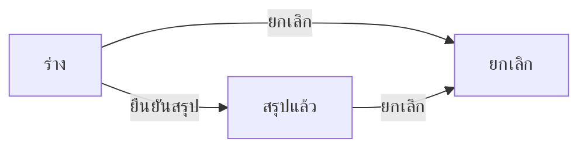

# BRD: สรุปข้อมูลประเมินความพึงพอใจลูกค้า กลุ่ม MT (MT Customer Satisfaction Summary)

| Field | Value |
|---|---|
| BRD ID | BRD-SAL-MTS-001 |
| Feature | F-TMP-008 (รหัสชั่วคราว) สรุปข้อมูลประเมินความพึงพอใจลูกค้า กลุ่ม MT — doc code MTS |
| BRD Type | New Feature (แบบ 2 · ดึงข้อมูลเดิม: Employee · SalesConfig) |
| Version | 1.0 |
| Status | **APPROVED (Prebrief Mode · Lane · unattended)** — DEC แทน Scope Lock จนมีใบเซ็นลูกค้า · มติ AI-DEFAULT ทุกข้อ (ยกเว้น VALID) |
| Module | Sales (Core Cube · Customer/CRM) |
| Customer | แบบฟอร์มลูกค้า FM-SAL-07 Rev.00: 01/07/2569 (ฝ่ายขาย) |
| Request | REQ-TMP-008 (ชั่วคราว — รอเลขจริงจาก F186) |
| Input | PREBRIEF_REQ-TMP-008_v2 · FORM_SPEC.json (20 ช่อง) · DECISIONS.lock (20 DEC · พร้อมเริ่มทำ · AI-DEFAULT 12 · VALID 8) · feature.html (audit FAIL 0 · self_audit PASS · e2e ยังไม่รัน — NO-BROWSER) |
| Created / Updated | 2026-10-10 |

## Changelog
- v1.0 (2026-10-10): สร้างผ่าน brd-generator-full v2.3 Prebrief Mode (doc-master-pipeline ขั้น 7 · โหมดไม่เฝ้า)

---

## 1. Business Context
### 1.1 ปัญหา / โอกาส
ฝ่ายขายสรุปผลประเมินความพึงพอใจของลูกค้ากลุ่ม Modern Trade (15 ช่องทาง เช่น ห้าง/ร้านค้าปลีกสมัยใหม่) ด้วยไฟล์ Excel FM-SAL-07 โดยคัดลอกชีตทุกครั้ง ("สรุปการประเมิณครั้งที่1") — แถวรวมคะแนนต่อช่องทางไม่มีสูตร (แต่แถว % อ้างถึง) · สีเขียว/เหลือง/แดงของ % ระบายเอง ไม่ผูกกับค่า · ป้ายผลเทียบมาตรฐานและรายชื่อช่องทางในภาพรวมโดยสรุปพิมพ์มือและไม่ตรงกับตาราง · ชื่อผู้สรุปพิมพ์เอง · ไม่มีผู้อนุมัติบนกระดาษ
### 1.2 เป้าหมาย
1. ขึ้นแบบสรุปเป็นเอกสารในระบบ ช่องตรงกระดาษ 1:1 · PDF Replica ที่ลูกค้าจำแบบเดิมได้ (2 หน้า)
2. ระบบคำนวณ รวมต่อช่องทาง · % ต่อช่องทาง · ผลเทียบมาตรฐาน · รายชื่อช่องทางแต่ละกลุ่ม ให้เอง — ไม่มีการระบายสี/พิมพ์ป้ายด้วยมือ
3. หัวข้อประเมิน รายชื่อช่องทาง และเกณฑ์ 95%/80% อ่านจากการตั้งค่าฝ่ายขาย
4. ผู้สรุปยืนยันสรุปในระบบ (ไม่มีสายอนุมัติตามแบบฟอร์ม) · แจ้งผู้บริหารเมื่อมีช่องทางต่ำกว่า 80%
### 1.3 ตัวชี้วัด
ไม่มีใน input → **OQ-01** (ห้ามแต่งตัวเลข)
### 1.4 ที่มา
แบบฟอร์มลูกค้า FM-SAL-07 (xlsx 1 ชีต A4 แนวนอน) → FORM_SPEC 20 ช่อง (กรอก 8 · คำนวณ 7 · ระบบใส่ 3 · ดึงจากระบบ 2) · gate 10 หมวดตอบโดย AI ตาม unattended-policy (AI-DEFAULT รวม G1)

## 2. Scope
### 2.1 In Scope
- รายการสรุปผล (ค้นหา · กรอง สถานะ/ปี · CSV) · สร้าง/แก้ร่าง wizard 4 ขั้น · ดูรายละเอียด 4 แท็บ (รายละเอียด › PDF › ลายเซ็น/อนุมัติ › ประวัติ)
- ครั้งที่ · เอกสารประเมิน วันที่ · สรุปข้อมูล วันที่ · ตารางคะแนน 9 หัวข้อ × 15 ช่องทาง (จาก config) · คะแนน 1–5 ต่อช่อง · คำนวณ รวม/%/ผลเทียบมาตรฐาน
- ภาพรวมโดยสรุป 3 กลุ่ม (รายชื่อช่องทางอัตโนมัติ + ข้อความแนะนำแก้ได้) · ข้อเสนอแนะ (หลายข้อ)
- ยืนยันสรุป (ผู้สรุป · ไม่มีอนุมัติ) · ยกเลิก (เหตุผลบังคับ) · แนบไฟล์ · PDF FM-SAL-07 Replica 2 หน้า · เลขที่ MTS จาก ENG-DOC-NUM
### 2.2 Out of Scope
- แบบประเมินรายลูกค้า MT และการดึงคะแนนอัตโนมัติ → ผู้ใช้กรอกคะแนนเอง (DEC-01/02 · OQ-05) · เปลี่ยนค่าในระบบ/ส่งต่อระบบอื่น · สายอนุมัติ (DEC-03 · OQ-03) · ทำซ้ำเอกสาร · ประกาศ · กันสร้างครั้งที่ซ้ำ (เตือนเท่านั้น)
### 2.3 Assumptions
- Employee (F-EMP-001) มีในระบบ · SalesConfig สำหรับหัวข้อ MT/รายชื่อช่องทาง/เกณฑ์/ป้าย/ข้อความแนะนำ ยังไม่มี → เพิ่มใน Sales Configuration (OQ-04)
### 2.4 Scope Lock (ชั่วคราว = DECISIONS.lock · ยังไม่มีใบเซ็น → OQ-02)
| DEC | หมวด | มติ | ที่มา |
|---|---|---|---|
| DEC-01 | G1 | ไม่เปลี่ยนค่าในระบบ | AI-DEFAULT |
| DEC-02 | G1 | ไม่ส่งต่อระบบอื่นรอบนี้ (ประกาศ event ใน FRD ไม่ยิง) | AI-DEFAULT |
| DEC-03 | G2 | ไม่มีการอนุมัติ — กระดาษไม่มีช่องผู้อนุมัติ · ยืนยันสรุป = ปิดรายงาน | AI-DEFAULT |
| DEC-04 | G3 | ค่าคงที่จาก SalesConfig (95% · 80% · คะแนนเต็ม 5 · 9 หัวข้อ · 15 ช่องทาง · ป้าย/ข้อความแนะนำ) · คะแนนจำนวนเต็ม 1–5 (บล็อก) · % = รวม ÷ คะแนนเต็ม · ช่องทางไม่ได้ประเมิน = ว่างทั้งคอลัมน์ · กรอกไม่ครบ = บล็อกตอนยืนยัน · วันที่สรุป ≥ วันที่เอกสารประเมิน · ครั้งที่ซ้ำในปี = เตือน | AI-DEFAULT |
| DEC-05 | G4 | หัวข้อประเมิน: แถว = หัวข้อใน config (PDF ≥ 9 ตามกระดาษ) | AI-DEFAULT |
| DEC-06 | G4 | ช่องทาง (คอลัมน์): คอลัมน์ = ช่องทางใน config (PDF ≥ 15 ตามกระดาษ) | AI-DEFAULT |
| DEC-07 | G4 | ข้อเสนอแนะ: ไม่จำกัด · PDF ≥ 4 บรรทัด | AI-DEFAULT |
| DEC-08 | G5 | ช่องตรงกระดาษ 1:1 · ไม่เพิ่มช่อง · แก้คำสะกด | AI-DEFAULT |
| DEC-09 | G6 | บล็อกผู้สรุปแถวล่าง · ข้อความ "ยืนยันสรุปในระบบ" ไม่ใช้ภาพ | AI-DEFAULT |
| DEC-10 | G8 | เจ้าของ · Sales admin เห็นทั้งหมด (ไม่มีผู้อนุมัติ) | AI-DEFAULT |
| DEC-11 | G9 | ออกเลขตอนบันทึกครั้งแรก · รหัส MTS | AI-DEFAULT |
| DEC-12 | G10 | แนบไฟล์ ✓ · CSV ✓ · ทำซ้ำ ✗ · ประกาศ ✗ | AI-DEFAULT |
| DEC-13 | VALID | รวมคะแนนต่อช่องทาง = SUM ทุกหัวข้อ (ต้นฉบับไม่มีสูตร) | FORM_SPEC |
| DEC-14 | VALID | สีและสถานะคำนวณจาก % เทียบเกณฑ์ (ต้นฉบับระบายตายตัว) | FORM_SPEC |
| DEC-15 | VALID | ผลเทียบมาตรฐานคำนวณจาก % เท่านั้น ผู้ใช้แก้ไม่ได้ | FORM_SPEC |
| DEC-16 | VALID | รายชื่อช่องทางต่อกลุ่มสร้างอัตโนมัติ ใช้ชื่อจาก config | FORM_SPEC |
| DEC-17 | VALID | เกณฑ์ตัวเลข ≥95 / 80–<95 / <80 + ป้ายตามคำอธิบายสี — รอลูกค้ายืนยันถ้อยคำ | FORM_SPEC |
| DEC-18 | VALID | แก้คำสะกด "ประเมิณ/ลุกค้า" · ชื่อช่องทางเป็นข้อความ | FORM_SPEC |
| DEC-19 | VALID | ชื่อ/ตำแหน่งผู้สรุปดึงจากผู้สร้างเอกสาร (pdpa) | FORM_SPEC |
| DEC-20 | VALID | 1 ใบ = 1 ครั้ง · ครั้งที่ซ้ำในปีเดียวกัน = เตือน | FORM_SPEC |

## 3. Roles & Permissions (COSO)
| Role | COSO | ทำอะไร |
|---|---|---|
| Sales Manager (ผู้สรุปการประเมิน · role-mgr-sales) | Maker | สร้าง/แก้ร่าง · ยืนยันสรุป · ยกเลิกของตัวเอง (ร่าง/สรุปแล้ว) |
| Sales admin (ผู้ดูแลเอกสารฝ่ายขาย) | Monitor | เห็นทั้งหมด · ยกเลิกได้ · ส่งออก CSV |
| หัวหน้าหน่วยธุรกิจ (role-mgr-bu) | ผู้รับแจ้ง | ได้รับแจ้งเมื่อมีช่องทางต่ำกว่า 80% (ไม่มีสิทธิ์ตัดสิน — OQ-03) |

| Action | Maker | Sales admin | คนอื่น |
|---|:-:|:-:|:-:|
| ดูใบ | ของตน | ทั้งหมด | ✗ |
| สร้าง/แก้ร่าง | ✓ ของตน | – | – |
| ยืนยันสรุป | ✓ ของตน | – | – |
| ยกเลิก | ✓ ของตน (ร่าง/สรุปแล้ว) | ✓ (ร่าง/สรุปแล้ว) | – |
SoD: ไม่มีผู้ตรวจทานตามแบบฟอร์ม — ความเสี่ยงที่ผู้สรุปยืนยันเองบันทึกไว้ใน OQ-03

## 4. User Journey
### 4.1 Happy Path
1. Sales Manager: สร้าง → ใส่ครั้งที่ + เอกสารประเมิน วันที่ + สรุปข้อมูล วันที่ → กรอกคะแนน 1–5 ของแต่ละช่องทาง (ระบบคำนวณรวม/%/ผล สด) → ตรวจภาพรวมโดยสรุป ปรับข้อความแนะนำ ใส่ข้อเสนอแนะ → แนบไฟล์ (ถ้ามี) → บันทึก (ได้เลข MTS) → ยืนยันสรุป
2. สถานะ **สรุปแล้ว** · ล็อกแก้ไข · PDF เก็บสำเนา · ถ้ามีช่องทาง < 80% → แจ้งหัวหน้าหน่วยธุรกิจ + Sales admin (mts_low_channel)
### 4.2 Alternative
- ช่องทางที่ไม่ได้ประเมินรอบนี้ → เว้นว่างทั้งคอลัมน์ (% "—" · ไม่อยู่ในกลุ่มใด)
- กรอกบางหัวข้อของช่องทาง → บันทึกร่างได้ · ยืนยันสรุปไม่ได้
- ครั้งที่ซ้ำกับใบอื่นในปีเดียวกัน → เตือน · บันทึกได้
- ยกเลิก (ร่าง/สรุปแล้ว) โดยเจ้าของหรือ Sales admin · ถ้าแก้ใบที่สรุปแล้ว ต้องยกเลิกแล้วสร้างใหม่

## 5. Data (จาก FORM_SPEC — ป้ายตามกระดาษ)
### 5.1 mt_csat_summary (header)
| ช่องบนกระดาษ | field | ชนิด | ที่มา | บังคับ |
|---|---|---|---|:-:|
| (เลขที่ — footer ระบบ) | doc_no | text | auto ENG-DOC-NUM | ✓ |
| ครั้งที่ | round_no | int ≥ 1 | user | ✓ |
| เอกสารประเมิน วันที่ | assessment_date | date | user | ✓ |
| สรุปข้อมูล วันที่ | summary_date | date | user (ค่าเริ่มวันนี้) | ✓ |
| ผู้สรุปการประเมิณ / Sales Manager. | summarizer_id → snapshot name/position | ref | system F-EMP-001 | ✓ |
| รวมคะแนนเต็ม (45) | max_total | int | computed จาก config snapshot | — |
| ข้อความแนะนำ 3 กลุ่ม | pass_note · below_note · far_note | text | user (ค่าเริ่มจาก config) | – |
| + DOA fields (ไม่มีอนุมัติ) | approval_required=false · approver_role · approved_by · approval_chain = null | | TODO: DOA engine | |
### 5.2 mt_csat_score (criterion × channel)
| criterion_id + topic_text snapshot · max_score | channel_id + channel_name snapshot | score (user int 1..max · null = ไม่ได้ประเมิน) |
### 5.3 ค่าคำนวณต่อช่องทาง (ไม่เก็บ หรือ snapshot ตอนยืนยัน)
total · pct · status (ผ่านมาตรฐาน / ต่ำกว่ามาตรฐาน / ค่อนข้างต่ำกว่ามาตรฐาน) · รายชื่อกลุ่ม pass_channels / below_channels / far_channels
### 5.4 mt_csat_recommendation (seq · text) · attachments → Document Center

## 6. User Stories
| ID | Story | AC หลัก |
|---|---|---|
| S-01 | Sales Manager สร้างสรุปผลครั้งใหม่ | ครั้งที่/วันที่ 2 ช่อง บังคับ · บันทึกได้เลข MTS |
| S-02 | Sales Manager กรอกคะแนนรายช่องทาง | 9 หัวข้อ × 15 ช่องทางจาก config · จำนวนเต็ม 1–5 · รวม/% อัปเดตสด |
| S-03 | Sales Manager ดูผลเทียบมาตรฐาน | สถานะต่อช่องทางตามเกณฑ์ใน config · รายชื่อกลุ่มอัตโนมัติ |
| S-04 | Sales Manager เขียนข้อความแนะนำและข้อเสนอแนะ | ข้อความแนะนำค่าเริ่มจาก config แก้ได้ · ข้อเสนอแนะ ≥ 1 ข้อตอนยืนยัน |
| S-05 | Sales Manager ยืนยันสรุป | ทุกช่องทางที่เริ่มกรอกต้องครบ · ≥ 1 ช่องทางครบ · ยืนยันแล้วล็อก |
| S-06 | หัวหน้าหน่วยธุรกิจได้รับแจ้งช่องทางต่ำกว่า 80% | ENG-NOTIFY mts_low_channel |
| S-07 | ผู้ใช้พิมพ์ PDF FM-SAL-07 | ทุกสถานะ 2 หน้า · ตาราง 2 ช่วง · ข้อเสนอแนะ ≥ 4 บรรทัด |
| S-08 | เจ้าของหรือ Sales admin ยกเลิก | ร่าง/สรุปแล้ว · เหตุผลบังคับ |
| S-09 | Sales admin ดูทุกใบ | เห็นทุกสถานะ · กรอง/CSV |

## 7. Status & Lifecycle
| จาก | Action | ไป | ใคร |
|---|---|---|---|
| — | บันทึกครั้งแรก | draft | Maker |
| draft | ยืนยันสรุป | final | Maker |
| draft / final | ยกเลิก | cancelled | Maker / Sales admin |
final = ล็อกแก้ไข

## 8. Business Rules + Validation
| ID | Rule | Tag | Type |
|---|---|:-:|---|
| BR-01 | รวมคะแนนต่อช่องทาง = Σ คะแนนทุกหัวข้อ | FIXED | Formula (DEC-13) |
| BR-02 | รวมคะแนนเต็ม = Σ คะแนนเต็มทุกหัวข้อ (config) | CONFIGURABLE | Formula |
| BR-03 | % = รวมคะแนน ÷ รวมคะแนนเต็ม × 100 · 2 ตำแหน่ง ROUND_HALF_UP · ไม่ครบ/ไม่ได้ประเมิน → "—" | FIXED | Formula (สูตรต้นฉบับ) |
| BR-04 | ผลเทียบมาตรฐาน: % ≥ เกณฑ์มาตรฐาน (config 95) ผ่านมาตรฐาน · ≥ เกณฑ์ต่ำ (config 80) ต่ำกว่ามาตรฐาน · ต่ำกว่านั้น ค่อนข้างต่ำกว่ามาตรฐาน · เทียบจากค่าก่อนปัด | CONFIGURABLE | Threshold (DEC-14/15/17) |
| BR-05 | รายชื่อช่องทางต่อกลุ่มสร้างจากผลเทียบมาตรฐาน | FIXED | Derived (DEC-16) |
| BR-06 | หัวข้อ · คะแนนเต็ม · รายชื่อช่องทาง · ป้าย · ข้อความแนะนำค่าเริ่ม อ่านจาก config · snapshot ลงเอกสารตอนบันทึก | CONFIGURABLE | Master (DEC-04/05/06) |
| BR-07 | ไม่มีสายอนุมัติ — ยืนยันสรุปโดยผู้สรุป · field DOA = null | FIXED | DEC-03 |
| BR-08 | ออกเลขตอนบันทึกครั้งแรก · no-gap ✗ | CONFIGURABLE | DOCCFG (DEC-11) |
| BR-09 | ใบเห็นเฉพาะเจ้าของ + Sales admin | FIXED | Visibility (DEC-10) |
| BR-10 | PDF บล็อกผู้สรุป 1 ช่อง · ข้อความยืนยันในระบบ | FIXED | DEC-09 |
| BR-11 | ยืนยันสรุปและมีช่องทาง < เกณฑ์ต่ำ → ENG-NOTIFY mts_low_channel | CONFIGURABLE | Notify |
| BR-12 | ครั้งที่ซ้ำในปีเดียวกัน (ใบไม่ยกเลิก) → เตือน | FIXED | DEC-20 |

| VR | ช่อง | เงื่อนไข | ข้อความ |
|---|---|---|---|
| VR-01 | ครั้งที่ | required · จำนวนเต็ม ≥ 1 | กรุณาระบุครั้งที่ / ครั้งที่ต้องเป็นจำนวนเต็มตั้งแต่ 1 |
| VR-02 | เอกสารประเมิน วันที่ · สรุปข้อมูล วันที่ | required · สรุป ≥ ประเมิน | กรุณาเลือกวันที่ / สรุปข้อมูล วันที่ ต้องไม่ก่อนเอกสารประเมิน วันที่ |
| VR-03 | คะแนน | จำนวนเต็ม 1..คะแนนเต็ม | คะแนนต้องเป็นจำนวนเต็ม 1–5 |
| VR-04 | ตารางคะแนน (ตอนยืนยัน) | ช่องทางที่เริ่มกรอกต้องครบ · ≥ 1 ช่องทางครบ | กรอกคะแนนให้ครบทุกหัวข้อของช่องทางที่ประเมิน |
| VR-05 | ข้อเสนอแนะ (ตอนยืนยัน) | ≥ 1 ข้อ | ใส่ข้อเสนอแนะอย่างน้อย 1 ข้อ |
| VR-06 | เหตุผลยกเลิก | required | กรุณาระบุเหตุผล |

### 8.5 ระดับความยืดหยุ่น
BR-02/04/06 → Sales Configuration (SalesConfig · versioned + มีผลตามวันที่) · BR-08 → F-DOCCFG · BR-11 → F-NOTIFY · BR-07 → DOA กลาง (ถ้าลูกค้าเพิ่มผู้รับรอง — OQ-03)

## 9. Edge Cases
| EC | กรณี | ผล |
|---|---|---|
| EC-01 | ช่องทางไม่ได้ประเมิน (ว่างทั้งคอลัมน์) | % "—" · ไม่อยู่ในกลุ่มใด |
| EC-02 | กรอกบางหัวข้อ | ร่างได้ · ยืนยันไม่ได้ (VR-04) |
| EC-03 | คะแนน 0/6/ทศนิยม/ตัวอักษร | ขอบแดง + บล็อก (VR-03) |
| EC-04 | % ตรงเกณฑ์พอดี (95.00 / 80.00) | ผ่านมาตรฐาน / ต่ำกว่ามาตรฐาน (≥) |
| EC-05 | ทุกช่องทางผ่าน | กลุ่มอื่นแสดง "—" · ไม่แจ้งเตือน |
| EC-06 | ครั้งที่ซ้ำในปี | เตือน · บันทึกได้ (DEC-20) |
| EC-07 | สรุปข้อมูล วันที่ ก่อนเอกสารประเมิน วันที่ | บล็อก (VR-02) |
| EC-08 | แก้หัวข้อ/ช่องทางใน config หลังออกเอกสาร | ใบเดิมใช้ snapshot |
| EC-09 | ยืนยัน/ยกเลิกชนกัน (stale) | 409 → toast รีเฟรช |
| EC-10 | แบบเอกสารปิดใช้ (F-DOCCFG) | ปุ่มสร้าง disabled |
| EC-11 | ข้อเสนอแนะยาว 12 ข้อ | PDF dense · ยัง 2 หน้า |

## 10. Value Stream & Downstream Impact
Positioning: Sales / Customer Experience — แบบประเมินลูกค้า MT (นอกระบบ) → **สรุปผลรายครั้ง (feature นี้)** → [แผนปรับปรุงรายช่องทาง — ปิดรอบนี้]
| ปลายทาง | ข้อมูล | Trigger | หมายเหตุ |
|---|---|---|---|
| รายงาน CSAT MT | % ต่อช่องทางต่อครั้ง | final | **ปิดรอบนี้ (DEC-02)** — ประกาศ event `mts.finalized` ใน FRD ไม่ยิง |
| หัวหน้าหน่วยธุรกิจ | ช่องทางต่ำกว่า 80% | final | ENG-NOTIFY mts_low_channel |
| F-DOCCFG / ENG-DOC-STORE | PDF snapshot | final | |

## 11. Delivery
Phase 1 = ทุกอย่างใน §2.1 · Phase 2 (เสนอ) = ดึงคะแนนจากแบบประเมินลูกค้า MT อัตโนมัติ + กราฟแนวโน้มรายช่องทาง + ผู้รับรอง (ถ้าลูกค้าต้องการ)

## 12. Dev Summary "ใบสั่ง"
- Config: SalesConfig.mt_csat_criteria[] · mt_channels[] · mt_csat_standard_pct · mt_csat_low_pct · mt_csat_bands[] · mt_customer_group · doc_type MTS
- Declaration: NTF_BRIEF · DOCCFG_BRIEF · MDOC_BRIEF (ฉบับจริงหลัง FRD) · ไม่มี DOA_BRIEF (DEC-03)
- Screen Inventory: P-01 รายการ · P-02 สร้าง/แก้ (drawer wide 4 ขั้น) · P-03 ดู (drawer 4 แท็บ) · M-01..03 modal ยืนยันสรุป/ยกเลิก/ทิ้งข้อมูล
- UI Signals: เอกสาร + พิมพ์ + ลายเซ็น(ผู้สรุป) = ใช่ · Q-form

## 13. Open Questions
| OQ | คำถาม | เจ้าของ | Block? |
|---|---|---|---|
| OQ-01 | ตัวชี้วัดความสำเร็จ (ระยะเวลาสรุป / % ช่องทางผ่านมาตรฐาน) | ลูกค้า | ไม่ |
| OQ-02 | ลูกค้าเซ็นยืนยัน DEC AI-DEFAULT — โดยเฉพาะไม่มีผู้อนุมัติ · เกณฑ์ 95/80 · ป้าย "ต่ำกว่ามาตรฐาน" (เหลือง) / "ค่อนข้างต่ำกว่ามาตรฐาน" (แดง) ที่ถ้อยคำสลับความรุนแรงกับข้อความภาพรวม | Strike → ลูกค้า | ก่อน UAT |
| OQ-03 | ต้องการผู้รับรองรายงาน (เช่น ผู้อำนวยการฝ่ายขาย) หรือไม่ — ถ้าต้องการใช้ DOA กลาง (role ใกล้สุด role-mgr-bu) | ลูกค้า + พี่เบิร์ด | ไม่ |
| OQ-04 | SalesConfig.mt_* ใน Sales Configuration (เจ้าของค่า) · ผูกรายชื่อช่องทางกับ Customer master กลุ่ม MT | พี่เบิร์ด | ก่อน dev |
| OQ-05 | ผูกกับแบบประเมินลูกค้า MT เพื่อดึงคะแนนอัตโนมัติเมื่อไร | Strike | ไม่ |
| OQ-06 | แบบพิมพ์แนวตั้ง 2 หน้า (ต้นฉบับแนวนอน 1 หน้า) ยอมรับได้หรือไม่ | ลูกค้า | ก่อน UAT |
| OQ-07 | รหัส feature F-TMP-008 / doc code MTS / function_code F01 ชั่วคราว — เทียบ FEATURE_REGISTRY + Taxonomy Master | Strike | ก่อน register |

## 14. Security & Compliance
Preset: Standard Sales · PII: ชื่อผู้สรุป snapshot — ข้อมูลตัวอย่างใน prototype/แบบพิมพ์เป็นชื่อสมมติทั้งหมด (ไฟล์ลูกค้ามีชื่อจริงพนักงาน — ไม่นำมาใช้) · ชื่อช่องทาง = ชื่อบริษัทคู่ค้า (ข้อมูลภายใน) · Audit append-only ทุก action · ไฟล์แนบตาม file_policy Document Center (≤ 20MB · pdf/doc/xls/img)

## 15. Health Check / Monitoring
SLA: ไม่กำหนดรอบนี้ (OQ-01) · KPI เสนอ: จำนวนช่องทางต่ำกว่า 80% ต่อครั้ง · % ช่องทางผ่านมาตรฐาน · Widget: แนวโน้ม % รายช่องทาง

## Appendix — Screen List
P-01 `#/csat-mt` · P-02 `#/csat-mt/create` · `/edit/:id` · P-03 `#/csat-mt/view/:id`

## AI Review Report (brd-generator-full v2.3 · Prebrief Mode)
C01 ✅ · C02 ✅ · C03 ✅ · C04 ✅ · C05 ✅ (story ละ 1 action) · C06–C09 ✅ · C10 ✅ (ทุก rule ติด Tag) · C11–C12 ✅ · C13 ✅ (edge 11 ข้อ) · C14–C15 ✅ · C16 ⚠️→WARN (ไม่มี Registry entry — F-TMP ชั่วคราว) · C17 ✅ · C18 ✅ (OQ มีเจ้าของ) · C19 ✅ · C20 ✅ (DEC ครบ 20 + OQ-02 รอใบเซ็น) · C21 ✅ · C22 ✅ (ไม่มีตัวชี้วัด → OQ-01) · C23 ✅ · PE01–PE05 ✅
**สถานะ: APPROVED** — พร้อมเข้า frd-generator-v6
