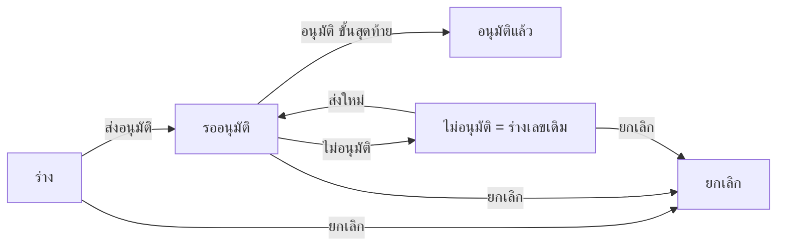

# BRD: สรุปผลการเคลียร์สินค้า Slow move (Slow Moving Stock Clearance Summary)

| Field | Value |
|---|---|
| BRD ID | BRD-WHS-SMC-001 |
| Feature | F-TMP-003 (รหัสชั่วคราว) สรุปผลการเคลียร์สินค้า Slow move |
| BRD Type | New Feature (แบบ 2 · ดึงข้อมูลเดิม) |
| Version | 1.0 |
| Status | **APPROVED (Prebrief Mode · Lane)** — DEC แทน Scope Lock จนมีใบเซ็นลูกค้า |
| Module | Inventory / Warehouse (Core Cube · Operation) |
| Customer | แบบฟอร์มลูกค้า FM-WHS-09 Rev.00 : 01/07/2569 (แผนกคลังสินค้า) |
| Request | REQ-TMP-003 (ชั่วคราว — รอเลขจริงจาก F186) |
| Input | PREBRIEF_REQ-TMP-003_v2 · FORM_SPEC.json (12 ช่อง · ERROR 0) · DECISIONS.lock (15 DEC · พร้อมเริ่มทำ) · feature.html (audit FAIL 0 · smoke 44/44 · [NO-BROWSER] e2e ยังไม่รัน) |
| Created / Updated | 2026-10-10 |

## Changelog
- v1.0 (2026-10-10): สร้างผ่าน brd-generator-full Prebrief Mode (doc-master-pipeline ขั้น 7 · โหมดไม่เฝ้า)

---

## 1. Business Context
### 1.1 ปัญหา / โอกาส
คลังสินค้าติดตามสินค้าเคลื่อนไหวช้า (Slow move) ด้วยกระดาษ FM-WHS-09 (ตาราง 23 แถว/เดือน) — รหัส/ชื่อสินค้าพิมพ์เองเสี่ยงผิด · ไม่รู้ว่ารายการไหนยังเคลียร์ไม่ได้ต้องตามต่อเดือนหน้า · สินค้าหมดอายุแล้วไม่มีใครเตือน · ผู้อนุมัติลงนามบนกระดาษ ค้นย้อนหลังยาก
### 1.2 เป้าหมาย
1. ขึ้นแบบฟอร์มเป็นเอกสารในระบบ ช่อง/ตารางตรงกระดาษ 1:1 ลูกค้าจำแบบเดิมได้ (PDF Replica)
2. รหัสสินค้า/รายละเอียดดึงจาก Product Master · แนวทางการเคลียร์เลือกจากค่าตั้ง · ผลการเคลียร์ (วันที่ + จำนวน) ตรวจความถูกต้องทันที
3. ผู้อนุมัติ (ผู้จัดการคลังสินค้า) อนุมัติผ่านสาย DOA กลาง (dynamic) · ไม่อนุมัติ = กลับร่างแก้ได้
### 1.3 ตัวชี้วัด
ไม่มีใน input → **OQ-01** (ห้ามแต่งตัวเลข)
### 1.4 ที่มา
แบบฟอร์มลูกค้า FM-WHS-09 (xlsx · A4 แนวนอน) → FORM_SPEC 12 ช่อง (ระบบ 4 · กรอก 7 · ระบบใส่ 1) · แถวซ้ำ 1 กลุ่ม 23 แถว · ลายเซ็น 2 (ผู้จัดทำ · ผู้อนุมัติ) · gate 10 หมวด = AI-DEFAULT ทั้งหมด (โหมดไม่เฝ้า)

## 2. Scope
### 2.1 In Scope
- รายการใบสรุป (segmented ทั้งหมด/รอฉันอนุมัติ · ค้นหาเลขที่/ผู้จัดทำ/รหัสสินค้า · กรองสถานะ/เดือน · CSV)
- สร้าง/แก้ไข wizard 3 ขั้น: เลือกเดือน → ตารางรายการ (รหัสสินค้า · วันที่ติดตาม · แนวทางการเคลียร์ · วันที่ · จำนวน · วันหมดอายุ · หมายเหตุ) · เพิ่ม/ลบแถว · บันทึกร่าง
- ส่งอนุมัติ DOA (เลือกคนต่อขั้น) · อนุมัติ / ไม่อนุมัติ (กลับร่างเลขเดิม) · ยกเลิก (เหตุผลบังคับ)
- แนบไฟล์ (ภาพทำลาย/ใบโอนย้าย/ใบคืนสินค้า) · PDF FM-WHS-09 Replica 2 หน้าทุกสถานะ · เลขที่ SMC จาก ENG-DOC-NUM
### 2.2 Out of Scope
- ตัดสต็อก / สร้าง Stock Adjustment / โอนย้ายจริง (Inventory · Stock Adjustment ยังไม่มีในระบบ · DEC-01/02) · คำนวณสินค้า Slow move อัตโนมัติจากความเคลื่อนไหว (ต้องใช้ Inventory 4.0) · หน้าตั้งค่าแนวทางการเคลียร์ (SlowMoveConfig — เสนอ feature ใหม่ OQ-04) · ช่องคลัง/จำนวนคงเหลือ/หน่วยนับ (กระดาษไม่มี · DEC-15 · OQ-03) · ทำซ้ำเอกสาร (G10 ✗ — prototype มีปุ่มทำซ้ำของ archetype → OQ-06) · ประกาศ
### 2.3 Assumptions
- ข้อมูลผู้จัดทำ/ตำแหน่ง/หน่วยงานมีใน F-EMP-001 / F-ORG-001 · ผู้อนุมัติ = ผู้จัดการคลังสินค้าของหน่วยงานผู้จัดทำ (resolve role-mgr-wh ตามผังองค์กร · OQ-05) · สินค้ามีใน Product Master (F-PRODUCT-MASTER-001 · T_product) · แนวทางการเคลียร์อ่านจาก config ของ feature นี้ (ค่าเริ่มเสนอ: จัดโปรโมชันลดราคา · โอนย้ายไปคลัง/สาขาที่ขายได้ · คืนผู้ขาย · ขายรวมล็อตให้ตัวแทน · ทำลายตามขั้นตอน · อื่น ๆ (ระบุ) — AI-DEFAULT รอลูกค้ายืนยัน)
### 2.4 Scope Lock (ชั่วคราว = DECISIONS.lock · ยังไม่มีใบเซ็น → OQ-02)
| DEC | หมวด | มติ | ที่มา |
|---|---|---|---|
| DEC-01 | G1 | อนุมัติแล้วไม่เปลี่ยนค่าในระบบ (ไม่ตัดสต็อก) | AI-DEFAULT |
| DEC-02 | G1 | ไม่ส่งต่อระบบอื่นรอบนี้ (ประกาศ event ใน FRD ไม่ยิง) | AI-DEFAULT |
| DEC-03 | G2 | DOA dynamic · ค่าเริ่ม 1 ขั้น role-mgr-wh (ผู้อนุมัติ) · ไม่มีวงเงิน | AI-DEFAULT |
| DEC-04 | G3 | แนวทางการเคลียร์อ่านจาก SlowMoveConfig · รหัสสินค้าจาก Product Master · บังคับ รหัส/วันที่ติดตาม/แนวทาง · วันที่+จำนวนคู่กัน จำนวน>0 · วันที่เคลียร์ไม่ก่อนวันที่ติดตาม · ห้ามวันอนาคต (ติดตาม/เคลียร์) · หมดอายุแล้ว/สินค้าซ้ำ = เตือน · 1 ใบ/เดือน ≥1 แถว | AI-DEFAULT |
| DEC-05 | G4 | ไม่จำกัดแถว · PDF ≥23 แถวตามกระดาษ | AI-DEFAULT |
| DEC-06 | G5 | ช่อง 1:1 ไม่เพิ่มช่อง | AI-DEFAULT |
| DEC-07 | G6 | ลายเซ็นแถวล่าง 1 ช่อง/ขั้น DOA · ข้อความ "ส่ง/พิจารณาในระบบ" | AI-DEFAULT |
| DEC-08 | G7 | ไม่อนุมัติ = กลับร่างเลขเดิม · ยกเลิก: เจ้าของ + admin · ร่าง/รออนุมัติ · เหตุผลบังคับ | AI-DEFAULT |
| DEC-09 | G8 | เจ้าของ · ผู้อนุมัติเห็นหลังส่ง · admin (role-mgr-wh) เห็นทั้งหมด | AI-DEFAULT |
| DEC-10 | G9 | ออกเลขตอนบันทึกครั้งแรก · รหัส SMC | AI-DEFAULT |
| DEC-11 | G10 | แนบไฟล์ ✓ · CSV ✓ · ทำซ้ำ ✗ · ประกาศ ✗ | AI-DEFAULT |
| DEC-12 | VALID | ยึดหัวตารางแถว 5 (มีเส้น) · ไม่ใช้หัวร่างแถว 4 (วันผลิต) | FORM_SPEC |
| DEC-13 | VALID | วันที่+จำนวนคู่กัน (>0) · วันที่เคลียร์ไม่ก่อนวันที่ติดตาม · ไม่อนาคต (บล็อก) | FORM_SPEC |
| DEC-14 | VALID | วันหมดอายุผ่านแล้ว ณ วันที่ติดตาม → เตือน (ไม่บล็อก) | FORM_SPEC |
| DEC-15 | VALID | ไม่มีช่องคลัง/คงเหลือ/หน่วย — คง 1:1 · เสนอลูกค้ายืนยัน | FORM_SPEC |

## 3. Roles & Permissions (COSO)
| Role | COSO | ทำอะไร |
|---|---|---|
| ผู้จัดทำ (เจ้าหน้าที่คลังสินค้า) | Maker | สร้าง/แก้ไขใบของตน · ส่ง · ยกเลิกของตัวเอง (ร่าง/รออนุมัติ/ไม่อนุมัติ) |
| role-mgr-wh (ผู้อนุมัติ · ผู้จัดการคลังสินค้าของหน่วยงาน) | Approver | ขั้น 1 อนุมัติ / ไม่อนุมัติ |
| role-mgr-wh ระดับฝ่าย (admin role ของหน่วยงานเจ้าของเอกสาร) | Admin view | เห็นทั้งหมด · ยกเลิกได้ · CSV |

| Action | Maker | Approver | Admin |
|---|:-:|:-:|:-:|
| ดูใบ | ของตน | หลังส่ง (อยู่ในสาย) | ทั้งหมด |
| สร้าง/แก้ไข | ✓ ของตน (ร่าง/ไม่อนุมัติ) | – | – |
| ตัดสินขั้น | – | ขั้นของตน | ขั้นของตน (ถ้า DOA ตั้งเพิ่ม) |
| ยกเลิก | ✓ ของตน | – | ✓ |
SoD: ผู้จัดทำพิจารณาใบตัวเองไม่ได้ (BR-DOA-04)

## 4. User Journey
### 4.1 Happy Path
1. ต้นเดือน/ระหว่างเดือน ผู้จัดทำ: สร้าง → เลือกเดือน (ค่าเริ่ม = เดือนนี้) → เพิ่มสินค้า Slow move (เลือกรหัส · วันที่ติดตาม · แนวทาง) → บันทึกร่าง (ได้เลข SMC)
2. เมื่อเคลียร์ได้: เปิดใบ → แก้ไข → กรอก วันที่ + จำนวน ที่เคลียร์ · หมายเหตุ → บันทึกร่าง
3. สิ้นเดือน: ส่งอนุมัติ → ผู้จัดการคลังสินค้า "อนุมัติ" → ปิดใบ · PDF เก็บสำเนา (approved_final)
### 4.2 Alternative
- ผู้อนุมัติ "ไม่อนุมัติ" (เหตุผลบังคับ) → ร่างเลขเดิม + แถบเหตุผล → ผู้จัดทำแก้ ส่งใหม่ (resolve สายใหม่)
- แถวที่ยังเคลียร์ไม่ได้ → เว้นวันที่/จำนวนว่าง · ทำซ้ำใบไปเดือนถัดไป (ยกเฉพาะแถวที่ยังเคลียร์ไม่ได้ — ถ้าลูกค้ายืนยัน OQ-06)
- สินค้าหมดอายุแล้ว ณ วันที่ติดตาม → เตือนในแถว + การ์ดสรุป (ไม่บล็อก)
- ยกเลิก (ร่าง/รออนุมัติ/ไม่อนุมัติ) โดยเจ้าของหรือ admin

## 5. Data (จาก FORM_SPEC — ป้ายตามกระดาษ)
### 5.1 slow_move_clearance (header)
| ช่องบนกระดาษ | field | ชนิด | ที่มา | บังคับ |
|---|---|---|---|:-:|
| (เลขที่ — ระบบเพิ่มใน footer) | doc_no | text | auto ENG-DOC-NUM | ✓ |
| หัวกระดาษ ชื่อบริษัท/ที่อยู่/โลโก้ | header_snapshot | jsonb | system F-ORG-001 (snapshot ตอนออกเลข) | ✓ |
| ประจำเดือน | clearance_month | yyyy-mm | user (ไม่เกินเดือนปัจจุบัน) | ✓ |
| ผู้จัดทำ (ลงชื่อ) | preparer_id + name/position/dept snapshot | ref | system F-EMP-001 | ✓ |
| ผู้อนุมัติ (ลงชื่อ) | approval_chain | jsonb | DOA | ✓ เมื่อส่ง |
| + DOA fields | approval_status · doa_ref · approver_role · approved_by · approved_at | | DOA | |
| + returned_reason · returned_by · returned_at | | | DEC-08 | |
### 5.2 slow_move_clearance_item (แถว 1..n)
| ช่องบนกระดาษ | field | ชนิด | หมายเหตุ |
|---|---|---|---|
| ลำดับ | seq | smallint | auto |
| รหัสสินค้า | product_code | ref T_product | active เท่านั้น |
| รายละเอียด | product_name_snapshot | text | ดึงจาก Product Master (แก้ไม่ได้) |
| วันที่ติดตาม | follow_up_date | date | ≤ วันนี้ |
| แนวทางการเคลียร์ | clearance_method_code + clearance_method_note | ref SlowMoveConfig + text | "อื่น ๆ" ต้องระบุ |
| วันที่ | cleared_date | date | ผลการเคลียร์ · ≥ follow_up_date · ≤ วันนี้ |
| จำนวน | cleared_qty | numeric(18,3) | > 0 · คู่กับ cleared_date |
| วันหมดอายุ | expiry_date | date | อนาคตได้ · ผ่านแล้ว = เตือน |
| หมายเหตุ | remark | text | |
### 5.3 attachments → Document Center (ระดับใบ)

## 6. User Stories
| ID | Story | AC หลัก |
|---|---|---|
| S-01 | ผู้จัดทำสร้างใบสรุปของเดือน | ต้องเลือกเดือน · ≥1 แถว · บันทึกได้เลข SMC |
| S-02 | ผู้จัดทำบันทึกสินค้าที่ติดตาม | เลือกรหัสจาก Product Master → รายละเอียดขึ้นเอง · วันที่ติดตาม + แนวทาง บังคับ |
| S-03 | ผู้จัดทำบันทึกผลการเคลียร์ | วันที่ + จำนวนคู่กัน · จำนวน>0 · ไม่ก่อนวันที่ติดตาม · ไม่อนาคต |
| S-04 | ผู้จัดทำเห็นสินค้าหมดอายุ/ซ้ำ | เตือนในแถว + การ์ดสรุป "หมดอายุแล้ว n รายการ" (ไม่บล็อก) |
| S-05 | ผู้จัดทำส่งอนุมัติ | slot ตามจำนวนขั้น DOA · ค่าเริ่มจาก resolve · ตัวเองไม่อยู่ในรายชื่อ |
| S-06 | ผู้อนุมัติอนุมัติ | ปุ่มเฉพาะผู้พิจารณาขั้นปัจจุบัน · เรียงขั้น · ครบ = อนุมัติแล้ว ล็อกแก้ไข |
| S-07 | ผู้อนุมัติไม่อนุมัติ | เหตุผลบังคับ → ร่างเลขเดิม · ผู้จัดทำเห็นเหตุผล |
| S-08 | พิมพ์/ดาวน์โหลด PDF FM-WHS-09 | 2 หน้าทุกสถานะ · ตาราง 23 แถว + ใบต่อ · ลายเซ็น = ผู้จัดทำ + 1 ช่อง/ขั้น DOA |
| S-09 | ยกเลิกเอกสาร | เจ้าของ/admin · ร่าง/รออนุมัติ/ไม่อนุมัติ · เหตุผลบังคับ |
| S-10 | admin ดูทุกใบ + CSV | กรองสถานะ/เดือน |

## 7. Status & Lifecycle
| จาก | Action | ไป | ใคร |
|---|---|---|---|
| — | บันทึกครั้งแรก | draft | Maker |
| draft / returned | แก้ไข | (เดิม) | Maker |
| draft / returned | ส่ง | pending (ขั้น 1) | Maker |
| pending | อนุมัติ ขั้น n<N | pending (ขั้น n+1) | ผู้พิจารณาขั้น n |
| pending | อนุมัติ ขั้น N | approved | ขั้น N |
| pending | ไม่อนุมัติ | returned (= ร่าง เลขเดิม) | ผู้พิจารณาขั้นปัจจุบัน |
| draft / pending / returned | ยกเลิก | cancelled | Maker / Admin |
approved = ล็อกแก้ไข ยกเลิกไม่ได้

## 8. Business Rules + Validation
| ID | Rule | Tag | Type |
|---|---|:-:|---|
| BR-01 | แนวทางการเคลียร์อ่านจาก SlowMoveConfig.clearance_methods (ตัวเลือก + ระบุเพิ่มเติม) · snapshot ข้อความลงแถว | CONFIGURABLE | Master (DEC-04) |
| BR-02 | รหัสสินค้าเลือกจาก Product Master (active) · รายละเอียด = product_name snapshot แก้ไม่ได้ | FIXED | Master (DEC-04) |
| BR-03 | แต่ละแถวบังคับ รหัสสินค้า · วันที่ติดตาม · แนวทาง ("อื่น ๆ" ต้องระบุ) · ≥1 แถว | FIXED [AI-DEFAULT] | DEC-04 |
| BR-04 | วันที่ (เคลียร์) กับ จำนวน กรอกคู่กัน · จำนวน > 0 · วันที่เคลียร์ ≥ วันที่ติดตาม · วันที่ติดตาม/เคลียร์ ≤ วันนี้ | FIXED | DEC-13 (VALID) |
| BR-05 | วันหมดอายุ ≤ วันที่ติดตาม → เตือน (ไม่บล็อก) | FIXED | DEC-14 (VALID) |
| BR-06 | รหัสสินค้าซ้ำในใบเดียวกัน → เตือน (อาจคนละ lot · ไม่บล็อก) | FIXED [AI-DEFAULT] | DEC-04 |
| BR-07 | 1 ใบ = ผู้จัดทำ × เดือน (ไม่บังคับไม่ซ้ำรอบนี้ — ไม่มีช่องคลัง) | FIXED [AI-DEFAULT] | DEC-04 · DEC-15 |
| BR-08 | สายอนุมัติ resolve จาก DOA ตอนส่ง แล้ว freeze | FIXED | DOA (BR-DOA-02) |
| BR-09 | ไม่อนุมัติ → returned เลขเดิม · resolve ใหม่ตอนส่งรอบถัดไป | FIXED | DEC-08 |
| BR-10 | ออกเลขตอนบันทึกครั้งแรก · no-gap ✗ | CONFIGURABLE | DOCCFG (DEC-10) |
| BR-11 | ร่างเห็นเฉพาะเจ้าของ (+ admin) | FIXED | DEC-09 |
| BR-12 | ช่องลงชื่อ PDF = ผู้จัดทำ + 1 ช่องต่อขั้น DOA (dynamic) · แถวละ ≤4 · คำตัดสินตาม role (role-mgr-wh = อนุมัติ/ไม่อนุมัติ) | FIXED (จำนวน = DOA) | DEC-03 · DEC-07 |
| BR-13 | ช่องตามกระดาษ 1:1 · ไม่ใช้หัวร่างแถว 4 | FIXED [AI-DEFAULT] | DEC-06 · DEC-12 |
| BR-14 | อนุมัติแล้วไม่ตัดสต็อก/ไม่สร้างเอกสารต่อ (ประกาศ event `smc.approved` ไม่ยิง) | FIXED [AI-DEFAULT] | DEC-01 · DEC-02 |

| VR | ช่อง | เงื่อนไข | ข้อความ |
|---|---|---|---|
| VR-01 | clearance_month | required · ≤ เดือนปัจจุบัน | เลือกเดือน |
| VR-02 | items | ≥1 แถว | บันทึกสินค้าอย่างน้อย 1 รายการ |
| VR-03 | product_code | required · active | เลือกสินค้า / สินค้านี้ปิดใช้งานแล้ว |
| VR-04 | follow_up_date | required · ≤ วันนี้ | ระบุวันที่ติดตาม / วันที่ติดตามเป็นวันในอนาคตไม่ได้ |
| VR-05 | clearance_method | required · "อื่น ๆ" ต้องมี note | เลือกแนวทางการเคลียร์ / ระบุแนวทางการเคลียร์ |
| VR-06 | cleared_date · cleared_qty | คู่กัน · qty>0 · date ≥ follow_up · ≤ วันนี้ | กรอกจำนวนคู่กับวันที่ / ระบุวันที่คู่กับจำนวน / จำนวนต้องมากกว่า 0 / วันที่ต้องไม่ก่อนวันที่ติดตาม |
| VR-07 | slot ผู้พิจารณา | ครบทุกขั้น · ≠ ผู้จัดทำ | กรุณาเลือกผู้พิจารณา |
| VR-08 | เหตุผล ไม่อนุมัติ/ยกเลิก | required | กรุณาระบุเหตุผล |

### 8.5 ระดับความยืดหยุ่น
BR-01 → หน้าตั้งค่าแนวทางการเคลียร์ (เสนอ feature ใหม่ · OQ-04) · BR-10 → F-DOCCFG · BR-12 → DOA กลาง

## 9. Edge Cases
| EC | กรณี | ผล |
|---|---|---|
| EC-01 | แถวว่างทั้งแถว | ตัดทิ้งตอนบันทึก (ถ้ามีแถวอื่น) |
| EC-02 | ยังเคลียร์ไม่ได้ | เว้นวันที่/จำนวน · นับ "ค้าง" ในสรุป |
| EC-03 | สินค้าหมดอายุแล้ว | เตือนในแถว + แถบในหน้าดู |
| EC-04 | รหัสซ้ำในใบ | เตือน (คนละ lot) |
| EC-05 | สินค้าถูกปิดใช้หลังบันทึก | แถวเดิมคง snapshot · แก้แถวต้องเลือกสินค้าที่ active |
| EC-06 | ผู้จัดทำเป็นผู้จัดการคลังเอง | resolve ไปผู้จัดการฝ่าย · ตัวเองไม่อยู่ในรายชื่อ |
| EC-07 | แก้ DOA ระหว่างรออนุมัติ | ใช้สาย snapshot |
| EC-08 | ส่ง/ตัดสินชนกัน (stale) | 409 → toast รีเฟรช |
| EC-09 | แบบเอกสารปิดใช้ (F-DOCCFG) | ปุ่มสร้าง disabled + แถบแดง |
| EC-10 | แถวเกิน 53 (23 + 30) | PDF หน้า 2 ล้น → OQ-08 (แยกใบต่อ/เพิ่มหน้า) |

## 10. Value Stream & Downstream Impact
Positioning: Warehouse Operation — ติดตามสินค้าคงคลังเคลื่อนไหวช้า (**feature นี้**) → [ปรับปรุงสต็อก / โอนย้าย / คืนผู้ขาย — ปิดรอบนี้]
| ปลายทาง | ข้อมูล | Trigger | หมายเหตุ |
|---|---|---|---|
| Stock Adjustment / Stock Transfer / Purchase Return | จำนวนที่เคลียร์ตามแนวทาง | approved | **ปิดรอบนี้ (DEC-01/02)** — ประกาศ event `smc.approved` ไม่ยิง |
| F-DOCCFG / ENG-DOC-STORE | PDF snapshot | approved_final | |
| รายงาน | มูลค่า/จำนวนที่เคลียร์ต่อแนวทาง · รายการค้างเกิน N เดือน | — | Report area อ่าน |

## 11. Delivery
Phase 1 = §2.1 ทั้งหมด · Phase 2 (เสนอ) = ช่องคลัง/คงเหลือ/หน่วย · ผูก Stock Adjustment/Transfer/Return · คำนวณรายการ Slow move อัตโนมัติจาก Inventory · หน้าตั้งค่าแนวทาง

## 12. Dev Summary "ใบสั่ง"
- Config: SlowMoveConfig.clearance_methods (ค่าเริ่มเสนอ 6 แนวทาง) · DOA entry F-TMP-003 (role-mgr-wh) · doc_type SMC
- Declaration: DOA_BRIEF · NTF_BRIEF (smc_cancelled) · DOCCFG_BRIEF · MDOC_BRIEF
- Screen Inventory: P-01 รายการ · P-02 สร้าง/แก้ไข (drawer wide 3 ขั้น) · P-03 ดู (drawer 4 แท็บ) · M-01..05 ส่ง/อนุมัติ/ไม่อนุมัติ/ยกเลิก/ทิ้งข้อมูล
- UI Signals: เอกสาร + พิมพ์ + ลายเซ็น = ใช่ · Q-form · แถวรายการเป็นตาราง

## 13. Open Questions
| OQ | คำถาม | เจ้าของ | Block? |
|---|---|---|---|
| OQ-01 | ตัวชี้วัด (% เคลียร์ได้ต่อเดือน · อายุค้างเฉลี่ย) | ลูกค้า | ไม่ |
| OQ-02 | ลูกค้าเซ็นยืนยัน DEC-01..11 (AI-DEFAULT) — โดยเฉพาะ ผู้อนุมัติ = ผู้จัดการคลังสินค้า · แนวทาง 6 แบบ · ไม่ตัดสต็อก | Strike → ลูกค้า | ก่อน UAT |
| OQ-03 | เพิ่มช่องคลัง/สาขา · จำนวนคงเหลือก่อนเคลียร์ · หน่วยนับ · วันผลิต (หัวร่างแถว 4) ไหม (DEC-12/15) | ลูกค้า | ไม่ (Phase 2) |
| OQ-04 | SlowMoveConfig อยู่ที่ไหน (feature ใหม่ใน Inventory Configuration?) | พี่เบิร์ด | ก่อน dev |
| OQ-05 | role-mgr-wh resolve ตามหน่วยงานผู้จัดทำได้ไหม (relative) · admin role ระดับฝ่าย | Strike + พี่เบิร์ด | ก่อน wire |
| OQ-06 | ปุ่ม "ทำซ้ำ" ใน prototype (ยกแถวที่ยังเคลียร์ไม่ได้ไปเดือนถัดไป) ขัด G10 ทำซ้ำ ✗ — เก็บหรือซ่อน | Strike → ลูกค้า | ไม่ |
| OQ-07 | function_code taxonomy ของ SMC (ใช้ F01 ชั่วคราว) · ได้รหัส feature จริง | Strike | ก่อน register |
| OQ-08 | แถวเกิน 53 ต่อใบ — แบบพิมพ์ต้องเพิ่มหน้า/แยกใบไหม (thai-doc R10 ออกแบบ 2 หน้า) | Strike | ไม่ |

## 14. Security & Compliance
Preset: Standard Operation · PII: ชื่อผู้จัดทำ/ผู้อนุมัติ (snapshot) — ข้อมูลตัวอย่าง prototype เป็นชื่อสมมติ/สินค้าสมมติ · Audit append-only ทุก action · SoD ผู้จัดทำ≠ผู้อนุมัติ · ไฟล์แนบตาม file_policy Document Center

## 15. Health Check / Monitoring
SLA: ไม่กำหนดรอบนี้ (→ OQ-01) · KPI เสนอ: ใบที่ยังไม่ส่งหลังสิ้นเดือน · รายการค้างไม่เคลียร์ต่อเนื่อง · สินค้าหมดอายุแล้วต่อเดือน

## 16. AI Review (C01–C23 · PE01–PE05)
C01 ✅ · C02 ✅ · C05 ✅ story ละ 1 การกระทำ · C10 ✅ ทุก BR มี Tag · C13 ✅ EC 10 · C18 ✅ WARNING → OQ · C19 ✅ §12 · C20 ✅ DEC ครบ 15 + OQ-02 รอใบเซ็น · C21 ✅ §10 · C22 ⚠️→OQ-01 (ไม่มีตัวชี้วัดใน input — ห้ามแต่ง) · C23 ✅ · PE01–PE05 ✅ · **สถานะ: APPROVED (Prebrief Mode)**

## Appendix — Screen List
P-01 `#/slow-move` · P-02 `#/slow-move/create` · `/edit/:id` · P-03 `#/slow-move/view/:id`
