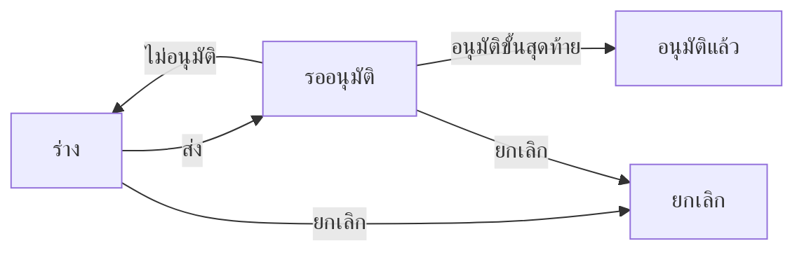

# BRD: หัวข้อการประเมินความพึงพอใจ สำหรับ General Trade (GT Customer Satisfaction Summary)

| Field | Value |
|---|---|
| BRD ID | BRD-SAL-CSM-001 |
| Feature | F-TMP-002 (รหัสชั่วคราว) หัวข้อการประเมินความพึงพอใจ สำหรับ General Trade — doc code CSM |
| BRD Type | New Feature (แบบ 2 · ดึงข้อมูลเดิม: Customer · Sale Order · Employee) |
| Version | 1.0 |
| Status | **APPROVED (Prebrief Mode · Lane · unattended)** — DEC แทน Scope Lock จนมีใบเซ็นลูกค้า · มติ AI-DEFAULT ทุกข้อ |
| Module | Sales (Core Cube · Customer/CRM) |
| Customer | แบบฟอร์มลูกค้า FM-SAL-11 Rev.00: 01/07/2569 (ฝ่ายขาย) |
| Request | REQ-TMP-002 (ชั่วคราว — รอเลขจริงจาก F186) |
| Input | PREBRIEF_REQ-TMP-002_v2 · FORM_SPEC.json (47 ช่อง) · DECISIONS.lock (20 DEC · พร้อมเริ่มทำ · AI-DEFAULT 14) · feature.html (audit FAIL 0 · self_audit PASS · e2e ยังไม่รัน — NO-BROWSER) |
| Created / Updated | 2026-10-10 |

## Changelog
- v1.0 (2026-10-10): สร้างผ่าน brd-generator-full v2.3 Prebrief Mode (doc-master-pipeline ขั้น 7 · โหมดไม่เฝ้า)

---

## 1. Business Context
### 1.1 ปัญหา / โอกาส
ฝ่ายขายสรุปผลแบบสำรวจความพึงพอใจลูกค้า General Trade (แบบสำรวจ FM-SAL-10) ด้วยไฟล์ Excel FM-SAL-11 ทุกเดือน — ไฟล์ต้นฉบับมีสูตรรวมไม่ครบ (แถว "รวม" ขาดบางคอลัมน์) · คอลัมน์ % ว่างไม่มีสูตร · ข้อความสรุป "โดยรวม 85.83 %" พิมพ์ตายตัวไม่ผูกกับตาราง · ชีตยังชื่อ FM-SAL-10 · รายชื่อลูกค้าที่ประเมินกรอกมือโดยไม่ตรวจเกณฑ์สั่งซื้อ ≥ 3 ครั้ง/เดือน · ลงนาม Sales Manager + ผู้อำนวยการสายงานการขายบนกระดาษ
### 1.2 เป้าหมาย
1. ขึ้นแบบสรุปเป็นเอกสารในระบบ ช่องตรงกระดาษ 1:1 · PDF Replica ที่ลูกค้าจำแบบเดิมได้ (2 หน้า)
2. ระบบคำนวณ รวมต่อข้อ · รวมต่อคอลัมน์ · % ต่อด้าน · % โดยรวม · ข้อความแปลผล ให้เอง — ไม่มีตัวเลขตายตัว
3. ดึงรายชื่อลูกค้าและจำนวนการสั่งซื้อจาก Customer / Sale Order · เตือนเมื่อต่ำกว่าเกณฑ์
4. สายรับรองจาก DOA กลาง (dynamic) แทนการส่งกระดาษ
### 1.3 ตัวชี้วัด
ไม่มีใน input → **OQ-01** (ห้ามแต่งตัวเลข)
### 1.4 ที่มา
แบบฟอร์มลูกค้า FM-SAL-11 (xlsx 1 ชีต) → FORM_SPEC 47 ช่อง (กรอก 16 · คำนวณ 26 · ระบบใส่ 3 · ดึงจากระบบ 2) · gate 10 หมวดตอบโดย AI ตาม unattended-policy (AI-DEFAULT ทั้งหมด รวม G1)

## 2. Scope
### 2.1 In Scope
- รายการแบบสรุป (ค้นหา · กรอง สถานะ/เดือน · CSV) · สร้าง/แก้ร่าง wizard 3 ขั้น · ดูรายละเอียด 4 แท็บ (รายละเอียด › PDF › ลายเซ็น/อนุมัติ › ประวัติ)
- ตารางคะแนน 3 ด้าน 16 หัวข้อ (หัวข้อจาก config) · จำนวนลูกค้าต่อระดับ 5 ระดับ · คำนวณ รวม/%/โดยรวม/แปลผล
- รายชื่อลูกค้าที่ประเมิน (เลือกจาก Customer · จำนวนการสั่งซื้อจาก Sale Order · ปุ่มดึงลูกค้าถึงเกณฑ์)
- ส่งอนุมัติ DOA (ค่าเริ่ม 1 ขั้น ผู้อำนวยการสายงานการขาย · เลือกคนต่อขั้น) · อนุมัติ / ไม่อนุมัติ→กลับร่าง · ยกเลิก (เหตุผลบังคับ)
- แนบไฟล์ · PDF FM-SAL-11 Replica 2 หน้าทุกสถานะ · เลขที่ CSM จาก ENG-DOC-NUM
### 2.2 Out of Scope
- แบบสำรวจรายลูกค้า FM-SAL-10 (ทำแยก — J001) และการดึงคะแนนจากแบบสำรวจอัตโนมัติ → ผู้ใช้กรอกจำนวนเอง (DEC-01/02 · OQ-05) · เปลี่ยนค่าในระบบ/ส่งต่อระบบอื่น · ทำซ้ำเอกสาร · ประกาศ · กันสร้างซ้ำเดือนเดียวกัน (OQ-06)
### 2.3 Assumptions
- Customer (GT) · Sale Order · Employee มีในระบบ (Sales module · F-EMP-001) · SalesConfig สำหรับหัวข้อ/ระดับคะแนน/ช่วงแปลผล/เกณฑ์สั่งซื้อ ยังไม่มี → เพิ่มใน Sales Configuration (OQ-04)
### 2.4 Scope Lock (ชั่วคราว = DECISIONS.lock · ยังไม่มีใบเซ็น → OQ-02)
| DEC | หมวด | มติ | ที่มา |
|---|---|---|---|
| DEC-01 | G1 | อนุมัติแล้วไม่เปลี่ยนค่าในระบบ | AI-DEFAULT |
| DEC-02 | G1 | ไม่ส่งต่อระบบอื่นรอบนี้ (ประกาศ event ใน FRD ไม่ยิง) | AI-DEFAULT |
| DEC-03 | G2 | DOA dynamic · ค่าเริ่ม 1 ขั้น role-mgr-bu (ป้าย "ผู้อำนวยการสายงานการขาย") · ไม่มีวงเงิน | AI-DEFAULT |
| DEC-04 | G3 | ค่าคงที่จาก SalesConfig (เกณฑ์ 3 ครั้ง · ช่วง 80/60 · ระดับ 5–1 · หัวข้อ 16 ข้อ) · คำนวณอัตโนมัติ · จำนวนต้องเป็นจำนวนเต็ม ≥ 0 (บล็อก) · % CSAT ถ่วงน้ำหนัก · สั่งซื้อต่ำกว่าเกณฑ์ = เตือน · ส่งได้เมื่อมีคำตอบ ≥ 1 ด้าน + ลูกค้า ≥ 1 | AI-DEFAULT |
| DEC-05 | G4 | ตารางด้านคุณภาพ: แถว = หัวข้อใน config (PDF ≥ 4 ตามกระดาษ) | AI-DEFAULT |
| DEC-06 | G4 | ตารางด้านส่งมอบ: แถว = หัวข้อใน config (PDF ≥ 4) | AI-DEFAULT |
| DEC-07 | G4 | ตารางด้านเจ้าหน้าที่: แถว = หัวข้อใน config (PDF ≥ 8) | AI-DEFAULT |
| DEC-08 | G4 | รายชื่อลูกค้าไม่จำกัด · PDF ≥ 14 แถว | AI-DEFAULT |
| DEC-09 | G5 | ช่องตรงกระดาษ 1:1 · ไม่เพิ่มช่อง | AI-DEFAULT |
| DEC-10 | G6 | ลายเซ็นแถวล่าง 1 ช่อง/ขั้น DOA · ข้อความ "ส่ง/พิจารณาในระบบ" ไม่ใช้ภาพ | AI-DEFAULT |
| DEC-11 | G7 | ไม่อนุมัติ = กลับเป็นร่าง (เลขเดิม) · ยกเลิก: เจ้าของ + admin · ร่าง/รออนุมัติ · เหตุผลบังคับ | AI-DEFAULT |
| DEC-12 | G8 | เจ้าของ · ผู้อนุมัติเห็นหลังส่ง · Sales admin เห็นทั้งหมด | AI-DEFAULT |
| DEC-13 | G9 | ออกเลขตอนบันทึกครั้งแรก · รหัส CSM | AI-DEFAULT |
| DEC-14 | G10 | แนบไฟล์ ✓ · CSV ✓ · ทำซ้ำ ✗ · ประกาศ ✗ | AI-DEFAULT |
| DEC-15 | VALID | ใช้รหัสฟอร์ม FM-SAL-11 ตาม footer (ชีตชื่อ FM-SAL-10) | FORM_SPEC |
| DEC-16 | VALID | แถว "รวม" ครบ 5 คอลัมน์ทุกด้าน | FORM_SPEC |
| DEC-17 | VALID | แถว "รวม" ด้านส่งมอบครบ 5 คอลัมน์ | FORM_SPEC |
| DEC-18 | VALID | % = คะแนนถ่วงน้ำหนัก ÷ (5 × รวม) × 100 · รวม = 0 ไม่คำนวณ | FORM_SPEC |
| DEC-19 | VALID | % โดยรวม + ข้อความแปลผลคำนวณอัตโนมัติ (แทน 85.83 ตายตัว) | FORM_SPEC |
| DEC-20 | VALID | จำนวนการสั่งซื้อ < เกณฑ์ → เตือน ไม่บล็อก | FORM_SPEC |

## 3. Roles & Permissions (COSO)
| Role | COSO | ทำอะไร |
|---|---|---|
| Sales Manager (ผู้จัดทำ · role-mgr-sales) | Maker | สร้าง/แก้ร่าง · ส่ง · ยกเลิกของตัวเอง (ร่าง/รออนุมัติ) |
| ผู้อำนวยการสายงานการขาย (role-mgr-bu ชั่วคราว — OQ-03) | Approver | ขั้น DOA 1 อนุมัติ/ไม่อนุมัติ |
| Sales admin (ผู้ดูแลเอกสารฝ่ายขาย) | Monitor | เห็นทั้งหมด · ยกเลิกได้ · ส่งออก CSV |

| Action | Maker | Approver | Sales admin |
|---|:-:|:-:|:-:|
| ดูใบ | ของตน | หลังส่ง (อยู่ในสาย) | ทั้งหมด |
| สร้าง/แก้ร่าง | ✓ ของตน | – | – |
| ตัดสินขั้น | – | ขั้นของตน | – |
| ยกเลิก | ✓ ของตน (ร่าง/รอ) | – | ✓ (ร่าง/รอ) |
SoD: ผู้จัดทำพิจารณาใบตัวเองไม่ได้ (BR-DOA-04)

## 4. User Journey
### 4.1 Happy Path
1. Sales Manager: สร้าง → เลือกเดือน → กรอกจำนวนลูกค้าต่อระดับ 16 ข้อ (ระบบคำนวณรวม/% สด) → ดึงลูกค้าที่สั่งซื้อถึงเกณฑ์ (หรือเลือกเอง) → แนบไฟล์ (ถ้ามี) → บันทึก (ได้เลข CSM) → ส่ง เลือกผู้รับรอง
2. ผู้อำนวยการสายงานการขาย อนุมัติ → **อนุมัติแล้ว** · PDF เก็บสำเนา (approved_final) · ถ้า % โดยรวม < 60 → แจ้งฝ่ายขาย (csm_low_csat)
### 4.2 Alternative
- ไม่อนุมัติ → กลับร่างเลขเดิม + เหตุผล → ผู้จัดทำแก้ ส่งใหม่ (resolve สายใหม่)
- ลูกค้าในรายชื่อสั่งซื้อต่ำกว่าเกณฑ์ → เตือนในฟอร์ม/หน้าตรวจสอบ · ส่งได้
- ยกเลิก (ร่าง/รออนุมัติ) โดยเจ้าของหรือ Sales admin

## 5. Data (จาก FORM_SPEC — ป้ายตามกระดาษ)
### 5.1 csat_summary (header)
| ช่องบนกระดาษ | field | ชนิด | ที่มา | บังคับ |
|---|---|---|---|:-:|
| (เลขที่ — footer ระบบ) | doc_no | text | auto ENG-DOC-NUM | ✓ |
| ประจำเดือน | period_month | YYYY-MM | user | ✓ |
| (ผู้จัดทำ — ลงชื่อ Sales Manager) | preparer_id → snapshot name/position/unit | ref | system F-EMP-001 | ✓ |
| รวม (ต่อด้าน × 5 ระดับ + ทั้งหมด) | — | int | computed (ไม่เก็บ หรือเก็บ snapshot ตอนอนุมัติ) | — |
| % (ต่อด้าน) | — | decimal(5,2) | computed | — |
| สรุปผลการประเมิน - โดยรวม … % | overall_pct (snapshot ตอนอนุมัติ) | decimal(5,2) | computed | — |
| ข้อความแปลผล | overall_level (snapshot) | text | computed จาก SalesConfig.csat_bands | — |
| + DOA fields | approval_status · doa_entry_ref · approval_chain(jsonb) · approver_role · approved_by · approved_at | | DOA | |
| + returned_reason · returned_by · returned_at | | | DEC-11 | |
### 5.2 csat_summary_line (16 แถว = หัวข้อใน config ต่อเอกสาร)
| section_key (q/d/s) · topic_id + topic_text snapshot (auto) | c5 มากที่สุด · c4 มาก · c3 ปานกลาง · c2 น้อย · c1 ต้องปรับปรุง (user int ≥ 0) | total (computed) |
### 5.3 csat_summary_customer
| customer_id (system Customer · pdpa) | order_count (system COUNT Sale Order ในเดือน · snapshot ตอนส่ง) |
### 5.4 attachments → Document Center (ไฟล์ระดับใบ)

## 6. User Stories
| ID | Story | AC หลัก |
|---|---|---|
| S-01 | Sales Manager สร้างแบบสรุปประจำเดือน | เลือกเดือน บังคับ · บันทึกได้เลข CSM |
| S-02 | Sales Manager กรอกคะแนน 3 ด้าน | 16 หัวข้อจาก config · จำนวนเต็ม ≥ 0 · รวม/% อัปเดตสด · ≥ 1 ด้านมีคำตอบ |
| S-03 | Sales Manager ดูผลสรุปโดยรวม | % โดยรวม + ข้อความแปลผลตามช่วงใน config |
| S-04 | Sales Manager เลือกลูกค้าที่ประเมิน | เลือกจาก Customer · ไม่ซ้ำ · ≥ 1 ราย · แสดงจำนวนสั่งซื้อจาก Sale Order |
| S-05 | Sales Manager ดึงลูกค้าถึงเกณฑ์อัตโนมัติ | ลูกค้าในหน่วยงานที่สั่งซื้อ ≥ เกณฑ์ในเดือนที่เลือก |
| S-06 | Sales Manager ส่งอนุมัติ | slot ต่อขั้นจาก DOA · ผู้จัดทำไม่อยู่ในรายชื่อ · บังคับเลือก |
| S-07 | ผู้อำนวยการสายงานการขายตัดสิน | ปุ่มเฉพาะผู้พิจารณาขั้นปัจจุบัน · ไม่อนุมัติบังคับเหตุผล → กลับร่าง |
| S-08 | ผู้ใช้พิมพ์ PDF FM-SAL-11 | ทุกสถานะ 2 หน้า · ลายเซ็น = ผู้จัดทำ + 1 ช่อง/ขั้น DOA · รายชื่อ ≥ 14 แถว |
| S-09 | เจ้าของหรือ Sales admin ยกเลิก | ร่าง/รออนุมัติ · เหตุผลบังคับ |
| S-10 | Sales admin ดูทุกใบ | เห็นทุกสถานะทุกหน่วยงาน · กรอง/CSV |

## 7. Status & Lifecycle
| จาก | Action | ไป | ใคร |
|---|---|---|---|
| — | บันทึกครั้งแรก | draft | Maker |
| draft | ส่ง | pending (ขั้น 1) | Maker |
| pending | อนุมัติขั้น n<N | pending (ขั้น n+1) | ผู้พิจารณาขั้น n |
| pending | อนุมัติขั้น N | approved | ขั้น N |
| pending | ไม่อนุมัติ | draft (เลขเดิม · returned_*) | ผู้พิจารณาขั้นปัจจุบัน |
| draft / pending | ยกเลิก | cancelled | Maker / Sales admin |
approved = ล็อกแก้ไข (ไม่มียกเลิก)

## 8. Business Rules + Validation
| ID | Rule | Tag | Type |
|---|---|:-:|---|
| BR-01 | รวมต่อแถว = c5+c4+c3+c2+c1 | FIXED | Formula |
| BR-02 | แถว "รวม" = Σ ต่อคอลัมน์ ครบ 5 ระดับ + รวมทั้งหมด | FIXED | Formula (DEC-16/17) |
| BR-03 | % ต่อด้าน = (Σ น้ำหนัก × จำนวน) ÷ (5 × รวม) × 100 · 2 ตำแหน่ง ROUND_HALF_UP · รวม = 0 → "—" | CONFIGURABLE (น้ำหนักจาก csat_scale) | Formula (DEC-04/18) |
| BR-04 | % โดยรวม = Σ คะแนนถ่วงน้ำหนัก 3 ด้าน ÷ (5 × Σ รวม 3 ด้าน) × 100 | CONFIGURABLE | Formula (DEC-19 · AI-DEFAULT ถ่วงตามจำนวนคำตอบ) |
| BR-05 | ข้อความแปลผล ≥ 80 สูง · 60–79.99 ปานกลาง · < 60 อาจไม่พึงพอใจ | CONFIGURABLE | Threshold (SalesConfig.csat_bands) |
| BR-06 | เกณฑ์ลูกค้าที่ประเมิน = สั่งซื้อ ≥ 3 ครั้ง/เดือน — ต่ำกว่า = เตือน | CONFIGURABLE | Threshold (csat_min_orders_per_month · DEC-20) |
| BR-07 | หัวข้อ 16 ข้อ/ระดับ 5 ระดับอ่านจาก config · snapshot ลงเอกสารตอนบันทึก | CONFIGURABLE | Master (csat_topics · csat_scale) |
| BR-08 | สายอนุมัติ resolve จาก DOA ตอนส่ง แล้ว freeze | FIXED | DOA (BR-DOA-02) |
| BR-09 | ไม่อนุมัติ → draft เลขเดิม · resolve ใหม่ตอนส่งรอบถัดไป | FIXED | DEC-11 |
| BR-10 | ออกเลขตอนบันทึกครั้งแรก · no-gap ✗ | CONFIGURABLE | DOCCFG (DEC-13) |
| BR-11 | ร่างเห็นเฉพาะเจ้าของ (+ Sales admin) | FIXED | Visibility #109 (DEC-12) |
| BR-12 | ช่องลงชื่อ PDF = ผู้จัดทำ + 1 ช่องต่อขั้น DOA (dynamic) · แถวละ ≤ 4 | FIXED (จำนวน = DOA) | DEC-03 · DEC-10 |
| BR-13 | อนุมัติขั้นสุดท้ายและ % โดยรวม < ช่วงกลาง → ENG-NOTIFY csm_low_csat | CONFIGURABLE | Notify |

| VR | ช่อง | เงื่อนไข | ข้อความ |
|---|---|---|---|
| VR-01 | ประจำเดือน | required | กรุณาเลือกเดือน |
| VR-02 | จำนวนต่อระดับ | จำนวนเต็ม ≥ 0 (ว่าง = 0) | ใส่เป็นจำนวนเต็ม 0 ขึ้นไป (จำนวนลูกค้า) |
| VR-03 | ตารางคะแนน | Σ ทั้งเอกสาร > 0 | กรอกคะแนนอย่างน้อย 1 ด้าน |
| VR-04 | ลูกค้า | ≥ 1 ราย · ทุกแถวต้องเลือก · ไม่ซ้ำ | เลือกลูกค้า / ลูกค้าซ้ำกับแถวที่ n |
| VR-05 | slot ผู้พิจารณา | ทุกขั้นต้องเลือก · ≠ ผู้จัดทำ | กรุณาเลือกผู้พิจารณา |
| VR-06 | เหตุผล ไม่อนุมัติ/ยกเลิก | required | กรุณาระบุเหตุผล |

### 8.5 ระดับความยืดหยุ่น
BR-03..07 → Sales Configuration (SalesConfig · versioned + มีผลตามวันที่) · BR-10 → F-DOCCFG · BR-12 → DOA กลาง · BR-13 → F-NOTIFY

## 9. Edge Cases
| EC | กรณี | ผล |
|---|---|---|
| EC-01 | ด้านใดไม่มีคำตอบ (รวม 0) | % ด้านนั้น "—" · ไม่นับใน % โดยรวม |
| EC-02 | ทุกด้านว่าง | บล็อกส่ง (VR-03) |
| EC-03 | กรอกจำนวนติดลบ/ทศนิยม/ตัวอักษร | ขอบแดง + บล็อก (VR-02) |
| EC-04 | ลูกค้าสั่งซื้อ < 3 ครั้ง | เตือน ไม่บล็อก |
| EC-05 | รายชื่อลูกค้า > 14 ราย | PDF dense · ยัง 2 หน้า (ทดสอบ 22 แถว) |
| EC-06 | สร้างซ้ำเดือนเดียวกัน | ไม่บล็อกรอบนี้ → OQ-06 |
| EC-07 | แก้ DOA ระหว่างใบรออนุมัติ | ใบเดิมใช้สาย snapshot |
| EC-08 | แก้หัวข้อใน config หลังออกเอกสาร | เอกสารเดิมใช้หัวข้อ snapshot |
| EC-09 | ส่ง/อนุมัติชนกัน (stale) | 409 → toast รีเฟรช สถานะไม่เปลี่ยน |
| EC-10 | แบบเอกสารปิดใช้ (F-DOCCFG) | ปุ่มสร้าง disabled |
| EC-11 | DOA 6 ขั้น | ช่องลงชื่อ 7 ช่อง 2 แถว (4+3) หน้า 2 |

## 10. Value Stream & Downstream Impact
Positioning: Sales / Customer Experience — แบบสำรวจลูกค้า FM-SAL-10 (J001) → **แบบสรุปรายเดือน (feature นี้)** → [รายงาน CSAT / แผนแก้ไข — ปิดรอบนี้]
| ปลายทาง | ข้อมูล | Trigger | หมายเหตุ |
|---|---|---|---|
| รายงาน CSAT ฝ่ายขาย | % ต่อด้าน/โดยรวม รายเดือน | approved | **ปิดรอบนี้ (DEC-02)** — ประกาศ event ใน FRD ไม่ยิง |
| ฝ่ายขาย (แผนแก้ไข) | % โดยรวม < 60 | approved | แจ้งผ่าน ENG-NOTIFY (csm_low_csat) |
| F-DOCCFG / ENG-DOC-STORE | PDF snapshot | approved_final | |

## 11. Delivery
Phase 1 = ทุกอย่างใน §2.1 · Phase 2 (เสนอ) = ดึงจำนวนคะแนนจากแบบสำรวจ FM-SAL-10 อัตโนมัติ + กันสร้างซ้ำเดือนเดียวกัน + รายงานแนวโน้ม CSAT

## 12. Dev Summary "ใบสั่ง"
- Config: SalesConfig.csat_topics[] · csat_scale[] · csat_bands[] · csat_min_orders_per_month · DOA entry F-TMP-002 · doc_type CSM
- Declaration: DOA_BRIEF · NTF_BRIEF · DOCCFG_BRIEF · MDOC_BRIEF (ฉบับจริงหลัง FRD)
- Screen Inventory: P-01 รายการ · P-02 สร้าง/แก้ (drawer wide 3 ขั้น) · P-03 ดู (drawer 4 แท็บ) · M-01..05 modal ส่ง/อนุมัติ/ไม่อนุมัติ/ยกเลิก/ทิ้งข้อมูล
- UI Signals: เอกสาร + พิมพ์ + ลายเซ็น = ใช่ · Q-form

## 13. Open Questions
| OQ | คำถาม | เจ้าของ | Block? |
|---|---|---|---|
| OQ-01 | ตัวชี้วัดความสำเร็จ (เวลาปิดสรุปรายเดือน / % เดือนที่ส่งตรงเวลา) | ลูกค้า | ไม่ |
| OQ-02 | ลูกค้าเซ็นยืนยัน DEC-01..14 (AI-DEFAULT) — โดยเฉพาะสูตร % ถ่วงน้ำหนัก (ต้นฉบับไม่มีสูตร) · % โดยรวมถ่วงตามจำนวนคำตอบ · 1 ขั้นอนุมัติ · กลับร่าง | Strike → ลูกค้า | ก่อน UAT |
| OQ-03 | role "ผู้อำนวยการสายงานการขาย" ไม่มีใน DOA master (ใช้ role-mgr-bu ชั่วคราว) — เพิ่ม role ใหม่หรือยืนยัน role-mgr-bu | Strike + พี่เบิร์ด | ก่อน wire |
| OQ-04 | SalesConfig (หัวข้อ/ระดับ/ช่วง/เกณฑ์) — เพิ่มใน Sales Configuration (feature เจ้าของค่า) | พี่เบิร์ด | ก่อน dev |
| OQ-05 | ผูกกับแบบสำรวจ FM-SAL-10 (J001) เพื่อนับคะแนนอัตโนมัติเมื่อไร | Strike | ไม่ |
| OQ-06 | 1 หน่วยงาน/เดือน มีได้ใบเดียวหรือไม่ (กันซ้ำ) | ลูกค้า | ไม่ |
| OQ-07 | รหัส feature F-TMP-002 / doc code CSM / function_code F01 ชั่วคราว — เทียบ FEATURE_REGISTRY + Taxonomy Master | Strike | ก่อน register |

## 14. Security & Compliance
Preset: Standard Sales · PII: ชื่อลูกค้า (อาจเป็นบุคคลธรรมดา — pdpa) · ชื่อผู้จัดทำ/ผู้อนุมัติ — ข้อมูลตัวอย่างใน prototype/แบบพิมพ์เป็นชื่อสมมติทั้งหมด · Audit append-only ทุก action · SoD ผู้จัดทำ ≠ ผู้อนุมัติ · ไฟล์แนบตาม file_policy Document Center (≤ 20MB · pdf/doc/xls/img)

## 15. Health Check / Monitoring
SLA ต่อขั้น: ไม่กำหนดรอบนี้ (OQ-01) · KPI เสนอ: % โดยรวมรายเดือนต่อหน่วยงาน · จำนวนเดือนที่ยังไม่ส่งสรุป · Widget: แนวโน้ม CSAT 12 เดือน

## Appendix — Screen List
P-01 `#/csat-gt` · P-02 `#/csat-gt/create` · `/edit/:id` · P-03 `#/csat-gt/view/:id`

## AI Review Report (brd-generator-full v2.3 · Prebrief Mode)
C01 ✅ · C02 ✅ · C03 ✅ · C04 ✅ · C05 ✅ (story ละ 1 action) · C06–C09 ✅ · C10 ✅ (ทุก rule ติด Tag) · C11–C12 ✅ · C13 ✅ (edge 11 ข้อ) · C14–C17 ✅ · C16 ⚠️→WARN (ไม่มี Registry entry — F-TMP ชั่วคราว) · C18 ✅ (OQ มีเจ้าของ) · C19 ✅ · C20 ✅ (DEC ครบ 20 + OQ-02 รอใบเซ็น) · C21 ✅ · C22 ✅ (ไม่มีตัวชี้วัด → OQ-01) · C23 ✅ · PE01–PE05 ✅
**สถานะ: APPROVED** — พร้อมเข้า frd-generator-v6
