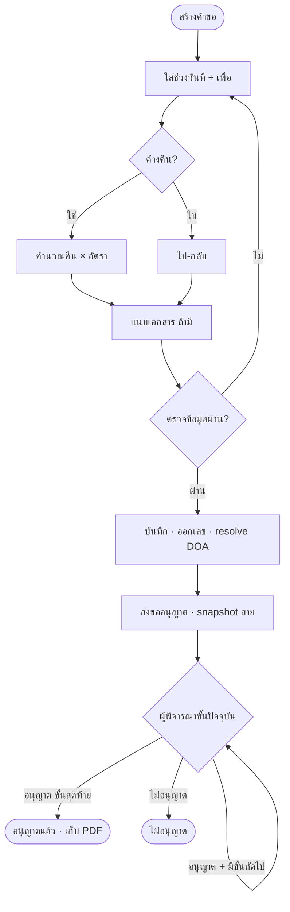
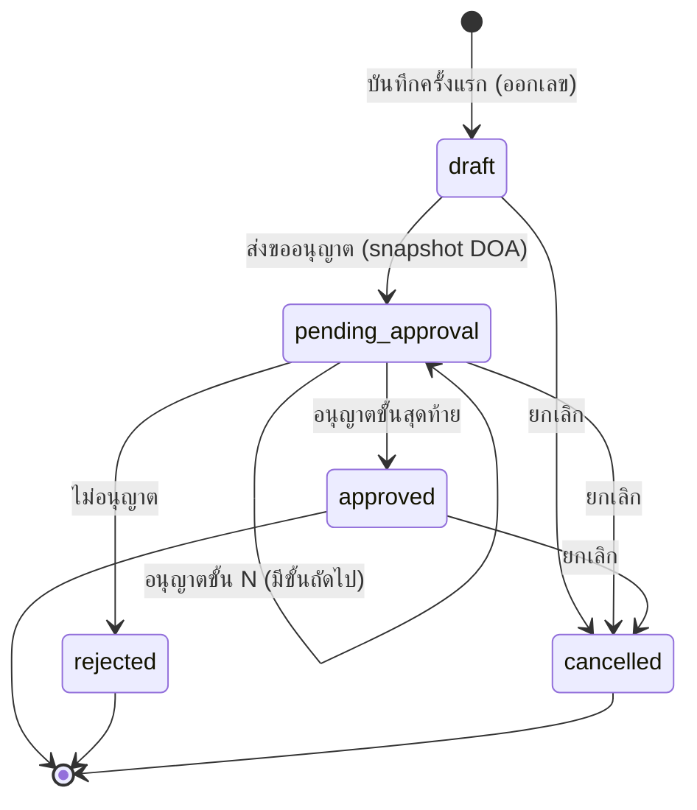

# BRD: แบบขออนุญาตออกปฏิบัติงานนอกสถานที่ (Off-site Work Request)

| Field | Value |
|---|---|
| BRD ID | BRD-HR-OSW-001 |
| Feature Name | แบบขออนุญาตออกปฏิบัติงานนอกสถานที่ (F-HR-OSW — รหัสจริงกำหนดตอนเริ่มพัฒนา) |
| BRD Type | New Feature |
| Version | 1.0 |
| Status | Approved (AI Reviewed — ดู AI Review Report ท้ายเอกสาร) |
| Module | HR › Payroll & Time (Core Cube › HR) |
| Owner | BA ทีม 2BSimple |
| Stakeholders | ลูกค้า Credence (ผู้ขอ Sirikan · ฝ่ายบุคคล) · Design Authority (Strike) · Dev Mgr (Bird) |
| Created Date | 5 ต.ค. 2569 |
| Last Updated | 5 ต.ค. 2569 |

**Input ที่ใช้ (Fresh Mode · HTML-first):**

| แหล่ง | ไฟล์ | บทบาท |
|---|---|---|
| Business intent (แทน RIF) | `PREBRIEF_REQ-2569-0000.md` (ร่างจากแบบฟอร์มลูกค้า) + `DECISIONS_F-HR-OSW_2026-10-05.md` (มติ DA 10 ข้อ) | ต้องการอะไร ทำไม เกณฑ์อะไร |
| หน้าจอ/flow จริง | `offsite-work-request.html` (รอบ 4 · E2E 64/64 + PDF/DOA 13/13 · self_audit PASS) | มีหน้าอะไร ทำอะไรได้จริง |
| แบบฟอร์มต้นฉบับ | `FM-HRM-02 Rev.00` (Credence) | ช่องข้อมูล + แบบพิมพ์ |
| Declaration | `DOA_BRIEF_F-HR-OSW.md` v1.0 · `DOCCFG_BRIEF_F-HR-OSW.md` v1.0 · `print/OSW_print-spec.md` | สายอนุมัติ · เลขรัน/สำเนา · แบบพิมพ์ |

## Changelog
- v1.0 (5 ต.ค. 2569): สร้าง BRD ผ่าน brd-generator-full v2.2 (Fresh Mode · HTML-first) — ไม่มี RIF/ใบเซ็น → ใช้ PREBRIEF + DECISIONS แทน (ดู §3.4, OQ-01)

---

## 2. Business Context

### 2.1 ปัญหา / โอกาส
- ปัจจุบันพนักงาน Credence ขออนุญาตออกปฏิบัติงานนอกสถานที่ด้วย **แบบฟอร์มกระดาษ FM-HRM-02** แล้วให้ผู้บังคับบัญชาเซ็น
- ปัญหาที่เห็นจากตัวอย่างจริง: **ข้อมูลขัดกันเอง** (ติ๊ก "ไป-กลับ" แต่กรอกค้างคืน 7 คืน และเบี้ยเลี้ยง 1,050 บาท · ช่วงวันที่รวม 11 วัน) — ไม่มีอะไรตรวจ · ย้อนดูสถานะ/ประวัติไม่ได้ · กระดาษจำกัด 5 บรรทัด · คำนวณเบี้ยเลี้ยงด้วยมือ
- โอกาส: ย้ายขึ้นระบบ โดย **หน้าตาเอกสารยังเหมือนแบบฟอร์มเดิม** (ลูกค้าคุ้นเคย) แต่ได้การตรวจข้อมูลอัตโนมัติ สายอนุมัติตาม DOA และหลักฐานย้อนหลัง

### 2.2 เป้าหมายทาง Business
- G1: พนักงานขออนุญาตออกนอกสถานที่ในระบบได้ทั้งหมด แทนกระดาษ
- G2: ผู้บังคับบัญชาพิจารณาได้เร็วขึ้น เห็นคำขอที่รอตัวเองในที่เดียว
- G3: ค่าเบี้ยเลี้ยงถูกต้องทุกใบ (คำนวณจากจำนวนคืน × อัตรานโยบาย) ไม่มีใบที่ข้อมูลขัดกัน
- G4: มีเอกสาร PDF รูปแบบ FM-HRM-02 ที่ผ่านอนุญาตแล้วเก็บเป็นหลักฐาน

### 2.3 ตัวชี้วัดความสำเร็จ (Success Metrics)
| Metric | Baseline ปัจจุบัน | Target | วัดยังไง/จากไหน | วัดเมื่อไหร่ |
|---|---|---|---|---|
| M1 สัดส่วนคำขอที่ทำในระบบ (เทียบกระดาษ) | ต้องเก็บ baseline ก่อน launch (นับใบกระดาษ/เดือน จากฝ่ายบุคคล) | 100% | จำนวนใบ OSW ในระบบ ÷ (ระบบ + กระดาษที่ HR รับ) | 1 เดือนหลัง launch |
| M2 เวลาพิจารณาเฉลี่ย (ส่ง → ผลขั้นสุดท้าย) | ต้องเก็บ baseline ก่อน launch | ≤ 1 วันทำการ | `decided_at − submitted_at` จาก `approval_chain` | รายสัปดาห์ หลัง launch 1 เดือน |
| M3 ใบที่ข้อมูลเบี้ยเลี้ยงขัดกัน | ≥ 1 ใบในตัวอย่าง 1 ใบ (ต้องเก็บ baseline จริง) | 0 ใบ | ระบบบังคับ: เลือกได้ไป-กลับ **หรือ** ค้างคืน · ยอด = คืน × อัตรา (ตรวจจาก record) | ทุกเดือน |
| M4 สัดส่วนคำขอที่ส่งก่อนวันเดินทาง | ต้องเก็บ baseline ก่อน launch | ≥ 90% | `submitted_at < min(d_from)` | รายเดือน |

### 2.4 ที่มาของ Requirement
- เคสที่เกิด: คำขอเอกสารใหม่จากลูกค้าผ่าน F185 (REQ-2569-0011 · ผู้ขอ Sirikan) พร้อมไฟล์ FM-HRM-02 Rev.00
- PREBRIEF จาก CMS (REQ-2569-0011) สกัดช่องได้ไม่ครบ (7 ช่องทั่วไป) → ทีมทำ PREBRIEF ร่างใหม่จากแบบฟอร์มจริง (17 ช่อง) และใช้เป็นฐานของ BRD นี้

---

## 3. Scope

### 3.1 In Scope
- สร้าง / แก้ไขร่าง / ส่งขออนุญาต / ดูรายละเอียด / ยกเลิก คำขอออกปฏิบัติงานนอกสถานที่
- ข้อมูลผู้ขอ (ชื่อ ตำแหน่ง ฝ่าย) และผู้บังคับบัญชา **ดึงจากระบบ** (ไม่ต้องกรอก)
- หลายช่วงวันที่ในใบเดียว (ไม่จำกัด) — ต่อช่วง: วันที่ไป–กลับ · เวลา · เพื่อ (วัตถุประสงค์+สถานที่)
- ลักษณะการปฏิบัติงาน ไป-กลับ / ค้างคืน · จำนวนคืน · คืนที่ได้เบี้ยเลี้ยง · ค่าเบี้ยเลี้ยง = คืน × อัตรานโยบาย
- สายอนุมัติจาก DOA กลาง (dynamic N ขั้น) · อนุญาต / ไม่อนุญาต (ต้องมีเหตุผล)
- เอกสาร PDF รูปแบบ FM-HRM-02 (โลโก้ลูกค้า) สร้างจากข้อมูลจริง · พิมพ์/ดาวน์โหลด · เก็บสำเนาเมื่ออนุญาตครบ
- เอกสารแนบประกอบ (ไม่บังคับ) · ทำซ้ำจากใบเดิม · ส่งออกรายการเป็น CSV · ประวัติ (append-only)

### 3.2 Out of Scope
- ไม่ส่งข้อมูลต่อระบบเวลาทำงาน (F-ATTEND-001) / เบิกจ่าย / เงินเดือน (F-PAYROLL-001) ในรอบนี้ (DEC-02)
- ไม่เปลี่ยนค่าใด ๆ ในระบบเมื่ออนุญาต (DEC-01)
- ไม่มีวงเงินในสายอนุมัติ (DEC-03)
- ไม่ใช้ลายมือชื่อภาพ / e-signature (DEC-09)
- ไม่แก้ใบหลังส่ง — ต้องยกเลิกแล้วทำซ้ำ · ไม่อนุญาต = จบใบ (DEC-10)
- ไม่ทำหน้าตั้งค่า DOA / เลขรัน / นโยบายเบี้ยเลี้ยง (เป็นของ F-DLG-001 / F-DOCCFG / ExpensePolicy)
- HR สร้างคำขอแทนพนักงาน (ไม่อยู่ใน HTML รอบนี้)

### 3.3 Assumptions
- A1: ทุกพนักงานมีผู้บังคับบัญชาตรงในผังองค์กร (F-ORG-001) — ใช้ resolve ขั้นแรกของ DOA
- A2: นโยบายเบี้ยเลี้ยงมีอัตราต่อคืนเดียวทั้งบริษัท (ปัจจุบัน 150 บาท) — อ่านจาก ExpensePolicy.per_diem
- A3: แบบเอกสาร OSW ถูก register และเปิดใช้งานในทะเบียนเอกสาร (F185) ก่อนพนักงานเริ่มใช้
- A4: ตัวอย่างข้อมูลในตัวอย่างลูกค้า (7 คืน) เกินช่วงวันที่ที่ค้างได้จริง (8 คืน → ปกติ) — ระบบเตือนเมื่อเกิน ไม่บล็อก

### 3.4 Scope Lock
- **Scope Lock Ref:** N/A — ยังไม่มีใบเซ็น Sign-off ของลูกค้า (งานนี้ไม่ได้ผ่าน SOW2.4) → **ใช้มติ Design Authority แทนชั่วคราว** (`DECISIONS_F-HR-OSW_2026-10-05.md`) · ต้องทำ Sign-off ก่อนเข้า dev (OQ-01)
- **Locked Decisions (มติ DA — ห้าม override จนกว่าจะมีใบเซ็น):**

| ID | มติ | อ้าง |
|---|---|---|
| DEC-01 | อนุญาตแล้วไม่เปลี่ยนค่าในระบบ | DECISIONS |
| DEC-02 | ไม่ส่งต่อเวลาทำงาน/เบิกจ่าย/เงินเดือนรอบนี้ | DECISIONS |
| DEC-03 | DOA dynamic ที่ DOA กลาง · ค่าเริ่ม 1 ขั้น ผู้บังคับบัญชาตรง · ไม่มีวงเงิน | DECISIONS · DOA_BRIEF |
| DEC-04 | เบี้ยเลี้ยงเฉพาะค้างคืน · อัตรานโยบาย (snapshot) · คืนคำนวณอัตโนมัติ ปรับได้ · เกินช่วง = เตือน | DECISIONS |
| DEC-05 | ช่วงวันที่ไม่จำกัด | DECISIONS |
| DEC-06 | "เพื่อ" ช่องเดียว · ไม่มีหมายเหตุ | DECISIONS |
| DEC-07 | wizard 3 ขั้น · ทำซ้ำ = ปุ่มมาตรฐาน | DECISIONS |
| DEC-08 | PDF แบบ FM-HRM-02 (thai-doc · FORM REPLICA) · ลายเซ็นแถวล่าง 1 ช่องต่อขั้น DOA | DECISIONS · print-spec |
| DEC-09 | ไม่ใช้ลายมือชื่อภาพ | DECISIONS |
| DEC-10 | ไม่อนุญาต = จบใบ · HR รับทราบ = เพิ่มขั้นที่ DOA | DECISIONS |

- **Scope Drift (HTML มีแต่ PREBRIEF ไม่ได้ขอ):** ⚠️ HTML-RIF DRIFT — (1) ขั้นเอกสารแนบ (2) ทำซ้ำ (3) ส่งออก CSV → มาจากโครงมาตรฐานเอกสารธุรกรรม (Pattern Q) ไม่ได้มาจากคำขอลูกค้า → OQ-02 ให้ยืนยันใน Sign-off

---

## 4. User Roles & Permissions

### 4.1 Roles ที่เกี่ยวข้อง
| Role | คำอธิบาย |
|---|---|
| พนักงาน (ผู้ขอ) | สร้างและส่งคำขอของตัวเอง |
| ผู้พิจารณา (ตาม DOA) | ค่าเริ่ม = ผู้บังคับบัญชาตรง · พิจารณาเฉพาะขั้นที่ได้รับมอบ |
| ฝ่ายบุคคล (HR) | เห็นทุกใบ · ยกเลิกได้ · ส่งออก |
| ผู้ดูแลระบบ (Admin) | ตั้งค่า DOA / เลขรัน / นโยบายเบี้ยเลี้ยง — นอก feature |

### 4.2 Permission Matrix
| Action | พนักงาน | ผู้พิจารณา | HR |
|---|:---:|:---:|:---:|
| ดูรายการ/รายละเอียด | ✅ ของตัวเอง | ✅ ใบที่ตนอยู่ในสาย | ✅ ทุกใบ |
| สร้างคำขอ | ✅ | ✅ (ของตัวเอง) | ✅ (ของตัวเอง) |
| แก้ไขร่าง | ✅ เจ้าของ | ❌ | ❌ |
| ส่งขออนุญาต | ✅ เจ้าของ | ❌ | ❌ |
| อนุญาต / ไม่อนุญาต | ❌ (ใบตัวเอง — SoD) | ✅ เฉพาะขั้นปัจจุบัน | ❌ (เว้นอยู่ในสาย) |
| ยกเลิกเอกสาร (ร่าง/รอ/อนุญาตแล้ว) | ✅ เจ้าของ | ❌ | ✅ |
| ทำซ้ำ · พิมพ์ · ดาวน์โหลด PDF | ✅ ใบที่เห็น | ✅ ใบที่เห็น | ✅ |
| ส่งออก CSV | ✅ ตามที่เห็น | ✅ ตามที่เห็น | ✅ |

---

## 5. User Journey (with COSO)

### 5.1 Happy Path
| # | Step | Maker | Checker | Approver | System | Notes / หน้าจอ |
|---|---|---|---|---|---|---|
| 1 | พนักงานกด "สร้างคำขอ" | พนักงาน | — | — | เปิด wizard · ดึงชื่อ/ตำแหน่ง/ฝ่าย/ผู้บังคับบัญชา | `#/offsite/create` · ขั้น 1 |
| 2 | ใส่วันที่ไป–กลับ + เพื่อ (ต่อช่วง · เพิ่มช่วงได้) | พนักงาน | — | — | เติมถึงวันที่ = วันไป · นับวัน · เวลาเริ่ม 08:30–17:30 | การ์ดช่วงวันที่ |
| 3 | เลือก ไป-กลับ / ค้างคืน | พนักงาน | — | — | ค้างคืน: คำนวณคืน + เบี้ยเลี้ยง = คืน × อัตรา | ปรับจำนวนคืนได้ |
| 4 | แนบเอกสาร (ไม่บังคับ) | พนักงาน | — | — | ตรวจชนิด/ขนาดไฟล์ | ขั้น 2 |
| 5 | ตรวจสอบและบันทึกส่ง | พนักงาน | — | — | ออกเลข ENG-DOC-NUM (ครั้งแรก) · resolve DOA | ขั้น 3 → modal ส่ง |
| 6 | ยืนยันผู้พิจารณาต่อขั้น แล้วส่ง | พนักงาน | — | — | snapshot `approval_chain` · สถานะ รออนุญาต · แจ้งผู้พิจารณา | slot picker 1 แถวต่อขั้น |
| 7 | ผู้พิจารณาขั้นที่ 1 อนุญาต | — | — | ผู้พิจารณาขั้น 1 | มีขั้นถัดไป → ส่งต่อ · ไม่มี → อนุญาตแล้ว | My Approval / "รอฉันพิจารณา" |
| 8 | (ถ้ามีขั้นถัดไป) ผู้พิจารณาขั้นถัดไปอนุญาต | — | — | ผู้พิจารณาขั้น N | ครบทุกขั้น → อนุญาตแล้ว · ล็อกแก้ไข · เก็บสำเนา PDF | DOA dynamic |
| 9 | ผู้ขอได้ผล · พิมพ์ PDF | พนักงาน | — | — | แจ้งผล · PDF FM-HRM-02 พร้อมช่องลายเซ็นทุกขั้น | แท็บ PDF Preview |

**SoD Check:** Maker (พนักงาน) ≠ Approver (ผู้พิจารณา) — ระบบไม่แสดงผู้ขอในรายชื่อผู้พิจารณา ✅

### 5.2 Alternative Paths
#### 5.2.1 ไม่อนุญาต
| # | Step | COSO Roles | Notes |
|---|---|---|---|
| 1 | ผู้พิจารณากด "ไม่อนุญาต" + เหตุผล (บังคับ) | Approver | ตัวเลือกสำเร็จรูป 3 แบบ |
| 2 | ระบบ: ขั้นปัจจุบัน = ไม่อนุญาต · ขั้นที่เหลือ = ข้าม · สถานะ = ไม่อนุญาต | System | แจ้งผู้ขอ |
| 3 | ผู้ขอ "ทำซ้ำ" เป็นใบใหม่ถ้าต้องการ | Maker | DEC-10 |

#### 5.2.2 บันทึกร่างไว้ก่อน
| # | Step | COSO Roles | Notes |
|---|---|---|---|
| 1 | พนักงานกด "บันทึกแบบร่าง" | Maker | ออกเลขที่แล้ว · สถานะ ร่าง |
| 2 | แก้ไขร่างภายหลัง → ส่งขออนุญาต | Maker | `#/offsite/edit/:id` |

#### 5.2.3 ยกเลิกเอกสาร
| # | Step | COSO Roles | Notes |
|---|---|---|---|
| 1 | เจ้าของหรือ HR กด "ยกเลิกเอกสาร" + เหตุผล (บังคับ) | Maker / HR | ได้ทั้ง ร่าง · รออนุญาต · อนุญาตแล้ว |
| 2 | ระบบ: สถานะ ยกเลิก · ขั้นที่ค้าง = ข้าม · บันทึกประวัติ | System | — |

#### 5.2.4 ทำซ้ำจากใบเดิม
| # | Step | COSO Roles | Notes |
|---|---|---|---|
| 1 | กด "ทำซ้ำ" ที่ใบเดิม | Maker | ใช้ เวลา/เพื่อ/ลักษณะ เดิม · วันที่ต้องกรอกใหม่ |

### 5.3 Process Diagram


---

## 6. Data Entity & Fields

### 6.1 Entity Overview
| Entity | Type | Description |
|---|---|---|
| T_osw_request | Header | คำขอ 1 ใบ (snapshot ผู้ขอ/อัตรา · สายอนุมัติ) |
| T_osw_line | Detail | ช่วงวันที่ปฏิบัติงาน (1:N) |
| T_osw_attachment | Attachment | ไฟล์แนบ (Document Center) |
| T_osw_audit | Audit | ประวัติ append-only |

### 6.2 Entity: T_osw_request
| # | Field | Label UI | Input Type | ค่า/ตัวเลือก | จำเป็น | เงื่อนไข | หมายเหตุ |
|---|---|---|---|---|:---:|---|---|
| 1 | osw_no | เลขที่ | AUTO | `{PREFIX}-{YYYY}-{run:4}` (OSW) | ✅ | ENG-DOC-NUM ตอนบันทึกครั้งแรก | immutable · DOCCFG_BRIEF |
| 2 | req_date | วันที่ขอ | AUTO | วันที่บันทึก | ✅ | — | |
| 3 | employee_id | ผู้ขอ | AUTO | session user → Employee | ✅ | — | F-EMP-001 |
| 4 | employee_name | ชื่อ-สกุล | AUTO | snapshot Employee.full_name | ✅ | — | PII |
| 5 | position | ตำแหน่ง | AUTO | snapshot Employee.position | ✅ | ค่า ณ วันที่ขอ | |
| 6 | dept | ฝ่าย | AUTO | snapshot OrgUnit.name | ✅ | ค่า ณ วันที่ขอ | F-ORG-001 |
| 7 | mode | ลักษณะการปฏิบัติงาน | DROPDOWN-SINGLE | day (ไป-กลับ) / overnight (ค้างคืน) | ✅ | default day | การ์ดเลือก |
| 8 | nights | คืนที่ค้าง | NUMBER | ≥ 1 เมื่อ overnight | ⚠️ | overnight เท่านั้น · ค่าเริ่ม = คืนที่ค้างได้จากช่วงวันที่ | day → 0 |
| 9 | paid_nights | คืนที่ได้เบี้ยเลี้ยง | NUMBER | 0 – nights | ⚠️ | ≤ nights | ค่าเริ่ม = nights |
| 10 | rate | อัตราต่อคืน | AUTO | snapshot ExpensePolicy.per_diem | ✅ | — | 150 บาท ณ ปัจจุบัน |
| 11 | per_diem_amount | ค่าเบี้ยเลี้ยงรวม | AUTO | paid_nights × rate | ✅ | read-only | day → 0 |
| 12 | approval_status | สถานะ | AUTO | draft / pending_approval / approved / rejected / cancelled | ✅ | state machine §8 | |
| 13 | approval_required | ต้องอนุมัติ | AUTO | true | ✅ | จาก DOA entry | |
| 14 | doa_entry_ref | อ้าง DOA | AUTO | — | ⚠️ | — | DOA_BRIEF §4 |
| 15 | approver_role | role ขั้นปัจจุบัน | AUTO | — | ⚠️ | — | |
| 16 | approval_chain | สายอนุมัติ | AUTO | jsonb `[{step, role, role_id, assignee, status, at, note}]` | ⚠️ | snapshot ตอนส่ง · append-only | ใช้ render ช่องลายเซ็น PDF |
| 17 | submitted_at | ส่งเมื่อ | AUTO | — | ⚠️ | — | |
| 18 | approved_by / approved_at | ผลขั้นสุดท้าย | AUTO | — | ⚠️ | — | |
| 19 | cancel_reason | เหตุผลยกเลิก | TEXTAREA | — | ⚠️ | บังคับเมื่อยกเลิก | |
| 20 | copy_of | ทำซ้ำจาก | AUTO | FK osw | ❌ | — | |
| 21 | created_by / created_date / modified_by / modified_date | Audit | AUTO | — | ✅ | — | |

### 6.3 Entity: T_osw_line
| # | Field | Label UI | Input Type | ค่า/ตัวเลือก | จำเป็น | เงื่อนไข | หมายเหตุ |
|---|---|---|---|---|:---:|---|---|
| 1 | line_no | # | AUTO | 1..N | ✅ | — | ไม่จำกัด (DEC-05) |
| 2 | d_from | วันที่ไป | DATE | — | ✅ | — | |
| 3 | d_to | ถึงวันที่ | DATE | — | ✅ | ≥ d_from · ค่าเริ่ม = d_from | |
| 4 | t_from | เวลาเริ่ม | TIME | ค่าเริ่ม 08:30 | ✅ | — | ซ่อนบนจอ กด "เปลี่ยนเวลา" |
| 5 | t_to | เวลาสิ้นสุด | TIME | ค่าเริ่ม 17:30 | ✅ | วันเดียว: > t_from | |
| 6 | purpose | เพื่อ | TEXT | วัตถุประสงค์ + สถานที่ | ✅ | ไม่ว่าง | ช่องเดียว (DEC-06) |
| 7 | days | วัน | AUTO | d_to − d_from + 1 | ✅ | — | |
| 8 | audit fields | — | AUTO | created_by/date · modified_by/date | ✅ | — | |

### 6.4 Entity: T_osw_attachment / T_osw_audit
- T_osw_attachment: file_id (Document Center) · name · size · uploaded_by · uploaded_date — ชนิด PDF/Word/Excel/PNG/JPG ≤ 20 MB/ไฟล์
- T_osw_audit: act · by · at · note · tone — append-only (สร้าง · แก้ไขร่าง · ส่ง · อนุญาตขั้น N · ไม่อนุญาต · ยกเลิก)

### 6.5 Entity Relationship
```
T_osw_request ──(1:N)──▶ T_osw_line
T_osw_request ──(1:N)──▶ T_osw_attachment ──▶ Document Center
T_osw_request ──(1:N)──▶ T_osw_audit
Employee / OrgUnit ──(snapshot)──▶ T_osw_request (employee_name, position, dept)
ExpensePolicy ──(snapshot)──▶ T_osw_request.rate
DOA entry (F-DLG-001) ──(resolve + snapshot)──▶ T_osw_request.approval_chain
F-DOCCFG ──(ENG-DOC-NUM)──▶ T_osw_request.osw_no
```

---

## 7. User Stories & Acceptance Criteria

### S-01: สร้างคำขอออกปฏิบัติงานนอกสถานที่
**As a** พนักงาน **I want to** สร้างคำขอโดยไม่ต้องกรอกข้อมูลตัวเอง **So that** ใช้เวลาน้อยที่สุด
- AC1: Given พนักงานอยู่หน้ารายการ, When กด "สร้างคำขอ", Then เปิดฟอร์มขั้นข้อมูลหลักทันที (ไม่มีขั้นเลือกแหล่งที่มา)
- AC2: Given ฟอร์มเปิด, When ดูการ์ดสรุป, Then เห็นชื่อ ตำแหน่ง ฝ่าย และผู้บังคับบัญชาจากระบบ โดยไม่มีช่องให้กรอก

### S-02: ระบุช่วงวันที่ปฏิบัติงาน
**As a** พนักงาน **I want to** ใส่วันที่ไปกับเรื่องที่จะไป **So that** ผู้บังคับบัญชารู้ว่าไปทำอะไร
- AC1: Given การ์ดช่วงวันที่ว่าง, When เลือกวันที่ไป, Then ถึงวันที่ถูกเติมเป็นวันเดียวกัน และแสดงจำนวนวัน
- AC2: Given ช่วงวันที่ครบ, When ช่อง "เพื่อ" ว่างแล้วกดถัดไป, Then ขึ้นข้อความ "บอกว่าไปทำอะไร ที่ไหน" ในการ์ดนั้น
- AC3: Given มี 2 ช่วง, When วันที่ซ้อนกัน, Then ขึ้น "วันที่ซ้อนกับช่วงที่ 1" และไปขั้นถัดไปไม่ได้

### S-03: เพิ่มช่วงวันที่
**As a** พนักงาน **I want to** เพิ่มช่วงไปปฏิบัติงานในใบเดียว **So that** ไม่ต้องทำหลายใบ
- AC1: Given มี 1 ช่วง, When กด "ไปอีกช่วง", Then ได้การ์ดใหม่ที่มีเวลาและข้อความ "เพื่อ" จากช่วงก่อน และเคอร์เซอร์อยู่ที่วันที่ไป
- AC2: Given มีมากกว่า 1 ช่วง, When กดลบช่วง, Then ช่วงนั้นหายไป และยอดรวมวันอัปเดต

### S-04: เปลี่ยนเวลาปฏิบัติงาน
**As a** พนักงาน **I want to** เปลี่ยนเวลาของช่วงที่ไม่ใช่เวลาปกติ **So that** ข้อมูลตรงความจริง
- AC1: Given การ์ดแสดง "08:30 – 17:30 น.", When กด "เปลี่ยนเวลา", Then มีช่องเวลาเริ่ม-สิ้นสุดให้แก้
- AC2: Given ไปวันเดียว, When เวลาสิ้นสุดไม่หลังเวลาเริ่ม, Then ขึ้น "เวลาสิ้นสุดต้องหลังเวลาเริ่ม"

### S-05: ขอค่าเบี้ยเลี้ยงกรณีค้างคืน
**As a** พนักงาน **I want to** เลือกค้างคืน **So that** ได้ค่าเบี้ยเลี้ยงตามนโยบาย
- AC1: Given ช่วง 12–14 ต.ค., When เลือก "ค้างคืน", Then แสดง "ค้าง 2 คืน · ได้เบี้ยเลี้ยง 2 คืน × ฿150.00 = ฿300.00"
- AC2: Given เลือก "ไป-กลับ", When ดูสรุป, Then ค่าเบี้ยเลี้ยง = ไม่มี และจำนวนคืน = 0

### S-06: ปรับจำนวนคืน
**As a** พนักงาน **I want to** ปรับจำนวนคืนที่ค้างหรือที่ได้เบี้ยเลี้ยง **So that** ตรงกับที่ค้างจริง
- AC1: Given ค้างคืน, When กด "ปรับจำนวนคืน" แล้ว + เกินช่วงวันที่, Then ขึ้นเตือน "มากกว่าช่วงวันที่" แต่ยังไปต่อได้
- AC2: Given คืนที่ได้เบี้ยเลี้ยงมากกว่าคืนที่ค้าง, When กดถัดไป, Then บล็อกพร้อมข้อความ "คืนที่ได้เบี้ยเลี้ยงต้องไม่เกินคืนที่ค้าง"

### S-07: ส่งขออนุญาต
**As a** พนักงาน **I want to** ส่งคำขอให้ผู้พิจารณาตาม DOA **So that** ได้รับอนุญาตก่อนไป
- AC1: Given ขั้นตรวจสอบ, When กด "บันทึกและส่งขออนุญาต", Then ได้เลขที่ และขึ้นหน้าต่างเลือกผู้พิจารณา 1 แถวต่อขั้น DOA (ค่าเริ่มจากสายงาน)
- AC2: Given ยืนยันส่ง, When สำเร็จ, Then สถานะ = รออนุญาต และสายอนุมัติถูก snapshot
- AC3: Given API ล้ม, When ส่ง, Then ขึ้น "ทำรายการไม่สำเร็จ กรุณาลองใหม่อีกครั้ง" และใบยังเป็นร่าง

### S-08: อนุญาตคำขอ
**As a** ผู้พิจารณา **I want to** อนุญาตคำขอที่รอฉัน **So that** พนักงานออกไปปฏิบัติงานได้
- AC1: Given ใบรอฉันพิจารณา, When กด "อนุญาต", Then ขั้นของฉัน = อนุญาต · มีขั้นถัดไปส่งต่อ · ไม่มี = อนุญาตแล้ว
- AC2: Given ใบอนุญาตครบ, When เปิด PDF, Then ช่องของฉันติ๊ก ☑ อนุญาต พร้อม "พิจารณาในระบบ วันที่ เวลา"

### S-09: ไม่อนุญาตคำขอ
**As a** ผู้พิจารณา **I want to** ปฏิเสธคำขอพร้อมเหตุผล **So that** ผู้ขอรู้ว่าต้องแก้อะไร
- AC1: Given ไม่ใส่เหตุผล, When กด "ไม่อนุญาต", Then ขึ้น "กรุณาระบุเหตุผล" และไม่บันทึก
- AC2: Given ใส่เหตุผล, When ยืนยัน, Then สถานะ = ไม่อนุญาต · ขั้นที่เหลือ = ข้าม · แสดงเหตุผลในหน้ารายละเอียด

### S-10: ยกเลิกเอกสาร
**As a** เจ้าของคำขอ **I want to** ยกเลิกคำขอที่ไม่ไปแล้ว **So that** ข้อมูลตรงความจริง
- AC1: Given ใบอนุญาตแล้ว, When กด "ยกเลิกเอกสาร" + เหตุผล, Then สถานะ = ยกเลิก และแสดงเหตุผล
- AC2: Given HR เปิดใบของคนอื่น, When กดยกเลิก, Then ทำได้ (HR มีสิทธิ์)

### S-11: พิมพ์เอกสาร
**As a** ผู้ขอ **I want to** พิมพ์เอกสารรูปแบบ FM-HRM-02 **So that** ใช้เป็นหลักฐานแบบเดิม
- AC1: Given เปิดแท็บ PDF Preview, When ดูเอกสาร, Then ได้หน้าตาแบบฟอร์มลูกค้า (โลโก้ · เส้นประ · ☐/☑) พร้อมข้อมูลใบนั้น
- AC2: Given กด "ดาวน์โหลด PDF", When หน้าต่างพิมพ์เปิด, Then ชื่อไฟล์เริ่มต้น = เลขที่เอกสาร

### S-12: ติดตามคำขอที่รอฉัน
**As a** ผู้พิจารณา **I want to** เห็นคำขอที่รอฉันพิจารณา **So that** ไม่ตกหล่น
- AC1: Given มีใบรอฉัน, When เปิดหน้ารายการ, Then การ์ด "รอฉันพิจารณา" และ badge เมนูแสดงจำนวน
- AC2: Given กดการ์ด, When กรอง, Then เหลือเฉพาะใบที่ฉันต้องพิจารณา

### S-13: ทำซ้ำคำขอ
**As a** พนักงาน **I want to** ทำซ้ำจากใบเดิม **So that** ไปที่เดิมได้โดยไม่พิมพ์ซ้ำ
- AC1: Given ใบเดิม 3 ช่วง, When กด "ทำซ้ำ", Then ได้ฟอร์มใหม่ 3 ช่วง ที่มี "เพื่อ" และเวลาเดิม แต่วันที่ว่าง
- AC2: Given ใบเดิมค้างคืน, When ใส่วันที่ใหม่, Then จำนวนคืนคำนวณใหม่จากวันที่

---

## 8. Status & Lifecycle

### 8.1 State Diagram


### 8.2 State Transition Table
| Current State | Trigger | Next State | COSO Role | Notes |
|---|---|---|---|---|
| — | บันทึกแบบร่าง / บันทึกและส่ง | draft | Maker | ออกเลข ENG-DOC-NUM |
| draft | แก้ไขร่าง | draft | Maker (เจ้าของ) | ประวัติ "แก้ไขร่าง" |
| draft | ส่งขออนุญาต | pending_approval | Maker | resolve + snapshot DOA · แจ้งขั้น 1 |
| pending_approval | อนุญาต (ยังมีขั้น) | pending_approval | Approver ขั้นปัจจุบัน | ขั้นถัดไปเป็นผู้พิจารณา |
| pending_approval | อนุญาต (ขั้นสุดท้าย) | approved | Approver | ล็อกแก้ไข · เก็บ PDF `approved_final` · แจ้งผู้ขอ |
| pending_approval | ไม่อนุญาต + เหตุผล | rejected | Approver | ขั้นที่เหลือ skipped · แจ้งผู้ขอ |
| draft / pending_approval / approved | ยกเลิก + เหตุผล | cancelled | Maker หรือ HR | ขั้นค้าง skipped |

UI label: draft = ร่าง · pending_approval = รออนุญาต · approved = อนุญาตแล้ว · rejected = ไม่อนุญาต · cancelled = ยกเลิก

---

## 9. Business Rules + Validation (with Tags)

### 9.1 Business Rules
| Rule ID | Rule | Tag | Type | เหตุผล Tag |
|---|---|:---:|---|---|
| R01 | สถานะเริ่มต้น = ร่าง | FIXED | Constant | logic หลัก |
| R02 | ผู้ขอ ตำแหน่ง ฝ่าย ดึงจากระบบ · snapshot ณ วันที่ขอ | FIXED | Data source | หลักฐานต้องไม่เปลี่ยนตามการย้ายตำแหน่งภายหลัง |
| R03 | เลือกลักษณะได้อย่างเดียว: ไป-กลับ หรือ ค้างคืน | FIXED | Constraint | กันข้อมูลขัดกันแบบตัวอย่างกระดาษ (DEC-04) |
| R04 | ค่าเบี้ยเลี้ยงเฉพาะค้างคืน = คืนที่ได้เบี้ยเลี้ยง × อัตราต่อคืน | FIXED | Formula | สูตรตามแบบฟอร์ม (DEC-04) |
| R05 | อัตราต่อคืน = ExpensePolicy.per_diem (ปัจจุบัน 150 บาท) · snapshot ลงเอกสาร | CONFIGURABLE | Rate | เปลี่ยนตามนโยบายบริษัท |
| R06 | จำนวนคืนเริ่มต้น = Σ (วันของแต่ละช่วง − 1) · ปรับได้ | FIXED | Default calc | สูตรช่วยกรอก |
| R07 | คืนที่ค้างเกินช่วงวันที่ = เตือน ไม่บล็อก | FIXED | Soft check | DEC-04 |
| R08 | เวลาเริ่มต้น 08:30–17:30 | CONFIGURABLE | Default | อาจต่างตามเวลาทำงานบริษัท |
| R09 | สายอนุมัติ resolve จาก DOA entry ตอนส่ง แล้ว freeze | DYNAMIC | Workflow | จำนวนขั้น/ผู้พิจารณาตั้งที่ DOA กลาง (DEC-03) |
| R10 | อนุญาตเรียงขั้น (sequential) — ครบทุกขั้นจึงอนุญาตแล้ว | FIXED | Workflow | ตาม chainMode ของ DOA entry |
| R11 | ผู้ขอพิจารณาใบตัวเองไม่ได้ | FIXED | SoD | COSO |
| R12 | ไม่อนุญาต / ยกเลิก ต้องมีเหตุผล | FIXED | Constraint | audit |
| R13 | แก้ไขได้เฉพาะร่างของตัวเอง · ส่งแล้วแก้ไม่ได้ | FIXED | Constraint | DEC-10 |
| R14 | เลขที่ = ENG-DOC-NUM (OSW · {PREFIX}-{YYYY}-{run:4} · รีเซ็ตรายปี) ออกตอนบันทึกครั้งแรก | CONFIGURABLE | Numbering | รูปแบบตั้งที่ F-DOCCFG |
| R15 | ก่อนออกเลข เช็คแบบเอกสาร OSW เปิดใช้งาน (F185 API-23) — ไม่เปิด = สร้างไม่ได้ | FIXED | Guard | ทะเบียนเอกสาร |
| R16 | ไฟล์แนบ PDF/Word/Excel/PNG/JPG ≤ 20 MB ต่อไฟล์ | CONFIGURABLE | Limit | file_policy กลาง |
| R17 | PDF ใช้แบบพิมพ์ FM-HRM-02 Rev.00 · ช่องลายเซ็น = ผู้ขอ + 1 ช่องต่อขั้นใน approval_chain | CONFIGURABLE | Template | Rev. ใหม่ของลูกค้า = เปลี่ยน config แบบพิมพ์ |
| R18 | อนุญาตครบ → เก็บสำเนา PDF (ENG-DOC-STORE approved_final) | CONFIGURABLE | Snapshot | flag ที่ F-DOCCFG |
| R19 | การมองเห็น: ผู้ขอเห็นของตัวเอง · ผู้พิจารณาเห็นใบในสาย · HR เห็นทุกใบ | FIXED | Access | PDPA |
| R20 | SLA การพิจารณาต่อขั้น | WARNING | SLA | ยังไม่กำหนด — ดู OQ-04 |

### 9.2 Validation Rules
| VR ID | Field/Action | เงื่อนไข | ประเภท | ข้อความ |
|---|---|---|---|---|
| VR01 | ช่วงวันที่ | d_from และ d_to ไม่ว่าง | Error | เลือกวันที่ไป |
| VR02 | ช่วงวันที่ + เพื่อ | ว่างทั้งคู่ | Error | เลือกวันที่และบอกว่าไปทำอะไร |
| VR03 | เพื่อ | ไม่ว่าง | Error | บอกว่าไปทำอะไร ที่ไหน |
| VR04 | d_to | ≥ d_from | Error | วันที่กลับต้องไม่ก่อนวันที่ไป |
| VR05 | t_from, t_to | ไม่ว่าง | Error | ใส่เวลาให้ครบ |
| VR06 | t_to (วันเดียว) | > t_from | Error | เวลาสิ้นสุดต้องหลังเวลาเริ่ม |
| VR07 | ช่วงวันที่หลายช่วง | ไม่ซ้อนกัน | Error | วันที่ซ้อนกับช่วงที่ N |
| VR08 | nights (ค้างคืน) | ≥ 1 | Error | ใส่วันที่ก่อน หรือปรับจำนวนคืน (อย่างน้อย 1 คืน) |
| VR09 | paid_nights | ≤ nights | Error | คืนที่ได้เบี้ยเลี้ยงต้องไม่เกินคืนที่ค้าง |
| VR10 | nights | > คืนที่ค้างได้จากช่วงวันที่ | Warning | มากกว่าช่วงวันที่ (ค้างได้ N คืน) — ตรวจอีกครั้ง |
| VR11 | d_from | < วันนี้ | Warning | มี N ช่วงเป็นวันที่ผ่านมาแล้ว — ส่งเป็นคำขอย้อนหลัง |
| VR12 | ผู้พิจารณาแต่ละขั้น | ไม่ว่าง | Error | กรุณาเลือกผู้พิจารณา |
| VR13 | เหตุผล (ไม่อนุญาต/ยกเลิก) | ไม่ว่าง | Error | กรุณาระบุเหตุผล |
| VR14 | ไฟล์แนบ | ชนิด/ขนาด | Error | {ชื่อไฟล์} — ชนิดไฟล์ไม่รองรับ / ไฟล์ใหญ่เกินกำหนด (สูงสุด 20 MB) |
| VR15 | ส่ง/บันทึก | API ล้ม | Error | ทำรายการไม่สำเร็จ กรุณาลองใหม่อีกครั้ง (ข้อมูลไม่หาย) |

### 9.5 สรุประดับความยืดหยุ่น
| Rule ID | Tag | ใครเปลี่ยน | บ่อยแค่ไหน | ระดับ | ที่มา |
|---|:---:|---|---|---|:---:|
| R05 อัตราเบี้ยเลี้ยง | CONFIGURABLE | Admin / ฝ่ายบัญชี | ปีละ 0–1 ครั้ง | Admin Panel (ExpensePolicy — มีเจ้าของแล้ว) | 🤖 |
| R08 เวลาเริ่มต้น | CONFIGURABLE | IT/Admin | นาน ๆ ครั้ง | Config File | 🤖 |
| R09 สายอนุมัติ | DYNAMIC | Admin DOA | ตามโครงสร้างองค์กร | Engine Management (DOA กลาง F-DLG-001 — มีอยู่แล้ว) | ✅ DEC-03 |
| R14 รูปแบบเลขที่ | CONFIGURABLE | Admin | นาน ๆ ครั้ง | Admin Panel (F-DOCCFG — มีอยู่แล้ว) | ✅ DOCCFG_BRIEF |
| R16 ไฟล์แนบ | CONFIGURABLE | IT | นาน ๆ ครั้ง | Config File (file_policy กลาง) | 🤖 |
| R17 แบบพิมพ์/Rev. | CONFIGURABLE | Admin | เมื่อลูกค้าออก Rev. ใหม่ | Admin Panel (config แบบพิมพ์ของ doc_type) | ✅ DEC-08 |
| R18 เก็บสำเนา | CONFIGURABLE | Admin | นาน ๆ ครั้ง | Admin Panel (F-DOCCFG flag) | ✅ DOCCFG_BRIEF |
| R20 SLA | WARNING | — | — | ⚠️ รอ HR ลูกค้า (OQ-04) | — |

ข้อ 🤖 ระดับ Config File/Admin Panel ปล่อยผ่านได้ · ข้อ DYNAMIC (R09) ✅ ยืนยันแล้วโดย DA ไม่ต้องลง OQ

---

## 10. Edge Cases

### 10.1 Edge Cases ที่ระบุแล้ว (default ☑)
- ☑ E01: ตัวอย่างกระดาษติ๊กไป-กลับแต่กรอกค้างคืน → ระบบเลือกได้อย่างเดียว (R03)
- ☑ E02: ค้างคืนเกินช่วงวันที่ → เตือน ไม่บล็อก (VR10)
- ☑ E03: คืนที่ได้เบี้ยเลี้ยง > คืนที่ค้าง → บล็อก (VR09)
- ☑ E04: ช่วงวันที่ซ้อนกัน → บล็อก (VR07)
- ☑ E05: ไปวันเดียวแต่เวลาสิ้นสุดก่อนเวลาเริ่ม → บล็อก (VR06)
- ☑ E06: คำขอย้อนหลัง (วันที่ผ่านแล้ว — ตัวอย่างลูกค้าขอ 9–10 ก.ย. ในวันที่ 11 ก.ย.) → เตือนในขั้นตรวจสอบ ส่งได้ (VR11)
- ☑ E07: เกิน 5 ช่วง (กระดาษเดิม 5 บรรทัด) → ระบบไม่จำกัด · PDF ระยะบรรทัดกระชับ 12 ช่วงยัง 1 หน้า
- ☑ E08: ผู้ขอพยายามเลือกตัวเองเป็นผู้พิจารณา → ไม่มีในรายชื่อ (R11)
- ☑ E09: API ส่ง/บันทึกล้ม → ข้อมูลไม่หาย กดซ้ำได้ (VR15)
- ☑ E10: ปิดฟอร์มที่กรอกค้าง → ถาม "ทิ้งข้อมูลที่กรอกไว้?"
- ☑ E11: ไฟล์ชนิดไม่รองรับ / ใหญ่เกิน 20 MB → ปฏิเสธพร้อมเหตุผล (VR14)
- ☑ E12: DOA ตั้ง 2 ขั้นขึ้นไป → slot picker หลายแถว · อนุญาตเรียงขั้น · PDF ช่องลายเซ็นเพิ่มตามขั้น

### 10.2 Edge Cases จาก AI Pattern Matching (☐ — BA ยืนยันที่ SOW3.7)
**ST (Status/Workflow)**
- ☐ E13: ผู้พิจารณาลาออก/ย้ายระหว่างใบรอ → ต้อง reassign ที่ DOA กลาง (delegation)
- ☐ E14: ยกเลิกใบที่อนุญาตแล้วหลังวันเดินทางผ่านไป → อนุญาตหรือไม่ (ตอนนี้อนุญาต)
- ☐ E15: ส่งพร้อมกัน 2 ครั้ง (กดซ้ำ) → ปุ่ม disable ระหว่างบันทึก (มีแล้วใน HTML)

**CA (Concurrent Access)**
- ☐ E16: ผู้ขอยกเลิกขณะผู้พิจารณากดอนุญาต → optimistic lock (version) · ตัวหลังได้ "ข้อมูลถูกแก้โดยผู้อื่น"

**DI (Lookup Master Data)**
- ☐ E17: ผู้ขอไม่มีผู้บังคับบัญชาในผังองค์กร → slot ขั้น 1 ว่าง ต้องเลือกเอง (VR12)
- ☐ E18: นโยบายเบี้ยเลี้ยงไม่มีค่า → แจ้งและไม่คำนวณ (ไม่ให้ส่งแบบค้างคืน)

**CL (Calculation)**
- ☐ E19: เปลี่ยนอัตรานโยบายระหว่างใบร่าง → ใช้อัตรา ณ วันบันทึกครั้งแรก หรือ ณ วันส่ง (ปัจจุบัน snapshot ตอนสร้าง)

**PD (PDF)**
- ☐ E20: ชื่อ/ข้อความ "เพื่อ" ยาวมาก → ตัดบรรทัดในช่องเส้นประ ไม่ล้นหน้า (ทดสอบแล้ว)
- ☐ E21: ช่วงวันที่ > 12 → ขึ้นหน้า 2 · แถวลายเซ็นไม่ถูกตัดกลาง

**PM (Permission)**
- ☐ E22: ผู้ใช้เปิด URL ใบของคนอื่นตรง → ไม่แสดง (R19)

### Tag Review Report
✅ R01–R04, R06, R07, R10–R13, R15, R19: FIXED — ถูกต้อง (logic/สูตรของแบบฟอร์ม)
✅ R05, R08, R14, R16–R18: CONFIGURABLE — เปลี่ยนแค่ค่า
✅ R09: DYNAMIC — ยืนยันแล้ว (DOA dynamic)
⚠️ R20: WARNING — รอ OQ-04 มีแผนหารือแล้ว

---

## 11. Impact Analysis / Regression Scope
N/A — New Feature (ไม่แก้ feature เดิม) · ใช้ engine/feature กลางแบบอ่านอย่างเดียว ไม่กระทบพฤติกรรมเดิม

---

## 12. System Context & Cross-Module Impact

### 12.1 Value Stream & Downstream Impact
**Positioning:** H2R (Hire-to-Retire) › HR › Payroll & Time — อยู่ข้าง F-LEAVE-001 (ใบลา) และ F-ATTEND-001 (เวลาทำงาน) · ก่อนหน้า: งานที่ได้รับมอบหมาย / แผนงานลูกค้า · ถัดไป: (อนาคต) บันทึกเวลาทำงานนอกสถานที่ · เบิกเบี้ยเลี้ยง
⚠️ ยังไม่มี VS Bible ของ H2R ใน cube-master-knowledge — positioning นี้ต้องยืนยันเมื่อทำ Bible (OQ-05)

**Document Flow Chain:**
```
มอบหมายงาน → [แบบขออนุญาตออกปฏิบัติงานนอกสถานที่ ← feature นี้] → อนุญาต → (อนาคต) เวลาทำงาน F-ATTEND-001 · เบิกเบี้ยเลี้ยง/เงินเดือน F-PAYROLL-001
```

**Upstream:**
| ต้นทาง | ข้อมูล/trigger ที่รับ | ถ้าต้นทางไม่มี/ผิด |
|---|---|---|
| Employee (F-EMP-001) | ชื่อ · ตำแหน่ง | ไม่มี = สร้างคำขอไม่ได้ (ผู้ใช้ต้องผูกพนักงาน) |
| OrgUnit (F-ORG-001) | ฝ่าย · ผู้บังคับบัญชาตรง | ไม่มีหัวหน้า = ผู้ขอเลือกผู้พิจารณาเอง (E17) |
| ExpensePolicy | อัตราเบี้ยเลี้ยงต่อคืน | ไม่มีค่า = ส่งแบบค้างคืนไม่ได้ (E18) |
| DOA (F-DLG-001) | สายอนุมัติ N ขั้น | ไม่มี entry = ส่งไม่ได้ (wire_status pending) |
| F-DOCCFG / F185 | เลขรัน · สถานะแบบเอกสาร | แบบเอกสารไม่เปิด = สร้างไม่ได้ (R15) |

**Downstream Impact Map:**
| ปลายทาง | ข้อมูลที่ไหลไป | Trigger | ถ้าใบถูกแก้/ยกเลิกกลางทาง |
|---|---|---|---|
| ผู้พิจารณา (My Approval · ENG-NOTIFY) | งานรอพิจารณา | ส่ง / อนุญาตขั้นก่อนหน้า | ยกเลิก → งานหายจาก My Approval · แจ้งผู้พิจารณา |
| ผู้ขอ (ENG-NOTIFY) | ผลพิจารณา | อนุญาตครบ / ไม่อนุญาต | — |
| Document Store (ENG-DOC-STORE) | PDF ฉบับอนุญาตแล้ว | approved | ยกเลิกหลังอนุญาต → สำเนาเดิมคงไว้ + สถานะยกเลิกในระบบ |
| ทะเบียนเอกสาร (F185) | จำนวนใบที่ออก (ผ่าน doc_type) | ออกเลข | — |
| เวลาทำงาน F-ATTEND-001 | ❌ ไม่ส่งรอบนี้ (DEC-02) | — | อนาคต: ต้องย้อนลบ/แก้บันทึกเวลาเมื่อยกเลิก |
| เบี้ยเลี้ยง/เงินเดือน F-PAYROLL-001 | ❌ ไม่ส่งรอบนี้ (DEC-02) | — | อนาคต: ต้องย้อนรายการเบิกเมื่อยกเลิก |

**ผลกระทบแนวขวาง:** สต๊อก: ไม่มี · บัญชี/GL/งบ: ไม่มี (ไม่ตั้งค้างจ่ายรอบนี้) · รายงาน: HR เห็นสรุปคำขอ/เบี้ยเลี้ยงจาก §18

### 12.2 Module & External Dependencies
- Module: F-EMP-001 · F-ORG-001 · ExpensePolicy · F-DLG-001 DOA · F-DOCCFG (ENG-DOC-NUM · ENG-DOC-STORE) · F185 ทะเบียนเอกสาร (API-23) · Document Center (ไฟล์แนบ) · ENG-NOTIFY
- External/ไฟล์: แบบพิมพ์ thai-doc-pdf-generator (`osw_body.tpl.html` + `base_form_patch.css` ต้องอัปเข้า skill)

### 12.3 Existing System Reference
| Rule | ระดับ | มีอยู่แล้ว? | Reference |
|---|---|:---:|---|
| R05 อัตราเบี้ยเลี้ยง | Admin Panel | ⚠️ บางส่วน | ExpensePolicy.per_diem — PREBRIEF ติด "พบบางส่วน" ต้องยืนยันเจ้าของ (OQ-03) |
| R09 สายอนุมัติ | Engine Management | ✅ | DOA กลาง F-DLG-001 (ตั้ง entry ตาม DOA_BRIEF) |
| R14 เลขที่ | Admin Panel | ✅ | F-DOCCFG (register ตาม DOCCFG_BRIEF) |
| R16 ไฟล์แนบ | Config File | ✅ | file_policy กลาง (Document Center) |
| R17 แบบพิมพ์ | Admin Panel | ⚠️ บางส่วน | thai-doc template มี · component FORM REPLICA ต้องอัปเข้า skill |
| R18 เก็บสำเนา | Admin Panel | ✅ | F-DOCCFG flag approved_final |
| R08 เวลาเริ่มต้น | Config File | ❌ | ต้องสร้าง config key |
⚠️ ไม่มี System Module Registry ในชุด input — ตารางนี้อ้างจาก declaration brief + PREBRIEF

---

## 13. Delivery Phases
### Phase 1: Feature Launch
- T_osw_request / T_osw_line / T_osw_attachment / T_osw_audit + audit fields + snapshot fields
- State machine §8 · validation VR01–VR15
- ใช้ ENG-DOC-NUM (OSW) · ENG-DOC-STORE (approved_final) · DOA resolve (N ขั้น) · ENG-NOTIFY · Document Center
- Config key เวลาเริ่มต้น (R08) + อ่านอัตรา ExpensePolicy (R05) — ห้าม hardcode
- PDF จาก template + data contract (print-spec §2)
- **Reuse:** DOA กลาง · F-DOCCFG · file_policy · thai-doc template

### Phase 2: Admin Panel
- ไม่มีงานใหม่ (ทุก rule ใช้ Admin Panel ที่มีอยู่แล้ว) — ยกเว้นถ้า ExpensePolicy ยังไม่มีหน้าตั้งค่าอัตรา (OQ-03)

### Phase 3: Rule Management
- ไม่มี

### Phase 4: Engine Management
- ไม่มี (DOA กลางรองรับ dynamic แล้ว)

---

## 14. Dev Requirements Summary "ใบสั่ง"

### 14.1 Config Foundation
| Item | โครงสร้าง | รองรับ Rule | มีอยู่แล้ว? |
|---|---|---|:---:|
| doc_type OSW | register ตาม DOCCFG_BRIEF | R14, R18 | ✅ (F-DOCCFG) |
| DOA entry `osw` | matrix 1 set ไม่มีวงเงิน · steps dynamic | R09, R10 | ✅ (DOA กลาง) |
| ExpensePolicy.per_diem | อ่านอย่างเดียว + snapshot | R05 | ⚠️ ยืนยัน (OQ-03) |
| config `osw.default_time` | 08:30 / 17:30 | R08 | ❌ ต้องสร้าง |
| แบบพิมพ์ FM-HRM-02 Rev.00 | template + Rev. เป็น config | R17 | ⚠️ อัป patch เข้า skill |

### 14.2 ข้อกำหนดจาก Tag
| Rule | ระดับ | Dev ต้องทำอะไร |
|---|---|---|
| R05 | Admin Panel | อ่าน ExpensePolicy.per_diem ตอนสร้างใบ แล้วเก็บลง `rate` — ห้ามใส่ 150 ในโค้ด |
| R08 | Config File | อ่าน `osw.default_time` เติมเวลาเริ่มต้น |
| R09 | Engine Management | `doa.resolve('osw', requester, dept)` → slot picker ต่อขั้น → snapshot `approval_chain` · callback อนุมัติเรียงขั้น — ใช้ DOA กลางที่มีอยู่ ไม่สร้างใหม่ |
| R14 | Admin Panel | `ENG-DOC-NUM.next('OSW', company_ctx)` ตอนบันทึกครั้งแรก — ห้าม format/+1 เอง |
| R16 | Config File | ใช้ file_policy กลาง |
| R17 | Admin Panel | render PDF จาก `osw_body.tpl.html` + data contract — ช่องลายเซ็นจาก `approval_chain` ห้าม fix จำนวน |
| R18 | Admin Panel | อนุญาตครบ → `ENG-DOC-STORE.store(pdf,'OSW',id,'approved_final')` |

### 14.3 ข้อกำหนดจาก Edge Cases / Validation
- E04/VR07: ตรวจช่วงวันที่ซ้อนกันฝั่ง server ด้วย (ไม่พึ่ง UI)
- E09/VR15: บันทึก/ส่งแบบ transaction · ล้มแล้ว rollback · client คงข้อมูล
- E12: approval sequential — ขั้นถัดไปเปิดเมื่อขั้นก่อนอนุญาต
- E16: optimistic lock (version) ทุก transition
- R11: server ตรวจ requester ≠ assignee ทุกขั้น

### 14.4 WARNING ที่รอข้อสรุป
| ประเด็น | หารือกับใคร | กำหนดวันที่ | สถานะ |
|---|---|---|---|
| R20 SLA การพิจารณาต่อขั้น | HR ลูกค้า (Credence) ผ่าน Sign-off | ก่อนเริ่ม dev (Sign-off รอบนี้) | ⚠️ รอ — ส่วนอื่นพัฒนาได้ · ไม่สร้าง SLA timer จนกว่าจะเคาะ |

### 14.6 Screen Inventory + UI Signals (หยาบ — ส่งต่อ FRD)
| # | ชื่อหน้า | route (จาก HTML) | ประเภทหยาบ | ผู้ใช้หลัก | หน้าที่ของหน้า | หมายเหตุ |
|---|---|---|---|---|---|---|
| P-01 | รายการคำขอออกปฏิบัติงานนอกสถานที่ | `#/offsite` | หน้ารายการ | ทุก role | ค้นหา/กรอง/ติดตาม · การ์ดรอฉันพิจารณา · ส่งออก CSV | เมนู ⋮ ทำซ้ำ/แก้ไข/พิมพ์/ยกเลิก |
| P-02 | สร้าง/แก้ไขคำขอ | `#/offsite/create` · `#/offsite/create/copy-:id` · `#/offsite/edit/:id` | ฟอร์มสร้าง (หลายขั้น · 3 ขั้น) | พนักงาน | ข้อมูลหลัก → เอกสารแนบ → ตรวจสอบและยืนยัน | การ์ดสรุปขวาอัปเดตสด |
| P-03 | รายละเอียดคำขอ | `#/offsite/view/:id` | หน้ารายละเอียด (4 แท็บ) | ทุก role | รายละเอียด · PDF Preview · ลายเซ็น/อนุมัติ · ประวัติ · อนุญาต/ไม่อนุญาต/ยกเลิก | มีเอกสารแนบ + ลายเซ็น |
| M-01 | ส่งขออนุญาต | modal | หน้ายืนยัน | พนักงาน | เลือกผู้พิจารณาต่อขั้น DOA | |
| M-02 | อนุญาต | modal | หน้ายืนยัน | ผู้พิจารณา | ยืนยัน + ความเห็น | |
| M-03 | ไม่อนุญาต | modal | หน้ายืนยัน | ผู้พิจารณา | เหตุผลบังคับ | |
| M-04 | ยกเลิกเอกสาร | modal | หน้ายืนยัน | เจ้าของ/HR | เหตุผลบังคับ | |
| M-05 | ทิ้งข้อมูลที่กรอก | modal | หน้ายืนยัน | พนักงาน | กันข้อมูลหาย | |

**รวม:** 3 หน้า + 5 หน้ายืนยัน (รายการ 1 · ฟอร์มหลายขั้น 1 · รายละเอียด 1) — ตรงกับ HTML ทุกหน้า (ไม่รวมตัวสลับผู้ใช้ที่เป็นเดโมเท่านั้น)

**UI Signals ให้ FRD:**
- Document/Transaction (approver + พิมพ์ + ลายเซ็น): ✅ ใช่ — Pattern Q แบบไม่มีรายการสินค้า (wizard 3 ขั้น)
- ต้องการ print/PDF: ✅ P-03 แท็บ PDF Preview + ดาวน์โหลด/พิมพ์จากรายการ · แบบพิมพ์ลูกค้า FM-HRM-02 (FORM REPLICA)
- NON-STANDARD flag: ⚠️ หน้าตา PDF ตามแบบฟอร์มลูกค้า (ไม่ใช่แบบมาตรฐาน thai-doc ทั้งหน้า) — DA อนุมัติแล้ว (DEC-08) · ฟอร์มสร้างใช้การ์ดต่อช่วงแทนตาราง (กรอกง่าย — DA สั่ง)

---

## 15. Open Questions
| # | คำถาม | สถานะ | คำตอบ / แผน |
|---|---|:---:|---|
| OQ-01 | ไม่มีใบเซ็น Sign-off → ทำ `newfeature-signoff-generator` ให้ลูกค้าเซ็นยืนยัน DEC-01–10 ก่อนเข้า dev | ⚠️ รอ | ทำต่อจาก BRD นี้ · ผู้รับผิดชอบ BA · ก่อนเริ่ม FRD dev handoff |
| OQ-02 | ยืนยันของที่มาจากโครงมาตรฐาน: เอกสารแนบ · ทำซ้ำ · ส่งออก CSV (HTML-RIF DRIFT) | ⚠️ รอ | ใส่ใน Sign-off ให้ลูกค้าติ๊ก |
| OQ-03 | เจ้าของ ExpensePolicy.per_diem และหน้าตั้งค่าอัตรามีแล้วหรือไม่ | ⚠️ รอ | ถามพี่เบิร์ด (Dev Mgr) ก่อน FRD |
| OQ-04 | SLA การพิจารณาต่อขั้น (R20) | ⚠️ รอ | ถาม HR ลูกค้าใน Sign-off |
| OQ-05 | ยืนยัน positioning H2R เมื่อมี VS Bible | ⚠️ รอ | ทีม VS Bible · ไม่บล็อก dev |
| OQ-06 | code `OSW` ชนกับ registry F-DOCCFG หรือไม่ | ⚠️ รอ | เช็คตอน deploy (DOCCFG_BRIEF) |
| OQ-07 | HTML ยังไม่ผ่าน qc-ux-html-checker / qc-coverage-checker อย่างเป็นทางการ (ผ่าน audit + E2E แล้ว) | ⚠️ รอ | รันก่อน FRD |
| Q-DOA | สายอนุมัติ / วงเงิน | ✅ ตอบแล้ว | dynamic ที่ DOA กลาง · ไม่มีวงเงิน (DEC-03) |
| Q-CFG / Q-POST | เปลี่ยนค่า/ส่งต่อระบบอื่น | ✅ ตอบแล้ว | ไม่ (DEC-01, DEC-02) |

---

## 16. Security & Compliance

### 16.1 Security Preset
**Preset เลือก:** Custom (ฐาน **P2 Approval/Workflow**) + ควบคุม PII บางส่วนจาก P6
**เหตุผล:** เป็นเอกสารที่มีสายอนุมัติ (P2 — cube-defaults: เอกสารมี approval) · มีข้อมูลส่วนบุคคลพนักงาน (ชื่อ/ตำแหน่ง/ช่วงที่อยู่นอกสถานที่) แต่ไม่มีเงินเดือน/ข้อมูลอ่อนไหวระดับ P6 เต็ม · ตัด S01-01 DoA Limit และ S01-06 Tolerance (ไม่มีวงเงิน — DEC-03)

### 16.2 Applicable Standards
| Standard | Applicable? |
|---|:---:|
| COSO (Internal Control / SoD) | ✅ |
| ISO/IEC 27001 | ✅ |
| PDPA | ✅ (ข้อมูลพนักงาน + ที่อยู่ระหว่างปฏิบัติงาน) |
| ITIL / COBIT (SLA) | ✅ (เมื่อเคาะ R20) |
| SOX | ❌ (ไม่กระทบงบการเงินรอบนี้) |
| PCI DSS | ❌ |

### 16.3 Control Checklist
| Control ID | Standard | Control | Required | Implementation Notes |
|---|---|---|:---:|---|
| S01-02 | COSO | Maker-Checker Workflow | ✓ Must | R11 · ผู้ขอไม่อยู่ในรายชื่อผู้พิจารณา + server check |
| S01-03 | COSO | Temporary Delegation | ✓ Must | ใช้ delegation ของ DOA กลาง (E13) |
| S01-04 | COSO | SoD Conflict Matrix | ✓ Must | ผ่าน DOA role |
| S01-07 | COSO | Immutable Log | ✓ Must | T_osw_audit append-only · `approval_chain` append-only |
| S02-01 | ISO 27001 | Password Policy | ✓ Must | platform |
| S02-03 | ISO 27001 | Session Management | ✓ Must | platform |
| S02-05 | ISO 27001 | Data Classification Tags | ✓ Must | ระดับ Internal-Confidential (ข้อมูลพนักงาน) |
| S03-02 | NIST | Policy Versioning | ✓ Must | DOA เปลี่ยนไม่กระทบใบที่ส่งแล้ว (snapshot) |
| S04-05 | COBIT | Standard Master Data Mapping | ✓ Must | snapshot จาก Employee/OrgUnit |
| S04-06 | COBIT | SLA & Escalation Rules | ○ Optional | รอ R20 |
| S06-03 | — | Standardized Audit Content | ✓ Must | who/what/when/where/result ทุก transition |
| S07-06 | PDPA | PII Tagging & Masking | ✓ Must | ติด tag ชื่อพนักงาน · การมองเห็นตาม R19 |
| S11-02 | — | Ticket Enforcement | ○ Optional | ไม่บังคับใน self-service |
| S14-02 | — | Payload Schema Validation | ✓ Must | VR01–VR14 ฝั่ง server |

### 16.4 Risk Statement
| Risk ID | Risk | Mitigated by Control |
|---|---|---|
| RK-01 | อนุญาตใบตัวเอง / ข้ามสาย | S01-02, S01-04 |
| RK-02 | แก้ข้อมูลหลังอนุญาตแล้วอ้างว่าได้รับอนุญาต | S01-07 (ล็อก + audit) |
| RK-03 | ข้อมูลพนักงาน/ที่อยู่ระหว่างปฏิบัติงานรั่วไปคนไม่เกี่ยว | S07-06, S02-05, R19 |
| RK-04 | ผู้พิจารณาไม่อยู่ ใบค้าง | S01-03, S04-06 |
| RK-05 | เบี้ยเลี้ยงผิดเพราะคำนวณมือ/อัตราเก่า | R04, R05 snapshot, S14-02 |

---

## 17. Health Check

### 17.1 SLA
| Step | SLA | Owner | Action when breached |
|---|---|---|---|
| ส่ง → ผลขั้นที่ 1 | ⚠️ รอ R20 (เสนอ 1 วันทำการ) | ผู้พิจารณาขั้น 1 | แจ้งเตือนผู้พิจารณา (ENG-NOTIFY) |
| ส่ง → ผลขั้นสุดท้าย | ⚠️ รอ R20 | ผู้พิจารณาทุกขั้น | แจ้ง HR |

### 17.2 Control Points
| Control ID | Where | When | Result |
|---|---|---|---|
| S01-02 | ส่ง / อนุญาต | ทุกครั้ง | บล็อกถ้า requester = assignee |
| S01-07 | ทุก transition | ทุกครั้ง | เขียน T_osw_audit |
| S14-02 | บันทึก / ส่ง | ทุกครั้ง | ตรวจ VR01–VR14 ฝั่ง server |
| S07-06 | รายการ / รายละเอียด / ส่งออก | ทุกครั้ง | กรองตาม R19 |

### 17.3 KPI
| KPI | Category | Target | Measure |
|---|---|---|---|
| K1 สัดส่วนคำขอในระบบ (คู่ M1) | Conversion | 100% | ใบในระบบ ÷ (ระบบ + กระดาษ) |
| K2 เวลาพิจารณาเฉลี่ย (คู่ M2) | Speed | ≤ 1 วันทำการ | avg(decided_at − submitted_at) |
| K3 ใบข้อมูลเบี้ยเลี้ยงขัดกัน (คู่ M3) | Quality | 0 | นับใบที่ per_diem ≠ paid × rate หรือ mode ไม่สอดคล้อง |
| K4 สัดส่วนคำขอส่งก่อนวันเดินทาง (คู่ M4) | Compliance | ≥ 90% | submitted_at < min(d_from) |
| K5 อัตราไม่อนุญาต | Quality | ติดตาม (ไม่มี target) | rejected ÷ decided |

### 17.4 Threshold
| Metric | Min | Max | Action |
|---|---|---|---|
| K2 เวลาพิจารณา | — | 2 วันทำการ | แจ้ง HR + ผู้พิจารณา |
| K4 ส่งก่อนเดินทาง | 80% | — | HR สื่อสารพนักงาน |
| ใบรอพิจารณาค้างต่อคน | — | 10 ใบ | แจ้งผู้พิจารณา |

### 17.5 Throughput
- Capacity: 200 ใบ/วัน (ประมาณ — HR ขนาดกลาง)
- Baseline: ต้องเก็บก่อน launch (จำนวนใบกระดาษ/เดือน)
- Stress Point: PDF render > 50 ใบ/นาที → ใช้ queue

---

## 18. Monitoring

### 18.1 Reports Overview
| Report | Type | Frequency |
|---|---|---|
| สรุปคำขอออกนอกสถานที่ | Performance | รายสัปดาห์ |
| สรุปเบี้ยเลี้ยงที่อนุญาต | Closing | รายเดือน |
| ความผิดปกติ | Anomaly | Real-time / รายวัน |
| ประวัติรายใบ | Transaction | On-demand |

### 18.2 Dashboard Widgets
| Widget | Source KPI | Threshold |
|---|---|---|
| เวลาพิจารณาเฉลี่ย | 17.3 K2 | 17.4 K2 |
| สัดส่วนส่งก่อนเดินทาง | 17.3 K4 | 17.4 K4 |
| ใบรอพิจารณาค้าง (ต่อผู้พิจารณา) | — | 17.4 ใบค้าง |
| คำขอในระบบเดือนนี้ | 17.3 K1 | — |
| อัตราไม่อนุญาต | 17.3 K5 | — |

### 18.3 Performance Report
- จำนวนคำขอ/ฝ่าย/เดือน · เวลาพิจารณาแยกผู้พิจารณา · ไป-กลับ vs ค้างคืน

### 18.4 Closing Report
- เบี้ยเลี้ยงที่อนุญาตรวม/ฝ่าย/เดือน (ข้อมูลอ้างอิง HR — ไม่ลงบัญชีรอบนี้)

### 18.5 Anomaly Report
- คืนที่ค้างเกินช่วงวันที่ (VR10) · คำขอย้อนหลัง (VR11) · ยกเลิกหลังอนุญาตแล้ว · ใบที่ K3 ≠ 0

### 18.6 Transaction Report
- ประวัติต่อใบ (T_osw_audit) · approval_chain · PDF ฉบับเก็บ (approved_final)

---

## Appendix
### A. Screen List — ดู §14.6
### B. Glossary
- **OSW**: Off-site Work Request · **DOA**: Delegation of Authority (F-DLG-001) · **F-DOCCFG**: Document Configuration (เลขรัน/สำเนา)
- **FORM REPLICA**: pattern แบบพิมพ์ของ thai-doc-pdf-generator ที่คงหน้าตาแบบฟอร์มกระดาษลูกค้า
- **snapshot**: เก็บค่า ณ เวลาที่ทำรายการ ไม่เปลี่ยนตามต้นทางภายหลัง
### C. Document Control
| Version | Date | Author | Changes |
|---|---|---|---|
| 1.0 | 2026-10-05 | BA ทีม 2BSimple | Initial via brd-generator-full v2.2 (HTML-first) |

---

## AI REVIEW REPORT — BRD Generator Full
BRD: BRD-HR-OSW-001 — แบบขออนุญาตออกปฏิบัติงานนอกสถานที่ · ประเภท: New Feature · วันที่ตรวจ: 5 ต.ค. 2569

| # | ผล | หมายเหตุ |
|---|:---:|---|
| C01 Business Objective วัดผลได้ | ✅ | G1–G4 + M1–M4 |
| C02 Roles ครบ | ✅ | 4 roles + matrix |
| C03 Scope In/Out/Assumptions | ✅ | |
| C04 Happy + Alt Path | ✅ | 4 alt paths |
| C05 Story ไม่มี "และ" | ✅ | S-01–S-13 ตรวจแล้ว |
| C06 AC Given-When-Then ≥ 2 | ✅ | |
| C07 Entity + ER | ✅ | |
| C08 Audit fields | ✅ | ทุก entity |
| C09 State diagram + table | ✅ | |
| C10 Tag ครบ | ✅ | R01–R20 |
| C11 ระดับความยืดหยุ่น | ✅ | §9.5 |
| C12 Validation ครบ | ✅ | VR01–VR15 ตรงข้อความบน HTML |
| C13 Edge Cases ≥ 3 หมวด | ✅ | ST/CA/DI/CL/PD/PM |
| C14 แยก BA vs AI | ✅ | 10.1 ☑ / 10.2 ☐ |
| C15 Dependencies | ✅ | §12.2 |
| C16 Existing System | ⚠️ | ไม่มี Registry — อ้าง declaration brief แทน (warn) |
| C17 Delivery Phases | ✅ | |
| C18 WARNING มีแผน | ✅ | R20 → OQ-04 · หารือ HR ลูกค้าใน Sign-off |
| C19 ใบสั่ง §14 | ✅ | 14.1–14.4 + 14.6 |
| C20 Scope Lock | ⚠️ | ไม่มีใบเซ็น → ใช้ DEC-01–10 (มติ DA) แทน · drift 3 รายการ flag แล้ว (OQ-01, OQ-02) |
| C21 Value Stream | ✅ | upstream 5 · downstream 6 แถว ตอบ "แล้วไงต่อ" · positioning รอ Bible (OQ-05) |
| C22 ตัวชี้วัด ↔ KPI | ✅ | M1–M4 ↔ K1–K4 · baseline = action ก่อน launch |
| C23 marker 🤖/✅ | ✅ | DYNAMIC (R09) ยืนยันแล้ว |
| PE01 COSO ทุก step | ✅ | |
| PE02 SoD | ✅ | |
| PE03 Preset + Controls | ✅ | Custom ฐาน P2 + PII |
| PE04 SLA/KPI/Threshold/Throughput | ✅ | SLA ค่ารอ R20 |
| PE05 Cross-section coverage | ✅ | rule ↔ edge · control ↔ control point · KPI ↔ widget |
| HTML Screen Inventory = หน้าจริง | ✅ | 3 หน้า + 5 modal ตรง route |

**สรุป:** ผ่าน 27/29 · ⚠️ 2 ข้อ (C16, C20) เป็นข้อจำกัดของ input (ไม่มี Registry / ใบเซ็น) ไม่ใช่ข้อบกพร่องของเนื้อหา และมี OQ รองรับครบ
**สถานะ: ✅ APPROVED (มีเงื่อนไข)** — พร้อมเข้า frd-generator-v6 · ต้องปิด OQ-01 (Sign-off) ก่อน dev handoff
