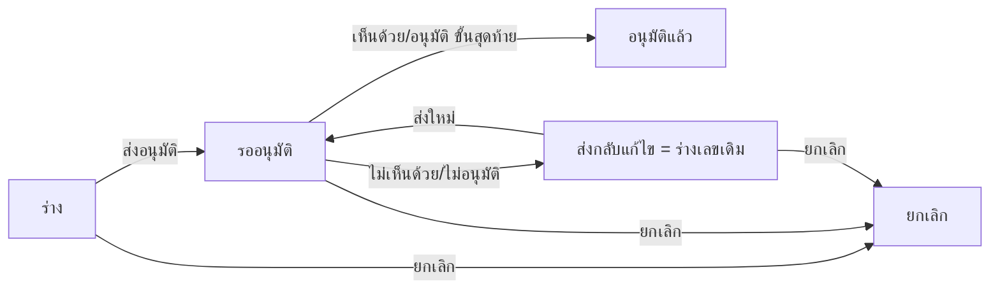

# BRD: แบบประเมินและคัดเลือกผู้ขาย/ผู้ให้บริการ ประจำปี (Annual Vendor/Service Provider Evaluation and Selection)

| Field | Value |
|---|---|
| BRD ID | BRD-PUR-VEV-001 |
| Feature | F-TMP-004 (รหัสชั่วคราว) แบบประเมินและคัดเลือกผู้ขาย/ผู้ให้บริการ ประจำปี |
| BRD Type | New Feature (แบบ 2 · ดึงข้อมูลเดิม) |
| Version | 1.0 |
| Status | **APPROVED (Prebrief Mode · Lane)** — DEC แทน Scope Lock จนมีใบเซ็นลูกค้า |
| Module | Purchase (Core Cube · Operation) |
| Customer | แบบฟอร์มลูกค้า FM-PUR-01 REV.00 : 01/07/2569 (แผนกจัดซื้อ) |
| Request | REQ-TMP-004 (ชั่วคราว — รอเลขจริงจาก F186) |
| Input | PREBRIEF_REQ-TMP-004_v2 · FORM_SPEC.json (16 ช่อง · ERROR 0) · DECISIONS.lock (17 DEC · พร้อมเริ่มทำ) · feature.html (audit FAIL 0 · smoke jsdom 38/38 · [NO-BROWSER] e2e ยังไม่รัน) |
| Created / Updated | 2026-10-10 |

## Changelog
- v1.0 (2026-10-10): สร้างผ่าน brd-generator-full v2.3 Prebrief Mode (doc-master-pipeline ขั้น 7 · โหมดไม่เฝ้า)

---

## 1. Business Context
### 1.1 ปัญหา / โอกาส
แผนกจัดซื้อประเมินผู้ขาย/ผู้ให้บริการประจำปีด้วยกระดาษ FM-PUR-01 (Excel) — ผู้ประเมินให้คะแนน 4 หัวข้อ (ส่งมอบ 3 · คุณภาพ 4 · บริการหลังการขาย 2 · เอกสาร 1 รวม 10) แล้วติ๊กสรุปผลผ่าน/ไม่ผ่านเอง (เกณฑ์ 6) · คะแนนรวมคำนวณมือ ติ๊กผลขัดกับคะแนนได้ · กรณีไม่ผ่านต้องให้ "ผู้จัดการฝ่ายจัดซื้อ และผู้บริหาร" พิจารณา แต่กระดาษไม่มีช่องลงชื่อผู้บริหาร · ค้นย้อนหลังว่าผู้ขายรายไหนไม่ผ่านต้องเปิดแฟ้ม
### 1.2 เป้าหมาย
1. ขึ้นแบบฟอร์มเป็นเอกสารในระบบ ช่องตรงกระดาษ 1:1 ลูกค้าจำแบบเดิมได้ (PDF Replica)
2. ระบบรวมคะแนนและสรุปผลผ่าน/ไม่ผ่านให้เอง (ห้ามติ๊กขัดกับคะแนน) · คะแนนเกินคะแนนเต็มบันทึกไม่ได้
3. ผู้จัดทำ (แผนกจัดซื้อ) เห็นด้วย → ผู้จัดการแผนกจัดซื้ออนุมัติ ผ่านสาย DOA กลาง (dynamic) · ไม่ผ่าน → เพิ่มขั้นผู้บริหาร + แจ้งทันที
### 1.3 ตัวชี้วัด
ไม่มีใน input → **OQ-01** (ห้ามแต่งตัวเลข)
### 1.4 ที่มา
แบบฟอร์มลูกค้า FM-PUR-01 (ไฟล์ .xls ตั้งชื่อเป็น .xlsx) → FORM_SPEC 16 ช่อง (ระบบ 3 · กรอก 9 · คำนวณ 3 · ระบบใส่ 1) · แถวซ้ำ 1 กลุ่ม (หัวข้อประเมิน 4) · ตัวเลือก 5 · ลายเซ็น 3 · gate 10 หมวด = AI-DEFAULT ทั้งหมด (โหมดไม่เฝ้า)

## 2. Scope
### 2.1 In Scope
- รายการแบบประเมิน (segmented ทั้งหมด/รอฉันพิจารณา · ค้นหาเลขที่/ผู้ขาย/ผู้ประเมิน · กรองสถานะ/ผลประเมิน · CSV)
- สร้าง/แก้ไข wizard 3 ขั้น: ผู้ขาย (ชื่อ · รหัส · ☐สินค้า ☐บริการ + ระบุ · เลขที่อ้างอิง · เงื่อนไขการชำระเงิน) → ให้คะแนน 4 หัวข้อจาก config (รวม + สรุปผลสด) → มาตรฐานที่ได้รับรอง 8 ตัวเลือก (+อื่นๆ ระบุ) → ความคิดเห็น · บันทึกร่างได้
- ส่งอนุมัติ DOA (เลือกคนต่อขั้น) · เห็นด้วย/ไม่เห็นด้วย (ผู้จัดทำ) · อนุมัติ/ไม่อนุมัติ (ผู้จัดการ/ผู้บริหาร) · ไม่เห็นด้วย/ไม่อนุมัติ = กลับร่างเลขเดิม · ยกเลิก (เหตุผลบังคับ)
- ผลไม่ผ่าน → สายอนุมัติเพิ่มขั้นผู้บริหาร (เงื่อนไขที่ DOA กลาง — TODO: DOA engine) + แจ้ง vev_evaluation_failed
- เตือนผู้ขายรหัสเดียวกันมีใบในปีเดียวกันแล้ว (ไม่บล็อก)
- แนบไฟล์ · PDF FM-PUR-01 Replica 2 หน้าทุกสถานะ · เลขที่ VEV จาก ENG-DOC-NUM
### 2.2 Out of Scope
- เลือกผู้ขายจาก Vendor master / อัปเดตสถานะผู้ขาย (Approved Vendor List) ตามผล (Master › Supplier/Vendor ยังไม่มี · DEC-01/02 → OQ-03) · ดึงคะแนนอัตโนมัติจาก PO/GRN · หน้าตั้งค่าเกณฑ์ประเมิน (VendorEvaluationConfig — เสนอ feature ใหม่ OQ-04) · ทำซ้ำเอกสาร (G10 ✗ — prototype มีปุ่มทำซ้ำของ archetype → OQ-07) · ประกาศ
### 2.3 Assumptions
- ข้อมูลผู้ประเมิน/ตำแหน่ง/แผนกมีใน F-EMP-001 / F-ORG-001 · หัวข้อ/คะแนนเต็ม/เกณฑ์ผ่าน/รายการมาตรฐานอ่านจาก config ของ feature นี้ (ค่าเริ่ม = ถ้อยคำบนกระดาษ) · ผู้ประเมิน = ผู้สร้างใบ (ผู้ใช้สินค้า/บริการ หรือเจ้าหน้าที่จัดซื้อ)
### 2.4 Scope Lock (ชั่วคราว = DECISIONS.lock · ยังไม่มีใบเซ็น → OQ-02)
| DEC | หมวด | มติ | ที่มา |
|---|---|---|---|
| DEC-01 | G1 | อนุมัติแล้วไม่เปลี่ยนค่าในระบบ | AI-DEFAULT |
| DEC-02 | G1 | ไม่ส่งต่อระบบอื่นรอบนี้ (ประกาศ event ใน FRD ไม่ยิง) | AI-DEFAULT |
| DEC-03 | G2 | DOA dynamic · ค่าเริ่ม 2 ขั้น role-pur-officer (ผู้จัดทำ แผนกจัดซื้อ) → role-mgr-pur (ผู้จัดการแผนกจัดซื้อ) · ไม่มีวงเงิน | AI-DEFAULT |
| DEC-04 | G3 | หัวข้อ/คะแนนเต็ม/เกณฑ์ผ่าน/มาตรฐานจาก VendorEvaluationConfig · คะแนน 0..คะแนนเต็ม ทศนิยม 1 · เกิน = บล็อก · ครบทุกหัวข้อก่อนส่ง · รวม+สรุปผลคำนวณ (แก้เองไม่ได้) · ไม่ผ่าน = เตือน + ขั้นผู้บริหาร · ประเภท ≥1 + ระบุ · อื่นๆ ต้องระบุ · ผู้ขายซ้ำในปี = เตือน | AI-DEFAULT |
| DEC-05 | G4 | หัวข้อประเมินมาจาก config (ไม่เพิ่ม/ลบแถวเอง) · PDF ≥4 แถว | AI-DEFAULT |
| DEC-06 | G5 | ช่อง 1:1 ไม่เพิ่มช่อง · คงคำ "คะแนนเฉลี่ย" · แก้สะกด 5 คำ | AI-DEFAULT |
| DEC-07 | G6 | ลายเซ็นแถวล่าง 1 ช่อง/ขั้น DOA · ข้อความ "ส่ง/พิจารณาในระบบ" · คำตัดสินผูก role | AI-DEFAULT |
| DEC-08 | G7 | ไม่เห็นด้วย/ไม่อนุมัติ = กลับร่างเลขเดิม · ยกเลิก: เจ้าของ + admin · ร่าง/รออนุมัติ · เหตุผลบังคับ | AI-DEFAULT |
| DEC-09 | G8 | เจ้าของ · ผู้อนุมัติเห็นหลังส่ง · admin (role-mgr-pur) เห็นทั้งหมด | AI-DEFAULT |
| DEC-10 | G9 | ออกเลขตอนบันทึกครั้งแรก · รหัส VEV | AI-DEFAULT |
| DEC-11 | G10 | แนบไฟล์ ✓ · CSV ✓ · ทำซ้ำ ✗ · ประกาศ ✗ | AI-DEFAULT |
| DEC-12 | VALID | คอลัมน์ "คะแนนเฉลี่ย" = คะแนนเต็ม · คะแนนที่ได้ ≤ คะแนนเต็ม (บล็อก) · เสนอเปลี่ยนคำเป็น "คะแนนเต็ม" | FORM_SPEC |
| DEC-13 | VALID | สรุปผลระบบติ๊กจากคะแนนรวม · < 6 = ไม่ผ่าน | FORM_SPEC |
| DEC-14 | VALID | ไม่ผ่าน → สายเพิ่มขั้นผู้บริหาร (TODO: DOA engine) · ช่องลายเซ็น PDF ตามขั้นจริง | FORM_SPEC |
| DEC-15 | VALID | คะแนน 0..คะแนนเต็ม ทศนิยม 1 · ครบ 4 หัวข้อก่อนส่ง (บล็อก) | FORM_SPEC |
| DEC-16 | VALID | แก้สะกด Pratice · เครื่อหมาย · มาตราฐาน · อุสาหกรรม · Quatation | FORM_SPEC |
| DEC-17 | VALID | ยึด Doc No. FM-PUR-01 (ชื่อชีต PUR-FM-001 / ไฟล์ .xls) | FORM_SPEC |

## 3. Roles & Permissions (COSO)
| Role | COSO | ทำอะไร |
|---|---|---|
| ผู้ประเมิน (Evaluated by) | Maker | สร้าง/แก้ไข/ให้คะแนน · ส่ง · ยกเลิกของตัวเอง (ร่าง/รออนุมัติ/ส่งกลับ) |
| role-pur-officer (ผู้จัดทำ · แผนกจัดซื้อ) ⚠ นอก DOA master | Checker | ขั้น 1 เห็นด้วย / ไม่เห็นด้วย |
| role-mgr-pur (ผู้จัดการแผนกจัดซื้อ) | Approver + Admin view | ขั้น 2 อนุมัติ / ไม่อนุมัติ · เห็นทั้งหมด · ยกเลิกได้ · CSV |
| role-gm (ผู้บริหาร · เฉพาะผลไม่ผ่าน) | Approver | ขั้นเพิ่ม อนุมัติ / ไม่อนุมัติ · รับแจ้งไม่ผ่าน |

| Action | Maker | Pur-officer | Mgr-PUR | GM |
|---|:-:|:-:|:-:|:-:|
| ดูใบ | ของตน | หลังส่ง (อยู่ในสาย) | ทั้งหมด | หลังส่ง (อยู่ในสาย) |
| สร้าง/แก้ไข | ✓ ของตน (ร่าง/ส่งกลับ) | – | – | – |
| ตัดสินขั้น | – | ขั้นของตน | ขั้นของตน | ขั้นของตน |
| ยกเลิก | ✓ ของตน | – | ✓ | – |
SoD: ผู้ประเมิน (ผู้ส่ง) พิจารณาใบตัวเองไม่ได้ (BR-DOA-04)

## 4. User Journey
### 4.1 Happy Path
1. ผู้ประเมิน: สร้าง → กรอกชื่อ/รหัสผู้ขาย · เลือกสินค้า/บริการ + ระบุ → ให้คะแนน 4 หัวข้อ (เห็นคะแนนรวม + ผ่าน/ไม่ผ่านสด) → มาตรฐาน → ความคิดเห็น → แนบไฟล์ → ตรวจสอบ → บันทึกและส่งอนุมัติ (ได้เลข VEV)
2. ผู้จัดทำ (แผนกจัดซื้อ) เห็นด้วย → ผู้จัดการแผนกจัดซื้ออนุมัติ → อนุมัติแล้ว · PDF เก็บสำเนา (approved_final)
### 4.2 Alternative
- คะแนนรวม < 6 → สรุปผล "ไม่ผ่าน" + สายอนุมัติเพิ่มขั้นผู้บริหาร + แจ้งผู้จัดการแผนกจัดซื้อ/ผู้บริหารทันทีที่ส่ง
- ไม่เห็นด้วย / ไม่อนุมัติ (เหตุผลบังคับ) → ร่างเลขเดิม + แถบเหตุผล → ผู้ประเมินแก้ ส่งใหม่ (resolve สายใหม่ตามผลใหม่)
- บันทึกร่างได้แม้คะแนนไม่ครบ (ต้องมีชื่อ/รหัสผู้ขาย) · ส่งได้เมื่อครบ
- ยกเลิก (ร่าง/รออนุมัติ/ส่งกลับ) โดยเจ้าของหรือผู้จัดการแผนกจัดซื้อ

## 5. Data (จาก FORM_SPEC — ป้ายตามกระดาษ)
### 5.1 vendor_evaluation (header)
| ช่องบนกระดาษ | field | ชนิด | ที่มา | บังคับ |
|---|---|---|---|:-:|
| (เลขที่ — ระบบเพิ่มใน footer) | doc_no | text | auto ENG-DOC-NUM | ✓ |
| โลโก้หัวกระดาษ | header_snapshot | jsonb | system F-ORG-001 (snapshot ตอนออกเลข) | ✓ |
| ชื่อผู้ขาย/ผู้ให้บริการ (Supplier Name) | vendor_name | text | user (Vendor master ยังไม่มี) | ✓ |
| รหัสผู้ขาย/ผู้ให้บริการ (Vendor Code) | vendor_code | text | user | ✓ |
| ☐ สินค้า : (Goods Specific) | supply_goods · goods_specific | bool · text | user | ≥1 ประเภท · ระบุเมื่อเลือก |
| ☐ บริการ : (Service Specific) | supply_service · service_specific | bool · text | user | ≥1 ประเภท · ระบุเมื่อเลือก |
| เลขที่อ้างอิง (Reference No./Request No./Quotation No) | reference_no | text | user | – |
| เงื่อนไขการชำระเงิน (Credit Term) | credit_term | text | user | – |
| คะแนนรวม (คะแนนเฉลี่ย / คะแนนที่ได้) | max_total · score_total | numeric(4,1) | computed | ✓ |
| สรุปผลการประเมิน (Evaluate Summary) | eval_result | enum(pass, fail) | computed | ✓ เมื่อส่ง |
| ระบบการบริหารงานที่ได้รับรองมาตรฐานต่างๆ | certifications · cert_other_text | text[] · text | user | – |
| ผู้ประเมิน · Evaluated by · Date | evaluator_id + name/position/dept snapshot · evaluated_at | ref · datetime | system F-EMP-001 · auto (ตอนส่ง) | ✓ |
| ความคิดเห็นผู้ประเมิน (เพิ่มเติม) | evaluator_comment | text | user | – |
| ผู้จัดทำ (แผนกจัดซื้อ) ☐เห็นด้วย ☐ไม่เห็นด้วย · อนุมัติ (ผู้จัดการแผนกจัดซื้อ) ☐อนุมัติ ☐ไม่อนุมัติ | approval_chain | jsonb | DOA | ✓ เมื่อส่ง |
| + DOA fields | approval_status · doa_ref · approver_role · approved_by · approved_at | | DOA | |
| + returned_reason · returned_by · returned_at | | | DEC-08 | |
### 5.2 vendor_evaluation_score (แถวต่อหัวข้อ)
| field | ชนิด | หมายเหตุ |
|---|---|---|
| criterion_id | ref VendorEvaluationConfig.criteria | ลำดับ + ถ้อยคำ + เกณฑ์ย่อย + max_score snapshot ตอนสร้างใบ |
| max_score | numeric(3,1) | คอลัมน์ "คะแนนเฉลี่ย" บนกระดาษ (DEC-12) |
| score | numeric(3,1) | 0 ≤ score ≤ max_score · ทศนิยม 1 (DEC-15) |
### 5.3 attachments → Document Center (ระดับใบ)

## 6. User Stories
| ID | Story | AC หลัก |
|---|---|---|
| S-01 | ผู้ประเมินสร้างแบบประเมินผู้ขาย | ชื่อ+รหัสผู้ขายบังคับ · บันทึกร่างได้เลข VEV |
| S-02 | ผู้ประเมินระบุประเภทสินค้า/บริการ | เลือกได้ทั้งสอง · เลือกแล้วต้องระบุรายละเอียด · ไม่เลือกเลย = บล็อกส่ง |
| S-03 | ผู้ประเมินให้คะแนนตามหัวข้อ | 0..คะแนนเต็ม ทศนิยม 1 · เกิน/รูปแบบผิด = error ที่แถว · คะแนนรวมอัปเดตสดไม่เสีย focus |
| S-04 | ระบบสรุปผลการประเมิน | ครบทุกหัวข้อ → ≥6 ผ่าน / <6 ไม่ผ่าน · ผู้ใช้แก้ผลเองไม่ได้ |
| S-05 | ผู้ประเมินระบุมาตรฐานที่ได้รับรอง | เลือกหลายตัว · อื่นๆ ต้องระบุชื่อ |
| S-06 | ผู้ประเมินส่งอนุมัติ | slot ตามจำนวนขั้น DOA (ผลไม่ผ่าน = +ผู้บริหาร) · ค่าเริ่มจาก resolve · ตัวเองไม่อยู่ในรายชื่อ |
| S-07 | ผู้จัดทำ (แผนกจัดซื้อ) เห็นด้วย / ไม่เห็นด้วย | ปุ่มเฉพาะผู้พิจารณาขั้นปัจจุบัน · ไม่เห็นด้วย = เหตุผลบังคับ → ร่างเลขเดิม |
| S-08 | ผู้จัดการแผนกจัดซื้อ (และผู้บริหารกรณีไม่ผ่าน) อนุมัติ / ไม่อนุมัติ | เรียงขั้น · ครบ = อนุมัติแล้ว ล็อกแก้ไข |
| S-09 | ผู้จัดการ/ผู้บริหารรับแจ้งผู้ขายไม่ผ่าน | ส่งใบที่ผลไม่ผ่าน → vev_evaluation_failed (in-app+email) |
| S-10 | พิมพ์/ดาวน์โหลด PDF FM-PUR-01 | 2 หน้าทุกสถานะ · ☑ ตามข้อมูล · ลายเซ็น = ผู้ประเมิน + 1 ช่อง/ขั้น DOA (คำตัดสินตาม role) |
| S-11 | ยกเลิกเอกสาร | เจ้าของ/ผู้จัดการแผนกจัดซื้อ · ร่าง/รออนุมัติ/ส่งกลับ · เหตุผลบังคับ |
| S-12 | ผู้จัดการแผนกจัดซื้อดูทุกใบ + CSV | กรองสถานะ/ผลประเมิน · CSV มีคะแนนรายหัวข้อ |
| S-13 | ระบบเตือนประเมินซ้ำ | ผู้ขายรหัสเดียวกันมีใบปีเดียวกัน (ไม่นับยกเลิก) → เตือน ไม่บล็อก |

## 7. Status & Lifecycle
| จาก | Action | ไป | ใคร |
|---|---|---|---|
| — | บันทึกครั้งแรก | draft | Maker |
| draft / returned | แก้ไข | (เดิม) | Maker |
| draft / returned | ส่ง (คะแนนครบ) | pending (ขั้น 1) | Maker |
| pending | เห็นด้วย/อนุมัติ ขั้น n<N | pending (ขั้น n+1) | ผู้พิจารณาขั้น n |
| pending | อนุมัติ ขั้น N | approved | ขั้น N |
| pending | ไม่เห็นด้วย/ไม่อนุมัติ | returned (= ร่าง เลขเดิม) | ผู้พิจารณาขั้นปัจจุบัน |
| draft / pending / returned | ยกเลิก | cancelled | Maker / Mgr-PUR |
approved = ล็อกแก้ไข ยกเลิกไม่ได้

## 8. Business Rules + Validation
| ID | Rule | Tag | Type |
|---|---|:-:|---|
| BR-01 | หัวข้อ + เกณฑ์ย่อย + คะแนนเต็ม อ่านจาก VendorEvaluationConfig.criteria ณ วันสร้าง (snapshot ลงใบ) | CONFIGURABLE | Master (DEC-04) |
| BR-02 | คะแนนที่ได้ 0..คะแนนเต็มของหัวข้อ ทศนิยมไม่เกิน 1 · เกิน = บล็อก | FIXED | DEC-12/15 (VALID) |
| BR-03 | ต้องให้คะแนนครบทุกหัวข้อก่อนส่ง (ร่างไม่บังคับครบ) | FIXED | DEC-15 (VALID) |
| BR-04 | คะแนนรวม = Σ คะแนนที่ได้ · สรุปผล = รวม < pass_threshold (6) ? ไม่ผ่าน : ผ่าน — คำนวณล้วน | FIXED (เกณฑ์ CONFIGURABLE) | DEC-04/13 |
| BR-05 | ไม่ผ่าน → DOA กลางเพิ่มขั้นผู้บริหาร (role-gm) · TODO: DOA engine (เงื่อนไขไม่ใช่วงเงิน) | CONFIGURABLE | DEC-14 [AI-DEFAULT role] |
| BR-06 | ไม่ผ่าน + ส่ง → vev_evaluation_failed ถึง role-mgr-pur + role-gm | CONFIGURABLE | DEC-14 · NTF |
| BR-07 | เลือกสินค้า และ/หรือ บริการ ≥1 · เลือกแล้วต้องระบุ | FIXED [AI-DEFAULT] | DEC-04 |
| BR-08 | รายการมาตรฐาน 8 ตัวเลือกจาก config · อื่นๆ ต้องระบุชื่อ | CONFIGURABLE | DEC-04 |
| BR-09 | ผู้ขายรหัสเดียวกันมีใบปีเดียวกัน (ไม่นับยกเลิก) → เตือน ไม่บล็อก | FIXED [AI-DEFAULT] | DEC-04 |
| BR-10 | สายอนุมัติ resolve จาก DOA ตอนส่ง แล้ว freeze | FIXED | DOA (BR-DOA-02) |
| BR-11 | ไม่เห็นด้วย/ไม่อนุมัติ → returned เลขเดิม · resolve ใหม่ตอนส่งรอบถัดไป | FIXED | DEC-08 |
| BR-12 | ออกเลขตอนบันทึกครั้งแรก · no-gap ✗ | CONFIGURABLE | DOCCFG (DEC-10) |
| BR-13 | ร่างเห็นเฉพาะเจ้าของ (+ ผู้จัดการแผนกจัดซื้อ) | FIXED | DEC-09 |
| BR-14 | ช่องลงชื่อ PDF = ผู้ประเมิน + 1 ช่องต่อขั้น DOA (dynamic) · แถวละ ≤4 · คำตัดสินตาม role (role-pur-officer = เห็นด้วย/ไม่เห็นด้วย · อื่น = อนุมัติ/ไม่อนุมัติ) | FIXED (จำนวน = DOA) | DEC-03 · DEC-07 |
| BR-15 | ช่องตามกระดาษ 1:1 · คงคำ "คะแนนเฉลี่ย" · แก้สะกด 5 คำ | FIXED [AI-DEFAULT] | DEC-06/16 |

| VR | ช่อง | เงื่อนไข | ข้อความ |
|---|---|---|---|
| VR-01 | vendor_name | required | กรุณากรอกข้อมูล |
| VR-02 | vendor_code | required | กรุณากรอกข้อมูล |
| VR-03 | ประเภท | ≥1 | เลือกสินค้า และ/หรือ บริการ อย่างน้อย 1 |
| VR-04 | goods_specific / service_specific | required เมื่อเลือกประเภทนั้น | กรุณากรอกข้อมูล |
| VR-05 | score[i] | required (ตอนส่ง) | กรอกคะแนน |
| VR-06 | score[i] | ตัวเลข ทศนิยม ≤1 | ตัวเลข ทศนิยมไม่เกิน 1 ตำแหน่ง |
| VR-07 | score[i] | ≤ max_score | เกินคะแนนเต็ม {max} |
| VR-08 | cert_other_text | required เมื่อเลือก อื่นๆ | ระบุชื่อมาตรฐาน |
| VR-09 | slot ผู้พิจารณา | ครบทุกขั้น · ≠ ผู้ประเมิน | กรุณาเลือกผู้พิจารณา |
| VR-10 | เหตุผล ไม่เห็นด้วย/ไม่อนุมัติ/ยกเลิก | required | กรุณาระบุเหตุผล |

### 8.5 ระดับความยืดหยุ่น
BR-01/04/08 → หน้าตั้งค่าเกณฑ์ประเมิน (เสนอ feature ใหม่ · OQ-04) · BR-05 → DOA กลาง (เงื่อนไขตามผล · OQ-05) · BR-06 → ENG-NOTIFY preference · BR-12 → F-DOCCFG · BR-14 → DOA กลาง

## 9. Edge Cases
| EC | กรณี | ผล |
|---|---|---|
| EC-01 | คะแนนรวมพอดี 6 | ผ่าน (มากกว่า หรือ เท่ากับ 6) |
| EC-02 | คะแนน 5.9 | ไม่ผ่าน + ขั้นผู้บริหาร |
| EC-03 | กรอก 3.5 ในหัวข้อเต็ม 3 / 2.25 / "ก" | บล็อก ชี้แถว |
| EC-04 | แก้คะแนนหลังถูกส่งกลับจากไม่ผ่าน → ผ่าน | ส่งใหม่ resolve 2 ขั้น (ไม่มีผู้บริหาร) |
| EC-05 | ร่างคะแนนไม่ครบแล้วกดส่งจากหน้าดู | เตือน + เปิดแก้ไข |
| EC-06 | ผู้ประเมินเป็นเจ้าหน้าที่จัดซื้อที่ resolve เป็นผู้จัดทำเอง | resolve เป็นคนอื่น · slot ไม่มีชื่อตัวเอง |
| EC-07 | แก้ DOA ระหว่างใบรออนุมัติ | ใช้สาย snapshot |
| EC-08 | ส่ง/ตัดสินชนกัน (stale) | 409 → toast รีเฟรช |
| EC-09 | แบบเอกสารปิดใช้ (F-DOCCFG) | ปุ่มสร้าง disabled + แถบแดง |
| EC-10 | config เกณฑ์เปลี่ยนกลางปี | ใบเดิมใช้หัวข้อ/คะแนนเต็ม snapshot |
| EC-11 | ผู้ขายเดียวกันประเมินซ้ำในปี | เตือน ไม่บล็อก |
| EC-12 | ยกเลิกสินค้า/บริการที่เลือกไว้ | ล้างช่องระบุของประเภทนั้น |

## 10. Value Stream & Downstream Impact
Positioning: Procure-to-Pay › Vendor Management — ประเมินผู้ขายประจำปี (**feature นี้**) → [ทะเบียนผู้ขายที่อนุมัติ (AVL) / Vendor master — ปิดรอบนี้]
| ปลายทาง | ข้อมูล | Trigger | หมายเหตุ |
|---|---|---|---|
| ผู้จัดการแผนกจัดซื้อ · ผู้บริหาร (ENG-NOTIFY) | ผู้ขายไม่ผ่าน + คะแนน | ส่งใบที่ผลไม่ผ่าน | vev_evaluation_failed ✓ รอบนี้ |
| Master › Supplier / Vendor | สถานะผ่าน/ไม่ผ่าน · มาตรฐาน · credit term | approved | **ปิดรอบนี้ (DEC-02)** — ประกาศ event `vev.evaluation_approved` ไม่ยิง |
| Purchase Order / Comparison Form | ผลประเมินล่าสุดของผู้ขาย | อ่าน | Phase 2 |
| F-DOCCFG / ENG-DOC-STORE | PDF snapshot | approved_final | |
| รายงาน | คะแนนเฉลี่ยต่อผู้ขาย · % ไม่ผ่าน | — | Report area อ่าน |

## 11. Delivery
Phase 1 = §2.1 ทั้งหมด · Phase 2 (เสนอ) = เลือกผู้ขายจาก Vendor master + อัปเดตสถานะ AVL · หน้าตั้งค่าเกณฑ์ · ดึงคะแนนส่งมอบจาก PO/GRN

## 12. Dev Summary "ใบสั่ง"
- Config: VendorEvaluationConfig (criteria · pass_threshold · certifications — ค่าเริ่มตามกระดาษ) · DOA entry F-TMP-004 (role-pur-officer → role-mgr-pur · เงื่อนไขไม่ผ่าน + role-gm) · doc_type VEV
- Declaration: DOA_BRIEF · NTF_BRIEF (vev_evaluation_failed · vev_cancelled) · DOCCFG_BRIEF · MDOC_BRIEF
- Screen Inventory: P-01 รายการ · P-02 สร้าง/แก้ไข (drawer wide 3 ขั้น) · P-03 ดู (drawer 4 แท็บ) · M-01..05 ส่ง/อนุมัติ/ไม่อนุมัติ/ยกเลิก/ทิ้งข้อมูล
- UI Signals: เอกสาร + พิมพ์ + ลายเซ็น = ใช่ · Q-form

## 13. Open Questions
| OQ | คำถาม | เจ้าของ | Block? |
|---|---|---|---|
| OQ-01 | ตัวชี้วัด (% ผู้ขายผ่าน · ระยะเวลาประเมิน) | ลูกค้า | ไม่ |
| OQ-02 | ลูกค้าเซ็นยืนยัน DEC-01..11 (AI-DEFAULT) — โดยเฉพาะสายอนุมัติ 2 ขั้น · ไม่ผ่าน = +ผู้บริหาร (role-gm?) · ไม่เห็นด้วย = กลับร่าง | Strike → ลูกค้า | ก่อน UAT |
| OQ-03 | เมื่อมี Vendor master: เลือกผู้ขายจาก master + ผลอนุมัติอัปเดตสถานะผู้ขาย (AVL) ไหม | ลูกค้า + พี่เบิร์ด | ไม่ (Phase 2) |
| OQ-04 | VendorEvaluationConfig อยู่ที่ไหน (Purchase Configuration?) | พี่เบิร์ด | ก่อน dev |
| OQ-05 | role-pur-officer ไม่อยู่ใน DOA master · DOA กลางรองรับเงื่อนไขตามผลประเมิน (ไม่ใช่วงเงิน) ไหม · "ผู้บริหาร" = role-gm หรือ role-proc-dir | Strike + พี่เบิร์ด | ก่อน wire |
| OQ-06 | เปลี่ยนหัวคอลัมน์ "คะแนนเฉลี่ย" เป็น "คะแนนเต็ม" ไหม (DEC-12) · กระดาษใช้ "ผู้จัดการฝ่าย" กับ "ผู้จัดการแผนก" ปนกัน | ลูกค้า | ไม่ |
| OQ-07 | ปุ่ม "ทำซ้ำ" ใน prototype (archetype) ขัด G10 ทำซ้ำ ✗ — เก็บหรือซ่อน | Strike | ไม่ |
| OQ-08 | function_code taxonomy ของ VEV (ใช้ F01 ชั่วคราว) · ได้รหัส feature จริง | Strike | ก่อน register |

## 14. Security & Compliance
Preset: Standard Operation · PII: ชื่อผู้ประเมิน/ผู้อนุมัติ (snapshot) · ข้อมูลผู้ขาย = ข้อมูลนิติบุคคล (ไม่ใช่ PII) — prototype ใช้ชื่อผู้ขาย/บุคคลสมมติทั้งหมด · Audit append-only ทุก action · SoD ผู้ประเมิน≠ผู้พิจารณา · ไฟล์แนบตาม file_policy Document Center

## 15. Health Check / Monitoring
SLA: ไม่กำหนดรอบนี้ (→ OQ-01) · KPI เสนอ: ใบรออนุมัติเกิน N วัน · จำนวนผู้ขายไม่ผ่านต่อปี · Widget: คะแนนเฉลี่ยต่อหัวข้อ

## 16. AI Review (C01–C23 · PE01–PE05)
C01 ✅ · C02 ✅ · C05 ✅ story ละ 1 การกระทำ · C10 ✅ ทุก BR มี Tag · C13 ✅ EC 12 · C18 ✅ WARNING → OQ · C19 ✅ §12 · C20 ✅ DEC ครบ 17 + OQ-02 รอใบเซ็น · C21 ✅ §10 · C22 ⚠️→OQ-01 (ไม่มีตัวชี้วัดใน input — ห้ามแต่ง) · C23 ✅ · PE01–PE05 ✅ · **สถานะ: APPROVED (Prebrief Mode)**

## Appendix — Screen List
P-01 `#/vendor-evaluation` · P-02 `#/vendor-evaluation/create` · `/edit/:id` · P-03 `#/vendor-evaluation/view/:id`
