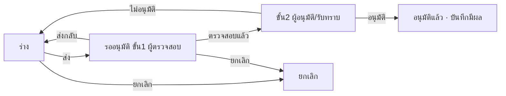

# BRD: แบบฟอร์มการบันทึกการยกระดับประเด็น (Issue Escalation Log)

| Field | Value |
|---|---|
| BRD ID | BRD-IVM-IVMI-001 |
| Feature | F-TMP-011 แบบฟอร์มการบันทึกการยกระดับประเด็น (รหัสชั่วคราว — รอ feature id จริง) |
| BRD Type | New Feature (แบบ 1 · ข้อมูลใหม่ทั้งหมด — ชื่อผู้จัดทำจาก F-EMP-001 · สายอนุมัติจาก DOA) |
| Version | 1.0 |
| Status | **APPROVED (Prebrief Mode · Lane · unattended)** — DEC แทน Scope Lock จนมีใบเซ็นลูกค้า · มติ AI-DEFAULT ทุกหมวด |
| Module | ฝ่ายบริหารการลงทุน (Investment Management) — module ใหม่ ยังไม่อยู่ใน Module Registry ของ DOA (OQ-03) |
| Customer | แบบฟอร์มลูกค้า FM-IVM-09 Rev.00 : 01/07/2569 (ขั้นตอนที่ 7: การติดตามคำถามและประเด็นคงค้าง) |
| Request | REQ-TMP-011 (ชั่วคราว — รอเลขจริงจาก F186) |
| Input | PREBRIEF_REQ-TMP-011_v2 · FORM_SPEC.json (11 ช่อง) · DECISIONS.lock (18 DEC · AI-DEFAULT 11 · พร้อมเริ่มทำ) · feature.html (html-generator-v9.4 · audit FAIL 0 · self_audit PASS · smoke 56/56 · NO-BROWSER) |
| Created / Updated | 2026-10-11 |

## Changelog
- v1.0 (2026-10-11): สร้างผ่าน brd-generator-full v2.3 Prebrief Mode (doc-master-pipeline ขั้น 7 · โหมดไม่เฝ้า)

---

## 1. Business Context
### 1.1 ปัญหา / โอกาส
ฝ่ายบริหารการลงทุนใช้ไฟล์ Excel FM-IVM-09 บันทึกประเด็นสำคัญที่ต้องเสนอผู้บริหารระดับสูง เนื่องจากกระทบต่อระยะเวลา ความเสี่ยง การตัดสินใจ หรือการปฏิบัติตามข้อกำหนด — ตาราง 10 คอลัมน์ 20 แถว · รหัสการยกระดับ ESC-001… พิมพ์ไว้ล่วงหน้า · ผลการพิจารณา / สถานะ เป็น dropdown 5 ค่า แต่ "มีข้อสั่งการแล้ว" ไม่มีช่องบันทึกข้อสั่งการ และ "ยกเลิก" ไม่มีเหตุผล · ไม่มีกติกากำหนดส่ง และไม่มีตัวบอกประเด็นที่เลยกำหนด · กระดาษไม่มีช่องระบุว่าเป็นบันทึกของโครงการใด · ไม่มีที่อ้างประเด็นคงค้างต้นเรื่อง (FM-IVM-03) · การตรวจทาน/อนุมัติ 3 ช่อง ส่งต่อด้วยมือ · ไฟล์กระจายในไดรฟ์ ตรวจย้อนหลังยาก
### 1.2 เป้าหมาย
1. ขึ้นแบบฟอร์มเป็นเอกสารในระบบ ช่องตรงกระดาษ 1:1 (+ ชื่อโครงการ / ธุรกรรม) · PDF Replica FM-IVM-09 2 หน้า
2. ระบบรันรหัส ESC- · บังคับหมายเหตุเมื่อมีข้อสั่งการแล้ว/ยกเลิก · กำหนดส่งต้องไม่ก่อนวันที่ · เตือนประเด็นเลยกำหนด
3. สายอนุมัติ 2 ขั้นจาก DOA กลาง (dynamic) · ประวัติ append-only · ค้นหา/กรองบันทึกที่มีประเด็นเลยกำหนดได้
### 1.3 ตัวชี้วัด
ไม่มีใน input → **OQ-01** (ห้ามแต่งตัวเลข)
### 1.4 ที่มา
แบบฟอร์มลูกค้า FM-IVM-09 (xlsx · ชื่อชีต INV-FM-09) → FORM_SPEC 11 ช่อง · แถวซ้ำ 1 ชุด (20 แถว) · ตัวเลือก 1 ชุด (ผลการพิจารณา / สถานะ 5 ค่า I13:I32) · ไม่มีสูตร · gate 10 หมวด = AI-DEFAULT ทั้งหมด (โหมดไม่เฝ้า)

## 2. Scope
### 2.1 In Scope
- รายการบันทึก (ค้นหา · กรองสถานะเอกสาร/ประเด็นเลยกำหนด · CSV) · สร้าง/แก้ร่าง wizard 3 ขั้น · ดูรายละเอียด 4 แท็บ (รายละเอียด › PDF Preview › ลายเซ็น/อนุมัติ › ประวัติ)
- ชื่อโครงการ / ธุรกรรม · บันทึกการยกระดับประเด็น 10 คอลัมน์ (ไม่จำกัดแถว)
- ส่งอนุมัติ DOA 2 ขั้น (เลือกคนต่อขั้น) · ตรวจสอบแล้ว/ส่งกลับ → กลับร่าง · อนุมัติ/ไม่อนุมัติ · ยกเลิก (เหตุผลบังคับ)
- แนบไฟล์ระดับใบ · PDF FM-IVM-09 Replica 2 หน้าทุกสถานะ · เลขที่ IVMI จาก ENG-DOC-NUM
### 2.2 Out of Scope
- เชื่อมแบบฟอร์มเริ่มต้นธุรกรรม FM-IVM-01 / ทะเบียนโครงการ (ชื่อโครงการกรอกเอง · OQ-05) · ดึงประเด็นคงค้างจาก FM-IVM-03 อัตโนมัติ (อ้าง OI-xxx ในข้อความเอง · OQ-07) · อัปเดตผลการพิจารณา/ข้อสั่งการหลังอนุมัติแบบไม่ผ่านสายอนุมัติ (OQ-08) · แจ้งเตือนกำหนดส่งรายวัน · ทำซ้ำ (DEC-11 ✗)
### 2.3 Assumptions
- ข้อมูลพนักงาน/ตำแหน่งมีใน F-EMP-001 / F-ORG-001 · DOA กลางเพิ่ม module/role ของฝ่ายบริหารการลงทุนได้ (OQ-03) · "เสนอต่อ" / "ผู้รับผิดชอบดำเนินการ" ในแถวเป็นข้อความ (ผู้บริหาร/คน/หน่วยงาน)
### 2.4 Scope Lock (ชั่วคราว = DECISIONS.lock · ยังไม่มีใบเซ็น → OQ-02)
| DEC | หมวด | มติ | ที่มา | ใช้ที่ |
|---|---|---|---|---|
| DEC-01 | G1 | อนุมัติแล้วไม่เปลี่ยนค่าในระบบ | AI-DEFAULT | html, thai-doc, brd, frd, tests, ntf-declaration |
| DEC-02 | G1 | ไม่ส่งต่อระบบอื่นรอบนี้ (ประกาศ event ไว้ใน FRD แต่ไม่ยิง) | AI-DEFAULT | brd, frd |
| DEC-03 | G2 | สายอนุมัติตั้งที่ DOA กลาง (dynamic) · ค่าเริ่ม 2 ขั้น: role-line-manager, role-gm · วงเงิน: ไม่มี | AI-DEFAULT | html, doa-declaration, frd, tests |
| DEC-04 | G3 | คำนวณให้อัตโนมัติ ผู้ใช้ปรับได้ · เกินเกณฑ์ = เตือน · รหัสการยกระดับ (ESC-001…) ระบบรันต่อใบอัตโนมัติ เรียงตามลำดับแถว · ผลการพิจารณา / สถานะ = มีข้อสั่งการแล้ว หรือ ยกเลิก → ต้องกรอกหมายเหตุ (ข้อสั่งการ/เหตุผล) (บล็อก) · กำหนดส่งต้องไม่ก่อนวันที่ยกระดับ (บล็อก) · เลยกำหนดส่ง และสถานะยังไม่ ปิดประเด็น / ยกเลิก → แสดงเตือน ไม่บล็อก · ต้องมีประเด็นอย่างน้อย 1 แถวก่อนส่ง (บล็อกตอนส่ง) | AI-DEFAULT | html, thai-doc, brd, frd, tests |
| DEC-05 | G4 | บันทึกการยกระดับประเด็น: ไม่จำกัดจำนวนแถว · PDF อย่างน้อย 20 แถวตามกระดาษ | AI-DEFAULT | html, thai-doc, frd |
| DEC-06 | G5 | ช่องตรงกระดาษ 1:1 · เพิ่ม: ชื่อโครงการ / ธุรกรรม (F01 · กระดาษไม่มีช่องระบุโครงการ) | AI-DEFAULT | html, thai-doc, brd, frd |
| DEC-07 | G6 | ลายเซ็นแถวล่าง 1 ช่องต่อขั้น DOA · ไม่ใช้ภาพลายมือชื่อ (ข้อความส่งในระบบ/พิจารณาในระบบ) | AI-DEFAULT | thai-doc, html, doccfg-declaration, frd |
| DEC-08 | G7 | ไม่อนุมัติ = กลับเป็นร่าง แก้แล้วส่งใหม่ · ยกเลิกได้โดย owner, admin_role สถานะ draft, pending · ต้องมีเหตุผล | AI-DEFAULT | html, frd, tests, doa-declaration |
| DEC-09 | G8 | มองเห็น: เจ้าของ · ผู้อนุมัติเห็นหลังส่ง · admin role เห็นทั้งหมด | AI-DEFAULT | html, frd, tests |
| DEC-10 | G9 | ออกเลขเมื่อบันทึกครั้งแรก · รหัส IVMI | AI-DEFAULT | doccfg-declaration, html, frd |
| DEC-11 | G10 | ของเสริม (กระดาษไม่มี): แนบไฟล์, ส่งออก CSV | AI-DEFAULT | html, brd, frd, ntf-declaration |
| DEC-12 | VALID | กฎตรวจจากตัวอย่างลูกค้า: ยึด FM-IVM-09 ตาม footer เป็นรหัสแบบฟอร์ม (พบ: ชื่อชีตเป็น INV-FM-09 แต่ Doc. No. ท้ายกระดาษเป็น FM-IVM-09) | FORM_SPEC | html, frd, tests |
| DEC-13 | VALID | กฎตรวจจากตัวอย่างลูกค้า: ชื่อโครงการ / ธุรกรรม บังคับกรอก (ช่องเพิ่ม F01 · AI-DEFAULT รอลูกค้ายืนยัน) (พบ: ไม่มีช่องระบุว่าบันทึกนี้เป็นของโครงการ/ธุรกรรมใด (แถว 4 ว่าง)) | FORM_SPEC | html, frd, tests |
| DEC-14 | VALID | กฎตรวจจากตัวอย่างลูกค้า: ระบบรันเลขต่อใบอัตโนมัติ · 20 แถวเป็นขั้นต่ำบนกระดาษ · เพิ่มแถวได้ไม่จำกัด (พบ: พิมพ์เลข ESC-001…ESC-020 ไว้ล่วงหน้า + แถวว่างไม่มีเลข (แถว 33)) | FORM_SPEC | html, frd, tests |
| DEC-15 | VALID | กฎตรวจจากตัวอย่างลูกค้า: มีข้อสั่งการแล้ว / ยกเลิก → หมายเหตุบังคับ (ระบุข้อสั่งการ/เหตุผล) (บล็อก) (พบ: สถานะ มีข้อสั่งการแล้ว ไม่มีช่องบันทึกข้อสั่งการ · ยกเลิก ไม่มีช่องเหตุผล) | FORM_SPEC | html, frd, tests |
| DEC-16 | VALID | กฎตรวจจากตัวอย่างลูกค้า: อ้างรหัส OI-xxx ในข้อความประเด็นได้ · ยังไม่ลิงก์ FM-IVM-03 (G1) (พบ: ไม่มีที่อ้างถึงรายการประเด็นคงค้าง (FM-IVM-03) ที่เป็นต้นเรื่อง) | FORM_SPEC | html, frd, tests |
| DEC-17 | VALID | กฎตรวจจากตัวอย่างลูกค้า: กำหนดส่งต้องไม่ก่อนวันที่ (บล็อก) · เลยกำหนดและยังไม่ปิด/ยกเลิก → แสดงเตือน ไม่บล็อก (พบ: ไม่มีกติกาวันที่ (กำหนดก่อนวันที่ยกระดับได้) และไม่มีตัวบอกเลยกำหนด) | FORM_SPEC | html, frd, tests |
| DEC-18 | VALID | กฎตรวจจากตัวอย่างลูกค้า: ตัดช่องว่างท้าย (พบ: ชื่อแบบฟอร์มในเซลล์ C1 มีช่องว่างท้าย) | FORM_SPEC | html, frd, tests |

## 3. Roles & Permissions (COSO)
| Role | COSO | ทำอะไร |
|---|---|---|
| ผู้จัดทำ (ผู้ประสานงานบริหารการลงทุน / ผู้รับผิดชอบที่ได้รับมอบหมาย) | Maker | สร้าง/แก้ร่าง · ส่ง · ยกเลิกของตัวเอง (ร่าง/รออนุมัติ) |
| ผู้ตรวจสอบ — role-line-manager (บนกระดาษ: ผู้จัดการฝ่ายบริหารการลงทุน) | Checker | ขั้น 1 ตรวจสอบแล้ว / ส่งกลับ |
| ผู้อนุมัติ / รับทราบ — role-gm (บนกระดาษ: รองกรรมการผู้จัดการ / กรรมการผู้จัดการ / ผู้มีอำนาจตามตารางอำนาจอนุมัติ (ถ้ามี)) | Approver | ขั้น 2 อนุมัติ / ไม่อนุมัติ |
| admin role ฝ่ายบริหารการลงทุน (เจ้าหน้าที่ดูแลเอกสาร) | Monitor | เห็นทุกใบ · ยกเลิกได้ (ร่าง/รออนุมัติ) · CSV |

| Action | Maker | Checker | Approver | Admin |
|---|:-:|:-:|:-:|:-:|
| ดูใบ | ของตน | หลังส่ง (อยู่ในสาย) | หลังส่ง (อยู่ในสาย) | ทั้งหมด |
| สร้าง/แก้ร่าง | ✓ ของตน | – | – | – |
| ตัดสินขั้น | – | ขั้น 1 | ขั้น 2 | – |
| ยกเลิก | ✓ ของตน | – | – | ✓ |
SoD: ผู้จัดทำพิจารณาใบตัวเองไม่ได้ (BR-DOA-04) · role จริงต้องเทียบ DOA master (OQ-03)

## 4. User Journey
### 4.1 Happy Path
1. ผู้จัดทำ: สร้าง → ใส่ชื่อโครงการ / ธุรกรรม → เพิ่มประเด็น (วันที่ · ประเด็นที่ยกระดับ · ผลกระทบ · การตัดสินใจที่ต้องการ · เสนอต่อ · ผู้รับผิดชอบดำเนินการ · กำหนดส่ง · ผลการพิจารณา / สถานะ · หมายเหตุ — รหัสการยกระดับระบบรัน) → แนบไฟล์ → บันทึก (ได้เลข IVMI) → ส่ง เลือกคน 2 ขั้น
2. ขั้น 1 ตรวจสอบแล้ว → ขั้น 2 อนุมัติ → **อนุมัติแล้ว (บันทึกมีผล)** · PDF เก็บสำเนา (approved_final) · แจ้งผู้รับผิดชอบดำเนินการ (ivmi_log_approved)
### 4.2 Alternative
- ส่งกลับ / ไม่อนุมัติ ขั้นใดก็ได้ → กลับร่าง เลขเดิม + เหตุผล → ผู้จัดทำแก้ ส่งใหม่ (resolve สายใหม่)
- ประเด็นเลยกำหนดส่งและยังไม่ปิด/ยกเลิก → แสดงเตือน ส่งได้
- ยกเลิก (ร่าง/รออนุมัติ) โดยเจ้าของหรือ admin → ถ้ารออนุมัติ แจ้งผู้พิจารณาขั้นปัจจุบัน (ivmi_cancelled)

## 5. Data (จาก FORM_SPEC — ป้ายตามกระดาษ)
### 5.1 ivm_escalation_log (header)
| ช่องบนกระดาษ | field | ชนิด | ที่มา | บังคับ |
|---|---|---|---|:-:|
| (เลขที่ — ระบบเพิ่ม footer) | doc_no | text | auto ENG-DOC-NUM | ✓ |
| ชื่อโครงการ / ธุรกรรม (ช่องเพิ่ม · DEC-06/13) | project_name | text | user | ✓ |
| ผู้จัดทำ (ชื่อ/ตำแหน่ง) | maker_id · maker_name_snapshot · maker_position_snapshot | ref | system F-EMP-001 | ✓ |
| + DOA fields | approval_status · doa_ref · approval_chain (jsonb snapshot) · approver_role · approved_by · approved_at | | DOA | |
| + returned_reason · returned_by · returned_at · cancel_reason | | | DEC-08 | |
### 5.2 ivm_escalation_item (บันทึกการยกระดับประเด็น — 10 คอลัมน์ตามกระดาษ)
| รหัสการยกระดับ `esc_no` (auto ESC-001…) | วันที่ `esc_date` (✓ ค่าเริ่ม วันนี้) | ประเด็นที่ยกระดับ `issue` (✓) | ผลกระทบ `impact` (✓) | การตัดสินใจที่ต้องการ `decision_needed` (✓) | เสนอต่อ `escalate_to` (✓ text) | ผู้รับผิดชอบดำเนินการ `action_owner` (✓ text) | กำหนดส่ง `due_date` (✓ ≥ esc_date) | ผลการพิจารณา / สถานะ `status` (✓ enum 5 · ค่าเริ่ม เสนอแล้ว) | หมายเหตุ `remark` (✓ เมื่อมีข้อสั่งการแล้ว/ยกเลิก) |
### 5.3 attachments → Document Center (ไฟล์ระดับใบ)
### 5.4 ข้อความคงที่บนกระดาษ (ไม่ใช่ช่อง)
ใช้ในขั้นตอน · วัตถุประสงค์ · ผู้จัดทำ/ผู้ตรวจสอบ/ผู้อนุมัติ (คำอธิบาย) · หมายเหตุการใช้งาน · ประวัติการแก้ไข (= revision ของแบบฟอร์มจาก F-DOCCFG ไม่ใช่ข้อมูลใบ)

## 6. User Stories
| ID | Story | AC หลัก |
|---|---|---|
| S-01 | ผู้จัดทำสร้างบันทึกของโครงการ | ชื่อโครงการบังคับ · ≥1 ประเด็น · บันทึกได้เลข IVMI |
| S-02 | ผู้จัดทำบันทึกประเด็นที่ยกระดับ | วันที่/ประเด็น/ผลกระทบ/การตัดสินใจที่ต้องการ/เสนอต่อ/ผู้รับผิดชอบดำเนินการ/กำหนดส่งบังคับ · รหัสการยกระดับระบบรัน |
| S-03 | ผู้จัดทำบันทึกผลการพิจารณา / สถานะ | 5 ค่าตามแบบฟอร์ม · มีข้อสั่งการแล้ว → หมายเหตุ (ข้อสั่งการ) บังคับ · ยกเลิก → หมายเหตุ (เหตุผล) บังคับ |
| S-04 | ผู้จัดทำเห็นประเด็นเลยกำหนด | กำหนดส่ง < วันนี้ และยังไม่ปิด/ยกเลิก → เตือน ส่งได้ · กำหนดส่งก่อนวันที่ → บล็อก |
| S-05 | ผู้จัดทำแนบไฟล์ | ไฟล์ระดับใบ ≤20MB · pdf/doc/xls/รูป |
| S-06 | ผู้จัดทำส่งอนุมัติ | slot 2 ขั้นค่าเริ่มจาก DOA · ผู้จัดทำไม่อยู่ในรายชื่อ · บังคับเลือกครบ |
| S-07 | ผู้ตรวจสอบตัดสิน | ปุ่มเฉพาะขั้นปัจจุบัน · ตรวจสอบแล้ว / ส่งกลับ (เหตุผลบังคับ) → กลับร่าง |
| S-08 | ผู้อนุมัติตัดสินขั้นสุดท้าย | อนุมัติ → บันทึกมีผล + แจ้งผู้รับผิดชอบดำเนินการ · ไม่อนุมัติ → กลับร่าง |
| S-09 | พิมพ์/ดาวน์โหลด PDF FM-IVM-09 | ทุกสถานะ 2 หน้า · ≥20 แถว · ลายเซ็น = ผู้จัดทำ + 1 แถวต่อขั้นตาม DOA (dynamic) |
| S-10 | ยกเลิก | เจ้าของ/admin · ร่างหรือรออนุมัติ · เหตุผลบังคับ |
| S-11 | admin ดูทุกใบ + CSV | กรองสถานะ/ประเด็นเลยกำหนด |

## 7. Status & Lifecycle
| จาก | Action | ไป | ใคร |
|---|---|---|---|
| — | บันทึกครั้งแรก | draft | Maker |
| draft | ส่ง | pending (ขั้น 1) | Maker |
| pending | ตรวจสอบแล้ว/อนุมัติ ขั้น n<N | pending (ขั้น n+1) | ผู้พิจารณาขั้น n |
| pending | อนุมัติขั้น N | approved | ขั้น N |
| pending | ส่งกลับ / ไม่อนุมัติ | draft (เลขเดิม · returned_*) | ผู้พิจารณาขั้นปัจจุบัน |
| draft / pending | ยกเลิก | cancelled | Maker / Admin |
approved = ล็อกแก้ไข (ไม่มียกเลิก) · อัปเดตผลการพิจารณาหลังอนุมัติ = OQ-08 · สถานะเอกสาร (ร่าง/รออนุมัติ/อนุมัติแล้ว/ยกเลิก) แยกจาก ผลการพิจารณา / สถานะ ต่อแถว

## 8. Business Rules + Validation
| ID | Rule | Tag | Type |
|---|---|:-:|---|
| BR-01 | รหัสการยกระดับ ESC-001… ระบบรันต่อใบตามลำดับแถว (ไม่พิมพ์ล่วงหน้า) | FIXED | Auto (DEC-04 · DEC-14) [AI-DEFAULT] |
| BR-02 | ผลการพิจารณา / สถานะ = มีข้อสั่งการแล้ว → หมายเหตุ (ข้อสั่งการ) บังคับ · = ยกเลิก → หมายเหตุ (เหตุผล) บังคับ | FIXED | Validation (DEC-04 · DEC-15) |
| BR-03 | กำหนดส่ง ≥ วันที่ | FIXED | Validation (DEC-04 · DEC-17) |
| BR-04 | เลยกำหนด (กำหนดส่ง < วันนี้ และสถานะยังไม่ ปิดประเด็น/ยกเลิก) → เตือน ไม่บล็อก | CONFIGURABLE | Warning (DEC-04 · DEC-17) [AI-DEFAULT] |
| BR-05 | ตัวเลือกตามแบบฟอร์ม: ผลการพิจารณา / สถานะ 5 ค่า (เสนอแล้ว · อยู่ระหว่างพิจารณา · มีข้อสั่งการแล้ว · ปิดประเด็น · ยกเลิก) | CONFIGURABLE | Master list |
| BR-06 | ต้องมีประเด็น ≥ 1 แถวก่อนบันทึก/ส่ง | FIXED | Validation (DEC-04) |
| BR-07 | สายอนุมัติ resolve จาก DOA ตอนส่ง แล้ว freeze | FIXED | DOA (BR-DOA-02) |
| BR-08 | ส่งกลับ/ไม่อนุมัติ → draft เลขเดิม · resolve ใหม่ตอนส่งรอบถัดไป | FIXED | DEC-08 (BR-DOA-03) |
| BR-09 | ออกเลขตอนบันทึกครั้งแรก · no-gap ✗ · รหัส IVMI | CONFIGURABLE | DOCCFG (DEC-10) |
| BR-10 | ร่างเห็นเฉพาะเจ้าของ (+ admin) | FIXED | Visibility (DEC-09) |
| BR-11 | ช่องลงชื่อใน PDF = ผู้จัดทำ + 1 แถวต่อขั้นที่ตั้งใน DOA (dynamic ไม่ fix) · คำตัดสินตาม role | FIXED (จำนวน = DOA) | DEC-03 · DEC-07 |
| BR-12 | PDF แสดงประเด็น ≥ 20 แถว · ไม่จำกัดในระบบ · แบบพิมพ์ 2 หน้า (R10) | FIXED | DEC-05 · DEC-14 |
| BR-13 | อนุมัติแล้วไม่เปลี่ยนค่าในระบบอื่น ไม่ส่งต่อ (ประกาศ event ไว้ไม่ยิง) | FIXED | DEC-01/02 |
| BR-14 | รหัสแบบฟอร์ม FM-IVM-09 ตาม footer (ไม่ใช่ชื่อชีต INV-FM-09) · ชื่อแบบฟอร์มตัดช่องว่างท้าย | FIXED | DEC-12 · DEC-18 |
| BR-15 | ชื่อโครงการ / ธุรกรรม บังคับ (ช่องเพิ่มจากกระดาษ) · ประเด็นต้นเรื่องอ้าง OI-xxx ของ FM-IVM-03 ในข้อความได้ (ยังไม่ลิงก์) | FIXED | DEC-06 · DEC-13 · DEC-16 [AI-DEFAULT] |

| VR | ช่อง | เงื่อนไข | ข้อความ |
|---|---|---|---|
| VR-01 | project_name | required | กรุณากรอกชื่อโครงการ / ธุรกรรม |
| VR-02 | esc_date · issue · impact · decision_needed · escalate_to · action_owner · due_date | required ต่อแถว | กรอก วันที่ · ประเด็นที่ยกระดับ · ผลกระทบ · การตัดสินใจที่ต้องการ · เสนอต่อ · ผู้รับผิดชอบดำเนินการ · กำหนดส่ง |
| VR-03 | remark | required เมื่อ status = มีข้อสั่งการแล้ว | มีข้อสั่งการแล้ว ต้องระบุข้อสั่งการในหมายเหตุ |
| VR-04 | remark | required เมื่อ status = ยกเลิก | ยกเลิก ต้องระบุเหตุผลในหมายเหตุ |
| VR-05 | due_date | ≥ esc_date | กำหนดส่งต้องไม่ก่อนวันที่ |
| VR-06 | escalations | ≥ 1 แถว | ต้องมีประเด็นที่ยกระดับอย่างน้อย 1 รายการ |
| VR-07 | slot ผู้พิจารณา | ทุกขั้นต้องเลือก · ≠ ผู้จัดทำ | กรุณาเลือกผู้พิจารณา |
| VR-08 | เหตุผล ส่งกลับ/ไม่อนุมัติ/ยกเลิก | required | กรุณาระบุเหตุผล |

### 8.5 ระดับความยืดหยุ่น
BR-04/05 → Admin Panel (Investment Policy) · BR-09 → F-DOCCFG · สายอนุมัติ → DOA กลาง

## 9. Edge Cases
| EC | กรณี | ผล |
|---|---|---|
| EC-01 | สถานะ มีข้อสั่งการแล้ว แต่หมายเหตุว่าง | บล็อก (VR-03) |
| EC-02 | สถานะ ยกเลิก (ต่อแถว) แต่หมายเหตุว่าง | บล็อก (VR-04) |
| EC-03 | กำหนดส่งก่อนวันที่ | บล็อก (VR-05) |
| EC-04 | กำหนดส่งผ่านไปแล้ว สถานะ เสนอแล้ว | เตือน ส่งได้ (BR-04) · แถวแสดงกำหนดเป็นป้ายแดง |
| EC-05 | ลบแถวจนไม่มีประเด็น | บล็อก (VR-06) |
| EC-06 | ลบแถวกลางตาราง | รหัส ESC- รันใหม่ตามลำดับ (เลขไม่ใช่ key) |
| EC-07 | ประเด็น > 20 แถว | PDF ต่อแถว หัวตารางซ้ำ · dense · 2 หน้า (ต้องยืนยันบนเครื่องที่มี browser) |
| EC-08 | ผู้จัดทำ = ผู้จัดการฝ่าย (resolve ขั้น 1 = ตัวเอง) | slot ว่าง ต้องเลือกคนอื่น |
| EC-09 | แก้ DOA ระหว่างใบรออนุมัติ | ใบเดิมใช้สาย snapshot |
| EC-10 | DOA ตั้ง 6 ขั้น | PDF 7 แถวลงชื่อ · dense |
| EC-11 | ส่ง/อนุมัติชนกัน (stale) | 409 → toast รีเฟรช สถานะไม่เปลี่ยน |
| EC-12 | แบบเอกสารปิดใช้ (F-DOCCFG) | ปุ่มสร้าง disabled |
| EC-13 | ชื่อชีต INV-FM-09 ≠ Doc No. | ใช้ FM-IVM-09 (DEC-12) |
| EC-14 | กระดาษมีแถวว่างไม่มีเลขท้ายตาราง (แถว 33) | ไม่แสดง · ขั้นต่ำ 20 แถว (DEC-14) |

## 10. Value Stream & Downstream Impact
Positioning: กระบวนการบริหารการลงทุน — เริ่มต้นธุรกรรม (FM-IVM-01) → ตารางติดตามงาน (FM-IVM-02) → คำถาม คำตอบ และประเด็นคงค้าง (FM-IVM-03) → **ขั้นตอนที่ 7 บันทึกการยกระดับประเด็น (feature นี้)** → … → ปิดงานและห้องข้อมูล (FM-IVM-11)
| ปลายทาง | ข้อมูล | Trigger | หมายเหตุ |
|---|---|---|---|
| ผู้รับผิดชอบดำเนินการ | ประเด็นที่ได้รับมอบหมาย + ข้อสั่งการ + กำหนดส่ง | approved | ENG-NOTIFY ivmi_log_approved |
| รายการประเด็นคงค้าง FM-IVM-03 | ผลการพิจารณาของประเด็นต้นเรื่อง | approved | **ปิดรอบนี้ (DEC-02)** — ประกาศ event `ivmi.approved` ใน FRD ไม่ยิง |
| F-DOCCFG / ENG-DOC-STORE | PDF snapshot | approved_final | |
| รายงาน | ประเด็นยังไม่ปิด · มีข้อสั่งการ · เลยกำหนด | — | Report area อ่าน |

## 11. Delivery
Phase 1 = ทุกอย่างใน §2.1 · Phase 2 (เสนอ) = เชื่อมทะเบียนโครงการ/FM-IVM-01 + ดึงประเด็นจาก FM-IVM-03 ที่ "ต้องยกระดับ = ใช่" (OQ-07) + อัปเดตผลการพิจารณาหลังอนุมัติ (OQ-08)

## 12. Dev Summary "ใบสั่ง"
- Config: DOA entry F-TMP-011 (2 ขั้น · role-line-manager → role-gm) · doc_type IVMI (F-DOCCFG) · รายการตัวเลือก ผลการพิจารณา / สถานะ 5 ค่า
- Declaration: DOA_BRIEF · NTF_BRIEF · DOCCFG_BRIEF · MDOC_BRIEF (ฉบับจริงหลัง FRD)
- Screen Inventory: P-01 รายการ · P-02 สร้าง/แก้ (drawer wide 3 ขั้น · ตารางกรอก 1 ชุด) · P-03 ดู (drawer 4 แท็บ) · M-01..05 modal ส่ง/อนุมัติ/ส่งกลับ/ยกเลิก/ทิ้งข้อมูล
- UI Signals: เอกสารบันทึก + พิมพ์ + ลายเซ็น = ใช่ · Q-form

## 13. Open Questions
| OQ | คำถาม | เจ้าของ | Block? |
|---|---|---|---|
| OQ-01 | ตัวชี้วัดความสำเร็จ (เวลาตัดสินใจเฉลี่ยต่อประเด็น / สัดส่วนประเด็นปิดตามกำหนด / เวลาอนุมัติเฉลี่ย) | ลูกค้า | ไม่ |
| OQ-02 | ลูกค้าเซ็นยืนยัน DEC-01..11 (AI-DEFAULT ทั้งหมด) — โดยเฉพาะ ช่องเพิ่ม ชื่อโครงการ · 2 ขั้น · ส่งกลับ = กลับร่าง · เลยกำหนดเตือนไม่บล็อก · บังคับหมายเหตุเมื่อมีข้อสั่งการแล้ว/ยกเลิก | ทีม BA → ลูกค้า | ก่อน UAT |
| OQ-03 | role ผู้จัดการฝ่ายบริหารการลงทุน / รองกรรมการผู้จัดการ / กรรมการผู้จัดการ / ผู้มีอำนาจตามตารางอำนาจอนุมัติ ไม่มีใน DOA contract (ใช้ role-line-manager / role-gm แทน) · module investment ไม่อยู่ใน Module Registry | ทีม BA + พี่เบิร์ด | ก่อน wire |
| OQ-04 | admin role ของฝ่ายบริหารการลงทุน (ใครเห็นทั้งหมด) — ยังไม่มี role id | ทีม BA | ก่อน dev |
| OQ-05 | ทำทะเบียนโครงการ / FM-IVM-01 เมื่อไร (เลือกโครงการแทนพิมพ์) | ทีม BA | ไม่ |
| OQ-06 | รหัส IVMI ใน F-DOCCFG · function_code / taxonomy ใน F185 · feature id จริงแทน F-TMP-011 | ทีม BA | ก่อน register |
| OQ-07 | ประเด็นคงค้างใน FM-IVM-03 ที่ "ต้องยกระดับ = ใช่" ควรดึงมาเปิดบันทึกนี้อัตโนมัติ และส่งผลการพิจารณากลับหรือไม่ | ลูกค้า | ก่อน Phase 2 |
| OQ-08 | หลังอนุมัติ การเปลี่ยนผลการพิจารณา / สถานะ (เช่น ปิดประเด็น) ต้องผ่านสายอนุมัติใหม่ (ฉบับใหม่) หรือผู้จัดทำอัปเดตเองได้ | ลูกค้า | ก่อน Phase 2 |

## 14. Security & Compliance
Preset: Standard (เอกสารภายใน · ข้อมูลการลงทุน = Confidential) · PII: ชื่อผู้จัดทำ / เสนอต่อ / ผู้รับผิดชอบดำเนินการ — ข้อมูลตัวอย่างใน prototype เป็นชื่อสมมติ (ไฟล์ลูกค้าไม่มีข้อมูลตัวอย่าง) · Audit append-only ทุก action · SoD ผู้จัดทำ≠ผู้อนุมัติ · ไฟล์แนบตาม file_policy Document Center · ห้ามเก็บ credential

## 15. Health Check / Monitoring
SLA ต่อขั้น: ไม่กำหนดรอบนี้ (→ OQ-01) · KPI เสนอ: ประเด็นยังไม่ปิด · ประเด็นเลยกำหนด · ประเด็นมีข้อสั่งการแล้วแต่ยังไม่ปิด · ใบรออนุมัติเกิน N วัน · Widget: โครงการที่มีประเด็นเลยกำหนด

## Appendix — Screen List
P-01 `#/ivm-escalation` · P-02 `#/ivm-escalation/create` · `/edit/:id` · P-03 `#/ivm-escalation/view/:id`

## AI Review (Quality Gate)
C1–C20 ผ่าน · C20 Scope Lock: DEC ครบ 18 ข้อจาก DECISIONS.lock + OQ-02 รอใบเซ็น → ✅ · ไม่มีตัวเลขแต่ง · ทุก BR อ้าง DEC → **APPROVED**
