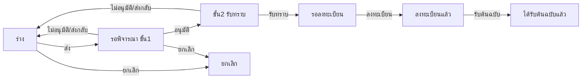

# BRD: แบบฟอร์มขอลงทะเบียนควบคุมสัญญา/เอกสารสำคัญ (Contract Control Registration)

| Field | Value |
|---|---|
| BRD ID | BRD-TMP-009-001 |
| Feature | F-TMP-009 แบบฟอร์มขอลงทะเบียนควบคุมสัญญา/เอกสารสำคัญ (รหัสชั่วคราว) |
| BRD Type | New Feature (แบบ 2 · ดึงข้อมูลเดิม: ผู้ขอ/หน่วยงาน) |
| Version | 1.0 |
| Status | **APPROVED (Prebrief Mode · Lane · unattended)** — DEC แทน Scope Lock จนมีใบเซ็นลูกค้า |
| Module | บริหารสัญญา (AGM · ยังไม่มีใน FEATURE_REGISTRY → เสนอ module ใหม่) |
| Customer | แบบฟอร์มลูกค้า FM-AGM-01 Rev.00 : 01/07/2569 · ฝ่ายบริหารสัญญา |
| Request | REQ-TMP-009 (ชั่วคราว — รอเลขจริงจาก F186) |
| Input | PREBRIEF_REQ-TMP-009_v2 · FORM_SPEC.json (8 ช่อง · 2 ตัวเลือก · 3 ลายเซ็น) · DECISIONS.lock (14 DEC · พร้อมเริ่มทำ) · feature.html (audit FAIL 0 · self_audit PASS · smoke jsdom 0 error) |
| Created / Updated | 2026-10-12 |

## Changelog
- v1.0 (2026-10-12): สร้างผ่าน brd-generator-full v2.3 Prebrief Mode (doc-master-pipeline ขั้น 7 · โหมดไม่เฝ้า)

---

## 1. Business Context
### 1.1 ปัญหา / โอกาส
ฝ่ายบริหารสัญญาคุมทะเบียนสัญญา/เอกสารสำคัญด้วยแบบฟอร์มกระดาษ FM-AGM-01 — ผู้ขอกรอกประเภท/จุดประสงค์/คู่สัญญา/ระยะสัญญา แล้วส่งต่อมือให้หัวหน้าลงนามและผู้เชี่ยวชาญด้านบริหารสัญญารับทราบ · เลขทะเบียนควบคุมและวันที่ได้รับต้นฉบับเขียนมือในกล่อง "ส่วนของผู้ดูแลสัญญา" · ค้นย้อนหลัง/ติดตามต้นฉบับที่ยังไม่ส่งทำได้ยาก
### 1.2 เป้าหมาย
1. ขึ้นแบบฟอร์มเป็นเอกสารในระบบ ช่องตรงกระดาษ 1:1 (PDF Replica — ลูกค้าจำแบบเดิมได้)
2. สายพิจารณาจาก DOA กลาง (หัวหน้า/ผู้จัดการ → ผู้เชี่ยวชาญด้านบริหารสัญญา "รับทราบ") แทนการเดินเอกสาร
3. ผู้ดูแลสัญญาออกเลขทะเบียนควบคุมในระบบ และบันทึกวันที่ได้รับต้นฉบับ/คู่ฉบับ — ค้นและส่งออกได้
### 1.3 ตัวชี้วัด
ไม่มีใน input → **OQ-01** (ห้ามแต่งตัวเลข)
### 1.4 ที่มา
แบบฟอร์มลูกค้า FM-AGM-01 (docx เปล่า ไม่มีข้อมูลตัวอย่าง) → FORM_SPEC 8 ช่อง · gate 10 หมวด = AI-DEFAULT ทุกหมวด (โหมดไม่เฝ้า)

## 2. Scope
### 2.1 In Scope
- รายการคำขอ (ค้นหา เลขที่/ผู้ขอ/คู่สัญญา/ทะเบียน · กรอง สถานะ·ประเภทสัญญา·หน่วยงาน · CSV) · สร้าง/แก้ร่าง wizard 3 ขั้น · ดูรายละเอียด 4 แท็บ (รายละเอียด › PDF › ลายเซ็น/อนุมัติ › ประวัติ)
- ส่งพิจารณา DOA (ค่าเริ่ม 2 ขั้น · เลือกคนต่อขั้น) · อนุมัติ/รับทราบ · ไม่อนุมัติ/ส่งกลับแก้ไข → กลับร่าง · ยกเลิก (เหตุผลบังคับ)
- ผู้ดูแลสัญญา: ลงทะเบียนควบคุม (ระบบออกเลขทะเบียน) · บันทึกวันที่ได้รับต้นฉบับ/คู่ฉบับ
- แนบไฟล์ (ร่างสัญญา/ฉบับลงนาม/เอกสารแนบท้าย) · PDF FM-AGM-01 Replica ทุกสถานะ · เลขที่ CTR จาก ENG-DOC-NUM
### 2.2 Out of Scope
- จัดเก็บ/จัดทำตัวสัญญา (contract repository เต็มรูป) · แจ้งเตือนสัญญาใกล้หมดอายุ · เชื่อมทะเบียนสัญญาเดิมกับคำขอ เบิก/ยืม/แก้ไข/ยกเลิกทำใหม่ (กระดาษไม่มีช่องอ้างอิง → OQ-04) · คืนเอกสารที่ยืม · ทำซ้ำเอกสาร (DEC-11)
### 2.3 Assumptions
- ผู้ขอ/ตำแหน่ง/หน่วยงานมีใน F-EMP-001 / F-ORG-001 · role ผู้เชี่ยวชาญด้านบริหารสัญญาจะตั้งใน DOA กลาง (ชั่วคราวใช้ role-compliance → OQ-03)
### 2.4 Scope Lock (ชั่วคราว = DECISIONS.lock · ยังไม่มีใบเซ็น → OQ-02)
| DEC | หมวด | มติ | ที่มา |
|---|---|---|---|
| DEC-01 | G1 | อนุมัติแล้วไม่เปลี่ยนค่าในระบบ | AI-DEFAULT |
| DEC-02 | G1 | ไม่ส่งต่อระบบอื่นรอบนี้ | AI-DEFAULT |
| DEC-03 | G2 | DOA dynamic ค่าเริ่ม 2 ขั้น: role-line-manager (หัวหน้า/ผู้จัดการ) → role-compliance (ผู้เชี่ยวชาญด้านบริหารสัญญา · รับทราบ) · ไม่มีวงเงิน | AI-DEFAULT |
| DEC-04 | G3 | ไม่มีสูตร/ค่าคงที่ · วันที่สิ้นสุด ≥ วันที่เริ่มต้น · เลือก แก้ไข/เปลี่ยนแปลง ต้องระบุสาเหตุ | AI-DEFAULT |
| DEC-05 | G4 | ไม่มีรายการซ้ำ | AI-DEFAULT |
| DEC-06 | G5 | ช่อง 1:1 · ช่อง 4 เก็บ 2 ค่า (เริ่ม/สิ้นสุด) แสดงบรรทัดเดียว | AI-DEFAULT |
| DEC-07 | G6 | ลายเซ็นแถวล่าง 1 ช่อง/ขั้น DOA · ข้อความ "ส่ง/พิจารณาในระบบ" ไม่ใช้ภาพ | AI-DEFAULT |
| DEC-08 | G7 | ไม่อนุมัติ/ส่งกลับ = กลับร่างเลขเดิม · ยกเลิก: เจ้าของ + admin · ร่าง/รอพิจารณา · เหตุผลบังคับ | AI-DEFAULT |
| DEC-09 | G8 | เจ้าของ · ผู้พิจารณาหลังส่ง · admin ฝ่ายบริหารสัญญาเห็นทั้งหมด | AI-DEFAULT |
| DEC-10 | G9 | ออกเลขตอนบันทึกครั้งแรก · รหัส CTR | AI-DEFAULT |
| DEC-11 | G10 | แนบไฟล์ ✓ · CSV ✓ · ทำซ้ำ ✗ · ประกาศ ✗ | AI-DEFAULT |
| DEC-12 | VALID | "เอกสารสำคัญอื่นๆ" ไม่มีช่องระบุ — คง 1:1 ระบุในไฟล์แนบ (OQ-05) | FORM_SPEC |
| DEC-13 | VALID | ไม่มีช่องอ้างอิงทะเบียนเดิม — ผู้ดูแลสัญญาค้นเอง (OQ-04) | FORM_SPEC |
| DEC-14 | VALID | สิ้นสุด ≥ เริ่มต้น | FORM_SPEC |

## 3. Roles & Permissions (COSO)
| Role | COSO | ทำอะไร |
|---|---|---|
| ผู้รับผิดชอบ (ผู้ขอ) | Maker | สร้าง/แก้ร่าง · ส่ง · ยกเลิกของตัวเอง (ร่าง/รอพิจารณา) |
| role-line-manager (หัวหน้า/ผู้จัดการ) | Approver | ขั้น 1 อนุมัติ/ไม่อนุมัติ |
| role-compliance → ผู้เชี่ยวชาญด้านบริหารสัญญา | Checker | ขั้น 2 รับทราบ/ส่งกลับแก้ไข |
| ผู้ดูแลสัญญา (admin ฝ่ายบริหารสัญญา) | Custodian | ลงทะเบียนควบคุม · บันทึกรับต้นฉบับ · เห็นทั้งหมด · ยกเลิกได้ |

| Action | Maker | L-Mgr | ผู้เชี่ยวชาญ | ผู้ดูแลสัญญา |
|---|:-:|:-:|:-:|:-:|
| ดูใบ | ของตน | หลังส่ง (อยู่ในสาย) | หลังส่ง (อยู่ในสาย) | ทั้งหมด |
| สร้าง/แก้ร่าง | ✓ ของตน | – | – | – |
| ตัดสินขั้น | – | ขั้น 1 | ขั้น 2 | – |
| ลงทะเบียน / รับต้นฉบับ | – | – | – | ✓ |
| ยกเลิก | ✓ ของตน | – | – | ✓ |
SoD: ผู้ขอพิจารณาใบตัวเองไม่ได้ (BR-DOA-04) · ใน prototype ผู้เชี่ยวชาญและผู้ดูแลสัญญาเป็นคนเดียวกัน (ฝ่ายเดียวกัน) — แยกคนได้ที่ DOA/สิทธิ์ (OQ-03)

## 4. User Journey
### 4.1 Happy Path
1. ผู้รับผิดชอบ: สร้าง → เลือกประเภทสัญญา + จุดประสงค์ → ชื่อคู่สัญญา · วันที่เริ่ม–สิ้นสุด · หน่วยงานเจ้าของสัญญา → แนบไฟล์ → บันทึก (ได้เลข CTR) → ส่ง เลือกคน 2 ขั้น
2. ขั้น 1 หัวหน้า/ผู้จัดการ อนุมัติ → ขั้น 2 ผู้เชี่ยวชาญด้านบริหารสัญญา รับทราบ → **รอลงทะเบียน**
3. ผู้ดูแลสัญญา ลงทะเบียนควบคุม (ได้ทะเบียนควบคุมเลขที่) → **ลงทะเบียนแล้ว** → ได้รับต้นฉบับ/คู่ฉบับ บันทึกวันที่ → **ได้รับต้นฉบับแล้ว** · PDF เก็บสำเนา (approved_final)
### 4.2 Alternative
- ไม่อนุมัติ (ขั้น 1) / ส่งกลับแก้ไข (ขั้น 2) → กลับร่าง เลขเดิม + เหตุผล → ผู้ขอแก้ ส่งใหม่ (resolve สายใหม่)
- จุดประสงค์ แก้ไข/เปลี่ยนแปลง → ต้องระบุสาเหตุ · เบิก/ยืม · เพิ่มเอกสารแนบท้าย · ยกเลิกฉบับเดิมทำใหม่ → flow เดียวกัน
- ยกเลิก (ร่าง/รอพิจารณา) โดยเจ้าของหรือผู้ดูแลสัญญา

## 5. Data (จาก FORM_SPEC — ป้ายตามกระดาษ)
### 5.1 contract_register_request (header)
| ช่องบนกระดาษ | field | ชนิด | ที่มา | บังคับ |
|---|---|---|---|:-:|
| เลขที่ (footer ระบบ) | doc_no | text | auto ENG-DOC-NUM (CTR) | ✓ |
| วันที่ | req_date | date | auto | ✓ |
| 1. ประเภทของสัญญา | contract_type | enum 8 (sale·hire·service_lease·loan·appointment·joint_venture·nda·other_doc) | user | ✓ |
| 2. จุดประสงค์ร้องขอ | purpose | enum 5 (new·add_annex·borrow·replace·amend) | user | ✓ |
| แก้ไข/เปลี่ยนแปลง ระบุสาเหตุ | change_reason | text | user (เมื่อ purpose=amend) | เงื่อนไข |
| 3. ชื่อคู่สัญญา | counterparty_name | text (pdpa) | user | ✓ |
| 4. วันที่เริ่มต้นและสิ้นสุดสัญญา | contract_start · contract_end | date ×2 | user | ✓ |
| 5. หน่วยงานเจ้าของสัญญา | owner_unit_id → snapshot name | ref | system F-ORG-001 (ค่าเริ่ม = หน่วยงานผู้ขอ) | ✓ |
| (ชื่อ-สกุล ผู้รับผิดชอบ) ตำแหน่ง | requester_id · position_snapshot · dept_snapshot | ref | system F-EMP-001 | ✓ |
| ทะเบียนควบคุมเลขที่ | register_no | text | auto (ตอนลงทะเบียน · รูปแบบ OQ-06) | – |
| ได้รับต้นฉบับ/คู่ฉบับสัญญา/เอกสารสำคัญ วันที่ | original_received_date | date | ผู้ดูแลสัญญา | – |
| + registered_by · registered_at | | | ระบบ | |
| + returned_reason · returned_by · returned_at | | | DEC-08 | |
### 5.2 DOA fields (นิยาม — ใช้ตาม doa-declaration)
| field | ชนิด | ความหมาย |
|---|---|---|
| approval_status | enum | สถานะสายพิจารณา (pending/approved/returned) |
| doa_entry_ref | text | DOA entry ที่ resolve ตอนส่ง (DOA-CTR-01) |
| approval_chain | jsonb | snapshot ขั้น 1..N {step, role_id, label, assignee, status, at, note} — freeze ตอนส่ง (BR-DOA-02) |
| approver_role | text | role ของขั้นที่ตัดสินล่าสุด |
| approved_by / approved_at | ref / datetime | ผู้ตัดสินขั้นสุดท้าย |
TODO: DOA engine — resolve/route จริงที่ DOA กลาง (F-DLG-001)
### 5.3 attachments → Document Center (ไฟล์ระดับใบ)

## 6. User Stories
| ID | Story | AC หลัก |
|---|---|---|
| S-01 | ผู้รับผิดชอบสร้างคำขอลงทะเบียน | เลือกประเภท 1 จาก 8 · จุดประสงค์ 1 จาก 5 · คู่สัญญา + วันที่ + หน่วยงาน บังคับ · บันทึกได้เลข CTR |
| S-02 | ผู้รับผิดชอบขอแก้ไข/เปลี่ยนแปลงสัญญา | เลือก แก้ไข/เปลี่ยนแปลง → ช่อง "ระบุสาเหตุ" บังคับ · พิมพ์ใน PDF บรรทัดเดียวกับตัวเลือก |
| S-03 | ผู้รับผิดชอบแนบเอกสาร | หลายไฟล์ · ≤20MB · pdf/doc/xls/รูป |
| S-04 | ผู้รับผิดชอบส่งพิจารณา | slot ต่อขั้นค่าเริ่มจาก DOA · ผู้ขอไม่อยู่ในรายชื่อ · บังคับเลือกครบ |
| S-05 | หัวหน้า/ผู้จัดการ พิจารณา | ปุ่มเฉพาะผู้พิจารณาขั้นปัจจุบัน · ไม่อนุมัติ = เหตุผลบังคับ → กลับร่าง |
| S-06 | ผู้เชี่ยวชาญด้านบริหารสัญญา รับทราบ | คำ "รับทราบ / ส่งกลับแก้ไข" (ผูก role) · ส่งกลับ = เหตุผลบังคับ → กลับร่าง |
| S-07 | ผู้ดูแลสัญญาลงทะเบียนควบคุม | เฉพาะสถานะรอลงทะเบียน · ระบบออกเลขทะเบียน · แจ้งผู้ขอให้ส่งต้นฉบับ |
| S-08 | ผู้ดูแลสัญญาบันทึกรับต้นฉบับ | วันที่บังคับ ไม่เกินวันนี้ · ปิดงาน |
| S-09 | พิมพ์/ดาวน์โหลด PDF FM-AGM-01 | ทุกสถานะ · ลายเซ็น = ผู้รับผิดชอบ + 1 ช่องต่อขั้นตาม DOA (แถวละ ≤4) · กล่องผู้ดูแลสัญญาแสดงเลขทะเบียน/วันที่รับ |
| S-10 | ยกเลิก | เจ้าของ/ผู้ดูแลสัญญา · ร่างหรือรอพิจารณา · เหตุผลบังคับ |
| S-11 | ผู้ดูแลสัญญาดูทุกใบ + CSV | กรอง สถานะ/ประเภทสัญญา/หน่วยงาน · ค้นด้วยเลขทะเบียน |

## 7. Status & Lifecycle
| จาก | Action | ไป | ใคร |
|---|---|---|---|
| — | บันทึกครั้งแรก | draft | Maker |
| draft | ส่ง | pending (ขั้น 1) | Maker |
| pending | อนุมัติ/รับทราบ ขั้น n<N | pending (ขั้น n+1) | ผู้พิจารณาขั้น n |
| pending | อนุมัติ/รับทราบ ขั้น N | approved (รอลงทะเบียน) | ขั้น N |
| pending | ไม่อนุมัติ/ส่งกลับแก้ไข | draft (เลขเดิม · returned_*) | ผู้พิจารณาขั้นปัจจุบัน |
| approved | ลงทะเบียนควบคุม | registered | ผู้ดูแลสัญญา |
| registered | บันทึกรับต้นฉบับ | completed | ผู้ดูแลสัญญา |
| draft / pending | ยกเลิก | cancelled | Maker / ผู้ดูแลสัญญา |
ส่งแล้ว = ล็อกแก้ไข

## 8. Business Rules + Validation
| ID | Rule | Tag | Type |
|---|---|:-:|---|
| BR-01 | ประเภทของสัญญาเลือกได้ 1 ค่า · จุดประสงค์เลือกได้ 1 ค่า (☐ บนกระดาษ) | FIXED | Choice (FORM_SPEC) |
| BR-02 | purpose = amend → change_reason บังคับ · อื่น ๆ = ว่าง | FIXED | DEC-04 |
| BR-03 | contract_end ≥ contract_start | FIXED | DEC-14 |
| BR-04 | หน่วยงานเจ้าของสัญญา ค่าเริ่ม = หน่วยงานผู้ขอ เปลี่ยนได้จาก OrgUnit | CONFIGURABLE | Master F-ORG-001 |
| BR-05 | สายพิจารณา resolve จาก DOA ตอนส่ง แล้ว freeze · จำนวนขั้นตั้งที่ DOA กลาง | FIXED | DOA (BR-DOA-02 · DEC-03) |
| BR-06 | คำตัดสินผูก role: default อนุมัติ/ไม่อนุมัติ · role-compliance รับทราบ/ส่งกลับแก้ไข | CONFIGURABLE | print_config.decision_words |
| BR-07 | ไม่อนุมัติ/ส่งกลับ → draft เลขเดิม · resolve ใหม่ตอนส่งรอบถัดไป | FIXED | DEC-08 |
| BR-08 | ออกเลข CTR ตอนบันทึกครั้งแรก · no-gap ✗ | CONFIGURABLE | DOCCFG (DEC-10) |
| BR-09 | ลงทะเบียนได้เฉพาะ approved · เลขทะเบียนออกโดยระบบ ไม่ซ้ำ | FIXED | Control |
| BR-10 | วันที่ได้รับต้นฉบับ ≤ วันนี้ · บันทึกได้เฉพาะ registered | FIXED | Control |
| BR-11 | ร่างเห็นเฉพาะเจ้าของ (+ ผู้ดูแลสัญญา) | FIXED | Visibility (DEC-09) |
| BR-12 | ช่องลงชื่อ PDF = ผู้รับผิดชอบ + 1 ช่องต่อขั้น DOA (dynamic) · แถวละ ≤4 · >4 ขั้น = dense | FIXED (จำนวน = DOA) | DEC-03 · DEC-07 |

| VR | ช่อง | เงื่อนไข | ข้อความ |
|---|---|---|---|
| VR-01 | contract_type | required | เลือกประเภทของสัญญา |
| VR-02 | purpose | required | เลือกจุดประสงค์ร้องขอ |
| VR-03 | change_reason | required เมื่อ amend | กรุณาระบุสาเหตุ |
| VR-04 | counterparty_name | required | กรุณาระบุชื่อคู่สัญญา |
| VR-05 | contract_start / contract_end | required · end ≥ start | เลือกวันที่เริ่มต้น / วันที่สิ้นสุดต้องไม่ก่อนวันที่เริ่มต้น |
| VR-06 | owner_unit | required | เลือกหน่วยงานเจ้าของสัญญา |
| VR-07 | slot ผู้พิจารณา | ทุกขั้นต้องเลือก · ≠ ผู้ขอ | กรุณาเลือกผู้พิจารณา |
| VR-08 | เหตุผล ไม่อนุมัติ/ส่งกลับ/ยกเลิก | required | กรุณาระบุเหตุผล |
| VR-09 | original_received_date | required · ≤ วันนี้ | เลือกวันที่ได้รับ |

### 8.5 ระดับความยืดหยุ่น
BR-04 → OrgUnit master · BR-05/06 → DOA กลาง + print_config · BR-08 → F-DOCCFG

## 9. Edge Cases
| EC | กรณี | ผล |
|---|---|---|
| EC-01 | สัญญาสิ้นสุดไปแล้ว (เช่น ขอลงทะเบียนย้อนหลัง) | เตือนในขั้นตรวจสอบ ไม่บล็อก |
| EC-02 | ผู้ขออยู่ฝ่ายบริหารสัญญาเอง (ขั้น 2 = ตัวเอง) | resolve ข้ามตัวเอง · slot ว่างต้องเลือกคนอื่น |
| EC-03 | DOA ตั้ง > 4 ขั้น | PDF 2 แถว dense ยัง 1 หน้า (ทดสอบ 6 ขั้น = 7 ช่อง 4+3) |
| EC-04 | แก้ DOA ระหว่างใบรอพิจารณา | ใบเดิมใช้สาย snapshot |
| EC-05 | ส่ง/ตัดสินชนกัน (stale) | 409 → toast รีเฟรช สถานะไม่เปลี่ยน |
| EC-06 | แบบเอกสารปิดใช้ (F-DOCCFG) | ปุ่มสร้าง disabled |
| EC-07 | "เอกสารสำคัญอื่นๆ" ไม่มีช่องระบุชื่อ | ระบุในไฟล์แนบ (OQ-05) |
| EC-08 | ชื่อคู่สัญญายาวมาก | PDF ตัดบรรทัดในช่องเส้นประ (ทดสอบ long-text) |

## 10. Value Stream & Downstream Impact
Positioning: Governance / Contract — จัดทำสัญญา (นอกระบบ) → **ขอลงทะเบียนควบคุม (feature นี้)** → ทะเบียนสัญญา (register) → [ติดตามหมดอายุ — ปิดรอบนี้]
| ปลายทาง | ข้อมูล | Trigger | หมายเหตุ |
|---|---|---|---|
| ทะเบียนสัญญา (ในเอกสารนี้) | register_no · received_date | registered / completed | ไม่ส่งต่อระบบอื่น (DEC-02) |
| F-DOCCFG / ENG-DOC-STORE | PDF snapshot | approved_final | |
| ENG-NOTIFY | ctr_registered · ctr_original_received · ctr_cancelled | ตาม NTF_BRIEF | DOA events มาจาก DOA engine |
| รายงาน | คำขอค้าง / ต้นฉบับยังไม่ส่ง | — | Report area อ่าน |

## 11. Delivery
Phase 1 = ทุกอย่างใน §2.1 · Phase 2 (เสนอ) = อ้างอิงทะเบียนเดิมสำหรับ เบิก/ยืม/แก้ไข · แจ้งเตือนสัญญาใกล้หมดอายุ · คืนเอกสารที่ยืม

## 12. Dev Summary "ใบสั่ง"
- Config: DOA entry F-TMP-009 (DOA-CTR-01) · doc_type CTR · ลำดับเลขทะเบียนควบคุม (OQ-06)
- Declaration: DOA_BRIEF · NTF_BRIEF · DOCCFG_BRIEF · MDOC_BRIEF (ฉบับจริงหลัง FRD)
- Screen Inventory: P-01 รายการ · P-02 สร้าง/แก้ (drawer wide 3 ขั้น) · P-03 ดู (drawer 4 แท็บ) · M-01..07 modal ส่ง/อนุมัติ/ไม่อนุมัติ/ยกเลิก/ลงทะเบียน/รับต้นฉบับ/ทิ้งข้อมูล
- UI Signals: เอกสาร + พิมพ์ + ลายเซ็น = ใช่ · Q-form

## 13. Open Questions
| OQ | คำถาม | เจ้าของ | Block? |
|---|---|---|---|
| OQ-01 | ตัวชี้วัดความสำเร็จ (เวลาลงทะเบียนเฉลี่ย / ต้นฉบับค้าง) | ลูกค้า | ไม่ |
| OQ-02 | ลูกค้าเซ็นยืนยัน DEC-01..11 (AI-DEFAULT ทั้งหมด) — โดยเฉพาะสาย 2 ขั้น · คำ รับทราบ/ส่งกลับแก้ไข · กลับร่าง | ทีม → ลูกค้า | ก่อน UAT |
| OQ-03 | "ผู้เชี่ยวชาญด้านบริหารสัญญา" ไม่มีใน DOA Roles Master — ใช้ role-compliance ชั่วคราว · เพิ่ม role ใหม่ไหม · ผู้ดูแลสัญญาเป็นคนเดียวกันไหม | ทีม DOA + ลูกค้า | ก่อน wire |
| OQ-04 | เบิก/ยืม · แก้ไข · ยกเลิกทำใหม่ ต้องอ้างทะเบียนเดิมไหม (กระดาษไม่มีช่อง) | ลูกค้า | ไม่ |
| OQ-05 | "เอกสารสำคัญอื่นๆ" ต้องเพิ่มช่องระบุชื่อเอกสารไหม | ลูกค้า | ไม่ |
| OQ-06 | รูปแบบ "ทะเบียนควบคุมเลขที่" (ลำดับแยกจากเลข CTR หรือใช้ร่วม) | ลูกค้า + ทีม DOCCFG | ก่อน dev |
| OQ-07 | module "บริหารสัญญา (AGM)" + function_code/taxonomy ของ doc_type CTR | ทีม | ก่อน register |

## 14. Security & Compliance
Preset: Standard · PII: ชื่อผู้รับผิดชอบ · ชื่อคู่สัญญา (อาจเป็นบุคคลธรรมดา — pdpa) — ข้อมูลตัวอย่างใน prototype/แบบพิมพ์เป็นชื่อสมมติ · Audit append-only ทุก action · SoD ผู้ขอ≠ผู้พิจารณา · ไฟล์แนบตาม file_policy Document Center (≤20MB) · ไม่เก็บ credential

## 15. Health Check / Monitoring
SLA ต่อขั้น: ไม่กำหนดรอบนี้ (→ OQ-01) · KPI เสนอ: คำขอรอพิจารณาเกิน N วัน · ลงทะเบียนแล้วแต่ยังไม่ได้รับต้นฉบับเกิน N วัน · Widget: ทะเบียนตามประเภทสัญญา

## Appendix — Screen List
P-01 `#/contract-register` · P-02 `#/contract-register/create` · `/edit/:id` · P-03 `#/contract-register/view/:id`

## AI Review (Quality Gate)
C01–C20 + PE01–PE0x: ผ่านทั้งหมดในโหมด Prebrief (C16 Registry = WARN: module ใหม่ยังไม่อยู่ใน FEATURE_REGISTRY · C20 Scope Lock = DECISIONS.lock + OQ-02) → **APPROVED**
