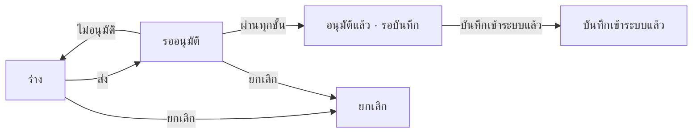

# BRD: แบบฟอร์มขอเพิ่ม-แก้ไข-ยกเลิก รหัสบัญชี (Account Code Request)

| Field | Value |
|---|---|
| BRD ID | BRD-ACC-ACR-001 |
| Feature | F-TMP-003 แบบฟอร์มขอเพิ่ม-แก้ไข-ยกเลิก รหัสบัญชี (รหัส feature ชั่วคราว — รอลงทะเบียน) |
| BRD Type | New Feature (แบบ 1 · Standalone — เก็บข้อมูลในเอกสารนี้ ไม่แก้ผังบัญชีอัตโนมัติ) |
| Version | 1.0 |
| Status | **APPROVED (Prebrief Mode · Lane)** — DEC แทน Scope Lock จนมีใบเซ็นลูกค้า |
| Module | Accounting (Core Cube) · แผนกเจ้าของแบบ: ฝ่ายบัญชี · ใกล้เคียง feature COA (FEATURE_REGISTRY: Accounting › COA ยังไม่มี BA artifact) |
| Customer form | FM-ACC-01 Rev.00 : 01/07/2569 (docx 1 หน้า A4) |
| Request | REQ-TMP-003 (ชั่วคราว — รอเลขจริงจาก F186) |
| Input | PREBRIEF_REQ-TMP-003_v2 · FORM_SPEC.json (13 ช่อง) · DECISIONS.lock (14 DEC · พร้อมเริ่มทำ · AI-DEFAULT 11) · feature.html (audit FAIL 0 · self_audit PASS · e2e 21/21) |
| Created / Updated | 2026-10-11 |

## Changelog
- v1.0 (2026-10-11): สร้างผ่าน brd-generator-full v2.3 Prebrief Mode · Lane (doc-master-pipeline ขั้น 7 · unattended)

---

## 1. Business Context
### 1.1 ปัญหา / โอกาส
การขอเพิ่ม แก้ไข หรือยกเลิกรหัสบัญชีในผังบัญชีใช้แบบฟอร์มกระดาษ FM-ACC-01 — ผู้ขอเขียนเอง · ผู้ตรวจสอบและผู้อนุมัติลงนามบนกระดาษ · ผู้บันทึกเข้าระบบลงชื่อหลังแก้ผังบัญชีแล้ว · เอกสารเก็บที่ฝ่ายบัญชีและการเงิน · ติดตามสถานะคำขอและย้อนดูประวัติการเปลี่ยนผังบัญชีได้ยาก
### 1.2 เป้าหมาย
1. ขึ้นแบบฟอร์มเป็นเอกสารในระบบ ช่องตรงกระดาษ 1:1 (PDF Replica FM-ACC-01) ลูกค้าจำแบบเดิมได้
2. 1 ใบ = 1 ประเภทคำขอ (เพิ่ม / แก้ไข / ยกเลิก) กรอกเฉพาะส่วนที่เกี่ยว · สายอนุมัติผู้ตรวจสอบ › ผู้อนุมัติ ตาม DOA กลาง
3. ปิดใบด้วยการยืนยัน "บันทึกเข้าระบบแล้ว" ของฝ่ายบัญชี — มีหลักฐานว่าใครแก้ผังบัญชีเมื่อไร
### 1.3 ตัวชี้วัด
ไม่มีใน input → **OQ-01** (ห้ามแต่งตัวเลข)
### 1.4 ที่มา
แบบฟอร์มลูกค้า FM-ACC-01 (docx) → FORM_SPEC 13 ช่อง · ☐ 3 ตัวเลือก · ลายเซ็น 4 จุด · ชื่อบัญชีที่ขอเพิ่ม 4 บรรทัด · gate 10 หมวดตอบโดย AI ตาม unattended-policy (AI-DEFAULT ทั้งหมด รอลูกค้ายืนยัน)

## 2. Scope
### 2.1 In Scope
- รายการคำขอ (ค้นหา · กรองสถานะ/ประเภทคำขอ · CSV) · สร้าง/แก้ร่าง wizard 3 ขั้น · ดูรายละเอียด 4 แท็บ (รายละเอียด › PDF Preview › ลายเซ็น/อนุมัติ › ประวัติ)
- เลือกประเภทคำขอ 1 อย่าง · เพิ่ม: ชื่อบัญชีที่ต้องการขอเพิ่ม (ไม่จำกัดบรรทัด) + วัตถุประสงค์ · แก้ไข: รหัสบัญชี + แก้ไขเป็น + วัตถุประสงค์ · ยกเลิก: รหัสบัญชี + ชื่อบัญชี + วัตถุประสงค์
- ส่งอนุมัติ DOA (dynamic · ค่าเริ่ม 2 ขั้น ผู้ตรวจสอบ › ผู้อนุมัติ) · ตรวจสอบแล้ว/อนุมัติ · ไม่อนุมัติ → กลับร่าง · ยกเลิก (เหตุผลบังคับ)
- ผู้บันทึกเข้าระบบ (admin ฝ่ายบัญชี) ยืนยัน "บันทึกเข้าระบบแล้ว" + วันที่ · แนบไฟล์ · PDF FM-ACC-01 ทุกสถานะ · เลขที่ ACR จาก ENG-DOC-NUM
### 2.2 Out of Scope
- แก้ผังบัญชี (COA) ให้อัตโนมัติเมื่ออนุมัติ (DEC-01) · ส่งต่อระบบอื่น (DEC-02) · ตรวจว่ารหัสบัญชีมีอยู่จริง/ซ้ำในผังบัญชี (COA ยังไม่มีในระบบ → OQ-04) · ทำซ้ำเอกสาร (DEC-11) · ประกาศ
### 2.3 Assumptions
- ข้อมูลผู้ขอ/ตำแหน่ง/ฝ่าย มีใน HR · Employee และ Organization · ผังองค์กรให้ผู้บังคับบัญชาตรง (role-line-manager) · ฝ่ายบัญชีแก้ผังบัญชีเองนอกเอกสารนี้
### 2.4 Scope Lock (ชั่วคราว = DECISIONS.lock · ยังไม่มีใบเซ็น → OQ-02)
| DEC | หมวด | มติ | ที่มา |
|---|---|---|---|
| DEC-01 | G1 | อนุมัติแล้วไม่เปลี่ยนค่าในระบบ (ไม่แก้ผังบัญชีอัตโนมัติ) | AI-DEFAULT |
| DEC-02 | G1 | ไม่ส่งต่อระบบอื่นรอบนี้ (ประกาศ event ใน FRD แต่ไม่ยิง) | AI-DEFAULT |
| DEC-03 | G2 | DOA dynamic · ค่าเริ่ม 2 ขั้น role-line-manager (ผู้ตรวจสอบ) › role-mgr-acc (ผู้อนุมัติ) · ไม่มีวงเงิน | AI-DEFAULT |
| DEC-04 | G3 | 1 ใบ = 1 ประเภทคำขอ · ส่วนที่ไม่ได้เลือกต้องว่าง · เพิ่มต้องมีชื่อบัญชี ≥ 1 แถว · ไม่อนุมัติ → เหตุผลบังคับ | AI-DEFAULT |
| DEC-05 | G4 | ชื่อบัญชีที่ต้องการขอเพิ่ม ไม่จำกัดแถว · PDF ≥ 4 แถว | AI-DEFAULT |
| DEC-06 | G5 | ช่องตรงกระดาษ 1:1 · ไม่เพิ่มช่อง | AI-DEFAULT |
| DEC-07 | G6 | ลายเซ็นแถวล่าง 1 ช่องต่อขั้น DOA · ข้อความ "ส่ง/พิจารณาในระบบ" ไม่ใช้ภาพ | AI-DEFAULT |
| DEC-08 | G7 | ไม่อนุมัติ = กลับร่างเลขเดิม · ยกเลิก: เจ้าของ + admin · ร่าง/รออนุมัติ · เหตุผลบังคับ | AI-DEFAULT |
| DEC-09 | G8 | เจ้าของ · ผู้อนุมัติหลังส่ง · admin ฝ่ายบัญชีเห็นทั้งหมด | AI-DEFAULT |
| DEC-10 | G9 | ออกเลขตอนบันทึกครั้งแรก · รหัส ACR | AI-DEFAULT |
| DEC-11 | G10 | แนบไฟล์ ✓ · CSV ✓ · ทำซ้ำ ✗ · ประกาศ ✗ | AI-DEFAULT |
| DEC-12 | VALID | ป้ายส่วนยกเลิก "วัตถุประสงค์ในการยกเลิก" (กระดาษพิมพ์ "แก้ไข") · key แยก cancel.purpose | FORM_SPEC |
| DEC-13 | VALID | 1 ใบ = 1 ประเภทคำขอ · ส่วนที่ไม่ได้เลือกต้องว่าง | FORM_SPEC |
| DEC-14 | VALID | เลือก ไม่อนุมัติ → เหตุผลบังคับ | FORM_SPEC |

## 3. Roles & Permissions (COSO)
| Role | COSO | ทำอะไร |
|---|---|---|
| พนักงาน (ผู้ขอเพิ่ม/แก้ไข/ยกเลิกรหัสบัญชี) | Maker | สร้าง/แก้ร่าง · ส่ง · ยกเลิกของตัวเอง (ร่าง/รออนุมัติ) |
| role-line-manager (ผู้ตรวจสอบ · ค่าเริ่ม DOA ขั้น 1) | Checker | ตรวจสอบแล้ว / ไม่ผ่านการตรวจสอบ |
| role-mgr-acc (ผู้อนุมัติ · ค่าเริ่ม DOA ขั้น 2) | Approver | อนุมัติ / ไม่อนุมัติ (เหตุผลบังคับ) |
| admin ฝ่ายบัญชี (ผู้บันทึกเข้าระบบ) | Executor | เห็นทุกใบ · ยกเลิกได้ (ร่าง/รออนุมัติ) · ยืนยันบันทึกเข้าระบบแล้ว — role ยังไม่อยู่ใน DOA master → OQ-03 |

| Action | ผู้ขอ | ผู้ตรวจสอบ | ผู้อนุมัติ | admin บัญชี |
|---|:-:|:-:|:-:|:-:|
| ดูใบ | ของตน | หลังส่ง (อยู่ในสาย) | หลังส่ง (อยู่ในสาย) | ทั้งหมด |
| สร้าง/แก้ร่าง | ✓ ของตน | – | – | – |
| ตัดสินขั้น | – | ✓ ขั้นของตน | ✓ ขั้นของตน | – |
| ยกเลิก | ✓ ของตน | – | – | ✓ |
| บันทึกเข้าระบบแล้ว | – | – | – | ✓ (เฉพาะอนุมัติแล้ว) |
SoD: ผู้ขอพิจารณาใบตัวเองไม่ได้ (BR-DOA-04) · ผู้บันทึกเข้าระบบเป็นคนละหน้าที่กับผู้อนุมัติ (แนะนำ ไม่บังคับรอบนี้ → OQ-05)

## 4. User Journey
### 4.1 Happy Path
1. ผู้ขอ: สร้าง → เลือกประเภทคำขอ → กรอกส่วนนั้น (เพิ่ม: ชื่อบัญชี + วัตถุประสงค์ · แก้ไข: รหัสบัญชี + แก้ไขเป็น + วัตถุประสงค์ · ยกเลิก: รหัสบัญชี + ชื่อบัญชี + วัตถุประสงค์) → แนบไฟล์ (ถ้ามี) → บันทึก (ได้เลข ACR) → ส่ง เลือกผู้พิจารณาต่อขั้น (ค่าเริ่มจาก DOA)
2. ผู้ตรวจสอบ: ตรวจสอบแล้ว → ส่งต่อขั้นถัดไป
3. ผู้อนุมัติ: อนุมัติ → **อนุมัติแล้ว · รอบันทึก** · PDF snapshot (approved_final) · แจ้งฝ่ายบัญชี (acr_ready_to_record)
4. ฝ่ายบัญชี: แก้ผังบัญชีตามคำขอ (นอกเอกสารนี้) → กด "บันทึกเข้าระบบแล้ว" + วันที่ → **บันทึกเข้าระบบแล้ว** · แจ้งผู้ขอ (acr_recorded)
### 4.2 Alternative
- ไม่ผ่านการตรวจสอบ / ไม่อนุมัติ → กลับร่าง เลขเดิม + เหตุผล → ผู้ขอแก้ ส่งใหม่ (resolve สายใหม่)
- ยกเลิก (ร่าง/รออนุมัติ) โดยเจ้าของหรือ admin

## 5. Data (จาก FORM_SPEC — ป้ายตามกระดาษ)
### 5.1 account_code_request (header)
| ช่องบนกระดาษ | field | ชนิด | ที่มา | บังคับ |
|---|---|---|---|:-:|
| เลขที่เอกสาร | doc_no | text | auto ENG-DOC-NUM (ACR) | ✓ |
| วันที่ | req_date | date | auto | ✓ |
| ☐ เพิ่ม / แก้ไข / ยกเลิกรหัสบัญชี | request_type | enum add·edit·cancel | user (เลือก 1) | ✓ |
| วัตถุประสงค์ในการเพิ่ม | add_purpose | text | user (เฉพาะ add) | ✓ เมื่อ add |
| รหัสบัญชี (กรณีแก้ไข) | edit_account_code | text | user (เฉพาะ edit) | ✓ เมื่อ edit |
| แก้ไขเป็น | edit_change_to | text | user (เฉพาะ edit) | ✓ เมื่อ edit |
| วัตถุประสงค์ในการแก้ไข | edit_purpose | text | user (เฉพาะ edit) | ✓ เมื่อ edit |
| รหัสบัญชี (กรณียกเลิก) | cancel_account_code | text | user (เฉพาะ cancel) | ✓ เมื่อ cancel |
| ชื่อบัญชี | cancel_account_name | text | user (เฉพาะ cancel) | ✓ เมื่อ cancel |
| วัตถุประสงค์ในการยกเลิก (DEC-12) | cancel_purpose | text | user (เฉพาะ cancel) | ✓ เมื่อ cancel |
| (ผู้ขอ — ระบบ) | requester_id · position_snapshot · dept_snapshot | ref/text | system HR · Employee / Organization (อ่านอย่างเดียว) | ✓ |
| สำหรับผู้อนุมัติ · เหตุผล · ลงนามผู้อนุมัติ · วันที่ | approval_status · doa_entry_ref · approval_chain (jsonb snapshot) · approver_role · approved_by · approved_at · returned_reason · returned_by · returned_at | | DOA (DEC-03/08/14) | |
| ผู้บันทึกเข้าระบบ … ( … ) / วันที่ | recorded_by · recorded_at | ref · date | admin ฝ่ายบัญชี | เมื่อบันทึก |
### 5.2 account_code_request_line (ชื่อบัญชีที่ต้องการขอเพิ่ม · 4 บรรทัดบนกระดาษ)
| ช่องบนกระดาษ | field | ชนิด | ที่มา | บังคับ |
|---|---|---|---|:-:|
| (ลำดับ — ระบบ) | seq | int | auto | ✓ |
| ชื่อบัญชีที่ต้องการขอเพิ่ม | account_name | text | user | ✓ ≥ 1 แถว เมื่อ add |
### 5.3 attachments → Document Center (ไฟล์ระดับใบ)

## 6. User Stories
| ID | Story | AC หลัก |
|---|---|---|
| S-01 | ผู้ขอเลือกประเภทคำขอ | เลือกได้ 1 ใน 3 · ช่องของประเภทที่เลือกเท่านั้นแสดง · ผู้ขอ/ตำแหน่ง/ฝ่าย ดึงจากระบบ |
| S-02 | ผู้ขอระบุชื่อบัญชีที่ต้องการขอเพิ่ม | ≥ 1 บรรทัด ไม่จำกัด · ชื่อซ้ำในใบ = บล็อก · วัตถุประสงค์ในการเพิ่มบังคับ |
| S-03 | ผู้ขอระบุรหัสบัญชีที่ต้องการแก้ไข | รหัสบัญชี · แก้ไขเป็น · วัตถุประสงค์ในการแก้ไข บังคับทั้ง 3 |
| S-04 | ผู้ขอระบุรหัสบัญชีที่ต้องการยกเลิก | รหัสบัญชี · ชื่อบัญชี · วัตถุประสงค์ในการยกเลิก บังคับทั้ง 3 |
| S-05 | ผู้ขอบันทึกร่าง | ได้เลข ACR ตอนบันทึกครั้งแรก · ส่วนที่ไม่ได้เลือกถูกล้าง |
| S-06 | ผู้ขอส่งอนุมัติ | slot ต่อขั้นจาก DOA · ผู้ขอไม่อยู่ในรายชื่อ · บังคับเลือก |
| S-07 | ผู้ตรวจสอบตรวจสอบคำขอ | ปุ่มเฉพาะผู้พิจารณาขั้นปัจจุบัน · คำ "ตรวจสอบแล้ว" · ส่งต่อขั้นถัดไป |
| S-08 | ผู้อนุมัติอนุมัติคำขอ | ขั้นสุดท้าย → อนุมัติแล้ว · รอบันทึก |
| S-09 | ผู้พิจารณาไม่อนุมัติคำขอ | เหตุผลบังคับ → กลับร่างเลขเดิม · ผู้ขอเห็นเหตุผล |
| S-10 | ฝ่ายบัญชียืนยันบันทึกเข้าระบบ | เฉพาะใบอนุมัติแล้ว · admin ฝ่ายบัญชี · วันที่ ≤ วันนี้ · ≥ วันที่อนุมัติ |
| S-11 | พิมพ์/ดาวน์โหลด PDF FM-ACC-01 | ทุกสถานะ · ☑ ตามประเภท · ส่วนอื่นว่าง · ลายเซ็น = ผู้ขอ + 1 ช่องต่อขั้น DOA (dynamic · แถวละ ≤4) + ผู้บันทึกเข้าระบบ |
| S-12 | เจ้าของ/admin ยกเลิกคำขอ | ร่างหรือรออนุมัติ · เหตุผลบังคับ |
| S-13 | admin ดูทุกใบ | กรองสถานะ/ประเภทคำขอ |
| S-14 | admin ส่งออก CSV | ตามตัวกรองปัจจุบัน |

## 7. Status & Lifecycle
| จาก | Action | ไป | ใคร |
|---|---|---|---|
| — | บันทึกครั้งแรก | draft | Maker |
| draft | ส่ง | pending (ขั้น 1) | Maker |
| pending | ผ่านขั้น n<N | pending (ขั้น n+1) | ผู้พิจารณาขั้น n |
| pending | ผ่านขั้น N | approved (อนุมัติแล้ว · รอบันทึก) | ขั้น N |
| pending | ไม่อนุมัติ | draft (เลขเดิม · returned_*) | ผู้พิจารณาขั้นปัจจุบัน |
| approved | บันทึกเข้าระบบแล้ว | recorded | admin ฝ่ายบัญชี |
| draft / pending | ยกเลิก | cancelled | Maker / admin |
approved/recorded = ล็อกแก้ไข

## 8. Business Rules + Validation
| ID | Rule | Tag | Type |
|---|---|:-:|---|
| BR-01 | 1 ใบ = 1 request_type · ฟิลด์ของประเภทอื่นเก็บเป็นค่าว่าง | FIXED | Validation (DEC-04/13) |
| BR-02 | add: ชื่อบัญชี ≥ 1 แถว · ไม่ซ้ำในใบ · ไม่จำกัดจำนวน | FIXED | Validation (DEC-04/05) |
| BR-03 | รหัสบัญชี/ชื่อบัญชีเป็นข้อความอิสระ (ยังไม่ตรวจกับ COA) | CONFIGURABLE | Master (OQ-04) |
| BR-04 | สายอนุมัติ resolve จาก DOA ตอนส่ง แล้ว freeze | FIXED | DOA (BR-DOA-02) |
| BR-05 | ไม่อนุมัติ → draft เลขเดิม · เหตุผลบังคับ · resolve ใหม่ตอนส่งรอบถัดไป | FIXED | DEC-08 · DEC-14 |
| BR-06 | ออกเลขตอนบันทึกครั้งแรก · no-gap ✗ | CONFIGURABLE | DOCCFG (DEC-10) |
| BR-07 | ร่างเห็นเฉพาะเจ้าของ (+ admin) | FIXED | Visibility #109 (DEC-09) |
| BR-08 | ช่องลงชื่อ PDF = ผู้ขอ + 1 ช่องต่อขั้น DOA (dynamic) · คำตัดสินตาม role (role-line-manager = ตรวจสอบแล้ว/ไม่ผ่านการตรวจสอบ) · ผู้บันทึกเข้าระบบคงที่ตามกระดาษ | FIXED (จำนวน = DOA) | DEC-03 · DEC-07 |
| BR-09 | บันทึกเข้าระบบแล้ว ได้เฉพาะ approved · โดย admin ฝ่ายบัญชี · ไม่แก้ COA อัตโนมัติ | FIXED | DEC-01 |
| BR-10 | ป้ายส่วนยกเลิก = "วัตถุประสงค์ในการยกเลิก" | FIXED | DEC-12 |

| VR | ช่อง | เงื่อนไข | ข้อความ |
|---|---|---|---|
| VR-01 | request_type | required | กรุณาเลือกประเภทคำขอ |
| VR-02 | account_name (add) | ≥ 1 แถวที่ไม่ว่าง | กรุณาระบุชื่อบัญชีอย่างน้อย 1 บัญชี |
| VR-03 | account_name (add) | ไม่ซ้ำในใบ | ชื่อบัญชีซ้ำกับบรรทัดที่ n |
| VR-04 | add_purpose / edit_purpose / cancel_purpose | required ตามประเภท | กรุณาระบุวัตถุประสงค์ในการ… |
| VR-05 | edit_account_code · edit_change_to | required เมื่อ edit | กรุณาระบุรหัสบัญชี · กรุณาระบุว่าแก้ไขเป็นอะไร |
| VR-06 | cancel_account_code · cancel_account_name | required เมื่อ cancel | กรุณาระบุรหัสบัญชี · กรุณาระบุชื่อบัญชี |
| VR-07 | slot ผู้พิจารณา | ทุกขั้นต้องเลือก · ≠ ผู้ขอ | กรุณาเลือกผู้พิจารณา |
| VR-08 | เหตุผล ไม่อนุมัติ/ยกเลิก | required | กรุณาระบุเหตุผล |
| VR-09 | วันที่บันทึกเข้าระบบ | required · ≤ วันนี้ · ≥ วันที่อนุมัติ | กรุณาเลือกวันที่บันทึกเข้าระบบ |
### 8.5 ระดับความยืดหยุ่น
BR-03 → ต่อ COA เมื่อมี feature · BR-06 → F-DOCCFG · สายอนุมัติ → DOA กลาง

## 9. Edge Cases
| EC | กรณี | ผล |
|---|---|---|
| EC-01 | เปลี่ยนประเภทคำขอกลางทาง | ค่าส่วนเดิมไม่ถูกบันทึก (ล้างตอนบันทึก) |
| EC-02 | ขอเพิ่ม > 4 บัญชี | PDF dense (ทดสอบ 12 แถว 1 หน้า) |
| EC-03 | ผู้ขอเป็นผู้อนุมัติเอง (role-mgr-acc ขอเอง) | resolve ข้ามตัวเอง · slot ต้องเลือกคนอื่น |
| EC-04 | แก้ DOA ระหว่างใบรออนุมัติ | ใบเดิมใช้สาย snapshot |
| EC-05 | ส่ง/อนุมัติชนกัน (stale) | 409 → toast รีเฟรช สถานะไม่เปลี่ยน |
| EC-06 | แบบเอกสารปิดใช้ (F-DOCCFG) | ปุ่มสร้าง disabled |
| EC-07 | รหัสบัญชีที่ขอแก้/ยกเลิกไม่มีในผังบัญชี หรือชื่อบัญชีที่ขอเพิ่มมีอยู่แล้ว | ไม่ตรวจรอบนี้ — ผู้ตรวจสอบตรวจเอง → OQ-04 |
| EC-08 | DOA 6 ขั้น + เพิ่ม 12 บัญชี | PDF 2 หน้า บล็อกลงชื่อขึ้นหน้า 2 ทั้งก้อน |
| EC-09 | อนุมัติแล้วแต่ยังไม่บันทึกเข้าระบบนาน | ป้าย "รอบันทึกเข้าระบบ" ในรายการ admin · แจ้ง acr_ready_to_record |

## 10. Value Stream & Downstream Impact
Positioning: Accounting — คำขอเปลี่ยนผังบัญชี (feature นี้) → [ฝ่ายบัญชีแก้ COA ด้วยมือ] → การบันทึกบัญชี (GL/Journal) ใช้รหัสใหม่
| ปลายทาง | ข้อมูล | Trigger | หมายเหตุ |
|---|---|---|---|
| COA (ผังบัญชี) | request_type · account_code · account_name | approved | **ปิดรอบนี้ (DEC-01/02)** — ประกาศ event ใน FRD ไม่ยิง · ฝ่ายบัญชีแก้เองแล้วยืนยัน |
| ENG-NOTIFY | acr_cancelled · acr_ready_to_record · acr_recorded | ตาม NTF_BRIEF | DOA ยิง doa_pending/doa_result เอง |
| F-DOCCFG / ENG-DOC-STORE | PDF snapshot | approved_final | |
| รายงาน | ประวัติการเปลี่ยนผังบัญชี | recorded | Report area อ่าน |

## 11. Delivery
Phase 1 = ทุกอย่างใน §2.1 · Phase 2 (เสนอ) = ตรวจรหัสกับ COA + แก้ COA อัตโนมัติเมื่ออนุมัติ (ผ่าน API ของ feature COA)

## 12. Dev Summary "ใบสั่ง"
- Config: DOA entry F-TMP-003 (role-line-manager → role-mgr-acc) · doc_type ACR (F-DOCCFG) · role admin ฝ่ายบัญชี (OQ-03)
- Declaration: DOA_BRIEF · NTF_BRIEF · DOCCFG_BRIEF · MDOC_BRIEF (ฉบับจริงหลัง FRD)
- Screen Inventory: P-01 รายการ · P-02 สร้าง/แก้ (drawer wide 3 ขั้น) · P-03 ดู (drawer 4 แท็บ) · M-01 ส่ง · M-02 ตรวจสอบ/อนุมัติ · M-03 ไม่อนุมัติ · M-04 ยกเลิก · M-05 บันทึกเข้าระบบแล้ว · M-06 ทิ้งข้อมูล
- UI Signals: เอกสาร + พิมพ์ + ลายเซ็น = ใช่ · Q-form · ตัวเลือก 3 ค่า = track-card · แถวซ้ำ 1 ช่อง = รายการบรรทัด

## 13. Open Questions
| OQ | คำถาม | เจ้าของ | Block? |
|---|---|---|---|
| OQ-01 | ตัวชี้วัดความสำเร็จ (เช่น เวลาจากขอถึงบันทึกเข้าระบบ) | ลูกค้า | ไม่ |
| OQ-02 | ลูกค้าเซ็นยืนยัน DEC-01..11 (AI-DEFAULT) — โดยเฉพาะผู้ตรวจสอบ = ผู้บังคับบัญชาตรง · ผู้อนุมัติ = ผู้จัดการฝ่ายบัญชี · กลับร่าง · ไม่แก้ COA อัตโนมัติ | Strike → ลูกค้า | ก่อน UAT |
| OQ-03 | role admin ฝ่ายบัญชี (ผู้บันทึกเข้าระบบ) ยังไม่อยู่ใน DOA roles master · role-line-manager เป็น relative role ยังไม่อยู่ใน master | Strike + พี่เบิร์ด | ก่อน wire |
| OQ-04 | COA ยังไม่มี BA artifact — ตรวจรหัสบัญชีมีจริง/ซ้ำ + เลือกจาก COA ทำรอบไหน | พี่เบิร์ด | ก่อน dev |
| OQ-05 | ผู้บันทึกเข้าระบบต้องเป็นคนละคนกับผู้อนุมัติไหม (SoD) | ลูกค้า | ไม่ |
| OQ-06 | รหัส feature จริง (แทน F-TMP-003) · REQ จริง · function_code taxonomy | Strike | ก่อน register |

## 14. Security & Compliance
Preset: Standard Operation · PII: ชื่อผู้ขอ/ผู้ลงนาม — ข้อมูลตัวอย่างใน prototype เป็นชื่อสมมติทั้งหมด (ฟอร์มลูกค้าเป็นแบบว่าง ไม่มีข้อมูลบุคคล) · Audit append-only ทุก action · SoD ผู้ขอ ≠ ผู้พิจารณา · ไฟล์แนบตาม file_policy Document Center (≤20MB)

## 15. Health Check / Monitoring
SLA ต่อขั้น: ไม่กำหนดรอบนี้ (→ OQ-01) · KPI เสนอ: ใบรออนุมัติเกิน N วัน · ใบอนุมัติแล้วรอบันทึกเกิน N วัน · Widget: จำนวนคำขอตามประเภทต่อเดือน

## 16. AI Review (Prebrief Mode · Lane)
C01–C23 + PE01–PE05: ผ่าน · C20 Scope Lock = DEC ครบ 14 ข้อ + OQ-02 รอใบเซ็น (✅ ตาม v2.3) · C22 ตัวชี้วัด → OQ-01 (ไม่แต่งตัวเลข) · C05 story ไม่มีคำว่า "และ" · PE02 SoD ผ่าน · **สถานะ: APPROVED**

## Appendix — Screen List
P-01 `#/account-code-request` · P-02 `#/account-code-request/create` · `/edit/:id` · P-03 `#/account-code-request/view/:id`
