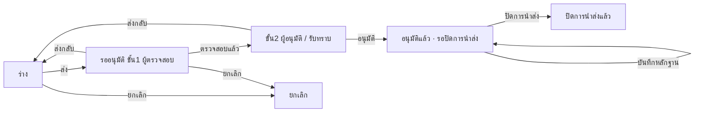

# BRD: แบบฟอร์มชุดเอกสารนำส่งและหลักฐานการนำส่ง (Document Dispatch Package and Delivery Evidence Form)

| Field | Value |
|---|---|
| BRD ID | BRD-IVM-IVMG-001 |
| Feature | F-TMP-009 แบบฟอร์มชุดเอกสารนำส่งและหลักฐานการนำส่ง (รหัสชั่วคราว — รอ feature id จริง) |
| BRD Type | New Feature (แบบ 1 · ข้อมูลใหม่ทั้งหมด — ชื่อผู้จัดทำจาก F-EMP-001 · ผู้ตรวจทาน/ผู้อนุมัติ + สายอนุมัติจาก DOA) |
| Version | 1.0 |
| Status | **APPROVED (Prebrief Mode · Lane · unattended)** — DEC แทน Scope Lock จนมีใบเซ็นลูกค้า · มติ AI-DEFAULT ทุกหมวด |
| Module | ฝ่ายบริหารการลงทุน (Investment Management) — module ใหม่ ยังไม่อยู่ใน Module Registry ของ DOA (OQ-03) |
| Customer | แบบฟอร์มลูกค้า FM-IVM-07 Rev.00 : 01/07/2569 (ขั้นตอนที่ 6: การจัดชุดและนำส่งเอกสารภายนอก) |
| Request | REQ-TMP-009 (ชั่วคราว — รอเลขจริงจาก F186) |
| Input | PREBRIEF_REQ-TMP-009_v2 · FORM_SPEC.json (23 ช่อง) · DECISIONS.lock (21 DEC · พร้อมเริ่มทำ) · feature.html (audit FAIL 0 · self_audit PASS · smoke 64/64 · NO-BROWSER) |
| Created / Updated | 2026-10-11 |

## Changelog
- v1.0 (2026-10-11): สร้างผ่าน brd-generator-full v2.3 Prebrief Mode (doc-master-pipeline ขั้น 7 · โหมดไม่เฝ้า)

---

## 1. Business Context
### 1.1 ปัญหา / โอกาส
ฝ่ายบริหารการลงทุนใช้ไฟล์ Excel FM-IVM-07 จัดชุดเอกสารก่อนนำส่งภายนอกและบันทึกหลักฐานการนำส่ง — ข้อมูลการนำส่ง 7 ช่อง · รายการตรวจสอบชุดเอกสาร 10 แถว (ลำดับพิมพ์ 1–10 ไว้ล่วงหน้า) · หลักฐานการนำส่งเอกสาร 15 แถว 10 คอลัมน์ · dropdown สถานะ/ระดับความลับ/ช่องทาง/สถานะการรับ ไม่ผูกกติกา (ขาดเอกสารไม่ต้องมีหมายเหตุ · รับแล้วไม่ต้องมีหลักฐาน · ส่งไม่สำเร็จไม่ต้องบอกเหตุ) · ฟอร์มเดียวรวมการตรวจ/อนุมัติชุดเอกสาร "ก่อนนำส่ง" กับหลักฐาน "หลังนำส่ง" โดยไม่มีลำดับงาน · ผู้ตรวจทาน/ผู้อนุมัติพิมพ์ชื่อเอง · ตรวจย้อนหลังยาก
### 1.2 เป้าหมาย
1. ขึ้นแบบฟอร์มเป็นเอกสารในระบบ ช่องตรงกระดาษ 1:1 · PDF Replica FM-IVM-07 2 หน้า
2. ลำดับงานชัด: จัดชุด → ตรวจสอบ/อนุมัติ (DOA 2 ขั้น) → นำส่งนอกระบบแล้วบันทึกหลักฐาน (ไม่ต้องอนุมัติซ้ำ) → ปิดการนำส่ง
3. กติกาตรวจ: ขาดเอกสาร/มีข้อจำกัดต้องมีหมายเหตุ · รับแล้วต้องมีหลักฐาน · อื่น ๆ/ส่งไม่สำเร็จ/ยกเลิกต้องมีหมายเหตุ · เวลาไม่เป็นอนาคต · ประวัติ append-only
### 1.3 ตัวชี้วัด
ไม่มีใน input → **OQ-01** (ห้ามแต่งตัวเลข)
### 1.4 ที่มา
แบบฟอร์มลูกค้า FM-IVM-07 (xlsx · ชื่อชีต/หัวฟอร์ม INV-FM-07) → FORM_SPEC 23 ช่อง · แถวซ้ำ 2 ชุด (รายการตรวจสอบชุดเอกสาร 10 แถว · หลักฐานการนำส่งเอกสาร 15 แถว) · ตัวเลือก 4 ชุด (สถานะ 4 ค่า D22:D31 · ระดับความลับ 4 ค่า E22:E31 · ช่องทาง 5 ค่า F35:F49 · สถานะการรับ 4 ค่า J35:J49) · ไม่มีสูตร · gate 10 หมวด = AI-DEFAULT ทั้งหมด (โหมดไม่เฝ้า)

## 2. Scope
### 2.1 In Scope
- รายการแบบฟอร์ม (ค้นหา · กรองสถานะเอกสาร/ระดับความลับ · CSV) · สร้าง/แก้ร่าง wizard 3 ขั้น · ดูรายละเอียด 4 แท็บ (รายละเอียด › PDF Preview › ลายเซ็น/อนุมัติ › ประวัติ)
- ข้อมูลการนำส่ง 7 ช่อง (กรอก 4 · ระบบใส่ 3) · รายการตรวจสอบชุดเอกสาร 6 คอลัมน์ (ไม่จำกัดแถว)
- ส่งอนุมัติ DOA 2 ขั้น (เลือกคนต่อขั้น) · ตรวจสอบแล้ว/ส่งกลับ · อนุมัติ/ส่งกลับ → กลับร่าง · ยกเลิก (เหตุผลบังคับ)
- หลังอนุมัติ: บันทึกหลักฐานการนำส่งเอกสาร 10 คอลัมน์ (ไม่จำกัดแถว · แนบไฟล์หลักฐานต่อแถวได้) · ปิดการนำส่ง
- แนบไฟล์ระดับใบ · PDF FM-IVM-07 Replica 2 หน้าทุกสถานะ · เลขที่ IVMG จาก ENG-DOC-NUM
### 2.2 Out of Scope
- ระบบส่งเอกสารออกเอง (อีเมล/ห้องข้อมูล) — ผู้ใช้ส่งนอกระบบแล้วบันทึกหลักฐาน (DEC-01) · เชื่อมแบบฟอร์มเริ่มต้นธุรกรรม FM-IVM-01 / ทะเบียนโครงการ (ชื่อโครงการกรอกเอง · OQ-05) · ดึงรายการเอกสารจากห้องข้อมูล FM-IVM-04 / ชุดเอกสารส่งมอบงาน FM-IVM-06 อัตโนมัติ (OQ-07) · เชื่อมแบบฟอร์มบันทึกการอนุมัตินำส่ง FM-IVM-08 (OQ-08) · ทำซ้ำ (DEC-12 ✗) · ช่องเพิ่มนอกกระดาษ (DEC-07)
### 2.3 Assumptions
- ข้อมูลพนักงาน/ตำแหน่งมีใน F-EMP-001 / F-ORG-001 · DOA กลางเพิ่ม module/role ของฝ่ายบริหารการลงทุนได้ (OQ-03) · ผู้ส่ง/ผู้รับ/หน่วยงาน/นำส่งให้ เป็นข้อความ · ระดับความลับเป็นข้อมูลประกอบการตัดสินใจของผู้อนุมัติ (ระบบไม่บังคับช่องทางตามระดับ · OQ-09)
### 2.4 Scope Lock (ชั่วคราว = DECISIONS.lock · ยังไม่มีใบเซ็น → OQ-02)
| DEC | หมวด | มติ | ที่มา | ใช้ที่ |
|---|---|---|---|---|
| DEC-01 | G1 | อนุมัติแล้วไม่เปลี่ยนค่าในระบบ | AI-DEFAULT | html, thai-doc, brd, frd, tests, ntf-declaration |
| DEC-02 | G1 | ไม่ส่งต่อระบบอื่นรอบนี้ (ประกาศ event ไว้ใน FRD แต่ไม่ยิง) | AI-DEFAULT | brd, frd |
| DEC-03 | G2 | สายอนุมัติตั้งที่ DOA กลาง (dynamic) · ค่าเริ่ม 2 ขั้น: role-line-manager, role-gm · วงเงิน: ไม่มี | AI-DEFAULT | html, doa-declaration, frd, tests |
| DEC-04 | G3 | คำนวณให้อัตโนมัติ ผู้ใช้ปรับได้ · เกินเกณฑ์ = เตือน · ลำดับแถวทั้งสองตาราง ระบบรันให้ 1, 2, 3 … ต่อใบ · ต้องมีรายการตรวจสอบชุดเอกสารอย่างน้อย 1 แถวก่อนส่ง (บล็อกตอนส่ง) · แถวสถานะ ขาดเอกสาร หรือ มีข้อจำกัด ต้องมีหมายเหตุ (บล็อกตอนส่ง) · มีแถวสถานะ ขาดเอกสาร → เตือนก่อนส่ง (ไม่บล็อก) · ลำดับงาน: อนุมัติชุดเอกสารก่อนนำส่ง → หลังอนุมัติ ผู้จัดทำบันทึกหลักฐานการนำส่งได้โดยไม่ต้องอนุมัติซ้ำ (มีประวัติแก้ไข) → ปิดการนำส่ง · หลักฐานการนำส่ง: สถานะการรับ รับแล้ว ต้องมีหลักฐาน / ลิงก์ หรือไฟล์แนบ (บล็อก) · หลักฐานการนำส่ง: ช่องทาง อื่น ๆ หรือสถานะ ส่งไม่สำเร็จ / ยกเลิก ต้องมีหมายเหตุ (บล็อก) · หลักฐานการนำส่ง: วันที่ / เวลาในอนาคต บล็อก · ก่อนวันที่นำส่ง = เตือน · ปิดการนำส่งได้เมื่อมีแถวสถานะ รับแล้ว อย่างน้อย 1 แถว และไม่มีแถว รอยืนยัน (บล็อก) | AI-DEFAULT | html, thai-doc, brd, frd, tests |
| DEC-05 | G4 | รายการตรวจสอบชุดเอกสาร: ไม่จำกัดจำนวนแถว · PDF อย่างน้อย 10 แถวตามกระดาษ | AI-DEFAULT | html, thai-doc, frd |
| DEC-06 | G4 | หลักฐานการนำส่งเอกสาร: ไม่จำกัดจำนวนแถว · PDF อย่างน้อย 15 แถวตามกระดาษ | AI-DEFAULT | html, thai-doc, frd |
| DEC-07 | G5 | ช่องตรงกระดาษ 1:1 · ไม่เพิ่มช่อง (เช่น หมายเหตุ) | AI-DEFAULT | html, thai-doc, brd, frd |
| DEC-08 | G6 | ลายเซ็นแถวล่าง 1 ช่องต่อขั้น DOA · ไม่ใช้ภาพลายมือชื่อ (ข้อความส่งในระบบ/พิจารณาในระบบ) | AI-DEFAULT | thai-doc, html, doccfg-declaration, frd |
| DEC-09 | G7 | ไม่อนุมัติ = กลับเป็นร่าง แก้แล้วส่งใหม่ · ยกเลิกได้โดย owner, admin_role สถานะ draft, pending · ต้องมีเหตุผล | AI-DEFAULT | html, frd, tests, doa-declaration |
| DEC-10 | G8 | มองเห็น: เจ้าของ · ผู้อนุมัติเห็นหลังส่ง · admin role เห็นทั้งหมด | AI-DEFAULT | html, frd, tests |
| DEC-11 | G9 | ออกเลขเมื่อบันทึกครั้งแรก · รหัส IVMG | AI-DEFAULT | doccfg-declaration, html, frd |
| DEC-12 | G10 | ของเสริม (กระดาษไม่มี): แนบไฟล์, ส่งออก CSV | AI-DEFAULT | html, brd, frd, ntf-declaration |
| DEC-13 | VALID | กฎตรวจจากตัวอย่างลูกค้า: ยึด FM-IVM-07 ตาม footer เป็นรหัสแบบฟอร์ม (พบ: ชื่อชีตและมุมหัวฟอร์มเป็น INV-FM-07 แต่ Doc. No. ท้ายกระดาษเป็น FM-IVM-07) | FORM_SPEC | html, frd, tests |
| DEC-14 | VALID | กฎตรวจจากตัวอย่างลูกค้า: คงคำตามกระดาษทั้งสองจุด (G5) · ทั้งสองคือ DOA ขั้นที่ 1 คนเดียวกัน (ระบบดึงชื่อจาก approval_chain) (พบ: ส่วนข้อมูลใช้คำ ผู้ตรวจทาน แต่ตารางลงชื่อใช้ ผู้ตรวจสอบ) | FORM_SPEC | html, frd, tests |
| DEC-15 | VALID | กฎตรวจจากตัวอย่างลูกค้า: แถวสถานะ ขาดเอกสาร หรือ มีข้อจำกัด ต้องมีหมายเหตุ (บล็อกตอนส่ง) (พบ: สถานะ ขาดเอกสาร / มีข้อจำกัด ไม่บังคับหมายเหตุ) | FORM_SPEC | html, frd, tests |
| DEC-16 | VALID | กฎตรวจจากตัวอย่างลูกค้า: มีแถว ขาดเอกสาร → เตือนก่อนส่ง (ไม่บล็อก) และแสดงจำนวนในหัว drawer (พบ: ส่งชุดเอกสารเข้าอนุมัติได้แม้มีแถว ขาดเอกสาร) | FORM_SPEC | html, frd, tests |
| DEC-17 | VALID | กฎตรวจจากตัวอย่างลูกค้า: รับแล้ว → ต้องมีหลักฐาน / ลิงก์ หรือไฟล์แนบ (บล็อก) (พบ: สถานะการรับ = รับแล้ว แต่ไม่มีหลักฐาน / ลิงก์ ได้) | FORM_SPEC | html, frd, tests |
| DEC-18 | VALID | กฎตรวจจากตัวอย่างลูกค้า: ต้องมีหมายเหตุ (บล็อก) (พบ: ช่องทาง อื่น ๆ / สถานะ ส่งไม่สำเร็จ / ยกเลิก ไม่บังคับหมายเหตุ) | FORM_SPEC | html, frd, tests |
| DEC-19 | VALID | กฎตรวจจากตัวอย่างลูกค้า: วันที่ / เวลา ก่อนวันที่นำส่ง = เตือน · เวลาในอนาคต = บล็อก (พบ: วันที่ / เวลาส่งไม่มีกติกาเทียบกับวันที่นำส่ง) | FORM_SPEC | html, frd, tests |
| DEC-20 | VALID | กฎตรวจจากตัวอย่างลูกค้า: อนุมัติชุดเอกสารก่อน → บันทึกหลักฐานการนำส่งหลังอนุมัติ (ไม่ต้องอนุมัติซ้ำ · มีประวัติแก้ไข) → ปิดการนำส่ง (พบ: ฟอร์มเดียวรวมการจัดชุดก่อนนำส่ง (ต้องตรวจ/อนุมัติ) กับหลักฐานหลังนำส่ง) | FORM_SPEC | html, frd, tests |
| DEC-21 | VALID | กฎตรวจจากตัวอย่างลูกค้า: ไม่เป็นช่องกรอกต่อใบ · แสดงจาก doccfg revision (พบ: ตารางประวัติการแก้ไขเป็นของแบบฟอร์ม (form revision) วางท้ายฟอร์ม) | FORM_SPEC | html, frd, tests |

## 3. Roles & Permissions (COSO)
| Role | COSO | ทำอะไร |
|---|---|---|
| ผู้จัดทำ (ผู้ประสานงานบริหารการลงทุน / ผู้รับผิดชอบที่ได้รับมอบหมาย) | Maker | สร้าง/แก้ร่าง · ส่ง · ยกเลิกของตัวเอง (ร่าง/รออนุมัติ) · บันทึกหลักฐานการนำส่ง · ปิดการนำส่ง |
| ผู้ตรวจสอบ — role-line-manager (บนกระดาษ: ผู้จัดการฝ่ายบริหารการลงทุน) | Checker | ขั้น 1 ตรวจสอบแล้ว / ส่งกลับ |
| ผู้อนุมัติ / รับทราบ — role-gm (บนกระดาษ: รองกรรมการผู้จัดการ / กรรมการผู้จัดการ / ผู้มีอำนาจตามตารางอำนาจอนุมัติ) | Approver | ขั้น 2 อนุมัติ / ส่งกลับ |
| admin role ฝ่ายบริหารการลงทุน (เจ้าหน้าที่ดูแลเอกสาร) | Monitor | เห็นทุกใบ · ยกเลิกได้ (ร่าง/รออนุมัติ) · บันทึกหลักฐาน/ปิดการนำส่งแทนได้ · CSV |

| Action | Maker | Checker | Approver | Admin |
|---|:-:|:-:|:-:|:-:|
| ดูใบ | ของตน | หลังส่ง (อยู่ในสาย) | หลังส่ง (อยู่ในสาย) | ทั้งหมด |
| สร้าง/แก้ร่าง | ✓ ของตน | – | – | – |
| ตัดสินขั้น | – | ขั้น 1 | ขั้น 2 | – |
| บันทึกหลักฐาน / ปิดการนำส่ง | ✓ ของตน (หลังอนุมัติ) | – | – | ✓ |
| ยกเลิก | ✓ ของตน | – | – | ✓ |
SoD: ผู้จัดทำพิจารณาใบตัวเองไม่ได้ (BR-DOA-04) · ผู้พิจารณาแก้หลักฐานการนำส่งไม่ได้ · role จริงต้องเทียบ DOA master (OQ-03)

## 4. User Journey
### 4.1 Happy Path
1. ผู้จัดทำ: สร้าง → ข้อมูลการนำส่ง (ชื่อโครงการ / ธุรกรรม · วัตถุประสงค์การนำส่ง · นำส่งให้ · วันที่นำส่ง) → รายการตรวจสอบชุดเอกสาร (เอกสาร · ฉบับ · สถานะ · ระดับความลับ · หมายเหตุ — ลำดับระบบรัน) → แนบไฟล์ → บันทึก (ได้เลข IVMG) → ส่ง เลือกคน 2 ขั้น
2. ขั้น 1 ตรวจสอบแล้ว (ระบบใส่ชื่อ ผู้ตรวจทาน) → ขั้น 2 อนุมัติ (ระบบใส่ชื่อ ผู้อนุมัติ) → **อนุมัติแล้ว · รอปิดการนำส่ง** · PDF เก็บสำเนา (approved_final)
3. ผู้จัดทำนำส่งนอกระบบ → บันทึกหลักฐานการนำส่ง (วันที่ / เวลา · ผู้ส่ง · ผู้รับ · หน่วยงาน · ช่องทาง · เอกสารที่ส่ง · หลักฐาน / ลิงก์ · หมายเหตุ · สถานะการรับ) ทีละครั้ง/หลายครั้ง → ปิดการนำส่ง (รับแล้ว ≥ 1 · ไม่มีรอยืนยัน) → แจ้งสายอนุมัติ + admin (ivmg_dispatch_closed)
### 4.2 Alternative
- ส่งกลับ ขั้นใดก็ได้ → กลับร่าง เลขเดิม + เหตุผล → ผู้จัดทำแก้ ส่งใหม่ (resolve สายใหม่)
- มีเอกสารสถานะ ขาดเอกสาร → เตือนตอนกรอก/ส่ง ส่งได้ (ผู้พิจารณาเห็นจำนวนที่ขาด)
- บันทึกแถว ส่งไม่สำเร็จ → แจ้งผู้จัดทำ + admin (ivmg_delivery_failed) → เพิ่มแถวส่งใหม่
- ปิดการนำส่งขณะยังมีแถว รอยืนยัน / ยังไม่มี รับแล้ว → บล็อก พร้อมลิงก์ไปบันทึกหลักฐาน
- ยกเลิก (ร่าง/รออนุมัติ) โดยเจ้าของหรือ admin → ถ้ารออนุมัติ แจ้งผู้พิจารณาขั้นปัจจุบัน (ivmg_cancelled)

## 5. Data (จาก FORM_SPEC — ป้ายตามกระดาษ)
### 5.1 ivm_dispatch (header)
| ช่องบนกระดาษ | field | ชนิด | ที่มา | บังคับ |
|---|---|---|---|:-:|
| (เลขที่ — ระบบเพิ่ม footer) | doc_no | text | auto ENG-DOC-NUM | ✓ |
| ชื่อโครงการ / ธุรกรรม | project_name | text | user | ✓ |
| วัตถุประสงค์การนำส่ง | purpose | textarea | user | ✓ |
| นำส่งให้ | recipient | text | user | ✓ |
| วันที่นำส่ง | dispatch_date | date | user | ✓ |
| ผู้จัดทำ | maker_id · maker_name_snapshot · maker_position_snapshot | ref | system F-EMP-001 (PDPA) | ✓ |
| ผู้ตรวจทาน | (approval_chain[ขั้นแรก].approved_by) | ref | DOA (PDPA) | ระบบ |
| ผู้อนุมัติ | (approval_chain[ขั้นสุดท้าย].approved_by) | ref | DOA (PDPA) | ระบบ |
| + DOA fields | approval_status · doa_ref · approval_chain (jsonb snapshot) · approver_role · approved_by · approved_at | | DOA | |
| + returned_reason · returned_by · returned_at · cancel_reason · closed_at · closed_by | | | DEC-09 · DEC-20 | |
### 5.2 ivm_dispatch_doc (รายการตรวจสอบชุดเอกสาร — 6 คอลัมน์ตามกระดาษ)
| ลำดับ `seq` (auto 1, 2, 3 …) | เอกสาร `doc_name` (✓) | ฉบับ `version` (✓) | สถานะ `status` (✓ enum 4 · ค่าเริ่ม ครบถ้วน) | ระดับความลับ `confidentiality` (✓ enum 4 · ค่าเริ่ม ภายใน) | หมายเหตุ `remark` (✓ เมื่อ ขาดเอกสาร / มีข้อจำกัด) |
### 5.3 ivm_dispatch_delivery (หลักฐานการนำส่งเอกสาร — 10 คอลัมน์ตามกระดาษ · บันทึกหลังอนุมัติ)
| ลำดับ `seq` (auto) | วันที่ / เวลา `sent_at` (✓ ไม่เป็นอนาคต) | ผู้ส่ง `sender` (✓ PDPA · ค่าเริ่ม = ผู้บันทึก) | ผู้รับ `receiver` (✓ PDPA) | หน่วยงาน `receiver_org` (✓ · ค่าเริ่ม = นำส่งให้) | ช่องทาง `channel` (✓ enum 5) | เอกสารที่ส่ง `docs_sent` (✓) | หลักฐาน / ลิงก์ `evidence` (✓ เมื่อ รับแล้ว — หรือไฟล์แนบ `evidence_file_id`) | หมายเหตุ `remark` (✓ เมื่อ อื่น ๆ / ส่งไม่สำเร็จ / ยกเลิก) | สถานะการรับ `receipt_status` (✓ enum 4 · ค่าเริ่ม รอยืนยัน) |
### 5.4 attachments → Document Center (ไฟล์ระดับใบ + ไฟล์หลักฐานต่อแถว)
### 5.5 ข้อความคงที่บนกระดาษ (ไม่ใช่ช่อง)
ใช้ในขั้นตอน · วัตถุประสงค์ · ผู้จัดทำ/ผู้ตรวจสอบ/ผู้อนุมัติ (คำอธิบาย) · หมายเหตุการใช้งาน · ประวัติการแก้ไข (= revision ของแบบฟอร์มจาก F-DOCCFG ไม่ใช่ข้อมูลใบ · DEC-21)

## 6. User Stories
| ID | Story | AC หลัก |
|---|---|---|
| S-01 | ผู้จัดทำบันทึกข้อมูลการนำส่ง | 4 ช่องบังคับ · ผู้จัดทำ/ผู้ตรวจทาน/ผู้อนุมัติ ระบบใส่ · บันทึกได้เลข IVMG |
| S-02 | ผู้จัดทำจัดรายการตรวจสอบชุดเอกสาร | เอกสาร + ฉบับ บังคับ · ลำดับระบบรัน · สถานะ 4 ค่า · ระดับความลับ 4 ค่า · ≥1 แถว |
| S-03 | ระบบบังคับหมายเหตุเอกสารที่มีปัญหา | ขาดเอกสาร / มีข้อจำกัด → หมายเหตุบังคับ · ขาดเอกสาร = เตือนก่อนส่ง (ไม่บล็อก) |
| S-04 | ผู้จัดทำแนบไฟล์ | ไฟล์ระดับใบ ≤20MB · pdf/doc/xls/รูป/eml/msg |
| S-05 | ผู้จัดทำส่งอนุมัติ | slot 2 ขั้นค่าเริ่มจาก DOA · ผู้จัดทำไม่อยู่ในรายชื่อ · บังคับเลือกครบ |
| S-06 | ผู้ตรวจสอบตัดสิน | ปุ่มเฉพาะขั้นปัจจุบัน · ตรวจสอบแล้ว / ส่งกลับ (เหตุผลบังคับ) → กลับร่าง |
| S-07 | ผู้อนุมัติตัดสิน | อนุมัติ → อนุมัติแล้ว · รอปิดการนำส่ง · ส่งกลับ → กลับร่าง |
| S-08 | ผู้จัดทำบันทึกหลักฐานการนำส่ง | หลังอนุมัติเท่านั้น · 10 คอลัมน์ · ไม่จำกัดแถว · รับแล้วต้องมีหลักฐาน/ไฟล์ · อื่น ๆ/ส่งไม่สำเร็จ/ยกเลิกต้องมีหมายเหตุ · เวลาไม่เป็นอนาคต · ก่อนวันที่นำส่ง = เตือน · ไม่ต้องอนุมัติซ้ำ |
| S-09 | ระบบแจ้งนำส่งไม่สำเร็จ | แถวใหม่/เปลี่ยนเป็น ส่งไม่สำเร็จ → แจ้งผู้จัดทำ + admin |
| S-10 | ผู้จัดทำปิดการนำส่ง | รับแล้ว ≥ 1 · ไม่มีรอยืนยัน · ปิดแล้วล็อก · แจ้งสายอนุมัติ + admin |
| S-11 | พิมพ์/ดาวน์โหลด PDF FM-IVM-07 | ทุกสถานะ 2 หน้า · ≥10 / ≥15 แถว · ลายเซ็น = ผู้จัดทำ + 1 แถวต่อขั้นตาม DOA (dynamic) |
| S-12 | ยกเลิก | เจ้าของ/admin · ร่างหรือรออนุมัติ · เหตุผลบังคับ |
| S-13 | admin ดูทุกใบ + CSV | กรองสถานะเอกสาร/ระดับความลับ |

## 7. Status & Lifecycle
| จาก | Action | ไป | ใคร |
|---|---|---|---|
| — | บันทึกครั้งแรก | draft | Maker |
| draft | ส่ง | pending (ขั้น 1) | Maker |
| pending | ตรวจสอบแล้ว/อนุมัติ ขั้น n<N | pending (ขั้น n+1) | ผู้พิจารณาขั้น n |
| pending | อนุมัติ ขั้น N | approved (อนุมัติแล้ว · รอปิดการนำส่ง) | ขั้น N |
| pending | ส่งกลับ | draft (เลขเดิม · returned_*) | ผู้พิจารณาขั้นปัจจุบัน |
| approved | บันทึกหลักฐานการนำส่ง | approved (ไม่เปลี่ยนสถานะ · audit) | Maker / Admin |
| approved | ปิดการนำส่ง | closed | Maker / Admin |
| draft / pending | ยกเลิก | cancelled | Maker / Admin |
approved = ชุดเอกสาร (หัว + รายการตรวจสอบ) ล็อก แก้ได้เฉพาะหลักฐานการนำส่ง · closed = ล็อกทั้งหมด · ยกเลิกหลังอนุมัติไม่ได้ (OQ-10)

## 8. Business Rules + Validation
| ID | Rule | Tag | Type |
|---|---|:-:|---|
| BR-01 | ลำดับแถวทั้งสองตาราง ระบบรัน 1, 2, 3 … ต่อใบ | FIXED | Auto (DEC-04) [AI-DEFAULT] |
| BR-02 | ต้องมีรายการตรวจสอบชุดเอกสาร ≥ 1 แถวก่อนบันทึก/ส่ง | FIXED | Validation (DEC-04) |
| BR-03 | สถานะ ขาดเอกสาร / มีข้อจำกัด → หมายเหตุบังคับ | FIXED | Validation (DEC-04 · DEC-15) |
| BR-04 | มีแถว ขาดเอกสาร → เตือนก่อนส่ง แสดงจำนวนในหัว drawer · ไม่บล็อก | CONFIGURABLE | Warning (DEC-16) [AI-DEFAULT] |
| BR-05 | ลำดับงาน: อนุมัติชุดเอกสาร → บันทึกหลักฐานการนำส่ง (ไม่ต้องอนุมัติซ้ำ · audit ทุกครั้ง) → ปิดการนำส่ง | FIXED | Lifecycle (DEC-04 · DEC-20) |
| BR-06 | สถานะการรับ รับแล้ว → หลักฐาน / ลิงก์ หรือไฟล์แนบ บังคับ | FIXED | Validation (DEC-17) |
| BR-07 | ช่องทาง อื่น ๆ หรือสถานะ ส่งไม่สำเร็จ / ยกเลิก → หมายเหตุบังคับ | FIXED | Validation (DEC-18) |
| BR-08 | วันที่ / เวลาส่ง ในอนาคต → บล็อก · ก่อนวันที่นำส่ง → เตือน | FIXED / CONFIGURABLE | Validation + Warning (DEC-19) |
| BR-09 | ปิดการนำส่งได้เมื่อ รับแล้ว ≥ 1 และไม่มี รอยืนยัน | FIXED | Validation (DEC-04) |
| BR-10 | ตัวเลือกตามแบบฟอร์ม: สถานะ 4 ค่า (ครบถ้วน · มีข้อจำกัด · ขาดเอกสาร · ไม่เกี่ยวข้อง) · ระดับความลับ 4 ค่า (ทั่วไป · ภายใน · ลับ · ลับมาก) · ช่องทาง 5 ค่า (อีเมล · ลิงก์ห้องข้อมูล · ระบบเอกสาร · ส่งมอบโดยตรง · อื่น ๆ) · สถานะการรับ 4 ค่า (รับแล้ว · รอยืนยัน · ส่งไม่สำเร็จ · ยกเลิก) | CONFIGURABLE | Master list |
| BR-11 | สายอนุมัติ resolve จาก DOA ตอนส่ง แล้ว freeze · ผู้ตรวจทาน = ผู้พิจารณาขั้นแรก · ผู้อนุมัติ = ผู้พิจารณาขั้นสุดท้าย | FIXED | DOA (BR-DOA-02 · DEC-14) |
| BR-12 | ส่งกลับ → draft เลขเดิม · resolve ใหม่ตอนส่งรอบถัดไป | FIXED | DEC-09 (BR-DOA-03) |
| BR-13 | ออกเลขตอนบันทึกครั้งแรก · no-gap ✗ · รหัส IVMG | CONFIGURABLE | DOCCFG (DEC-11) |
| BR-14 | ร่างเห็นเฉพาะเจ้าของ (+ admin) · ผู้พิจารณาเห็นหลังส่ง | FIXED | Visibility (DEC-10) |
| BR-15 | ช่องลงชื่อใน PDF = ผู้จัดทำ + 1 แถวต่อขั้นที่ตั้งใน DOA (dynamic ไม่ fix) · คำตัดสินตาม role (ตรวจสอบแล้ว/ส่งกลับ · อนุมัติ/ส่งกลับ) | FIXED (จำนวน = DOA) | DEC-03 · DEC-08 |
| BR-16 | PDF แสดงรายการตรวจสอบ ≥ 10 แถว · หลักฐาน ≥ 15 แถว · ไม่จำกัดในระบบ · แบบพิมพ์ 2 หน้า (R10) | FIXED | DEC-05 · DEC-06 |
| BR-17 | อนุมัติแล้ว/ปิดแล้ว ไม่เปลี่ยนค่าในระบบอื่น ไม่ส่งต่อ (ประกาศ event ไว้ไม่ยิง) | FIXED | DEC-01/02 |
| BR-18 | รหัสแบบฟอร์ม FM-IVM-07 ตาม footer (ไม่ใช่ INV-FM-07) · ประวัติการแก้ไข = revision แบบฟอร์ม | FIXED | DEC-13 · DEC-21 |

| VR | ช่อง | เงื่อนไข | ข้อความ |
|---|---|---|---|
| VR-01 | project_name · purpose · recipient · dispatch_date | required | กรุณากรอกชื่อโครงการ / ธุรกรรม · กรุณากรอกวัตถุประสงค์การนำส่ง · กรุณากรอกผู้รับการนำส่ง · กรุณาเลือกวันที่นำส่ง |
| VR-02 | doc_name · version | required ต่อแถว | กรอก เอกสาร · ฉบับ |
| VR-03 | remark (รายการตรวจสอบ) | required เมื่อ ขาดเอกสาร / มีข้อจำกัด | กรอก หมายเหตุ (สถานะ …) |
| VR-04 | docs | ≥ 1 แถว | ต้องมีรายการตรวจสอบชุดเอกสารอย่างน้อย 1 รายการ |
| VR-05 | sent_at | วันที่ required · เวลา HH:mm · ไม่เป็นอนาคต | กรอก วันที่ · เวลา (HH:mm) · วันที่ / เวลาต้องไม่เป็นเวลาในอนาคต |
| VR-06 | sender · receiver · receiver_org · docs_sent | required ต่อแถว | กรอก ผู้ส่ง · ผู้รับ · หน่วยงาน · เอกสารที่ส่ง |
| VR-07 | evidence | required เมื่อ รับแล้ว (หรือไฟล์แนบ) | รับแล้ว ต้องมีหลักฐาน / ลิงก์ หรือไฟล์แนบ |
| VR-08 | remark (หลักฐาน) | required เมื่อ อื่น ๆ / ส่งไม่สำเร็จ / ยกเลิก | ช่องทาง อื่น ๆ / ส่งไม่สำเร็จ / ยกเลิก ต้องมีหมายเหตุ |
| VR-09 | deliveries | ≥ 1 แถวเมื่อบันทึกหลักฐาน | ต้องมีรายการนำส่งอย่างน้อย 1 รายการ |
| VR-10 | ปิดการนำส่ง | รับแล้ว ≥ 1 · ไม่มีรอยืนยัน | ยังปิดการนำส่งไม่ได้ — ยังไม่มีแถวสถานะการรับ "รับแล้ว" / ยังมีแถว "รอยืนยัน" n รายการ |
| VR-11 | slot ผู้พิจารณา | ทุกขั้นต้องเลือก · ≠ ผู้จัดทำ | กรุณาเลือกผู้พิจารณา |
| VR-12 | เหตุผล ส่งกลับ/ยกเลิก | required | กรุณาระบุเหตุผล |

### 8.5 ระดับความยืดหยุ่น
BR-04/08(เตือน)/10 → Admin Panel (Investment Policy) · BR-13 → F-DOCCFG · สายอนุมัติ → DOA กลาง

## 9. Edge Cases
| EC | กรณี | ผล |
|---|---|---|
| EC-01 | เปลี่ยนสถานะเป็น ขาดเอกสาร แล้วไม่กรอกหมายเหตุ | บล็อก (VR-03) |
| EC-02 | ส่งชุดเอกสารที่มีแถว ขาดเอกสาร | เตือน ส่งได้ (BR-04) |
| EC-03 | ลบแถวรายการตรวจสอบจนหมด | บล็อก (VR-04) |
| EC-04 | ลบแถวกลางตาราง | ลำดับรันใหม่ (ลำดับไม่ใช่ key) |
| EC-05 | บันทึกหลักฐานก่อนอนุมัติ | ไม่มีปุ่ม · route /evidence/:id → แจ้งเตือน (BR-05) |
| EC-06 | รับแล้วแต่ไม่มีลิงก์ → แนบไฟล์แทน | ผ่าน (ไฟล์เก็บ Document Center ของใบ) |
| EC-07 | เวลาส่งในอนาคต (พิมพ์ผิดวัน) | บล็อก (VR-05) |
| EC-08 | วันที่ส่งก่อนวันที่นำส่ง | เตือน บันทึกได้ (BR-08) |
| EC-09 | ส่งไม่สำเร็จ แล้วส่งใหม่ | เพิ่มแถวใหม่ · แถวเดิมคงไว้ (หลักฐานครบ) · แจ้ง ivmg_delivery_failed |
| EC-10 | ปิดการนำส่งขณะยังมี รอยืนยัน | บล็อก + ปุ่มไปบันทึกหลักฐาน (VR-10) |
| EC-11 | หลักฐาน > 15 แถว / รายการ > 10 แถว | PDF ต่อแถว หัวตารางซ้ำ · dense · 2 หน้า (ต้องยืนยันบนเครื่องที่มี browser) |
| EC-12 | ผู้จัดทำ = ผู้จัดการฝ่าย (resolve ขั้น 1 = ตัวเอง) | slot ว่าง ต้องเลือกคนอื่น |
| EC-13 | แก้ DOA ระหว่างใบรออนุมัติ | ใบเดิมใช้สาย snapshot |
| EC-14 | DOA ตั้ง 6 ขั้น | PDF 7 แถวลงชื่อ · dense |
| EC-15 | ส่ง/อนุมัติ/บันทึกหลักฐานชนกัน (stale) | 409 → toast รีเฟรช สถานะไม่เปลี่ยน |
| EC-16 | แบบเอกสารปิดใช้ (F-DOCCFG) | ปุ่มสร้าง disabled |
| EC-17 | หัวฟอร์ม INV-FM-07 ≠ Doc No. | ใช้ FM-IVM-07 (DEC-13) |
| EC-18 | ผู้พิจารณาพยายามบันทึกหลักฐาน | ไม่มีสิทธิ์ (เฉพาะเจ้าของ/admin) |

## 10. Value Stream & Downstream Impact
Positioning: กระบวนการบริหารการลงทุน — เริ่มต้นธุรกรรม (FM-IVM-01) → … → ชุดเอกสารส่งมอบงาน (FM-IVM-06) → **ขั้นตอนที่ 6 การจัดชุดและนำส่งเอกสารภายนอก (feature นี้)** → บันทึกการอนุมัตินำส่ง (FM-IVM-08) → … → ปิดงานและห้องข้อมูล (FM-IVM-11)
| ปลายทาง | ข้อมูล | Trigger | หมายเหตุ |
|---|---|---|---|
| ผู้จัดทำ + admin ฝ่ายบริหารการลงทุน | แถวที่ส่งไม่สำเร็จ | บันทึกหลักฐาน (ส่งไม่สำเร็จ) | ENG-NOTIFY ivmg_delivery_failed |
| สายอนุมัติ + admin | ปิดการนำส่ง + จำนวนรับแล้ว | approved → closed | ENG-NOTIFY ivmg_dispatch_closed |
| ทะเบียนโครงการ / ห้องข้อมูล / FM-IVM-08 | สถานะการนำส่ง | approved / closed | **ปิดรอบนี้ (DEC-02)** — ประกาศ event `ivmg.approved` · `ivmg.closed` ใน FRD ไม่ยิง |
| F-DOCCFG / ENG-DOC-STORE | PDF snapshot | approved_final | |
| รายงาน | ชุดเอกสารที่นำส่ง · ระดับความลับ · ผลการรับ | — | Report area อ่าน |

## 11. Delivery
Phase 1 = ทุกอย่างใน §2.1 · Phase 2 (เสนอ) = เชื่อมทะเบียนโครงการ/FM-IVM-01 + ดึงรายการจากห้องข้อมูล/FM-IVM-06 (OQ-05/07) + เชื่อม FM-IVM-08 (OQ-08) + กติกาช่องทางตามระดับความลับ (OQ-09)

## 12. Dev Summary "ใบสั่ง"
- Config: DOA entry F-TMP-009 (2 ขั้น · role-line-manager → role-gm · คำตัดสิน ตรวจสอบแล้ว/ส่งกลับ · อนุมัติ/ส่งกลับ) · doc_type IVMG (F-DOCCFG) · รายการตัวเลือก 4 ชุด
- Declaration: DOA_BRIEF · NTF_BRIEF (3 event) · DOCCFG_BRIEF · MDOC_BRIEF (ฉบับจริงหลัง FRD)
- Screen Inventory: P-01 รายการ · P-02 สร้าง/แก้ (drawer wide 3 ขั้น · ตารางกรอก 6 คอลัมน์) · P-03 ดู (drawer 4 แท็บ) · P-04 บันทึกหลักฐานการนำส่ง (drawer wide · ตารางกรอก 10 คอลัมน์) · M-01..06 modal ส่ง/ตรวจสอบแล้ว-อนุมัติ/ส่งกลับ/ยกเลิก/ปิดการนำส่ง/ทิ้งข้อมูล
- UI Signals: เอกสารบันทึก + พิมพ์ + ลายเซ็น = ใช่ · Q-form + ขั้นหลังอนุมัติ

## 13. Open Questions
| OQ | คำถาม | เจ้าของ | Block? |
|---|---|---|---|
| OQ-01 | ตัวชี้วัดความสำเร็จ (เวลาจากอนุมัติถึงปิดการนำส่ง / สัดส่วนส่งไม่สำเร็จ / เวลาอนุมัติเฉลี่ย) | ลูกค้า | ไม่ |
| OQ-02 | ลูกค้าเซ็นยืนยัน DEC-01..12 (AI-DEFAULT ทั้งหมด) — โดยเฉพาะ 2 ขั้น · ส่งกลับ = กลับร่าง · ลำดับงาน อนุมัติก่อน → หลักฐานหลังอนุมัติไม่ต้องอนุมัติซ้ำ · ขาดเอกสาร = เตือน | ทีม BA → ลูกค้า | ก่อน UAT |
| OQ-03 | role "ผู้จัดการฝ่ายบริหารการลงทุน" และ "รองกรรมการผู้จัดการ / กรรมการผู้จัดการ / ผู้มีอำนาจตามตารางอำนาจอนุมัติ" ไม่มีใน DOA contract (ใช้ role-line-manager / role-gm แทน) · module investment ไม่อยู่ใน Module Registry | ทีม BA + พี่เบิร์ด | ก่อน wire |
| OQ-04 | admin role ของฝ่ายบริหารการลงทุน (ใครเห็นทั้งหมด/บันทึกหลักฐานแทนได้) — ยังไม่มี role id | ทีม BA | ก่อน dev |
| OQ-05 | ทำทะเบียนโครงการ / FM-IVM-01 เมื่อไร (เลือกโครงการแทนพิมพ์) | ทีม BA | ไม่ |
| OQ-06 | รหัส IVMG ใน F-DOCCFG · function_code / taxonomy ใน F185 · feature id จริงแทน F-TMP-009 | ทีม BA | ก่อน register |
| OQ-07 | ดึงรายการเอกสารจากห้องข้อมูล FM-IVM-04 / ชุดเอกสารส่งมอบงาน FM-IVM-06 มาเป็นแถวเริ่มต้นหรือไม่ | ลูกค้า | ก่อน Phase 2 |
| OQ-08 | ความสัมพันธ์กับแบบฟอร์มบันทึกการอนุมัตินำส่ง FM-IVM-08 — ใช้แทนขั้นอนุมัติของใบนี้ หรือแยกกัน | ลูกค้า | ก่อน UAT |
| OQ-09 | ต้องบังคับช่องทางตามระดับความลับไหม (เช่น ลับมาก ห้ามส่งทางอีเมล) | ลูกค้า | ไม่ |
| OQ-10 | หลังอนุมัติแล้วถ้าต้องยกเลิกการนำส่ง ทำอย่างไร (ยกเลิกได้ไหม / ใช้สถานะการรับ ยกเลิก รายแถว) | ลูกค้า | ก่อน UAT |

## 14. Security & Compliance
Preset: Standard (เอกสารภายใน · ข้อมูลการลงทุน = Confidential) · PII: ชื่อผู้ส่ง/ผู้รับ/ผู้จัดทำ/ผู้ตรวจทาน/ผู้อนุมัติ (pdpa) — ข้อมูลตัวอย่างใน prototype เป็นชื่อสมมติ (ไฟล์ลูกค้าเป็นฟอร์มเปล่า) · Audit append-only ทุก action (รวมบันทึกหลักฐานแต่ละครั้ง) · SoD ผู้จัดทำ≠ผู้อนุมัติ · ลิงก์หลักฐานเก็บเป็นข้อความ ห้ามเก็บรหัสผ่านห้องข้อมูล/credential · ไฟล์แนบตาม file_policy Document Center

## 15. Health Check / Monitoring
SLA ต่อขั้น: ไม่กำหนดรอบนี้ (→ OQ-01) · KPI เสนอ: ใบอนุมัติแล้วแต่ยังไม่ปิดการนำส่งเกิน N วัน · แถว รอยืนยัน ค้าง · จำนวนส่งไม่สำเร็จ · ใบรออนุมัติเกิน N วัน · Widget: ชุดเอกสารรอปิดการนำส่ง

## Appendix — Screen List
P-01 `#/ivm-dispatch` · P-02 `#/ivm-dispatch/create` · `/edit/:id` · P-03 `#/ivm-dispatch/view/:id` · P-04 `#/ivm-dispatch/evidence/:id`

## AI Review (Quality Gate)
C1–C20 ผ่าน · C20 Scope Lock: DEC ครบ 21 ข้อจาก DECISIONS.lock + OQ-02 รอใบเซ็น → ✅ · C16 ไม่มี Registry = WARN (module investment) · ไม่มีตัวเลขแต่ง · ทุก BR อ้าง DEC → **APPROVED**
