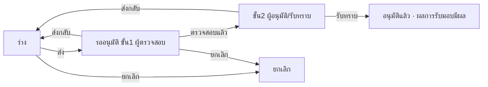

# BRD: แบบฟอร์มชุดเอกสารส่งมอบงาน (Handover Document Package Form)

| Field | Value |
|---|---|
| BRD ID | BRD-IVM-IVMF-001 |
| Feature | F-TMP-008 แบบฟอร์มชุดเอกสารส่งมอบงาน (รหัสชั่วคราว — รอ feature id จริง) |
| BRD Type | New Feature (แบบ 1 · ข้อมูลใหม่ทั้งหมด — ชื่อผู้จัดทำจาก F-EMP-001 · สายอนุมัติจาก DOA) |
| Version | 1.0 |
| Status | **APPROVED (Prebrief Mode · Lane · unattended)** — DEC แทน Scope Lock จนมีใบเซ็นลูกค้า · มติ AI-DEFAULT ทุกหมวด |
| Module | ฝ่ายบริหารการลงทุน (Investment Management) — module ใหม่ ยังไม่อยู่ใน Module Registry ของ DOA (OQ-03) |
| Customer | แบบฟอร์มลูกค้า FM-IVM-06 Rev.00 : 01/07/2569 (ขั้นตอนที่ 6: จัดทำและส่งต่องานให้ฝ่ายบริหารการลงทุน) |
| Request | REQ-TMP-008 (ชั่วคราว — รอเลขจริงจาก F186) |
| Input | PREBRIEF_REQ-TMP-008_v2 · FORM_SPEC.json (18 ช่อง) · DECISIONS.lock (18 DEC · พร้อมเริ่มทำ) · feature.html (audit FAIL 0 · self_audit PASS · smoke 53/53 · NO-BROWSER) |
| Created / Updated | 2026-10-11 |

## Changelog
- v1.0 (2026-10-11): สร้างผ่าน brd-generator-full v2.3 Prebrief Mode (doc-master-pipeline ขั้น 7 · โหมดไม่เฝ้า)

---

## 1. Business Context
### 1.1 ปัญหา / โอกาส
ฝ่ายบริหารการลงทุนใช้ไฟล์ Excel FM-IVM-06 บันทึกการรับมอบชุดเอกสารจากฝ่ายพัฒนาธุรกิจ — ข้อมูลการรับมอบ 6 ช่อง · ผลการตรวจรับเอกสาร 12 แถว (ลำดับพิมพ์ 1–12 ไว้ล่วงหน้า) · ประเด็นค้างและข้อตกลงการติดตาม 4 ช่อง · dropdown "ได้รับแล้ว" กับ "ความครบถ้วน" ไม่ผูกกัน (เลือก ไม่ได้รับ + ครบถ้วน ได้) · แถวที่ไม่ครบไม่บังคับผู้รับผิดชอบแก้ไขและกำหนดส่ง · "ผลการรับมอบ" เลือก รับมอบครบถ้วน ได้แม้บางแถวยังไม่ครบ · ไม่มีกติกาวันที่กำหนดส่ง · ผู้อนุมัติ/รับทราบเป็นฝ่ายผู้ส่งมอบ (ฝ่ายพัฒนาธุรกิจ) · ส่งต่อด้วยมือ ตรวจย้อนหลังยาก
### 1.2 เป้าหมาย
1. ขึ้นแบบฟอร์มเป็นเอกสารในระบบ ช่องตรงกระดาษ 1:1 · PDF Replica FM-IVM-06 2 หน้า
2. ระบบรันลำดับ · ไม่ได้รับ → ไม่ครบถ้วนอัตโนมัติ · แถวไม่ครบต้องมีประเด็น/ผู้รับผิดชอบ/กำหนดส่ง · ผลการรับมอบต้องสอดคล้องตาราง · ระบบแนะนำผลการรับมอบ (เตือน)
3. สายอนุมัติ 2 ขั้นจาก DOA กลาง (dynamic) · ประวัติ append-only · ค้นหา/กรองตามผลการรับมอบได้
### 1.3 ตัวชี้วัด
ไม่มีใน input → **OQ-01** (ห้ามแต่งตัวเลข)
### 1.4 ที่มา
แบบฟอร์มลูกค้า FM-IVM-06 (xlsx · ชื่อชีต INV-FM-06) → FORM_SPEC 18 ช่อง · แถวซ้ำ 1 ชุด (ผลการตรวจรับเอกสาร 12 แถว) · ตัวเลือก 3 ชุด (ผลการรับมอบ 3 ค่า E18 · ได้รับแล้ว 2 ค่า E22:E33 · ความครบถ้วน 3 ค่า F22:F33) · ไม่มีสูตร · gate 10 หมวด = AI-DEFAULT ทั้งหมด (โหมดไม่เฝ้า)

## 2. Scope
### 2.1 In Scope
- รายการแบบฟอร์ม (ค้นหา · กรองสถานะเอกสาร/ผลการรับมอบ · CSV) · สร้าง/แก้ร่าง wizard 3 ขั้น · ดูรายละเอียด 4 แท็บ (รายละเอียด › PDF Preview › ลายเซ็น/อนุมัติ › ประวัติ)
- ข้อมูลการรับมอบ 6 ช่อง · ผลการตรวจรับเอกสาร 8 คอลัมน์ (ไม่จำกัดแถว) · ประเด็นค้างและข้อตกลงการติดตาม 4 ช่อง
- ส่งอนุมัติ DOA 2 ขั้น (เลือกคนต่อขั้น) · ตรวจสอบแล้ว/ส่งกลับ · รับทราบ/ส่งกลับ → กลับร่าง · ยกเลิก (เหตุผลบังคับ)
- แนบไฟล์ระดับใบ · PDF FM-IVM-06 Replica 2 หน้าทุกสถานะ · เลขที่ IVMF จาก ENG-DOC-NUM
### 2.2 Out of Scope
- เชื่อมแบบฟอร์มเริ่มต้นธุรกรรม FM-IVM-01 / ทะเบียนโครงการ (ชื่อโครงการกรอกเอง · OQ-05) · ดึงรายการเอกสารจากคำขอเอกสาร FM-IVM-05 / ห้องข้อมูล FM-IVM-04 อัตโนมัติ (OQ-07) · ติดตามรายการค้างส่งรายวัน/ปิดรายการค้างหลังอนุมัติ (OQ-08) · ทำซ้ำ (DEC-11 ✗) · ช่องเพิ่มนอกกระดาษ (DEC-06)
### 2.3 Assumptions
- ข้อมูลพนักงาน/ตำแหน่งมีใน F-EMP-001 / F-ORG-001 · DOA กลางเพิ่ม module/role ของฝ่ายบริหารการลงทุนได้ (OQ-03) · ผู้ส่งมอบ/ผู้รับมอบ/ผู้รับผิดชอบแก้ไขเป็นข้อความ (คน/หน่วยงาน)
### 2.4 Scope Lock (ชั่วคราว = DECISIONS.lock · ยังไม่มีใบเซ็น → OQ-02)
| DEC | หมวด | มติ | ที่มา | ใช้ที่ |
|---|---|---|---|---|
| DEC-01 | G1 | อนุมัติแล้วไม่เปลี่ยนค่าในระบบ | AI-DEFAULT | html, thai-doc, brd, frd, tests, ntf-declaration |
| DEC-02 | G1 | ไม่ส่งต่อระบบอื่นรอบนี้ (ประกาศ event ไว้ใน FRD แต่ไม่ยิง) | AI-DEFAULT | brd, frd |
| DEC-03 | G2 | สายอนุมัติตั้งที่ DOA กลาง (dynamic) · ค่าเริ่ม 2 ขั้น: role-line-manager, role-mgr-bu · วงเงิน: ไม่มี | AI-DEFAULT | html, doa-declaration, frd, tests |
| DEC-04 | G3 | คำนวณให้อัตโนมัติ ผู้ใช้ปรับได้ · เกินเกณฑ์ = เตือน · ลำดับแถวผลการตรวจรับเอกสาร ระบบรันให้ 1, 2, 3 … ต่อใบ · ได้รับแล้ว = ไม่ได้รับ → ความครบถ้วนตั้งเป็น ไม่ครบถ้วน ให้อัตโนมัติ (เลือก ครบถ้วน ไม่ได้ · บล็อก) · แถวที่ไม่ใช่ ได้รับ + ครบถ้วน ต้องมีประเด็นที่พบ · ผู้รับผิดชอบแก้ไข · กำหนดส่งเพิ่มเติม (บล็อกตอนส่ง) · กำหนดส่งเพิ่มเติมต้องไม่ก่อนวันที่รับมอบ (บล็อก) · ผลการรับมอบ รับมอบครบถ้วน → ทุกแถวต้อง ได้รับ + ครบถ้วน (บล็อก) · รับมอบแบบมีเงื่อนไข → ต้องมีประเด็นค้างจากการรับมอบ + กำหนดการติดตาม (บล็อก) · ยังไม่รับมอบ → ต้องมีหมายเหตุจากฝ่ายบริหารการลงทุน (บล็อก) · ระบบแนะนำผลการรับมอบจากตาราง (ทุกแถวครบ → รับมอบครบถ้วน · มีแถวไม่ครบ → รับมอบแบบมีเงื่อนไข) เป็นคำเตือน ไม่บล็อก · ต้องมีรายการเอกสารอย่างน้อย 1 แถวก่อนส่ง (บล็อกตอนส่ง) | AI-DEFAULT | html, thai-doc, brd, frd, tests |
| DEC-05 | G4 | ผลการตรวจรับเอกสาร: ไม่จำกัดจำนวนแถว · PDF อย่างน้อย 12 แถวตามกระดาษ | AI-DEFAULT | html, thai-doc, frd |
| DEC-06 | G5 | ช่องตรงกระดาษ 1:1 · ไม่เพิ่มช่อง (เช่น หมายเหตุ) | AI-DEFAULT | html, thai-doc, brd, frd |
| DEC-07 | G6 | ลายเซ็นแถวล่าง 1 ช่องต่อขั้น DOA · ไม่ใช้ภาพลายมือชื่อ (ข้อความส่งในระบบ/พิจารณาในระบบ) | AI-DEFAULT | thai-doc, html, doccfg-declaration, frd |
| DEC-08 | G7 | ไม่อนุมัติ = กลับเป็นร่าง แก้แล้วส่งใหม่ · ยกเลิกได้โดย owner, admin_role สถานะ draft, pending · ต้องมีเหตุผล | AI-DEFAULT | html, frd, tests, doa-declaration |
| DEC-09 | G8 | มองเห็น: เจ้าของ · ผู้อนุมัติเห็นหลังส่ง · admin role เห็นทั้งหมด | AI-DEFAULT | html, frd, tests |
| DEC-10 | G9 | ออกเลขเมื่อบันทึกครั้งแรก · รหัส IVMF | AI-DEFAULT | doccfg-declaration, html, frd |
| DEC-11 | G10 | ของเสริม (กระดาษไม่มี): แนบไฟล์, ส่งออก CSV | AI-DEFAULT | html, brd, frd, ntf-declaration |
| DEC-12 | VALID | กฎตรวจจากตัวอย่างลูกค้า: ยึด FM-IVM-06 ตาม footer เป็นรหัสแบบฟอร์ม (พบ: ชื่อชีตเป็น INV-FM-06 แต่ Doc. No. ท้ายกระดาษเป็น FM-IVM-06) | FORM_SPEC | html, frd, tests |
| DEC-13 | VALID | กฎตรวจจากตัวอย่างลูกค้า: ไม่ได้รับ → ความครบถ้วนต้องเป็น ไม่ครบถ้วน (ระบบตั้งให้ · บล็อก ครบถ้วน) (พบ: ได้รับแล้ว = ไม่ได้รับ แต่ความครบถ้วนเลือก ครบถ้วน ได้ (dropdown ไม่ผูกกัน)) | FORM_SPEC | html, frd, tests |
| DEC-14 | VALID | กฎตรวจจากตัวอย่างลูกค้า: แถวที่ไม่ใช่ ได้รับ+ครบถ้วน ต้องมีประเด็นที่พบ · ผู้รับผิดชอบแก้ไข · กำหนดส่งเพิ่มเติม (บล็อกตอนส่ง) (พบ: แถวที่ ไม่ได้รับ / ไม่ครบถ้วน / ต้องตรวจสอบเพิ่มเติม ไม่บังคับผู้รับผิดชอบแก้ไขและกำหนดส่ง) | FORM_SPEC | html, frd, tests |
| DEC-15 | VALID | กฎตรวจจากตัวอย่างลูกค้า: รับมอบครบถ้วน → ทุกแถวต้อง ได้รับ + ครบถ้วน (บล็อก) · รับมอบแบบมีเงื่อนไข → ต้องกรอกประเด็นค้างจากการรับมอบ + กำหนดการติดตาม (บล็อก) (พบ: เลือก รับมอบครบถ้วน ได้แม้บางแถวไม่ได้รับ/ไม่ครบ) | FORM_SPEC | html, frd, tests |
| DEC-16 | VALID | กฎตรวจจากตัวอย่างลูกค้า: กำหนดส่งเพิ่มเติมต้องไม่ก่อนวันที่รับมอบ (บล็อก) (พบ: ไม่มีกติกาวันที่) | FORM_SPEC | html, frd, tests |
| DEC-17 | VALID | กฎตรวจจากตัวอย่างลูกค้า: ขั้น 2 = รับทราบผลการรับมอบ (รับทราบ / ส่งกลับ) · role ต้องยืนยันกับ DOA กลาง (พบ: ผู้อนุมัติ / รับทราบ เป็นฝ่ายพัฒนาธุรกิจ (ฝ่ายผู้ส่งมอบ) ไม่ใช่ผู้บริหารสายบังคับบัญชา) | FORM_SPEC | html, frd, tests |
| DEC-18 | VALID | กฎตรวจจากตัวอย่างลูกค้า: ไม่เป็นช่องกรอกต่อใบ · แสดงจาก doccfg revision (พบ: ตารางประวัติการแก้ไขเป็นของแบบฟอร์ม (form revision) วางท้ายฟอร์ม) | FORM_SPEC | html, frd, tests |

## 3. Roles & Permissions (COSO)
| Role | COSO | ทำอะไร |
|---|---|---|
| ผู้จัดทำ (ฝ่ายบริหารการลงทุน — ผู้รับมอบ) | Maker | สร้าง/แก้ร่าง · ส่ง · ยกเลิกของตัวเอง (ร่าง/รออนุมัติ) |
| ผู้ตรวจสอบ — role-line-manager (บนกระดาษ: ผู้จัดการฝ่ายบริหารการลงทุน) | Checker | ขั้น 1 ตรวจสอบแล้ว / ส่งกลับ |
| ผู้อนุมัติ / รับทราบ — role-mgr-bu (บนกระดาษ: ฝ่ายพัฒนาธุรกิจรับทราบผลการรับมอบ) | Approver (รับทราบ) | ขั้น 2 รับทราบ / ส่งกลับ |
| admin role ฝ่ายบริหารการลงทุน (เจ้าหน้าที่ดูแลเอกสาร) | Monitor | เห็นทุกใบ · ยกเลิกได้ (ร่าง/รออนุมัติ) · CSV |

| Action | Maker | Checker | Approver | Admin |
|---|:-:|:-:|:-:|:-:|
| ดูใบ | ของตน | หลังส่ง (อยู่ในสาย) | หลังส่ง (อยู่ในสาย) | ทั้งหมด |
| สร้าง/แก้ร่าง | ✓ ของตน | – | – | – |
| ตัดสินขั้น | – | ขั้น 1 | ขั้น 2 | – |
| ยกเลิก | ✓ ของตน | – | – | ✓ |
SoD: ผู้จัดทำพิจารณาใบตัวเองไม่ได้ (BR-DOA-04) · ขั้น 2 เป็นฝ่ายผู้ส่งมอบรับทราบผล (ไม่ใช่สายบังคับบัญชา · DEC-17) · role จริงต้องเทียบ DOA master (OQ-03)

## 4. User Journey
### 4.1 Happy Path
1. ผู้จัดทำ: สร้าง → ข้อมูลการรับมอบ (ชื่อโครงการ · ผู้ส่งมอบจากฝ่ายพัฒนาธุรกิจ · ผู้รับมอบจากฝ่ายบริหารการลงทุน (ค่าเริ่ม = ผู้จัดทำ) · วันที่ / เวลารับมอบ · ฉบับชุดเอกสาร · ผลการรับมอบ) → ผลการตรวจรับเอกสาร (ชื่อเอกสาร · รหัส / ฉบับ · ได้รับแล้ว · ความครบถ้วน · ประเด็นที่พบ · ผู้รับผิดชอบแก้ไข · กำหนดส่งเพิ่มเติม — ลำดับระบบรัน) → ประเด็นค้างและข้อตกลงการติดตาม → แนบไฟล์ → บันทึก (ได้เลข IVMF) → ส่ง เลือกคน 2 ขั้น
2. ขั้น 1 ตรวจสอบแล้ว → ขั้น 2 รับทราบ → **อนุมัติแล้ว (ผลการรับมอบมีผล)** · PDF เก็บสำเนา (approved_final) · ผล = มีเงื่อนไข / ยังไม่รับมอบ → แจ้งผู้จัดทำ + admin ติดตามเอกสารค้างส่ง (ivmf_handover_followup)
### 4.2 Alternative
- ส่งกลับ ขั้นใดก็ได้ → กลับร่าง เลขเดิม + เหตุผล → ผู้จัดทำแก้ ส่งใหม่ (resolve สายใหม่)
- ผลการรับมอบไม่ตรงคำแนะนำจากตาราง (เช่น ทุกแถวครบแต่เลือก มีเงื่อนไข) → เตือน ส่งได้
- ยังไม่รับมอบ → ต้องมีหมายเหตุจากฝ่ายบริหารการลงทุน · ยังส่งรับทราบได้ (บันทึกว่าไม่รับมอบ)
- ยกเลิก (ร่าง/รออนุมัติ) โดยเจ้าของหรือ admin → ถ้ารออนุมัติ แจ้งผู้พิจารณาขั้นปัจจุบัน (ivmf_cancelled)

## 5. Data (จาก FORM_SPEC — ป้ายตามกระดาษ)
### 5.1 ivm_handover (header)
| ช่องบนกระดาษ | field | ชนิด | ที่มา | บังคับ |
|---|---|---|---|:-:|
| (เลขที่ — ระบบเพิ่ม footer) | doc_no | text | auto ENG-DOC-NUM | ✓ |
| ชื่อโครงการ | project_name | text | user | ✓ |
| ผู้ส่งมอบจากฝ่ายพัฒนาธุรกิจ | sender_name | text | user (PDPA) | ✓ |
| ผู้รับมอบจากฝ่ายบริหารการลงทุน | receiver_name | text | user · ค่าเริ่ม = ผู้จัดทำ (PDPA) | ✓ |
| วันที่ / เวลารับมอบ | handover_at | datetime | user | ✓ |
| ฉบับชุดเอกสาร | package_version | text | user | ✓ |
| ผลการรับมอบ | handover_result | enum 3 | user | ✓ |
| ประเด็นค้างจากการรับมอบ | open_issues | textarea | user | เมื่อ มีเงื่อนไข |
| เอกสาร / ข้อมูลที่ต้องส่งเพิ่มเติม | pending_docs | textarea | user | – |
| กำหนดการติดตาม | followup_schedule | text | user | เมื่อ มีเงื่อนไข |
| หมายเหตุจากฝ่ายบริหารการลงทุน | ivm_remark | textarea | user | เมื่อ ยังไม่รับมอบ |
| ผู้จัดทำ (ชื่อ/ตำแหน่ง) | maker_id · maker_name_snapshot · maker_position_snapshot | ref | system F-EMP-001 | ✓ |
| + DOA fields | approval_status · doa_ref · approval_chain (jsonb snapshot) · approver_role · approved_by · approved_at | | DOA | |
| + returned_reason · returned_by · returned_at · cancel_reason | | | DEC-08 | |
### 5.2 ivm_handover_item (ผลการตรวจรับเอกสาร — 8 คอลัมน์ตามกระดาษ)
| ลำดับ `seq` (auto 1, 2, 3 …) | ชื่อเอกสาร `doc_name` (✓) | รหัส / ฉบับ `doc_ref` | ได้รับแล้ว `received` (✓ enum 2 · ค่าเริ่ม ได้รับ) | ความครบถ้วน `completeness` (✓ enum 3 · ไม่ได้รับ → ไม่ครบถ้วน) | ประเด็นที่พบ `issue` (✓ เมื่อแถวไม่ครบ) | ผู้รับผิดชอบแก้ไข `fix_owner` (✓ เมื่อแถวไม่ครบ · PDPA) | กำหนดส่งเพิ่มเติม `due_date` (✓ เมื่อแถวไม่ครบ · ≥ วันที่รับมอบ) |
### 5.3 attachments → Document Center (ไฟล์ระดับใบ)
### 5.4 ข้อความคงที่บนกระดาษ (ไม่ใช่ช่อง)
ใช้ในขั้นตอน · วัตถุประสงค์ · ผู้จัดทำ/ผู้ตรวจสอบ/ผู้อนุมัติ (คำอธิบาย) · ประวัติการแก้ไข (= revision ของแบบฟอร์มจาก F-DOCCFG ไม่ใช่ข้อมูลใบ · DEC-18)

## 6. User Stories
| ID | Story | AC หลัก |
|---|---|---|
| S-01 | ผู้จัดทำบันทึกข้อมูลการรับมอบ | 6 ช่องบังคับ · เวลา HH:mm · ผู้รับมอบค่าเริ่ม = ผู้จัดทำ · บันทึกได้เลข IVMF |
| S-02 | ผู้จัดทำบันทึกผลการตรวจรับเอกสาร | ชื่อเอกสารบังคับ · ลำดับระบบรัน · ได้รับแล้ว 2 ค่า · ความครบถ้วน 3 ค่า · ≥1 แถว |
| S-03 | ระบบผูกได้รับแล้วกับความครบถ้วน | ไม่ได้รับ → ไม่ครบถ้วนอัตโนมัติ · ครบถ้วน เลือกไม่ได้ |
| S-04 | ผู้จัดทำระบุรายการค้างส่ง | แถวไม่ครบ → ประเด็นที่พบ · ผู้รับผิดชอบแก้ไข · กำหนดส่งเพิ่มเติม บังคับ · กำหนดส่ง ≥ วันที่รับมอบ |
| S-05 | ผู้จัดทำเลือกผลการรับมอบ | ระบบแนะนำจากตาราง (เตือน) · ครบถ้วนต้องครบทุกแถว · มีเงื่อนไขต้องมีประเด็นค้าง + กำหนดการติดตาม · ยังไม่รับมอบต้องมีหมายเหตุ |
| S-06 | ผู้จัดทำแนบไฟล์ | ไฟล์ระดับใบ ≤20MB · pdf/doc/xls/รูป |
| S-07 | ผู้จัดทำส่งอนุมัติ | slot 2 ขั้นค่าเริ่มจาก DOA · ผู้จัดทำไม่อยู่ในรายชื่อ · บังคับเลือกครบ |
| S-08 | ผู้ตรวจสอบตัดสิน | ปุ่มเฉพาะขั้นปัจจุบัน · ตรวจสอบแล้ว / ส่งกลับ (เหตุผลบังคับ) → กลับร่าง |
| S-09 | ฝ่ายพัฒนาธุรกิจรับทราบผลการรับมอบ | รับทราบ → อนุมัติแล้ว + แจ้งติดตาม (ถ้าผลไม่ครบ) · ส่งกลับ → กลับร่าง |
| S-10 | พิมพ์/ดาวน์โหลด PDF FM-IVM-06 | ทุกสถานะ 2 หน้า · ≥12 แถวผลการตรวจรับ · ลายเซ็น = ผู้จัดทำ + 1 แถวต่อขั้นตาม DOA (dynamic) |
| S-11 | ยกเลิก | เจ้าของ/admin · ร่างหรือรออนุมัติ · เหตุผลบังคับ |
| S-12 | admin ดูทุกใบ + CSV | กรองสถานะเอกสาร/ผลการรับมอบ |

## 7. Status & Lifecycle
| จาก | Action | ไป | ใคร |
|---|---|---|---|
| — | บันทึกครั้งแรก | draft | Maker |
| draft | ส่ง | pending (ขั้น 1) | Maker |
| pending | ตรวจสอบแล้ว ขั้น n<N | pending (ขั้น n+1) | ผู้พิจารณาขั้น n |
| pending | รับทราบ ขั้น N | approved | ขั้น N |
| pending | ส่งกลับ | draft (เลขเดิม · returned_*) | ผู้พิจารณาขั้นปัจจุบัน |
| draft / pending | ยกเลิก | cancelled | Maker / Admin |
approved = ล็อกแก้ไข (ไม่มียกเลิก) · ปิดรายการค้างส่งหลังอนุมัติ = OQ-08

## 8. Business Rules + Validation
| ID | Rule | Tag | Type |
|---|---|:-:|---|
| BR-01 | ลำดับแถวผลการตรวจรับเอกสาร ระบบรัน 1, 2, 3 … ต่อใบ | FIXED | Auto (DEC-04) [AI-DEFAULT] |
| BR-02 | ได้รับแล้ว = ไม่ได้รับ → ความครบถ้วน = ไม่ครบถ้วน อัตโนมัติ · ครบถ้วน เลือกไม่ได้ | FIXED | Auto + Validation (DEC-04 · DEC-13) |
| BR-03 | แถวที่ไม่ใช่ ได้รับ + ครบถ้วน → ประเด็นที่พบ · ผู้รับผิดชอบแก้ไข · กำหนดส่งเพิ่มเติม บังคับ | FIXED | Validation (DEC-04 · DEC-14) |
| BR-04 | กำหนดส่งเพิ่มเติม ≥ วันที่รับมอบ | FIXED | Validation (DEC-04 · DEC-16) |
| BR-05 | รับมอบครบถ้วน → ทุกแถว ได้รับ + ครบถ้วน | FIXED | Validation (DEC-04 · DEC-15) |
| BR-06 | รับมอบแบบมีเงื่อนไข → ประเด็นค้างจากการรับมอบ + กำหนดการติดตาม บังคับ · ยังไม่รับมอบ → หมายเหตุจากฝ่ายบริหารการลงทุน บังคับ | FIXED | Validation (DEC-04 · DEC-15) |
| BR-07 | ระบบแนะนำผลการรับมอบจากตาราง (ทุกแถวครบ → รับมอบครบถ้วน · มีแถวไม่ครบ → รับมอบแบบมีเงื่อนไข) · ไม่ตรง = เตือน ไม่บล็อก | CONFIGURABLE | Warning (DEC-04) [AI-DEFAULT] |
| BR-08 | ตัวเลือกตามแบบฟอร์ม: ผลการรับมอบ 3 ค่า (รับมอบครบถ้วน · รับมอบแบบมีเงื่อนไข · ยังไม่รับมอบ) · ได้รับแล้ว 2 ค่า (ได้รับ · ไม่ได้รับ) · ความครบถ้วน 3 ค่า (ครบถ้วน · ไม่ครบถ้วน · ต้องตรวจสอบเพิ่มเติม) | CONFIGURABLE | Master list |
| BR-09 | ต้องมีรายการเอกสาร ≥ 1 แถวก่อนบันทึก/ส่ง | FIXED | Validation (DEC-04) |
| BR-10 | สายอนุมัติ resolve จาก DOA ตอนส่ง แล้ว freeze | FIXED | DOA (BR-DOA-02) |
| BR-11 | ส่งกลับ → draft เลขเดิม · resolve ใหม่ตอนส่งรอบถัดไป | FIXED | DEC-08 (BR-DOA-03) |
| BR-12 | ออกเลขตอนบันทึกครั้งแรก · no-gap ✗ · รหัส IVMF | CONFIGURABLE | DOCCFG (DEC-10) |
| BR-13 | ร่างเห็นเฉพาะเจ้าของ (+ admin) | FIXED | Visibility (DEC-09) |
| BR-14 | ช่องลงชื่อใน PDF = ผู้จัดทำ + 1 แถวต่อขั้นที่ตั้งใน DOA (dynamic ไม่ fix) · คำตัดสินตาม role (ตรวจสอบแล้ว/ส่งกลับ · รับทราบ/ส่งกลับ) | FIXED (จำนวน = DOA) | DEC-03 · DEC-07 · DEC-17 |
| BR-15 | PDF แสดงผลการตรวจรับ ≥ 12 แถว · ไม่จำกัดในระบบ · แบบพิมพ์ 2 หน้า (R10) | FIXED | DEC-05 |
| BR-16 | อนุมัติแล้วไม่เปลี่ยนค่าในระบบอื่น ไม่ส่งต่อ (ประกาศ event ไว้ไม่ยิง) | FIXED | DEC-01/02 |
| BR-17 | รหัสแบบฟอร์ม FM-IVM-06 ตาม footer (ไม่ใช่ชื่อชีต INV-FM-06) · ประวัติการแก้ไข = revision แบบฟอร์ม | FIXED | DEC-12 · DEC-18 |

| VR | ช่อง | เงื่อนไข | ข้อความ |
|---|---|---|---|
| VR-01 | project_name · sender_name · receiver_name · version · result | required | กรุณากรอกชื่อโครงการ / ผู้ส่งมอบ / ผู้รับมอบ / ฉบับชุดเอกสาร · กรุณาเลือกผลการรับมอบ |
| VR-02 | handover_at | วันที่ required · เวลา HH:mm | กรุณาเลือกวันที่รับมอบ · กรุณากรอกเวลาแบบ HH:mm |
| VR-03 | doc_name | required ต่อแถว | กรอก ชื่อเอกสาร |
| VR-04 | completeness | ≠ ครบถ้วน เมื่อ received = ไม่ได้รับ | ไม่ได้รับ เลือก ครบถ้วน ไม่ได้ |
| VR-05 | issue · fix_owner · due_date | required เมื่อแถวไม่ใช่ ได้รับ + ครบถ้วน | กรอก ประเด็นที่พบ · ผู้รับผิดชอบแก้ไข · กำหนดส่งเพิ่มเติม |
| VR-06 | due_date | ≥ วันที่รับมอบ | กำหนดส่งเพิ่มเติมต้องไม่ก่อนวันที่รับมอบ |
| VR-07 | result = รับมอบครบถ้วน | ทุกแถวครบ | รับมอบครบถ้วน ต้องได้รับและครบถ้วนทุกรายการ |
| VR-08 | open_issues · followup_schedule | required เมื่อ result = มีเงื่อนไข | รับมอบแบบมีเงื่อนไข ต้องระบุประเด็นค้างจากการรับมอบ / กำหนดการติดตาม |
| VR-09 | ivm_remark | required เมื่อ result = ยังไม่รับมอบ | ยังไม่รับมอบ ต้องระบุหมายเหตุจากฝ่ายบริหารการลงทุน |
| VR-10 | items | ≥ 1 แถว | ต้องมีรายการเอกสารอย่างน้อย 1 รายการ |
| VR-11 | slot ผู้พิจารณา | ทุกขั้นต้องเลือก · ≠ ผู้จัดทำ | กรุณาเลือกผู้พิจารณา |
| VR-12 | เหตุผล ส่งกลับ/ยกเลิก | required | กรุณาระบุเหตุผล |

### 8.5 ระดับความยืดหยุ่น
BR-07/08 → Admin Panel (Investment Policy) · BR-12 → F-DOCCFG · สายอนุมัติ → DOA กลาง

## 9. Edge Cases
| EC | กรณี | ผล |
|---|---|---|
| EC-01 | เปลี่ยน ได้รับแล้ว เป็น ไม่ได้รับ ขณะความครบถ้วน = ครบถ้วน | ระบบตั้งเป็น ไม่ครบถ้วน · option ครบถ้วน disabled (BR-02) |
| EC-02 | แถว ต้องตรวจสอบเพิ่มเติม ไม่มีผู้รับผิดชอบ/กำหนดส่ง | บล็อก (VR-05) |
| EC-03 | กำหนดส่งเพิ่มเติมก่อนวันที่รับมอบ | บล็อก (VR-06) |
| EC-04 | เลือก รับมอบครบถ้วน แต่มีแถวค้าง | บล็อก (VR-07) พร้อมจำนวนแถวค้าง |
| EC-05 | ทุกแถวครบแต่เลือก รับมอบแบบมีเงื่อนไข | เตือน ส่งได้ (BR-07) |
| EC-06 | ยังไม่รับมอบ ไม่มีหมายเหตุ | บล็อก (VR-09) |
| EC-07 | ลบแถวจนไม่มีรายการ | บล็อก (VR-10) |
| EC-08 | ลบแถวกลางตาราง | ลำดับรันใหม่ (ลำดับไม่ใช่ key) |
| EC-09 | รายการ > 12 แถว | PDF ต่อแถว หัวตารางซ้ำ · dense · 2 หน้า (ต้องยืนยันบนเครื่องที่มี browser) |
| EC-10 | เวลารับมอบพิมพ์ผิดรูปแบบ (25:00) | บล็อก (VR-02) |
| EC-11 | ผู้จัดทำ = ผู้จัดการฝ่าย (resolve ขั้น 1 = ตัวเอง) | slot ว่าง ต้องเลือกคนอื่น |
| EC-12 | แก้ DOA ระหว่างใบรออนุมัติ | ใบเดิมใช้สาย snapshot |
| EC-13 | DOA ตั้ง 6 ขั้น | PDF 7 แถวลงชื่อ · dense |
| EC-14 | ส่ง/อนุมัติชนกัน (stale) | 409 → toast รีเฟรช สถานะไม่เปลี่ยน |
| EC-15 | แบบเอกสารปิดใช้ (F-DOCCFG) | ปุ่มสร้าง disabled |
| EC-16 | ชื่อชีต INV-FM-06 ≠ Doc No. | ใช้ FM-IVM-06 (DEC-12) |

## 10. Value Stream & Downstream Impact
Positioning: กระบวนการบริหารการลงทุน — เริ่มต้นธุรกรรม (FM-IVM-01) → … → คำขอเอกสาร (FM-IVM-05) → **ขั้นตอนที่ 6 จัดทำและส่งต่องานให้ฝ่ายบริหารการลงทุน (feature นี้)** → … → ปิดงานและห้องข้อมูล (FM-IVM-11)
| ปลายทาง | ข้อมูล | Trigger | หมายเหตุ |
|---|---|---|---|
| ผู้จัดทำ + admin ฝ่ายบริหารการลงทุน | รายการค้างส่ง + กำหนดส่งเร็วสุด | approved และผล ≠ รับมอบครบถ้วน | ENG-NOTIFY ivmf_handover_followup |
| ทะเบียนโครงการ / ห้องข้อมูล | สถานะรับมอบ | approved | **ปิดรอบนี้ (DEC-02)** — ประกาศ event `ivmf.approved` ใน FRD ไม่ยิง |
| F-DOCCFG / ENG-DOC-STORE | PDF snapshot | approved_final | |
| รายงาน | ผลการรับมอบ · รายการค้างส่ง | — | Report area อ่าน |

## 11. Delivery
Phase 1 = ทุกอย่างใน §2.1 · Phase 2 (เสนอ) = เชื่อมทะเบียนโครงการ/FM-IVM-01 + ดึงรายการเอกสารจาก FM-IVM-05 (OQ-05/07) + ปิดรายการค้างส่งหลังอนุมัติ (OQ-08)

## 12. Dev Summary "ใบสั่ง"
- Config: DOA entry F-TMP-008 (2 ขั้น · role-line-manager → role-mgr-bu · คำตัดสินขั้น 2 รับทราบ/ส่งกลับ) · doc_type IVMF (F-DOCCFG) · รายการตัวเลือก 3 ชุด
- Declaration: DOA_BRIEF · NTF_BRIEF · DOCCFG_BRIEF · MDOC_BRIEF (ฉบับจริงหลัง FRD)
- Screen Inventory: P-01 รายการ · P-02 สร้าง/แก้ (drawer wide 3 ขั้น · ตารางกรอก 8 คอลัมน์) · P-03 ดู (drawer 4 แท็บ) · M-01..05 modal ส่ง/ตรวจสอบแล้ว-รับทราบ/ส่งกลับ/ยกเลิก/ทิ้งข้อมูล
- UI Signals: เอกสารบันทึก + พิมพ์ + ลายเซ็น = ใช่ · Q-form

## 13. Open Questions
| OQ | คำถาม | เจ้าของ | Block? |
|---|---|---|---|
| OQ-01 | ตัวชี้วัดความสำเร็จ (สัดส่วนรับมอบครบถ้วนรอบแรก / เวลาปิดรายการค้างส่ง / เวลาอนุมัติเฉลี่ย) | ลูกค้า | ไม่ |
| OQ-02 | ลูกค้าเซ็นยืนยัน DEC-01..11 (AI-DEFAULT ทั้งหมด) — โดยเฉพาะ 2 ขั้น · ส่งกลับ = กลับร่าง · ผลการรับมอบต้องสอดคล้องตาราง · คำแนะนำ = เตือน | ทีม BA → ลูกค้า | ก่อน UAT |
| OQ-03 | role "ผู้จัดการฝ่ายบริหารการลงทุน" และ "ฝ่ายพัฒนาธุรกิจรับทราบผลการรับมอบ" ไม่มีใน DOA contract (ใช้ role-line-manager / role-mgr-bu แทน) · module investment ไม่อยู่ใน Module Registry | ทีม BA + พี่เบิร์ด | ก่อน wire |
| OQ-04 | admin role ของฝ่ายบริหารการลงทุน (ใครเห็นทั้งหมด) — ยังไม่มี role id | ทีม BA | ก่อน dev |
| OQ-05 | ทำทะเบียนโครงการ / FM-IVM-01 เมื่อไร (เลือกโครงการแทนพิมพ์) | ทีม BA | ไม่ |
| OQ-06 | รหัส IVMF ใน F-DOCCFG · function_code / taxonomy ใน F185 · feature id จริงแทน F-TMP-008 | ทีม BA | ก่อน register |
| OQ-07 | ดึงรายการเอกสารจากคำขอเอกสาร FM-IVM-05 / ห้องข้อมูล FM-IVM-04 มาเป็นแถวเริ่มต้นหรือไม่ | ลูกค้า | ก่อน Phase 2 |
| OQ-08 | หลังอนุมัติ การปิดรายการค้างส่ง (ได้รับเพิ่ม) ทำในใบเดิมหรือออกใบรับมอบฉบับใหม่ | ลูกค้า | ก่อน Phase 2 |

## 14. Security & Compliance
Preset: Standard (เอกสารภายใน · ข้อมูลการลงทุน = Confidential) · PII: ชื่อผู้ส่งมอบ/ผู้รับมอบ/ผู้รับผิดชอบแก้ไข (pdpa) — ข้อมูลตัวอย่างใน prototype เป็นชื่อสมมติ (ไฟล์ลูกค้าเป็นฟอร์มเปล่า) · Audit append-only ทุก action · SoD ผู้จัดทำ≠ผู้อนุมัติ · ไฟล์แนบตาม file_policy Document Center · ห้ามเก็บ credential

## 15. Health Check / Monitoring
SLA ต่อขั้น: ไม่กำหนดรอบนี้ (→ OQ-01) · KPI เสนอ: ใบรับมอบแบบมีเงื่อนไข/ยังไม่รับมอบ · รายการค้างส่งเลยกำหนดส่งเพิ่มเติม · ใบรออนุมัติเกิน N วัน · Widget: โครงการที่ยังรับมอบไม่ครบ

## Appendix — Screen List
P-01 `#/ivm-handover` · P-02 `#/ivm-handover/create` · `/edit/:id` · P-03 `#/ivm-handover/view/:id`

## AI Review (Quality Gate)
C1–C20 ผ่าน · C20 Scope Lock: DEC ครบ 18 ข้อจาก DECISIONS.lock + OQ-02 รอใบเซ็น → ✅ · ไม่มีตัวเลขแต่ง · ทุก BR อ้าง DEC → **APPROVED**
