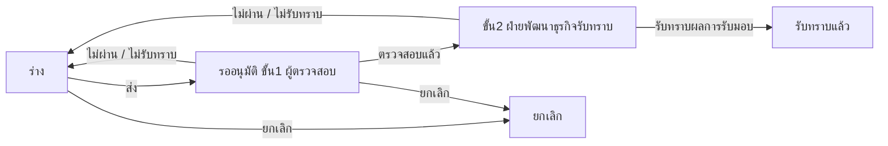

# BRD: แบบฟอร์มชุดเอกสารส่งมอบงาน (สำหรับฝ่ายบริหารการลงทุนจัดเก็บ) (Handover Package Record — Investment Management)

| Field | Value |
|---|---|
| BRD ID | BRD-TMP-008-001 |
| Feature | F-TMP-008 แบบฟอร์มชุดเอกสารส่งมอบงาน (สำหรับฝ่ายบริหารการลงทุนจัดเก็บ) (รหัสชั่วคราว) |
| BRD Type | New Feature (แบบ 1 · Standalone) |
| Version | 1.0 |
| Status | **APPROVED (Prebrief Mode · Lane · unattended)** — DEC แทน Scope Lock จนมีใบเซ็นลูกค้า · มติ AI-DEFAULT 11 ข้อรอลูกค้ายืนยัน |
| Module | Business Development (ใช้โดยฝ่ายบริหารการลงทุน · ฝ่ายพัฒนาธุรกิจรับทราบ) |
| Customer | แบบฟอร์มลูกค้า FM-BDM-08 Rev.00 : 01/07/2569 |
| Request | REQ-TMP-008 (ชั่วคราว — รอเลขจริงจาก F186) |
| Input | PREBRIEF_REQ-TMP-008_v2 · FORM_SPEC.json (18 ช่อง · 1 กลุ่มแถวซ้ำ 12 แถว · ลายเซ็น 3) · DECISIONS.lock (17 DEC · พร้อมเริ่มทำ) · feature.html (audit FAIL 0 · e2e 21/21) |
| Created / Updated | 2026-10-10 |

## Changelog
- v1.0 (2026-10-10): สร้างผ่าน brd-generator-full v2.3 Prebrief Mode (doc-master-pipeline ขั้น 7 · โหมดไม่เฝ้า)

---

## 1. Business Context
### 1.1 ปัญหา / โอกาส
เมื่อฝ่ายพัฒนาธุรกิจส่งต่องานโครงการให้ฝ่ายบริหารการลงทุน (ขั้นตอนที่ 6) ฝ่ายบริหารการลงทุนบันทึกการรับมอบด้วยแบบฟอร์ม Excel FM-BDM-08 — เลือก "รับมอบครบถ้วน" ได้แม้ตารางมีเอกสาร "ไม่ได้รับ" หรือ "ไม่ครบถ้วน" · แถวที่ "ไม่ได้รับ" เลือก "ครบถ้วน" ได้ (ขัดกัน) · แถวที่ไม่ผ่านไม่บังคับผู้รับผิดชอบและกำหนดส่ง · ไม่มีการติดตามประเด็นค้าง · ลงนามด้วยมือ · หัวฟอร์มซ้ำกับ FM-BDM-07 (ฉบับฝ่ายพัฒนาธุรกิจจัดเก็บ) ทำให้สับสนว่าเป็นฉบับใคร
### 1.2 เป้าหมาย
1. ขึ้นแบบฟอร์มเป็นเอกสารในระบบ ช่องตรงกระดาษ 1:1 ลูกค้าจำแบบเดิมได้ (PDF Replica 2 หน้า)
2. ผลการรับมอบสอดคล้องกับผลการตรวจรับรายเอกสาร (บังคับ) · เอกสารที่ไม่ผ่านมีผู้รับผิดชอบและกำหนดส่ง · ประเด็นค้างถูกบันทึกและติดตาม
3. สายตรวจสอบ (ผู้จัดการฝ่ายบริหารการลงทุน) → รับทราบ (ฝ่ายพัฒนาธุรกิจ) จาก DOA กลาง — ตรวจสอบย้อนหลังได้
### 1.3 ตัวชี้วัด
ไม่มีใน input → **OQ-01** (ห้ามแต่งตัวเลข)
### 1.4 ที่มา
แบบฟอร์มลูกค้า FM-BDM-08 (xlsx 1 ชีต) → FORM_SPEC 18 ช่อง (กรอก 17 · ระบบใส่ 1) · gate 10 หมวดตอบโดย AI ตาม unattended-policy (AI-DEFAULT ทุกหมวด)

## 2. Scope
### 2.1 In Scope
- รายการบันทึก (ค้นหา · กรอง สถานะเอกสาร/ผลการรับมอบ/ฝ่าย · CSV · แบ่งหน้า) · สร้าง/แก้ร่าง wizard 3 ขั้น · ดูรายละเอียด 4 แท็บ (รายละเอียด › PDF › ลายเซ็น/อนุมัติ › ประวัติ)
- ข้อมูลการรับมอบ: ชื่อโครงการ · ผู้ส่งมอบจากฝ่ายพัฒนาธุรกิจ · ผู้รับมอบจากฝ่ายบริหารการลงทุน · วันที่ / เวลารับมอบ · ฉบับชุดเอกสาร · ผลการรับมอบ
- ผลการตรวจรับเอกสารไม่จำกัดแถว: ชื่อเอกสาร · รหัส / ฉบับ · ได้รับแล้ว · ความครบถ้วน · ประเด็นที่พบ · ผู้รับผิดชอบแก้ไข · กำหนดส่งเพิ่มเติม
- ประเด็นค้างและข้อตกลงการติดตาม: ประเด็นค้างจากการรับมอบ · เอกสาร / ข้อมูลที่ต้องส่งเพิ่มเติม · กำหนดการติดตาม · หมายเหตุจากฝ่ายบริหารการลงทุน
- ส่งอนุมัติ DOA 2 ขั้น (เลือกคนต่อขั้น) · ตรวจสอบแล้ว/รับทราบผลการรับมอบ · ไม่ผ่าน→กลับร่าง · ยกเลิก (เหตุผลบังคับ)
- แนบไฟล์ · PDF FM-BDM-08 Replica 2 หน้าทุกสถานะ · เลขที่ HOI จาก ENG-DOC-NUM · แจ้งเตือนเมื่อรับทราบแล้วยังมีเอกสารค้างส่ง
### 2.2 Out of Scope
- ผูกคู่กับ FM-BDM-07 (ฉบับฝ่ายพัฒนาธุรกิจจัดเก็บ) / โครงการในระบบ — กระดาษไม่มีช่อง (DEC-06 · DEC-17 → OQ-05) · หน้าตั้งค่า HandoverConfig (ใช้ config กลาง → OQ-04) · ทำซ้ำเอกสาร · ประกาศ · dashboard ติดตามเอกสารค้างข้ามใบ
### 2.3 Assumptions
- ผู้จัดทำ/ตำแหน่ง/ฝ่ายมีใน F-EMP-001 / F-ORG-001 · HandoverConfig มีหรือจะเพิ่ม (OQ-04) · ผู้ตรวจสอบ = ผู้บังคับบัญชาตรงของผู้จัดทำ (ผู้จัดการฝ่ายบริหารการลงทุน) · ผู้ส่งมอบ/ผู้รับมอบ/ผู้รับผิดชอบแก้ไขเป็นข้อความ (เลือกจากรายชื่อพนักงานได้)
### 2.4 Scope Lock (ชั่วคราว = DECISIONS.lock · ยังไม่มีใบเซ็น → OQ-02)
| DEC | หมวด | มติ | ที่มา |
|---|---|---|---|
| DEC-01 | G1 | อนุมัติแล้วไม่เปลี่ยนค่าในระบบ | AI-DEFAULT |
| DEC-02 | G1 | ไม่ส่งต่อระบบอื่นรอบนี้ (ประกาศ event ไว้ใน FRD แต่ไม่ยิง) | AI-DEFAULT |
| DEC-03 | G2 | สายอนุมัติตั้งที่ DOA กลาง (dynamic) · ค่าเริ่ม 2 ขั้น: role-line-manager, role-mgr-bu · วงเงิน: ไม่มี | AI-DEFAULT |
| DEC-04 | G3 | ผลการรับมอบ / ได้รับแล้ว / ความครบถ้วน อ่านจาก HandoverConfig · รับมอบครบถ้วนได้เมื่อทุกแถวได้รับ+ครบถ้วน (บังคับ) · แถวไม่ได้รับห้ามครบถ้วน · แถวไม่ผ่านต้องมีประเด็น/ผู้รับผิดชอบ/กำหนดส่ง · วันที่กำหนดส่ง/ติดตาม ≥ วันที่รับมอบ · ไม่ครบถ้วน → ประเด็นค้างบังคับ | AI-DEFAULT |
| DEC-05 | G4 | ผลการตรวจรับเอกสาร: ไม่จำกัดจำนวนแถว · PDF อย่างน้อย 12 แถวตามกระดาษ | AI-DEFAULT |
| DEC-06 | G5 | ช่องตรงกระดาษ 1:1 · ไม่เพิ่มช่อง | AI-DEFAULT |
| DEC-07 | G6 | ลายเซ็นแถวล่าง 1 ช่องต่อขั้น DOA · ไม่ใช้ภาพลายมือชื่อ (ข้อความส่งในระบบ/พิจารณาในระบบ) | AI-DEFAULT |
| DEC-08 | G7 | ไม่อนุมัติ = กลับเป็นร่าง แก้แล้วส่งใหม่ · ยกเลิกได้โดย owner, admin_role สถานะ draft, pending · ต้องมีเหตุผล | AI-DEFAULT |
| DEC-09 | G8 | มองเห็น: เจ้าของ · ผู้อนุมัติเห็นหลังส่ง · admin role (ฝ่ายบริหารการลงทุน) เห็นทั้งหมด | AI-DEFAULT |
| DEC-10 | G9 | ออกเลขเมื่อบันทึกครั้งแรก · รหัส HOI | AI-DEFAULT |
| DEC-11 | G10 | ของเสริม (กระดาษไม่มี): แนบไฟล์, ส่งออก CSV | AI-DEFAULT |
| DEC-12 | VALID | รับมอบครบถ้วน ได้เมื่อทุกแถว ได้รับ และ ครบถ้วน · ไม่ครบ = บังคับเลือก รับมอบแบบมีเงื่อนไข หรือ ยังไม่รับมอบ | FORM_SPEC |
| DEC-13 | VALID | ได้รับแล้ว = ไม่ได้รับ → ความครบถ้วน ต้องไม่เป็น ครบถ้วน | FORM_SPEC |
| DEC-14 | VALID | แถวที่ไม่ผ่าน ต้องมี ประเด็นที่พบ + ผู้รับผิดชอบแก้ไข + กำหนดส่งเพิ่มเติม | FORM_SPEC |
| DEC-15 | VALID | กำหนดส่งเพิ่มเติม / กำหนดการติดตาม ≥ วันที่รับมอบ | FORM_SPEC |
| DEC-16 | VALID | ผลการรับมอบ ≠ รับมอบครบถ้วน → ประเด็นค้างจากการรับมอบ บังคับกรอก | FORM_SPEC |
| DEC-17 | VALID | ไม่เพิ่มช่องอ้าง FM-BDM-07 (G5 1:1) — เสนอลูกค้ายืนยันการผูกคู่ในรายงาน | FORM_SPEC |

## 3. Roles & Permissions (COSO)
| Role | COSO | ทำอะไร |
|---|---|---|
| ผู้จัดทำ (ฝ่ายบริหารการลงทุน) | Maker | สร้าง/แก้ร่าง · ส่ง · ยกเลิกของตัวเอง (ร่าง/รออนุมัติ) |
| role-line-manager (ผู้ตรวจสอบ · ผู้จัดการฝ่ายบริหารการลงทุน) | Checker | ขั้น 1 ตรวจสอบแล้ว / ไม่ผ่านการตรวจสอบ |
| role-mgr-bu (ผู้อนุมัติ / รับทราบ · ฝ่ายพัฒนาธุรกิจรับทราบผลการรับมอบ) | Approver | ขั้น 2 รับทราบผลการรับมอบ / ไม่รับทราบ |
| admin ฝ่ายบริหารการลงทุน | Monitor | เห็นทั้งหมด · ยกเลิกได้ |

| Action | Maker | Checker | Approver | Admin |
|---|:-:|:-:|:-:|:-:|
| ดูใบ | ของตน | หลังส่ง (อยู่ในสาย) | หลังส่ง (อยู่ในสาย) | ทั้งหมด |
| สร้าง/แก้ร่าง | ✓ ของตน | – | – | – |
| ตัดสินขั้น | – | ขั้น 1 | ขั้น 2 | – |
| ยกเลิก | ✓ ของตน | – | – | ✓ |
SoD: ผู้จัดทำพิจารณาใบตัวเองไม่ได้ (BR-DOA-04) · ไม่มี role "ผู้จัดการฝ่ายพัฒนาธุรกิจ" ใน DOA master → ใช้ role-mgr-bu ชั่วคราว (OQ-03) · ขั้น 2 เป็นการรับทราบข้ามฝ่าย

## 4. User Journey
### 4.1 Happy Path
1. ผู้จัดทำ (ฝ่ายบริหารการลงทุน): สร้าง → ขั้น 1 กรอกข้อมูลการรับมอบ + ตรวจรับเอกสารทีละแถว (ชื่อเอกสาร · รหัส/ฉบับ · ได้รับแล้ว · ความครบถ้วน · ประเด็น · ผู้รับผิดชอบ · กำหนดส่ง) → ขั้น 2 ประเด็นค้างและข้อตกลงการติดตาม + แนบใบรับมอบ → บันทึก (ได้เลข HOI) → ส่ง เลือกคน 2 ขั้น
2. ขั้น 1 ผู้จัดการฝ่ายบริหารการลงทุน "ตรวจสอบแล้ว" → ขั้น 2 ฝ่ายพัฒนาธุรกิจ "รับทราบผลการรับมอบ" → **รับทราบแล้ว** · PDF เก็บสำเนา (approved_final) · มีเอกสารค้างส่ง → แจ้งผู้จัดทำ (hoi_acknowledged_open_items)
### 4.2 Alternative
- ไม่ผ่านการตรวจสอบ/ไม่รับทราบ ขั้นใดก็ได้ → กลับร่าง เลขเดิม + เหตุผล → ผู้จัดทำแก้ ส่งใหม่ (resolve สายใหม่)
- เลือก "รับมอบครบถ้วน" ขณะมีแถวไม่ได้รับ/ไม่ครบถ้วน → บล็อก ให้เลือก แบบมีเงื่อนไข / ยังไม่รับมอบ
- ผลการรับมอบไม่ครบถ้วน → ขั้น 2 บังคับประเด็นค้าง
- ยกเลิก (ร่าง/รออนุมัติ) โดยเจ้าของหรือ admin

## 5. Data (จาก FORM_SPEC — ป้ายตามกระดาษ)
### 5.1 handover_record (header)
| ช่อง | field | ชนิด | ที่มา | บังคับ |
|---|---|---|---|:-:|
| เลขที่ (footer) | doc_no | text | auto ENG-DOC-NUM (HOI) | ✓ |
| วันที่ | doc_date | date | auto | ✓ |
| ผู้จัดทำ (ชื่อ · ตำแหน่ง) | preparer_id → snapshot | ref | system F-EMP-001 | ✓ |
| ฝ่าย | dept_snapshot | text | system F-ORG-001 | ✓ |
| ชื่อโครงการ | project_name | text | user | ✓ |
| ผู้ส่งมอบจากฝ่ายพัฒนาธุรกิจ | sender_name | text (เลือกจาก Employee ได้) | user | ✓ |
| ผู้รับมอบจากฝ่ายบริหารการลงทุน | receiver_name | text (ค่าเริ่ม = ผู้จัดทำ) | user | ✓ |
| วันที่ / เวลารับมอบ | received_at | datetime (วันที่ ≤ วันนี้ · เวลา HH:MM) | user | ✓ |
| ฉบับชุดเอกสาร | package_version | text | user | ✓ |
| ผลการรับมอบ | handover_result | enum (HandoverConfig.handover_results) | user | ✓ |
| ประเด็นค้างจากการรับมอบ | open_issues | text | user | เมื่อผลการรับมอบ ≠ รับมอบครบถ้วน |
| เอกสาร / ข้อมูลที่ต้องส่งเพิ่มเติม | pending_docs | text | user | |
| กำหนดการติดตาม | followup_date | date ≥ received_at | user | |
| หมายเหตุจากฝ่ายบริหารการลงทุน | remark | text | user | |
| + DOA fields | approval_status · doa_ref · approval_chain(jsonb) · approved_by · approved_at | | DOA | |
| + returned_reason · returned_by · returned_at | | | DEC-08 | |
### 5.2 handover_item (ผลการตรวจรับเอกสาร · ≥1 แถว · PDF ≥ 12)
| ช่องบนกระดาษ | field | ชนิด | ที่มา | บังคับ |
|---|---|---|---|:-:|
| ลำดับ | seq | int | auto | ✓ |
| ชื่อเอกสาร | doc_name | text | user | ✓ |
| รหัส / ฉบับ | doc_code_rev | text | user | |
| ได้รับแล้ว | received | enum (HandoverConfig.received_options) | user | ✓ |
| ความครบถ้วน | completeness | enum (HandoverConfig.completeness_options) | user | ✓ |
| ประเด็นที่พบ | issue | text | user | เมื่อแถวไม่ผ่าน |
| ผู้รับผิดชอบแก้ไข | fix_owner_name | text | user | เมื่อแถวไม่ผ่าน |
| กำหนดส่งเพิ่มเติม | due_date | date ≥ received_at | user | เมื่อแถวไม่ผ่าน |
### 5.3 ค่าคงที่บนกระดาษ → config
ผลการรับมอบ → HandoverConfig.handover_results · ได้รับแล้ว → HandoverConfig.received_options · ความครบถ้วน → HandoverConfig.completeness_options · ประวัติการแก้ไขแบบฟอร์ม → DocumentConfig.form_revisions (F003)
### 5.4 attachments → Document Center (ไฟล์ระดับใบ)

## 6. User Stories
| ID | Story | AC หลัก |
|---|---|---|
| S-01 | ผู้จัดทำบันทึกข้อมูลการรับมอบ | 6 ช่องบังคับ · เวลา HH:MM · วันที่ ≤ วันนี้ · บันทึกได้เลข HOI |
| S-02 | ผู้จัดทำตรวจรับเอกสารรายการ | ≥1 แถว · ชื่อเอกสาร/ได้รับแล้ว/ความครบถ้วน บังคับ · ไม่ได้รับห้ามครบถ้วน · นับรายการไม่ผ่านสด |
| S-03 | ผู้จัดทำกำหนดผู้รับผิดชอบเอกสารค้าง | แถวไม่ผ่านต้องมีประเด็น/ผู้รับผิดชอบ/กำหนดส่ง ≥ วันที่รับมอบ |
| S-04 | ผู้จัดทำสรุปผลการรับมอบ | รับมอบครบถ้วนได้เฉพาะเมื่อทุกแถวผ่าน · ไม่ครบ → ประเด็นค้างบังคับ |
| S-05 | ผู้จัดทำส่งตรวจสอบ/รับทราบ | slot 2 ขั้นค่าเริ่มจาก DOA · ผู้จัดทำไม่อยู่ในรายชื่อ · บังคับเลือกครบ |
| S-06 | ผู้ตรวจสอบ/ฝ่ายพัฒนาธุรกิจตัดสิน | ปุ่มเฉพาะผู้พิจารณาขั้นปัจจุบัน · เรียงขั้น · ไม่ผ่านบังคับเหตุผล → กลับร่าง |
| S-07 | พิมพ์/ดาวน์โหลด PDF FM-BDM-08 | 2 หน้าทุกสถานะ · ตรวจรับ ≥12 แถว · ลายเซ็น = ผู้จัดทำ + 1 แถวต่อขั้น DOA (dynamic) |
| S-08 | ยกเลิก | เจ้าของ/admin · ร่างหรือรออนุมัติ · เหตุผลบังคับ |
| S-09 | admin ดูทุกใบ + CSV | กรอง สถานะเอกสาร/ผลการรับมอบ/ฝ่าย |
| S-10 | แจ้งเตือนเอกสารค้างหลังรับทราบ | รับทราบแล้วและผลการรับมอบ ≠ ครบถ้วน → แจ้งผู้จัดทำ (in-app) |

## 7. Status & Lifecycle
| จาก | Action | ไป | ใคร |
|---|---|---|---|
| — | บันทึกครั้งแรก | draft | Maker |
| draft | ส่ง | pending (ขั้น 1) | Maker |
| pending | ตัดสินผ่านขั้น n<N | pending (ขั้น n+1) | ผู้พิจารณาขั้น n |
| pending | ตัดสินผ่านขั้น N | approved (รับทราบแล้ว) | ขั้น N |
| pending | ไม่ผ่าน/ไม่รับทราบ | draft (เลขเดิม · returned_*) | ผู้พิจารณาขั้นปัจจุบัน |
| draft / pending | ยกเลิก | cancelled | Maker / Admin |
approved = ล็อกแก้ไข · สถานะเอกสาร (workflow) แยกจาก "ผลการรับมอบ" บนกระดาษ (ผู้จัดทำกรอก)

## 8. Business Rules + Validation
| ID | Rule | Tag | Type |
|---|---|:-:|---|
| BR-01 | ผลการรับมอบ / ได้รับแล้ว / ความครบถ้วน อ่านจาก HandoverConfig — ห้าม hardcode | CONFIGURABLE | Master (DEC-04) |
| BR-02 | ผลการรับมอบ = รับมอบครบถ้วน ได้เมื่อทุกแถว ได้รับ + ครบถ้วน (บังคับ) | FIXED | Validation (DEC-12) |
| BR-03 | แถว ไม่ได้รับ → ความครบถ้วน ≠ ครบถ้วน | FIXED | Validation (DEC-13) |
| BR-04 | แถวไม่ผ่าน (ไม่ได้รับ / ไม่ครบถ้วน / ต้องตรวจสอบเพิ่มเติม) ต้องมี ประเด็นที่พบ + ผู้รับผิดชอบแก้ไข + กำหนดส่งเพิ่มเติม | FIXED | Validation (DEC-14) |
| BR-05 | กำหนดส่งเพิ่มเติม / กำหนดการติดตาม ≥ วันที่รับมอบ · วันที่รับมอบ ≤ วันนี้ | FIXED | Validation (DEC-15) |
| BR-06 | ผลการรับมอบ ≠ รับมอบครบถ้วน → ประเด็นค้างจากการรับมอบ บังคับ | FIXED | Validation (DEC-16) |
| BR-07 | สายอนุมัติ resolve จาก DOA ตอนส่ง แล้ว freeze | FIXED | DOA (BR-DOA-02) |
| BR-08 | ไม่ผ่าน → draft เลขเดิม · resolve ใหม่ตอนส่งรอบถัดไป | FIXED | DEC-08 |
| BR-09 | ออกเลขตอนบันทึกครั้งแรก · no-gap ✗ | CONFIGURABLE | DOCCFG (DEC-10) |
| BR-10 | ร่างเห็นเฉพาะเจ้าของ (+ admin) | FIXED | Visibility (DEC-09) |
| BR-11 | ช่องลงชื่อใน PDF = ผู้จัดทำ + 1 แถวต่อขั้นที่ตั้งใน DOA (dynamic) · คำตัดสินตาม role | FIXED (จำนวน = DOA) | DEC-03 · DEC-07 |
| BR-12 | PDF 2 หน้าเสมอ (หน้า 1: ข้อมูลการรับมอบ + ตรวจรับ 12 แถว · หน้า 2: แถวต่อ + ประเด็นค้าง + ลงชื่อ + ประวัติ) · ตรวจรับ ≥12 | FIXED | DEC-05 · thai-doc R10 |
| BR-13 | รับทราบแล้วและยังมีแถวไม่ผ่าน → แจ้งผู้จัดทำ (hoi_acknowledged_open_items) | CONFIGURABLE [AI-DEFAULT] | Notify (DEC-04 · DEC-14) |

| VR | ช่อง | เงื่อนไข | ข้อความ |
|---|---|---|---|
| VR-01 | project_name · sender_name · receiver_name · package_version · handover_result | required | กรุณาระบุ… (ต่อช่อง) |
| VR-02 | received_at | วันที่ required ≤ วันนี้ · เวลา HH:MM | กรุณาระบุวันที่และเวลา (รูปแบบ 10:30) |
| VR-03 | doc_name · received · completeness (ทุกแถว) | required | กรอกชื่อเอกสาร ได้รับแล้ว และความครบถ้วนให้ครบทุกรายการ |
| VR-04 | completeness เมื่อ received = ไม่ได้รับ | ≠ ครบถ้วน | รายการที่ "ไม่ได้รับ" เลือกความครบถ้วนเป็น "ครบถ้วน" ไม่ได้ |
| VR-05 | issue · fix_owner_name · due_date (แถวไม่ผ่าน) | required | รายการที่ไม่ได้รับหรือไม่ครบถ้วน ต้องระบุประเด็นที่พบ ผู้รับผิดชอบแก้ไข และกำหนดส่งเพิ่มเติม |
| VR-06 | due_date · followup_date | ≥ received_at | กำหนดส่งเพิ่มเติมต้องไม่ก่อนวันที่รับมอบ / กำหนดการติดตามต้องไม่ก่อนวันที่รับมอบ |
| VR-07 | handover_result = รับมอบครบถ้วน | ทุกแถวผ่าน | มีเอกสารไม่ได้รับหรือไม่ครบถ้วน — เลือก "รับมอบแบบมีเงื่อนไข" หรือ "ยังไม่รับมอบ" |
| VR-08 | open_issues | required เมื่อผลการรับมอบ ≠ ครบถ้วน | กรุณาระบุประเด็นค้างจากการรับมอบ |
| VR-09 | slot ผู้พิจารณา | ทุกขั้นต้องเลือก · ≠ ผู้จัดทำ | กรุณาเลือกผู้พิจารณา |
| VR-10 | เหตุผล ไม่ผ่าน/ยกเลิก | required | กรุณาระบุเหตุผล |

### 8.5 ระดับความยืดหยุ่น
BR-01 → HandoverConfig · BR-13 → Notify (AI-DEFAULT รอยืนยัน) · BR-09 → F-DOCCFG · BR-11 → DOA กลาง

## 9. Edge Cases
| EC | กรณี | ผล |
|---|---|---|
| EC-01 | เปลี่ยนแถวจาก ได้รับ/ครบถ้วน → ไม่ได้รับ ขณะผลการรับมอบ = รับมอบครบถ้วน | บล็อกตอนถัดไป ให้เปลี่ยนผลการรับมอบ |
| EC-02 | ผลการรับมอบ = ยังไม่รับมอบ | ประเด็นค้างบังคับ · ส่งได้ (ฝ่ายพัฒนาธุรกิจรับทราบว่ายังไม่รับมอบ) |
| EC-03 | รายการตรวจรับ > 12 แถว | PDF หน้า 2 ต่อตาราง (หัวซ้ำ) · ยัง 2 หน้า (ทดสอบ 24 แถว) |
| EC-04 | ผู้จัดทำเป็นผู้จัดการเอง (ขั้น 1 = ตัวเอง) | slot ว่าง ต้องเลือกคนอื่น |
| EC-05 | แก้ DOA ระหว่างรออนุมัติ | ใบเดิมใช้สาย snapshot |
| EC-06 | ตัดสินชนกัน (stale) | 409 → toast รีเฟรช สถานะไม่เปลี่ยน |
| EC-07 | แบบเอกสารปิดใช้ (F-DOCCFG) | ปุ่มสร้าง disabled |
| EC-08 | เปลี่ยนวันที่รับมอบให้หลังกำหนดส่งที่กรอกแล้ว | กำหนดส่งที่ก่อนวันรับมอบ = บล็อกตอนถัดไป |
| EC-09 | DOA ตั้ง > 4 ขั้น | PDF ลงชื่อ dense · ทดสอบ 6 ขั้น = 7 แถว ยัง 2 หน้า |

## 10. Value Stream & Downstream Impact
Positioning: Business Development — ขั้นตอนที่ 6 (จัดทำและส่งต่องานให้ฝ่ายบริหารการลงทุน) · ฉบับฝ่ายบริหารการลงทุนจัดเก็บ (คู่กับ FM-BDM-07 ฉบับฝ่ายพัฒนาธุรกิจจัดเก็บ)
| ปลายทาง | ข้อมูล | Trigger | หมายเหตุ |
|---|---|---|---|
| ระบบอื่น | — | — | **ไม่ส่งต่อรอบนี้ (DEC-02)** |
| ENG-NOTIFY | hoi_cancelled · hoi_acknowledged_open_items | cancel / approved | |
| F-DOCCFG / ENG-DOC-STORE | PDF snapshot | approved_final | |
| รายงาน | เอกสารค้างส่ง · เวลารับมอบ | — | Report area อ่าน (Phase 2) |

## 11. Delivery
Phase 1 = §2.1 · Phase 2 (เสนอ) = ผูกคู่ FM-BDM-07/08 + โครงการ · dashboard ติดตามเอกสารค้าง · หน้าตั้งค่า HandoverConfig

## 12. Dev Summary "ใบสั่ง"
- Config: HandoverConfig (handover_results · received_options · completeness_options) · DOA entry F-TMP-008 · doc_type HOI · DocumentConfig.form_revisions
- Declaration: DOA_BRIEF · NTF_BRIEF · DOCCFG_BRIEF · MDOC_BRIEF (ฉบับจริงหลัง FRD)
- Screen Inventory: P-01 รายการ · P-02 สร้าง/แก้ (drawer wide 3 ขั้น) · P-03 ดู (drawer 4 แท็บ) · M-01..05 modal ส่ง/ตรวจสอบ-รับทราบ/ไม่ผ่าน/ยกเลิก/ทิ้งข้อมูล
- UI Signals: เอกสาร + พิมพ์ + ลายเซ็น = ใช่ · Q-form · ข้อมูลการรับมอบ + ตารางตรวจรับในขั้น 1 · ประเด็นค้าง + แนบไฟล์ในขั้น 2

## 13. Open Questions
| OQ | คำถาม | เจ้าของ | Block? |
|---|---|---|---|
| OQ-01 | ตัวชี้วัดความสำเร็จ (เช่น % รับมอบครบถ้วนรอบแรก · เวลาปิดเอกสารค้าง) | ลูกค้า | ไม่ |
| OQ-02 | ลูกค้าเซ็นยืนยัน DEC-01..11 (AI-DEFAULT) — โดยเฉพาะ 2 ขั้น · ขั้น 2 ฝ่ายพัฒนาธุรกิจรับทราบ · กลับร่าง · คำตัดสิน · admin เห็นทั้งหมด | Strike → ลูกค้า | ก่อน UAT |
| OQ-03 | ไม่มี role ผู้จัดการฝ่ายพัฒนาธุรกิจ ใน DOA master — ใช้ role-mgr-bu ชั่วคราว | Strike + พี่เบิร์ด | ก่อน wire |
| OQ-04 | HandoverConfig มีใน Core แล้วหรือยัง / ใช้ร่วมกับ FM-BDM-07 ได้ไหม | พี่เบิร์ด | ก่อน dev |
| OQ-05 | ต้องผูกใบนี้กับ FM-BDM-07 (ฉบับฝ่ายพัฒนาธุรกิจจัดเก็บ) / โครงการ ไหม — กระดาษไม่มีช่อง | ลูกค้า | ไม่ |
| OQ-06 | กำหนดการติดตาม เป็นวันที่ (เสนอ) หรือข้อความอิสระ | ลูกค้า | ไม่ |
| OQ-07 | รหัส HOI ชนกับ doc_type อื่นใน F-DOCCFG ไหม (HOB สงวนให้ FM-BDM-07) · function_code taxonomy | Strike | ก่อน register |

## 14. Security & Compliance
Preset: Standard Internal · PII: ชื่อผู้จัดทำ/ผู้ส่งมอบ/ผู้รับมอบ/ผู้พิจารณา (snapshot) — ข้อมูลตัวอย่างใน prototype เป็นชื่อสมมติ · Audit append-only ทุก action · SoD ผู้จัดทำ≠ผู้พิจารณา · ไฟล์แนบตาม file_policy Document Center (≤20MB · pdf/doc/xls/img)

## 15. Health Check / Monitoring
SLA ต่อขั้น: ไม่กำหนดรอบนี้ (→ OQ-01) · KPI เสนอ: เอกสารค้างส่งเกินกำหนด · ใบรอรับทราบเกิน N วัน

## Appendix — Screen List
P-01 `#/handover-investment` · P-02 `#/handover-investment/create` · `/edit/:id` · P-03 `#/handover-investment/view/:id`

## AI Review (Quality Gate)
C1–C19 ✓ · C16 ไม่มี Registry ตรง (WARN — feature ใหม่ เสนอใน _BATCH_REPORT) · C20 ✓ Scope Lock = DEC-01..17 ครบ + OQ-02 รอใบเซ็น → **APPROVED**
