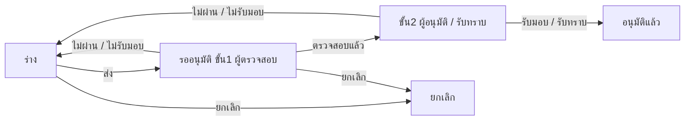

# BRD: แบบฟอร์มชุดเอกสารส่งมอบงาน (สำหรับฝ่ายพัฒนาธุรกิจจัดเก็บ) (Handover Package · BD copy)

| Field | Value |
|---|---|
| BRD ID | BRD-TMP-007-001 |
| Feature | F-TMP-007 แบบฟอร์มชุดเอกสารส่งมอบงาน (สำหรับฝ่ายพัฒนาธุรกิจจัดเก็บ) (รหัสชั่วคราว) |
| BRD Type | New Feature (แบบ 1 · Standalone) |
| Version | 1.0 |
| Status | **APPROVED (Prebrief Mode · Lane · unattended)** — DEC แทน Scope Lock จนมีใบเซ็นลูกค้า · มติ AI-DEFAULT 11 ข้อรอลูกค้ายืนยัน |
| Module | Business Development (ฝ่ายพัฒนาธุรกิจ) |
| Customer | แบบฟอร์มลูกค้า FM-BDM-07 Rev.00 : 01/07/2569 |
| Request | REQ-TMP-007 (ชั่วคราว — รอเลขจริงจาก F186) |
| Input | PREBRIEF_REQ-TMP-007_v2 · FORM_SPEC.json (18 ช่อง · 1 กลุ่มแถวซ้ำ 12 แถว · ลายเซ็น 3) · DECISIONS.lock (16 DEC · พร้อมเริ่มทำ) · feature.html (audit FAIL 0 · e2e 21/21 verify) |
| Created / Updated | 2026-10-10 |

## Changelog
- v1.0 (2026-10-10): สร้างผ่าน brd-generator-full v2.3 Prebrief Mode (doc-master-pipeline ขั้น 7 · โหมดไม่เฝ้า)

---

## 1. Business Context
### 1.1 ปัญหา / โอกาส
ฝ่ายพัฒนาธุรกิจรวบรวมชุดเอกสารโครงการก่อนส่งมอบให้ฝ่ายบริหารการลงทุน (ขั้นตอนที่ 6) ด้วยแบบฟอร์ม Excel FM-BDM-07 ฉบับที่ฝ่ายพัฒนาธุรกิจจัดเก็บ — Excel มีรายการตัวเลือก 1–5 ค้างบนเซลล์หัวข้อ · เลือก "สถานะข้อมูล = สมบูรณ์" ได้แม้มีเอกสารขาด/มีข้อจำกัด · ช่องข้อจำกัดของข้อมูลว่างได้แม้สถานะ "มีข้อจำกัด" · ผู้รับมอบถูกบันทึก 2 ที่ (ช่องผู้รับมอบ + แถวผู้อนุมัติ / รับทราบ) · ลงนามด้วยมือ · ตรวจย้อนหลังยากว่าส่งมอบอะไรเมื่อไร
### 1.2 เป้าหมาย
1. ขึ้นแบบฟอร์มเป็นเอกสารในระบบ ช่องตรงกระดาษ 1:1 ลูกค้าจำแบบเดิมได้ (PDF Replica 2 หน้า)
2. ตรวจความครบถ้วนของชุดเอกสารก่อนส่งมอบ — นับเอกสารขาด/มีข้อจำกัดสด · เตือนเมื่อสถานะข้อมูลไม่สอดคล้อง · บังคับระบุข้อจำกัดของข้อมูล
3. สายตรวจสอบ/รับทราบจาก DOA กลาง (ค่าเริ่ม 2 ขั้น · ขั้นรับทราบ = ผู้รับมอบ) — มีหลักฐานการรับมอบในระบบ
### 1.3 ตัวชี้วัด
ไม่มีใน input → **OQ-01** (ห้ามแต่งตัวเลข)
### 1.4 ที่มา
แบบฟอร์มลูกค้า FM-BDM-07 (xlsx 1 ชีต) → FORM_SPEC 18 ช่อง (กรอก 17 · ระบบใส่ 1) · gate 10 หมวดตอบโดย AI ตาม unattended-policy (AI-DEFAULT ทุกหมวด) · มีแบบฟอร์มคู่ FM-BDM-08 (สำหรับฝ่ายบริหารการลงทุน) ทำแยก feature

## 2. Scope
### 2.1 In Scope
- รายการชุดส่งมอบ (ค้นหา · กรอง สถานะเอกสาร/สถานะข้อมูล/ฝ่าย · CSV · แบ่งหน้า) · สร้าง/แก้ร่าง wizard 3 ขั้น · ดูรายละเอียด 4 แท็บ (รายละเอียด › PDF › ลายเซ็น/อนุมัติ › ประวัติ)
- ข้อมูลการส่งมอบ: ชื่อโครงการ · ผู้ส่งมอบ · ผู้รับมอบ / ฝ่ายบริหารการลงทุน · วันที่ส่งมอบ · ฉบับชุดเอกสาร · สถานะข้อมูล
- รายการเอกสารในชุดส่งมอบไม่จำกัดแถว: ชื่อเอกสาร · รหัส / ฉบับ · วันที่เอกสาร · ผู้รับผิดชอบ · สถานะ · ตำแหน่งจัดเก็บ / ลิงก์ · หมายเหตุ
- สมมติฐาน ประเด็นค้าง และข้อจำกัด: สมมติฐานสำคัญ · ประเด็นค้าง · ข้อจำกัดของข้อมูล · งานที่ฝ่ายพัฒนาธุรกิจยังต้องสนับสนุน
- ส่งอนุมัติ DOA 2 ขั้น (เลือกคนต่อขั้น · ขั้นรับทราบค่าเริ่ม = ผู้รับมอบ) · ตรวจสอบแล้ว/รับมอบ · ไม่ผ่าน→กลับร่าง · ยกเลิก (เหตุผลบังคับ)
- แนบไฟล์ · PDF FM-BDM-07 Replica 2 หน้าทุกสถานะ · เลขที่ HOB จาก ENG-DOC-NUM · แจ้งเตือนเมื่อรับมอบแล้วยังมีเอกสารขาด/มีข้อจำกัด
### 2.2 Out of Scope
- ดึงรายการเอกสารจากเอกสารต้นทางในระบบอัตโนมัติ (FM-BDM-01..06) — ผู้ใช้กรอกชื่อ/รหัส/ลิงก์เอง (DEC-01 → OQ-05) · สร้างฉบับฝ่ายบริหารการลงทุน (FM-BDM-08) อัตโนมัติ (DEC-02) · หน้าตั้งค่า HandoverPackageConfig (OQ-04) · ทำซ้ำเอกสาร · ประกาศเมื่ออนุมัติ
### 2.3 Assumptions
- ผู้จัดทำ/ผู้ส่งมอบ/ผู้รับมอบมีใน F-EMP-001 / F-ORG-001 · HandoverPackageConfig มีหรือจะเพิ่ม (OQ-04) · ผู้ตรวจสอบ = ผู้บังคับบัญชาตรงของผู้จัดทำ · ผู้รับผิดชอบเอกสารเป็นข้อความ (เลือกจากรายชื่อพนักงานได้)
### 2.4 Scope Lock (ชั่วคราว = DECISIONS.lock · ยังไม่มีใบเซ็น → OQ-02)
| DEC | หมวด | มติ | ที่มา |
|---|---|---|---|
| DEC-01 | G1 | อนุมัติแล้วไม่เปลี่ยนค่าในระบบ | AI-DEFAULT |
| DEC-02 | G1 | ไม่ส่งต่อระบบอื่นรอบนี้ (ประกาศ event ไว้ใน FRD แต่ไม่ยิง) | AI-DEFAULT |
| DEC-03 | G2 | สายอนุมัติตั้งที่ DOA กลาง (dynamic) · ค่าเริ่ม 2 ขั้น: role-line-manager, role-mgr-bu · วงเงิน: ไม่มี | AI-DEFAULT |
| DEC-04 | G3 | สถานะข้อมูล → HandoverPackageConfig.data_statuses · สถานะเอกสาร → HandoverPackageConfig.doc_statuses · ไม่ใช้ DV ค้าง 1–5 · สมบูรณ์ขณะมีเอกสารขาด/มีข้อจำกัด = เตือน · มีข้อจำกัด → ต้องกรอกข้อจำกัดของข้อมูล · วันที่เอกสารหลังวันที่ส่งมอบ = เตือน · ส่งได้เมื่อมีรายการเอกสาร ≥ 1 | AI-DEFAULT |
| DEC-05 | G4 | รายการเอกสารในชุดส่งมอบ: ไม่จำกัดจำนวนแถว · PDF อย่างน้อย 12 แถวตามกระดาษ | AI-DEFAULT |
| DEC-06 | G5 | ช่องตรงกระดาษ 1:1 · ไม่เพิ่มช่อง | AI-DEFAULT |
| DEC-07 | G6 | ลายเซ็นแถวล่าง 1 ช่องต่อขั้น DOA · ไม่ใช้ภาพลายมือชื่อ (ข้อความส่งในระบบ/พิจารณาในระบบ) | AI-DEFAULT |
| DEC-08 | G7 | ไม่อนุมัติ = กลับเป็นร่าง แก้แล้วส่งใหม่ · ยกเลิกได้โดย owner, admin_role สถานะ draft, pending · ต้องมีเหตุผล | AI-DEFAULT |
| DEC-09 | G8 | มองเห็น: เจ้าของ · ผู้อนุมัติเห็นหลังส่ง · admin role เห็นทั้งหมด | AI-DEFAULT |
| DEC-10 | G9 | ออกเลขเมื่อบันทึกครั้งแรก · รหัส HOB | AI-DEFAULT |
| DEC-11 | G10 | ของเสริม (กระดาษไม่มี): แนบไฟล์, ส่งออก CSV | AI-DEFAULT |
| DEC-12 | VALID | ตัดรายการ 1–5 (C13:C18) ทิ้ง · ใช้เฉพาะ สถานะข้อมูล (E18) และ สถานะเอกสาร (G22:G33) | FORM_SPEC |
| DEC-13 | VALID | สถานะข้อมูล = สมบูรณ์ ได้เมื่อทุกรายการ = ครบถ้วน หรือ ไม่เกี่ยวข้อง (ไม่ครบ = เตือน) | FORM_SPEC |
| DEC-14 | VALID | สถานะข้อมูล = มีข้อจำกัด หรือรายการใด = มีข้อจำกัด → ต้องกรอก ข้อจำกัดของข้อมูล | FORM_SPEC |
| DEC-15 | VALID | ผู้รับมอบที่เลือก = ผู้พิจารณาขั้นรับทราบใน DOA (ค่าเริ่ม) · บล็อกลงชื่อมาจาก DOA เท่านั้น | FORM_SPEC |
| DEC-16 | VALID | วันที่เอกสาร ≤ วันที่ส่งมอบ (เกิน = เตือน) | FORM_SPEC |

## 3. Roles & Permissions (COSO)
| Role | COSO | ทำอะไร |
|---|---|---|
| ผู้จัดทำ (ผู้เชี่ยวชาญด้านพัฒนาธุรกิจ / ผู้รับผิดชอบที่ได้รับมอบหมาย) | Maker | สร้าง/แก้ร่าง · ส่ง · ยกเลิกของตัวเอง (ร่าง/รออนุมัติ) |
| role-line-manager (ผู้ตรวจสอบ · ผู้จัดการฝ่ายพัฒนาธุรกิจ) | Checker | ขั้น 1 ตรวจสอบแล้ว / ไม่ผ่านการตรวจสอบ |
| role-mgr-bu (ผู้อนุมัติ / รับทราบ · ฝ่ายบริหารการลงทุนเป็นผู้รับมอบ) | Approver | ขั้น 2 รับมอบ / รับทราบ หรือ ไม่รับมอบ |
| admin ฝ่ายพัฒนาธุรกิจ | Monitor | เห็นทั้งหมด · ยกเลิกได้ |

| Action | Maker | Checker | Approver | Admin |
|---|:-:|:-:|:-:|:-:|
| ดูใบ | ของตน | หลังส่ง (อยู่ในสาย) | หลังส่ง (อยู่ในสาย) | ทั้งหมด |
| สร้าง/แก้ร่าง | ✓ ของตน | – | – | – |
| ตัดสินขั้น | – | ขั้น 1 | ขั้น 2 | – |
| ยกเลิก | ✓ ของตน | – | – | ✓ |
SoD: ผู้จัดทำพิจารณาใบตัวเองไม่ได้ (BR-DOA-04) · role "ฝ่ายบริหารการลงทุน (ผู้รับมอบ)" ไม่มีใน DOA master ตรงตัว → ใช้ role-mgr-bu ชั่วคราว (OQ-03)

## 4. User Journey
### 4.1 Happy Path
1. ผู้จัดทำ: สร้าง → กรอกข้อมูลการส่งมอบ (ชื่อโครงการ · ผู้ส่งมอบ · ผู้รับมอบ · วันที่ส่งมอบ · ฉบับ · สถานะข้อมูล) → ใส่รายการเอกสารทีละแถว → ขั้น 2 สมมติฐาน/ประเด็นค้าง/ข้อจำกัด + แนบไฟล์ → บันทึก (ได้เลข HOB) → ส่ง เลือกคน 2 ขั้น (ขั้นรับทราบค่าเริ่ม = ผู้รับมอบ)
2. ขั้น 1 ผู้ตรวจสอบ "ตรวจสอบแล้ว" → ขั้น 2 ผู้รับมอบ "รับมอบ / รับทราบ" → **อนุมัติแล้ว** · PDF เก็บสำเนา (approved_final) · ยังมีเอกสารขาด/มีข้อจำกัด → แจ้งผู้จัดทำ (hob_received_with_gaps)
### 4.2 Alternative
- ไม่ผ่านการตรวจสอบ/ไม่รับมอบ ขั้นใดก็ได้ → กลับร่าง เลขเดิม + เหตุผล → ผู้จัดทำแก้ ส่งใหม่ (resolve สายใหม่)
- เลือก "สมบูรณ์" ขณะมีเอกสารขาด/มีข้อจำกัด → เตือน ไม่บล็อก
- สถานะข้อมูลหรือรายการใด "มีข้อจำกัด" แต่ไม่กรอกข้อจำกัดของข้อมูล → บล็อกที่ขั้น 2
- วันที่เอกสารหลังวันที่ส่งมอบ → เตือน
- ยกเลิก (ร่าง/รออนุมัติ) โดยเจ้าของหรือ admin

## 5. Data (จาก FORM_SPEC — ป้ายตามกระดาษ)
### 5.1 handover_package (header)
| ช่อง | field | ชนิด | ที่มา | บังคับ |
|---|---|---|---|:-:|
| เลขที่ (footer) | doc_no | text | auto ENG-DOC-NUM (HOB) | ✓ |
| วันที่ | doc_date | date | auto | ✓ |
| ผู้จัดทำ (ชื่อ · ตำแหน่ง) | preparer_id → snapshot | ref | system F-EMP-001 | ✓ |
| ฝ่าย | dept_snapshot | text | system F-ORG-001 | ✓ |
| ชื่อโครงการ | project_name | text | user | ✓ |
| ผู้ส่งมอบ | sender_id → snapshot | ref Employee | user (ค่าเริ่ม = ผู้จัดทำ) | ✓ |
| ผู้รับมอบ / ฝ่ายบริหารการลงทุน | receiver_id → snapshot | ref Employee | user (ค่าเริ่ม = role-mgr-bu) | ✓ |
| วันที่ส่งมอบ | handover_date | date | user | ✓ |
| ฉบับชุดเอกสาร | package_version | text | user | ✓ |
| สถานะข้อมูล | data_status | enum (HandoverPackageConfig.data_statuses) | user | ✓ |
| สมมติฐานสำคัญ | assumptions | text | user | |
| ประเด็นค้าง | open_issues | text | user | |
| ข้อจำกัดของข้อมูล | data_limits | text | user | เมื่อมีข้อจำกัด (DEC-14) |
| งานที่ฝ่ายพัฒนาธุรกิจยังต้องสนับสนุน | bd_support | text | user | |
| + DOA fields | approval_status · doa_ref · approval_chain(jsonb) · approved_by · approved_at | | DOA | |
| + returned_reason · returned_by · returned_at | | | DEC-08 | |
### 5.2 handover_package_item (รายการเอกสารในชุดส่งมอบ · ≥1 แถว · PDF ≥ 12)
| ช่องบนกระดาษ | field | ชนิด | ที่มา | บังคับ |
|---|---|---|---|:-:|
| ลำดับ | seq | int | auto | ✓ |
| ชื่อเอกสาร | doc_name | text | user | ✓ |
| รหัส / ฉบับ | doc_ref | text | user | |
| วันที่เอกสาร | doc_date | date (≤ วันที่ส่งมอบ = เตือน) | user | |
| ผู้รับผิดชอบ | owner_name | text (เลือกจาก Employee ได้) | user | |
| สถานะ | status | enum (HandoverPackageConfig.doc_statuses) | user | ✓ |
| ตำแหน่งจัดเก็บ / ลิงก์ | location | text | user | |
| หมายเหตุ | remark | text | user | |
### 5.3 ค่าคงที่บนกระดาษ → config
สถานะข้อมูล → HandoverPackageConfig.data_statuses · สถานะเอกสาร → HandoverPackageConfig.doc_statuses · ประวัติการแก้ไขแบบฟอร์ม → DocumentConfig.form_revisions (F003)
### 5.4 attachments → Document Center (ไฟล์ระดับใบ)

## 6. User Stories
| ID | Story | AC หลัก |
|---|---|---|
| S-01 | ผู้จัดทำสร้างชุดเอกสารส่งมอบ | ข้อมูลการส่งมอบ 6 ช่องบังคับ · รายการเอกสาร ≥1 แถว ชื่อเอกสาร/สถานะบังคับ · บันทึกได้เลข HOB |
| S-02 | ผู้จัดทำตรวจความครบถ้วนของชุด | นับเอกสารขาด/มีข้อจำกัดสด · สมบูรณ์แต่ยังขาด = เตือน · วันที่เอกสารหลังวันส่งมอบ = เตือน |
| S-03 | ผู้จัดทำบันทึกสมมติฐานและข้อจำกัด | ข้อจำกัดของข้อมูลบังคับเมื่อมีข้อจำกัด · อื่นไม่บังคับ |
| S-04 | ผู้จัดทำส่งตรวจสอบ/รับมอบ | slot 2 ขั้นค่าเริ่มจาก DOA (ขั้นรับทราบ = ผู้รับมอบ) · ผู้จัดทำไม่อยู่ในรายชื่อ · บังคับเลือกครบ |
| S-05 | ผู้ตรวจสอบ/ผู้รับมอบตัดสิน | ปุ่มเฉพาะผู้พิจารณาขั้นปัจจุบัน · เรียงขั้น · ไม่ผ่านบังคับเหตุผล → กลับร่าง |
| S-06 | พิมพ์/ดาวน์โหลด PDF FM-BDM-07 | 2 หน้าทุกสถานะ · รายการเอกสาร ≥12 แถว · ลายเซ็น = ผู้จัดทำ + 1 แถวต่อขั้น DOA (dynamic) |
| S-07 | ยกเลิก | เจ้าของ/admin · ร่างหรือรออนุมัติ · เหตุผลบังคับ |
| S-08 | admin ดูทุกใบ + CSV | กรอง สถานะเอกสาร/สถานะข้อมูล/ฝ่าย |
| S-09 | แจ้งเตือนเอกสารขาดหลังรับมอบ | รับมอบครบและยังมีสถานะ ขาดเอกสาร/มีข้อจำกัด → แจ้งผู้จัดทำ (in-app) |

## 7. Status & Lifecycle
| จาก | Action | ไป | ใคร |
|---|---|---|---|
| — | บันทึกครั้งแรก | draft | Maker |
| draft | ส่ง | pending (ขั้น 1) | Maker |
| pending | ตัดสินผ่านขั้น n<N | pending (ขั้น n+1) | ผู้พิจารณาขั้น n |
| pending | ตัดสินผ่านขั้น N | approved | ขั้น N |
| pending | ไม่ผ่าน/ไม่รับมอบ | draft (เลขเดิม · returned_*) | ผู้พิจารณาขั้นปัจจุบัน |
| draft / pending | ยกเลิก | cancelled | Maker / Admin |
approved = ล็อกแก้ไข · สถานะเอกสาร (workflow) แยกจาก "สถานะข้อมูล" บนกระดาษ (ผู้จัดทำกรอก)

## 8. Business Rules + Validation
| ID | Rule | Tag | Type |
|---|---|:-:|---|
| BR-01 | สถานะข้อมูล/สถานะเอกสาร อ่านจาก HandoverPackageConfig — ห้าม hardcode | CONFIGURABLE | Master (DEC-04 · DEC-12) |
| BR-02 | ไม่มีช่องคำนวณ · ไม่ใช้ตัวเลือกค้าง 1–5 | FIXED | DEC-12 |
| BR-03 | สถานะข้อมูล = สมบูรณ์ ขณะมีเอกสาร ขาดเอกสาร/มีข้อจำกัด = เตือน ไม่บล็อก | CONFIGURABLE [AI-DEFAULT] | Policy (DEC-04 · DEC-13) |
| BR-04 | สถานะข้อมูลหรือรายการใด = มีข้อจำกัด → ข้อจำกัดของข้อมูลบังคับ | FIXED | Validation (DEC-14) |
| BR-05 | วันที่เอกสาร > วันที่ส่งมอบ = เตือน | CONFIGURABLE [AI-DEFAULT] | Policy (DEC-16) |
| BR-06 | ขั้นรับทราบ (role-mgr-bu) ค่าเริ่มผู้พิจารณา = ผู้รับมอบที่เลือก · เปลี่ยนได้ตอนส่ง | FIXED | DEC-15 |
| BR-07 | สายอนุมัติ resolve จาก DOA ตอนส่ง แล้ว freeze | FIXED | DOA (BR-DOA-02) |
| BR-08 | ไม่ผ่าน → draft เลขเดิม · resolve ใหม่ตอนส่งรอบถัดไป | FIXED | DEC-08 |
| BR-09 | ออกเลขตอนบันทึกครั้งแรก · no-gap ✗ | CONFIGURABLE | DOCCFG (DEC-10) |
| BR-10 | ร่างเห็นเฉพาะเจ้าของ (+ admin) | FIXED | Visibility (DEC-09) |
| BR-11 | ช่องลงชื่อใน PDF = ผู้จัดทำ + 1 แถวต่อขั้นที่ตั้งใน DOA (dynamic) · คำตัดสินตาม role | FIXED (จำนวน = DOA) | DEC-03 · DEC-07 |
| BR-12 | PDF 2 หน้าเสมอ (หน้า 1: ข้อมูลการส่งมอบ + รายการ 14 แถว · หน้า 2: รายการต่อ + สมมติฐาน + ลงชื่อ + ประวัติ) · รายการ ≥12 | FIXED | DEC-05 · thai-doc R10 |
| BR-13 | รับมอบครบแล้วยังมีเอกสารขาด/มีข้อจำกัด → แจ้งผู้จัดทำ | FIXED | NTF (DEC-13) |

| VR | ช่อง | เงื่อนไข | ข้อความ |
|---|---|---|---|
| VR-01 | project_name | required | กรุณาระบุชื่อโครงการ |
| VR-02 | sender_id · receiver_id | required | กรุณาเลือกผู้ส่งมอบ / ผู้รับมอบ |
| VR-03 | handover_date · package_version · data_status | required | กรุณาระบุวันที่ส่งมอบ / ฉบับชุดเอกสาร / เลือกสถานะข้อมูล |
| VR-04 | doc_name · status (ทุกแถวรายการ) | required | กรอกชื่อเอกสารและสถานะให้ครบทุกรายการ (หรือลบแถวที่ไม่ใช้) |
| VR-05 | data_limits | required เมื่อมีข้อจำกัด | มีรายการ "มีข้อจำกัด" — กรุณาระบุข้อจำกัดของข้อมูล |
| VR-06 | slot ผู้พิจารณา | ทุกขั้นต้องเลือก · ≠ ผู้จัดทำ | กรุณาเลือกผู้พิจารณา |
| VR-07 | เหตุผล ไม่ผ่าน/ยกเลิก | required | กรุณาระบุเหตุผล |

### 8.5 ระดับความยืดหยุ่น
BR-01 → HandoverPackageConfig · BR-03/05 → Policy (AI-DEFAULT รอยืนยัน) · BR-09 → F-DOCCFG · BR-11 → DOA กลาง

## 9. Edge Cases
| EC | กรณี | ผล |
|---|---|---|
| EC-01 | เปลี่ยนสถานะข้อมูลเป็น มีข้อจำกัด หลังกรอกขั้น 2 แล้ว | ข้อจำกัดของข้อมูลกลายเป็นบังคับ · ตรวจซ้ำตอนบันทึก |
| EC-02 | สมบูรณ์แต่มีเอกสารขาด | เตือนในฟอร์ม/รายละเอียด · บันทึกได้ · รับมอบแล้วแจ้งผู้จัดทำ |
| EC-03 | รายการเอกสาร > 14 แถว | PDF หน้า 2 ต่อตาราง (หัวซ้ำ) · ยัง 2 หน้า (ทดสอบ 24 แถว) |
| EC-04 | ผู้จัดทำเป็นผู้จัดการเอง (ขั้น 1 = ตัวเอง) | slot ว่าง ต้องเลือกคนอื่น |
| EC-05 | แก้ DOA ระหว่างรออนุมัติ | ใบเดิมใช้สาย snapshot |
| EC-06 | ตัดสินชนกัน (stale) | 409 → toast รีเฟรช สถานะไม่เปลี่ยน |
| EC-07 | แบบเอกสารปิดใช้ (F-DOCCFG) | ปุ่มสร้าง disabled |
| EC-08 | เปลี่ยนผู้รับมอบในร่าง | ค่าเริ่ม slot ขั้นรับทราบเปลี่ยนตาม (DEC-15) |
| EC-09 | DOA ตั้ง > 4 ขั้น | PDF ลงชื่อ dense · ทดสอบ 6 ขั้น = 7 แถว ยัง 2 หน้า |

## 10. Value Stream & Downstream Impact
Positioning: Business Development — ขั้นตอนที่ 6 (จัดทำและส่งต่องานให้ฝ่ายบริหารการลงทุน) · รับเอกสารจาก FM-BDM-01..06 (อ้างอิงด้วยรหัส/ลิงก์) · คู่กับฉบับฝ่ายบริหารการลงทุน FM-BDM-08
| ปลายทาง | ข้อมูล | Trigger | หมายเหตุ |
|---|---|---|---|
| ระบบอื่น / FM-BDM-08 | — | — | **ไม่ส่งต่อรอบนี้ (DEC-02)** |
| ENG-NOTIFY | hob_cancelled · hob_received_with_gaps | cancel / approved | |
| F-DOCCFG / ENG-DOC-STORE | PDF snapshot | approved_final | |
| รายงาน | เอกสารขาด · เวลาส่งมอบ | — | Report area อ่าน (Phase 2) |

## 11. Delivery
Phase 1 = §2.1 · Phase 2 (เสนอ) = ดึงรายการเอกสารจากเอกสาร BDM ในระบบ · ผูกกับ FM-BDM-08 · หน้าตั้งค่า HandoverPackageConfig

## 12. Dev Summary "ใบสั่ง"
- Config: HandoverPackageConfig (data_statuses · doc_statuses · complete_data · limited_data · gap_doc) · DOA entry F-TMP-007 · doc_type HOB · DocumentConfig.form_revisions
- Declaration: DOA_BRIEF · NTF_BRIEF · DOCCFG_BRIEF · MDOC_BRIEF (ฉบับจริงหลัง FRD)
- Screen Inventory: P-01 รายการ · P-02 สร้าง/แก้ (drawer wide 3 ขั้น) · P-03 ดู (drawer 4 แท็บ) · M-01..05 modal ส่ง/รับมอบ/ไม่ผ่าน/ยกเลิก/ทิ้งข้อมูล
- UI Signals: เอกสาร + พิมพ์ + ลายเซ็น = ใช่ · Q-form · ข้อมูลการส่งมอบ + ตารางรายการเอกสารในขั้น 1 · สมมติฐาน/ข้อจำกัด + แนบในขั้น 2

## 13. Open Questions
| OQ | คำถาม | เจ้าของ | Block? |
|---|---|---|---|
| OQ-01 | ตัวชี้วัดความสำเร็จ (เช่น % ชุดที่ส่งมอบครบในรอบแรก · เวลาส่งมอบ) | ลูกค้า | ไม่ |
| OQ-02 | ลูกค้าเซ็นยืนยัน DEC-01..11 (AI-DEFAULT) — โดยเฉพาะ 2 ขั้น · กลับร่าง · คำตัดสิน "รับมอบ / รับทราบ" · admin เห็นทั้งหมด | Strike → ลูกค้า | ก่อน UAT |
| OQ-03 | role ฝ่ายบริหารการลงทุน (ผู้รับมอบ) ไม่มีใน DOA master — ใช้ role-mgr-bu ชั่วคราว | Strike + พี่เบิร์ด | ก่อน wire |
| OQ-04 | HandoverPackageConfig มีใน Core แล้วหรือยัง / ใช้ร่วมกับ FM-BDM-08 ไหม | พี่เบิร์ด | ก่อน dev |
| OQ-05 | ต้องดึงรายการเอกสารจากเอกสาร BDM ในระบบ (FM-BDM-01..06) อัตโนมัติไหม | ลูกค้า | ไม่ |
| OQ-06 | ฉบับฝ่ายพัฒนาธุรกิจ (FM-BDM-07) กับฉบับฝ่ายบริหารการลงทุน (FM-BDM-08) ควรเป็นเอกสารเดียว 2 มุมมองหรือ 2 เอกสาร | ลูกค้า + Strike | ไม่ |
| OQ-07 | รหัส HOB ชนกับ doc_type อื่นใน F-DOCCFG ไหม · function_code taxonomy | Strike | ก่อน register |

## 14. Security & Compliance
Preset: Standard Internal · PII: ชื่อผู้จัดทำ/ผู้ส่งมอบ/ผู้รับมอบ/ผู้รับผิดชอบ (snapshot) — ข้อมูลตัวอย่างใน prototype เป็นชื่อสมมติ · Audit append-only ทุก action · SoD ผู้จัดทำ≠ผู้พิจารณา · ไฟล์แนบตาม file_policy Document Center (≤20MB · pdf/doc/xls/img)

## 15. Health Check / Monitoring
SLA ต่อขั้น: ไม่กำหนดรอบนี้ (→ OQ-01) · KPI เสนอ: ชุดที่รับมอบแล้วยังขาดเอกสาร · ใบรออนุมัติเกิน N วัน

## Appendix — Screen List
P-01 `#/handover-package-bd` · P-02 `#/handover-package-bd/create` · `/edit/:id` · P-03 `#/handover-package-bd/view/:id`

## AI Review (Quality Gate)
C1–C19 ✓ · C16 ไม่มี Registry ตรง (WARN — feature ใหม่ เสนอใน _BATCH_REPORT) · C20 ✓ Scope Lock = DEC-01..16 ครบ + OQ-02 รอใบเซ็น → **APPROVED**
