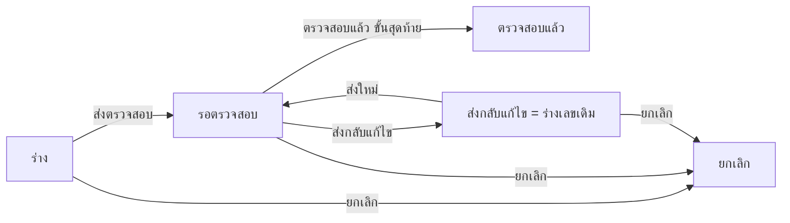

# BRD: แบบฟอร์มตรวจเช็ครถฟอร์คลิฟท์ประจำวัน (Forklift Daily Inspection Checklist)

| Field | Value |
|---|---|
| BRD ID | BRD-WHS-FLI-001 |
| Feature | F-TMP-002 (รหัสชั่วคราว) แบบฟอร์มตรวจเช็ครถฟอร์คลิฟท์ประจำวัน |
| BRD Type | New Feature (แบบ 2 · ดึงข้อมูลเดิม) |
| Version | 1.0 |
| Status | **APPROVED (Prebrief Mode · Lane)** — DEC แทน Scope Lock จนมีใบเซ็นลูกค้า |
| Module | Inventory / Warehouse (Core Cube · Operation) |
| Customer | แบบฟอร์มลูกค้า FM-WHS-04 Rev.00 : 01/07/2569 (แผนกคลังสินค้า) |
| Request | REQ-TMP-002 (ชั่วคราว — รอเลขจริงจาก F186) |
| Input | PREBRIEF_REQ-TMP-002_v2 · FORM_SPEC.json (12 ช่อง · ERROR 0) · DECISIONS.lock (17 DEC · พร้อมเริ่มทำ) · feature.html (audit FAIL 0 · smoke 27/27 · [NO-BROWSER] e2e ยังไม่รัน) |
| Created / Updated | 2026-10-10 |

## Changelog
- v1.0 (2026-10-10): สร้างผ่าน brd-generator-full v2.3 Prebrief Mode (doc-master-pipeline ขั้น 7 · โหมดไม่เฝ้า)

---

## 1. Business Context
### 1.1 ปัญหา / โอกาส
พนักงานคลังสินค้าตรวจสภาพรถฟอร์คลิฟท์ก่อนใช้งานทุกวันด้วยกระดาษ FM-WHS-04 (ตาราง 29 รายการ × 31 วัน) — ไม่มีใครรู้ทันทีเมื่อพบจุดผิดปกติ (หมายเหตุท้ายฟอร์มให้ "แจ้งผู้ควบคุมทันที" แต่ไม่มีช่องทาง) · ตรวจย้อนหลังว่ารถคันไหนเคยผิดปกติต้องเปิดแฟ้ม · หัวหน้างานลงนามรับรองเดือนละครั้งบนกระดาษ · ใบเดียวมีทั้งส่วนรถน้ำมันและรถไฟฟ้า กรอกผิดส่วนได้
### 1.2 เป้าหมาย
1. ขึ้นแบบฟอร์มเป็นเอกสารในระบบ ช่อง/ตารางตรงกระดาษ 1:1 ลูกค้าจำแบบเดิมได้ (PDF Replica)
2. บันทึกผลรายวันได้ทันทีหน้างาน (ปกติทั้งหมดในคลิกเดียว) · พบ ✗ แจ้งหัวหน้างานตรวจสอบทันที
3. หัวหน้างานตรวจสอบรับรองใบประจำเดือนผ่านสาย DOA กลาง (dynamic) · ส่งกลับแก้ไขได้
### 1.3 ตัวชี้วัด
ไม่มีใน input → **OQ-01** (ห้ามแต่งตัวเลข)
### 1.4 ที่มา
แบบฟอร์มลูกค้า FM-WHS-04 (xlsx) → FORM_SPEC 12 ช่อง (ระบบ 5 · กรอก 4 · ระบบใส่ 3) · แถวซ้ำ 3 กลุ่ม (15/8/6 แถว × วันที่ 1–31) · ลายเซ็น 2 · gate 10 หมวด = AI-DEFAULT ทั้งหมด (โหมดไม่เฝ้า)

## 2. Scope
### 2.1 In Scope
- รายการแบบตรวจ (segmented ทั้งหมด/รอฉันตรวจสอบ · ค้นหา · กรองสถานะ/ประเภทรถ · CSV)
- สร้าง/บันทึกผลต่อ wizard 3 ขั้น: เลือกประเภทรถ (น้ำมัน/ไฟฟ้า) + ประจำเดือน → เลือกวัน → เช็คลิสต์ ✓/✗ ต่อรายการ (ปุ่ม "ปกติทั้งหมด") · บันทึกร่างได้ทุกวัน
- ส่งตรวจสอบ DOA (เลือกคนต่อขั้น) · ตรวจสอบแล้ว / ส่งกลับแก้ไข (กลับร่างเลขเดิม) · ยกเลิก (เหตุผลบังคับ)
- แจ้งหัวหน้างานตรวจสอบเมื่อพบรายการผิดปกติ (fli_defect_found)
- แนบไฟล์ (ใบแจ้งซ่อม/รูป) · PDF FM-WHS-04 Replica 2 หน้าทุกสถานะ · เลขที่ FLI จาก ENG-DOC-NUM
### 2.2 Out of Scope
- ทะเบียนรถ/ผูกรถรายคัน (กระดาษไม่มีช่องหมายเลขรถ → OQ-03) · เปิดใบแจ้งซ่อม/Maintenance อัตโนมัติ (Asset/Maintenance Schedule ยังไม่มี · DEC-02) · หน้าตั้งค่ารายการตรวจ (ForkliftChecklistConfig — เสนอ feature ใหม่ OQ-04) · ทำซ้ำเอกสาร (G10 ✗ — prototype มีปุ่มทำซ้ำของ archetype → OQ-06) · ประกาศ
### 2.3 Assumptions
- ข้อมูลผู้ตรวจสอบ/ตำแหน่ง/แผนกมีใน F-EMP-001 / F-ORG-001 · หัวหน้างาน = ผู้บังคับบัญชาตามผังองค์กร (resolve role-supervisor) · รายการตรวจ 3 กลุ่มอ่านจาก config ของ feature นี้ (ค่าเริ่ม = ถ้อยคำบนกระดาษ)
### 2.4 Scope Lock (ชั่วคราว = DECISIONS.lock · ยังไม่มีใบเซ็น → OQ-02)
| DEC | หมวด | มติ | ที่มา |
|---|---|---|---|
| DEC-01 | G1 | อนุมัติแล้วไม่เปลี่ยนค่าในระบบ | AI-DEFAULT |
| DEC-02 | G1 | ไม่ส่งต่อระบบอื่นรอบนี้ (ประกาศ event ใน FRD ไม่ยิง) | AI-DEFAULT |
| DEC-03 | G2 | DOA dynamic · ค่าเริ่ม 1 ขั้น role-supervisor (หัวหน้างานตรวจสอบ) · ไม่มีวงเงิน | AI-DEFAULT |
| DEC-04 | G3 | รายการตรวจ 3 กลุ่ม + คอลัมน์วันอ่านจาก config/ปฏิทิน · ประเภทรถเลือก 1 · ✓/✗/ว่าง · ห้ามวันเกินเดือน/อนาคต · ✗ = เตือน+แจ้ง · 1 ใบ/เดือน ส่งสิ้นเดือน | AI-DEFAULT |
| DEC-05 | G4 | รายการทั่วไป ≥15 แถวใน PDF · ไม่จำกัด (มาจาก config) | AI-DEFAULT |
| DEC-06 | G4 | เฉพาะรถน้ำมัน ≥8 แถว | AI-DEFAULT |
| DEC-07 | G4 | เฉพาะรถไฟฟ้า ≥6 แถว | AI-DEFAULT |
| DEC-08 | G5 | ช่อง 1:1 ไม่เพิ่มช่อง (แก้สะกด ปฎิบัติ→ปฏิบัติ) | AI-DEFAULT |
| DEC-09 | G6 | ลายเซ็นแถวล่าง 1 ช่อง/ขั้น DOA · ข้อความ "ส่ง/พิจารณาในระบบ" | AI-DEFAULT |
| DEC-10 | G7 | ส่งกลับแก้ไข = กลับร่างเลขเดิม · ยกเลิก: เจ้าของ + admin · ร่าง/รออนุมัติ · เหตุผลบังคับ | AI-DEFAULT |
| DEC-11 | G8 | เจ้าของ · ผู้อนุมัติเห็นหลังส่ง · admin (role-mgr-wh) เห็นทั้งหมด | AI-DEFAULT |
| DEC-12 | G9 | ออกเลขตอนบันทึกครั้งแรก · รหัส FLI | AI-DEFAULT |
| DEC-13 | G10 | แนบไฟล์ ✓ · CSV ✓ · ทำซ้ำ ✗ · ประกาศ ✗ | AI-DEFAULT |
| DEC-14 | VALID | กรอกเฉพาะส่วนตามประเภทรถ · PDF คงตารางอีกประเภทว่าง | FORM_SPEC |
| DEC-15 | VALID | ห้ามกรอกวันเกินเดือน/วันอนาคต (บล็อก) | FORM_SPEC |
| DEC-16 | VALID | มี ✗ → เตือน + แจ้งหัวหน้างาน (ไม่บล็อก) | FORM_SPEC |
| DEC-17 | VALID | ไม่มีช่องหมายเลขรถ — คง 1:1 · เสนอลูกค้ายืนยัน | FORM_SPEC |

## 3. Roles & Permissions (COSO)
| Role | COSO | ทำอะไร |
|---|---|---|
| ผู้ตรวจสอบ (พนักงานขับรถ/คลัง) | Maker | สร้าง/บันทึกผลรายวัน · ส่ง · ยกเลิกของตัวเอง (ร่าง/รออนุมัติ/ส่งกลับ) |
| role-supervisor (หัวหน้างานตรวจสอบ) | Checker/Approver | ขั้น 1 ตรวจสอบแล้ว / ส่งกลับแก้ไข · รับแจ้งพบผิดปกติ |
| role-mgr-wh (ผู้จัดการคลังสินค้า) | Admin view | เห็นทั้งหมด · ยกเลิกได้ · CSV |

| Action | Maker | Supervisor | Mgr-WH |
|---|:-:|:-:|:-:|
| ดูใบ | ของตน | หลังส่ง (อยู่ในสาย) | ทั้งหมด |
| สร้าง/บันทึกผล | ✓ ของตน (ร่าง/ส่งกลับ) | – | – |
| ตัดสินขั้น | – | ขั้นของตน | ขั้นของตน (ถ้า DOA ตั้งเพิ่ม) |
| ยกเลิก | ✓ ของตน | – | ✓ |
SoD: ผู้ตรวจสอบ (ผู้บันทึก) พิจารณาใบตัวเองไม่ได้ (BR-DOA-04)

## 4. User Journey
### 4.1 Happy Path
1. วันแรกของเดือน ผู้ตรวจสอบ: สร้าง → เลือกประเภทรถ + เดือน (ค่าเริ่ม = เดือนนี้) → วันนี้ → "ปกติทั้งหมด" → บันทึกร่าง (ได้เลข FLI)
2. ทุกวัน: เปิดใบ → บันทึกผล/แก้ไข → วันถัดไป → ✓/✗ → บันทึกร่าง (พบ ✗ → ระบบแจ้งหัวหน้างาน)
3. สิ้นเดือน: ส่งตรวจสอบ → หัวหน้างาน "ตรวจสอบแล้ว" → ปิดใบ · PDF เก็บสำเนา (approved_final)
### 4.2 Alternative
- หัวหน้างาน "ส่งกลับแก้ไข" (เหตุผลบังคับ) → ร่างเลขเดิม + แถบเหตุผล → ผู้ตรวจสอบแก้ ส่งใหม่ (resolve สายใหม่)
- เปลี่ยนประเภทรถระหว่างกรอก → ล้างผลรายการเฉพาะของประเภทเดิม + เตือน (DEC-14)
- เปลี่ยนเดือน → ล้างผลเดิม + เตือน · เดือนอนาคตเลือกไม่ได้
- ยกเลิก (ร่าง/รออนุมัติ/ส่งกลับ) โดยเจ้าของหรือผู้จัดการคลัง

## 5. Data (จาก FORM_SPEC — ป้ายตามกระดาษ)
### 5.1 forklift_inspection (header)
| ช่องบนกระดาษ | field | ชนิด | ที่มา | บังคับ |
|---|---|---|---|:-:|
| (เลขที่ — ระบบเพิ่มใน footer) | doc_no | text | auto ENG-DOC-NUM | ✓ |
| หัวกระดาษ ชื่อบริษัท/ที่อยู่/โลโก้ | header_snapshot | jsonb | system F-ORG-001 (snapshot ตอนออกเลข) | ✓ |
| ประเภทรถ ☐ น้ำมัน ☐ ไฟฟ้า | vehicle_type | enum(fuel, electric) | user | ✓ |
| ประจำเดือน | inspection_month | yyyy-mm | user (ไม่เกินเดือนปัจจุบัน) | ✓ |
| ผู้ตรวจสอบ (ลงชื่อ) | inspector_id + name/position/dept snapshot | ref | system F-EMP-001 | ✓ |
| หัวหน้างานตรวจสอบ (ลงชื่อ) | approval_chain | jsonb | DOA | ✓ เมื่อส่ง |
| + DOA fields | approval_status · doa_ref · approver_role · approved_by · approved_at | | DOA | |
| + returned_reason · returned_by · returned_at | | | DEC-10 | |
### 5.2 forklift_inspection_result (แถวต่อวัน × รายการ)
| field | ชนิด | หมายเหตุ |
|---|---|---|
| day | smallint 1..31 | ≤ จำนวนวันของเดือน · ≤ วันนี้ (DEC-15) |
| section | enum(general, fuel, electric) | เฉพาะ general + ประเภทที่เลือก (DEC-14) |
| item_id | ref ForkliftChecklistConfig.items | ลำดับ + ถ้อยคำ snapshot |
| result | enum(ok, ng) | ✓ = ok · ✗ = ng · ไม่มีแถว = ยังไม่ตรวจ |
### 5.3 attachments → Document Center (ระดับใบ)

## 6. User Stories
| ID | Story | AC หลัก |
|---|---|---|
| S-01 | ผู้ตรวจสอบสร้างแบบตรวจของเดือน | ต้องเลือกประเภทรถ + เดือน · บันทึกได้เลข FLI |
| S-02 | ผู้ตรวจสอบบันทึกผลประจำวัน | เลือกวัน (อนาคตกดไม่ได้) · ✓/✗ ทุกรายการ · ปุ่มปกติทั้งหมด · วันที่กรอกไม่ครบ = บล็อกบันทึก |
| S-03 | ผู้ตรวจสอบเห็นสถานะทั้งเดือน | ปุ่มวันแสดงสี ครบปกติ/มีผิดปกติ/ไม่ครบ · สรุป ตรวจแล้ว x/N วัน · ผิดปกติ n ช่อง |
| S-04 | หัวหน้างานรับแจ้งเมื่อพบผิดปกติ | บันทึกที่มี ✗ เพิ่ม → แจ้ง in-app+email (fli_defect_found) · แถบเตือนบนจอ |
| S-05 | ผู้ตรวจสอบส่งตรวจสอบสิ้นเดือน | slot ตามจำนวนขั้น DOA · ค่าเริ่มจาก resolve · ตัวเองไม่อยู่ในรายชื่อ |
| S-06 | หัวหน้างานตรวจสอบแล้ว | ปุ่มเฉพาะผู้พิจารณาขั้นปัจจุบัน · เรียงขั้น · ครบ = ตรวจสอบแล้ว ล็อกแก้ไข |
| S-07 | หัวหน้างานส่งกลับแก้ไข | เหตุผลบังคับ → ร่างเลขเดิม · ผู้ตรวจสอบเห็นเหตุผล |
| S-08 | พิมพ์/ดาวน์โหลด PDF FM-WHS-04 | 2 หน้าทุกสถานะ · ☑ ประเภทรถ · ตาราง 15/8/6 × 31 · ลายเซ็น = ผู้ตรวจสอบ + 1 ช่อง/ขั้น DOA |
| S-09 | ยกเลิกเอกสาร | เจ้าของ/ผู้จัดการคลัง · ร่าง/รออนุมัติ/ส่งกลับ · เหตุผลบังคับ |
| S-10 | ผู้จัดการคลังดูทุกใบ + CSV | กรองสถานะ/ประเภทรถ |

## 7. Status & Lifecycle
| จาก | Action | ไป | ใคร |
|---|---|---|---|
| — | บันทึกครั้งแรก | draft | Maker |
| draft / returned | บันทึกผล | (เดิม) | Maker |
| draft / returned | ส่ง | pending (ขั้น 1) | Maker |
| pending | ตรวจสอบแล้ว ขั้น n<N | pending (ขั้น n+1) | ผู้พิจารณาขั้น n |
| pending | ตรวจสอบแล้ว ขั้น N | approved | ขั้น N |
| pending | ส่งกลับแก้ไข | returned (= ร่าง เลขเดิม) | ผู้พิจารณาขั้นปัจจุบัน |
| draft / pending / returned | ยกเลิก | cancelled | Maker / Mgr-WH |
approved = ล็อกแก้ไข ยกเลิกไม่ได้

## 8. Business Rules + Validation
| ID | Rule | Tag | Type |
|---|---|:-:|---|
| BR-01 | รายการตรวจ 3 กลุ่มอ่านจาก ForkliftChecklistConfig.items ณ วันสร้าง (snapshot ลงใบ) | CONFIGURABLE | Master (DEC-04) |
| BR-02 | คอลัมน์วัน = จำนวนวันของ inspection_month (PDF พิมพ์หัว 1–31 ตามกระดาษ) | FIXED | Calendar (DEC-04) |
| BR-03 | กรอกได้เฉพาะ general + ประเภทรถที่เลือก · เปลี่ยนประเภท = ล้างผลส่วนเฉพาะเดิม | FIXED | DEC-14 (VALID) |
| BR-04 | ห้ามกรอกวันเกินเดือนหรือวันอนาคต | FIXED | DEC-15 (VALID) |
| BR-05 | วันที่มีผลต้องครบทุกรายการ (ไม่ครบ = บล็อกบันทึก) · ≥1 วันก่อนบันทึก | FIXED | DEC-04 [AI-DEFAULT] |
| BR-06 | มี ✗ เพิ่มจากครั้งก่อน → เตือน + fli_defect_found ถึงหัวหน้างาน (ไม่บล็อก) | CONFIGURABLE | DEC-16 (VALID) |
| BR-07 | 1 ใบ = 1 เดือน ต่อผู้ตรวจสอบ ต่อรถ (ไม่บังคับไม่ซ้ำรอบนี้ — ไม่มีหมายเลขรถ) | FIXED [AI-DEFAULT] | DEC-04 · DEC-17 |
| BR-08 | สายอนุมัติ resolve จาก DOA ตอนส่ง แล้ว freeze | FIXED | DOA (BR-DOA-02) |
| BR-09 | ส่งกลับแก้ไข → returned เลขเดิม · resolve ใหม่ตอนส่งรอบถัดไป | FIXED | DEC-10 |
| BR-10 | ออกเลขตอนบันทึกครั้งแรก · no-gap ✗ | CONFIGURABLE | DOCCFG (DEC-12) |
| BR-11 | ร่างเห็นเฉพาะเจ้าของ (+ ผู้จัดการคลัง) | FIXED | DEC-11 |
| BR-12 | ช่องลงชื่อ PDF = ผู้ตรวจสอบ + 1 ช่องต่อขั้น DOA (dynamic) · แถวละ ≤4 · คำตัดสินตาม role (role-supervisor = ตรวจสอบแล้ว/ส่งกลับแก้ไข) | FIXED (จำนวน = DOA) | DEC-03 · DEC-09 |
| BR-13 | ช่องตามกระดาษ 1:1 · หมายเหตุสะกด "ปฏิบัติ" | FIXED [AI-DEFAULT] | DEC-08 |

| VR | ช่อง | เงื่อนไข | ข้อความ |
|---|---|---|---|
| VR-01 | vehicle_type | required | เลือกประเภทรถ |
| VR-02 | inspection_month | required · ≤ เดือนปัจจุบัน | เลือกเดือนปัจจุบันหรือเดือนก่อนหน้า |
| VR-03 | ผลรายวัน | วันที่มีผลต้องครบทุกรายการ | วันที่ … กรอกผลไม่ครบทุกรายการ |
| VR-04 | ผลรายวัน | ≥1 วันครบ | บันทึกผลตรวจอย่างน้อย 1 วัน |
| VR-05 | slot ผู้พิจารณา | ครบทุกขั้น · ≠ ผู้ตรวจสอบ | กรุณาเลือกผู้พิจารณา |
| VR-06 | เหตุผล ส่งกลับ/ยกเลิก | required | กรุณาระบุเหตุผล |

### 8.5 ระดับความยืดหยุ่น
BR-01 → หน้าตั้งค่ารายการตรวจ (เสนอ feature ใหม่ · OQ-04) · BR-06 → ENG-NOTIFY preference · BR-10 → F-DOCCFG · BR-12 → DOA กลาง

## 9. Edge Cases
| EC | กรณี | ผล |
|---|---|---|
| EC-01 | เดือน 28/29/30 วัน | ปุ่มวันตามจริง · PDF คอลัมน์เกินเว้นว่าง |
| EC-02 | เดือนปัจจุบัน | วันหลังวันนี้กดไม่ได้ |
| EC-03 | เปลี่ยนประเภทรถหลังกรอก | ล้างส่วนเฉพาะเดิม + เตือน |
| EC-04 | กรอกครึ่งวัน | บล็อกบันทึก ชี้วันที่ไม่ครบ |
| EC-05 | ผู้ตรวจสอบเป็นหัวหน้างานเอง | slot ว่าง ต้องเลือกคนอื่น |
| EC-06 | แก้ DOA ระหว่างใบรอตรวจ | ใช้สาย snapshot |
| EC-07 | ส่ง/ตัดสินชนกัน (stale) | 409 → toast รีเฟรช |
| EC-08 | แบบเอกสารปิดใช้ (F-DOCCFG) | ปุ่มสร้าง disabled + แถบแดง |
| EC-09 | config รายการตรวจเปลี่ยนกลางเดือน | ใบเดิมใช้รายการ snapshot |
| EC-10 | รถหลายคันประเภทเดียวกัน | สร้างหลายใบได้ (ไม่มีหมายเลขรถ → OQ-03) |

## 10. Value Stream & Downstream Impact
Positioning: Warehouse Operation / Safety — ตรวจรถก่อนใช้งาน (**feature นี้**) → [แจ้งซ่อม / Maintenance — ปิดรอบนี้]
| ปลายทาง | ข้อมูล | Trigger | หมายเหตุ |
|---|---|---|---|
| หัวหน้างาน (ENG-NOTIFY) | รายการผิดปกติ | บันทึกที่มี ✗ เพิ่ม | fli_defect_found ✓ รอบนี้ |
| Asset / Maintenance Schedule | รายการผิดปกติ → ใบแจ้งซ่อม | approved / defect | **ปิดรอบนี้ (DEC-02)** — ประกาศ event `fli.defect_recorded` ไม่ยิง |
| F-DOCCFG / ENG-DOC-STORE | PDF snapshot | approved_final | |
| รายงาน | % วันตรวจครบ · จำนวนผิดปกติต่อรายการ | — | Report area อ่าน |

## 11. Delivery
Phase 1 = §2.1 ทั้งหมด · Phase 2 (เสนอ) = ทะเบียนรถ + ผูกใบต่อคัน · เปิดแจ้งซ่อมจาก ✗ · หน้าตั้งค่ารายการตรวจ

## 12. Dev Summary "ใบสั่ง"
- Config: ForkliftChecklistConfig.items (general/fuel/electric — ค่าเริ่มตามกระดาษ) · DOA entry F-TMP-002 (role-supervisor) · doc_type FLI
- Declaration: DOA_BRIEF · NTF_BRIEF (fli_defect_found · fli_cancelled) · DOCCFG_BRIEF · MDOC_BRIEF
- Screen Inventory: P-01 รายการ · P-02 สร้าง/บันทึกผล (drawer wide 3 ขั้น) · P-03 ดู (drawer 4 แท็บ) · M-01..05 ส่ง/ตรวจสอบแล้ว/ส่งกลับ/ยกเลิก/ทิ้งข้อมูล
- UI Signals: เอกสาร + พิมพ์ + ลายเซ็น = ใช่ · Q-form

## 13. Open Questions
| OQ | คำถาม | เจ้าของ | Block? |
|---|---|---|---|
| OQ-01 | ตัวชี้วัด (% วันตรวจครบ · เวลาจากพบ ✗ ถึงแจ้งซ่อม) | ลูกค้า | ไม่ |
| OQ-02 | ลูกค้าเซ็นยืนยัน DEC-01..13 (AI-DEFAULT) — โดยเฉพาะ 1 ใบ/เดือน · ส่งกลับ=ร่าง · คำ ตรวจสอบแล้ว/ส่งกลับแก้ไข | Strike → ลูกค้า | ก่อน UAT |
| OQ-03 | เพิ่มช่องหมายเลข/ทะเบียนรถไหม (กระดาษไม่มี · DEC-17) | ลูกค้า | ไม่ (Phase 2) |
| OQ-04 | ForkliftChecklistConfig อยู่ที่ไหน (feature ใหม่ใน Inventory Configuration?) | พี่เบิร์ด | ก่อน dev |
| OQ-05 | role-supervisor resolve จากผังองค์กรได้ไหม (relative role) | Strike + พี่เบิร์ด | ก่อน wire |
| OQ-06 | ปุ่ม "ทำซ้ำ" ใน prototype (archetype) ขัด G10 ทำซ้ำ ✗ — เก็บหรือซ่อน | Strike | ไม่ |
| OQ-07 | function_code taxonomy ของ FLI (ใช้ F01 ชั่วคราว) · ได้รหัส feature จริง | Strike | ก่อน register |

## 14. Security & Compliance
Preset: Standard Operation · PII: ชื่อผู้ตรวจสอบ/หัวหน้างาน (snapshot) — ข้อมูลตัวอย่าง prototype เป็นชื่อสมมติ · Audit append-only ทุก action · SoD ผู้บันทึก≠ผู้ตรวจรับรอง · ไฟล์แนบตาม file_policy Document Center

## 15. Health Check / Monitoring
SLA: ไม่กำหนดรอบนี้ (→ OQ-01) · KPI เสนอ: ใบที่ยังไม่ส่งหลังสิ้นเดือน N วัน · จำนวน ✗ ต่อรายการต่อเดือน · Widget: วันตรวจครบ % ต่อผู้ตรวจสอบ

## 16. AI Review (C01–C23 · PE01–PE05)
C01 ✅ · C02 ✅ · C05 ✅ story ละ 1 การกระทำ · C10 ✅ ทุก BR มี Tag · C13 ✅ EC 10 · C18 ✅ WARNING → OQ · C19 ✅ §12 · C20 ✅ DEC ครบ 17 + OQ-02 รอใบเซ็น · C21 ✅ §10 · C22 ⚠️→OQ-01 (ไม่มีตัวชี้วัดใน input — ห้ามแต่ง) · C23 ✅ · PE01–PE05 ✅ · **สถานะ: APPROVED (Prebrief Mode)**

## Appendix — Screen List
P-01 `#/forklift` · P-02 `#/forklift/create` · `/edit/:id` · P-03 `#/forklift/view/:id`
