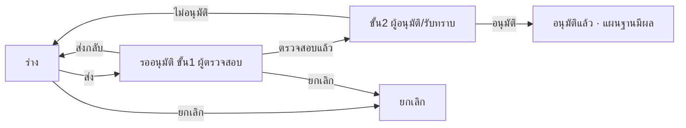

# BRD: แบบฟอร์มตารางติดตามงานและแผนฐาน (Deal Tracker and Baseline Plan)

| Field | Value |
|---|---|
| BRD ID | BRD-IVM-IVMB-001 |
| Feature | F-TMP-004 แบบฟอร์มตารางติดตามงานและแผนฐาน (รหัสชั่วคราว — รอ feature id จริง) |
| BRD Type | New Feature (แบบ 1 · ข้อมูลใหม่ทั้งหมด — ชื่อผู้จัดทำจาก F-EMP-001 · สายอนุมัติจาก DOA) |
| Version | 1.0 |
| Status | **APPROVED (Prebrief Mode · Lane · unattended)** — DEC แทน Scope Lock จนมีใบเซ็นลูกค้า · มติ AI-DEFAULT ทุกหมวด |
| Module | ฝ่ายบริหารการลงทุน (Investment Management) — module ใหม่ ยังไม่อยู่ใน Module Registry ของ DOA (OQ-03) |
| Customer | แบบฟอร์มลูกค้า FM-IVM-02 Rev.00 : 01/07/2569 (ขั้นตอนที่ 2 ของกระบวนการบริหารการลงทุน) |
| Request | REQ-TMP-004 (ชั่วคราว — รอเลขจริงจาก F186) |
| Input | PREBRIEF_REQ-TMP-004_v2 · FORM_SPEC.json (19 ช่อง) · DECISIONS.lock (18 DEC · พร้อมเริ่มทำ) · feature.html (audit FAIL 0 · self_audit PASS · smoke 36/36 · NO-BROWSER) |
| Created / Updated | 2026-10-11 |

## Changelog
- v1.0 (2026-10-11): สร้างผ่าน brd-generator-full v2.3 Prebrief Mode (doc-master-pipeline ขั้น 7 · โหมดไม่เฝ้า)

---

## 1. Business Context
### 1.1 ปัญหา / โอกาส
ฝ่ายบริหารการลงทุนใช้ไฟล์ Excel FM-IVM-02 กำหนดหมุดหมายตามแผนฐานและติดตามงานของแต่ละธุรกรรม — ตาราง 2 ชุด (หมุดหมาย 8 แถว · รายการติดตามงาน 18 แถว) · ความคลาดเคลื่อน (วัน) คำนวณด้วยสูตรในเซลล์ · ร้อยละความคืบหน้าไม่ผูกกับสถานะ · คอลัมน์ "ปรับปรุงล่าสุด" กรอกมือ · กระดาษไม่มีช่องระบุว่าเป็นตารางของโครงการใด · การตรวจทาน/อนุมัติ 3 ช่อง ส่งต่อด้วยมือ · ไฟล์กระจายในไดรฟ์ ตรวจย้อนหลังยาก
### 1.2 เป้าหมาย
1. ขึ้นแบบฟอร์มเป็นเอกสารในระบบ ช่องตรงกระดาษ 1:1 (+ ชื่อโครงการ / ธุรกรรม) · PDF Replica FM-IVM-02 2 หน้า
2. คำนวณความคลาดเคลื่อน (วัน) ให้อัตโนมัติ · เตือนหมุดหมายที่ช้ากว่าแผน · ร้อยละ 0–100 · ปรับปรุงล่าสุดระบบใส่
3. สายอนุมัติ 2 ขั้นจาก DOA กลาง (dynamic) · ประวัติ append-only · ค้นหา/กรองตารางที่ช้ากว่าแผนได้
### 1.3 ตัวชี้วัด
ไม่มีใน input → **OQ-01** (ห้ามแต่งตัวเลข)
### 1.4 ที่มา
แบบฟอร์มลูกค้า FM-IVM-02 (xlsx · ชื่อชีต INV-FM-02) → FORM_SPEC 19 ช่อง · แถวซ้ำ 2 ชุด · ตัวเลือกสถานะ 5 ค่า (data validation H13:H20 · G24:G41) · สูตร I13:I20 · data validation ร้อยละ 0–100 (J24:J41) · gate 10 หมวด = AI-DEFAULT ทั้งหมด (โหมดไม่เฝ้า)

## 2. Scope
### 2.1 In Scope
- รายการตาราง (ค้นหา · กรองสถานะเอกสาร/ตามแผนฐาน · CSV) · สร้าง/แก้ร่าง wizard 3 ขั้น · ดูรายละเอียด 4 แท็บ (รายละเอียด › PDF Preview › ลายเซ็น/อนุมัติ › ประวัติ)
- ชื่อโครงการ / ธุรกรรม · แผนฐานและหมุดหมายสำคัญ 10 คอลัมน์ · รายการติดตามงาน 10 คอลัมน์ (ไม่จำกัดแถว)
- ส่งอนุมัติ DOA 2 ขั้น (เลือกคนต่อขั้น) · ตรวจสอบแล้ว/ส่งกลับ → กลับร่าง · อนุมัติ/ไม่อนุมัติ · ยกเลิก (เหตุผลบังคับ)
- แนบไฟล์ระดับใบ · PDF FM-IVM-02 Replica 2 หน้าทุกสถานะ · เลขที่ IVMB จาก ENG-DOC-NUM
### 2.2 Out of Scope
- เชื่อมแบบฟอร์มเริ่มต้นธุรกรรม FM-IVM-01 / ทะเบียนโครงการ (ยังไม่มีในระบบ → ชื่อโครงการกรอกเอง · OQ-05) · อัปเดตความคืบหน้าหลังอนุมัติแบบไม่ผ่านสายอนุมัติ (OQ-07) · แจ้งเตือนกำหนดส่งรายวัน · ทำซ้ำเป็นฟีเจอร์ทางการ (DEC-12 ✗ — prototype มีเมนูทำซ้ำตามมาตรฐานเอกสาร แต่ไม่บังคับ dev)
### 2.3 Assumptions
- ข้อมูลพนักงาน/ตำแหน่งมีใน F-EMP-001 / F-ORG-001 · DOA กลางเพิ่ม module/role ของฝ่ายบริหารการลงทุนได้ (OQ-03) · ผู้รับผิดชอบในแถวเป็นข้อความ (คน/หน่วยงาน/ที่ปรึกษาภายนอก)
### 2.4 Scope Lock (ชั่วคราว = DECISIONS.lock · ยังไม่มีใบเซ็น → OQ-02)
| DEC | หมวด | มติ | ที่มา | ใช้ที่ |
|---|---|---|---|---|
| DEC-01 | G1 | อนุมัติแล้วไม่เปลี่ยนค่าในระบบ | AI-DEFAULT | html, thai-doc, brd, frd, tests, ntf-declaration |
| DEC-02 | G1 | ไม่ส่งต่อระบบอื่นรอบนี้ (ประกาศ event ไว้ใน FRD แต่ไม่ยิง) | AI-DEFAULT | brd, frd |
| DEC-03 | G2 | สายอนุมัติตั้งที่ DOA กลาง (dynamic) · ค่าเริ่ม 2 ขั้น: role-line-manager, role-gm · วงเงิน: ไม่มี | AI-DEFAULT | html, doa-declaration, frd, tests |
| DEC-04 | G3 | คำนวณให้อัตโนมัติ ผู้ใช้ปรับได้ · เกินเกณฑ์ = เตือน · ความคลาดเคลื่อน (วัน) = วันที่ปรับปรุง − วันที่ตามแผนฐาน · ว่างถ้าวันใดวันหนึ่งว่าง · ค่าบวก (ช้ากว่าแผน) แสดงเตือน ไม่บล็อก · ร้อยละความคืบหน้าต้องอยู่ระหว่าง 0–100 (บล็อก) · สถานะ แล้วเสร็จ แต่ร้อยละความคืบหน้า < 100 → เตือน ไม่บล็อก · ต้องมีหมุดหมายอย่างน้อย 1 แถว และรายการติดตามงานอย่างน้อย 1 แถวก่อนส่ง (บล็อกตอนส่ง) · ปรับปรุงล่าสุด ระบบใส่วันที่ที่แก้แถวล่าสุดให้อัตโนมัติ | AI-DEFAULT | html, thai-doc, brd, frd, tests |
| DEC-05 | G4 | แผนฐานและหมุดหมายสำคัญ: ไม่จำกัดจำนวนแถว · PDF อย่างน้อย 8 แถวตามกระดาษ | AI-DEFAULT | html, thai-doc, frd |
| DEC-06 | G4 | รายการติดตามงาน: ไม่จำกัดจำนวนแถว · PDF อย่างน้อย 18 แถวตามกระดาษ | AI-DEFAULT | html, thai-doc, frd |
| DEC-07 | G5 | ช่องตรงกระดาษ 1:1 · เพิ่ม: ชื่อโครงการ / ธุรกรรม (F01 · กระดาษไม่มีช่องระบุโครงการ) | AI-DEFAULT | html, thai-doc, brd, frd |
| DEC-08 | G6 | ลายเซ็นแถวล่าง 1 ช่องต่อขั้น DOA · ไม่ใช้ภาพลายมือชื่อ (ข้อความส่งในระบบ/พิจารณาในระบบ) | AI-DEFAULT | thai-doc, html, doccfg-declaration, frd |
| DEC-09 | G7 | ไม่อนุมัติ = กลับเป็นร่าง แก้แล้วส่งใหม่ · ยกเลิกได้โดย owner, admin_role สถานะ draft, pending · ต้องมีเหตุผล | AI-DEFAULT | html, frd, tests, doa-declaration |
| DEC-10 | G8 | มองเห็น: เจ้าของ · ผู้อนุมัติเห็นหลังส่ง · admin role เห็นทั้งหมด | AI-DEFAULT | html, frd, tests |
| DEC-11 | G9 | ออกเลขเมื่อบันทึกครั้งแรก · รหัส IVMB | AI-DEFAULT | doccfg-declaration, html, frd |
| DEC-12 | G10 | ของเสริม (กระดาษไม่มี): แนบไฟล์, ส่งออก CSV | AI-DEFAULT | html, brd, frd, ntf-declaration |
| DEC-13 | VALID | กฎตรวจจากตัวอย่างลูกค้า: ยึด FM-IVM-02 ตาม footer เป็นรหัสแบบฟอร์ม (พบ: ชื่อชีตเป็น INV-FM-02 แต่ Doc. No. ท้ายกระดาษเป็น FM-IVM-02) | FORM_SPEC | html, frd, tests |
| DEC-14 | VALID | กฎตรวจจากตัวอย่างลูกค้า: ชื่อโครงการ / ธุรกรรม บังคับกรอก (ช่องเพิ่ม F01 · AI-DEFAULT รอลูกค้ายืนยัน) (พบ: ไม่มีช่องระบุว่าตารางนี้เป็นของโครงการ/ธุรกรรมใด (แถว 4 ว่าง)) | FORM_SPEC | html, frd, tests |
| DEC-15 | VALID | กฎตรวจจากตัวอย่างลูกค้า: ใช้ 18 แถวเป็นขั้นต่ำบนกระดาษ · เพิ่มแถวได้ไม่จำกัด (พบ: มีเลขกำกับ 18 แถว และแถวว่างไม่มีเลขอีก 2 แถว (แถว 42–43)) | FORM_SPEC | html, frd, tests |
| DEC-16 | VALID | กฎตรวจจากตัวอย่างลูกค้า: ร้อยละต้องอยู่ 0–100 (บล็อก) · สถานะ แล้วเสร็จ แต่ร้อยละ < 100 → เตือน ไม่บล็อก (พบ: data validation ทศนิยม 0–100 แต่สถานะกับร้อยละไม่ผูกกัน (เช่น แล้วเสร็จ แต่ 40%)) | FORM_SPEC | html, frd, tests |
| DEC-17 | VALID | กฎตรวจจากตัวอย่างลูกค้า: คำนวณอัตโนมัติ F06 − F05 · ค่าบวก (ช้ากว่าแผน) → แสดงเตือน ไม่บล็อก (พบ: วันที่ปรับปรุงไม่มีกติกา และความคลาดเคลื่อนคำนวณเฉพาะเมื่อมีวันที่ปรับปรุง) | FORM_SPEC | html, frd, tests |
| DEC-18 | VALID | กฎตรวจจากตัวอย่างลูกค้า: ระบบใส่วันที่ที่แก้แถวล่าสุดให้อัตโนมัติ (พบ: คอลัมน์ ปรับปรุงล่าสุด ไม่มีรูปแบบวันที่ (General) และพึ่งการกรอกมือ) | FORM_SPEC | html, frd, tests |

## 3. Roles & Permissions (COSO)
| Role | COSO | ทำอะไร |
|---|---|---|
| ผู้จัดทำ (ผู้ประสานงานบริหารการลงทุน / ผู้รับผิดชอบที่ได้รับมอบหมาย) | Maker | สร้าง/แก้ร่าง · ส่ง · ยกเลิกของตัวเอง (ร่าง/รออนุมัติ) |
| ผู้ตรวจสอบ — role-line-manager (บนกระดาษ: ผู้จัดการฝ่ายบริหารการลงทุน) | Checker | ขั้น 1 ตรวจสอบแล้ว / ส่งกลับ |
| ผู้อนุมัติ / รับทราบ — role-gm (บนกระดาษ: รองกรรมการผู้จัดการ / กรรมการผู้จัดการ / ผู้มีอำนาจตามตารางอำนาจอนุมัติ (ถ้ามี)) | Approver | ขั้น 2 อนุมัติ / ไม่อนุมัติ |
| admin role ฝ่ายบริหารการลงทุน (เจ้าหน้าที่ดูแลเอกสาร) | Monitor | เห็นทุกใบ · ยกเลิกได้ (ร่าง/รออนุมัติ) · CSV |

| Action | Maker | Checker | Approver | Admin |
|---|:-:|:-:|:-:|:-:|
| ดูใบ | ของตน | หลังส่ง (อยู่ในสาย) | หลังส่ง (อยู่ในสาย) | ทั้งหมด |
| สร้าง/แก้ร่าง | ✓ ของตน | – | – | – |
| ตัดสินขั้น | – | ขั้น 1 | ขั้น 2 | – |
| ยกเลิก | ✓ ของตน | – | – | ✓ |
SoD: ผู้จัดทำพิจารณาใบตัวเองไม่ได้ (BR-DOA-04) · role จริงต้องเทียบ DOA master (OQ-03)

## 4. User Journey
### 4.1 Happy Path
1. ผู้จัดทำ: สร้าง → ใส่ชื่อโครงการ / ธุรกรรม → เพิ่มหมุดหมาย (หมุดหมาย · ผลงานส่งมอบ · ผู้รับผิดชอบ · วันที่ตามแผนฐาน · วันที่ปรับปรุง · งานที่ต้องเสร็จก่อน · สถานะ · หมายเหตุ — ความคลาดเคลื่อนคำนวณให้) → เพิ่มงาน (หมวดงาน · งาน · ผู้รับผิดชอบ · กำหนดส่ง · งานที่ต้องเสร็จก่อน · สถานะ · ประเด็น · ร้อยละ — ปรับปรุงล่าสุดระบบใส่) → แนบไฟล์ → บันทึก (ได้เลข IVMB) → ส่ง เลือกคน 2 ขั้น
2. ขั้น 1 ตรวจสอบแล้ว → ขั้น 2 อนุมัติ → **อนุมัติแล้ว (แผนฐานมีผล)** · PDF เก็บสำเนา (approved_final) · แจ้งผู้รับผิดชอบหมุดหมาย/งาน (ivmb_baseline_approved)
### 4.2 Alternative
- ส่งกลับ / ไม่อนุมัติ ขั้นใดก็ได้ → กลับร่าง เลขเดิม + เหตุผล → ผู้จัดทำแก้ ส่งใหม่ (resolve สายใหม่)
- หมุดหมายช้ากว่าแผน (ความคลาดเคลื่อน > 0) → แสดงเตือน ส่งได้ · งานสถานะ แล้วเสร็จ แต่ร้อยละ < 100 → เตือน ส่งได้
- ยกเลิก (ร่าง/รออนุมัติ) โดยเจ้าของหรือ admin → ถ้ารออนุมัติ แจ้งผู้พิจารณาขั้นปัจจุบัน (ivmb_cancelled)

## 5. Data (จาก FORM_SPEC — ป้ายตามกระดาษ)
### 5.1 ivm_deal_tracker (header)
| ช่องบนกระดาษ | field | ชนิด | ที่มา | บังคับ |
|---|---|---|---|:-:|
| (เลขที่ — ระบบเพิ่ม footer) | doc_no | text | auto ENG-DOC-NUM | ✓ |
| ชื่อโครงการ / ธุรกรรม (ช่องเพิ่ม · DEC-07/14) | project_name | text | user | ✓ |
| ผู้จัดทำ (ชื่อ/ตำแหน่ง) | maker_id · maker_name_snapshot · maker_position_snapshot | ref | system F-EMP-001 | ✓ |
| + DOA fields | approval_status · doa_ref · approval_chain (jsonb snapshot) · approver_role · approved_by · approved_at | | DOA | |
| + returned_reason · returned_by · returned_at · cancel_reason | | | DEC-09 | |
### 5.2 ivm_deal_tracker_milestone (แผนฐานและหมุดหมายสำคัญ — 10 คอลัมน์ตามกระดาษ)
| ลำดับ `seq` (auto) | หมุดหมายสำคัญ `milestone` (✓) | ผลงานส่งมอบ `deliverable` | ผู้รับผิดชอบ `owner` (✓ text) | วันที่ตามแผนฐาน `baseline_date` (✓) | วันที่ปรับปรุง `revised_date` | งานที่ต้องเสร็จก่อน `predecessor` | สถานะ `status` (✓ enum 5) | ความคลาดเคลื่อน (วัน) `variance_days` (computed) | หมายเหตุ `remark` |
### 5.3 ivm_deal_tracker_task (รายการติดตามงาน — 10 คอลัมน์ตามกระดาษ)
| ลำดับ `seq` (auto) | หมวดงาน `category` | งาน / ผลงานส่งมอบ `task` (✓) | ผู้รับผิดชอบ `owner` (✓ text) | กำหนดส่ง `due_date` (✓) | งานที่ต้องเสร็จก่อน `predecessor` | สถานะ `status` (✓ enum 5) | ประเด็น / หมายเหตุ `issue` | ปรับปรุงล่าสุด `last_updated` (auto) | ร้อยละความคืบหน้า `progress_pct` (0–100) |
### 5.4 attachments → Document Center (ไฟล์ระดับใบ)
### 5.5 ข้อความคงที่บนกระดาษ (ไม่ใช่ช่อง)
ใช้ในขั้นตอน · วัตถุประสงค์ · ผู้จัดทำ/ผู้ตรวจสอบ/ผู้อนุมัติ (คำอธิบาย) · หมายเหตุการใช้งาน · ประวัติการแก้ไข (= revision ของแบบฟอร์มจาก F-DOCCFG ไม่ใช่ข้อมูลใบ)

## 6. User Stories
| ID | Story | AC หลัก |
|---|---|---|
| S-01 | ผู้จัดทำสร้างตารางของโครงการ | ชื่อโครงการบังคับ · ≥1 หมุดหมาย · ≥1 งาน · บันทึกได้เลข IVMB |
| S-02 | ผู้จัดทำกำหนดหมุดหมายตามแผนฐาน | หมุดหมาย/ผู้รับผิดชอบ/วันที่ตามแผนฐานบังคับ · สถานะเลือก 5 ค่า |
| S-03 | ผู้จัดทำเห็นความคลาดเคลื่อน | = วันที่ปรับปรุง − วันที่ตามแผนฐาน · ว่างถ้าวันใดว่าง · บวก = เตือน |
| S-04 | ผู้จัดทำบันทึกงานที่ต้องติดตาม | งาน/ผู้รับผิดชอบ/กำหนดส่งบังคับ · ร้อยละ 0–100 · ปรับปรุงล่าสุดระบบใส่ |
| S-05 | ผู้จัดทำแนบไฟล์ | ไฟล์ระดับใบ ≤20MB · pdf/doc/xls/รูป |
| S-06 | ผู้จัดทำส่งอนุมัติ | slot 2 ขั้นค่าเริ่มจาก DOA · ผู้จัดทำไม่อยู่ในรายชื่อ · บังคับเลือกครบ |
| S-07 | ผู้ตรวจสอบตัดสิน | ปุ่มเฉพาะขั้นปัจจุบัน · ตรวจสอบแล้ว / ส่งกลับ (เหตุผลบังคับ) → กลับร่าง |
| S-08 | ผู้อนุมัติตัดสินขั้นสุดท้าย | อนุมัติ → แผนฐานมีผล + แจ้งผู้รับผิดชอบ · ไม่อนุมัติ → กลับร่าง |
| S-09 | พิมพ์/ดาวน์โหลด PDF FM-IVM-02 | ทุกสถานะ 2 หน้า · ≥8 หมุดหมาย · ≥18 งาน · ลายเซ็น = ผู้จัดทำ + 1 แถวต่อขั้นตาม DOA (dynamic) |
| S-10 | ยกเลิก | เจ้าของ/admin · ร่างหรือรออนุมัติ · เหตุผลบังคับ |
| S-11 | admin ดูทุกใบ + CSV | กรองสถานะ/ตามแผนฐาน |

## 7. Status & Lifecycle
| จาก | Action | ไป | ใคร |
|---|---|---|---|
| — | บันทึกครั้งแรก | draft | Maker |
| draft | ส่ง | pending (ขั้น 1) | Maker |
| pending | ตรวจสอบแล้ว/อนุมัติ ขั้น n<N | pending (ขั้น n+1) | ผู้พิจารณาขั้น n |
| pending | อนุมัติขั้น N | approved | ขั้น N |
| pending | ส่งกลับ / ไม่อนุมัติ | draft (เลขเดิม · returned_*) | ผู้พิจารณาขั้นปัจจุบัน |
| draft / pending | ยกเลิก | cancelled | Maker / Admin |
approved = ล็อกแก้ไข (ไม่มียกเลิก) · ปรับแผนหลังอนุมัติ = OQ-07

## 8. Business Rules + Validation
| ID | Rule | Tag | Type |
|---|---|:-:|---|
| BR-01 | ความคลาดเคลื่อน (วัน) = วันที่ปรับปรุง − วันที่ตามแผนฐาน · ว่างถ้าวันใดวันหนึ่งว่าง (ตรงสูตร I13:I20) | FIXED | Calculation (DEC-04 · DEC-17) [AI-DEFAULT] |
| BR-02 | ความคลาดเคลื่อน > 0 (ช้ากว่าแผน) → เตือน ไม่บล็อก | CONFIGURABLE | Warning (DEC-04 · DEC-17) [AI-DEFAULT] |
| BR-03 | ร้อยละความคืบหน้า 0–100 (ทศนิยมได้) — นอกช่วงบล็อก | FIXED | Validation (DEC-16) |
| BR-04 | สถานะ แล้วเสร็จ แต่ร้อยละ < 100 → เตือน ไม่บล็อก | CONFIGURABLE | Warning (DEC-16) [AI-DEFAULT] |
| BR-05 | ปรับปรุงล่าสุด = วันที่แก้แถวงานนั้นล่าสุด (ระบบใส่) | FIXED | Auto (DEC-18) |
| BR-06 | สถานะ 5 ค่าตามแบบฟอร์ม (ยังไม่เริ่ม · กำลังดำเนินการ · รอตรวจทาน · แล้วเสร็จ · พักงาน) | CONFIGURABLE | Master list |
| BR-07 | ต้องมีหมุดหมาย ≥ 1 แถว และงาน ≥ 1 แถวก่อนบันทึก/ส่ง | FIXED | Validation (DEC-04) |
| BR-08 | สายอนุมัติ resolve จาก DOA ตอนส่ง แล้ว freeze | FIXED | DOA (BR-DOA-02) |
| BR-09 | ส่งกลับ/ไม่อนุมัติ → draft เลขเดิม · resolve ใหม่ตอนส่งรอบถัดไป | FIXED | DEC-09 (BR-DOA-03) |
| BR-10 | ออกเลขตอนบันทึกครั้งแรก · no-gap ✗ · รหัส IVMB | CONFIGURABLE | DOCCFG (DEC-11) |
| BR-11 | ร่างเห็นเฉพาะเจ้าของ (+ admin) | FIXED | Visibility (DEC-10) |
| BR-12 | ช่องลงชื่อใน PDF = ผู้จัดทำ + 1 แถวต่อขั้นที่ตั้งใน DOA (dynamic ไม่ fix) · คำตัดสินตาม role | FIXED (จำนวน = DOA) | DEC-03 · DEC-08 |
| BR-13 | PDF แสดงหมุดหมาย ≥ 8 แถว · งาน ≥ 18 แถว · ไม่จำกัดในระบบ · แบบพิมพ์ 2 หน้า (R10) | FIXED | DEC-05 · DEC-06 · DEC-15 |
| BR-14 | อนุมัติแล้วไม่เปลี่ยนค่าในระบบอื่น ไม่ส่งต่อ (ประกาศ event ไว้ไม่ยิง) | FIXED | DEC-01/02 |
| BR-15 | รหัสแบบฟอร์ม FM-IVM-02 ตาม footer (ไม่ใช่ชื่อชีต INV-FM-02) | FIXED | DEC-13 |
| BR-16 | ชื่อโครงการ / ธุรกรรม บังคับ (ช่องเพิ่มจากกระดาษ) | FIXED | DEC-07 · DEC-14 [AI-DEFAULT] |

| VR | ช่อง | เงื่อนไข | ข้อความ |
|---|---|---|---|
| VR-01 | project_name | required | กรุณากรอกชื่อโครงการ / ธุรกรรม |
| VR-02 | milestone · owner · baseline_date | required ต่อแถว | กรอก หมุดหมายสำคัญ · ผู้รับผิดชอบ · วันที่ตามแผนฐาน |
| VR-03 | task · owner · due_date | required ต่อแถว | กรอก งาน / ผลงานส่งมอบ · ผู้รับผิดชอบ · กำหนดส่ง |
| VR-04 | progress_pct | 0–100 | ร้อยละความคืบหน้าต้องอยู่ระหว่าง 0–100 |
| VR-05 | slot ผู้พิจารณา | ทุกขั้นต้องเลือก · ≠ ผู้จัดทำ | กรุณาเลือกผู้พิจารณา |
| VR-06 | เหตุผล ส่งกลับ/ไม่อนุมัติ/ยกเลิก | required | กรุณาระบุเหตุผล |

### 8.5 ระดับความยืดหยุ่น
BR-02/04/06 → Admin Panel (Investment Policy) · BR-10 → F-DOCCFG · สายอนุมัติ → DOA กลาง

## 9. Edge Cases
| EC | กรณี | ผล |
|---|---|---|
| EC-01 | วันที่ปรับปรุงว่าง | ความคลาดเคลื่อนว่าง (ไม่ใช่ 0) |
| EC-02 | วันที่ปรับปรุงก่อนวันที่ตามแผนฐาน | ค่าลบ (เร็วกว่าแผน) ไม่เตือน |
| EC-03 | ร้อยละ 150 / ตัวอักษร | บล็อก (VR-04) |
| EC-04 | แล้วเสร็จ แต่ 80% | เตือน ส่งได้ (BR-04) |
| EC-05 | หมุดหมาย > 8 / งาน > 18 แถว | PDF ต่อแถว หัวตารางซ้ำ · dense · 2 หน้า (ต้องยืนยันบนเครื่องที่มี browser) |
| EC-06 | ผู้จัดทำ = ผู้จัดการฝ่าย (resolve ขั้น 1 = ตัวเอง) | slot ว่าง ต้องเลือกคนอื่น |
| EC-07 | แก้ DOA ระหว่างใบรออนุมัติ | ใบเดิมใช้สาย snapshot |
| EC-08 | DOA ตั้ง 6 ขั้น | PDF 7 แถวลงชื่อ · dense |
| EC-09 | ส่ง/อนุมัติชนกัน (stale) | 409 → toast รีเฟรช สถานะไม่เปลี่ยน |
| EC-10 | แบบเอกสารปิดใช้ (F-DOCCFG) | ปุ่มสร้าง disabled |
| EC-11 | ชื่อชีต INV-FM-02 ≠ Doc No. | ใช้ FM-IVM-02 (DEC-13) |
| EC-12 | กระดาษมีแถวว่างไม่มีเลข 2 แถวท้ายรายการงาน | ไม่แสดง · ขั้นต่ำ 18 แถว (DEC-15) |

## 10. Value Stream & Downstream Impact
Positioning: กระบวนการบริหารการลงทุน — เริ่มต้นธุรกรรม (FM-IVM-01) → **ขั้นตอนที่ 2 จัดทำตารางติดตามงานและแผนควบคุมงาน (feature นี้)** → … → พิจารณายุติ (FM-IVM-10) / ปิดงานและห้องข้อมูล (FM-IVM-11)
| ปลายทาง | ข้อมูล | Trigger | หมายเหตุ |
|---|---|---|---|
| ทะเบียนโครงการ / FM-IVM-11 | แผนฐาน + ความคืบหน้า | approved | **ปิดรอบนี้ (DEC-02)** — ประกาศ event `ivmb.approved` ใน FRD ไม่ยิง |
| ผู้รับผิดชอบหมุดหมาย/งาน | งานที่ได้รับมอบหมาย + กำหนดส่ง | approved | ENG-NOTIFY ivmb_baseline_approved |
| F-DOCCFG / ENG-DOC-STORE | PDF snapshot | approved_final | |
| รายงาน | โครงการที่ช้ากว่าแผน · ความคืบหน้าเฉลี่ย | — | Report area อ่าน |

## 11. Delivery
Phase 1 = ทุกอย่างใน §2.1 · Phase 2 (เสนอ) = เชื่อมทะเบียนโครงการ/FM-IVM-01 (เลือกโครงการแทนพิมพ์) + อัปเดตความคืบหน้าหลังอนุมัติ (OQ-07)

## 12. Dev Summary "ใบสั่ง"
- Config: DOA entry F-TMP-004 (2 ขั้น · role-line-manager → role-gm) · doc_type IVMB (F-DOCCFG) · รายการสถานะงาน 5 ค่า
- Declaration: DOA_BRIEF · NTF_BRIEF · DOCCFG_BRIEF · MDOC_BRIEF (ฉบับจริงหลัง FRD)
- Screen Inventory: P-01 รายการ · P-02 สร้าง/แก้ (drawer wide 3 ขั้น · ตารางกรอก 2 ชุด) · P-03 ดู (drawer 4 แท็บ) · M-01..05 modal ส่ง/อนุมัติ/ส่งกลับ/ยกเลิก/ทิ้งข้อมูล
- UI Signals: เอกสารบันทึก + พิมพ์ + ลายเซ็น = ใช่ · Q-form

## 13. Open Questions
| OQ | คำถาม | เจ้าของ | Block? |
|---|---|---|---|
| OQ-01 | ตัวชี้วัดความสำเร็จ (สัดส่วนหมุดหมายตรงแผน / เวลาอนุมัติเฉลี่ย) | ลูกค้า | ไม่ |
| OQ-02 | ลูกค้าเซ็นยืนยัน DEC-01..12 (AI-DEFAULT ทั้งหมด) — โดยเฉพาะ ช่องเพิ่ม ชื่อโครงการ · 2 ขั้น · ส่งกลับ = กลับร่าง · เตือนไม่บล็อก | ทีม BA → ลูกค้า | ก่อน UAT |
| OQ-03 | role ผู้จัดการฝ่ายบริหารการลงทุน / รองกรรมการผู้จัดการ / กรรมการผู้จัดการ ไม่มีใน DOA contract (ใช้ role-line-manager / role-gm แทน) · module investment ไม่อยู่ใน Module Registry | ทีม BA + พี่เบิร์ด | ก่อน wire |
| OQ-04 | admin role ของฝ่ายบริหารการลงทุน (ใครเห็นทั้งหมด) — ยังไม่มี role id | ทีม BA | ก่อน dev |
| OQ-05 | ทำทะเบียนโครงการ / FM-IVM-01 เมื่อไร (เลือกโครงการแทนพิมพ์) | ทีม BA | ไม่ |
| OQ-06 | รหัส IVMB ใน F-DOCCFG · function_code / taxonomy ใน F185 · feature id จริงแทน F-TMP-004 | ทีม BA | ก่อน register |
| OQ-07 | หลังอนุมัติ การอัปเดตสถานะ/ร้อยละ/วันที่ปรับปรุง ต้องผ่านสายอนุมัติใหม่ (ฉบับใหม่) หรือผู้จัดทำอัปเดตเองได้ | ลูกค้า | ก่อน Phase 2 |

## 14. Security & Compliance
Preset: Standard (เอกสารภายใน · ข้อมูลการลงทุน = Confidential) · PII: ชื่อผู้จัดทำ/ผู้รับผิดชอบ — ข้อมูลตัวอย่างใน prototype เป็นชื่อสมมติ (ไฟล์ลูกค้าไม่มีข้อมูลตัวอย่าง) · Audit append-only ทุก action · SoD ผู้จัดทำ≠ผู้อนุมัติ · ไฟล์แนบตาม file_policy Document Center · ห้ามเก็บ credential

## 15. Health Check / Monitoring
SLA ต่อขั้น: ไม่กำหนดรอบนี้ (→ OQ-01) · KPI เสนอ: หมุดหมายช้ากว่าแผน · ความคืบหน้าเฉลี่ยต่อโครงการ · ใบรออนุมัติเกิน N วัน · Widget: โครงการที่มีหมุดหมายช้ากว่าแผน

## Appendix — Screen List
P-01 `#/ivm-deal-tracker` · P-02 `#/ivm-deal-tracker/create` · `/edit/:id` · P-03 `#/ivm-deal-tracker/view/:id`

## AI Review (Quality Gate)
C1–C20 ผ่าน · C20 Scope Lock: DEC ครบ 18 ข้อจาก DECISIONS.lock + OQ-02 รอใบเซ็น → ✅ · ไม่มีตัวเลขแต่ง · ทุก BR อ้าง DEC → **APPROVED**
