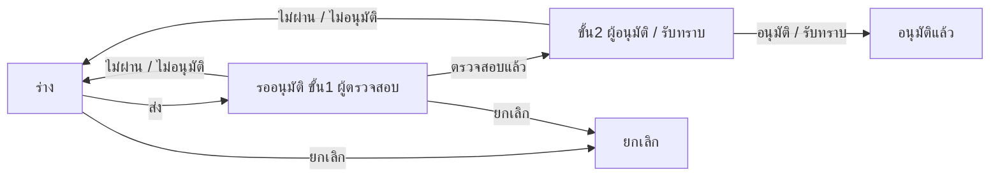

# BRD: แบบฟอร์มบทสรุปผู้บริหารและบันทึกการลงทุน (Executive Summary & Investment Memo)

| Field | Value |
|---|---|
| BRD ID | BRD-TMP-005-001 |
| Feature | F-TMP-005 แบบฟอร์มบทสรุปผู้บริหารและบันทึกการลงทุน (รหัสชั่วคราว) |
| BRD Type | New Feature (แบบ 1 · Standalone) |
| Version | 1.0 |
| Status | **APPROVED (Prebrief Mode · Lane · unattended)** — DEC แทน Scope Lock จนมีใบเซ็นลูกค้า · มติ AI-DEFAULT 11 ข้อรอลูกค้ายืนยัน |
| Module | Business Development (ฝ่ายพัฒนาธุรกิจ) |
| Customer | แบบฟอร์มลูกค้า FM-BDM-05 Rev.00 : 01/07/2569 |
| Request | REQ-TMP-005 (ชั่วคราว — รอเลขจริงจาก F186) |
| Input | PREBRIEF_REQ-TMP-005_v2 · FORM_SPEC.json (23 ช่อง · เงื่อนไขประกอบ 6 แถว · ลายเซ็น 3) · DECISIONS.lock (16 DEC · พร้อมเริ่มทำ) · feature.html (audit FAIL 0 · e2e 21/21) |
| Created / Updated | 2026-10-10 |

## Changelog
- v1.0 (2026-10-10): สร้างผ่าน brd-generator-full v2.3 Prebrief Mode (doc-master-pipeline ขั้น 7 · โหมดไม่เฝ้า)

---

## 1. Business Context
### 1.1 ปัญหา / โอกาส
ฝ่ายพัฒนาธุรกิจจัดทำบทสรุปผู้บริหารและบันทึกการลงทุนเพื่อเสนอผู้บริหารตัดสินใจ (ขั้นตอนที่ 5: จัดทำเอกสารเสนอผู้บริหาร) ด้วยแบบฟอร์ม Excel FM-BDM-05 — ช่องวงเงินเป็นข้อความอิสระ (กรอกตัวอักษร/ค่าติดลบได้) · ตารางเอกสารและเงื่อนไขประกอบเลือกสถานะได้ทั้งที่ไม่มีรายการ · เงื่อนไขที่ยังไม่แล้วเสร็จไม่บังคับผู้รับผิดชอบ/กำหนดเสร็จ · ส่งเสนออนุมัติได้โดยผู้อนุมัติไม่เห็นว่ามีเงื่อนไขค้างกี่รายการ · ลงนามผู้ตรวจสอบ/ผู้อนุมัติด้วยมือ · ไม่มีที่เก็บกลางให้ค้นข้อเสนอการลงทุนย้อนหลัง
### 1.2 เป้าหมาย
1. ขึ้นแบบฟอร์มเป็นเอกสารในระบบ ช่องตรงกระดาษ 1:1 ลูกค้าจำแบบเดิมได้ (PDF Replica 2 หน้า)
2. บทสรุปผู้บริหาร 13 หัวข้อครบตามกระดาษ · วงเงินเป็นตัวเลข · สถานะเงื่อนไขประกอบ 4 ค่าอ่านจาก config (InvestmentMemo) · ตรวจแถวเงื่อนไขก่อนส่ง และเตือนเงื่อนไขค้าง
3. สายตรวจสอบ/อนุมัติ/รับทราบจาก DOA กลาง (ค่าเริ่ม 2 ขั้น · พร้อมส่งวงเงินให้ DOA กลางถ้าลูกค้าตั้ง matrix ตามวงเงิน) แทนการเดินเอกสาร · เก็บประวัติและ PDF ฉบับอนุมัติ
### 1.3 ตัวชี้วัด
ไม่มีใน input → **OQ-01** (ห้ามแต่งตัวเลข)
### 1.4 ที่มา
แบบฟอร์มลูกค้า FM-BDM-05 (xlsx 1 ชีต · data validation สถานะ H36:H41) → FORM_SPEC 23 ช่อง (กรอก 22 · ระบบใส่ 1) · gate 10 หมวดตอบโดย AI ตาม unattended-policy (AI-DEFAULT ทุกหมวด)

## 2. Scope
### 2.1 In Scope
- รายการบันทึก (ค้นหา · กรอง สถานะเอกสาร/สถานะเงื่อนไข/ฝ่าย · CSV · แบ่งหน้า) · สร้าง/แก้ร่าง wizard 3 ขั้น · ดูรายละเอียด 4 แท็บ (รายละเอียด › PDF › ลายเซ็น/อนุมัติ › ประวัติ)
- ข้อมูลสรุปโครงการ / การลงทุน: ชื่อโครงการ · ประเภทโครงการ / ธุรกรรม · ผู้เสนอ / ผู้รับผิดชอบ · วงเงินหรือมูลค่าโดยประมาณ
- บทสรุปผู้บริหารและบันทึกการลงทุน 13 หัวข้อ: ข้อเสนอ / การตัดสินใจที่ต้องการ · บทสรุปโครงการ · เหตุผลเชิงกลยุทธ์ · โอกาสทางธุรกิจและตลาด · รูปแบบธุรกิจ / โครงสร้างธุรกรรม · แผนดำเนินงาน · ผลการวิเคราะห์ทางการเงิน · มูลค่าหรือกรอบการลงทุน · ความเสี่ยงสำคัญและแนวทางจัดการ · ทางเลือกที่พิจารณา · เงื่อนไขสำคัญก่อนอนุมัติ · ข้อเสนอแนะของฝ่ายพัฒนาธุรกิจ · ขั้นตอนถัดไป
- เอกสารและเงื่อนไขประกอบ (ไม่จำกัดแถว): ลำดับ · รายการเอกสาร / เงื่อนไข · ผู้รับผิดชอบ · กำหนดเสร็จ · สถานะ · หมายเหตุ
- ส่งอนุมัติ DOA 2 ขั้น (เลือกคนต่อขั้น) · ตรวจสอบแล้ว/อนุมัติ / รับทราบ · ไม่ผ่าน→กลับร่าง · ยกเลิก (เหตุผลบังคับ)
- แนบไฟล์ · PDF FM-BDM-05 Replica 2 หน้าทุกสถานะ · เลขที่ IVM จาก ENG-DOC-NUM · แจ้งผู้จัดทำเมื่ออนุมัติแล้วยังมีเงื่อนไขค้าง
### 2.2 Out of Scope
- สร้าง/ผูกงบลงทุน · โครงการต้นทาง (FM-BDM-01) · ผลคัดกรอง (FM-BDM-03) อัตโนมัติ — กระดาษไม่มีเลขโครงการ (DEC-01 · DEC-06 · DEC-16 → OQ-05) · หน้าตั้งค่า InvestmentMemo (ใช้ config กลาง → OQ-04) · matrix อนุมัติตามวงเงิน (ตั้งที่ DOA กลาง → OQ-06) · ทำซ้ำเอกสาร · ประกาศเมื่ออนุมัติ · เตือนอัตโนมัติเมื่อเงื่อนไขถึงกำหนด
### 2.3 Assumptions
- ผู้จัดทำ/ผู้เสนอ/ผู้รับผิดชอบเงื่อนไข/ตำแหน่ง/ฝ่ายมีใน F-EMP-001 / F-ORG-001 · InvestmentMemo config มีหรือจะเพิ่ม (OQ-04) · ผู้ตรวจสอบ = ผู้บังคับบัญชาตรงของผู้จัดทำ · สกุลเงินบาท
### 2.4 Scope Lock (ชั่วคราว = DECISIONS.lock · ยังไม่มีใบเซ็น → OQ-02)
| DEC | หมวด | มติ | ที่มา |
|---|---|---|---|
| DEC-01 | G1 | อนุมัติแล้วไม่เปลี่ยนค่าในระบบ | AI-DEFAULT |
| DEC-02 | G1 | ไม่ส่งต่อระบบอื่นรอบนี้ (ประกาศ event ไว้ใน FRD แต่ไม่ยิง) | AI-DEFAULT |
| DEC-03 | G2 | สายอนุมัติตั้งที่ DOA กลาง (dynamic) · ค่าเริ่ม 2 ขั้น: role-line-manager, role-gm · วงเงิน: ไม่มี | AI-DEFAULT |
| DEC-04 | G3 | ค่าคงที่อ่านจาก config: "ยังไม่เริ่ม · กำลังดำเนินการ · แล้วเสร็จ · พักงาน" → InvestmentMemo.condition_statuses, "กรรมการผู้จัดการ / ผู้มีอำนาจตามตารางอำนาจอนุมัติ" → DOA engine (approval matrix) · คำนวณให้อัตโนมัติ ผู้ใช้ปรับได้ · เกินเกณฑ์ = เตือน · สถานะเอกสาร/เงื่อนไขประกอบ อ่านจาก InvestmentMemo.condition_statuses (ยังไม่เริ่ม · กำลังดำเนินการ · แล้วเสร็จ · พักงาน) · วงเงินหรือมูลค่าโดยประมาณ ต้องเป็นตัวเลข ≥ 0 (บาท) · แถวเอกสาร/เงื่อนไขที่กรอก ต้องมีรายการเอกสาร / เงื่อนไข และสถานะ · สถานะที่ยังไม่ 'แล้วเสร็จ' ต้องมีผู้รับผิดชอบและกำหนดเสร็จ · เงื่อนไขที่ยังไม่ 'แล้วเสร็จ' ตอนส่งอนุมัติ = เตือน ไม่บล็อก (แสดงจำนวนให้ผู้อนุมัติเห็น) | AI-DEFAULT |
| DEC-05 | G4 | เอกสารและเงื่อนไขประกอบ: ไม่จำกัดจำนวนแถว · PDF อย่างน้อย 6 แถวตามกระดาษ | AI-DEFAULT |
| DEC-06 | G5 | ช่องตรงกระดาษ 1:1 · ไม่เพิ่มช่อง (เช่น หมายเหตุ) | AI-DEFAULT |
| DEC-07 | G6 | ลายเซ็นแถวล่าง 1 ช่องต่อขั้น DOA · ไม่ใช้ภาพลายมือชื่อ (ข้อความส่งในระบบ/พิจารณาในระบบ) | AI-DEFAULT |
| DEC-08 | G7 | ไม่อนุมัติ = กลับเป็นร่าง แก้แล้วส่งใหม่ · ยกเลิกได้โดย owner, admin_role สถานะ draft, pending · ต้องมีเหตุผล | AI-DEFAULT |
| DEC-09 | G8 | มองเห็น: เจ้าของ · ผู้อนุมัติเห็นหลังส่ง · admin role เห็นทั้งหมด | AI-DEFAULT |
| DEC-10 | G9 | ออกเลขเมื่อบันทึกครั้งแรก · รหัส IVM | AI-DEFAULT |
| DEC-11 | G10 | ของเสริม (กระดาษไม่มี): แนบไฟล์, ส่งออก CSV | AI-DEFAULT |
| DEC-12 | VALID | กฎตรวจจากตัวอย่างลูกค้า: แถวที่มีสถานะต้องกรอกรายการเอกสาร / เงื่อนไข (พบ: เลือกสถานะได้ทั้งที่ไม่มีรายการเอกสาร/เงื่อนไขในแถวนั้น) | FORM_SPEC |
| DEC-13 | VALID | กฎตรวจจากตัวอย่างลูกค้า: สถานะที่ยังไม่ 'แล้วเสร็จ' ต้องมีผู้รับผิดชอบและกำหนดเสร็จ (พบ: สถานะ 'กำลังดำเนินการ' หรือ 'ยังไม่เริ่ม' ไม่บังคับผู้รับผิดชอบและกำหนดเสร็จ) | FORM_SPEC |
| DEC-14 | VALID | กฎตรวจจากตัวอย่างลูกค้า: วงเงินต้องเป็นตัวเลข ≥ 0 (พบ: ช่องข้อความว่าง ไม่บังคับเป็นตัวเลข — กรอกตัวอักษร/ค่าติดลบได้) | FORM_SPEC |
| DEC-15 | VALID | กฎตรวจจากตัวอย่างลูกค้า: ไม่บล็อก — แสดงจำนวนเงื่อนไขที่ยังไม่แล้วเสร็จให้ผู้อนุมัติเห็น (เตือน) (พบ: ส่งเสนออนุมัติได้ทั้งที่เงื่อนไขก่อนอนุมัติในตารางยังไม่ 'แล้วเสร็จ') | FORM_SPEC |
| DEC-16 | VALID | กฎตรวจจากตัวอย่างลูกค้า: ไม่เพิ่มช่อง (G5 1:1) — เสนอให้ลูกค้ายืนยันการผูกกับโครงการในรายงาน (พบ: ไม่มีเลขที่โครงการ/การอ้างถึงแบบฟอร์มเริ่มต้นโครงการ (FM-BDM-01) และผลคัดกรอง (FM-BDM-03)) | FORM_SPEC |

## 3. Roles & Permissions (COSO)
| Role | COSO | ทำอะไร |
|---|---|---|
| ผู้จัดทำ (ผู้เชี่ยวชาญด้านพัฒนาธุรกิจ / ผู้รับผิดชอบที่ได้รับมอบหมาย) | Maker | สร้าง/แก้ร่าง · ส่ง · ยกเลิกของตัวเอง (ร่าง/รออนุมัติ) |
| role-line-manager (ผู้ตรวจสอบ · ผู้จัดการฝ่ายพัฒนาธุรกิจ / รองกรรมการผู้จัดการ) | Checker | ขั้น 1 ตรวจสอบแล้ว / ไม่ผ่านการตรวจสอบ |
| role-gm (ผู้อนุมัติ / รับทราบ · กรรมการผู้จัดการ / ผู้มีอำนาจตามตารางอำนาจอนุมัติ) | Approver | ขั้น 2 อนุมัติ / รับทราบ หรือ ไม่อนุมัติ |
| admin ฝ่ายพัฒนาธุรกิจ | Monitor | เห็นทั้งหมด · ยกเลิกได้ |

| Action | Maker | Checker | Approver | Admin |
|---|:-:|:-:|:-:|:-:|
| ดูใบ | ของตน | หลังส่ง (อยู่ในสาย) | หลังส่ง (อยู่ในสาย) | ทั้งหมด |
| สร้าง/แก้ร่าง | ✓ ของตน | – | – | – |
| ตัดสินขั้น | – | ขั้น 1 | ขั้น 2 | – |
| ยกเลิก | ✓ ของตน | – | – | ✓ |
SoD: ผู้จัดทำพิจารณาใบตัวเองไม่ได้ (BR-DOA-04) · role-gm ไม่มีใน DOA master ตรงตัว (กรรมการผู้จัดการ/ผู้มีอำนาจตามตาราง) → OQ-03

## 4. User Journey
### 4.1 Happy Path
1. ผู้จัดทำ: สร้าง → ① กรอกข้อมูลสรุปโครงการ (ผู้เสนอค่าเริ่ม = ตัวเอง · วงเงินตัวเลข) → ② กรอกบทสรุปผู้บริหาร 13 หัวข้อ (7 หัวข้อบังคับ) → ③ เพิ่มเอกสาร/เงื่อนไขประกอบ (ไม่บังคับ · เพิ่มได้ไม่จำกัด) → แนบไฟล์ (ไม่บังคับ) → บันทึก (ได้เลข IVM) → ส่ง เลือกคน 2 ขั้น (เห็นจำนวนเงื่อนไขค้าง)
2. ขั้น 1 ผู้ตรวจสอบ "ตรวจสอบแล้ว" → ขั้น 2 "อนุมัติ / รับทราบ" → **อนุมัติแล้ว** · PDF เก็บสำเนา (approved_final) · มีเงื่อนไขค้าง → แจ้งผู้จัดทำ (ivm_approved_open_conditions)
### 4.2 Alternative
- ไม่ผ่านการตรวจสอบ/ไม่อนุมัติ ขั้นใดก็ได้ → กลับร่าง เลขเดิม + เหตุผล → ผู้จัดทำแก้ ส่งใหม่ (resolve สายใหม่)
- วงเงินไม่ใช่ตัวเลข/ติดลบ → บล็อก
- แถวเงื่อนไขที่กรอกบางช่องแต่ไม่มีรายการหรือสถานะ → บล็อกที่แถว · สถานะยังไม่ "แล้วเสร็จ" ไม่มีผู้รับผิดชอบ/กำหนดเสร็จ → บล็อกที่แถว
- แถวว่างทั้งแถว → ไม่บันทึก (ตัดทิ้ง)
- เงื่อนไขค้างตอนส่ง/อนุมัติ → แถบเตือน ไม่บล็อก
- ยกเลิก (ร่าง/รออนุมัติ) โดยเจ้าของหรือ admin

## 5. Data (จาก FORM_SPEC — ป้ายตามกระดาษ)
### 5.1 investment_memo (header)
| ช่อง | field | ชนิด | ที่มา | บังคับ |
|---|---|---|---|:-:|
| เลขที่ (footer) | doc_no | text | auto ENG-DOC-NUM (IVM) | ✓ |
| วันที่ | doc_date | date | auto | ✓ |
| ผู้จัดทำ (ชื่อ · ตำแหน่ง) | preparer_id → snapshot | ref | system F-EMP-001 | ✓ |
| ฝ่าย | dept_snapshot | text | system F-ORG-001 | ✓ |
| ชื่อโครงการ | project_name | text | user | ✓ |
| ประเภทโครงการ / ธุรกรรม | project_type | text | user | ✓ |
| ผู้เสนอ / ผู้รับผิดชอบ | proposer_id → snapshot | ref Employee | user (เลือก) | ✓ |
| วงเงินหรือมูลค่าโดยประมาณ | estimated_amount | decimal(18,2) ≥ 0 (บาท) | user | ✓ |
| ข้อเสนอ / การตัดสินใจที่ต้องการ | decision_requested | text | user | ✓ |
| บทสรุปโครงการ | project_summary | text | user | ✓ |
| เหตุผลเชิงกลยุทธ์ | strategic_rationale | text | user | ✓ |
| โอกาสทางธุรกิจและตลาด | market_opportunity | text | user | |
| รูปแบบธุรกิจ / โครงสร้างธุรกรรม | business_model | text | user | |
| แผนดำเนินงาน | implementation_plan | text | user | |
| ผลการวิเคราะห์ทางการเงิน | financial_analysis | text | user | ✓ |
| มูลค่าหรือกรอบการลงทุน | investment_framework | text | user | ✓ |
| ความเสี่ยงสำคัญและแนวทางจัดการ | key_risks | text | user | ✓ |
| ทางเลือกที่พิจารณา | alternatives | text | user | |
| เงื่อนไขสำคัญก่อนอนุมัติ | pre_approval_conditions | text | user | |
| ข้อเสนอแนะของฝ่ายพัฒนาธุรกิจ | bd_recommendation | text | user | ✓ |
| ขั้นตอนถัดไป | next_steps | text | user | |
| + DOA fields | approval_status · doa_ref · approval_chain(jsonb) · approved_by · approved_at | | DOA | |
| + returned_reason · returned_by · returned_at | | | DEC-08 | |
### 5.2 investment_memo_condition (เอกสารและเงื่อนไขประกอบ · ไม่จำกัดแถว)
| ช่องบนกระดาษ | field | ชนิด | ที่มา | บังคับ |
|---|---|---|---|:-:|
| ลำดับ | seq | int | auto running | ✓ |
| รายการเอกสาร / เงื่อนไข | item | text | user | ✓ (แถวที่กรอก) |
| ผู้รับผิดชอบ | owner_id → snapshot | ref Employee | user (เลือก) | เมื่อยังไม่แล้วเสร็จ |
| กำหนดเสร็จ | due_date | date | user | เมื่อยังไม่แล้วเสร็จ |
| สถานะ | status | enum (InvestmentMemo.condition_statuses) | user | ✓ (แถวที่กรอก) |
| หมายเหตุ | remark | text | user | |
### 5.3 ค่าคงที่บนกระดาษ → config
สถานะเงื่อนไข 4 ค่า → InvestmentMemo.condition_statuses · ผู้อนุมัติตามตารางอำนาจอนุมัติ → DOA กลาง (approval matrix) · ประวัติการแก้ไขแบบฟอร์ม → DocumentConfig.form_revisions (F003)
### 5.4 attachments → Document Center (ไฟล์ระดับใบ)

## 6. User Stories
| ID | Story | AC หลัก |
|---|---|---|
| S-01 | ผู้จัดทำสร้างบทสรุปผู้บริหาร | ข้อมูลสรุปโครงการ 4 ช่องบังคับ · วงเงินตัวเลข ≥ 0 · บันทึกได้เลข IVM |
| S-02 | ผู้จัดทำกรอกบทสรุปผู้บริหาร 13 หัวข้อ | ถ้อยคำหัวข้อตามกระดาษ · 7 หัวข้อบังคับ |
| S-03 | ผู้จัดทำระบุเอกสารและเงื่อนไขประกอบ | เพิ่ม/ลบแถวไม่จำกัด · แถวที่กรอกต้องมีรายการ + สถานะ · ยังไม่แล้วเสร็จต้องมีผู้รับผิดชอบ + กำหนดเสร็จ · แถวว่างตัดทิ้ง |
| S-04 | ผู้จัดทำส่งตรวจสอบ/อนุมัติ | slot 2 ขั้นค่าเริ่มจาก DOA · ผู้จัดทำไม่อยู่ในรายชื่อ · บังคับเลือกครบ · เห็นจำนวนเงื่อนไขค้าง |
| S-05 | ผู้ตรวจสอบ/ผู้อนุมัติตัดสิน | ปุ่มเฉพาะผู้พิจารณาขั้นปัจจุบัน · เรียงขั้น · เห็นสรุปข้อเสนอ/วงเงิน/ผลวิเคราะห์ + เตือนเงื่อนไขค้าง · ไม่ผ่านบังคับเหตุผล → กลับร่าง |
| S-06 | พิมพ์/ดาวน์โหลด PDF FM-BDM-05 | 2 หน้าทุกสถานะ · เงื่อนไขขั้นต่ำ 6 แถว · ลายเซ็น = ผู้จัดทำ + 1 แถวต่อขั้น DOA (dynamic) |
| S-07 | ยกเลิก | เจ้าของ/admin · ร่างหรือรออนุมัติ · เหตุผลบังคับ |
| S-08 | admin ดูทุกใบ + CSV | กรอง สถานะเอกสาร/สถานะเงื่อนไข/ฝ่าย |
| S-09 | แจ้งเตือนเงื่อนไขค้างหลังอนุมัติ | อนุมัติครบและมีเงื่อนไขยังไม่ "แล้วเสร็จ" → แจ้งผู้จัดทำ (in-app) |

## 7. Status & Lifecycle
| จาก | Action | ไป | ใคร |
|---|---|---|---|
| — | บันทึกครั้งแรก | draft | Maker |
| draft | ส่ง | pending (ขั้น 1) | Maker |
| pending | ตัดสินผ่านขั้น n<N | pending (ขั้น n+1) | ผู้พิจารณาขั้น n |
| pending | ตัดสินผ่านขั้น N | approved | ขั้น N |
| pending | ไม่ผ่าน/ไม่อนุมัติ | draft (เลขเดิม · returned_*) | ผู้พิจารณาขั้นปัจจุบัน |
| draft / pending | ยกเลิก | cancelled | Maker / Admin |
approved = ล็อกแก้ไข · สถานะของเงื่อนไขประกอบเป็นข้อมูลในเอกสาร ไม่ใช่สถานะเอกสาร (อัปเดตภายหลัง = ใบใหม่ / Phase 2)

## 8. Business Rules + Validation
| ID | Rule | Tag | Type |
|---|---|:-:|---|
| BR-01 | หัวข้อบทสรุปผู้บริหาร 13 หัวข้อตามกระดาษ · ลำดับตายตัว | FIXED | Form (DEC-06) |
| BR-02 | วงเงินหรือมูลค่าโดยประมาณ เป็นตัวเลข ≥ 0 (บาท · 2 ตำแหน่ง) | FIXED | Validation (DEC-14) |
| BR-03 | แถวเงื่อนไขที่กรอกต้องมีรายการเอกสาร / เงื่อนไข และสถานะ · แถวว่างทั้งแถวไม่บันทึก | FIXED | Validation (DEC-12) |
| BR-04 | สถานะที่ยังไม่ "แล้วเสร็จ" ต้องมีผู้รับผิดชอบและกำหนดเสร็จ | FIXED | Validation (DEC-13) |
| BR-05 | เงื่อนไขยังไม่แล้วเสร็จตอนส่ง/อนุมัติ = เตือน ไม่บล็อก (แสดงจำนวน) | CONFIGURABLE [AI-DEFAULT] | Policy (DEC-04 · DEC-15) |
| BR-06 | สถานะเงื่อนไขอ่านจาก InvestmentMemo.condition_statuses — ห้าม hardcode | CONFIGURABLE | Master (DEC-04) |
| BR-07 | สายอนุมัติ resolve จาก DOA ตอนส่ง แล้ว freeze · ส่ง estimated_amount ให้ DOA กลาง (TODO: DOA engine) | FIXED | DOA (BR-DOA-02 · DEC-03) |
| BR-08 | ไม่ผ่าน → draft เลขเดิม · resolve ใหม่ตอนส่งรอบถัดไป | FIXED [AI-DEFAULT] | DEC-08 |
| BR-09 | ออกเลขตอนบันทึกครั้งแรก · no-gap ✗ | CONFIGURABLE [AI-DEFAULT] | DOCCFG (DEC-10) |
| BR-10 | ร่างเห็นเฉพาะเจ้าของ (+ admin) | FIXED [AI-DEFAULT] | Visibility (DEC-09) |
| BR-11 | ช่องลงชื่อใน PDF = ผู้จัดทำ + 1 แถวต่อขั้นที่ตั้งใน DOA (dynamic) · คำตัดสินตาม role | FIXED (จำนวน = DOA) | DEC-03 · DEC-07 |
| BR-12 | PDF 2 หน้าเสมอ (หน้า 1: ข้อมูลสรุป + บทสรุป 13 หัวข้อ · หน้า 2: เงื่อนไขประกอบ ≥6 แถว + ลงชื่อ + ประวัติ) | FIXED | DEC-05 · thai-doc R10 |
| BR-13 | อนุมัติแล้วไม่เปลี่ยนค่าในระบบอื่น · ไม่สร้างงบลงทุน/โครงการอัตโนมัติ | FIXED [AI-DEFAULT] | DEC-01 · DEC-02 |

| VR | ช่อง | เงื่อนไข | ข้อความ |
|---|---|---|---|
| VR-01 | project_name · project_type · proposer | required | กรุณากรอก… / กรุณาเลือก… |
| VR-02 | estimated_amount | required · ตัวเลข ≥ 0 | กรุณาระบุวงเงินเป็นตัวเลขตั้งแต่ 0 ขึ้นไป |
| VR-03 | decision_requested · project_summary · strategic_rationale · financial_analysis · investment_framework · key_risks · bd_recommendation | required | กรุณากรอก… |
| VR-04 | conditions[].item · status (แถวที่กรอก) | required | แถวที่กรอกต้องมีรายการเอกสาร / เงื่อนไข และสถานะ |
| VR-05 | conditions[].owner · due_date (ยังไม่แล้วเสร็จ) | required | สถานะที่ยังไม่ "แล้วเสร็จ" ต้องมีผู้รับผิดชอบและกำหนดเสร็จ |
| VR-06 | slot ผู้พิจารณา | ทุกขั้นต้องเลือก · ≠ ผู้จัดทำ | กรุณาเลือกผู้พิจารณา |
| VR-07 | เหตุผล ไม่ผ่าน/ยกเลิก | required | กรุณาระบุเหตุผล |

### 8.5 ระดับความยืดหยุ่น
BR-05/06 → InvestmentMemo config · BR-08/10/13 → Policy (AI-DEFAULT รอยืนยัน) · BR-09 → F-DOCCFG · BR-07/11 → DOA กลาง

## 9. Edge Cases
| EC | กรณี | ผล |
|---|---|---|
| EC-01 | วงเงินกรอก "250 ล้าน" / ติดลบ | บล็อก + ข้อความ VR-02 |
| EC-02 | แถวเงื่อนไขเลือกสถานะแต่ไม่มีรายการ | บล็อกที่แถว |
| EC-03 | สถานะ "กำลังดำเนินการ" ไม่มีผู้รับผิดชอบ/กำหนดเสร็จ | บล็อกที่แถว · เปลี่ยนเป็น "แล้วเสร็จ" → ปลดบังคับ |
| EC-04 | ข้อความยาวทุกหัวข้อ + เงื่อนไข 12 แถว | PDF ยัง 2 หน้า (ทดสอบ long-12conditions) · > 20 แถวตารางข้ามหน้า (thead ซ้ำ) → OQ-07 |
| EC-05 | ผู้จัดทำเป็นผู้จัดการเอง (ขั้น 1 = ตัวเอง) | slot ว่าง ต้องเลือกคนอื่น |
| EC-06 | แก้ DOA ระหว่างรออนุมัติ | ใบเดิมใช้สาย snapshot |
| EC-07 | ตัดสินชนกัน (stale) | 409 → toast รีเฟรช สถานะไม่เปลี่ยน |
| EC-08 | แบบเอกสารปิดใช้ (F-DOCCFG) | ปุ่มสร้าง disabled |
| EC-09 | InvestmentMemo เปลี่ยนรายการสถานะภายหลัง | ใบเดิมเก็บ status label snapshot · PDF อนุมัติแล้วตาม approved_final |
| EC-10 | ผู้เสนอ/ผู้รับผิดชอบลาออก | แสดงชื่อ snapshot |
| EC-11 | ไม่มีรายการเงื่อนไขเลย | ส่งได้ · drawer แสดงแผงไม่มีข้อมูล · PDF 6 แถวว่าง |

## 10. Value Stream & Downstream Impact
Positioning: Business Development — ขั้นตอนที่ 5 (จัดทำเอกสารเสนอผู้บริหาร) · ต่อจากผลคัดกรอง (FM-BDM-03) เมื่อมติไปต่อ · ก่อนการตรวจทานและอนุมัติภายใน (FM-BDM-06)
| ปลายทาง | ข้อมูล | Trigger | หมายเหตุ |
|---|---|---|---|
| ระบบอื่น / งบลงทุน / โครงการต้นทาง | — | — | **ไม่ส่งต่อรอบนี้ (DEC-02)** |
| DOA กลาง | estimated_amount (ถ้าตั้ง matrix ตามวงเงิน) | ส่ง | TODO: DOA engine |
| ENG-NOTIFY | ivm_cancelled · ivm_approved_open_conditions | cancel / approved | |
| F-DOCCFG / ENG-DOC-STORE | PDF snapshot | approved_final | |
| รายงาน | ข้อเสนอการลงทุนตามวงเงิน/ประเภท · เงื่อนไขค้าง | — | Report area อ่าน (Phase 2) |

## 11. Delivery
Phase 1 = §2.1 · Phase 2 (เสนอ) = ผูกเลขโครงการ (FM-BDM-01/03) และส่งต่อ FM-BDM-06 · ติดตาม/อัปเดตสถานะเงื่อนไขหลังอนุมัติ · เตือนเงื่อนไขใกล้กำหนด · หน้าตั้งค่า InvestmentMemo

## 12. Dev Summary "ใบสั่ง"
- Config: InvestmentMemo (condition_statuses) · DOA entry F-TMP-005 · doc_type IVM · DocumentConfig.form_revisions
- Declaration: DOA_BRIEF · NTF_BRIEF · DOCCFG_BRIEF · MDOC_BRIEF (ฉบับจริงหลัง FRD)
- Screen Inventory: P-01 รายการ · P-02 สร้าง/แก้ (drawer wide 3 ขั้น) · P-03 ดู (drawer 4 แท็บ) · M-01..05 modal ส่ง/อนุมัติ/ไม่ผ่าน/ยกเลิก/ทิ้งข้อมูล
- UI Signals: เอกสาร + พิมพ์ + ลายเซ็น = ใช่ · Q-form · ตารางเงื่อนไขประกอบเพิ่มแถวได้ในขั้น 1

## 13. Open Questions
| OQ | คำถาม | เจ้าของ | Block? |
|---|---|---|---|
| OQ-01 | ตัวชี้วัดความสำเร็จ (เช่น เวลาตั้งแต่จัดทำจนผู้บริหารตัดสินใจ) | ลูกค้า | ไม่ |
| OQ-02 | ลูกค้าเซ็นยืนยัน DEC-01..11 (AI-DEFAULT) — โดยเฉพาะ 2 ขั้น · กลับร่าง · คำตัดสิน · admin เห็นทั้งหมด · เงื่อนไขค้าง = เตือน | Strike → ลูกค้า | ก่อน UAT |
| OQ-03 | role กรรมการผู้จัดการ / ผู้มีอำนาจตามตารางอำนาจอนุมัติ ไม่มีใน DOA master — ใช้ role-gm ชั่วคราว · ผู้ตรวจสอบ "รองกรรมการผู้จัดการ" ไม่มี role | Strike + พี่เบิร์ด | ก่อน wire |
| OQ-04 | InvestmentMemo config (condition_statuses) มีใน Core แล้วหรือยัง / ใครดูแล | พี่เบิร์ด | ก่อน dev |
| OQ-05 | ต้องผูกกับโครงการ (FM-BDM-01) / ผลคัดกรอง (FM-BDM-03) / ส่งต่อ FM-BDM-06 ไหม — กระดาษไม่มีช่อง | ลูกค้า | ไม่ |
| OQ-06 | ตารางอำนาจอนุมัติตามวงเงิน (ช่วงวงเงิน → ผู้อนุมัติ) — ตั้งที่ DOA กลาง | ลูกค้า | ก่อน wire |
| OQ-07 | เงื่อนไขเกิน 20 แถว ให้ PDF ขึ้นหน้า 3 ได้ไหม | ลูกค้า | ไม่ |
| OQ-08 | รหัส IVM ชนกับ doc_type อื่นใน F-DOCCFG ไหม · function_code taxonomy | Strike | ก่อน register |

## 14. Security & Compliance
Preset: Standard Internal (ข้อมูลการลงทุน = ข้อมูลภายในอ่อนไหว) · PII: ชื่อผู้จัดทำ/ผู้เสนอ/ผู้รับผิดชอบ/ผู้พิจารณา (snapshot) — ข้อมูลตัวอย่างใน prototype เป็นชื่อสมมติ · Audit append-only ทุก action · SoD ผู้จัดทำ≠ผู้พิจารณา · ไฟล์แนบตาม file_policy Document Center (≤20MB · pdf/doc/xls/img)

## 15. Health Check / Monitoring
SLA ต่อขั้น: ไม่กำหนดรอบนี้ (→ OQ-01) · KPI เสนอ: มูลค่าข้อเสนอที่รออนุมัติ · ใบอนุมัติแล้วที่ยังมีเงื่อนไขค้าง · ใบรออนุมัติเกิน N วัน

## Appendix — Screen List
P-01 `#/investment-memo` · P-02 `#/investment-memo/create` · `/edit/:id` · P-03 `#/investment-memo/view/:id`

## AI Review (Quality Gate)
C1–C19 ✓ · C16 ไม่มี Registry ตรง (WARN — feature ใหม่ เสนอใน _BATCH_REPORT) · C20 ✓ Scope Lock = DEC-01..16 ครบ + OQ-02 รอใบเซ็น → **APPROVED**
