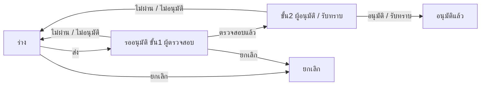

# BRD: แบบฟอร์มบันทึกการตรวจทานและอนุมัติภายใน (Internal Review & Approval Record)

| Field | Value |
|---|---|
| BRD ID | BRD-TMP-006-001 |
| Feature | F-TMP-006 แบบฟอร์มบันทึกการตรวจทานและอนุมัติภายใน (รหัสชั่วคราว) |
| BRD Type | New Feature (แบบ 1 · Standalone) |
| Version | 1.0 |
| Status | **APPROVED (Prebrief Mode · Lane · unattended)** — DEC แทน Scope Lock จนมีใบเซ็นลูกค้า · มติ AI-DEFAULT 12 ข้อรอลูกค้ายืนยัน |
| Module | Business Development (ฝ่ายพัฒนาธุรกิจ) |
| Customer | แบบฟอร์มลูกค้า FM-BDM-06 Rev.00 : 01/07/2569 |
| Request | REQ-TMP-006 (ชั่วคราว — รอเลขจริงจาก F186) |
| Input | PREBRIEF_REQ-TMP-006_v2 · FORM_SPEC.json (17 ช่อง · 2 กลุ่มแถวซ้ำ 10/3 แถว · ลายเซ็น 3) · DECISIONS.lock (18 DEC · พร้อมเริ่มทำ) · feature.html (audit FAIL 0 · e2e 21/21) |
| Created / Updated | 2026-10-10 |

## Changelog
- v1.0 (2026-10-10): สร้างผ่าน brd-generator-full v2.3 Prebrief Mode (doc-master-pipeline ขั้น 7 · โหมดไม่เฝ้า)

---

## 1. Business Context
### 1.1 ปัญหา / โอกาส
ฝ่ายพัฒนาธุรกิจบันทึกผลการตรวจทานเอกสารเสนอผู้บริหาร (ขั้นตอนที่ 5) ด้วยแบบฟอร์ม Excel FM-BDM-06 — ตัวเลือกใน Excel เลื่อนตำแหน่ง/ค้างจากแบบประเมินความเสี่ยง (ประเภทความเสี่ยง · คะแนน 1–5 · สูตร D×E) · เลือก "อนุมัติครบถ้วน" ได้แม้ข้อแก้ไขยังเปิด · ผู้อนุมัติถูกบันทึกซ้ำ 2 ที่ (ตารางอนุมัติภายใน + บล็อกลงชื่อ) อาจขัดกัน · ลงนามด้วยมือ · ตรวจสอบย้อนหลังยาก
### 1.2 เป้าหมาย
1. ขึ้นแบบฟอร์มเป็นเอกสารในระบบ ช่องตรงกระดาษ 1:1 ลูกค้าจำแบบเดิมได้ (PDF Replica 2 หน้า)
2. ติดตามข้อแก้ไขแต่ละรายการถึงสถานะ "ปิด" · สถานะสุดท้ายสอดคล้องกับข้อแก้ไข (เตือน) · วันที่มีผลตามสถานะ
3. สายตรวจสอบ/อนุมัติจาก DOA กลาง (ค่าเริ่ม 2 ขั้น) · ผลพิจารณาในระบบเติมลง "บันทึกการอนุมัติภายใน" อัตโนมัติ — ตรวจสอบย้อนหลังได้
### 1.3 ตัวชี้วัด
ไม่มีใน input → **OQ-01** (ห้ามแต่งตัวเลข)
### 1.4 ที่มา
แบบฟอร์มลูกค้า FM-BDM-06 (xlsx 1 ชีต) → FORM_SPEC 17 ช่อง (กรอก 15 · ระบบใส่ 2) · gate 10 หมวดตอบโดย AI ตาม unattended-policy (AI-DEFAULT ทุกหมวด)

## 2. Scope
### 2.1 In Scope
- รายการบันทึก (ค้นหา · กรอง สถานะเอกสาร/สถานะการอนุมัติ/ฝ่าย · CSV · แบ่งหน้า) · สร้าง/แก้ร่าง wizard 3 ขั้น · ดูรายละเอียด 4 แท็บ (รายละเอียด › PDF › ลายเซ็น/อนุมัติ › ประวัติ)
- บันทึกการตรวจทานไม่จำกัดแถว: รายการเอกสาร / ประเด็น · ผู้ตรวจทาน · วันที่ตรวจทาน · ผลการตรวจทาน · ข้อคิดเห็น / ข้อแก้ไข · ผู้รับผิดชอบแก้ไข · สถานะ
- บันทึกการอนุมัติภายในไม่จำกัดแถว: ผู้พิจารณา / ผู้อนุมัติ · ตำแหน่ง · ผลการพิจารณา · วันที่ · ลายมือชื่อ / หลักฐาน (ระบบเติมจากผลพิจารณา DOA + ผู้ใช้เพิ่มการพิจารณานอกระบบ)
- สถานะสุดท้าย: สถานะการอนุมัติ · วันที่มีผล · หมายเหตุ
- ส่งอนุมัติ DOA 2 ขั้น (เลือกคนต่อขั้น) · ตรวจสอบแล้ว/อนุมัติ · ไม่ผ่าน→กลับร่าง · ยกเลิก (เหตุผลบังคับ)
- แนบไฟล์ · PDF FM-BDM-06 Replica 2 หน้าทุกสถานะ · เลขที่ IRV จาก ENG-DOC-NUM · แจ้งเตือนเมื่ออนุมัติแล้วยังมีข้อแก้ไขค้าง
### 2.2 Out of Scope
- ผูกกับโครงการ / เอกสารเสนอผู้บริหาร (FM-BDM-05) — กระดาษไม่มีช่อง (DEC-07 · DEC-17 → OQ-05) · หน้าตั้งค่า ReviewApprovalConfig (ใช้ config กลาง → OQ-04) · ทำซ้ำเอกสาร · ประกาศเมื่ออนุมัติ · ติดตามข้อแก้ไขข้ามใบ (dashboard)
### 2.3 Assumptions
- ผู้จัดทำ/ตำแหน่ง/ฝ่ายมีใน F-EMP-001 / F-ORG-001 · ReviewApprovalConfig มีหรือจะเพิ่ม (OQ-04) · ผู้ตรวจสอบ = ผู้บังคับบัญชาตรงของผู้จัดทำ · ผู้ตรวจทาน/ผู้รับผิดชอบแก้ไขเป็นข้อความ (เลือกจากรายชื่อพนักงานได้ · คนนอกพิมพ์เอง)
### 2.4 Scope Lock (ชั่วคราว = DECISIONS.lock · ยังไม่มีใบเซ็น → OQ-02)
| DEC | หมวด | มติ | ที่มา |
|---|---|---|---|
| DEC-01 | G1 | อนุมัติแล้วไม่เปลี่ยนค่าในระบบ | AI-DEFAULT |
| DEC-02 | G1 | ไม่ส่งต่อระบบอื่นรอบนี้ (ประกาศ event ไว้ใน FRD แต่ไม่ยิง) | AI-DEFAULT |
| DEC-03 | G2 | สายอนุมัติตั้งที่ DOA กลาง (dynamic) · ค่าเริ่ม 2 ขั้น: role-line-manager, role-gm · วงเงิน: ไม่มี | AI-DEFAULT |
| DEC-04 | G3 | สถานะข้อแก้ไข (เปิด / กำลังดำเนินการ / ปิด) → ReviewApprovalConfig.review_statuses · สถานะการอนุมัติ (อนุมัติครบถ้วน / อนุมัติแบบมีเงื่อนไข / อยู่ระหว่างแก้ไข / ไม่อนุมัติ) → ReviewApprovalConfig.final_statuses · ไม่ใช้ตัวเลือก/สูตรค้างจาก FM-BDM-02 · อนุมัติครบถ้วนขณะข้อแก้ไขยังเปิด = เตือน ไม่บล็อก · วันที่มีผลบังคับเมื่ออนุมัติครบถ้วน/แบบมีเงื่อนไข สถานะอื่นต้องว่าง · สถานะ "ปิด" ไม่มีผู้รับผิดชอบหรือข้อคิดเห็น = เตือน | AI-DEFAULT |
| DEC-05 | G4 | บันทึกการตรวจทาน: ไม่จำกัดจำนวนแถว · PDF อย่างน้อย 10 แถวตามกระดาษ | AI-DEFAULT |
| DEC-06 | G4 | บันทึกการอนุมัติภายใน: ไม่จำกัดจำนวนแถว · PDF อย่างน้อย 3 แถวตามกระดาษ | AI-DEFAULT |
| DEC-07 | G5 | ช่องตรงกระดาษ 1:1 · ไม่เพิ่มช่อง | AI-DEFAULT |
| DEC-08 | G6 | ลายเซ็นแถวล่าง 1 ช่องต่อขั้น DOA · ไม่ใช้ภาพลายมือชื่อ (ข้อความส่งในระบบ/พิจารณาในระบบ) | AI-DEFAULT |
| DEC-09 | G7 | ไม่อนุมัติ = กลับเป็นร่าง แก้แล้วส่งใหม่ · ยกเลิกได้โดย owner, admin_role สถานะ draft, pending · ต้องมีเหตุผล | AI-DEFAULT |
| DEC-10 | G8 | มองเห็น: เจ้าของ · ผู้อนุมัติเห็นหลังส่ง · admin role เห็นทั้งหมด | AI-DEFAULT |
| DEC-11 | G9 | ออกเลขเมื่อบันทึกครั้งแรก · รหัส IRV | AI-DEFAULT |
| DEC-12 | G10 | ของเสริม (กระดาษไม่มี): แนบไฟล์, ส่งออก CSV | AI-DEFAULT |
| DEC-13 | VALID | ใช้เฉพาะรายการตัวเลือกที่ตรงความหมาย (สถานะข้อแก้ไข · สถานะการอนุมัติ) · ตัดรายการค้างจาก FM-BDM-02 | FORM_SPEC |
| DEC-14 | VALID | ไม่มีช่องคำนวณ — ไม่นำสูตรค้าง (F23/F29) มาใช้ | FORM_SPEC |
| DEC-15 | VALID | อนุมัติครบถ้วนได้เมื่อข้อแก้ไขทุกแถวสถานะ = ปิด (ไม่ครบ = เตือน) | FORM_SPEC |
| DEC-16 | VALID | แถวบันทึกการอนุมัติภายในเติมจากประวัติ DOA ได้ · บล็อกลงชื่อมาจาก DOA เท่านั้น | FORM_SPEC |
| DEC-17 | VALID | ไม่เพิ่มช่องโครงการ (G5 1:1) — เสนอลูกค้ายืนยันการผูกกับโครงการ/FM-BDM-05 ในรายงาน | FORM_SPEC |
| DEC-18 | VALID | วันที่มีผลบังคับเมื่อสถานะ = อนุมัติครบถ้วน หรือ อนุมัติแบบมีเงื่อนไข · สถานะอื่นต้องว่าง | FORM_SPEC |

## 3. Roles & Permissions (COSO)
| Role | COSO | ทำอะไร |
|---|---|---|
| ผู้จัดทำ (ผู้เชี่ยวชาญด้านพัฒนาธุรกิจ / ผู้รับผิดชอบที่ได้รับมอบหมาย) | Maker | สร้าง/แก้ร่าง · ส่ง · ยกเลิกของตัวเอง (ร่าง/รออนุมัติ) |
| role-line-manager (ผู้ตรวจสอบ · ผู้จัดการฝ่ายพัฒนาธุรกิจ / รองกรรมการผู้จัดการ) | Checker | ขั้น 1 ตรวจสอบแล้ว / ไม่ผ่านการตรวจสอบ |
| role-gm (ผู้อนุมัติ / รับทราบ · กรรมการผู้จัดการ / ผู้มีอำนาจตามตารางอำนาจอนุมัติ) | Approver | ขั้น 2 อนุมัติ / รับทราบ หรือ ไม่อนุมัติ |
| admin ฝ่ายพัฒนาธุรกิจ | Monitor | เห็นทั้งหมด · ยกเลิกได้ |

| Action | Maker | Checker | Approver | Admin |
|---|:-:|:-:|:-:|:-:|
| ดูใบ | ของตน | หลังส่ง (อยู่ในสาย) | หลังส่ง (อยู่ในสาย) | ทั้งหมด |
| สร้าง/แก้ร่าง | ✓ ของตน | – | – | – |
| ตัดสินขั้น | – | ขั้น 1 | ขั้น 2 | – |
| ยกเลิก | ✓ ของตน | – | – | ✓ |
SoD: ผู้จัดทำพิจารณาใบตัวเองไม่ได้ (BR-DOA-04) · role กรรมการผู้จัดการ ไม่มีใน DOA master ตรงตัว → ใช้ role-gm ชั่วคราว (OQ-03)

## 4. User Journey
### 4.1 Happy Path
1. ผู้จัดทำ: สร้าง → ใส่รายการตรวจทานทีละแถว (รายการเอกสาร · ผู้ตรวจทาน · วันที่ · ผล · ข้อคิดเห็น · ผู้รับผิดชอบ · สถานะ) → ขั้น 2 ใส่ผู้พิจารณานอกระบบ (ถ้ามี) + สถานะสุดท้าย + แนบหลักฐาน → บันทึก (ได้เลข IRV) → ส่ง เลือกคน 2 ขั้น
2. ขั้น 1 ผู้ตรวจสอบ "ตรวจสอบแล้ว" (เติมแถวบันทึกการอนุมัติภายใน) → ขั้น 2 "อนุมัติ / รับทราบ" → **อนุมัติแล้ว** · PDF เก็บสำเนา (approved_final) · ยังมีข้อแก้ไขค้าง → แจ้งผู้จัดทำ (irv_approved_open_items)
### 4.2 Alternative
- ไม่ผ่านการตรวจสอบ/ไม่อนุมัติ ขั้นใดก็ได้ → กลับร่าง เลขเดิม + เหตุผล (บันทึกเป็นแถวอนุมัติภายใน) → ผู้จัดทำแก้ ส่งใหม่ (resolve สายใหม่)
- เลือก "อนุมัติครบถ้วน" ขณะข้อแก้ไขยังเปิด → เตือน ไม่บล็อก
- สถานะการอนุมัติ = อยู่ระหว่างแก้ไข / ไม่อนุมัติ → วันที่มีผลปิดและล้างค่า
- ยกเลิก (ร่าง/รออนุมัติ) โดยเจ้าของหรือ admin

## 5. Data (จาก FORM_SPEC — ป้ายตามกระดาษ)
### 5.1 internal_review (header)
| ช่อง | field | ชนิด | ที่มา | บังคับ |
|---|---|---|---|:-:|
| เลขที่ (footer) | doc_no | text | auto ENG-DOC-NUM (IRV) | ✓ |
| วันที่ | doc_date | date | auto | ✓ |
| ผู้จัดทำ (ชื่อ · ตำแหน่ง) | preparer_id → snapshot | ref | system F-EMP-001 | ✓ |
| ฝ่าย | dept_snapshot | text | system F-ORG-001 | ✓ |
| สถานะการอนุมัติ | final_approval_status | enum (ReviewApprovalConfig.final_statuses) | user | ✓ |
| วันที่มีผล | final_effective_date | date | user | เมื่ออนุมัติครบถ้วน/แบบมีเงื่อนไข |
| หมายเหตุ | final_remark | text | user | |
| + DOA fields | approval_status · doa_ref · approval_chain(jsonb) · approved_by · approved_at | | DOA | |
| + returned_reason · returned_by · returned_at | | | DEC-09 | |
### 5.2 internal_review_item (บันทึกการตรวจทาน · ≥1 แถว · PDF ≥ 10)
| ช่องบนกระดาษ | field | ชนิด | ที่มา | บังคับ |
|---|---|---|---|:-:|
| ลำดับ | seq | int | auto | ✓ |
| รายการเอกสาร / ประเด็น | item | text | user | ✓ |
| ผู้ตรวจทาน | reviewer_name | text (เลือกจาก Employee ได้) | user | ✓ |
| วันที่ตรวจทาน | review_date | date ≤ วันนี้ | user | ✓ |
| ผลการตรวจทาน | result | text (คำแนะนำ ผ่าน / ผ่านแบบมีข้อแก้ไข / ไม่ผ่าน) | user | ✓ |
| ข้อคิดเห็น / ข้อแก้ไข | comment | text | user | |
| ผู้รับผิดชอบแก้ไข | fix_owner_name | text | user | |
| สถานะ | status | enum (ReviewApprovalConfig.review_statuses) | user | ✓ |
### 5.3 internal_review_approval (บันทึกการอนุมัติภายใน · ≥0 แถว · PDF ≥ 3)
| ช่องบนกระดาษ | field | ชนิด | ที่มา | บังคับ |
|---|---|---|---|:-:|
| ลำดับ | seq | int | auto | ✓ |
| ผู้พิจารณา / ผู้อนุมัติ | approver_name | text | user / DOA | ✓ |
| ตำแหน่ง | position | text | user / DOA snapshot | ✓ |
| ผลการพิจารณา | decision | text | user / คำตัดสิน DOA + ความเห็น | ✓ |
| วันที่ | decided_date | date | user / DOA | ✓ |
| ลายมือชื่อ / หลักฐาน | evidence | text | user / "พิจารณาในระบบ" | |
| (ระบบ) | source | enum manual / doa | system | ✓ |
### 5.4 ค่าคงที่บนกระดาษ → config
สถานะข้อแก้ไข → ReviewApprovalConfig.review_statuses · สถานะการอนุมัติ → ReviewApprovalConfig.final_statuses · ประวัติการแก้ไขแบบฟอร์ม → DocumentConfig.form_revisions (F003)
### 5.5 attachments → Document Center (ไฟล์ระดับใบ)

## 6. User Stories
| ID | Story | AC หลัก |
|---|---|---|
| S-01 | ผู้จัดทำสร้างบันทึกการตรวจทาน | ≥1 แถว · รายการ/ผู้ตรวจทาน/วันที่/ผล/สถานะ บังคับ · บันทึกได้เลข IRV |
| S-02 | ผู้จัดทำติดตามข้อแก้ไขถึงปิด | นับข้อแก้ไขค้างสด · สถานะ "ปิด" ไม่มีผู้รับผิดชอบ/ข้อคิดเห็น = เตือน |
| S-03 | ผู้จัดทำบันทึกการพิจารณานอกระบบ | เพิ่มแถวอนุมัติภายใน (ชื่อ ตำแหน่ง ผล วันที่ บังคับ · หลักฐานไม่บังคับ) |
| S-04 | ผู้จัดทำกำหนดสถานะสุดท้าย | สถานะบังคับ · วันที่มีผลตามสถานะ · อนุมัติครบถ้วนแต่ข้อแก้ไขค้าง = เตือน |
| S-05 | ผู้จัดทำส่งตรวจสอบ/อนุมัติ | slot 2 ขั้นค่าเริ่มจาก DOA · ผู้จัดทำไม่อยู่ในรายชื่อ · บังคับเลือกครบ |
| S-06 | ผู้ตรวจสอบ/ผู้อนุมัติตัดสิน | ปุ่มเฉพาะผู้พิจารณาขั้นปัจจุบัน · เรียงขั้น · ไม่ผ่านบังคับเหตุผล → กลับร่าง · ผลเติมแถวอนุมัติภายใน |
| S-07 | พิมพ์/ดาวน์โหลด PDF FM-BDM-06 | 2 หน้าทุกสถานะ · ตรวจทาน ≥10 แถว · อนุมัติภายใน ≥3 แถว · ลายเซ็น = ผู้จัดทำ + 1 แถวต่อขั้น DOA (dynamic) |
| S-08 | ยกเลิก | เจ้าของ/admin · ร่างหรือรออนุมัติ · เหตุผลบังคับ |
| S-09 | admin ดูทุกใบ + CSV | กรอง สถานะเอกสาร/สถานะการอนุมัติ/ฝ่าย |
| S-10 | แจ้งเตือนข้อแก้ไขค้างหลังอนุมัติ | อนุมัติครบและยังมีสถานะ เปิด/กำลังดำเนินการ → แจ้งผู้จัดทำ (in-app) |

## 7. Status & Lifecycle
| จาก | Action | ไป | ใคร |
|---|---|---|---|
| — | บันทึกครั้งแรก | draft | Maker |
| draft | ส่ง | pending (ขั้น 1) | Maker |
| pending | ตัดสินผ่านขั้น n<N | pending (ขั้น n+1) | ผู้พิจารณาขั้น n |
| pending | ตัดสินผ่านขั้น N | approved | ขั้น N |
| pending | ไม่ผ่าน/ไม่อนุมัติ | draft (เลขเดิม · returned_*) | ผู้พิจารณาขั้นปัจจุบัน |
| draft / pending | ยกเลิก | cancelled | Maker / Admin |
approved = ล็อกแก้ไข · สถานะเอกสาร (workflow) แยกจาก "สถานะการอนุมัติ" บนกระดาษ (ผู้จัดทำกรอก)

## 8. Business Rules + Validation
| ID | Rule | Tag | Type |
|---|---|:-:|---|
| BR-01 | สถานะข้อแก้ไข/สถานะการอนุมัติ อ่านจาก ReviewApprovalConfig — ห้าม hardcode | CONFIGURABLE | Master (DEC-04 · DEC-13) |
| BR-02 | ไม่มีช่องคำนวณ · ไม่ใช้สูตร/ตัวเลือกค้างจาก FM-BDM-02 | FIXED | DEC-13 · DEC-14 |
| BR-03 | สถานะการอนุมัติ = อนุมัติครบถ้วน ขณะมีข้อแก้ไข เปิด/กำลังดำเนินการ = เตือน ไม่บล็อก | CONFIGURABLE [AI-DEFAULT] | Policy (DEC-04 · DEC-15) |
| BR-04 | วันที่มีผลบังคับเมื่อ อนุมัติครบถ้วน / อนุมัติแบบมีเงื่อนไข · สถานะอื่นต้องว่าง | FIXED | Validation (DEC-18) |
| BR-05 | สถานะข้อแก้ไข "ปิด" ไม่มีผู้รับผิดชอบหรือข้อคิดเห็น = เตือน | CONFIGURABLE [AI-DEFAULT] | Policy (DEC-04) |
| BR-06 | ผลพิจารณาแต่ละขั้น DOA (ผ่าน/ไม่ผ่าน + ความเห็น) เติมแถวบันทึกการอนุมัติภายใน source=doa (แก้ไม่ได้) | FIXED | DEC-16 |
| BR-07 | สายอนุมัติ resolve จาก DOA ตอนส่ง แล้ว freeze | FIXED | DOA (BR-DOA-02) |
| BR-08 | ไม่ผ่าน → draft เลขเดิม · resolve ใหม่ตอนส่งรอบถัดไป | FIXED | DEC-09 |
| BR-09 | ออกเลขตอนบันทึกครั้งแรก · no-gap ✗ | CONFIGURABLE | DOCCFG (DEC-11) |
| BR-10 | ร่างเห็นเฉพาะเจ้าของ (+ admin) | FIXED | Visibility (DEC-10) |
| BR-11 | ช่องลงชื่อใน PDF = ผู้จัดทำ + 1 แถวต่อขั้นที่ตั้งใน DOA (dynamic) · คำตัดสินตาม role | FIXED (จำนวน = DOA) | DEC-03 · DEC-08 |
| BR-12 | PDF 2 หน้าเสมอ (หน้า 1: ตรวจทาน 14 แถว · หน้า 2: แถวต่อ + อนุมัติภายใน + สถานะสุดท้าย + ลงชื่อ + ประวัติ) · ตรวจทาน ≥10 · อนุมัติภายใน ≥3 | FIXED | DEC-05 · DEC-06 · thai-doc R10 |
| BR-13 | วันที่ตรวจทาน/วันที่พิจารณา ไม่เกินวันนี้ | FIXED | Validation |

| VR | ช่อง | เงื่อนไข | ข้อความ |
|---|---|---|---|
| VR-01 | item · reviewer · review_date · result · status (ทุกแถวตรวจทาน) | required | กรอกรายการเอกสาร ผู้ตรวจทาน วันที่ ผลการตรวจทาน และสถานะให้ครบทุกรายการ |
| VR-02 | approver_name · position · decision · decided_date (แถวอนุมัติภายในที่เพิ่ม) | required | กรอกผู้พิจารณา ตำแหน่ง ผลการพิจารณา และวันที่ให้ครบทุกแถว (หรือลบแถวที่ไม่ใช้) |
| VR-03 | final_approval_status | required | กรุณาเลือกสถานะการอนุมัติ |
| VR-04 | final_effective_date | required เมื่อ อนุมัติครบถ้วน/แบบมีเงื่อนไข | กรุณาระบุวันที่มีผล |
| VR-05 | slot ผู้พิจารณา | ทุกขั้นต้องเลือก · ≠ ผู้จัดทำ | กรุณาเลือกผู้พิจารณา |
| VR-06 | เหตุผล ไม่ผ่าน/ยกเลิก | required | กรุณาระบุเหตุผล |

### 8.5 ระดับความยืดหยุ่น
BR-01 → ReviewApprovalConfig · BR-03/05 → Policy (AI-DEFAULT รอยืนยัน) · BR-09 → F-DOCCFG · BR-11 → DOA กลาง

## 9. Edge Cases
| EC | กรณี | ผล |
|---|---|---|
| EC-01 | เปลี่ยนสถานะการอนุมัติจาก อนุมัติครบถ้วน → อยู่ระหว่างแก้ไข | ล้างวันที่มีผล + ปิดช่อง |
| EC-02 | อนุมัติครบถ้วนแต่ข้อแก้ไขยังเปิด | เตือนในฟอร์ม/รายละเอียด · บันทึกได้ · อนุมัติแล้วแจ้งผู้จัดทำ |
| EC-03 | รายการตรวจทาน > 14 แถว | PDF หน้า 2 ต่อตาราง (หัวซ้ำ) · ยัง 2 หน้า (ทดสอบ 24 แถว) |
| EC-04 | ผู้จัดทำเป็นผู้จัดการเอง (ขั้น 1 = ตัวเอง) | slot ว่าง ต้องเลือกคนอื่น |
| EC-05 | แก้ DOA ระหว่างรออนุมัติ | ใบเดิมใช้สาย snapshot |
| EC-06 | ตัดสินชนกัน (stale) | 409 → toast รีเฟรช สถานะไม่เปลี่ยน |
| EC-07 | แบบเอกสารปิดใช้ (F-DOCCFG) | ปุ่มสร้าง disabled |
| EC-08 | ถูกตีกลับแล้วส่งใหม่ | แถวอนุมัติภายในเก็บผลรอบก่อน (source=doa) ต่อท้ายรอบใหม่ |
| EC-09 | DOA ตั้ง > 4 ขั้น | PDF ลงชื่อ dense · ทดสอบ 6 ขั้น = 7 แถว ยัง 2 หน้า |

## 10. Value Stream & Downstream Impact
Positioning: Business Development — ขั้นตอนที่ 5 (จัดทำเอกสารเสนอผู้บริหาร) · ใช้คู่บทสรุปผู้บริหาร/บันทึกการลงทุน (FM-BDM-05)
| ปลายทาง | ข้อมูล | Trigger | หมายเหตุ |
|---|---|---|---|
| ระบบอื่น | — | — | **ไม่ส่งต่อรอบนี้ (DEC-02)** |
| ENG-NOTIFY | irv_cancelled · irv_approved_open_items | cancel / approved | |
| F-DOCCFG / ENG-DOC-STORE | PDF snapshot | approved_final | |
| รายงาน | ข้อแก้ไขค้าง · เวลาตรวจทาน | — | Report area อ่าน (Phase 2) |

## 11. Delivery
Phase 1 = §2.1 · Phase 2 (เสนอ) = ผูกโครงการ/FM-BDM-05 · dashboard ติดตามข้อแก้ไขข้ามใบ · หน้าตั้งค่า ReviewApprovalConfig

## 12. Dev Summary "ใบสั่ง"
- Config: ReviewApprovalConfig (review_statuses · final_statuses · final_needs_effective) · DOA entry F-TMP-006 · doc_type IRV · DocumentConfig.form_revisions
- Declaration: DOA_BRIEF · NTF_BRIEF · DOCCFG_BRIEF · MDOC_BRIEF (ฉบับจริงหลัง FRD)
- Screen Inventory: P-01 รายการ · P-02 สร้าง/แก้ (drawer wide 3 ขั้น) · P-03 ดู (drawer 4 แท็บ) · M-01..05 modal ส่ง/อนุมัติ/ไม่ผ่าน/ยกเลิก/ทิ้งข้อมูล
- UI Signals: เอกสาร + พิมพ์ + ลายเซ็น = ใช่ · Q-form · ตารางตรวจทานในขั้น 1 · ตารางอนุมัติภายใน + สถานะสุดท้ายในขั้น 2

## 13. Open Questions
| OQ | คำถาม | เจ้าของ | Block? |
|---|---|---|---|
| OQ-01 | ตัวชี้วัดความสำเร็จ (เช่น เวลาตรวจทานเฉลี่ย · % ข้อแก้ไขปิดก่อนอนุมัติ) | ลูกค้า | ไม่ |
| OQ-02 | ลูกค้าเซ็นยืนยัน DEC-01..12 (AI-DEFAULT) — โดยเฉพาะ 2 ขั้น · กลับร่าง · คำตัดสิน · admin เห็นทั้งหมด | Strike → ลูกค้า | ก่อน UAT |
| OQ-03 | role กรรมการผู้จัดการ / ผู้มีอำนาจตามตารางอำนาจอนุมัติ ไม่มีใน DOA master — ใช้ role-gm ชั่วคราว · ผู้ตรวจสอบ "รองกรรมการผู้จัดการ" อยู่ขั้นเดียวกับผู้จัดการฝ่ายหรือแยกขั้น | Strike + พี่เบิร์ด | ก่อน wire |
| OQ-04 | ReviewApprovalConfig มีใน Core แล้วหรือยัง / ใครดูแล | พี่เบิร์ด | ก่อน dev |
| OQ-05 | ต้องผูกบันทึกกับโครงการ / FM-BDM-05 ไหม — กระดาษไม่มีช่อง | ลูกค้า | ไม่ |
| OQ-06 | ผลการตรวจทาน เป็นข้อความอิสระหรือรายการตัวเลือก (เสนอ ผ่าน / ผ่านแบบมีข้อแก้ไข / ไม่ผ่าน) | ลูกค้า | ไม่ |
| OQ-07 | รหัส IRV ชนกับ doc_type อื่นใน F-DOCCFG ไหม · function_code taxonomy | Strike | ก่อน register |

## 14. Security & Compliance
Preset: Standard Internal · PII: ชื่อผู้จัดทำ/ผู้ตรวจทาน/ผู้พิจารณา (snapshot) — ข้อมูลตัวอย่างใน prototype เป็นชื่อสมมติ · Audit append-only ทุก action · SoD ผู้จัดทำ≠ผู้พิจารณา · ไฟล์แนบตาม file_policy Document Center (≤20MB · pdf/doc/xls/img)

## 15. Health Check / Monitoring
SLA ต่อขั้น: ไม่กำหนดรอบนี้ (→ OQ-01) · KPI เสนอ: ข้อแก้ไขค้างหลังอนุมัติ · ใบรออนุมัติเกิน N วัน

## Appendix — Screen List
P-01 `#/internal-review` · P-02 `#/internal-review/create` · `/edit/:id` · P-03 `#/internal-review/view/:id`

## AI Review (Quality Gate)
C1–C19 ✓ · C16 ไม่มี Registry ตรง (WARN — feature ใหม่ เสนอใน _BATCH_REPORT) · C20 ✓ Scope Lock = DEC-01..18 ครบ + OQ-02 รอใบเซ็น → **APPROVED**
