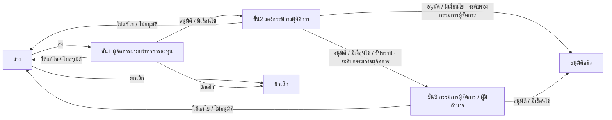

# BRD: แบบฟอร์มบันทึกการอนุมัตินำส่ง (Pre-submission Approval Record Form)

| Field | Value |
|---|---|
| BRD ID | BRD-IVM-IVMH-001 |
| Feature | F-TMP-010 แบบฟอร์มบันทึกการอนุมัตินำส่ง (รหัสชั่วคราว — รอ feature id จริง) |
| BRD Type | New Feature (แบบ 1 · ข้อมูลใหม่ทั้งหมด — ชื่อผู้จัดทำจาก F-EMP-001 · สายอนุมัติจาก DOA) |
| Version | 1.0 |
| Status | **APPROVED (Prebrief Mode · Lane · unattended)** — DEC แทน Scope Lock จนมีใบเซ็นลูกค้า · มติ AI-DEFAULT ทุกหมวด |
| Module | ฝ่ายบริหารการลงทุน (Investment Management) — module ใหม่ ยังไม่อยู่ใน Module Registry ของ DOA (OQ-03) |
| Customer | แบบฟอร์มลูกค้า FM-IVM-08 Rev.00 : 01/07/2569 (ขั้นตอนที่ 6: การอนุมัติก่อนนำส่งหรือก่อนดำเนินการ) |
| Request | REQ-TMP-010 (ชั่วคราว — รอเลขจริงจาก F186) |
| Input | PREBRIEF_REQ-TMP-010_v2 · FORM_SPEC.json (13 ช่อง) · DECISIONS.lock (18 DEC · AI-DEFAULT 11 · พร้อมเริ่มทำ) · feature.html (html-generator-v9.4 · audit FAIL 0 · self_audit PASS · smoke 58/58 · NO-BROWSER) |
| Created / Updated | 2026-10-11 |

## Changelog
- v1.0 (2026-10-11): สร้างผ่าน brd-generator-full v2.3 Prebrief Mode (doc-master-pipeline ขั้น 7 · โหมดไม่เฝ้า)

---

## 1. Business Context
### 1.1 ปัญหา / โอกาส
ฝ่ายบริหารการลงทุนใช้ไฟล์ Excel FM-IVM-08 เป็นหลักฐานการตรวจทานและอนุมัติก่อนส่งเอกสารหรือดำเนินการสำคัญตามตารางอำนาจอนุมัติ — รายละเอียดการขออนุมัติ 6 ช่อง · ตารางผลการพิจารณา 3 แถว (ผู้จัดการฝ่ายบริหารการลงทุน · รองกรรมการผู้จัดการ · กรรมการผู้จัดการ / ผู้มีอำนาจ) · บล็อกลงชื่อการตรวจทาน / อนุมัติซ้ำกับตาราง (คนเดียวลง 2 ที่) · "ระดับอำนาจอนุมัติ" เป็นช่องข้อความแต่เป็นตัวกำหนดว่าต้องผ่านกี่ขั้น · dropdown ผลการพิจารณา 5 ค่าไม่บังคับเงื่อนไข / ข้อสั่งการ · รับทราบ เลือกได้ทุกแถว · ไม่มีลำดับบังคับ · ส่งต่อด้วยมือ ตรวจย้อนหลังยาก
### 1.2 เป้าหมาย
1. ขึ้นแบบฟอร์มเป็นเอกสารในระบบ ช่องตรงกระดาษ 1:1 · PDF Replica FM-IVM-08 2 หน้า
2. ระดับอำนาจอนุมัติเลือกจากรายการ → สายอนุมัติ 2/3 ขั้นจาก DOA กลาง (dynamic) · ผลการพิจารณาบันทึกจากการกดของผู้พิจารณาแต่ละขั้น (ไม่กรอกซ้ำ)
3. ผลการพิจารณา 5 ค่าตามแบบฟอร์ม พร้อมกติกา (มีเงื่อนไข/ให้แก้ไข/ไม่อนุมัติ ต้องมีข้อสั่งการ · รับทราบเฉพาะขั้นกลาง · เรียงขั้น) · ประวัติ append-only
### 1.3 ตัวชี้วัด
ไม่มีใน input → **OQ-01** (ห้ามแต่งตัวเลข)
### 1.4 ที่มา
แบบฟอร์มลูกค้า FM-IVM-08 (xlsx · ชื่อชีต INV-FM-08) → FORM_SPEC 13 ช่อง (ผู้ใช้กรอก 6 · ระบบใส่ 7) · แถวซ้ำ 1 ชุด (ผลการพิจารณา 3 แถว = ขั้น DOA) · ตัวเลือก 2 ชุด (ระดับอำนาจอนุมัติ 2 ค่า — AI-DEFAULT · ผลการพิจารณา 5 ค่า data validation D22:D24) · ไม่มีสูตร/ค่าคงที่ · gate 10 หมวด = AI-DEFAULT ทั้งหมด (โหมดไม่เฝ้า)

## 2. Scope
### 2.1 In Scope
- รายการแบบฟอร์ม (ค้นหา · กรองสถานะเอกสาร/ระดับอำนาจอนุมัติ · CSV) · สร้าง/แก้ร่าง wizard 3 ขั้น · ดูรายละเอียด 4 แท็บ (รายละเอียด › PDF Preview › ลายเซ็น/อนุมัติ › ประวัติ)
- รายละเอียดการขออนุมัติ 6 ช่อง · ตารางผลการพิจารณา (1 แถวต่อขั้น DOA · ระบบเติม)
- ส่งอนุมัติ DOA 2/3 ขั้นตามระดับ (เลือกคนต่อขั้น) · พิจารณา: อนุมัติ / อนุมัติแบบมีเงื่อนไข / รับทราบ (ขั้นกลาง) · ส่งกลับ: ให้แก้ไข / ไม่อนุมัติ → กลับร่าง · ยกเลิก (เหตุผลบังคับ)
- แนบไฟล์ระดับใบ · PDF FM-IVM-08 Replica 2 หน้าทุกสถานะ · เลขที่ IVMH จาก ENG-DOC-NUM
### 2.2 Out of Scope
- เชื่อมแบบฟอร์มเริ่มต้นธุรกรรม FM-IVM-01 / ทะเบียนโครงการ (ชื่อโครงการกรอกเอง · OQ-05) · ผูกกับชุดเอกสารนำส่ง FM-IVM-07 อัตโนมัติ (OQ-07) · บันทึกการนำส่งจริง (ทำนอกเอกสารนี้) · ติดตามการปฏิบัติตามเงื่อนไขหลังอนุมัติ (OQ-08) · ทำซ้ำ (DEC-11 ✗) · ช่องเพิ่มนอกกระดาษ (DEC-06)
### 2.3 Assumptions
- ข้อมูลพนักงาน/ตำแหน่งมีใน F-EMP-001 / F-ORG-001 · DOA กลางรับ parameter ระดับอำนาจอนุมัติเพื่อ resolve 2/3 ขั้นได้ และเพิ่ม module/role ของฝ่ายบริหารการลงทุนได้ (OQ-03) · ผลการพิจารณา 5 ค่ารองรับใน DOA engine (OQ-09)
### 2.4 Scope Lock (ชั่วคราว = DECISIONS.lock · ยังไม่มีใบเซ็น → OQ-02)
| DEC | หมวด | มติ | ที่มา | ใช้ที่ |
|---|---|---|---|---|
| DEC-01 | G1 | อนุมัติแล้วไม่เปลี่ยนค่าในระบบ | AI-DEFAULT | html, thai-doc, brd, frd, tests, ntf-declaration |
| DEC-02 | G1 | ไม่ส่งต่อระบบอื่นรอบนี้ (ประกาศ event ไว้ใน FRD แต่ไม่ยิง) | AI-DEFAULT | brd, frd |
| DEC-03 | G2 | สายอนุมัติตั้งที่ DOA กลาง (dynamic) · ค่าเริ่ม 3 ขั้น: role-line-manager, role-gm, role-gm · วงเงิน: ไม่มี | AI-DEFAULT | html, doa-declaration, frd, tests |
| DEC-04 | G3 | คำนวณให้อัตโนมัติ ผู้ใช้ปรับได้ · เกินเกณฑ์ = เตือน · ระดับอำนาจอนุมัติ เลือกจากรายการ: รองกรรมการผู้จัดการ (2 ขั้น) · กรรมการผู้จัดการ / ผู้มีอำนาจ (3 ขั้น) — กำหนดจำนวนขั้นพิจารณา (บล็อกถ้าไม่เลือก) · ตารางผลการพิจารณา ระบบเติมจากการกดพิจารณาของแต่ละขั้น (ลำดับ · ผู้พิจารณา / ผู้อนุมัติ · ตำแหน่ง · วันที่ · หลักฐาน / ลายเซ็น) — ผู้จัดทำแก้ไม่ได้ · พิจารณาตามลำดับขั้น · ขั้นถัดไปเปิดเมื่อขั้นก่อน อนุมัติ / อนุมัติแบบมีเงื่อนไข / รับทราบ · ผลการพิจารณา อนุมัติแบบมีเงื่อนไข / ให้แก้ไข / ไม่อนุมัติ → ต้องกรอกเงื่อนไข / ข้อสั่งการ (บล็อก) · รับทราบ เลือกได้เฉพาะขั้นกลาง (ไม่ใช่ขั้น 1 ผู้ตรวจสอบ และไม่ใช่ขั้นสุดท้ายที่ต้องตัดสิน) (บล็อก) · ทุกขั้นผ่าน และมีขั้นใด อนุมัติแบบมีเงื่อนไข → สถานะ อนุมัติแล้ว + ป้าย มีเงื่อนไข · รวมเงื่อนไขทุกขั้นแสดงในหน้ารายละเอียด · บล็อกลงชื่อ การตรวจทาน / อนุมัติ ใช้ข้อมูล DOA ชุดเดียวกับตารางผลการพิจารณา (ไม่กรอกซ้ำ) | AI-DEFAULT | html, thai-doc, brd, frd, tests |
| DEC-05 | G4 | ผลการพิจารณา: ไม่จำกัดจำนวนแถว · PDF อย่างน้อย 3 แถวตามกระดาษ | AI-DEFAULT | html, thai-doc, frd |
| DEC-06 | G5 | ช่องตรงกระดาษ 1:1 · ไม่เพิ่มช่อง (เช่น หมายเหตุ) | AI-DEFAULT | html, thai-doc, brd, frd |
| DEC-07 | G6 | ลายเซ็นแถวล่าง 1 ช่องต่อขั้น DOA · ไม่ใช้ภาพลายมือชื่อ (ข้อความส่งในระบบ/พิจารณาในระบบ) | AI-DEFAULT | thai-doc, html, doccfg-declaration, frd |
| DEC-08 | G7 | ไม่อนุมัติ = กลับเป็นร่าง แก้แล้วส่งใหม่ · ยกเลิกได้โดย owner, admin_role สถานะ draft, pending · ต้องมีเหตุผล | AI-DEFAULT | html, frd, tests, doa-declaration |
| DEC-09 | G8 | มองเห็น: เจ้าของ · ผู้อนุมัติเห็นหลังส่ง · admin role เห็นทั้งหมด | AI-DEFAULT | html, frd, tests |
| DEC-10 | G9 | ออกเลขเมื่อบันทึกครั้งแรก · รหัส IVMH | AI-DEFAULT | doccfg-declaration, html, frd |
| DEC-11 | G10 | ของเสริม (กระดาษไม่มี): แนบไฟล์, ส่งออก CSV | AI-DEFAULT | html, brd, frd, ntf-declaration |
| DEC-12 | VALID | กฎตรวจจากตัวอย่างลูกค้า: ยึด FM-IVM-08 ตาม footer เป็นรหัสแบบฟอร์ม (พบ: ชื่อชีตเป็น INV-FM-08 แต่ Doc. No. ท้ายกระดาษเป็น FM-IVM-08) | FORM_SPEC | html, frd, tests |
| DEC-13 | VALID | กฎตรวจจากตัวอย่างลูกค้า: ใช้ข้อมูล DOA ชุดเดียว: ตารางผลการพิจารณา = ทุกขั้น · บล็อกลงชื่อ ผู้ตรวจสอบ = ขั้น 1 · ผู้อนุมัติ / รับทราบ = ขั้นสุดท้าย (ไม่ให้กรอกซ้ำ) (พบ: กระดาษมีทั้งตารางผลการพิจารณา 3 แถว และบล็อกลงชื่อ ผู้ตรวจสอบ/ผู้อนุมัติ ซ้ำกัน (คนเดียวกันลง 2 ที่)) | FORM_SPEC | html, frd, tests |
| DEC-14 | VALID | กฎตรวจจากตัวอย่างลูกค้า: เลือกระดับจากรายการ → กำหนดจำนวนขั้น DOA · แถวที่ไม่ต้องพิจารณาพิมพ์ — (ไม่ต้องพิจารณาตามระดับ) (พบ: ช่องว่างข้อความอิสระ แต่ระดับเป็นตัวกำหนดว่าต้องผ่านกี่ขั้น (แถว 2 / แถว 3)) | FORM_SPEC | html, frd, tests |
| DEC-15 | VALID | กฎตรวจจากตัวอย่างลูกค้า: อนุมัติแบบมีเงื่อนไข / ให้แก้ไข / ไม่อนุมัติ → ต้องกรอกเงื่อนไข / ข้อสั่งการ (บล็อก) (พบ: ตัวเลือก อนุมัติแบบมีเงื่อนไข / ให้แก้ไข / ไม่อนุมัติ ไม่บังคับกรอกเงื่อนไข / ข้อสั่งการ) | FORM_SPEC | html, frd, tests |
| DEC-16 | VALID | กฎตรวจจากตัวอย่างลูกค้า: รับทราบ ใช้ได้เฉพาะขั้นที่ไม่ใช่ขั้นตัดสินสุดท้ายของระดับ (ขั้นผู้มีอำนาจเหนือระดับที่ต้องรับทราบ) · ขั้น 1 ผู้ตรวจสอบเลือกได้ อนุมัติ/อนุมัติแบบมีเงื่อนไข/ให้แก้ไข/ไม่อนุมัติ (พบ: ตัวเลือก รับทราบ เลือกได้ทุกแถว รวมแถว 1 ผู้ตรวจสอบ (ผู้ตรวจสอบรับทราบ = ไม่ได้ตรวจ)) | FORM_SPEC | html, frd, tests |
| DEC-17 | VALID | กฎตรวจจากตัวอย่างลูกค้า: พิจารณาตามลำดับขั้น · ขั้นถัดไปเปิดเมื่อขั้นก่อนอนุมัติ/อนุมัติแบบมีเงื่อนไข/รับทราบ · ให้แก้ไข/ไม่อนุมัติ → กลับเป็นร่าง (back_to_draft) (พบ: ไม่มีลำดับบังคับ — แถว 2 กรอกได้ก่อนแถว 1) | FORM_SPEC | html, frd, tests |
| DEC-18 | VALID | กฎตรวจจากตัวอย่างลูกค้า: ไม่เป็นช่องกรอกต่อใบ · แสดงจาก doccfg revision (พบ: ตารางประวัติการแก้ไขเป็นของแบบฟอร์ม (form revision) วางท้ายฟอร์ม) | FORM_SPEC | html, frd, tests |

## 3. Roles & Permissions (COSO)
| Role | COSO | ทำอะไร |
|---|---|---|
| ผู้จัดทำ (ผู้ประสานงานบริหารการลงทุน / ผู้รับผิดชอบที่ได้รับมอบหมาย) | Maker | สร้าง/แก้ร่าง · ส่ง · ยกเลิกของตัวเอง (ร่าง/รออนุมัติ) |
| ผู้ตรวจสอบ — role-line-manager (บนกระดาษ: ผู้จัดการฝ่ายบริหารการลงทุน) | Checker | ขั้น 1 อนุมัติ / อนุมัติแบบมีเงื่อนไข / ให้แก้ไข / ไม่อนุมัติ |
| ผู้อนุมัติ / รับทราบ — role-gm (บนกระดาษ: รองกรรมการผู้จัดการ) | Approver | ขั้น 2 อนุมัติ / อนุมัติแบบมีเงื่อนไข / ให้แก้ไข / ไม่อนุมัติ · รับทราบ (เมื่อมีขั้น 3) |
| ผู้อนุมัติ — role-gm (บนกระดาษ: กรรมการผู้จัดการ / ผู้มีอำนาจ) | Approver | ขั้น 3 (เฉพาะระดับกรรมการผู้จัดการ / ผู้มีอำนาจ) อนุมัติ / อนุมัติแบบมีเงื่อนไข / ให้แก้ไข / ไม่อนุมัติ |
| admin role ฝ่ายบริหารการลงทุน (เจ้าหน้าที่ดูแลเอกสาร) | Monitor | เห็นทุกใบ · ยกเลิกได้ (ร่าง/รออนุมัติ) · CSV |

| Action | Maker | Checker | Approver | Admin |
|---|:-:|:-:|:-:|:-:|
| ดูใบ | ของตน | หลังส่ง (อยู่ในสาย) | หลังส่ง (อยู่ในสาย) | ทั้งหมด |
| สร้าง/แก้ร่าง | ✓ ของตน | – | – | – |
| พิจารณาขั้น | – | ขั้น 1 | ขั้น 2 / 3 | – |
| ยกเลิก | ✓ ของตน | – | – | ✓ |
SoD: ผู้จัดทำพิจารณาใบตัวเองไม่ได้ (BR-DOA-04) · ผู้ตรวจสอบ (ขั้น 1) รับทราบไม่ได้ (DEC-16) · role จริงต้องเทียบ DOA master (OQ-03)

## 4. User Journey
### 4.1 Happy Path
1. ผู้จัดทำ: สร้าง → รายละเอียดการขออนุมัติ (ชื่อโครงการ / ธุรกรรม · เรื่องที่ขออนุมัติ · เอกสารประกอบ · ระดับอำนาจอนุมัติ · ข้อเสนอของฝ่ายบริหารการลงทุน · เงื่อนไขการอนุมัติ) → ดูตารางผลการพิจารณาตามระดับ → แนบไฟล์ → บันทึก (ได้เลข IVMH) → ส่ง เลือกคนต่อขั้น
2. ขั้น 1 ผู้จัดการฝ่ายบริหารการลงทุน อนุมัติ → ขั้น 2 รองกรรมการผู้จัดการ (รับทราบ เมื่อมีขั้น 3 / อนุมัติ เมื่อเป็นขั้นสุดท้าย) → (ขั้น 3 กรรมการผู้จัดการ / ผู้มีอำนาจ อนุมัติ) → **อนุมัติแล้ว** · PDF เก็บสำเนา (approved_final) · มีขั้นใดอนุมัติแบบมีเงื่อนไข → แจ้งผู้จัดทำ + admin (ivmh_conditional_approved)
### 4.2 Alternative
- ให้แก้ไข / ไม่อนุมัติ ขั้นใดก็ได้ (เงื่อนไข / ข้อสั่งการ บังคับ) → กลับร่าง เลขเดิม → ผู้จัดทำแก้ ส่งใหม่ (resolve สายใหม่) หรือยกเลิก
- อนุมัติแบบมีเงื่อนไข → ต้องระบุเงื่อนไข / ข้อสั่งการ · ผ่านขั้น · ผลรวม = อนุมัติแบบมีเงื่อนไข
- ยกเลิก (ร่าง/รออนุมัติ) โดยเจ้าของหรือ admin → ถ้ารออนุมัติ แจ้งผู้พิจารณาขั้นปัจจุบัน (ivmh_cancelled)

## 5. Data (จาก FORM_SPEC — ป้ายตามกระดาษ)
### 5.1 ivm_submission_approval (header)
| ช่องบนกระดาษ | key | ชนิด | บังคับ | ที่มา |
|---|---|---|:-:|---|
| ชื่อโครงการ / ธุรกรรม | project_name | ข้อความ | ✓ | ผู้ใช้กรอก |
| เรื่องที่ขออนุมัติ | subject | ข้อความยาว | ✓ | ผู้ใช้กรอก |
| เอกสารประกอบ | supporting_docs | ข้อความยาว (+ ไฟล์แนบ) | ✓ | ผู้ใช้กรอก |
| ระดับอำนาจอนุมัติ | authority_level | ตัวเลือก (รองกรรมการผู้จัดการ · กรรมการผู้จัดการ / ผู้มีอำนาจ) | ✓ | ผู้ใช้เลือก (DEC-04/14) |
| ข้อเสนอของฝ่ายบริหารการลงทุน | ivm_proposal | ข้อความยาว | ✓ | ผู้ใช้กรอก |
| เงื่อนไขการอนุมัติ | proposed_conditions | ข้อความยาว | – | ผู้ใช้กรอก |
### 5.2 ผลการพิจารณา (= approval_chain snapshot · 1 แถวต่อขั้น)
| คอลัมน์บนกระดาษ | key | ที่มา |
|---|---|---|
| ลำดับ | seq | ลำดับขั้น |
| ผู้พิจารณา / ผู้อนุมัติ | reviewer_role | ป้ายขั้นจาก DOA |
| ตำแหน่ง | position | ตำแหน่งผู้กด ณ วันที่พิจารณา |
| ผลการพิจารณา | decision | อนุมัติ · อนุมัติแบบมีเงื่อนไข · ให้แก้ไข · ไม่อนุมัติ · รับทราบ |
| เงื่อนไข / ข้อสั่งการ | instruction | ผู้พิจารณากรอก |
| วันที่ | decided_at | วันที่กด |
| หลักฐาน / ลายเซ็น | evidence | ชื่อผู้พิจารณา + พิจารณาในระบบ |
### 5.3 attachments → Document Center (ไฟล์ระดับใบ)
### 5.4 ข้อความคงที่บนกระดาษ (ไม่ใช่ช่อง)
ใช้ในขั้นตอน · วัตถุประสงค์ · ผู้จัดทำ · ผู้ตรวจสอบ · ผู้อนุมัติ / รับทราบ · หมายเหตุการใช้งาน · ประวัติการแก้ไข (= revision แบบฟอร์ม DEC-18)

## 6. User Stories
| ID | Story | AC หลัก |
|---|---|---|
| S-01 | ผู้จัดทำบันทึกรายละเอียดการขออนุมัติ | 5 ช่องบังคับ · เงื่อนไขการอนุมัติไม่บังคับ · บันทึกได้เลข IVMH |
| S-02 | ผู้จัดทำเลือกระดับอำนาจอนุมัติ | 2 ค่า · รองกรรมการผู้จัดการ = 2 ขั้น · กรรมการผู้จัดการ / ผู้มีอำนาจ = 3 ขั้น · ตารางผลการพิจารณาแสดงตาม |
| S-03 | ผู้จัดทำแนบไฟล์ | ไฟล์ระดับใบ ≤20MB · pdf/doc/xls/รูป |
| S-04 | ผู้จัดทำส่งอนุมัติ | slot ต่อขั้นค่าเริ่มจาก DOA · ผู้จัดทำไม่อยู่ในรายชื่อ · บังคับเลือกครบ |
| S-05 | ผู้ตรวจสอบพิจารณาขั้น 1 | อนุมัติ / อนุมัติแบบมีเงื่อนไข (ข้อสั่งการบังคับ) · ไม่มีรับทราบ · ส่งกลับ ให้แก้ไข / ไม่อนุมัติ |
| S-06 | รองกรรมการผู้จัดการพิจารณาขั้น 2 | ขั้นกลางเลือก รับทราบ ได้ · ขั้นสุดท้ายต้องตัดสิน |
| S-07 | กรรมการผู้จัดการ / ผู้มีอำนาจพิจารณาขั้น 3 | อนุมัติ → อนุมัติแล้ว · มีเงื่อนไข → แจ้งเงื่อนไข |
| S-08 | ผู้จัดทำแก้ใบที่ถูกส่งกลับ | แถบถูกส่งกลับ + ข้อสั่งการ · แก้แล้วส่งใหม่เลขเดิม |
| S-09 | พิมพ์/ดาวน์โหลด PDF FM-IVM-08 | ทุกสถานะ 2 หน้า · ผลการพิจารณา ≥3 แถว · ลายเซ็น = ผู้จัดทำ + 1 แถวต่อขั้นตาม DOA |
| S-10 | ยกเลิก | เจ้าของ/admin · ร่างหรือรออนุมัติ · เหตุผลบังคับ |
| S-11 | admin ดูทุกใบ + CSV | กรองสถานะเอกสาร/ระดับอำนาจอนุมัติ |

## 7. Status & Lifecycle
| จาก | Action | ไป | ใคร |
|---|---|---|---|
| — | บันทึกครั้งแรก | draft | Maker |
| draft | ส่ง | pending (ขั้น 1) | Maker |
| pending | อนุมัติ / อนุมัติแบบมีเงื่อนไข / รับทราบ ขั้น n<N | pending (ขั้น n+1) | ผู้พิจารณาขั้น n |
| pending | อนุมัติ / อนุมัติแบบมีเงื่อนไข ขั้น N | approved | ขั้น N |
| pending | ให้แก้ไข / ไม่อนุมัติ | draft (เลขเดิม · returned_*) | ผู้พิจารณาขั้นปัจจุบัน |
| draft / pending | ยกเลิก | cancelled | Maker / Admin |
approved = ล็อกแก้ไข · ติดตามเงื่อนไขหลังอนุมัติ = OQ-08

## 8. Business Rules + Validation
| ID | Rule | Tag | Type |
|---|---|:-:|---|
| BR-01 | ระดับอำนาจอนุมัติ เลือกจากรายการ 2 ค่า · กำหนดจำนวนขั้น (2 / 3) ส่งให้ DOA กลาง resolve | CONFIGURABLE | DOA (DEC-03 · DEC-04 · DEC-14) [AI-DEFAULT] |
| BR-02 | ตารางผลการพิจารณา = 1 แถวต่อขั้น approval_chain · ระบบเติมจากการกดพิจารณา · ผู้จัดทำแก้ไม่ได้ | FIXED | Auto (DEC-04 · DEC-13) |
| BR-03 | พิจารณาเรียงขั้น · ขั้นถัดไปเปิดเมื่อขั้นก่อน อนุมัติ / อนุมัติแบบมีเงื่อนไข / รับทราบ | FIXED | DEC-17 |
| BR-04 | อนุมัติแบบมีเงื่อนไข / ให้แก้ไข / ไม่อนุมัติ → เงื่อนไข / ข้อสั่งการ บังคับ | FIXED | Validation (DEC-04 · DEC-15) |
| BR-05 | รับทราบ เลือกได้เฉพาะขั้นกลาง (ไม่ใช่ขั้น 1 และไม่ใช่ขั้นสุดท้าย) | FIXED | Validation (DEC-04 · DEC-16) |
| BR-06 | ผลการพิจารณา 5 ค่าตามแบบฟอร์ม (อนุมัติ · อนุมัติแบบมีเงื่อนไข · ให้แก้ไข · ไม่อนุมัติ · รับทราบ) | CONFIGURABLE | Master list (FORM_SPEC) |
| BR-07 | ทุกขั้นผ่านและมีขั้นใด อนุมัติแบบมีเงื่อนไข → สถานะ อนุมัติแล้ว + ผล อนุมัติแบบมีเงื่อนไข · แจ้งเงื่อนไข | FIXED | DEC-04 · NTF |
| BR-08 | บล็อกลงชื่อ การตรวจทาน / อนุมัติ ใช้ข้อมูล DOA ชุดเดียวกับตารางผลการพิจารณา | FIXED | DEC-04 · DEC-13 |
| BR-09 | สายอนุมัติ resolve จาก DOA ตอนส่ง แล้ว freeze · ผู้จัดทำพิจารณาใบตัวเองไม่ได้ | FIXED | DOA (BR-DOA-02/04 · DEC-03) |
| BR-10 | ให้แก้ไข / ไม่อนุมัติ → draft เลขเดิม · resolve ใหม่ตอนส่งรอบถัดไป | FIXED | DEC-08 (BR-DOA-03 · on_reject back_to_draft) |
| BR-11 | ออกเลขตอนบันทึกครั้งแรก · no-gap ✗ · รหัส IVMH | CONFIGURABLE | DOCCFG (DEC-10) |
| BR-12 | ร่างเห็นเฉพาะเจ้าของ (+ admin) | FIXED | Visibility (DEC-09) |
| BR-13 | ช่องลงชื่อใน PDF = ผู้จัดทำ + 1 แถวต่อขั้นที่ตั้งใน DOA (dynamic ไม่ fix) · คำตัดสินตาม role (ตรวจสอบแล้ว/ส่งกลับ · อนุมัติ / รับทราบ/ส่งกลับ) | FIXED (จำนวน = DOA) | DEC-03 · DEC-07 |
| BR-14 | PDF ผลการพิจารณา ≥ 3 แถว (ขั้นที่ไม่ต้องพิจารณาตามระดับ → "—") · แบบพิมพ์ 2 หน้า (R10) | FIXED | DEC-05 · DEC-14 |
| BR-15 | อนุมัติแล้วไม่เปลี่ยนค่าในระบบอื่น ไม่ส่งต่อ (ประกาศ event ไว้ไม่ยิง) | FIXED | DEC-01/02 |
| BR-16 | รหัสแบบฟอร์ม FM-IVM-08 ตาม footer (ไม่ใช่ชื่อชีต INV-FM-08) · ประวัติการแก้ไข = revision แบบฟอร์ม · ช่องตามกระดาษ 1:1 · ของเสริม แนบไฟล์ + CSV · ไม่มีทำซ้ำ | FIXED | DEC-06 · DEC-11 · DEC-12 · DEC-18 |

| VR | ช่อง | เงื่อนไข | ข้อความ |
|---|---|---|---|
| VR-01 | project_name · subject · supporting_docs · ivm_proposal | required | กรุณากรอกชื่อโครงการ / ธุรกรรม · กรุณากรอกเรื่องที่ขออนุมัติ · กรุณาระบุเอกสารประกอบ · กรุณากรอกข้อเสนอของฝ่ายบริหารการลงทุน |
| VR-02 | authority_level | required · ค่าในรายการ | กรุณาเลือกระดับอำนาจอนุมัติ |
| VR-03 | instruction (อนุมัติแบบมีเงื่อนไข) | required | อนุมัติแบบมีเงื่อนไข ต้องระบุเงื่อนไข / ข้อสั่งการ |
| VR-04 | instruction (ให้แก้ไข / ไม่อนุมัติ) | required | กรุณาระบุเงื่อนไข / ข้อสั่งการ |
| VR-05 | decision = รับทราบ | เฉพาะขั้นกลาง | (ไม่แสดงตัวเลือก · API 422 ACK_NOT_ALLOWED) |
| VR-06 | slot ผู้พิจารณา | ทุกขั้นต้องเลือก · ≠ ผู้จัดทำ | กรุณาเลือกผู้พิจารณา |
| VR-07 | เหตุผลยกเลิก | required | กรุณาระบุเหตุผล |

### 8.5 ระดับความยืดหยุ่น
BR-01/06 → Admin Panel (Investment Policy) · BR-11 → F-DOCCFG · สายอนุมัติ/จำนวนขั้น → DOA กลาง

## 9. Edge Cases
| EC | กรณี | ผล |
|---|---|---|
| EC-01 | ระดับ รองกรรมการผู้จัดการ (2 ขั้น) | PDF แถว 3 พิมพ์ "—" + ไม่ต้องพิจารณาตามระดับอำนาจอนุมัติ |
| EC-02 | เปลี่ยนระดับอำนาจอนุมัติระหว่างร่าง | ตารางผลการพิจารณา/สายอนุมัติเปลี่ยนตาม (ยังไม่ freeze) |
| EC-03 | อนุมัติแบบมีเงื่อนไข ไม่มีข้อสั่งการ | บล็อก (VR-03) |
| EC-04 | ขั้น 1 / ขั้นสุดท้ายพยายามเลือก รับทราบ | ไม่มีตัวเลือก · API 422 (VR-05) |
| EC-05 | ให้แก้ไข / ไม่อนุมัติ ไม่มีข้อสั่งการ | บล็อก (VR-04) |
| EC-06 | ไม่อนุมัติ | กลับร่างเลขเดิม (DEC-08) · ผู้จัดทำยกเลิกได้ถ้าไม่ดำเนินการต่อ |
| EC-07 | ผู้จัดทำ = ผู้จัดการฝ่าย (resolve ขั้น 1 = ตัวเอง) | slot ว่าง ต้องเลือกคนอื่น |
| EC-08 | แก้ DOA ระหว่างใบรออนุมัติ | ใบเดิมใช้สาย snapshot |
| EC-09 | DOA ตั้ง 6 ขั้น | PDF ผลการพิจารณา 6 แถว · ลงชื่อ 7 แถว · dense · 2 หน้า |
| EC-10 | ข้อความยาวทุกช่อง | PDF ตัดบรรทัดในช่อง · 2 หน้าเท่าเดิม (ต้องยืนยันบนเครื่องที่มี browser) |
| EC-11 | ส่ง/อนุมัติชนกัน (stale) | 409 → toast รีเฟรช สถานะไม่เปลี่ยน |
| EC-12 | แบบเอกสารปิดใช้ (F-DOCCFG) | ปุ่มสร้าง disabled |
| EC-13 | ชื่อชีต INV-FM-08 ≠ Doc No. | ใช้ FM-IVM-08 (DEC-12) |

## 10. Value Stream & Downstream Impact
Positioning: กระบวนการบริหารการลงทุน — เริ่มต้นธุรกรรม (FM-IVM-01) → … → ชุดเอกสารนำส่ง (FM-IVM-07) → **ขั้นตอนที่ 6 การอนุมัติก่อนนำส่งหรือก่อนดำเนินการ (feature นี้)** → … → ปิดงานและห้องข้อมูล (FM-IVM-11)
| ปลายทาง | ข้อมูล | Trigger | หมายเหตุ |
|---|---|---|---|
| ผู้จัดทำ + admin ฝ่ายบริหารการลงทุน | เงื่อนไขจากผู้อนุมัติ | approved และมีขั้นอนุมัติแบบมีเงื่อนไข | ENG-NOTIFY ivmh_conditional_approved |
| ผู้พิจารณาขั้นปัจจุบัน | ใบถูกยกเลิก | pending → cancelled | ENG-NOTIFY ivmh_cancelled |
| ชุดเอกสารนำส่ง / ทะเบียนโครงการ | สถานะอนุมัติ | approved | **ปิดรอบนี้ (DEC-02)** — ประกาศ event `ivmh.approved` ใน FRD ไม่ยิง |
| F-DOCCFG / ENG-DOC-STORE | PDF snapshot | approved_final | |

## 11. Delivery
Phase 1 = ทุกอย่างใน §2.1 · Phase 2 (เสนอ) = เชื่อมทะเบียนโครงการ/FM-IVM-01 + ผูกชุดเอกสารนำส่ง FM-IVM-07 (OQ-05/07) + ติดตามเงื่อนไขหลังอนุมัติ (OQ-08)

## 12. Dev Summary "ใบสั่ง"
- Config: DOA entry F-TMP-010 (ค่าเริ่ม 3 ขั้น · role-line-manager → role-gm → role-gm · ขั้น 3 เฉพาะระดับกรรมการผู้จัดการ / ผู้มีอำนาจ · resolve_params authority_level) · doc_type IVMH (F-DOCCFG) · รายการตัวเลือก 2 ชุด
- Declaration: DOA_BRIEF · NTF_BRIEF · DOCCFG_BRIEF · MDOC_BRIEF (ฉบับจริงหลัง FRD)
- Screen Inventory: P-01 รายการ · P-02 สร้าง/แก้ (drawer wide 3 ขั้น) · P-03 ดู (drawer 4 แท็บ) · M-01..05 modal ส่ง/พิจารณา/ส่งกลับ/ยกเลิก/ทิ้งข้อมูล
- UI Signals: เอกสารบันทึก + พิมพ์ + ลายเซ็น = ใช่ · Q-form

## 13. Open Questions
| OQ | คำถาม | เจ้าของ | Block? |
|---|---|---|---|
| OQ-01 | ตัวชี้วัดความสำเร็จ (เวลาอนุมัติเฉลี่ยต่อขั้น / สัดส่วนถูกส่งกลับ / สัดส่วนอนุมัติแบบมีเงื่อนไข) | ลูกค้า | ไม่ |
| OQ-02 | ลูกค้าเซ็นยืนยัน DEC-01..11 (AI-DEFAULT ทั้งหมด) — โดยเฉพาะระดับอำนาจอนุมัติ 2 ค่า → 2/3 ขั้น · ไม่อนุมัติ = กลับร่าง (ไม่จบใบ) · รับทราบเฉพาะขั้นกลาง | ทีม BA → ลูกค้า | ก่อน UAT |
| OQ-03 | role "ผู้จัดการฝ่ายบริหารการลงทุน" · "รองกรรมการผู้จัดการ" · "กรรมการผู้จัดการ / ผู้มีอำนาจ" ไม่มีใน DOA contract (ใช้ role-line-manager / role-gm / role-gm แทน) · module investment ไม่อยู่ใน Module Registry | ทีม BA + พี่เบิร์ด | ก่อน wire |
| OQ-04 | admin role ของฝ่ายบริหารการลงทุน (ใครเห็นทั้งหมด) — ยังไม่มี role id | ทีม BA | ก่อน dev |
| OQ-05 | ทำทะเบียนโครงการ / FM-IVM-01 เมื่อไร (เลือกโครงการแทนพิมพ์) | ทีม BA | ไม่ |
| OQ-06 | รหัส IVMH ใน F-DOCCFG · function_code / taxonomy ใน F185 · feature id จริงแทน F-TMP-010 | ทีม BA | ก่อน register |
| OQ-07 | ผูกใบนี้กับชุดเอกสารนำส่ง FM-IVM-07 (อ้างเลขที่) หรือไม่ | ลูกค้า | ก่อน Phase 2 |
| OQ-08 | หลังอนุมัติแบบมีเงื่อนไข ต้องบันทึกการปฏิบัติตามเงื่อนไขในใบนี้หรือไม่ | ลูกค้า | ก่อน Phase 2 |
| OQ-09 | DOA engine รองรับผลการพิจารณา 5 ค่า (อนุมัติแบบมีเงื่อนไข · ให้แก้ไข · รับทราบ) และ resolve ตามระดับอำนาจอนุมัติหรือไม่ (doa_tool รองรับคู่ approve/reject — ใส่ decision_options ไว้) | ทีม BA + พี่เบิร์ด | ก่อน wire |
| OQ-10 | "ไม่อนุมัติ" ควรจบใบ (on_reject end) แทนกลับร่างหรือไม่ — รอบนี้กลับร่างตามมติ G7 | ลูกค้า | ก่อน UAT |

## 14. Security & Compliance
Preset: Standard (เอกสารภายใน · ข้อมูลการลงทุน = Confidential) · PII: ชื่อผู้จัดทำ/ผู้พิจารณาใน snapshot (pdpa) — ข้อมูลตัวอย่างใน prototype เป็นชื่อสมมติ (ไฟล์ลูกค้าเป็นฟอร์มเปล่า) · Audit append-only ทุก action · SoD ผู้จัดทำ≠ผู้อนุมัติ · ไฟล์แนบตาม file_policy Document Center · ห้ามเก็บ credential

## 15. Health Check / Monitoring
SLA ต่อขั้น: ไม่กำหนดรอบนี้ (→ OQ-01) · KPI เสนอ: ใบรออนุมัติเกิน N วันต่อขั้น · สัดส่วนถูกส่งกลับ · ใบอนุมัติแบบมีเงื่อนไขที่ยังไม่ปฏิบัติตาม (Phase 2) · Widget: รอฉันพิจารณา

## Appendix — Screen List
P-01 `#/ivm-submission-approval` · P-02 `#/ivm-submission-approval/create` · `/edit/:id` · P-03 `#/ivm-submission-approval/view/:id`

## AI Review (Quality Gate)
C1–C20 ผ่าน · C20 Scope Lock: DEC ครบ 18 ข้อจาก DECISIONS.lock + OQ-02 รอใบเซ็น → ✅ · ไม่มีตัวเลขแต่ง · ทุก BR อ้าง DEC → **APPROVED**
