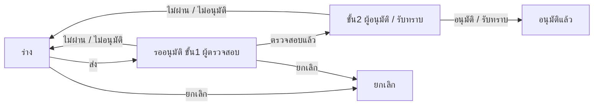

# BRD: แบบฟอร์มบันทึกเหตุผลการไม่ดำเนินโครงการต่อ (Project Discontinuation Record)

| Field | Value |
|---|---|
| BRD ID | BRD-TMP-004-001 |
| Feature | F-TMP-004 แบบฟอร์มบันทึกเหตุผลการไม่ดำเนินโครงการต่อ (รหัสชั่วคราว) |
| BRD Type | New Feature (แบบ 1 · Standalone) |
| Version | 1.0 |
| Status | **APPROVED (Prebrief Mode · Lane · unattended)** — DEC แทน Scope Lock จนมีใบเซ็นลูกค้า · มติ AI-DEFAULT 11 ข้อรอลูกค้ายืนยัน |
| Module | Business Development (ฝ่ายพัฒนาธุรกิจ) |
| Customer | แบบฟอร์มลูกค้า FM-BDM-04 Rev.00 : 01/07/2569 |
| Request | REQ-TMP-004 (ชั่วคราว — รอเลขจริงจาก F186) |
| Input | PREBRIEF_REQ-TMP-004_v2 · FORM_SPEC.json (16 ช่อง · เหตุผล 8 แถว · ลายเซ็น 3) · DECISIONS.lock (16 DEC · พร้อมเริ่มทำ) · feature.html (audit FAIL 0 · e2e 21/21) |
| Created / Updated | 2026-10-10 |

## Changelog
- v1.0 (2026-10-10): สร้างผ่าน brd-generator-full v2.3 Prebrief Mode (doc-master-pipeline ขั้น 7 · โหมดไม่เฝ้า)

---

## 1. Business Context
### 1.1 ปัญหา / โอกาส
ฝ่ายพัฒนาธุรกิจบันทึกเหตุผลเมื่อมีมติไม่ดำเนินโครงการต่อ (ขั้นตอนที่ 4: คัดกรองและประเมินเบื้องต้น) ด้วยแบบฟอร์ม Excel FM-BDM-04 — ส่งได้แม้ไม่ได้เลือกเหตุผลใดเลย · เลือก "เหตุผลอื่น" ได้โดยไม่ระบุว่าอะไร · กรอกรายละเอียดในแถวที่เลือก "ไม่ใช่" ได้ · เลือกสถานะ "ติดตามเงื่อนไขในอนาคต" โดยไม่มีข้อเสนอให้ติดตาม · ลงนามผู้ตรวจสอบ/ผู้อนุมัติด้วยมือ · ไม่มีที่เก็บกลางให้ค้นโครงการที่ปิดไปแล้วและบทเรียนที่ได้รับ
### 1.2 เป้าหมาย
1. ขึ้นแบบฟอร์มเป็นเอกสารในระบบ ช่องตรงกระดาษ 1:1 ลูกค้าจำแบบเดิมได้ (PDF Replica 2 หน้า)
2. รายการเหตุผล 8 ข้อ และสถานะการปิดโครงการ 3 ค่า อ่านจาก config (ProjectClosure) · ตรวจเหตุผลขั้นต่ำและข้อมูลประกอบก่อนส่ง
3. สายตรวจสอบ/อนุมัติ/รับทราบจาก DOA กลาง (ค่าเริ่ม 2 ขั้น) แทนการเดินเอกสาร · เก็บประวัติและ PDF ฉบับอนุมัติ
### 1.3 ตัวชี้วัด
ไม่มีใน input → **OQ-01** (ห้ามแต่งตัวเลข)
### 1.4 ที่มา
แบบฟอร์มลูกค้า FM-BDM-04 (xlsx 1 ชีต A1:J46 · data validation 2 รายการ) → FORM_SPEC 16 ช่อง (กรอก 15 · ระบบใส่ 1) · gate 10 หมวดตอบโดย AI ตาม unattended-policy (AI-DEFAULT ทุกหมวด)

## 2. Scope
### 2.1 In Scope
- รายการบันทึก (ค้นหา · กรอง สถานะเอกสาร/สถานะการปิดโครงการ/ฝ่าย · CSV · แบ่งหน้า) · สร้าง/แก้ร่าง wizard 3 ขั้น · ดูรายละเอียด 4 แท็บ (รายละเอียด › PDF › ลายเซ็น/อนุมัติ › ประวัติ)
- ข้อมูลโครงการ: ชื่อโครงการ · ผู้รับผิดชอบ · วันที่มีมติไม่ดำเนินการต่อ · ขั้นตอนที่ยุติ
- เหตุผล 8 แถวตายตัว: เหตุผลหลัก · เลือก (ใช่/ไม่ใช่) · รายละเอียดประกอบ · หลักฐานอ้างอิง · ผลกระทบ · เงื่อนไขที่จะพิจารณาใหม่
- สรุปและปิดโครงการ: สรุปเหตุผล · เอกสารที่ใช้ประกอบการตัดสินใจ · บทเรียนที่ได้รับ · แนวทางจัดเก็บเอกสาร · ข้อเสนอให้ติดตามในอนาคต · สถานะการปิดโครงการ
- ส่งอนุมัติ DOA 2 ขั้น (เลือกคนต่อขั้น) · ตรวจสอบแล้ว/อนุมัติ / รับทราบ · ไม่ผ่าน→กลับร่าง · ยกเลิก (เหตุผลบังคับ)
- แนบไฟล์ · PDF FM-BDM-04 Replica 2 หน้าทุกสถานะ · เลขที่ PCL จาก ENG-DOC-NUM · แจ้งผู้จัดทำเมื่ออนุมัติแล้วสถานะ "ติดตามเงื่อนไขในอนาคต"
### 2.2 Out of Scope
- ผูก/ปิดสถานะโครงการต้นทาง (FM-BDM-01 · ผลคัดกรอง FM-BDM-03) อัตโนมัติ — กระดาษไม่มีเลขโครงการ (DEC-01 · DEC-06 · DEC-16 → OQ-05) · หน้าตั้งค่า ProjectClosure (ใช้ config กลาง → OQ-04) · ทำซ้ำเอกสาร · ประกาศเมื่ออนุมัติ · เตือนอัตโนมัติเมื่อถึงเงื่อนไขพิจารณาใหม่
### 2.3 Assumptions
- ผู้จัดทำ/ผู้รับผิดชอบ/ตำแหน่ง/ฝ่ายมีใน F-EMP-001 / F-ORG-001 · ProjectClosure config มีหรือจะเพิ่ม (OQ-04) · ผู้ตรวจสอบ = ผู้บังคับบัญชาตรงของผู้จัดทำ
### 2.4 Scope Lock (ชั่วคราว = DECISIONS.lock · ยังไม่มีใบเซ็น → OQ-02)
| DEC | หมวด | มติ | ที่มา |
|---|---|---|---|
| DEC-01 | G1 | อนุมัติแล้วไม่เปลี่ยนค่าในระบบ | AI-DEFAULT |
| DEC-02 | G1 | ไม่ส่งต่อระบบอื่นรอบนี้ (ประกาศ event ไว้ใน FRD แต่ไม่ยิง) | AI-DEFAULT |
| DEC-03 | G2 | สายอนุมัติตั้งที่ DOA กลาง (dynamic) · ค่าเริ่ม 2 ขั้น: role-line-manager, role-gm · วงเงิน: ไม่มี | AI-DEFAULT |
| DEC-04 | G3 | ค่าคงที่อ่านจาก config: "ไม่สอดคล้องกับกลยุทธ์ · ตลาดไม่น่าสนใจ · ผลตอบแทนไม่เพียงพอ · ความเสี่ยงสูง · ข้อมูลไม่เพียงพอ · ข้อจำกัดด้านกฎหมาย · ข้อจำกัดด้านทรัพยากร · เหตุผลอื่น" → ProjectClosure.reason_types, "ปิดโครงการแล้ว · รอจัดเก็บเอกสาร · ติดตามเงื่อนไขในอนาคต" → ProjectClosure.closure_statuses · คำนวณให้อัตโนมัติ ผู้ใช้ปรับได้ · เกินเกณฑ์ = เตือน · รายการเหตุผลหลัก 8 ข้อ อ่านจาก ProjectClosure.reason_types (แสดงเป็นแถวตายตัว) · สถานะการปิดโครงการ อ่านจาก ProjectClosure.closure_statuses (ปิดโครงการแล้ว · รอจัดเก็บเอกสาร · ติดตามเงื่อนไขในอนาคต) · ต้องมีเหตุผลที่เลือก 'ใช่' อย่างน้อย 1 ข้อ ก่อนส่ง · แถวที่เลือก 'ใช่' ต้องกรอกรายละเอียดประกอบ · แถว 'ไม่ใช่' ปิดช่องกรอกในแถว · สถานะ 'ติดตามเงื่อนไขในอนาคต' ต้องกรอกข้อเสนอให้ติดตามในอนาคต | AI-DEFAULT |
| DEC-05 | G4 | เหตุผลการไม่ดำเนินโครงการต่อ: สูงสุด 8 แถว · PDF อย่างน้อย 8 แถวตามกระดาษ | AI-DEFAULT |
| DEC-06 | G5 | ช่องตรงกระดาษ 1:1 · ไม่เพิ่มช่อง (เช่น หมายเหตุ) | AI-DEFAULT |
| DEC-07 | G6 | ลายเซ็นแถวล่าง 1 ช่องต่อขั้น DOA · ไม่ใช้ภาพลายมือชื่อ (ข้อความส่งในระบบ/พิจารณาในระบบ) | AI-DEFAULT |
| DEC-08 | G7 | ไม่อนุมัติ = กลับเป็นร่าง แก้แล้วส่งใหม่ · ยกเลิกได้โดย owner, admin_role สถานะ draft, pending · ต้องมีเหตุผล | AI-DEFAULT |
| DEC-09 | G8 | มองเห็น: เจ้าของ · ผู้อนุมัติเห็นหลังส่ง · admin role เห็นทั้งหมด | AI-DEFAULT |
| DEC-10 | G9 | ออกเลขเมื่อบันทึกครั้งแรก · รหัส PCL | AI-DEFAULT |
| DEC-11 | G10 | ของเสริม (กระดาษไม่มี): แนบไฟล์, ส่งออก CSV | AI-DEFAULT |
| DEC-12 | VALID | กฎตรวจจากตัวอย่างลูกค้า: ต้องมีเหตุผลที่เลือก 'ใช่' อย่างน้อย 1 ข้อ (พบ: ไม่มีการบังคับว่าต้องเลือก 'ใช่' อย่างน้อย 1 เหตุผล — ส่งฟอร์มที่ไม่มีเหตุผลได้) | FORM_SPEC |
| DEC-13 | VALID | กฎตรวจจากตัวอย่างลูกค้า: เลือก 'ใช่' ที่เหตุผลอื่น ต้องกรอกรายละเอียดประกอบ (พบ: เลือก 'ใช่' ได้โดยไม่ระบุว่าเหตุผลอื่นคืออะไร) | FORM_SPEC |
| DEC-14 | VALID | กฎตรวจจากตัวอย่างลูกค้า: แถวที่เลือก 'ใช่' ต้องกรอกรายละเอียดประกอบ · แถว 'ไม่ใช่' ปิดช่องกรอก (พบ: กรอกรายละเอียด/หลักฐานในแถวที่เลือก 'ไม่ใช่' ได้) | FORM_SPEC |
| DEC-15 | VALID | กฎตรวจจากตัวอย่างลูกค้า: สถานะ 'ติดตามเงื่อนไขในอนาคต' ต้องกรอกข้อเสนอให้ติดตามในอนาคต (พบ: เลือก 'ติดตามเงื่อนไขในอนาคต' ได้โดยไม่กรอกข้อเสนอให้ติดตามในอนาคต) | FORM_SPEC |
| DEC-16 | VALID | กฎตรวจจากตัวอย่างลูกค้า: ไม่เพิ่มช่อง (G5 1:1) — เสนอให้ลูกค้ายืนยันการผูกกับโครงการในรายงาน (พบ: ไม่มีเลขที่โครงการ/การอ้างถึงแบบฟอร์มเริ่มต้นโครงการ (FM-BDM-01) และผลคัดกรอง (FM-BDM-03)) | FORM_SPEC |

## 3. Roles & Permissions (COSO)
| Role | COSO | ทำอะไร |
|---|---|---|
| ผู้จัดทำ (ผู้เชี่ยวชาญด้านพัฒนาธุรกิจ / ผู้รับผิดชอบที่ได้รับมอบหมาย) | Maker | สร้าง/แก้ร่าง · ส่ง · ยกเลิกของตัวเอง (ร่าง/รออนุมัติ) |
| role-line-manager (ผู้ตรวจสอบ · ผู้จัดการฝ่ายพัฒนาธุรกิจ) | Checker | ขั้น 1 ตรวจสอบแล้ว / ไม่ผ่านการตรวจสอบ |
| role-gm (ผู้อนุมัติ / รับทราบ · รองกรรมการผู้จัดการ / กรรมการผู้จัดการ / ผู้มีอำนาจตามตารางอำนาจอนุมัติ) | Approver | ขั้น 2 อนุมัติ / รับทราบ หรือ ไม่อนุมัติ |
| admin ฝ่ายพัฒนาธุรกิจ | Monitor | เห็นทั้งหมด · ยกเลิกได้ |

| Action | Maker | Checker | Approver | Admin |
|---|:-:|:-:|:-:|:-:|
| ดูใบ | ของตน | หลังส่ง (อยู่ในสาย) | หลังส่ง (อยู่ในสาย) | ทั้งหมด |
| สร้าง/แก้ร่าง | ✓ ของตน | – | – | – |
| ตัดสินขั้น | – | ขั้น 1 | ขั้น 2 | – |
| ยกเลิก | ✓ ของตน | – | – | ✓ |
SoD: ผู้จัดทำพิจารณาใบตัวเองไม่ได้ (BR-DOA-04) · role-gm ไม่มีใน DOA master ตรงตัว (รองกรรมการผู้จัดการ/กรรมการผู้จัดการ/ผู้มีอำนาจตามตาราง) → OQ-03

## 4. User Journey
### 4.1 Happy Path
1. ผู้จัดทำ: สร้าง → ① กรอกข้อมูลโครงการ (ผู้รับผิดชอบค่าเริ่ม = ตัวเอง · วันที่มีมติ ≤ วันนี้) → ② เลือก "ใช่" ที่เหตุผลที่เกี่ยวข้อง (ค่าเริ่ม "ไม่ใช่") แล้วกรอกรายละเอียดประกอบ/หลักฐาน/ผลกระทบ/เงื่อนไขพิจารณาใหม่ → ③ สรุปเหตุผลและเลือกสถานะการปิดโครงการ → แนบหลักฐาน (ไม่บังคับ) → บันทึก (ได้เลข PCL) → ส่ง เลือกคน 2 ขั้น
2. ขั้น 1 ผู้ตรวจสอบ "ตรวจสอบแล้ว" → ขั้น 2 "อนุมัติ / รับทราบ" → **อนุมัติแล้ว** · PDF เก็บสำเนา (approved_final) · สถานะ "ติดตามเงื่อนไขในอนาคต" → แจ้งผู้จัดทำ (pcl_followup_approved)
### 4.2 Alternative
- ไม่ผ่านการตรวจสอบ/ไม่อนุมัติ ขั้นใดก็ได้ → กลับร่าง เลขเดิม + เหตุผล → ผู้จัดทำแก้ ส่งใหม่ (resolve สายใหม่)
- ไม่ได้เลือก "ใช่" เลย → บล็อก "เลือก "ใช่" อย่างน้อย 1 เหตุผล"
- เลือก "ใช่" แต่ไม่มีรายละเอียดประกอบ (รวม "เหตุผลอื่น") → บล็อกที่แถวนั้น
- เปลี่ยนแถวเป็น "ไม่ใช่" → ล้างและปิดช่องในแถว
- สถานะ "ติดตามเงื่อนไขในอนาคต" ไม่มีข้อเสนอให้ติดตาม → บล็อก
- ยกเลิก (ร่าง/รออนุมัติ) โดยเจ้าของหรือ admin

## 5. Data (จาก FORM_SPEC — ป้ายตามกระดาษ)
### 5.1 project_discontinuation (header)
| ช่อง | field | ชนิด | ที่มา | บังคับ |
|---|---|---|---|:-:|
| เลขที่ (footer) | doc_no | text | auto ENG-DOC-NUM (PCL) | ✓ |
| วันที่ | doc_date | date | auto | ✓ |
| ผู้จัดทำ (ชื่อ · ตำแหน่ง) | preparer_id → snapshot | ref | system F-EMP-001 | ✓ |
| ฝ่าย | dept_snapshot | text | system F-ORG-001 | ✓ |
| ชื่อโครงการ | project_name | text | user | ✓ |
| ผู้รับผิดชอบ | owner_id → snapshot | ref Employee | user (เลือก) | ✓ |
| วันที่มีมติไม่ดำเนินการต่อ | decision_date | date ≤ วันนี้ | user | ✓ |
| ขั้นตอนที่ยุติ | stopped_stage | text | user | ✓ |
| สรุปเหตุผล | summary | text | user | ✓ |
| เอกสารที่ใช้ประกอบการตัดสินใจ | decision_documents | text | user | |
| บทเรียนที่ได้รับ | lessons_learned | text | user | |
| แนวทางจัดเก็บเอกสาร | archive_method | text | user | |
| ข้อเสนอให้ติดตามในอนาคต | future_followup | text | user | เมื่อติดตามเงื่อนไขในอนาคต |
| สถานะการปิดโครงการ | closure_status | enum (ProjectClosure.closure_statuses) | user | ✓ |
| + DOA fields | approval_status · doa_ref · approval_chain(jsonb) · approved_by · approved_at | | DOA | |
| + returned_reason · returned_by · returned_at | | | DEC-08 | |
### 5.2 project_discontinuation_reason (เหตุผลการไม่ดำเนินโครงการต่อ · 8 แถวตายตัว)
| ช่องบนกระดาษ | field | ชนิด | ที่มา | บังคับ |
|---|---|---|---|:-:|
| เหตุผลหลัก | reason_code → reason_name | ref ProjectClosure.reason_types | auto (แถวตายตัว) | ✓ |
| เลือก | selected | enum ใช่/ไม่ใช่ (ค่าเริ่ม ไม่ใช่) | user | ✓ |
| รายละเอียดประกอบ | detail | text | user | เมื่อ "ใช่" |
| หลักฐานอ้างอิง | evidence | text | user | |
| ผลกระทบ | impact | text | user | |
| เงื่อนไขที่จะพิจารณาใหม่ | revisit_condition | text | user | |
### 5.3 ค่าคงที่บนกระดาษ → config
เหตุผลหลัก 8 ข้อ → ProjectClosure.reason_types · สถานะการปิดโครงการ 3 ค่า → ProjectClosure.closure_statuses · ประวัติการแก้ไขแบบฟอร์ม → DocumentConfig.form_revisions (F003)
### 5.4 attachments → Document Center (ไฟล์ระดับใบ)

## 6. User Stories
| ID | Story | AC หลัก |
|---|---|---|
| S-01 | ผู้จัดทำสร้างบันทึกการไม่ดำเนินโครงการต่อ | ข้อมูลโครงการ 4 ช่องบังคับ · บันทึกได้เลข PCL |
| S-02 | ผู้จัดทำเลือกเหตุผลและกรอกข้อมูลประกอบ | 8 แถวตาม config · ค่าเริ่ม "ไม่ใช่" · ≥1 "ใช่" · แถว "ใช่" ต้องมีรายละเอียด · "ไม่ใช่" ปิดช่อง |
| S-03 | ผู้จัดทำสรุปและปิดโครงการ | สรุปเหตุผล + สถานะบังคับ · ติดตามเงื่อนไขในอนาคต ต้องมีข้อเสนอให้ติดตาม |
| S-04 | ผู้จัดทำส่งตรวจสอบ/อนุมัติ | slot 2 ขั้นค่าเริ่มจาก DOA · ผู้จัดทำไม่อยู่ในรายชื่อ · บังคับเลือกครบ |
| S-05 | ผู้ตรวจสอบ/ผู้อนุมัติตัดสิน | ปุ่มเฉพาะผู้พิจารณาขั้นปัจจุบัน · เรียงขั้น · ไม่ผ่านบังคับเหตุผล → กลับร่าง |
| S-06 | พิมพ์/ดาวน์โหลด PDF FM-BDM-04 | 2 หน้าทุกสถานะ · เหตุผล 8 แถว · ลายเซ็น = ผู้จัดทำ + 1 แถวต่อขั้น DOA (dynamic) |
| S-07 | ยกเลิก | เจ้าของ/admin · ร่างหรือรออนุมัติ · เหตุผลบังคับ |
| S-08 | admin ดูทุกใบ + CSV | กรอง สถานะเอกสาร/สถานะการปิดโครงการ/ฝ่าย |
| S-09 | แจ้งเตือนโครงการที่ต้องติดตาม | อนุมัติครบและสถานะ "ติดตามเงื่อนไขในอนาคต" → แจ้งผู้จัดทำ (in-app) |

## 7. Status & Lifecycle
| จาก | Action | ไป | ใคร |
|---|---|---|---|
| — | บันทึกครั้งแรก | draft | Maker |
| draft | ส่ง | pending (ขั้น 1) | Maker |
| pending | ตัดสินผ่านขั้น n<N | pending (ขั้น n+1) | ผู้พิจารณาขั้น n |
| pending | ตัดสินผ่านขั้น N | approved | ขั้น N |
| pending | ไม่ผ่าน/ไม่อนุมัติ | draft (เลขเดิม · returned_*) | ผู้พิจารณาขั้นปัจจุบัน |
| draft / pending | ยกเลิก | cancelled | Maker / Admin |
approved = ล็อกแก้ไข · สถานะการปิดโครงการเป็นข้อมูลในเอกสาร ไม่ใช่สถานะเอกสาร (เปลี่ยนภายหลัง = บันทึกใบใหม่)

## 8. Business Rules + Validation
| ID | Rule | Tag | Type |
|---|---|:-:|---|
| BR-01 | เหตุผลหลัก 8 แถวตามลำดับ ProjectClosure.reason_types · ไม่เพิ่ม/ลบแถว | CONFIGURABLE | Master (DEC-04 · DEC-05) |
| BR-02 | ต้องมีเหตุผลที่เลือก "ใช่" อย่างน้อย 1 ข้อ | FIXED | Validation (DEC-12) |
| BR-03 | แถว "ใช่" ต้องกรอกรายละเอียดประกอบ · "เหตุผลอื่น" = ใช่ ต้องระบุว่าเหตุผลอื่นคืออะไร | FIXED | Validation (DEC-13 · DEC-14) |
| BR-04 | แถว "ไม่ใช่" ล้างและปิดช่องข้อความในแถว | FIXED | Validation (DEC-14) |
| BR-05 | สถานะ "ติดตามเงื่อนไขในอนาคต" ต้องกรอกข้อเสนอให้ติดตามในอนาคต | FIXED | Validation (DEC-15) |
| BR-06 | สถานะการปิดโครงการอ่านจาก ProjectClosure.closure_statuses — ห้าม hardcode | CONFIGURABLE | Master (DEC-04) |
| BR-07 | สายอนุมัติ resolve จาก DOA ตอนส่ง แล้ว freeze | FIXED | DOA (BR-DOA-02) |
| BR-08 | ไม่ผ่าน → draft เลขเดิม · resolve ใหม่ตอนส่งรอบถัดไป | FIXED [AI-DEFAULT] | DEC-08 |
| BR-09 | ออกเลขตอนบันทึกครั้งแรก · no-gap ✗ | CONFIGURABLE [AI-DEFAULT] | DOCCFG (DEC-10) |
| BR-10 | ร่างเห็นเฉพาะเจ้าของ (+ admin) | FIXED [AI-DEFAULT] | Visibility (DEC-09) |
| BR-11 | ช่องลงชื่อใน PDF = ผู้จัดทำ + 1 แถวต่อขั้นที่ตั้งใน DOA (dynamic) · คำตัดสินตาม role | FIXED (จำนวน = DOA) | DEC-03 · DEC-07 |
| BR-12 | PDF 2 หน้าเสมอ (หน้า 1: ข้อมูลโครงการ + เหตุผล 8 แถว · หน้า 2: สรุปและปิดโครงการ + ลงชื่อ + ประวัติ) | FIXED | DEC-05 · thai-doc R10 |
| BR-13 | อนุมัติแล้วไม่เปลี่ยนค่าในระบบอื่น · ไม่ปิดโครงการต้นทางอัตโนมัติ | FIXED [AI-DEFAULT] | DEC-01 · DEC-02 |

| VR | ช่อง | เงื่อนไข | ข้อความ |
|---|---|---|---|
| VR-01 | project_name · owner · decision_date · stopped_stage | required | กรุณากรอก… / กรุณาเลือก… |
| VR-02 | reasons[].selected | ≥1 "ใช่" | เลือก "ใช่" อย่างน้อย 1 เหตุผล |
| VR-03 | reasons[].detail (แถว "ใช่") | required | แถวที่เลือก "ใช่" ต้องกรอกรายละเอียดประกอบ |
| VR-04 | summary · closure_status | required | กรุณากรอกสรุปเหตุผล / กรุณาเลือกสถานะการปิดโครงการ |
| VR-05 | future_followup | required เมื่อ ติดตามเงื่อนไขในอนาคต | ต้องระบุเมื่อสถานะเป็น "ติดตามเงื่อนไขในอนาคต" |
| VR-06 | decision_date | ≤ วันนี้ | วันที่ในอนาคตเลือกไม่ได้ |
| VR-07 | slot ผู้พิจารณา | ทุกขั้นต้องเลือก · ≠ ผู้จัดทำ | กรุณาเลือกผู้พิจารณา |
| VR-08 | เหตุผล ไม่ผ่าน/ยกเลิก | required | กรุณาระบุเหตุผล |

### 8.5 ระดับความยืดหยุ่น
BR-01/06 → ProjectClosure config · BR-08/10/13 → Policy (AI-DEFAULT รอยืนยัน) · BR-09 → F-DOCCFG · BR-11 → DOA กลาง

## 9. Edge Cases
| EC | กรณี | ผล |
|---|---|---|
| EC-01 | ส่งโดยไม่เลือกเหตุผลใด | บล็อก + ไฮไลต์ช่องเลือกทุกแถว |
| EC-02 | เลือก "เหตุผลอื่น" ไม่ระบุรายละเอียด | บล็อกที่แถว + ข้อความเฉพาะ |
| EC-03 | เปลี่ยน "ใช่" → "ไม่ใช่" หลังกรอกแล้ว | ข้อความในแถวถูกล้าง · PDF แถวนั้นว่าง |
| EC-04 | ข้อความยาวทุกแถว + สรุปยาว | PDF ยัง 2 หน้า (ทดสอบ long-8reasons) |
| EC-05 | ผู้จัดทำเป็นผู้จัดการเอง (ขั้น 1 = ตัวเอง) | slot ว่าง ต้องเลือกคนอื่น |
| EC-06 | แก้ DOA ระหว่างรออนุมัติ | ใบเดิมใช้สาย snapshot |
| EC-07 | ตัดสินชนกัน (stale) | 409 → toast รีเฟรช สถานะไม่เปลี่ยน |
| EC-08 | แบบเอกสารปิดใช้ (F-DOCCFG) | ปุ่มสร้าง disabled |
| EC-09 | ProjectClosure เปลี่ยนรายการเหตุผลภายหลัง | ใบเดิมเก็บ reason_name snapshot · PDF อนุมัติแล้วตาม approved_final |
| EC-10 | ผู้รับผิดชอบลาออก | แสดงชื่อ snapshot |

## 10. Value Stream & Downstream Impact
Positioning: Business Development — ขั้นตอนที่ 4 (คัดกรองและประเมินเบื้องต้น) · ต่อจากผลคัดกรอง (FM-BDM-03) เมื่อมติไม่ไปต่อ
| ปลายทาง | ข้อมูล | Trigger | หมายเหตุ |
|---|---|---|---|
| ระบบอื่น / โครงการต้นทาง | — | — | **ไม่ส่งต่อรอบนี้ (DEC-02)** · ไม่ปิดสถานะโครงการอัตโนมัติ |
| ENG-NOTIFY | pcl_cancelled · pcl_followup_approved | cancel / approved | |
| F-DOCCFG / ENG-DOC-STORE | PDF snapshot | approved_final | |
| รายงาน | โครงการที่ไม่ไปต่อ แยกเหตุผล / ติดตามเงื่อนไข | — | Report area อ่าน (Phase 2) |

## 11. Delivery
Phase 1 = §2.1 · Phase 2 (เสนอ) = ผูกเลขโครงการ (FM-BDM-01/03) · รายงานเหตุผลที่ไม่ไปต่อ · เตือนเมื่อถึงเงื่อนไขพิจารณาใหม่ · หน้าตั้งค่า ProjectClosure

## 12. Dev Summary "ใบสั่ง"
- Config: ProjectClosure (reason_types · closure_statuses) · DOA entry F-TMP-004 · doc_type PCL · DocumentConfig.form_revisions
- Declaration: DOA_BRIEF · NTF_BRIEF · DOCCFG_BRIEF · MDOC_BRIEF (ฉบับจริงหลัง FRD)
- Screen Inventory: P-01 รายการ · P-02 สร้าง/แก้ (drawer wide 3 ขั้น) · P-03 ดู (drawer 4 แท็บ) · M-01..05 modal ส่ง/อนุมัติ/ไม่ผ่าน/ยกเลิก/ทิ้งข้อมูล
- UI Signals: เอกสาร + พิมพ์ + ลายเซ็น = ใช่ · Q-form · ตารางเหตุผล 8 แถวในขั้น 1

## 13. Open Questions
| OQ | คำถาม | เจ้าของ | Block? |
|---|---|---|---|
| OQ-01 | ตัวชี้วัดความสำเร็จ (เช่น เวลาตั้งแต่มีมติจนปิดโครงการ) | ลูกค้า | ไม่ |
| OQ-02 | ลูกค้าเซ็นยืนยัน DEC-01..11 (AI-DEFAULT) — โดยเฉพาะ 2 ขั้น · กลับร่าง · คำตัดสิน · admin เห็นทั้งหมด · ค่าเริ่ม "ไม่ใช่" | Strike → ลูกค้า | ก่อน UAT |
| OQ-03 | role รองกรรมการผู้จัดการ / กรรมการผู้จัดการ / ผู้มีอำนาจตามตารางอำนาจอนุมัติ ไม่มีใน DOA master — ใช้ role-gm ชั่วคราว | Strike + พี่เบิร์ด | ก่อน wire |
| OQ-04 | ProjectClosure config มีใน Core แล้วหรือยัง / ใครดูแล | พี่เบิร์ด | ก่อน dev |
| OQ-05 | ต้องผูกบันทึกกับโครงการ (FM-BDM-01) / ผลคัดกรอง (FM-BDM-03) และปิดสถานะโครงการต้นทางไหม — กระดาษไม่มีช่อง | ลูกค้า | ไม่ |
| OQ-06 | รหัส PCL ชนกับ doc_type อื่นใน F-DOCCFG ไหม · function_code taxonomy | Strike | ก่อน register |

## 14. Security & Compliance
Preset: Standard Internal · PII: ชื่อผู้จัดทำ/ผู้รับผิดชอบ/ผู้พิจารณา (snapshot) — ข้อมูลตัวอย่างใน prototype เป็นชื่อสมมติ · Audit append-only ทุก action · SoD ผู้จัดทำ≠ผู้พิจารณา · ไฟล์แนบตาม file_policy Document Center (≤20MB · pdf/doc/xls/img)

## 15. Health Check / Monitoring
SLA ต่อขั้น: ไม่กำหนดรอบนี้ (→ OQ-01) · KPI เสนอ: จำนวนโครงการสถานะ "ติดตามเงื่อนไขในอนาคต" · ใบรออนุมัติเกิน N วัน

## Appendix — Screen List
P-01 `#/project-discontinuation` · P-02 `#/project-discontinuation/create` · `/edit/:id` · P-03 `#/project-discontinuation/view/:id`

## AI Review (Quality Gate)
C1–C19 ✓ · C16 ไม่มี Registry ตรง (WARN — feature ใหม่ เสนอใน _BATCH_REPORT) · C20 ✓ Scope Lock = DEC-01..16 ครบ + OQ-02 รอใบเซ็น → **APPROVED**
