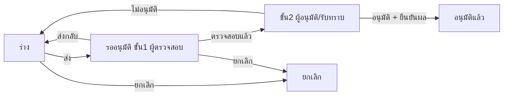

# BRD: แบบฟอร์มบันทึกเหตุผลการไม่ดำเนินโครงการต่อ (Project Discontinuation Record)

| Field | Value |
|---|---|
| BRD ID | BRD-IVM-IVMJ-001 |
| Feature | F-TMP-002 แบบฟอร์มบันทึกเหตุผลการไม่ดำเนินโครงการต่อ (รหัสชั่วคราว — รอ feature id จริง) |
| BRD Type | New Feature (แบบ 2 · ดึงข้อมูลเดิม — ผู้มีอำนาจพิจารณาจาก DOA / ชื่อพนักงานจาก F-EMP-001) |
| Version | 1.0 |
| Status | **APPROVED (Prebrief Mode · Lane · unattended)** — DEC แทน Scope Lock จนมีใบเซ็นลูกค้า · มติ AI-DEFAULT ทุกหมวด |
| Module | ฝ่ายบริหารการลงทุน (Investment Management) — module ใหม่ ยังไม่อยู่ใน Module Registry ของ DOA (OQ-03) |
| Customer | แบบฟอร์มลูกค้า FM-IVM-10 Rev.00 : 01/07/2569 (ขั้นตอนที่ 7 ของกระบวนการบริหารการลงทุน) |
| Request | REQ-TMP-002 (ชั่วคราว — รอเลขจริงจาก F186) |
| Input | PREBRIEF_REQ-TMP-002_v2 · FORM_SPEC.json (19 ช่อง) · DECISIONS.lock (15 DEC · พร้อมเริ่มทำ) · feature.html (audit FAIL 0 · self_audit PASS · e2e 21/21) |
| Created / Updated | 2026-10-11 |

## Changelog
- v1.0 (2026-10-11): สร้างผ่าน brd-generator-full v2.3 Prebrief Mode (doc-master-pipeline ขั้น 7 · โหมดไม่เฝ้า)

---

## 1. Business Context
### 1.1 ปัญหา / โอกาส
ฝ่ายบริหารการลงทุนบันทึกการเสนอ "ไม่ดำเนินโครงการ/ธุรกรรมต่อ" ด้วยแบบฟอร์ม Excel FM-IVM-10 — เหตุผล หลักฐาน ผลการพิจารณา และแนวทางปิดงานกระจายอยู่ในไฟล์ · การตรวจทาน/อนุมัติ 3 ช่อง (ผู้จัดทำ › ผู้ตรวจสอบ › ผู้อนุมัติ/รับทราบ) ส่งต่อด้วยมือ · ไม่มีกติกาว่าต้องมีเหตุผลอย่างน้อยกี่ข้อ · ผล "ดำเนินการต่อแบบมีเงื่อนไข" ไม่มีที่บังคับระบุเงื่อนไข · ตรวจย้อนหลังยาก
### 1.2 เป้าหมาย
1. ขึ้นแบบฟอร์มเป็นเอกสารในระบบ ช่องตรงกระดาษ 1:1 (PDF Replica FM-IVM-10 · 2 หน้า)
2. บังคับเหตุผล/หลักฐานขั้นต่ำก่อนส่ง และบังคับข้อสั่งการเมื่อผลเป็น "ดำเนินการต่อแบบมีเงื่อนไข"
3. สายอนุมัติ 2 ขั้นจาก DOA กลาง (dynamic) · ประวัติ append-only · ค้นหาย้อนหลังได้
### 1.3 ตัวชี้วัด
ไม่มีใน input → **OQ-01** (ห้ามแต่งตัวเลข)
### 1.4 ที่มา
แบบฟอร์มลูกค้า FM-IVM-10 (xlsx · ชื่อชีต INV-FM-10) → FORM_SPEC 19 ช่อง · ตัวเลือก 2 ชุด (เลือก ใช่/ไม่ใช่ · ผลการพิจารณา 4 ค่า จาก data validation) · gate 10 หมวด = AI-DEFAULT ทั้งหมด (โหมดไม่เฝ้า)

## 2. Scope
### 2.1 In Scope
- รายการบันทึก (ค้นหา · กรองสถานะ/ผลการพิจารณา · CSV) · สร้าง/แก้ร่าง wizard 3 ขั้น · ดูรายละเอียด 4 แท็บ (รายละเอียด › PDF Preview › ลายเซ็น/อนุมัติ › ประวัติ)
- ข้อมูลโครงการ 5 ช่อง · ตารางเหตุผล 8 คอลัมน์ (ไม่จำกัดแถว) · ข้อสรุป 6 ช่อง
- ส่งอนุมัติ DOA 2 ขั้น (เลือกคนต่อขั้น) · ตรวจสอบแล้ว/ส่งกลับ → กลับร่าง · อนุมัติขั้นสุดท้ายยืนยัน/เปลี่ยนผลการพิจารณาได้ · ยกเลิก (เหตุผลบังคับ)
- แนบไฟล์ระดับใบ · PDF FM-IVM-10 Replica 2 หน้าทุกสถานะ · เลขที่ IVMJ จาก ENG-DOC-NUM
### 2.2 Out of Scope
- เชื่อมแบบฟอร์มเริ่มต้นธุรกรรม FM-IVM-01 / ทะเบียนโครงการ (ยังไม่มีในระบบ → ชื่อโครงการกรอกเอง · OQ-05) · ปิดงานในห้องข้อมูล FM-IVM-11 อัตโนมัติ · เปลี่ยนสถานะโครงการในระบบอื่น (DEC-01/02) · ทำซ้ำเป็นฟีเจอร์ทางการ (DEC-11 ✗ — prototype มีเมนูทำซ้ำตามมาตรฐานเอกสาร แต่ไม่บังคับ dev)
### 2.3 Assumptions
- ข้อมูลพนักงาน/ตำแหน่งมีใน F-EMP-001 / F-ORG-001 · DOA กลางเพิ่ม module/role ของฝ่ายบริหารการลงทุนได้ (OQ-03)
### 2.4 Scope Lock (ชั่วคราว = DECISIONS.lock · ยังไม่มีใบเซ็น → OQ-02)
| DEC | หมวด | มติ | ที่มา | ใช้ที่ |
|---|---|---|---|---|
| DEC-01 | G1 | อนุมัติแล้วไม่เปลี่ยนค่าในระบบ | AI-DEFAULT | html, thai-doc, brd, frd, tests, ntf-declaration |
| DEC-02 | G1 | ไม่ส่งต่อระบบอื่นรอบนี้ (ประกาศ event ไว้ใน FRD แต่ไม่ยิง) | AI-DEFAULT | brd, frd |
| DEC-03 | G2 | สายอนุมัติตั้งที่ DOA กลาง (dynamic) · ค่าเริ่ม 2 ขั้น: role-line-manager, role-gm · วงเงิน: ไม่มี | AI-DEFAULT | html, doa-declaration, frd, tests |
| DEC-04 | G3 | คำนวณให้อัตโนมัติ ผู้ใช้ปรับได้ · เกินเกณฑ์ = เตือน · ต้องมีเหตุผลอย่างน้อย 1 แถวที่เลือก ใช่ และแถวที่เลือก ใช่ ต้องกรอกรายละเอียดประกอบ (บล็อกตอนส่ง) · ผลการพิจารณา = ดำเนินการต่อแบบมีเงื่อนไข → ข้อสั่งการ / เงื่อนไข บังคับกรอก · ผลการพิจารณา ผู้จัดทำเสนอ · ผู้อนุมัติขั้นสุดท้ายยืนยันหรือแก้ได้ตอนอนุมัติ | AI-DEFAULT | html, thai-doc, brd, frd, tests |
| DEC-05 | G4 | เหตุผลการไม่ดำเนินโครงการต่อ: ไม่จำกัดจำนวนแถว · PDF อย่างน้อย 8 แถวตามกระดาษ | AI-DEFAULT | html, thai-doc, frd |
| DEC-06 | G5 | ช่องตรงกระดาษ 1:1 · ไม่เพิ่มช่อง (เช่น หมายเหตุ) | AI-DEFAULT | html, thai-doc, brd, frd |
| DEC-07 | G6 | ลายเซ็นแถวล่าง 1 ช่องต่อขั้น DOA · ไม่ใช้ภาพลายมือชื่อ (ข้อความส่งในระบบ/พิจารณาในระบบ) | AI-DEFAULT | thai-doc, html, doccfg-declaration, frd |
| DEC-08 | G7 | ไม่อนุมัติ = กลับเป็นร่าง แก้แล้วส่งใหม่ · ยกเลิกได้โดย owner, admin_role สถานะ draft, pending · ต้องมีเหตุผล | AI-DEFAULT | html, frd, tests, doa-declaration |
| DEC-09 | G8 | มองเห็น: เจ้าของ · ผู้อนุมัติเห็นหลังส่ง · admin role เห็นทั้งหมด | AI-DEFAULT | html, frd, tests |
| DEC-10 | G9 | ออกเลขเมื่อบันทึกครั้งแรก · รหัส IVMJ | AI-DEFAULT | doccfg-declaration, html, frd |
| DEC-11 | G10 | ของเสริม (กระดาษไม่มี): แนบไฟล์, ส่งออก CSV | AI-DEFAULT | html, brd, frd, ntf-declaration |
| DEC-12 | VALID | กฎตรวจจากตัวอย่างลูกค้า: ยึด FM-IVM-10 ตาม footer เป็นรหัสแบบฟอร์ม (พบ: ชื่อชีตเป็น INV-FM-10 แต่ Doc. No. ท้ายกระดาษเป็น FM-IVM-10) | FORM_SPEC | html, frd, tests |
| DEC-13 | VALID | กฎตรวจจากตัวอย่างลูกค้า: ต้องมีอย่างน้อย 1 แถวที่เลือก ใช่ และแถวที่เลือก ใช่ ต้องกรอกรายละเอียดประกอบ (บล็อกตอนส่ง) (พบ: คอลัมน์ เลือก (ใช่/ไม่ใช่) ไม่มีกติกาว่าต้องเลือก ใช่ อย่างน้อยกี่ข้อ) | FORM_SPEC | html, frd, tests |
| DEC-14 | VALID | กฎตรวจจากตัวอย่างลูกค้า: เลือก ดำเนินการต่อแบบมีเงื่อนไข → ข้อสั่งการ / เงื่อนไข บังคับกรอก (พบ: ตัวเลือก ดำเนินการต่อแบบมีเงื่อนไข ขัดกับชื่อแบบฟอร์ม (ไม่ดำเนินโครงการต่อ) และไม่มีที่ระบุเงื่อนไขบังคับ) | FORM_SPEC | html, frd, tests |
| DEC-15 | VALID | กฎตรวจจากตัวอย่างลูกค้า: ใช้ 8 คอลัมน์ตามหัวตาราง · ไม่เพิ่มช่อง (พบ: หัวตารางมี 10 คอลัมน์ แต่มีหัวเพียง 8 (I, J ว่าง)) | FORM_SPEC | html, frd, tests |

## 3. Roles & Permissions (COSO)
| Role | COSO | ทำอะไร |
|---|---|---|
| ผู้จัดทำ (ผู้ประสานงานบริหารการลงทุน / ผู้รับผิดชอบโครงการ) | Maker | สร้าง/แก้ร่าง · ส่ง · ยกเลิกของตัวเอง (ร่าง/รออนุมัติ) |
| ผู้ตรวจสอบ — role-line-manager (บนกระดาษ: ผู้จัดการฝ่ายบริหารการลงทุน) | Checker | ขั้น 1 ตรวจสอบแล้ว / ส่งกลับ |
| ผู้อนุมัติ / รับทราบ — role-gm (บนกระดาษ: รองกรรมการผู้จัดการ / กรรมการผู้จัดการ / ผู้มีอำนาจตามตารางอำนาจอนุมัติ) | Approver | ขั้น 2 อนุมัติ / ไม่อนุมัติ · ยืนยัน/เปลี่ยนผลการพิจารณา |
| admin role ฝ่ายบริหารการลงทุน (เจ้าหน้าที่ดูแลเอกสาร) | Monitor | เห็นทุกใบ · ยกเลิกได้ (ร่าง/รออนุมัติ) · CSV |

| Action | Maker | Checker | Approver | Admin |
|---|:-:|:-:|:-:|:-:|
| ดูใบ | ของตน | หลังส่ง (อยู่ในสาย) | หลังส่ง (อยู่ในสาย) | ทั้งหมด |
| สร้าง/แก้ร่าง | ✓ ของตน | – | – | – |
| ตัดสินขั้น | – | ขั้น 1 | ขั้น 2 | – |
| ยกเลิก | ✓ ของตน | – | – | ✓ |
SoD: ผู้จัดทำพิจารณาใบตัวเองไม่ได้ (BR-DOA-04) · role จริงต้องเทียบ DOA master (OQ-03)

## 4. User Journey
### 4.1 Happy Path
1. ผู้จัดทำ: สร้าง → ใส่ชื่อโครงการ · ผู้รับผิดชอบ · วันที่เสนอ · ขั้นตอนที่ยุติ → เพิ่มเหตุผล (เลือก ใช่ + รายละเอียด/หลักฐาน/ผลกระทบ/เงื่อนไขพิจารณาใหม่/ผู้รับผิดชอบ/หมายเหตุ) → สรุปเหตุผล · เอกสารประกอบ · ผลที่เสนอ · แนวทางจัดเก็บ · ประเด็นติดตาม → แนบไฟล์ → บันทึก (ได้เลข IVMJ) → ส่ง เลือกคน 2 ขั้น
2. ขั้น 1 ตรวจสอบแล้ว → ขั้น 2 อนุมัติ (ยืนยันผล) → **อนุมัติแล้ว** · PDF เก็บสำเนา (approved_final) · แจ้งผู้รับผิดชอบ (ivmj_result_recorded)
### 4.2 Alternative
- ส่งกลับ / ไม่อนุมัติ ขั้นใดก็ได้ → กลับร่าง เลขเดิม + เหตุผล → ผู้จัดทำแก้ ส่งใหม่ (resolve สายใหม่)
- ผู้อนุมัติขั้นสุดท้ายเปลี่ยนผลเป็น "ดำเนินการต่อแบบมีเงื่อนไข" → ต้องใส่ข้อสั่งการ / เงื่อนไข
- ยกเลิก (ร่าง/รออนุมัติ) โดยเจ้าของหรือ admin → ถ้ารออนุมัติ แจ้งผู้พิจารณาขั้นปัจจุบัน (ivmj_cancelled)

## 5. Data (จาก FORM_SPEC — ป้ายตามกระดาษ)
### 5.1 ivm_discontinuation (header)
| ช่องบนกระดาษ | field | ชนิด | ที่มา | บังคับ |
|---|---|---|---|:-:|
| (เลขที่ — ระบบเพิ่ม footer) | doc_no | text | auto ENG-DOC-NUM | ✓ |
| ชื่อโครงการ / ธุรกรรม | project_name | text | user | ✓ |
| ผู้รับผิดชอบ | owner_employee_id → owner_name_snapshot | ref | user เลือกพนักงาน (ค่าเริ่ม = ผู้จัดทำ) | ✓ |
| วันที่เสนอไม่ดำเนินการต่อ | proposed_date | date | user (ค่าเริ่ม = วันนี้ · ไม่เกินวันนี้) | ✓ |
| ขั้นตอนที่ยุติ | stopped_at_step | text | user | ✓ |
| ผู้มีอำนาจพิจารณา | authority_name | text | system = approval_chain ขั้นสุดท้าย → Employee.full_name (อ่านอย่างเดียว) | ✓ |
| สรุปเหตุผล | summary_reason | text | user | ✓ |
| ข้อมูล / เอกสารที่ใช้ประกอบการตัดสินใจ | supporting_docs | text | user | – |
| ผลการพิจารณา | result | enum(approve_stop, review_more, on_hold, continue_conditional) | user เสนอ · ผู้อนุมัติขั้นสุดท้ายยืนยัน | ✓ |
| ข้อสั่งการ / เงื่อนไข | instruction | text | user / ผู้อนุมัติ | เมื่อ continue_conditional |
| แนวทางจัดเก็บเอกสารและปิดงาน | archive_plan | text | user | ✓ |
| ประเด็นที่ต้องติดตามในอนาคต | follow_up | text | user | – |
| ผู้จัดทำ (ชื่อ/ตำแหน่ง) | maker_id · maker_name_snapshot · maker_position_snapshot | ref | system F-EMP-001 | ✓ |
| + DOA fields | approval_status · doa_ref · approval_chain (jsonb snapshot) · approver_role · approved_by · approved_at | | DOA | |
| + returned_reason · returned_by · returned_at · cancel_reason | | | DEC-08 | |
### 5.2 ivm_discontinuation_reason (ตารางเหตุผล — 8 คอลัมน์ตามกระดาษ)
| เหตุผลหลัก `reason` (✓) | เลือก `selected` ใช่/ไม่ใช่ (✓) | รายละเอียดประกอบ `detail` (✓ เมื่อ ใช่) | หลักฐานอ้างอิง `evidence_ref` | ผลกระทบ `impact` | เงื่อนไขที่จะพิจารณาใหม่ `reconsider_condition` | ผู้รับผิดชอบ `owner` (text) | หมายเหตุ `remark` |
### 5.3 attachments → Document Center (ไฟล์ระดับใบ)
### 5.4 ข้อความคงที่บนกระดาษ (ไม่ใช่ช่อง)
ใช้ในขั้นตอน · วัตถุประสงค์ · ผู้จัดทำ/ผู้ตรวจสอบ/ผู้อนุมัติ (คำอธิบาย) · หมายเหตุการใช้งาน · ประวัติการแก้ไข (= revision ของแบบฟอร์มจาก F-DOCCFG ไม่ใช่ข้อมูลใบ)

## 6. User Stories
| ID | Story | AC หลัก |
|---|---|---|
| S-01 | ผู้จัดทำสร้างบันทึกเหตุผล | 4 ช่องข้อมูลโครงการบังคับ · ≥1 เหตุผลเลือก ใช่ + รายละเอียด · สรุปเหตุผล + แนวทางจัดเก็บบังคับ · บันทึกได้เลข IVMJ |
| S-02 | ผู้จัดทำบันทึกเหตุผลที่ "ไม่ใช่" | แถว ไม่ใช่ เก็บแค่เหตุผลหลัก (ช่องอื่นซ่อน) · แสดงใน PDF |
| S-03 | ผู้จัดทำเสนอ "ดำเนินการต่อแบบมีเงื่อนไข" | ข้อสั่งการ / เงื่อนไข บังคับ |
| S-04 | ผู้จัดทำแนบหลักฐาน | ไฟล์ระดับใบ ≤20MB · pdf/doc/xls/รูป |
| S-05 | ผู้จัดทำส่งอนุมัติ | slot 2 ขั้นค่าเริ่มจาก DOA · ผู้จัดทำไม่อยู่ในรายชื่อ · บังคับเลือกครบ |
| S-06 | ผู้ตรวจสอบตัดสิน | ปุ่มเฉพาะขั้นปัจจุบัน · ตรวจสอบแล้ว / ส่งกลับ (เหตุผลบังคับ) → กลับร่าง |
| S-07 | ผู้อนุมัติขั้นสุดท้ายยืนยันผล | เปลี่ยนผลได้ · มีเงื่อนไข → ข้อสั่งการบังคับ · อนุมัติ → แจ้งผู้รับผิดชอบ |
| S-08 | พิมพ์/ดาวน์โหลด PDF FM-IVM-10 | ทุกสถานะ 2 หน้า · ≥8 แถวเหตุผล · ลายเซ็น = ผู้จัดทำ + 1 แถวต่อขั้นตาม DOA (dynamic) |
| S-09 | ยกเลิก | เจ้าของ/admin · ร่างหรือรออนุมัติ · เหตุผลบังคับ |
| S-10 | admin ดูทุกใบ + CSV | กรองสถานะ/ผลการพิจารณา |

## 7. Status & Lifecycle
| จาก | Action | ไป | ใคร |
|---|---|---|---|
| — | บันทึกครั้งแรก | draft | Maker |
| draft | ส่ง | pending (ขั้น 1) | Maker |
| pending | ตรวจสอบแล้ว/อนุมัติ ขั้น n<N | pending (ขั้น n+1) | ผู้พิจารณาขั้น n |
| pending | อนุมัติขั้น N | approved | ขั้น N |
| pending | ส่งกลับ / ไม่อนุมัติ | draft (เลขเดิม · returned_*) | ผู้พิจารณาขั้นปัจจุบัน |
| draft / pending | ยกเลิก | cancelled | Maker / Admin |
approved = ล็อกแก้ไข (ไม่มียกเลิก)

## 8. Business Rules + Validation
| ID | Rule | Tag | Type |
|---|---|:-:|---|
| BR-01 | ต้องมีเหตุผลที่เลือก ใช่ ≥ 1 แถว | FIXED | Validation (DEC-04 · DEC-13) |
| BR-02 | แถวที่เลือก ใช่ ต้องมีรายละเอียดประกอบ | FIXED | Validation (DEC-13) |
| BR-03 | ผล = ดำเนินการต่อแบบมีเงื่อนไข → ข้อสั่งการ / เงื่อนไข บังคับ (ทั้งตอนเสนอและตอนผู้อนุมัติเปลี่ยนผล) | FIXED | Validation (DEC-14) |
| BR-04 | ผลการพิจารณา: ผู้จัดทำเสนอ · ผู้อนุมัติขั้นสุดท้ายยืนยัน/เปลี่ยนได้ตอนอนุมัติ (audit เก็บค่าเดิม→ใหม่) | CONFIGURABLE | Policy (DEC-04 AI-DEFAULT) |
| BR-05 | ตัวเลือกผลการพิจารณา 4 ค่าตามแบบฟอร์ม | CONFIGURABLE | Master list |
| BR-06 | ผู้มีอำนาจพิจารณา = ผู้พิจารณาขั้นสุดท้ายใน approval_chain (อ่านอย่างเดียว) | FIXED | DOA |
| BR-07 | สายอนุมัติ resolve จาก DOA ตอนส่ง แล้ว freeze | FIXED | DOA (BR-DOA-02) |
| BR-08 | ส่งกลับ/ไม่อนุมัติ → draft เลขเดิม · resolve ใหม่ตอนส่งรอบถัดไป | FIXED | DEC-08 (BR-DOA-03) |
| BR-09 | ออกเลขตอนบันทึกครั้งแรก · no-gap ✗ · รหัส IVMJ | CONFIGURABLE | DOCCFG (DEC-10) |
| BR-10 | ร่างเห็นเฉพาะเจ้าของ (+ admin) | FIXED | Visibility (DEC-09) |
| BR-11 | ช่องลงชื่อใน PDF = ผู้จัดทำ + 1 แถวต่อขั้นที่ตั้งใน DOA (dynamic ไม่ fix) · คำตัดสินตาม role | FIXED (จำนวน = DOA) | DEC-03 · DEC-07 |
| BR-12 | PDF แสดงตารางเหตุผลอย่างน้อย 8 แถว · ไม่จำกัดในระบบ · แบบพิมพ์ 2 หน้า (R10) | FIXED | DEC-05 |
| BR-13 | อนุมัติแล้วไม่เปลี่ยนค่าในระบบอื่น ไม่ส่งต่อ (ประกาศ event ไว้ไม่ยิง) | FIXED | DEC-01/02 |
| BR-14 | รหัสแบบฟอร์ม FM-IVM-10 ตาม footer (ไม่ใช่ชื่อชีต INV-FM-10) | FIXED | DEC-12 |
| BR-15 | ใช้ 8 คอลัมน์ตามหัวตาราง ไม่เพิ่มช่อง | FIXED | DEC-15 · DEC-06 |

| VR | ช่อง | เงื่อนไข | ข้อความ |
|---|---|---|---|
| VR-01 | project_name | required | กรุณากรอกชื่อโครงการ / ธุรกรรม |
| VR-02 | owner · proposed_date (≤ วันนี้) · stopped_at_step | required | กรุณาเลือกผู้รับผิดชอบ / กรุณาเลือกวันที่ / กรุณาระบุขั้นตอนที่ยุติ |
| VR-03 | reasons[].reason · detail (ใช่) | required | ใส่เหตุผลหลัก / เลือก ใช่ ต้องมีรายละเอียดประกอบ |
| VR-04 | reasons | ≥1 ใช่ | ต้องมีเหตุผลที่เลือก ใช่ อย่างน้อย 1 ข้อ |
| VR-05 | summary_reason · archive_plan | required | กรุณากรอก… |
| VR-06 | instruction | required เมื่อ continue_conditional | เลือก ดำเนินการต่อแบบมีเงื่อนไข ต้องระบุข้อสั่งการ / เงื่อนไข |
| VR-07 | slot ผู้พิจารณา | ทุกขั้นต้องเลือก · ≠ ผู้จัดทำ | กรุณาเลือกผู้พิจารณา |
| VR-08 | เหตุผล ส่งกลับ/ไม่อนุมัติ/ยกเลิก | required | กรุณาระบุเหตุผล |

### 8.5 ระดับความยืดหยุ่น
BR-04/05 → Admin Panel (Investment Policy) · BR-09 → F-DOCCFG · สายอนุมัติ → DOA กลาง

## 9. Edge Cases
| EC | กรณี | ผล |
|---|---|---|
| EC-01 | ทุกแถวเลือก ไม่ใช่ | บล็อกส่ง (VR-04) |
| EC-02 | เหตุผล > 8 แถว | PDF ต่อแถว หัวตารางซ้ำ · ยัง 2 หน้า (ทดสอบ 12 แถว) |
| EC-03 | ผู้จัดทำ = ผู้จัดการฝ่าย (resolve ขั้น 1 = ตัวเอง) | slot ว่าง ต้องเลือกคนอื่น |
| EC-04 | แก้ DOA ระหว่างใบรออนุมัติ | ใบเดิมใช้สาย snapshot |
| EC-05 | DOA ตั้ง 6 ขั้น | PDF 7 แถวลงชื่อ · ยัง 2 หน้า |
| EC-06 | ส่ง/อนุมัติชนกัน (stale) | 409 → toast รีเฟรช สถานะไม่เปลี่ยน |
| EC-07 | แบบเอกสารปิดใช้ (F-DOCCFG) | ปุ่มสร้าง disabled |
| EC-08 | ผู้อนุมัติเปลี่ยนผลเป็น มีเงื่อนไข ไม่ใส่ข้อสั่งการ | บล็อก (VR-06) |
| EC-09 | วันที่เสนออนาคต | เลือกไม่ได้ (max = วันนี้) |
| EC-10 | ชื่อชีต INV-FM-10 ≠ Doc No. | ใช้ FM-IVM-10 (DEC-12) |

## 10. Value Stream & Downstream Impact
Positioning: กระบวนการบริหารการลงทุน — เริ่มต้นธุรกรรม (FM-IVM-01 · ยังไม่มี) → … → **ขั้นตอนที่ 7 พิจารณายุติ (feature นี้)** → ปิดงานและห้องข้อมูล (FM-IVM-11 · ยังไม่มี)
| ปลายทาง | ข้อมูล | Trigger | หมายเหตุ |
|---|---|---|---|
| ทะเบียนโครงการ / FM-IVM-11 | ผลการพิจารณา + แนวทางปิดงาน | approved | **ปิดรอบนี้ (DEC-02)** — ประกาศ event `ivmj.approved` ใน FRD ไม่ยิง |
| ผู้รับผิดชอบ | ผล + ประเด็นติดตาม | approved | ENG-NOTIFY ivmj_result_recorded |
| F-DOCCFG / ENG-DOC-STORE | PDF snapshot | approved_final | |
| รายงาน | โครงการที่ยุติ / พัก ตามช่วงเวลา | — | Report area อ่าน |

## 11. Delivery
Phase 1 = ทุกอย่างใน §2.1 · Phase 2 (เสนอ) = เชื่อมทะเบียนโครงการ/FM-IVM-01 (เลือกโครงการแทนพิมพ์) + ส่งต่อ FM-IVM-11 ปิดงาน

## 12. Dev Summary "ใบสั่ง"
- Config: DOA entry F-TMP-002 (2 ขั้น · role-line-manager → role-gm) · doc_type IVMJ (F-DOCCFG) · รายการผลการพิจารณา 4 ค่า
- Declaration: DOA_BRIEF · NTF_BRIEF · DOCCFG_BRIEF · MDOC_BRIEF (ฉบับจริงหลัง FRD)
- Screen Inventory: P-01 รายการ · P-02 สร้าง/แก้ (drawer wide 3 ขั้น) · P-03 ดู (drawer 4 แท็บ) · M-01..05 modal ส่ง/อนุมัติ/ส่งกลับ/ยกเลิก/ทิ้งข้อมูล
- UI Signals: เอกสารบันทึก + พิมพ์ + ลายเซ็น = ใช่ · Q-form

## 13. Open Questions
| OQ | คำถาม | เจ้าของ | Block? |
|---|---|---|---|
| OQ-01 | ตัวชี้วัดความสำเร็จ (เวลาอนุมัติเฉลี่ย / จำนวนโครงการที่พักแล้วกลับมาทำ) | ลูกค้า | ไม่ |
| OQ-02 | ลูกค้าเซ็นยืนยัน DEC-01..11 (AI-DEFAULT ทั้งหมด) — โดยเฉพาะ 2 ขั้น · ส่งกลับ = กลับร่าง · ผู้อนุมัติเปลี่ยนผลได้ · คำ ตรวจสอบแล้ว/ส่งกลับ | ทีม BA → ลูกค้า | ก่อน UAT |
| OQ-03 | role ผู้จัดการฝ่ายบริหารการลงทุน / รองกรรมการผู้จัดการ / กรรมการผู้จัดการ ไม่มีใน DOA contract (ใช้ role-line-manager / role-gm แทน) · module investment ไม่อยู่ใน Module Registry | ทีม BA + พี่เบิร์ด | ก่อน wire |
| OQ-04 | admin role ของฝ่ายบริหารการลงทุน (ใครเห็นทั้งหมด) — ยังไม่มี role id | ทีม BA | ก่อน dev |
| OQ-05 | ทำทะเบียนโครงการ / FM-IVM-01 เมื่อไร (เลือกโครงการแทนพิมพ์) | ทีม BA | ไม่ |
| OQ-06 | รหัส IVMJ ใน F-DOCCFG · function_code / taxonomy ใน F185 · feature id จริงแทน F-TMP-002 | ทีม BA | ก่อน register |

## 14. Security & Compliance
Preset: Standard (เอกสารภายใน · ข้อมูลการลงทุน = Confidential) · PII: ชื่อผู้จัดทำ/ผู้รับผิดชอบ — ข้อมูลตัวอย่างใน prototype เป็นชื่อสมมติ (ไฟล์ลูกค้าไม่มีข้อมูลตัวอย่าง) · Audit append-only ทุก action · SoD ผู้จัดทำ≠ผู้อนุมัติ · ไฟล์แนบตาม file_policy Document Center · ห้ามเก็บ credential

## 15. Health Check / Monitoring
SLA ต่อขั้น: ไม่กำหนดรอบนี้ (→ OQ-01) · KPI เสนอ: ใบรออนุมัติเกิน N วัน · สัดส่วนผลการพิจารณา · Widget: โครงการที่พัก/มีเงื่อนไขที่ต้องติดตาม

## Appendix — Screen List
P-01 `#/ivm-discontinue` · P-02 `#/ivm-discontinue/create` · `/edit/:id` · P-03 `#/ivm-discontinue/view/:id`

## AI Review (Quality Gate)
C1–C20 ผ่าน · C20 Scope Lock: DEC ครบ 15 ข้อจาก DECISIONS.lock + OQ-02 รอใบเซ็น → ✅ · ไม่มีตัวเลขแต่ง · ทุก BR อ้าง DEC → **APPROVED**
