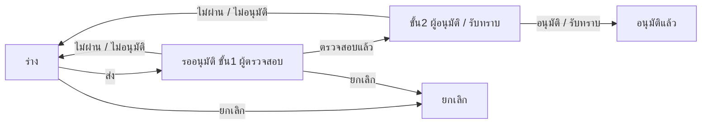

# BRD: แบบฟอร์มประเมินความเสี่ยง (Risk Assessment)

| Field | Value |
|---|---|
| BRD ID | BRD-TMP-002-001 |
| Feature | F-TMP-002 แบบฟอร์มประเมินความเสี่ยง (รหัสชั่วคราว) |
| BRD Type | New Feature (แบบ 1 · Standalone) |
| Version | 1.0 |
| Status | **APPROVED (Prebrief Mode · Lane · unattended)** — DEC แทน Scope Lock จนมีใบเซ็นลูกค้า · มติ AI-DEFAULT 11 ข้อรอลูกค้ายืนยัน |
| Module | Business Development (ฝ่ายพัฒนาธุรกิจ) |
| Customer | แบบฟอร์มลูกค้า FM-BDM-02 Rev.00 : 01/07/2569 |
| Request | REQ-TMP-002 (ชั่วคราว — รอเลขจริงจาก F186) |
| Input | PREBRIEF_REQ-TMP-002_v2 · FORM_SPEC.json (10 ช่อง · 18 แถว · ลายเซ็น 3) · DECISIONS.lock (16 DEC · พร้อมเริ่มทำ) · feature.html (audit FAIL 0 · e2e 21/21) |
| Created / Updated | 2026-10-10 |

## Changelog
- v1.0 (2026-10-10): สร้างผ่าน brd-generator-full v2.3 Prebrief Mode (doc-master-pipeline ขั้น 7 · โหมดไม่เฝ้า)

---

## 1. Business Context
### 1.1 ปัญหา / โอกาส
ฝ่ายพัฒนาธุรกิจประเมินความเสี่ยงของโครงการด้วยแบบฟอร์ม Excel FM-BDM-02 (ใช้ในขั้นตอนที่ 3 และขั้นตอนที่ 7) — คะแนนก่อนควบคุมคำนวณในเซลล์แต่แสดง 0 ในแถวว่าง · รายการคะแนนคงเหลือมีค่า 7 ที่เป็นไปไม่ได้ · ไม่มีการตรวจว่าคะแนนคงเหลือสูงกว่าก่อนควบคุม · ลงนามผู้ตรวจสอบ/ผู้อนุมัติด้วยมือ · ไม่มีที่เก็บกลางให้ติดตามความเสี่ยงระดับสูง
### 1.2 เป้าหมาย
1. ขึ้นแบบฟอร์มเป็นเอกสารในระบบ ช่องตรงกระดาษ 1:1 ลูกค้าจำแบบเดิมได้ (PDF Replica 2 หน้า)
2. ระบบคูณคะแนนก่อนควบคุมให้เอง · ใช้เกณฑ์/ช่วงระดับ/ประเภทจาก config (RiskMatrix) · แสดงระดับเป็นสี
3. สายตรวจสอบ/อนุมัติจาก DOA กลาง (ค่าเริ่ม 2 ขั้น) แทนการเดินเอกสาร
### 1.3 ตัวชี้วัด
ไม่มีใน input → **OQ-01** (ห้ามแต่งตัวเลข)
### 1.4 ที่มา
แบบฟอร์มลูกค้า FM-BDM-02 (xlsx 1 ชีต) → FORM_SPEC 10 ช่อง (กรอก 8 · คำนวณ 1 · ระบบใส่ 1) · gate 10 หมวดตอบโดย AI ตาม unattended-policy (AI-DEFAULT ทุกหมวด)

## 2. Scope
### 2.1 In Scope
- รายการแบบประเมิน (ค้นหา · กรอง สถานะ/ระดับสูงสุด/ฝ่าย · CSV · แบ่งหน้า) · สร้าง/แก้ร่าง wizard 3 ขั้น · ดูรายละเอียด 4 แท็บ (รายละเอียด › PDF › ลายเซ็น/อนุมัติ › ประวัติ)
- ทะเบียนความเสี่ยงไม่จำกัดแถว: ประเภท · รายละเอียด · สาเหตุ/ผลกระทบ · โอกาสเกิด · ผลกระทบ · คะแนนก่อนควบคุม (คำนวณ) · มาตรการควบคุม · คะแนนคงเหลือ · สถานะ
- สรุประดับความเสี่ยงก่อน/หลังควบคุมตาม RiskMatrix.level_bands (แสดงผลเท่านั้น)
- ส่งอนุมัติ DOA 2 ขั้น (เลือกคนต่อขั้น) · ตรวจสอบแล้ว/อนุมัติ · ไม่ผ่าน→กลับร่าง · ยกเลิก (เหตุผลบังคับ)
- แนบไฟล์ · PDF FM-BDM-02 Replica 2 หน้าทุกสถานะ · เลขที่ RSK จาก ENG-DOC-NUM · แจ้งเตือนเมื่ออนุมัติแล้วมีความเสี่ยงระดับสูงมาก
### 2.2 Out of Scope
- ผูกกับเอกสารโครงการ (FM-BDM-01) — กระดาษไม่มีช่อง (DEC-06 · DEC-15 → OQ-05) · หน้าตั้งค่า RiskMatrix (ใช้ config กลาง → OQ-04) · ทำซ้ำเอกสาร · ประกาศเมื่ออนุมัติ · ติดตามรายการความเสี่ยงข้ามใบ (dashboard)
### 2.3 Assumptions
- ผู้จัดทำ/ตำแหน่ง/ฝ่ายมีใน F-EMP-001 / F-ORG-001 · RiskMatrix config มีหรือจะเพิ่ม (OQ-04) · ผู้ตรวจสอบ = ผู้บังคับบัญชาตรงของผู้จัดทำ
### 2.4 Scope Lock (ชั่วคราว = DECISIONS.lock · ยังไม่มีใบเซ็น → OQ-02)
| DEC | หมวด | มติ | ที่มา |
|---|---|---|---|
| DEC-01 | G1 | อนุมัติแล้วไม่เปลี่ยนค่าในระบบ | AI-DEFAULT |
| DEC-02 | G1 | ไม่ส่งต่อระบบอื่นรอบนี้ (ประกาศ event ไว้ใน FRD แต่ไม่ยิง) | AI-DEFAULT |
| DEC-03 | G2 | สายอนุมัติตั้งที่ DOA กลาง (dynamic) · ค่าเริ่ม 2 ขั้น: role-line-manager, role-gm · วงเงิน: ไม่มี | AI-DEFAULT |
| DEC-04 | G3 | ค่าคงที่อ่านจาก config: "คะแนน 1–5 โอกาสเกิด/ผลกระทบ (ต่ำมาก…สูงมาก + คำอธิบาย)" → RiskMatrix.likelihood_scale / RiskMatrix.impact_scale, "1-4 ต่ำ · 5-9 ปานกลาง · 10-16 สูง · 17-25 สูงมาก" → RiskMatrix.level_bands, "ประเภทความเสี่ยง 9 ประเภท" → RiskMatrix.categories · คำนวณให้อัตโนมัติ ผู้ใช้ปรับได้ · เกินเกณฑ์ = เตือน · คะแนนก่อนควบคุม = โอกาสเกิดก่อนควบคุม × ผลกระทบก่อนควบคุม (คำนวณอัตโนมัติ · ว่างจนกว่ากรอกครบทั้งสองช่อง) · โอกาสเกิด / ผลกระทบ เลือก 1–5 ตามเกณฑ์ RiskMatrix · คะแนนคงเหลือ ต้องอยู่ในชุดผลคูณ {1,2,3,4,5,6,8,9,10,12,15,16,20,25} (ตัด 7 ที่ต้นฉบับใส่ผิด) · คะแนนคงเหลือ > คะแนนก่อนควบคุม = เตือน ไม่บล็อก · ระดับความเสี่ยงคำนวณจาก RiskMatrix.level_bands (1-4 ต่ำ · 5-9 ปานกลาง · 10-16 สูง · 17-25 สูงมาก) ใช้แสดงสี/ป้าย ไม่เพิ่มคอลัมน์ · สถานะรายการ = ปิดแล้ว ต้องมีคะแนนคงเหลือ | AI-DEFAULT |
| DEC-05 | G4 | ทะเบียนความเสี่ยง: ไม่จำกัดจำนวนแถว · PDF อย่างน้อย 18 แถวตามกระดาษ | AI-DEFAULT |
| DEC-06 | G5 | ช่องตรงกระดาษ 1:1 · ไม่เพิ่มช่อง (เช่น หมายเหตุ) | AI-DEFAULT |
| DEC-07 | G6 | ลายเซ็นแถวล่าง 1 ช่องต่อขั้น DOA · ไม่ใช้ภาพลายมือชื่อ (ข้อความส่งในระบบ/พิจารณาในระบบ) | AI-DEFAULT |
| DEC-08 | G7 | ไม่อนุมัติ = กลับเป็นร่าง แก้แล้วส่งใหม่ · ยกเลิกได้โดย owner, admin_role สถานะ draft, pending · ต้องมีเหตุผล | AI-DEFAULT |
| DEC-09 | G8 | มองเห็น: เจ้าของ · ผู้อนุมัติเห็นหลังส่ง · admin role เห็นทั้งหมด | AI-DEFAULT |
| DEC-10 | G9 | ออกเลขเมื่อบันทึกครั้งแรก · รหัส RSK | AI-DEFAULT |
| DEC-11 | G10 | ของเสริม (กระดาษไม่มี): แนบไฟล์, ส่งออก CSV | AI-DEFAULT |
| DEC-12 | VALID | กฎตรวจจากตัวอย่างลูกค้า: คะแนนคงเหลือต้องอยู่ในชุดผลคูณ {1,2,3,4,5,6,8,9,10,12,15,16,20,25} (พบ: รายการตัวเลือกมี 7 ซึ่งไม่ใช่ผลคูณของโอกาสเกิด × ผลกระทบ (1–5) ได้) | FORM_SPEC |
| DEC-13 | VALID | กฎตรวจจากตัวอย่างลูกค้า: คะแนนคงเหลือ ≤ คะแนนก่อนควบคุม (เกิน = เตือน) (พบ: คะแนนคงเหลือกรอกเองได้สูงกว่าคะแนนก่อนควบคุม) | FORM_SPEC |
| DEC-14 | VALID | กฎตรวจจากตัวอย่างลูกค้า: แสดงว่างจนกว่ากรอกทั้งโอกาสเกิดและผลกระทบ (พบ: แถวว่างแสดง 0 (=E×F) ทั้งที่ยังไม่ได้ประเมิน) | FORM_SPEC |
| DEC-15 | VALID | กฎตรวจจากตัวอย่างลูกค้า: ไม่เพิ่มช่อง (G5 1:1) — เสนอให้ลูกค้ายืนยันการผูกกับโครงการ (FM-BDM-01) ในรายงาน (พบ: ใช้ประเมินความเสี่ยง 'ของโครงการ' แต่ไม่มีช่องชื่อ/เลขที่โครงการบนกระดาษ) | FORM_SPEC |
| DEC-16 | VALID | กฎตรวจจากตัวอย่างลูกค้า: ระดับคำนวณจากคะแนนตาม RiskMatrix.level_bands ใช้แสดงสี/ป้ายเท่านั้น ไม่เพิ่มคอลัมน์บนแบบพิมพ์ (พบ: ไม่มีคอลัมน์ระดับความเสี่ยงแม้มีตารางสรุประดับ — ต้นฉบับใช้สีพื้นแทน) | FORM_SPEC |

## 3. Roles & Permissions (COSO)
| Role | COSO | ทำอะไร |
|---|---|---|
| ผู้จัดทำ (ผู้เชี่ยวชาญด้านพัฒนาธุรกิจ / ผู้รับผิดชอบความเสี่ยง) | Maker | สร้าง/แก้ร่าง · ส่ง · ยกเลิกของตัวเอง (ร่าง/รออนุมัติ) |
| role-line-manager (ผู้ตรวจสอบ · ผู้จัดการฝ่ายพัฒนาธุรกิจ) | Checker | ขั้น 1 ตรวจสอบแล้ว / ไม่ผ่านการตรวจสอบ |
| role-gm (ผู้อนุมัติ / รับทราบ · รองกรรมการผู้จัดการ / กรรมการผู้จัดการ) | Approver | ขั้น 2 อนุมัติ / รับทราบ หรือ ไม่อนุมัติ |
| admin ฝ่ายพัฒนาธุรกิจ | Monitor | เห็นทั้งหมด · ยกเลิกได้ |

| Action | Maker | Checker | Approver | Admin |
|---|:-:|:-:|:-:|:-:|
| ดูใบ | ของตน | หลังส่ง (อยู่ในสาย) | หลังส่ง (อยู่ในสาย) | ทั้งหมด |
| สร้าง/แก้ร่าง | ✓ ของตน | – | – | – |
| ตัดสินขั้น | – | ขั้น 1 | ขั้น 2 | – |
| ยกเลิก | ✓ ของตน | – | – | ✓ |
SoD: ผู้จัดทำพิจารณาใบตัวเองไม่ได้ (BR-DOA-04) · role-gm ไม่มีใน DOA master ตรงตัว (รองกรรมการผู้จัดการ/กรรมการผู้จัดการ) → OQ-03

## 4. User Journey
### 4.1 Happy Path
1. ผู้จัดทำ: สร้าง → ใส่ความเสี่ยงทีละแถว (ประเภท · รายละเอียด · สาเหตุ · โอกาสเกิด · ผลกระทบ → ระบบคูณคะแนน · มาตรการ · คะแนนคงเหลือ · สถานะ) → แนบหลักฐาน (ไม่บังคับ) → บันทึก (ได้เลข RSK) → ส่ง เลือกคน 2 ขั้น
2. ขั้น 1 ผู้ตรวจสอบ "ตรวจสอบแล้ว" → ขั้น 2 "อนุมัติ / รับทราบ" → **อนุมัติแล้ว** · PDF เก็บสำเนา (approved_final) · มีคะแนน ≥ 17 → แจ้งผู้จัดทำ (rsk_very_high_approved)
### 4.2 Alternative
- ไม่ผ่านการตรวจสอบ/ไม่อนุมัติ ขั้นใดก็ได้ → กลับร่าง เลขเดิม + เหตุผล → ผู้จัดทำแก้ ส่งใหม่ (resolve สายใหม่)
- คะแนนคงเหลือ > คะแนนก่อนควบคุม → เตือน ไม่บล็อก
- สถานะ "ปิดแล้ว" ไม่มีคะแนนคงเหลือ → บล็อกจนใส่
- ยกเลิก (ร่าง/รออนุมัติ) โดยเจ้าของหรือ admin

## 5. Data (จาก FORM_SPEC — ป้ายตามกระดาษ)
### 5.1 risk_assessment (header)
| ช่อง | field | ชนิด | ที่มา | บังคับ |
|---|---|---|---|:-:|
| เลขที่ (footer) | doc_no | text | auto ENG-DOC-NUM (RSK) | ✓ |
| วันที่ | doc_date | date | auto | ✓ |
| ผู้จัดทำ (ชื่อ · ตำแหน่ง) | preparer_id → snapshot | ref | system F-EMP-001 | ✓ |
| ฝ่าย | dept_snapshot | text | system F-ORG-001 | ✓ |
| + DOA fields | approval_status · doa_ref · approval_chain(jsonb) · approved_by · approved_at | | DOA | |
| + returned_reason · returned_by · returned_at | | | DEC-08 | |
### 5.2 risk_assessment_item (ทะเบียนและแบบประเมินความเสี่ยง · ≥1 แถว · PDF ≥ 18)
| ช่องบนกระดาษ | field | ชนิด | ที่มา | บังคับ |
|---|---|---|---|:-:|
| ลำดับ | seq | int | auto | ✓ |
| ประเภทความเสี่ยง | category | enum (RiskMatrix.categories) | user | ✓ |
| รายละเอียดความเสี่ยง | description | text | user | ✓ |
| สาเหตุ / ผลกระทบ | cause_effect | text | user | |
| โอกาสเกิดก่อนควบคุม | likelihood | 1–5 (RiskMatrix.likelihood_scale) | user | ✓ |
| ผลกระทบก่อนควบคุม | impact | 1–5 (RiskMatrix.impact_scale) | user | ✓ |
| คะแนนก่อนควบคุม | inherent_score | int | computed likelihood × impact | ✓ |
| มาตรการควบคุม | control_measure | text | user | |
| คะแนนคงเหลือ | residual_score | int ∈ ชุดผลคูณ | user | เมื่อปิดแล้ว |
| สถานะ | status | enum เปิด/อยู่ระหว่างจัดการ/ติดตามผล/ปิดแล้ว | user | ✓ |
### 5.3 ค่าคงที่บนกระดาษ → config
เกณฑ์ 1–5 (โอกาสเกิด/ผลกระทบ + คำอธิบาย) → RiskMatrix.likelihood_scale / impact_scale · ช่วง 1-4/5-9/10-16/17-25 + แนวทางดำเนินการ → RiskMatrix.level_bands · 9 ประเภท → RiskMatrix.categories · ประวัติการแก้ไขแบบฟอร์ม → DocumentConfig.form_revisions (F003)
### 5.4 attachments → Document Center (ไฟล์ระดับใบ)

## 6. User Stories
| ID | Story | AC หลัก |
|---|---|---|
| S-01 | ผู้จัดทำสร้างแบบประเมินความเสี่ยง | ≥1 แถว · ประเภท/รายละเอียด/โอกาส/ผลกระทบ/สถานะ บังคับ · คะแนนคำนวณสด · บันทึกได้เลข RSK |
| S-02 | ผู้จัดทำเห็นระดับความเสี่ยงทันที | ป้ายสีตาม RiskMatrix.level_bands · สรุปจำนวนต่อระดับก่อน/หลังควบคุม |
| S-03 | ผู้จัดทำบันทึกคะแนนคงเหลือหลังมาตรการ | เลือกได้เฉพาะชุดผลคูณ · สูงกว่าก่อนควบคุม = เตือน · ปิดแล้วต้องมีคะแนน |
| S-04 | ผู้จัดทำส่งตรวจสอบ/อนุมัติ | slot 2 ขั้นค่าเริ่มจาก DOA · ผู้จัดทำไม่อยู่ในรายชื่อ · บังคับเลือกครบ |
| S-05 | ผู้ตรวจสอบ/ผู้อนุมัติตัดสิน | ปุ่มเฉพาะผู้พิจารณาขั้นปัจจุบัน · เรียงขั้น · ไม่ผ่านบังคับเหตุผล → กลับร่าง |
| S-06 | พิมพ์/ดาวน์โหลด PDF FM-BDM-02 | 2 หน้าทุกสถานะ · ≥18 แถว · ลายเซ็น = ผู้จัดทำ + 1 แถวต่อขั้น DOA (dynamic) |
| S-07 | ยกเลิก | เจ้าของ/admin · ร่างหรือรออนุมัติ · เหตุผลบังคับ |
| S-08 | admin ดูทุกใบ + CSV | กรอง สถานะ/ระดับสูงสุด/ฝ่าย |
| S-09 | แจ้งเตือนความเสี่ยงสูงมาก | อนุมัติครบและมีคะแนน ≥ 17 → แจ้งผู้จัดทำ (in-app+email) |

## 7. Status & Lifecycle
| จาก | Action | ไป | ใคร |
|---|---|---|---|
| — | บันทึกครั้งแรก | draft | Maker |
| draft | ส่ง | pending (ขั้น 1) | Maker |
| pending | ตัดสินผ่านขั้น n<N | pending (ขั้น n+1) | ผู้พิจารณาขั้น n |
| pending | ตัดสินผ่านขั้น N | approved | ขั้น N |
| pending | ไม่ผ่าน/ไม่อนุมัติ | draft (เลขเดิม · returned_*) | ผู้พิจารณาขั้นปัจจุบัน |
| draft / pending | ยกเลิก | cancelled | Maker / Admin |
approved = ล็อกแก้ไข (การติดตามรอบถัดไป ขั้นตอนที่ 7 = สร้างแบบประเมินใบใหม่)

## 8. Business Rules + Validation
| ID | Rule | Tag | Type |
|---|---|:-:|---|
| BR-01 | คะแนนก่อนควบคุม = โอกาสเกิด × ผลกระทบ · ว่างจนกรอกครบทั้งสองช่อง | FIXED | Formula (DEC-04 · DEC-14) |
| BR-02 | ระดับความเสี่ยงจาก RiskMatrix.level_bands · แสดงสี/ป้ายเท่านั้น ไม่เพิ่มคอลัมน์ | CONFIGURABLE | Display (DEC-16) |
| BR-03 | คะแนนคงเหลือ ∈ ชุดผลคูณ 1–5 × 1–5 (ตัดค่า 7 ของต้นฉบับ) | FIXED | Validation (DEC-12) |
| BR-04 | คะแนนคงเหลือ > คะแนนก่อนควบคุม = เตือน ไม่บล็อก | CONFIGURABLE [AI-DEFAULT] | Policy (DEC-04 · DEC-13) |
| BR-05 | สถานะรายการ "ปิดแล้ว" ต้องมีคะแนนคงเหลือ | CONFIGURABLE [AI-DEFAULT] | Validation (DEC-04) |
| BR-06 | เกณฑ์/ช่วง/ประเภท อ่านจาก RiskMatrix config — ห้าม hardcode | CONFIGURABLE | Master (DEC-04) |
| BR-07 | สายอนุมัติ resolve จาก DOA ตอนส่ง แล้ว freeze | FIXED | DOA (BR-DOA-02) |
| BR-08 | ไม่ผ่าน → draft เลขเดิม · resolve ใหม่ตอนส่งรอบถัดไป | FIXED | DEC-08 |
| BR-09 | ออกเลขตอนบันทึกครั้งแรก · no-gap ✗ | CONFIGURABLE | DOCCFG (DEC-10) |
| BR-10 | ร่างเห็นเฉพาะเจ้าของ (+ admin) | FIXED | Visibility (DEC-09) |
| BR-11 | ช่องลงชื่อใน PDF = ผู้จัดทำ + 1 แถวต่อขั้นที่ตั้งใน DOA (dynamic) · คำตัดสินตาม role | FIXED (จำนวน = DOA) | DEC-03 · DEC-07 |
| BR-12 | PDF 2 หน้าเสมอ (หน้า 1: 14 แถว · หน้า 2: แถวต่อ + สรุประดับ + ลงชื่อ + ประวัติ) · ≥18 แถว | FIXED | DEC-05 · thai-doc R10 |

| VR | ช่อง | เงื่อนไข | ข้อความ |
|---|---|---|---|
| VR-01 | category · description · likelihood · impact · status (ทุกแถว) | required | กรอกประเภท รายละเอียด โอกาสเกิด ผลกระทบ และสถานะให้ครบทุกรายการ |
| VR-02 | residual_score | ∈ ชุดผลคูณ · บังคับเมื่อปิดแล้ว | สถานะ "ปิดแล้ว" ต้องระบุคะแนนคงเหลือ |
| VR-03 | slot ผู้พิจารณา | ทุกขั้นต้องเลือก · ≠ ผู้จัดทำ | กรุณาเลือกผู้พิจารณา |
| VR-04 | เหตุผล ไม่ผ่าน/ยกเลิก | required | กรุณาระบุเหตุผล |

### 8.5 ระดับความยืดหยุ่น
BR-02/03/06 → RiskMatrix config · BR-04/05 → Policy (AI-DEFAULT รอยืนยัน) · BR-09 → F-DOCCFG · BR-11 → DOA กลาง

## 9. Edge Cases
| EC | กรณี | ผล |
|---|---|---|
| EC-01 | แถวที่ยังไม่ใส่โอกาส/ผลกระทบ | คะแนนว่าง (ไม่ใช่ 0) |
| EC-02 | คะแนนคงเหลือสูงกว่าก่อนควบคุม | เตือนในตาราง + สรุป · บันทึกได้ |
| EC-03 | รายการ > 18 แถว | PDF หน้า 2 ต่อตาราง (หัวซ้ำ) · ยัง 2 หน้า (ทดสอบ 24 แถว) |
| EC-04 | ผู้จัดทำเป็นผู้จัดการเอง (ขั้น 1 = ตัวเอง) | slot ว่าง ต้องเลือกคนอื่น |
| EC-05 | แก้ DOA ระหว่างรออนุมัติ | ใบเดิมใช้สาย snapshot |
| EC-06 | ตัดสินชนกัน (stale) | 409 → toast รีเฟรช สถานะไม่เปลี่ยน |
| EC-07 | แบบเอกสารปิดใช้ (F-DOCCFG) | ปุ่มสร้าง disabled |
| EC-08 | RiskMatrix เปลี่ยนช่วงระดับภายหลัง | ใบที่อนุมัติแล้วแสดงตาม snapshot ของ PDF (approved_final) |

## 10. Value Stream & Downstream Impact
Positioning: Business Development — ขั้นตอนที่ 3 (ประเมินความเสี่ยง) และขั้นตอนที่ 7 (ติดตามความเสี่ยง) ของโครงการ
| ปลายทาง | ข้อมูล | Trigger | หมายเหตุ |
|---|---|---|---|
| ระบบอื่น | — | — | **ไม่ส่งต่อรอบนี้ (DEC-02)** |
| ENG-NOTIFY | rsk_cancelled · rsk_very_high_approved | cancel / approved | |
| F-DOCCFG / ENG-DOC-STORE | PDF snapshot | approved_final | |
| รายงาน | ความเสี่ยงระดับสูง/สูงมาก | — | Report area อ่าน (Phase 2) |

## 11. Delivery
Phase 1 = §2.1 · Phase 2 (เสนอ) = ผูกโครงการ (FM-BDM-01) · dashboard ติดตามความเสี่ยงข้ามใบ · หน้าตั้งค่า RiskMatrix

## 12. Dev Summary "ใบสั่ง"
- Config: RiskMatrix (likelihood_scale · impact_scale · level_bands · categories) · DOA entry F-TMP-002 · doc_type RSK · DocumentConfig.form_revisions
- Declaration: DOA_BRIEF · NTF_BRIEF · DOCCFG_BRIEF · MDOC_BRIEF (ฉบับจริงหลัง FRD)
- Screen Inventory: P-01 รายการ · P-02 สร้าง/แก้ (drawer wide 3 ขั้น) · P-03 ดู (drawer 4 แท็บ) · M-01..05 modal ส่ง/อนุมัติ/ไม่ผ่าน/ยกเลิก/ทิ้งข้อมูล
- UI Signals: เอกสาร + พิมพ์ + ลายเซ็น = ใช่ · Q-form · ตารางทะเบียนในขั้น 1

## 13. Open Questions
| OQ | คำถาม | เจ้าของ | Block? |
|---|---|---|---|
| OQ-01 | ตัวชี้วัดความสำเร็จ (เช่น % ความเสี่ยงสูงที่มีมาตรการ) | ลูกค้า | ไม่ |
| OQ-02 | ลูกค้าเซ็นยืนยัน DEC-01..11 (AI-DEFAULT) — โดยเฉพาะ 2 ขั้น · กลับร่าง · คำตัดสิน · admin เห็นทั้งหมด | Strike → ลูกค้า | ก่อน UAT |
| OQ-03 | role รองกรรมการผู้จัดการ / กรรมการผู้จัดการ ไม่มีใน DOA master — ใช้ role-gm ชั่วคราว · "ตามความเหมาะสม" = เลือกตามระดับความเสี่ยงหรือไม่ | Strike + พี่เบิร์ด | ก่อน wire |
| OQ-04 | RiskMatrix config มีใน Core แล้วหรือยัง / ใครดูแล | พี่เบิร์ด | ก่อน dev |
| OQ-05 | ต้องผูกแบบประเมินกับโครงการ (FM-BDM-01) ไหม — กระดาษไม่มีช่อง | ลูกค้า | ไม่ |
| OQ-06 | รหัส RSK ชนกับ doc_type อื่นใน F-DOCCFG ไหม · function_code taxonomy | Strike | ก่อน register |

## 14. Security & Compliance
Preset: Standard Internal · PII: ชื่อผู้จัดทำ/ผู้พิจารณา (snapshot) — ข้อมูลตัวอย่างใน prototype เป็นชื่อสมมติ · Audit append-only ทุก action · SoD ผู้จัดทำ≠ผู้พิจารณา · ไฟล์แนบตาม file_policy Document Center (≤20MB · pdf/doc/xls/img)

## 15. Health Check / Monitoring
SLA ต่อขั้น: ไม่กำหนดรอบนี้ (→ OQ-01) · KPI เสนอ: จำนวนความเสี่ยงระดับสูงมากที่ยังเปิด · ใบรออนุมัติเกิน N วัน

## Appendix — Screen List
P-01 `#/risk-assessment` · P-02 `#/risk-assessment/create` · `/edit/:id` · P-03 `#/risk-assessment/view/:id`

## AI Review (Quality Gate)
C1–C19 ✓ · C16 ไม่มี Registry ตรง (WARN — feature ใหม่ เสนอใน _BATCH_REPORT) · C20 ✓ Scope Lock = DEC-01..16 ครบ + OQ-02 รอใบเซ็น → **APPROVED**
