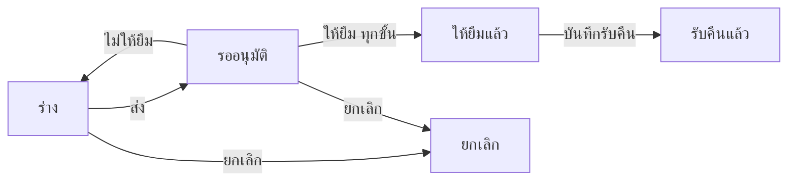

# BRD: แบบฟอร์มยืมสินทรัพย์ (Asset Borrowing)

| Field | Value |
|---|---|
| BRD ID | BRD-ASM-ALN-001 |
| Feature | F-TMP-002 แบบฟอร์มยืมสินทรัพย์ (รหัส feature ชั่วคราว — รอลงทะเบียน) |
| BRD Type | New Feature (แบบ 2 · ดึงข้อมูลเดิม) |
| Version | 1.0 |
| Status | **APPROVED (Prebrief Mode · Lane)** — DEC แทน Scope Lock จนมีใบเซ็นลูกค้า |
| Module | Asset Management (Core Cube) · แผนกเจ้าของแบบ: ฝ่ายบริหารสินทรัพย์ |
| Customer form | FM-ASM-04 Rev.00 : 01/07/2569 (xlsx 1 หน้า A4) |
| Request | REQ-TMP-002 (ชั่วคราว — รอเลขจริงจาก F186) |
| Input | PREBRIEF_REQ-TMP-002_v2 · FORM_SPEC.json (13 ช่อง) · DECISIONS.lock (13 DEC · พร้อมเริ่มทำ · AI-DEFAULT 11) · feature.html (audit FAIL 0 · self_audit PASS · e2e jsdom 32/32) |
| Created / Updated | 2026-10-11 |

## Changelog
- v1.0 (2026-10-11): สร้างผ่าน brd-generator-full v2.3 Prebrief Mode · Lane (doc-master-pipeline ขั้น 7 · unattended)

---

## 1. Business Context
### 1.1 ปัญหา / โอกาส
พนักงานยืมสินทรัพย์บริษัท (อุปกรณ์ไอที เฟอร์นิเจอร์ เครื่องมือ) ด้วยแบบฟอร์มกระดาษ FM-ASM-04 — ต้องเขียนชื่อสินทรัพย์/ทะเบียนเอง · ผู้ให้ยืมลงนามบนกระดาษ · การรับคืนลงนามท้ายแบบเดียวกัน · ไม่มีภาพรวมว่าสินทรัพย์ใดถูกยืมอยู่และเลยกำหนดคืนหรือไม่
### 1.2 เป้าหมาย
1. ขึ้นแบบฟอร์มเป็นเอกสารในระบบ ช่องตรงกระดาษ 1:1 (PDF Replica FM-ASM-04) ลูกค้าจำแบบเดิมได้
2. เลือกสินทรัพย์จากทะเบียน (Asset Master) แทนการเขียนเอง · ผู้ให้ยืมกำหนดจำนวนที่ให้ยืมจริงตอนอนุมัติ
3. บันทึกการรับคืน (ผู้ส่งคืน/ผู้รับคืน) ในใบเดียวกัน · เห็นใบที่เลยกำหนดคืน
### 1.3 ตัวชี้วัด
ไม่มีใน input → **OQ-01** (ห้ามแต่งตัวเลข)
### 1.4 ที่มา
แบบฟอร์มลูกค้า FM-ASM-04 (xlsx) → FORM_SPEC 13 ช่อง · ลายเซ็น 4 จุด · ตาราง 11 แถว · gate 10 หมวดตอบโดย AI ตาม unattended-policy (AI-DEFAULT ทั้งหมด รอลูกค้ายืนยัน)

## 2. Scope
### 2.1 In Scope
- รายการแบบฟอร์มยืม (ค้นหา · กรองสถานะ/ฝ่าย · CSV · เลยกำหนดคืน) · สร้าง/แก้ร่าง wizard 3 ขั้น · ดูรายละเอียด 4 แท็บ (รายละเอียด › PDF Preview › ลายเซ็น/อนุมัติ › ประวัติ)
- เลือกทะเบียนสินทรัพย์ (ชื่อรายการตามทะเบียน) · จำนวนที่ยืม · วันที่ยืม · วันที่ส่งคืน · หมายเหตุ · ไม่จำกัดแถว
- ส่งอนุมัติ DOA (dynamic · ค่าเริ่ม 1 ขั้น ผู้ให้ยืม) · ผู้ให้ยืมกรอกจำนวนที่ให้ยืม · ให้ยืม / ไม่ให้ยืม→กลับร่าง · ยกเลิก (เหตุผลบังคับ)
- บันทึกรับคืน (ผู้ส่งคืน = ผู้ยืม · ผู้รับคืน = ผู้ให้ยืมหรือเจ้าหน้าที่บริหารสินทรัพย์) · แนบไฟล์ · PDF FM-ASM-04 ทุกสถานะ · เลขที่ ALN จาก ENG-DOC-NUM
### 2.2 Out of Scope
- เปลี่ยนสถานะ/ผู้ถือครองใน Asset Master (DEC-01) · ส่งต่อระบบอื่น (DEC-02) · ตรวจสินทรัพย์ว่าง/จองซ้อนข้ามใบ (→ OQ-05) · รับคืนบางส่วน/หลายครั้ง · ทำซ้ำเอกสาร (DEC-11) · ประกาศ
### 2.3 Assumptions
- ข้อมูลผู้ยืม/ตำแหน่ง/ฝ่าย มีใน HR · Employee และ Organization · Asset Master มีรหัสทะเบียน + ชื่อ (feature registry: Asset Management › Asset Master ยังไม่มี BA artifact → OQ-04)
### 2.4 Scope Lock (ชั่วคราว = DECISIONS.lock · ยังไม่มีใบเซ็น → OQ-02)
| DEC | หมวด | มติ | ที่มา |
|---|---|---|---|
| DEC-01 | G1 | อนุมัติแล้วไม่เปลี่ยนค่าในระบบ | AI-DEFAULT |
| DEC-02 | G1 | ไม่ส่งต่อระบบอื่นรอบนี้ (ประกาศ event ใน FRD แต่ไม่ยิง) | AI-DEFAULT |
| DEC-03 | G2 | DOA dynamic · ค่าเริ่ม 1 ขั้น role-mgr-acc (ผู้ให้ยืม) · ไม่มีวงเงิน | AI-DEFAULT |
| DEC-04 | G3 | จำนวนที่ให้ยืม ≤ จำนวนที่ยืม (บล็อก) · ผู้ให้ยืมกรอกตอนพิจารณา ว่าง = เท่าจำนวนที่ยืม · วันที่ส่งคืน ≥ วันที่ยืม (บล็อก) · ทะเบียนซ้ำในใบ (บล็อก) · รับคืนได้เมื่ออนุมัติแล้ว · เลยกำหนดคืน = เตือน | AI-DEFAULT |
| DEC-05 | G4 | ไม่จำกัดแถว · PDF ≥ 11 แถว | AI-DEFAULT |
| DEC-06 | G5 | ช่องตรงกระดาษ 1:1 · ไม่เพิ่มช่อง | AI-DEFAULT |
| DEC-07 | G6 | ลายเซ็นแถวล่าง 1 ช่องต่อขั้น DOA · ข้อความ "ส่ง/พิจารณาในระบบ" ไม่ใช้ภาพ | AI-DEFAULT |
| DEC-08 | G7 | ไม่อนุมัติ = กลับร่างเลขเดิม · ยกเลิก: เจ้าของ + admin · ร่าง/รออนุมัติ · เหตุผลบังคับ | AI-DEFAULT |
| DEC-09 | G8 | เจ้าของ · ผู้อนุมัติหลังส่ง · admin ฝ่ายบริหารสินทรัพย์เห็นทั้งหมด | AI-DEFAULT |
| DEC-10 | G9 | ออกเลขตอนบันทึกครั้งแรก · รหัส ALN | AI-DEFAULT |
| DEC-11 | G10 | แนบไฟล์ ✓ · CSV ✓ · ทำซ้ำ ✗ · ประกาศ ✗ | AI-DEFAULT |
| DEC-12 | VALID | จำนวนที่ให้ยืม ≤ จำนวนที่ยืม และ > 0 เมื่ออนุมัติ | FORM_SPEC |
| DEC-13 | VALID | วันที่ส่งคืน ≥ วันที่ยืม · รับคืนจริงบันทึกที่ส่วนรับคืน | FORM_SPEC |

## 3. Roles & Permissions (COSO)
| Role | COSO | ทำอะไร |
|---|---|---|
| พนักงาน (ผู้ยืม) | Maker | สร้าง/แก้ร่าง · ส่ง · ยกเลิกของตัวเอง (ร่าง/รออนุมัติ) · เป็นผู้ส่งคืน |
| role-mgr-acc (ผู้ให้ยืม · ค่าเริ่ม DOA) | Approver + Custodian | ให้ยืม/ไม่ให้ยืม · กรอกจำนวนที่ให้ยืม · บันทึกรับคืน |
| admin ฝ่ายบริหารสินทรัพย์ (เจ้าหน้าที่บริหารสินทรัพย์) | Checker (ติดตาม) | เห็นทุกใบ · ยกเลิกได้ (ร่าง/รออนุมัติ) · บันทึกรับคืน (ผู้รับคืน) — role ยังไม่อยู่ใน DOA master → OQ-03 |

| Action | ผู้ยืม | ผู้ให้ยืม | admin สินทรัพย์ |
|---|:-:|:-:|:-:|
| ดูใบ | ของตน | หลังส่ง (อยู่ในสาย) | ทั้งหมด |
| สร้าง/แก้ร่าง | ✓ ของตน | – | – |
| ตัดสินขั้น | – | ✓ ขั้นของตน | – |
| ยกเลิก | ✓ ของตน | – | ✓ |
| บันทึกรับคืน | – | ✓ | ✓ |
SoD: ผู้ยืมพิจารณาใบตัวเองไม่ได้ (BR-DOA-04) · ผู้รับคืน ≠ ผู้ยืม

## 4. User Journey
### 4.1 Happy Path
1. ผู้ยืม: สร้าง → ระบุ "เพื่อใช้" → เลือกทะเบียนสินทรัพย์ + จำนวน + วันที่ยืม/ส่งคืน → แนบไฟล์ (ถ้ามี) → บันทึก (ได้เลข ALN) → ส่ง เลือกผู้ให้ยืม (ค่าเริ่มจาก DOA)
2. ผู้ให้ยืม: กรอกจำนวนที่ให้ยืม (ค่าเริ่ม = จำนวนที่ยืม) → ให้ยืม → **ให้ยืมแล้ว** · PDF snapshot (approved_final)
3. ถึงวันส่งคืน: ผู้ยืมนำมาคืน → ผู้ให้ยืม/เจ้าหน้าที่บริหารสินทรัพย์ บันทึกรับคืน (ยืนยันประโยค "ได้รับสินทรัพย์ … ครบถ้วน" + วันที่รับคืน) → **รับคืนแล้ว**
### 4.2 Alternative
- ไม่ให้ยืม → กลับร่าง เลขเดิม + เหตุผล → ผู้ยืมแก้ ส่งใหม่ (resolve สายใหม่)
- เลยวันที่ส่งคืนยังไม่บันทึกรับคืน → แจ้งเตือน aln_overdue (ผู้ยืม + ผู้ดูแล) · ป้ายในรายการ
- ยกเลิก (ร่าง/รออนุมัติ) โดยเจ้าของหรือ admin

## 5. Data (จาก FORM_SPEC — ป้ายตามกระดาษ)
### 5.1 asset_borrow (header)
| ช่องบนกระดาษ | field | ชนิด | ที่มา | บังคับ |
|---|---|---|---|:-:|
| เลขที่ | doc_no | text | auto ENG-DOC-NUM (ALN) | ✓ |
| (วันที่ขอ — ระบบ) | req_date | date | auto | ✓ |
| ข้าพเจ้า | requester_id → name_snapshot | ref | system HR · Employee (อ่านอย่างเดียว) | ✓ |
| ตำแหน่ง | position_snapshot | text | system Organization · Position | ✓ |
| ฝ่าย/แผนก | dept_snapshot | text | system Organization · Department | ✓ |
| ขอยืมสินทรัพย์ เพื่อใช้ | purpose | text | user | ✓ |
| + DOA fields | approval_status · doa_entry_ref · approval_chain (jsonb snapshot) · approver_role · approved_by · approved_at | | DOA | |
| + returned_reason · returned_by · returned_at | | | DEC-08 (ไม่อนุมัติกลับร่าง) | |
| + return_record (ผู้ส่งคืน · ผู้รับคืน · วันที่รับคืน) | returned_by_emp · received_by · received_at | | ส่วนรับคืนบนกระดาษ | เมื่อรับคืน |
### 5.2 asset_borrow_line (ตาราง 11 แถวบนกระดาษ)
| ช่องบนกระดาษ | field | ชนิด | ที่มา | บังคับ |
|---|---|---|---|:-:|
| ลำดับ | seq | int | auto | ✓ |
| รายการ | asset_name (ตามทะเบียน) | text | system Asset Master | ✓ |
| ทะเบียนสินทรัพย์ | asset_code | ref | user เลือกจาก Asset Master | ✓ |
| จำนวนที่ยืม | qty_requested | int ≥1 | user | ✓ |
| จำนวนที่ให้ยืม | qty_lent | int 1..qty_requested | ผู้ให้ยืมตอนพิจารณา | ✓ เมื่ออนุมัติ |
| วันที่ยืม | borrow_date | date | user | ✓ |
| วันที่ส่งคืน | return_date | date ≥ borrow_date | user (กำหนดคืน) | ✓ |
| หมายเหตุ | remark | text | user | – |
### 5.3 attachments → Document Center (ไฟล์ระดับใบ)

## 6. User Stories
| ID | Story | AC หลัก |
|---|---|---|
| S-01 | ผู้ยืมระบุวัตถุประสงค์การยืม | "เพื่อใช้" บังคับ · ผู้ยืม/ตำแหน่ง/ฝ่าย ดึงจากระบบ |
| S-02 | ผู้ยืมเลือกสินทรัพย์จากทะเบียน | ค้นหาทะเบียน/ชื่อ · ชื่อรายการตามทะเบียน · ทะเบียนซ้ำในใบ = บล็อก · ≥1 แถว ไม่จำกัด |
| S-03 | ผู้ยืมกำหนดวันที่ยืมและวันที่ส่งคืน | ตัวเลือกวัน พ.ศ. · ส่งคืน ≥ ยืม (บล็อก) · ย้อนหลังได้ (เตือนในขั้นตรวจสอบ) |
| S-04 | ผู้ยืมบันทึกร่าง | ได้เลข ALN ตอนบันทึกครั้งแรก |
| S-05 | ผู้ยืมส่งอนุมัติ | slot ต่อขั้นจาก DOA · ผู้ยืมไม่อยู่ในรายชื่อ · บังคับเลือก |
| S-06 | ผู้ให้ยืมกำหนดจำนวนที่ให้ยืม | ค่าเริ่ม = จำนวนที่ยืม · 1 ≤ ค่า ≤ จำนวนที่ยืม (บล็อก) |
| S-07 | ผู้ให้ยืมให้ยืม | ปุ่มเฉพาะผู้พิจารณาขั้นปัจจุบัน · คำ "ให้ยืม" · เรียงขั้น |
| S-08 | ผู้ให้ยืมไม่ให้ยืม | เหตุผลบังคับ → กลับร่างเลขเดิม · ผู้ยืมเห็นเหตุผล |
| S-09 | ผู้รับคืนบันทึกรับคืน | เฉพาะใบให้ยืมแล้ว · ยืนยันประโยครับคืน · วันที่รับคืน ≤ วันนี้ · สถานะรับคืนแล้ว |
| S-10 | ผู้ดูแลติดตามใบเลยกำหนดคืน | ป้าย/สีในรายการ · แบนเนอร์ในใบ · แจ้งเตือนรายวัน |
| S-11 | พิมพ์/ดาวน์โหลด PDF FM-ASM-04 | ทุกสถานะ · ≥11 แถว · ลายเซ็น = ผู้ยืม + 1 ช่องต่อขั้น DOA (dynamic · แถวละ ≤4) + ส่วนรับคืน 2 ช่อง |
| S-12 | เจ้าของ/admin ยกเลิก | ร่างหรือรออนุมัติ · เหตุผลบังคับ |
| S-13 | admin ดูทุกใบ + ส่งออก CSV | กรองสถานะ/ฝ่าย · CSV ระดับรายการ |

## 7. Status & Lifecycle
| จาก | Action | ไป | ใคร |
|---|---|---|---|
| — | บันทึกครั้งแรก | draft | Maker |
| draft | ส่ง | pending (ขั้น 1) | Maker |
| pending | ให้ยืมขั้น n<N | pending (ขั้น n+1) | ผู้พิจารณาขั้น n |
| pending | ให้ยืมขั้น N | approved (ให้ยืมแล้ว) | ขั้น N |
| pending | ไม่ให้ยืม | draft (เลขเดิม · returned_*) | ผู้พิจารณาขั้นปัจจุบัน |
| approved | บันทึกรับคืน | returned (รับคืนแล้ว) | ผู้ให้ยืม / admin |
| draft / pending | ยกเลิก | cancelled | Maker / admin |
approved/returned = ล็อกแก้ไข

## 8. Business Rules + Validation
| ID | Rule | Tag | Type |
|---|---|:-:|---|
| BR-01 | ชื่อรายการ = Asset.name ของทะเบียนที่เลือก (snapshot ตอนบันทึก) | FIXED | Master |
| BR-02 | qty_lent: 1 ≤ ค่า ≤ qty_requested · ค่าเริ่ม = qty_requested | FIXED | Validation (DEC-04/12) |
| BR-03 | return_date ≥ borrow_date | FIXED | Validation (DEC-04/13) |
| BR-04 | ทะเบียนสินทรัพย์ซ้ำในใบเดียว = บล็อก | FIXED | Validation (DEC-04 AI-DEFAULT) |
| BR-05 | เลยกำหนดคืน (วันนี้ > return_date และยังไม่รับคืน) = เตือน ไม่บล็อก | CONFIGURABLE | Policy (DEC-04) |
| BR-06 | สายอนุมัติ resolve จาก DOA ตอนส่ง แล้ว freeze | FIXED | DOA (BR-DOA-02) |
| BR-07 | ไม่ให้ยืม → draft เลขเดิม · resolve ใหม่ตอนส่งรอบถัดไป | FIXED | DEC-08 |
| BR-08 | ออกเลขตอนบันทึกครั้งแรก · no-gap ✗ | CONFIGURABLE | DOCCFG (DEC-10) |
| BR-09 | ร่างเห็นเฉพาะเจ้าของ (+ admin) | FIXED | Visibility #109 (DEC-09) |
| BR-10 | ช่องลงชื่อ PDF = ผู้ยืม + 1 ช่องต่อขั้น DOA (dynamic) · คำตัดสินตาม role (role-mgr-acc = ให้ยืม/ไม่ให้ยืม) · ส่วนรับคืน 2 ช่องคงที่ตามกระดาษ | FIXED (จำนวน = DOA) | DEC-03 · DEC-07 |
| BR-11 | บันทึกรับคืนได้เฉพาะ approved · ผู้รับคืน = ผู้ให้ยืมในสายหรือ admin · ไม่แก้ Asset Master | FIXED | DEC-01 · DEC-04 |

| VR | ช่อง | เงื่อนไข | ข้อความ |
|---|---|---|---|
| VR-01 | purpose | required | กรุณาระบุว่ายืมไปใช้ทำอะไร |
| VR-02 | line ทะเบียน · จำนวน · วันที่ยืม · วันที่ส่งคืน | required · จำนวน ≥ 1 · ≥1 แถว | กรอกให้ครบ: … |
| VR-03 | return_date | ≥ borrow_date | วันที่ส่งคืนต้องไม่ก่อนวันที่ยืม |
| VR-04 | asset_code | ไม่ซ้ำในใบ | ทะเบียนสินทรัพย์ซ้ำกับรายการที่ n |
| VR-05 | qty_lent | 1..qty_requested | จำนวนที่ให้ยืมต้องอยู่ระหว่าง 1 ถึงจำนวนที่ยืม |
| VR-06 | slot ผู้พิจารณา | ทุกขั้นต้องเลือก · ≠ ผู้ยืม | กรุณาเลือกผู้พิจารณา |
| VR-07 | เหตุผล ไม่ให้ยืม/ยกเลิก | required | กรุณาระบุเหตุผล |
| VR-08 | วันที่รับคืน | required · ≤ วันนี้ · ≥ วันที่ยืมแรก | กรุณาเลือกวันที่รับคืน |
### 8.5 ระดับความยืดหยุ่น
BR-05 → Admin Panel (นโยบายแจ้งเตือน) · BR-08 → F-DOCCFG · สายอนุมัติ → DOA กลาง

## 9. Edge Cases
| EC | กรณี | ผล |
|---|---|---|
| EC-01 | ผู้ให้ยืมให้ยืมน้อยกว่าที่ขอ (เช่น ขอ 20 ให้ 15) | qty_lent 15 · PDF แสดงทั้งสองคอลัมน์ |
| EC-02 | รายการ > 11 แถว | PDF dense (ทดสอบ 14 แถว) |
| EC-03 | ผู้ยืมเป็นผู้ให้ยืมเอง (role-mgr-acc ยืมเอง) | resolve ข้ามตัวเอง · slot ต้องเลือกคนอื่น |
| EC-04 | แก้ DOA ระหว่างใบรออนุมัติ | ใบเดิมใช้สาย snapshot |
| EC-05 | ส่ง/อนุมัติชนกัน (stale) | 409 → toast รีเฟรช สถานะไม่เปลี่ยน |
| EC-06 | แบบเอกสารปิดใช้ (F-DOCCFG) | ปุ่มสร้าง disabled |
| EC-07 | สินทรัพย์เดียวถูกยืมซ้อนช่วงเวลาข้ามใบ | ไม่ตรวจรอบนี้ (DEC-01) → OQ-05 |
| EC-08 | วันที่ยืมย้อนหลัง | ส่งได้ · เตือนในขั้นตรวจสอบ |
| EC-09 | เลยกำหนดคืน | ป้ายแดงในรายการ · แบนเนอร์ · aln_overdue |

## 10. Value Stream & Downstream Impact
Positioning: Asset Management — ทะเบียนสินทรัพย์ (Asset Master) → **ยืม/คืน (feature นี้)** → [สถานะถือครองในทะเบียน — ปิดรอบนี้]
| ปลายทาง | ข้อมูล | Trigger | หมายเหตุ |
|---|---|---|---|
| Asset Master (สถานะ/ผู้ถือครอง) | asset_code · qty_lent · ผู้ยืม | approved / returned | **ปิดรอบนี้ (DEC-01/02)** — ประกาศ event ใน FRD ไม่ยิง |
| ENG-NOTIFY | aln_cancelled · aln_returned · aln_overdue | ตาม NTF_BRIEF | DOA ยิง doa_pending/doa_result เอง |
| F-DOCCFG / ENG-DOC-STORE | PDF snapshot | approved_final | |
| รายงาน | ใบค้างคืน / เลยกำหนด | — | Report area อ่าน |

## 11. Delivery
Phase 1 = ทุกอย่างใน §2.1 · Phase 2 (เสนอ) = อัปเดตสถานะถือครองใน Asset Master + ตรวจจองซ้อน + รับคืนบางส่วน

## 12. Dev Summary "ใบสั่ง"
- Config: DOA entry F-TMP-002 (role-mgr-acc) · doc_type ALN (F-DOCCFG) · role admin ฝ่ายบริหารสินทรัพย์ (OQ-03)
- Declaration: DOA_BRIEF · NTF_BRIEF · DOCCFG_BRIEF · MDOC_BRIEF (ฉบับจริงหลัง FRD)
- Screen Inventory: P-01 รายการ · P-02 สร้าง/แก้ (drawer wide 3 ขั้น) · P-03 ดู (drawer 4 แท็บ) · M-01 ส่ง · M-02 ให้ยืม (จำนวนที่ให้ยืม) · M-03 ไม่ให้ยืม · M-04 ยกเลิก · M-05 บันทึกรับคืน · M-06 ทิ้งข้อมูล
- UI Signals: เอกสาร + พิมพ์ + ลายเซ็น = ใช่ · Q-form · แถวซ้ำแบบตาราง

## 13. Open Questions
| OQ | คำถาม | เจ้าของ | Block? |
|---|---|---|---|
| OQ-01 | ตัวชี้วัดความสำเร็จ (เช่น % คืนตรงกำหนด · เวลาอนุมัติเฉลี่ย) | ลูกค้า | ไม่ |
| OQ-02 | ลูกค้าเซ็นยืนยัน DEC-01..11 (AI-DEFAULT) — โดยเฉพาะผู้ให้ยืม = role-mgr-acc · กลับร่าง · ไม่อัปเดต Asset Master | Strike → ลูกค้า | ก่อน UAT |
| OQ-03 | role admin ฝ่ายบริหารสินทรัพย์ / ผู้ดูแลสินทรัพย์ ยังไม่อยู่ใน DOA roles master (14 role) — ใช้ role ใด | Strike + พี่เบิร์ด | ก่อน wire |
| OQ-04 | Asset Master (Asset Management) ยังไม่มี BA artifact — field code/name/สถานะ | พี่เบิร์ด | ก่อน dev |
| OQ-05 | ตรวจสินทรัพย์ถูกยืมซ้อนช่วงเวลา / ปรับสถานะทะเบียน ทำรอบไหน | ลูกค้า | ไม่ |
| OQ-06 | รหัส feature จริง (แทน F-TMP-002) · REQ จริง · function_code taxonomy · module enum F185 ยังไม่มี Asset | Strike | ก่อน register |

## 14. Security & Compliance
Preset: Standard Operation · PII: ชื่อผู้ยืม (pdpa) — ข้อมูลตัวอย่างใน prototype เป็นชื่อสมมติทั้งหมด · Audit append-only ทุก action · SoD ผู้ยืม ≠ ผู้ให้ยืม/ผู้รับคืน · ไฟล์แนบตาม file_policy Document Center (≤20MB)

## 15. Health Check / Monitoring
SLA ต่อขั้น: ไม่กำหนดรอบนี้ (→ OQ-01) · KPI เสนอ: ใบเลยกำหนดคืน · ใบรออนุมัติเกิน N วัน · Widget: สินทรัพย์ที่ถูกยืมอยู่ตามฝ่าย

## 16. AI Review (Prebrief Mode · Lane)
C01–C23 + PE01–PE05: ผ่าน · C20 Scope Lock = DEC ครบ 13 ข้อ + OQ-02 รอใบเซ็น (✅ ตาม v2.3) · C22 ตัวชี้วัด → OQ-01 (ไม่แต่งตัวเลข) · C05 story ไม่มีคำว่า "และ" · **สถานะ: APPROVED**

## Appendix — Screen List
P-01 `#/asset-borrow` · P-02 `#/asset-borrow/create` · `/edit/:id` · P-03 `#/asset-borrow/view/:id`
