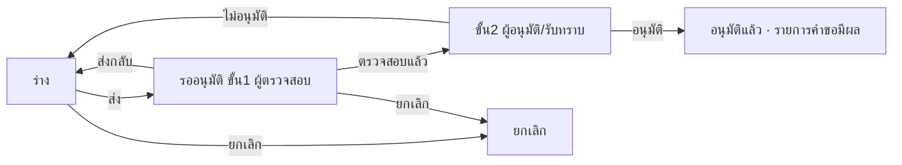

# BRD: แบบฟอร์มรายการคำขอเอกสารและข้อมูล (Document and Information Request List)

| Field | Value |
|---|---|
| BRD ID | BRD-IVM-IVME-001 |
| Feature | F-TMP-007 แบบฟอร์มรายการคำขอเอกสารและข้อมูล (รหัสชั่วคราว — รอ feature id จริง) |
| BRD Type | New Feature (แบบ 1 · ข้อมูลใหม่ทั้งหมด — ชื่อผู้จัดทำจาก F-EMP-001 · สายอนุมัติจาก DOA · prefix รหัสคำขอ/หมายเหตุการใช้งานจาก config) |
| Version | 1.0 |
| Status | **APPROVED (Prebrief Mode · Lane · unattended)** — DEC แทน Scope Lock จนมีใบเซ็นลูกค้า · มติ AI-DEFAULT ทุกหมวด |
| Module | ฝ่ายบริหารการลงทุน (Investment Management) — module ใหม่ ยังไม่อยู่ใน Module Registry ของ DOA (OQ-03) |
| Customer | แบบฟอร์มลูกค้า FM-IVM-05 Rev.00 : 01/07/2569 (SOP-04: การขอข้อมูลและการรับมอบงาน) |
| Request | REQ-TMP-007 (ชั่วคราว — รอเลขจริงจาก F186) |
| Input | PREBRIEF_REQ-TMP-007_v2 · FORM_SPEC.json (11 ช่อง · แถวซ้ำ 1 ชุด 20 แถว · ตัวเลือก 1 ชุด 6 ค่า · ค่าคงที่ 2) · DECISIONS.lock (18 DEC · พร้อมเริ่มทำ) · feature.html (audit FAIL 0 · self_audit PASS · jsdom 42/42 · NO-BROWSER) |
| Created / Updated | 2026-10-11 |

## Changelog
- v1.0 (2026-10-11): สร้างผ่าน brd-generator-full v2.3 Prebrief Mode (doc-master-pipeline ขั้น 7 · โหมดไม่เฝ้า)

---

## 1. Business Context
### 1.1 ปัญหา / โอกาส
ฝ่ายบริหารการลงทุนใช้ไฟล์ Excel FM-IVM-05 จัดทำรายการเอกสาร/ข้อมูลที่ต้องขอจากเจ้าของโครงการ หน่วยงานภายใน หรือบุคคลภายนอก แล้วติดตามการรับมอบ — ตาราง 10 คอลัมน์ พิมพ์รหัส DR-001 … DR-020 ไว้ 20 แถว · สถานะเลือกจาก dropdown 6 ค่า แต่ไม่ผูกกับวันที่ขอ/วันที่ได้รับ · ไม่มีกติกาลำดับ วันที่ขอ / กำหนดส่ง / วันที่ได้รับ · ปิดแถวเป็น ไม่เกี่ยวข้อง / ยกเลิก ได้โดยไม่ต้องให้เหตุผล · ช่องลิงก์เป็นข้อความอิสระ อาจมีรหัสผ่านไดรฟ์ปนมา · กระดาษไม่มีช่องระบุว่าเป็นรายการของโครงการใด · ตรวจทาน/อนุมัติ 3 ช่องส่งต่อด้วยมือ
### 1.2 เป้าหมาย
1. ขึ้นแบบฟอร์มเป็นเอกสารในระบบ ช่องตรงกระดาษ 1:1 (+ ชื่อโครงการ / ธุรกรรม) · PDF Replica FM-IVM-05 2 หน้า
2. รหัสคำขอระบบรัน (prefix จาก config) · หมายเหตุการใช้งานอ่านจาก config · กติกาสถานะ↔วันที่ ลำดับวันที่ เหตุผลการปิดแถว ลิงก์ path/URL ที่ตรวจได้ · ป้ายเกินกำหนด
3. สายอนุมัติ 2 ขั้นจาก DOA กลาง (dynamic) · ประวัติ append-only
### 1.3 ตัวชี้วัด
ไม่มีใน input → **OQ-01** (ห้ามแต่งตัวเลข)
### 1.4 ที่มา
แบบฟอร์มลูกค้า FM-IVM-05 (xlsx · ชื่อชีต INV-FM-05) → FORM_SPEC 11 ช่อง · แถวซ้ำ 1 ชุด (20 แถว DR-001…DR-020) · ตัวเลือก 1 ชุด (สถานะ 6 ค่า จาก data validation G13:G32) · ค่าคงที่ 2 (รูปแบบรหัสคำขอ · หมายเหตุการใช้งาน) · ลายเซ็น 3 · anomalies 7 · gate 10 หมวด = AI-DEFAULT ทั้งหมด (โหมดไม่เฝ้า)

## 2. Scope
### 2.1 In Scope
- รายการเอกสาร (ค้นหา · กรองสถานะเอกสาร / มีรายการเกินกำหนด · CSV 1 แถวต่อคำขอ) · สร้าง/แก้ร่าง wizard 3 ขั้น · ดูรายละเอียด 4 แท็บ (รายละเอียด › PDF Preview › ลายเซ็น/อนุมัติ › ประวัติ)
- ชื่อโครงการ / ธุรกรรม · รายการคำขอเอกสารและข้อมูล 10 คอลัมน์ (ไม่จำกัดแถว) · สรุปรายการคำขอ (คำนวณ) · หมายเหตุการใช้งาน (อ่านอย่างเดียว)
- ส่งอนุมัติ DOA 2 ขั้น (เลือกคนต่อขั้น) · ตรวจสอบแล้ว/ส่งกลับ → กลับร่าง · อนุมัติ/ไม่อนุมัติ · ยกเลิก (เหตุผลบังคับ)
- แนบไฟล์ระดับใบ · PDF FM-IVM-05 Replica 2 หน้าทุกสถานะ · เลขที่ IVME จาก ENG-DOC-NUM
### 2.2 Out of Scope
- ส่งคำขอจริงถึงผู้ถูกขอข้อมูล (อีเมล/ลิงก์อัปโหลด) — ติดตามนอกระบบ (DEC-01/02) · ตรวจไฟล์จริงในห้องข้อมูล/ไดรฟ์ · เชื่อมแบบฟอร์มเริ่มต้นธุรกรรม FM-IVM-01 / ทะเบียนโครงการ (ชื่อโครงการกรอกเอง · OQ-05) · อัปเดตสถานะคำขอหลังอนุมัติโดยไม่ผ่านสายอนุมัติ (OQ-07) · ทำซ้ำ (DEC-11 ไม่มี)
### 2.3 Assumptions
- ข้อมูลพนักงาน/ตำแหน่งมีใน F-EMP-001 / F-ORG-001 · DOA กลางเพิ่ม module/role ของฝ่ายบริหารการลงทุนได้ (OQ-03) · มี config DocRequestPolicy (code_prefix · usage_note) หรือสร้างใน Admin Panel (OQ-08) · ผู้ถูกขอข้อมูล/ผู้รับผิดชอบเป็นข้อความอิสระตามกระดาษ (อาจเป็นบุคคลภายนอก)
### 2.4 Scope Lock (ชั่วคราว = DECISIONS.lock · ยังไม่มีใบเซ็น → OQ-02)
| DEC | หมวด | มติ | ที่มา | ใช้ที่ |
|---|---|---|---|---|
| DEC-01 | G1 | อนุมัติแล้วไม่เปลี่ยนค่าในระบบ | AI-DEFAULT | html, thai-doc, brd, frd, tests, ntf-declaration |
| DEC-02 | G1 | ไม่ส่งต่อระบบอื่นรอบนี้ (ประกาศ event ไว้ใน FRD แต่ไม่ยิง) | AI-DEFAULT | brd, frd |
| DEC-03 | G2 | สายอนุมัติตั้งที่ DOA กลาง (dynamic) · ค่าเริ่ม 2 ขั้น: role-line-manager, role-gm · วงเงิน: ไม่มี | AI-DEFAULT | html, doa-declaration, frd, tests |
| DEC-04 | G3 | รหัสคำขอ DR-nnn ระบบรันต่อใบ (prefix จาก DocRequestPolicy.code_prefix) · ใบใหม่ตั้งต้น 1 แถว (PDF เติมแถวว่างจนครบ 20) · หมายเหตุการใช้งานอ่านจาก DocRequestPolicy.usage_note แสดงอ่านอย่างเดียว · สถานะ↔วันที่ (บล็อก) · ลำดับวันที่ (บล็อก) · ไม่เกี่ยวข้อง/ยกเลิก ต้องมีหมายเหตุ (บล็อก) · เกินกำหนด (เตือน) · ลิงก์ path/URL · คำว่า password/รหัสผ่าน (เตือน) · ต้องมีคำขอ ≥1 ก่อนส่ง (บล็อกตอนส่ง) (ฉบับเต็มใน DECISIONS.lock.md) | AI-DEFAULT | html, thai-doc, brd, frd, tests |
| DEC-05 | G4 | รายการคำขอเอกสารและข้อมูล: ไม่จำกัดจำนวนแถว · PDF อย่างน้อย 20 แถวตามกระดาษ | AI-DEFAULT | html, thai-doc, frd |
| DEC-06 | G5 | ช่องตรงกระดาษ 1:1 · เพิ่ม: ชื่อโครงการ / ธุรกรรม (F01 · กระดาษไม่มีช่องระบุโครงการ) | AI-DEFAULT | html, thai-doc, brd, frd |
| DEC-07 | G6 | ลายเซ็นแถวล่าง 1 ช่องต่อขั้น DOA · ไม่ใช้ภาพลายมือชื่อ (ข้อความส่งในระบบ/พิจารณาในระบบ) | AI-DEFAULT | thai-doc, html, doccfg-declaration, frd |
| DEC-08 | G7 | ไม่อนุมัติ = กลับเป็นร่าง แก้แล้วส่งใหม่ · ยกเลิกได้โดย owner, admin_role สถานะ draft, pending · ต้องมีเหตุผล | AI-DEFAULT | html, frd, tests, doa-declaration |
| DEC-09 | G8 | มองเห็น: เจ้าของ · ผู้อนุมัติเห็นหลังส่ง · admin role เห็นทั้งหมด | AI-DEFAULT | html, frd, tests |
| DEC-10 | G9 | ออกเลขเมื่อบันทึกครั้งแรก · รหัส IVME | AI-DEFAULT | doccfg-declaration, html, frd |
| DEC-11 | G10 | ของเสริม (กระดาษไม่มี): แนบไฟล์, ส่งออก CSV | AI-DEFAULT | html, brd, frd, ntf-declaration |
| DEC-12 | VALID | ยึด FM-IVM-05 ตาม footer เป็นรหัสแบบฟอร์ม (ชื่อชีต INV-FM-05) | FORM_SPEC | html, frd, tests |
| DEC-13 | VALID | ชื่อโครงการ / ธุรกรรม บังคับกรอก (ช่องเพิ่ม F01 · กระดาษแถว 4 ว่าง) | FORM_SPEC | html, frd, tests |
| DEC-14 | VALID | ขอแล้ว/ได้รับบางส่วน/ได้รับครบ → ต้องมีวันที่ขอ (บล็อก) · ได้รับครบ → ต้องมีวันที่ได้รับ (บล็อก) · ยังไม่ขอ แต่มีวันที่ได้รับ → บล็อก | FORM_SPEC | html, frd, tests |
| DEC-15 | VALID | กำหนดส่งก่อนวันที่ขอ → บล็อก · วันที่ได้รับก่อนวันที่ขอ → บล็อก · เลยกำหนดส่งแล้วยังไม่ได้รับครบ → เตือน (ป้ายเกินกำหนด) | FORM_SPEC | html, frd, tests |
| DEC-16 | VALID | ต้องกรอกหมายเหตุ (เหตุผล) เมื่อเลือก ไม่เกี่ยวข้อง / ยกเลิก (บล็อก) | FORM_SPEC | html, frd, tests |
| DEC-17 | VALID | ลิงก์เอกสารรับเฉพาะ path / URL · ห้ามเก็บรหัสผ่าน · ข้อความมีคำว่า password/รหัสผ่าน → เตือน | FORM_SPEC | html, frd, tests |
| DEC-18 | VALID | ประวัติการแก้ไข = ข้อมูลควบคุมแบบฟอร์ม (form revision) ไม่ใช่ช่องกรอก · เส้นตารางว่างด้านล่างไม่เป็นช่อง | FORM_SPEC | html, frd, tests |

## 3. Roles & Permissions (COSO)
| Role | COSO | ทำอะไร |
|---|---|---|
| ผู้จัดทำ (ผู้ประสานงานบริหารการลงทุน / ผู้รับผิดชอบที่ได้รับมอบหมาย) | Maker | สร้าง/แก้ร่าง · ส่ง · ยกเลิกของตัวเอง (ร่าง/รออนุมัติ) |
| ผู้ตรวจสอบ — role-line-manager (บนกระดาษ: ผู้จัดการฝ่ายบริหารการลงทุน) | Checker | ขั้น 1 ตรวจสอบแล้ว / ส่งกลับ |
| ผู้อนุมัติ / รับทราบ — role-gm (บนกระดาษ: รองกรรมการผู้จัดการ / กรรมการผู้จัดการ / ผู้มีอำนาจตามตารางอำนาจอนุมัติ (ถ้ามี)) | Approver | ขั้น 2 อนุมัติ / ไม่อนุมัติ |
| admin role ฝ่ายบริหารการลงทุน | Monitor | เห็นทุกใบ · ยกเลิกได้ (ร่าง/รออนุมัติ) · CSV · รับแจ้งเมื่ออนุมัติเพื่อเริ่มส่งคำขอนอกระบบ |

| Action | Maker | Checker | Approver | Admin |
|---|:-:|:-:|:-:|:-:|
| ดูใบ | ของตน | หลังส่ง (อยู่ในสาย) | หลังส่ง (อยู่ในสาย) | ทั้งหมด |
| สร้าง/แก้ร่าง | ✓ ของตน | – | – | – |
| ตัดสินขั้น | – | ขั้น 1 | ขั้น 2 | – |
| ยกเลิก | ✓ ของตน | – | – | ✓ |
SoD: ผู้จัดทำพิจารณาใบตัวเองไม่ได้ (BR-DOA-04) · role จริงต้องเทียบ DOA master (OQ-03)

## 4. User Journey
### 4.1 Happy Path
1. ผู้จัดทำ: สร้าง → ใส่ชื่อโครงการ / ธุรกรรม → รายการคำขอ (ตั้งต้น 1 แถว DR-001 · เอกสาร / ข้อมูลที่ขอ · ผู้ถูกขอข้อมูล · ผู้รับผิดชอบ · วันที่ขอ · กำหนดส่ง · สถานะ · วันที่ได้รับ · หมายเหตุ · ลิงก์เอกสาร — เพิ่มคำขอ รหัสรันต่อ) → ดูหมายเหตุการใช้งาน (อ่านอย่างเดียว) → แนบไฟล์ → ตรวจสอบ → บันทึก (ได้เลข IVME) → ส่ง เลือกคน 2 ขั้น
2. ขั้น 1 ตรวจสอบแล้ว → ขั้น 2 อนุมัติ → **อนุมัติแล้ว (รายการคำขอมีผล)** · PDF เก็บสำเนา (approved_final) · แจ้งผู้จัดทำ + admin role (ivme_request_list_approved) ให้เริ่มส่งคำขอและติดตามการรับมอบ
### 4.2 Alternative
- ส่งกลับ / ไม่อนุมัติ ขั้นใดก็ได้ → กลับร่าง เลขเดิม + เหตุผล → ผู้จัดทำแก้ ส่งใหม่ (resolve สายใหม่)
- คำขอเลยกำหนดส่งแล้วยังไม่ได้รับครบ → ป้ายเกินกำหนด (เตือน ส่งได้) · ลิงก์หรือหมายเหตุมีคำว่า password / รหัสผ่าน → เตือน ส่งได้
- ลบคำขอจนไม่เหลือ → บันทึกร่างได้ แต่ส่งไม่ได้ (ต้องมี ≥1)
- ยกเลิก (ร่าง/รออนุมัติ) โดยเจ้าของหรือ admin → ถ้ารออนุมัติ แจ้งผู้พิจารณาขั้นปัจจุบัน (ivme_cancelled)

## 5. Data (จาก FORM_SPEC — ป้ายตามกระดาษ)
### 5.1 ivm_doc_request (header)
| ช่องบนกระดาษ | field | ชนิด | ที่มา | บังคับ |
|---|---|---|---|:-:|
| (เลขที่ — ระบบเพิ่ม footer) | doc_no | text | auto ENG-DOC-NUM | ✓ |
| ชื่อโครงการ / ธุรกรรม (ช่องเพิ่ม · DEC-06/13) | project_name | text | user | ✓ |
| หมายเหตุการใช้งาน | usage_note_snapshot | config | DocRequestPolicy.usage_note ณ ออกเลข | ✓ |
| ผู้จัดทำ (ชื่อ/ตำแหน่ง) | maker_id · maker_name_snapshot · maker_position_snapshot | ref | system F-EMP-001 | ✓ |
| + DOA fields | approval_status · doa_ref · approval_chain (jsonb snapshot) · approver_role · approved_by · approved_at | | DOA | |
| + returned_reason · returned_by · returned_at · cancel_reason | | | DEC-08 | |
### 5.2 ivm_doc_request_item (รายการคำขอเอกสารและข้อมูล — 10 คอลัมน์ตามกระดาษ)
| รหัสคำขอ `request_code` (auto DR-nnn) | เอกสาร / ข้อมูลที่ขอ `item` (✓) | ผู้ถูกขอข้อมูล `requestee` (✓ text) | ผู้รับผิดชอบ `owner` (✓ text) | วันที่ขอ `request_date` (มีเงื่อนไข) | กำหนดส่ง `due_date` (✓) | สถานะ `status` (✓ enum 6 · เริ่ม ยังไม่ขอ) | วันที่ได้รับ `received_date` (มีเงื่อนไข) | หมายเหตุ `remark` (มีเงื่อนไข) | ลิงก์เอกสาร `doc_link` (path/URL) |
### 5.3 สรุปรายการคำขอ (คำนวณตอนแสดง/พิมพ์ — ไม่เก็บ)
ทั้งหมด · ได้รับครบ · ได้รับบางส่วน · ค้างรับ (ยังไม่ขอ + ขอแล้ว) · ไม่เกี่ยวข้อง / ยกเลิก · เกินกำหนด
### 5.4 attachments → Document Center (ไฟล์ระดับใบ)
### 5.5 ข้อความคงที่บนกระดาษ (ไม่ใช่ช่อง)
ใช้ในขั้นตอน · วัตถุประสงค์ · ผู้จัดทำ/ผู้ตรวจสอบ/ผู้อนุมัติ (คำอธิบาย) · ประวัติการแก้ไข (= revision ของแบบฟอร์มจาก F-DOCCFG ไม่ใช่ข้อมูลใบ · DEC-18)

## 6. User Stories
| ID | Story | AC หลัก |
|---|---|---|
| S-01 | ผู้จัดทำสร้างรายการคำขอของโครงการ | ชื่อโครงการบังคับ · ตั้งต้น 1 แถว DR-001 · บันทึกได้เลข IVME |
| S-02 | ผู้จัดทำเพิ่มคำขอ | รหัสคำขอรันต่อ (DR-002 …) · ลบแถวแล้วไม่รันรหัสใหม่ |
| S-03 | ผู้จัดทำบันทึกสถานะการรับมอบ | สถานะ↔วันที่ตาม DEC-14 · ลำดับวันที่ตาม DEC-15 |
| S-04 | ผู้จัดทำปิดคำขอที่ไม่ต้องใช้ | ไม่เกี่ยวข้อง / ยกเลิก ต้องระบุเหตุผลในหมายเหตุ |
| S-05 | ผู้จัดทำใส่ลิงก์เอกสาร | รับเฉพาะ path หรือ URL · คำว่ารหัสผ่าน = เตือน |
| S-06 | ผู้จัดทำเห็นคำขอเกินกำหนด | ป้ายเกินกำหนดในแถว · ตัวกรองรายการเกินกำหนดในหน้ารายการ |
| S-07 | ผู้จัดทำส่งอนุมัติ | ต้องมีคำขอ ≥1 · slot 2 ขั้นค่าเริ่มจาก DOA · ผู้จัดทำไม่อยู่ในรายชื่อ · บังคับเลือกครบ |
| S-08 | ผู้ตรวจสอบตัดสิน | ตรวจสอบแล้ว / ส่งกลับ (เหตุผลบังคับ) → กลับร่าง |
| S-09 | ผู้อนุมัติตัดสินขั้นสุดท้าย | อนุมัติ → รายการคำขอมีผล + แจ้งผู้จัดทำ/admin · ไม่อนุมัติ → กลับร่าง |
| S-10 | พิมพ์/ดาวน์โหลด PDF FM-IVM-05 | ทุกสถานะ 2 หน้า · ≥20 แถวคำขอ · ลายเซ็น = ผู้จัดทำ + 1 แถวต่อขั้นตาม DOA (dynamic) |
| S-11 | ยกเลิก | เจ้าของ/admin · ร่างหรือรออนุมัติ · เหตุผลบังคับ |
| S-12 | admin ดูทุกใบ + CSV | กรองสถานะ / มีรายการเกินกำหนด · CSV 1 แถวต่อคำขอ |

## 7. Status & Lifecycle
| จาก | Action | ไป | ใคร |
|---|---|---|---|
| — | บันทึกครั้งแรก | draft | Maker |
| draft | ส่ง | pending (ขั้น 1) | Maker |
| pending | ตรวจสอบแล้ว/อนุมัติ ขั้น n<N | pending (ขั้น n+1) | ผู้พิจารณาขั้น n |
| pending | อนุมัติขั้น N | approved | ขั้น N |
| pending | ส่งกลับ / ไม่อนุมัติ | draft (เลขเดิม · returned_*) | ผู้พิจารณาขั้นปัจจุบัน |
| draft / pending | ยกเลิก | cancelled | Maker / Admin |
approved = ล็อกแก้ไข · อัปเดตสถานะการรับมอบหลังอนุมัติ = OQ-07

## 8. Business Rules + Validation
| ID | Rule | Tag | Type |
|---|---|:-:|---|
| BR-01 | รหัสคำขอ = DocRequestPolicy.code_prefix + เลข 3 หลัก รันต่อใบ (max+1) · ลบแถวไม่รันใหม่ | CONFIGURABLE | Auto (DEC-04) [AI-DEFAULT] |
| BR-02 | หมายเหตุการใช้งาน อ่านจาก DocRequestPolicy.usage_note · snapshot ตอนออกเลข · แสดงอ่านอย่างเดียว | CONFIGURABLE | Config read (DEC-04) [AI-DEFAULT] |
| BR-03 | ใบใหม่ตั้งต้น 1 แถว สถานะ ยังไม่ขอ | CONFIGURABLE | Default (DEC-04) [AI-DEFAULT] |
| BR-04 | สถานะ ขอแล้ว / ได้รับบางส่วน / ได้รับครบ ต้องมีวันที่ขอ | FIXED | Validation (DEC-14) |
| BR-05 | สถานะ ได้รับครบ ต้องมีวันที่ได้รับ · สถานะ ยังไม่ขอ ต้องไม่มีวันที่ได้รับ | FIXED | Validation (DEC-14) |
| BR-06 | กำหนดส่งต้องไม่ก่อนวันที่ขอ · วันที่ได้รับต้องไม่ก่อนวันที่ขอ | FIXED | Validation (DEC-15) |
| BR-07 | เลยกำหนดส่ง (กำหนดส่ง < วันนี้) และสถานะไม่ใช่ ได้รับครบ / ไม่เกี่ยวข้อง / ยกเลิก → ป้ายเกินกำหนด เตือน ไม่บล็อก | CONFIGURABLE | Warning (DEC-15) [AI-DEFAULT] |
| BR-08 | สถานะ ไม่เกี่ยวข้อง / ยกเลิก ต้องมีหมายเหตุ (เหตุผล) | FIXED | Validation (DEC-16) |
| BR-09 | ลิงก์เอกสาร = URL (http/https) หรือ path (มี / หรือ \) เท่านั้น · ห้ามเก็บรหัสผ่าน · พบคำว่า password/รหัสผ่าน ในลิงก์หรือหมายเหตุ → เตือน | FIXED / CONFIGURABLE | Validation · Warning (DEC-17) |
| BR-10 | ตัวเลือกสถานะ 6 ค่าตามแบบฟอร์ม (master list ivme.request_status) | CONFIGURABLE | Master list |
| BR-11 | ต้องมีรายการคำขอ ≥ 1 ก่อนส่ง (ร่างบันทึกได้แม้ไม่มี) | FIXED | Validation (DEC-04) |
| BR-12 | สายอนุมัติ resolve จาก DOA ตอนส่ง แล้ว freeze · ผู้จัดทำพิจารณาใบตัวเองไม่ได้ | FIXED | DOA (BR-DOA-02/04) |
| BR-13 | ส่งกลับ/ไม่อนุมัติ → draft เลขเดิม · resolve ใหม่ตอนส่งรอบถัดไป | FIXED | DEC-08 (BR-DOA-03) |
| BR-14 | ออกเลขตอนบันทึกครั้งแรก · no-gap ✗ · รหัส IVME | CONFIGURABLE | DOCCFG (DEC-10) |
| BR-15 | ร่างเห็นเฉพาะเจ้าของ (+ admin) · ผู้พิจารณาเห็นหลังส่ง | FIXED | Visibility (DEC-09) |
| BR-16 | ช่องลงชื่อใน PDF = ผู้จัดทำ + 1 แถวต่อขั้นที่ตั้งใน DOA (dynamic ไม่ fix) · คำตัดสินตาม role | FIXED (จำนวน = DOA) | DEC-03 · DEC-07 |
| BR-17 | PDF แสดงรายการคำขอ ≥ 20 แถว (เติมแถวว่างรหัสรันต่อ) · ไม่จำกัดในระบบ · แบบพิมพ์ 2 หน้า (R10) | FIXED | DEC-05 |
| BR-18 | อนุมัติแล้วไม่เปลี่ยนค่าในระบบอื่น ไม่ส่งต่อ ไม่ส่งคำขอจริงถึงผู้ถูกขอข้อมูล (ประกาศ event ไว้ไม่ยิง) | FIXED | DEC-01/02 |
| BR-19 | รหัสแบบฟอร์ม FM-IVM-05 ตาม footer (ไม่ใช่ชื่อชีต INV-FM-05) | FIXED | DEC-12 |
| BR-20 | ชื่อโครงการ / ธุรกรรม บังคับ (ช่องเพิ่มจากกระดาษ) · ของเสริม: แนบไฟล์ · CSV · ไม่มีทำซ้ำ | FIXED | DEC-06 · DEC-13 · DEC-11 [AI-DEFAULT] |

| VR | ช่อง | เงื่อนไข | ข้อความ |
|---|---|---|---|
| VR-01 | project_name | required | กรุณากรอกชื่อโครงการ / ธุรกรรม |
| VR-02 | items[].item · requestee · owner · due_date · status | required ต่อแถว | คำขอ DR-nnn: กรอก เอกสาร / ข้อมูลที่ขอ · ผู้ถูกขอข้อมูล · ผู้รับผิดชอบ · กำหนดส่ง |
| VR-03 | items[].request_date | required เมื่อ status ∈ {requested, partial, received} | สถานะ {ขอแล้ว/ได้รับบางส่วน/ได้รับครบ} ต้องระบุวันที่ขอ |
| VR-04 | items[].received_date | required เมื่อ status = received | สถานะ ได้รับครบ ต้องระบุวันที่ได้รับ |
| VR-05 | items[].received_date | ว่างเมื่อ status = not_requested | สถานะ ยังไม่ขอ ต้องไม่มีวันที่ได้รับ |
| VR-06 | items[].due_date | ≥ request_date | กำหนดส่งต้องไม่ก่อนวันที่ขอ |
| VR-07 | items[].received_date | ≥ request_date | วันที่ได้รับต้องไม่ก่อนวันที่ขอ |
| VR-08 | items[].remark | required เมื่อ status ∈ {not_applicable, cancelled} | สถานะ {ไม่เกี่ยวข้อง/ยกเลิก} ต้องระบุเหตุผลในหมายเหตุ |
| VR-09 | items[].doc_link | URL หรือ path | ลิงก์เอกสารต้องเป็น path หรือ URL |
| VR-10 | items[] | ≥ 1 แถว (ตอนส่ง) | ต้องมีรายการคำขออย่างน้อย 1 รายการก่อนส่ง |
| VR-11 | slot ผู้พิจารณา | ทุกขั้นต้องเลือก · ≠ ผู้จัดทำ | กรุณาเลือกผู้พิจารณา |
| VR-12 | เหตุผล ส่งกลับ/ไม่อนุมัติ/ยกเลิก | required | กรุณาระบุเหตุผล |

### 8.5 ระดับความยืดหยุ่น
BR-01/02/03 → Admin Panel (DocRequestPolicy) · BR-07/09 (ส่วนเตือน)/10 → Admin Panel (Investment Policy) · BR-14 → F-DOCCFG · สายอนุมัติ → DOA กลาง

## 9. Edge Cases
| EC | กรณี | ผล |
|---|---|---|
| EC-01 | สถานะ ขอแล้ว ไม่มีวันที่ขอ | บล็อก (VR-03) |
| EC-02 | สถานะ ได้รับครบ ไม่มีวันที่ได้รับ | บล็อก (VR-04) |
| EC-03 | สถานะ ยังไม่ขอ แต่มีวันที่ได้รับ | บล็อก (VR-05) |
| EC-04 | กำหนดส่ง / วันที่ได้รับ ก่อนวันที่ขอ | บล็อก (VR-06/07) |
| EC-05 | ไม่เกี่ยวข้อง / ยกเลิก ไม่มีหมายเหตุ | บล็อก (VR-08) |
| EC-06 | ลิงก์เป็นข้อความ เช่น "ดูในไลน์กลุ่ม" | บล็อก (VR-09) |
| EC-07 | หมายเหตุมี "รหัสผ่านไดรฟ์ …" | เตือน ส่งได้ + ป้ายตรวจรหัสผ่าน (BR-09) |
| EC-08 | เลยกำหนดส่ง สถานะ ได้รับบางส่วน | ป้ายเกินกำหนด เตือน ส่งได้ (BR-07) |
| EC-09 | ลบคำขอจนไม่เหลือแล้วกดส่ง | บล็อก (VR-10) · บันทึกร่างได้ |
| EC-10 | คำขอ > 20 แถว | PDF หัวตารางซ้ำ · dense · 2 หน้า (ต้องยืนยันบนเครื่องที่มี browser) |
| EC-11 | ลบ DR-002 แล้วเพิ่มแถว | แถวใหม่ได้ DR-00(max+1) ไม่ใช้ DR-002 ซ้ำ |
| EC-12 | ผู้จัดทำ = ผู้จัดการฝ่าย (resolve ขั้น 1 = ตัวเอง) | slot ว่าง ต้องเลือกคนอื่น |
| EC-13 | DOA ตั้ง 6 ขั้น | PDF 7 แถวลงชื่อ (4+3) · dense |
| EC-14 | ส่ง/อนุมัติชนกัน (stale) | 409 → toast รีเฟรช สถานะไม่เปลี่ยน |
| EC-15 | แบบเอกสารปิดใช้ (F-DOCCFG) | ปุ่มสร้าง disabled |
| EC-16 | config prefix/หมายเหตุการใช้งานเปลี่ยนหลังออกเลข | ใบเดิมแสดง snapshot เดิม |
| EC-17 | ชื่อชีต INV-FM-05 ≠ Doc No. | ใช้ FM-IVM-05 (DEC-12) |

## 10. Value Stream & Downstream Impact
Positioning: กระบวนการบริหารการลงทุน — เริ่มต้นธุรกรรม (FM-IVM-01) → ตารางติดตามงาน (FM-IVM-02) → คำถาม-คำตอบ (FM-IVM-03) → ห้องข้อมูล (FM-IVM-04) → **SOP-04 การขอข้อมูลและการรับมอบงาน (feature นี้)** → ชุดเอกสารส่งมอบงาน (FM-IVM-06) → … → ปิดงานและห้องข้อมูล (FM-IVM-11)
| ปลายทาง | ข้อมูล | Trigger | หมายเหตุ |
|---|---|---|---|
| ผู้จัดทำ + admin role ฝ่าย | รายการคำขอที่อนุมัติ | approved | ENG-NOTIFY ivme_request_list_approved → เริ่มส่งคำขอและติดตามนอกระบบ |
| FM-IVM-04 ห้องข้อมูล / FM-IVM-06 ชุดส่งมอบ | เอกสารที่ได้รับ + ลิงก์ | approved | **ปิดรอบนี้ (DEC-02)** — ประกาศ event `ivme.approved` ใน FRD ไม่ยิง |
| F-DOCCFG / ENG-DOC-STORE | PDF snapshot | approved_final | |
| รายงาน | คำขอค้างรับ · เกินกำหนด | — | Report area อ่าน |

## 11. Delivery
Phase 1 = ทุกอย่างใน §2.1 · Phase 2 (เสนอ) = เชื่อมทะเบียนโครงการ/FM-IVM-01 · ส่งต่อ FM-IVM-04/06 · ปรับสถานะการรับมอบหลังอนุมัติ (OQ-07) · ส่งคำขอถึงผู้ถูกขอข้อมูลในระบบ

## 12. Dev Summary "ใบสั่ง"
- Config: DOA entry F-TMP-007 (2 ขั้น · role-line-manager → role-gm) · doc_type IVME (F-DOCCFG) · DocRequestPolicy (code_prefix · usage_note) · master list ivme.request_status (6)
- Declaration: DOA_BRIEF · NTF_BRIEF · DOCCFG_BRIEF · MDOC_BRIEF (ฉบับจริงหลัง FRD)
- Screen Inventory: P-01 รายการ · P-02 สร้าง/แก้ (drawer wide 3 ขั้น · ตารางกรอก 10 คอลัมน์) · P-03 ดู (drawer 4 แท็บ) · M-01..05 modal ส่ง/อนุมัติ/ส่งกลับ/ยกเลิก/ทิ้งข้อมูล
- UI Signals: เอกสารบันทึก + พิมพ์ + ลายเซ็น = ใช่ · Q-form

## 13. Open Questions
| OQ | คำถาม | เจ้าของ | Block? |
|---|---|---|---|
| OQ-01 | ตัวชี้วัดความสำเร็จ (สัดส่วนคำขอได้รับตามกำหนด / เวลาอนุมัติเฉลี่ย) | ลูกค้า | ไม่ |
| OQ-02 | ลูกค้าเซ็นยืนยัน DEC-01..11 (AI-DEFAULT ทั้งหมด) — โดยเฉพาะ ช่องเพิ่มชื่อโครงการ · 2 ขั้น · ส่งกลับ = กลับร่าง · กติกาสถานะ↔วันที่ · ลิงก์ path/URL | ทีม BA → ลูกค้า | ก่อน UAT |
| OQ-03 | role ผู้จัดการฝ่ายบริหารการลงทุน / รองกรรมการผู้จัดการ / กรรมการผู้จัดการ ไม่มีใน DOA contract (ใช้ role-line-manager / role-gm แทน) · module investment ไม่อยู่ใน Module Registry | ทีม BA + พี่เบิร์ด | ก่อน wire |
| OQ-04 | admin role ของฝ่ายบริหารการลงทุน (ใครเห็นทั้งหมด) — ยังไม่มี role id | ทีม BA | ก่อน dev |
| OQ-05 | ทำทะเบียนโครงการ / FM-IVM-01 เมื่อไร (เลือกโครงการแทนพิมพ์) | ทีม BA | ไม่ |
| OQ-06 | รหัส IVME ใน F-DOCCFG · function_code / taxonomy ใน F185 · feature id จริงแทน F-TMP-007 | ทีม BA | ก่อน register |
| OQ-07 | หลังอนุมัติ การอัปเดตสถานะการรับมอบ (ได้รับครบ/วันที่ได้รับ) ต้องทำใบใหม่ผ่านสายอนุมัติ หรือแก้แถวในใบเดิมได้โดยไม่ต้องอนุมัติซ้ำ | ลูกค้า | ก่อน Phase 2 |
| OQ-08 | config DocRequestPolicy เป็นของ feature ใด (Admin Panel ฝ่ายลงทุน หรือ Policy Center) | ทีม BA | ก่อน dev |

## 14. Security & Compliance
Preset: Standard (เอกสารภายใน · ข้อมูลการลงทุน = Confidential) · PII: ชื่อผู้จัดทำ/ผู้ถูกขอข้อมูล/ผู้รับผิดชอบ (pdpa: F04/F05) — ข้อมูลตัวอย่างใน prototype เป็นชื่อสมมติ (ไฟล์ลูกค้าเป็นฟอร์มเปล่า) · ลิงก์เอกสาร ห้ามเก็บรหัสผ่านหรือ token (BR-09) · Audit append-only ทุก action · SoD ผู้จัดทำ≠ผู้อนุมัติ · ไฟล์แนบตาม file_policy Document Center

## 15. Health Check / Monitoring
SLA ต่อขั้น: ไม่กำหนดรอบนี้ (→ OQ-01) · KPI เสนอ: คำขอเกินกำหนด · คำขอค้างรับ · ใบรออนุมัติเกิน N วัน · Widget: รายการคำขอที่มีรายการเกินกำหนด

## Appendix — Screen List
P-01 `#/ivm-doc-request` · P-02 `#/ivm-doc-request/create` · `/edit/:id` · P-03 `#/ivm-doc-request/view/:id`

## AI Review (Quality Gate)
C1–C20 ผ่าน · C20 Scope Lock: DEC ครบ 18 ข้อจาก DECISIONS.lock + OQ-02 รอใบเซ็น → ✅ · ไม่มีตัวเลขแต่ง · ทุก BR อ้าง DEC → **APPROVED**
