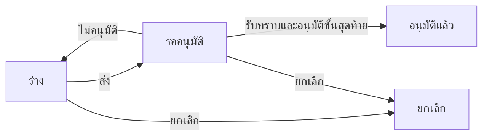

# BRD: แบบฟอร์มสรุปประเมินความพึงพอใจ (Sale admin) สำหรับลูกค้าในประเทศ (Sale Admin Satisfaction Summary — Domestic)

| Field | Value |
|---|---|
| BRD ID | BRD-SAL-SDS-001 |
| Feature | F-TMP-005 (รหัสชั่วคราว) แบบฟอร์มสรุปประเมินความพึงพอใจ (Sale admin) สำหรับลูกค้าในประเทศ — doc code SDS |
| BRD Type | New Feature (แบบ 2 · ดึงข้อมูลเดิม: แบบประเมิน SDA F-TMP-004 · Customer · Employee) |
| Version | 1.0 |
| Status | **APPROVED (Prebrief Mode · Lane · unattended)** — DEC แทน Scope Lock จนมีใบเซ็นลูกค้า · มติ AI-DEFAULT ทุกข้อ |
| Module | Sales (Core Cube · Customer/CRM) |
| Customer | แบบฟอร์มลูกค้า FM-SAL-21 Rev.00 : 01/07/2569 (ฝ่ายขาย) |
| Request | REQ-TMP-005 (ชั่วคราว — รอเลขจริงจาก F186) |
| Input | PREBRIEF_REQ-TMP-005_v2 · FORM_SPEC.json (10 ช่อง) · DECISIONS.lock (16 DEC · พร้อมเริ่มทำ · AI-DEFAULT 11) · feature.html (audit FAIL 0 · self_audit PASS · e2e ทางการยังไม่รัน — NO-BROWSER) |
| Created / Updated | 2026-10-10 |

## Changelog
- v1.0 (2026-10-10): สร้างผ่าน brd-generator-full v2.3 Prebrief Mode (doc-master-pipeline ขั้น 7 · โหมดไม่เฝ้า)

---

## 1. Business Context
### 1.1 ปัญหา / โอกาส
Sale admin ให้ลูกค้าในประเทศตอบแบบประเมิน FM-SAL-20 (SDA) ทีละราย แล้วสรุปลงแบบฟอร์ม Word FM-SAL-21 ด้วยมือ — ตารางหัวข้อ 5 ข้อ × ลูกค้า 6 คอลัมน์ · ต้องคัดระดับความพึงพอใจของแต่ละลูกค้ามาใส่เอง · ไม่มีช่องประจำเดือน · แถวใต้ชื่อลูกค้าว่างไม่มีป้าย · ตัวอย่างในไฟล์มีชื่อลูกค้าซ้ำคอลัมน์ · ลงนามผู้สรุป (Sales Administrative Manager) + ผู้รับทราบและอนุมัติ (Managing Director) บนกระดาษ
### 1.2 เป้าหมาย
1. ขึ้นใบสรุปเป็นเอกสารในระบบ ช่องตามกระดาษ + ประจำเดือน · PDF Replica ที่ลูกค้าจำแบบเดิมได้ (2 หน้า)
2. ดึงระดับความพึงพอใจจากแบบประเมิน SDA ที่บันทึกผลแล้วของเดือนให้เอง (อ่านอย่างเดียว) — ไม่ต้องคัดลอกมือ
3. กันลูกค้าซ้ำ · ไฮไลต์ระดับต่ำให้เห็นก่อนสรุป
4. สายรับทราบและอนุมัติจาก DOA กลาง (dynamic) แทนการส่งกระดาษ
### 1.3 ตัวชี้วัด
ไม่มีใน input → **OQ-01** (ห้ามแต่งตัวเลข)
### 1.4 ที่มา
แบบฟอร์มลูกค้า FM-SAL-21 (docx 1 หน้า แนวนอน) → FORM_SPEC 10 ช่อง (ดึงจากระบบ 7 · กรอก 3) · gate 10 หมวดตอบโดย AI ตาม unattended-policy (AI-DEFAULT ทั้งหมด รวม G1) · ใบต้นทาง FM-SAL-20 (F-TMP-004 · SDA) ทำเสร็จแล้ว

## 2. Scope
### 2.1 In Scope
- รายการใบสรุป (ค้นหา · กรอง สถานะ/เดือน · CSV) · สร้าง/แก้ร่าง wizard 3 ขั้น · ดูรายละเอียด 4 แท็บ (รายละเอียด › PDF › ลายเซ็น/อนุมัติ › ประวัติ)
- ประจำเดือน → ดึงแบบประเมิน SDA ที่บันทึกผลแล้วของเดือน (ปุ่มดึงทั้งหมด หรือเพิ่มทีละราย · ≤ 12 ราย) · ตารางหัวข้อ 5 ข้อ × ลูกค้า (ระดับเป็นคำ) · วันที่ประเมิน + เลขที่ SDA ใต้ชื่อลูกค้า
- สรุปผลการประเมิน (บังคับตอนส่ง) · ข้อเสนอแนะ (ไม่บังคับ)
- ส่งอนุมัติ DOA (ค่าเริ่ม 1 ขั้น ผู้รับทราบและอนุมัติ · เลือกคนต่อขั้น) · รับทราบและอนุมัติ / ไม่อนุมัติ→กลับร่าง · ยกเลิก (เหตุผลบังคับ)
- แนบไฟล์ · PDF FM-SAL-21 Replica 2 หน้าทุกสถานะ · เลขที่ SDS จาก ENG-DOC-NUM
### 2.2 Out of Scope
- แก้ไขคะแนนในใบสรุป (ต้องแก้ที่แบบประเมิน SDA ต้นทาง) · คำนวณคะแนนรวม/% (กระดาษไม่มี) · เปลี่ยนค่าในระบบ/ส่งต่อระบบอื่น (DEC-01/02) · ทำซ้ำเอกสาร · ประกาศ · กันสร้างซ้ำเดือนเดียวกัน (OQ-06)
### 2.3 Assumptions
- แบบประเมิน SDA (F-TMP-004) เปิดให้อ่าน "บันทึกผลแล้ว" ตามเดือน/ลูกค้า · Customer · Employee มีในระบบ · SalesConfig.sda_topics/sda_scale ใช้ชุดเดียวกับ SDA (ป้ายย่อสำหรับใบสรุป) → เพิ่มใน Sales Configuration (OQ-04)
### 2.4 Scope Lock (ชั่วคราว = DECISIONS.lock · ยังไม่มีใบเซ็น → OQ-02)
| DEC | หมวด | มติ | ที่มา |
|---|---|---|---|
| DEC-01 | G1 | อนุมัติแล้วไม่เปลี่ยนค่าในระบบ | AI-DEFAULT |
| DEC-02 | G1 | ไม่ส่งต่อระบบอื่นรอบนี้ (ประกาศ event ใน FRD ไม่ยิง) | AI-DEFAULT |
| DEC-03 | G2 | DOA dynamic · ค่าเริ่ม 1 ขั้น role-ceo (ป้าย "ผู้รับทราบและอนุมัติ · Managing Director") · ไม่มีวงเงิน | AI-DEFAULT |
| DEC-04 | G3 | หัวข้อ/สเกลจาก SalesConfig · คะแนนดึงจาก SDA บันทึกผลแล้ว (อ่านอย่างเดียว · แสดงเป็นคำ) · ลูกค้าซ้ำ = บล็อก · หลายใบใช้ใบล่าสุด (เตือน) · ระดับ ≤ 2 = ไฮไลต์เตือน · ส่งได้เมื่อมีลูกค้า ≥ 1 + สรุปผล · SDA ถูกยกเลิกหลังดึง = เตือน/เอาออก · ส่งแล้วเก็บ snapshot | AI-DEFAULT |
| DEC-05 | G4 | ลูกค้าสูงสุด 12 ราย/ใบ · PDF แสดง 12 คอลัมน์ (2 ชุด × 6) ทุกสถานะ | AI-DEFAULT |
| DEC-06 | G5 | ช่องตามกระดาษ 1:1 + เพิ่ม "ประจำเดือน" | AI-DEFAULT |
| DEC-07 | G6 | ลายเซ็นแถวล่าง ผู้สรุป + 1 ช่อง/ขั้น DOA · ข้อความ "ส่ง/พิจารณาในระบบ" ไม่ใช้ภาพ | AI-DEFAULT |
| DEC-08 | G7 | ไม่อนุมัติ = กลับเป็นร่าง (เลขเดิม) · ยกเลิก: เจ้าของ + admin · ร่าง/รออนุมัติ · เหตุผลบังคับ | AI-DEFAULT |
| DEC-09 | G8 | เจ้าของ · ผู้อนุมัติเห็นหลังส่ง · ผู้จัดการฝ่ายขาย (role-mgr-sales) เห็นทั้งหมด | AI-DEFAULT |
| DEC-10 | G9 | ออกเลขตอนบันทึกครั้งแรก · รหัส SDS | AI-DEFAULT |
| DEC-11 | G10 | แนบไฟล์ ✓ · CSV ✓ · ทำซ้ำ ✗ · ประกาศ ✗ | AI-DEFAULT |
| DEC-12 | VALID | ลูกค้าเดียวกันซ้ำในใบเดียวกันไม่ได้ (บล็อก) · หลายใบในเดือนใช้ใบล่าสุด | FORM_SPEC |
| DEC-13 | VALID | แถวใต้ชื่อลูกค้า = วันที่ประเมิน + เลขที่ SDA อ้างอิง | FORM_SPEC |
| DEC-14 | VALID | เพิ่มช่อง ประจำเดือน (บังคับ) ใช้ดึงแบบประเมินของเดือน | FORM_SPEC |
| DEC-15 | VALID | หัวข้อจับคู่ q1–q5 ของ SDA · พิมพ์ถ้อยคำตามกระดาษ FM-SAL-21 | FORM_SPEC |
| DEC-16 | VALID | เส้นลงชื่อเท่ากันทุกช่อง (layout) | FORM_SPEC |

## 3. Roles & Permissions (COSO)
| Role | COSO | ทำอะไร |
|---|---|---|
| Sales Administrative Manager / Sale admin (ผู้สรุปผลการประเมิน) | Maker | สร้าง/แก้ร่าง · ส่ง · ยกเลิกของตัวเอง (ร่าง/รออนุมัติ) |
| Managing Director (ผู้รับทราบและอนุมัติ · role-ceo ชั่วคราว — OQ-03) | Approver | ขั้น DOA 1 รับทราบและอนุมัติ / ไม่อนุมัติ |
| ผู้จัดการฝ่ายขาย (role-mgr-sales) | Monitor | เห็นทั้งหมด · ยกเลิกได้ · ส่งออก CSV |

| Action | Maker | Approver | ผู้จัดการฝ่ายขาย |
|---|:-:|:-:|:-:|
| ดูใบ | ของตน | หลังส่ง (อยู่ในสาย) | ทั้งหมด |
| สร้าง/แก้ร่าง | ✓ ของตน | – | – |
| ตัดสินขั้น | – | ขั้นของตน | – |
| ยกเลิก | ✓ ของตน (ร่าง/รอ) | – | ✓ (ร่าง/รอ) |
SoD: ผู้สรุปพิจารณาใบตัวเองไม่ได้ (BR-DOA-04)

## 4. User Journey
### 4.1 Happy Path
1. Sale admin: สร้าง → เลือกเดือน → กด "ดึงแบบประเมินที่บันทึกผลแล้วของเดือนนี้" (ระบบเติมลูกค้า ≤ 12 ราย พร้อมระดับ 5 หัวข้อ) → ตรวจตาราง (ช่องระดับต่ำไฮไลต์) → เขียนสรุปผล + ข้อเสนอแนะ → แนบไฟล์ (ถ้ามี) → บันทึก (ได้เลข SDS) → ส่ง เลือกผู้รับทราบและอนุมัติ
2. Managing Director รับทราบและอนุมัติ → **อนุมัติแล้ว** · PDF เก็บสำเนา (approved_final) · ถ้ามีช่องระดับต่ำ → แจ้งฝ่ายขาย (sds_low_score_approved)
### 4.2 Alternative
- ไม่อนุมัติ → กลับร่างเลขเดิม + เหตุผล → ผู้สรุปแก้ ส่งใหม่ (resolve สายใหม่)
- ลูกค้ามีแบบประเมินหลายใบในเดือน → ใช้ใบล่าสุด + แจ้งในหน้าตรวจสอบ
- แบบประเมิน SDA ถูกยกเลิกหลังดึงเข้าร่าง → banner เตือน · ส่งไม่ได้จนกว่าจะเอาคอลัมน์ออก
- ลูกค้าเกิน 12 ราย → ดึงได้ 12 · แจ้งจำนวนที่เหลือ ให้ทำใบสรุปเพิ่ม
- ยกเลิก (ร่าง/รออนุมัติ) โดยเจ้าของหรือผู้จัดการฝ่ายขาย

## 5. Data (จาก FORM_SPEC — ป้ายตามกระดาษ)
### 5.1 sds_summary (header)
| ช่องบนกระดาษ | field | ชนิด | ที่มา | บังคับ |
|---|---|---|---|:-:|
| (เลขที่ — footer ระบบ) | doc_no | text | auto ENG-DOC-NUM | ✓ |
| ประจำเดือน (เพิ่ม — DEC-06) | period_month | YYYY-MM | user | ✓ |
| สรุปผลการประเมิน | conclusion | text ≤ 1,000 | user | ✓ ตอนส่ง |
| ข้อเสนอแนะ | suggestion | text ≤ 1,000 | user | – |
| ผู้สรุปผลการประเมิน (ลงชื่อ) | preparer_id → snapshot name/position/unit | ref | system F-EMP-001 | ✓ |
| ผู้รับทราบและอนุมัติ (ลงชื่อ) | approval fields ของ DOA (ดู FRD 02/03) | | DOA | |
| + returned_reason · returned_by · returned_at | | | DEC-08 | |
### 5.2 sds_summary_column (≤ 12 คอลัมน์ต่อใบ = ลูกค้า)
| หัวคอลัมน์ (ชื่อลูกค้า · pdpa) | customer_id (system Customer) |
|---|---|
| แถวใต้ชื่อลูกค้า | sda_id → sda_doc_no + survey_date (snapshot) |
| 1.–5. ระดับความพึงพอใจ | score_q1…q5 (snapshot weight 1–5 จาก SDA · แสดงเป็นคำ) |
### 5.3 attachments → Document Center (ไฟล์ระดับใบ)

## 6. User Stories
| ID | Story | AC หลัก |
|---|---|---|
| S-01 | Sale admin สร้างใบสรุปประจำเดือน | เลือกเดือน บังคับ · บันทึกได้เลข SDS |
| S-02 | Sale admin ดึงผลแบบประเมินของเดือน | ดึงเฉพาะ SDA ที่บันทึกผลแล้ว · ≤ 12 ราย · แจ้งจำนวนที่เหลือ |
| S-03 | Sale admin เพิ่ม/เอาลูกค้าออกทีละราย | ลูกค้าซ้ำ = บล็อก · เกิน 12 = บล็อก |
| S-04 | Sale admin ดูตารางหัวข้อ × ลูกค้า | ระดับเป็นคำ · ช่องระดับน้อย/ควรปรับปรุงไฮไลต์ · แก้คะแนนไม่ได้ |
| S-05 | Sale admin เขียนสรุปผลและข้อเสนอแนะ | สรุปผลบังคับตอนส่ง · ≤ 1,000 ตัวอักษร |
| S-06 | Sale admin ส่งอนุมัติ | slot ต่อขั้นจาก DOA · ผู้สรุปไม่อยู่ในรายชื่อ · บังคับเลือก |
| S-07 | Managing Director ตัดสิน | ปุ่มเฉพาะผู้พิจารณาขั้นปัจจุบัน · ไม่อนุมัติบังคับเหตุผล → กลับร่าง |
| S-08 | ผู้ใช้พิมพ์ PDF FM-SAL-21 | ทุกสถานะ 2 หน้า · 12 คอลัมน์ · ลายเซ็น = ผู้สรุป + 1 ช่อง/ขั้น DOA |
| S-09 | เจ้าของหรือผู้จัดการฝ่ายขายยกเลิก | ร่าง/รออนุมัติ · เหตุผลบังคับ |
| S-10 | ผู้จัดการฝ่ายขายดูทุกใบ | เห็นทุกสถานะ · กรอง/CSV (1 แถว = 1 ลูกค้า) |

## 7. Status & Lifecycle
| จาก | Action | ไป | ใคร |
|---|---|---|---|
| — | บันทึกครั้งแรก | draft | Maker |
| draft | ส่ง | pending (ขั้น 1) | Maker |
| pending | อนุมัติขั้น n<N | pending (ขั้น n+1) | ผู้พิจารณาขั้น n |
| pending | อนุมัติขั้น N | approved | ขั้น N |
| pending | ไม่อนุมัติ | draft (เลขเดิม · returned_*) | ผู้พิจารณาขั้นปัจจุบัน |
| draft / pending | ยกเลิก | cancelled | Maker / ผู้จัดการฝ่ายขาย |
approved = ล็อกแก้ไข (ไม่มียกเลิก)

## 8. Business Rules + Validation
| ID | Rule | Tag | Type |
|---|---|:-:|---|
| BR-01 | คอลัมน์ = แบบประเมิน SDA ที่ "บันทึกผลแล้ว" ของลูกค้าในเดือนที่เลือก · อ่านอย่างเดียว | FIXED | Data source (DEC-01/04) |
| BR-02 | ลูกค้าซ้ำในใบเดียวกัน = บล็อก · หลายใบในเดือน = ใช้ใบล่าสุด (เตือน) | FIXED | Validation (DEC-12) |
| BR-03 | ลูกค้าสูงสุด 12 ราย/ใบ | CONFIGURABLE | Limit (DEC-05) |
| BR-04 | หัวข้อ 5 ข้อ + สเกล 5 ระดับอ่านจาก config · จับคู่ q1–q5 ของ SDA · snapshot ลงเอกสาร | CONFIGURABLE | Master (sda_topics · sda_scale · DEC-15) |
| BR-05 | ระดับ ≤ 2 (น้อย/ควรปรับปรุง) = ไฮไลต์เตือน ไม่บล็อก | CONFIGURABLE | Threshold (DEC-04) |
| BR-06 | ใบร่างเก็บค่าที่ดึง (snapshot) · SDA ถูกยกเลิกหลังดึง = เตือน + ส่งไม่ได้จนเอาออก · ใบที่ส่งแล้วไม่เปลี่ยนตาม SDA | FIXED | Integrity (DEC-04) |
| BR-07 | สายอนุมัติ resolve จาก DOA ตอนส่ง แล้ว freeze | FIXED | DOA (BR-DOA-02) |
| BR-08 | ไม่อนุมัติ → draft เลขเดิม · resolve ใหม่ตอนส่งรอบถัดไป | FIXED | DEC-08 |
| BR-09 | ออกเลขตอนบันทึกครั้งแรก · no-gap ✗ | CONFIGURABLE | DOCCFG (DEC-10) |
| BR-10 | ร่างเห็นเฉพาะเจ้าของ (+ ผู้จัดการฝ่ายขาย) | FIXED | Visibility #109 (DEC-09) |
| BR-11 | ช่องลงชื่อ PDF = ผู้สรุป + 1 ช่องต่อขั้น DOA (dynamic) · แถวละ ≤ 4 · คำตัดสิน role-ceo = "รับทราบและอนุมัติ" | FIXED (จำนวน = DOA) | DEC-03 · DEC-07 |
| BR-12 | อนุมัติขั้นสุดท้ายและมีช่องระดับต่ำ → ENG-NOTIFY sds_low_score_approved | CONFIGURABLE | Notify |

| VR | ช่อง | เงื่อนไข | ข้อความ |
|---|---|---|---|
| VR-01 | ประจำเดือน | required | กรุณาเลือกเดือน |
| VR-02 | ลูกค้าที่ประเมิน | ≥ 1 ราย | เพิ่มลูกค้าที่ประเมินอย่างน้อย 1 ราย |
| VR-03 | ลูกค้าที่ประเมิน | ไม่ซ้ำ | ลูกค้านี้อยู่ในใบสรุปแล้ว |
| VR-04 | ลูกค้าที่ประเมิน | ≤ 12 ราย | ใบสรุป 1 ใบมีลูกค้าได้สูงสุด 12 ราย — ทำใบสรุปเพิ่ม |
| VR-05 | สรุปผลการประเมิน | required ตอนส่ง · ≤ 1,000 | กรุณาเขียนสรุปผลการประเมิน |
| VR-06 | slot ผู้พิจารณา | ทุกขั้นต้องเลือก · ≠ ผู้สรุป | กรุณาเลือกผู้พิจารณา |
| VR-07 | เหตุผล ไม่อนุมัติ/ยกเลิก | required | กรุณาระบุเหตุผล |

### 8.5 ระดับความยืดหยุ่น
BR-03..05 → Sales Configuration (SalesConfig · versioned + มีผลตามวันที่) · BR-09 → F-DOCCFG · BR-11 → DOA กลาง · BR-12 → F-NOTIFY

## 9. Edge Cases
| EC | กรณี | ผล |
|---|---|---|
| EC-01 | เดือนที่ไม่มีแบบประเมินบันทึกผลแล้ว | ดึงแล้ว "ไม่มีลูกค้าเพิ่ม" · ส่งไม่ได้ (VR-02) |
| EC-02 | ลูกค้ามีแบบประเมิน > 12 ราย | ดึง 12 · แจ้งที่เหลือ → ใบสรุปเพิ่ม |
| EC-03 | ลูกค้ามีแบบประเมิน 2 ใบในเดือน | ใช้ใบล่าสุด + เตือน |
| EC-04 | SDA ถูกยกเลิกหลังดึงเข้าร่าง | banner + ส่งไม่ได้จนเอาคอลัมน์ออก |
| EC-05 | เปลี่ยนเดือนหลังดึงลูกค้าแล้ว | ล้างรายชื่อเดิม + แจ้ง |
| EC-06 | สร้างซ้ำเดือนเดียวกัน | ไม่บล็อกรอบนี้ → OQ-06 |
| EC-07 | แก้ DOA ระหว่างใบรออนุมัติ | ใบเดิมใช้สาย snapshot |
| EC-08 | แก้หัวข้อ/สเกลใน config หลังออกเอกสาร | เอกสารเดิมใช้ snapshot |
| EC-09 | ส่ง/อนุมัติชนกัน (stale) | 409 → toast รีเฟรช สถานะไม่เปลี่ยน |
| EC-10 | แบบเอกสารปิดใช้ (F-DOCCFG) | ปุ่มสร้าง disabled |
| EC-11 | DOA 6 ขั้น | ช่องลงชื่อ 7 ช่อง 2 แถว (4+3) หน้า 2 |
| EC-12 | สรุปผล/ข้อเสนอแนะยาว 1,000 ตัวอักษร | PDF ยัง 2 หน้า (ทดสอบ 9+6 บรรทัด) |

## 10. Value Stream & Downstream Impact
Positioning: Sales / Customer Experience — แบบประเมิน FM-SAL-20 (F-TMP-004 · SDA) → **ใบสรุปรายเดือน (feature นี้)** → [รายงานความพึงพอใจ / แผนแก้ไข — ปิดรอบนี้]
| ปลายทาง | ข้อมูล | Trigger | หมายเหตุ |
|---|---|---|---|
| รายงานความพึงพอใจฝ่ายขาย | ระดับต่อหัวข้อ × ลูกค้า รายเดือน | approved | **ปิดรอบนี้ (DEC-02)** — ประกาศ event ใน FRD ไม่ยิง |
| ฝ่ายขาย (แผนแก้ไข) | ช่องระดับต่ำ | approved | แจ้งผ่าน ENG-NOTIFY (sds_low_score_approved) |
| F-DOCCFG / ENG-DOC-STORE | PDF snapshot | approved_final | |

## 11. Delivery
Phase 1 = ทุกอย่างใน §2.1 · Phase 2 (เสนอ) = กันสร้างซ้ำเดือนเดียวกัน + รายงานแนวโน้มความพึงพอใจรายลูกค้า + ใบสรุปต่างประเทศ (FM-SAL-23) ใช้โครงเดียวกัน

## 12. Dev Summary "ใบสั่ง"
- Config: SalesConfig.sda_topics[] · sda_scale[] · sds_max_customers (12) · DOA entry F-TMP-005 · doc_type SDS
- อ่านจาก: F-TMP-004 SDA (สถานะ recorded · ตามเดือน/ลูกค้า) — read-only API
- Declaration: DOA_BRIEF · NTF_BRIEF · DOCCFG_BRIEF · MDOC_BRIEF (ฉบับจริงหลัง FRD)
- Screen Inventory: P-01 รายการ · P-02 สร้าง/แก้ (drawer wide 3 ขั้น) · P-03 ดู (drawer 4 แท็บ) · M-01..05 modal ส่ง/อนุมัติ/ไม่อนุมัติ/ยกเลิก/ทิ้งข้อมูล
- UI Signals: เอกสาร + พิมพ์ + ลายเซ็น = ใช่ · Q-form

## 13. Open Questions
| OQ | คำถาม | เจ้าของ | Block? |
|---|---|---|---|
| OQ-01 | ตัวชี้วัดความสำเร็จ (เวลาปิดสรุปรายเดือน / % เดือนที่ส่งตรงเวลา) | ลูกค้า | ไม่ |
| OQ-02 | ลูกค้าเซ็นยืนยัน DEC-01..11 (AI-DEFAULT) — โดยเฉพาะ เพิ่มประจำเดือน · แถวใต้ชื่อ = วันที่+เลขที่ SDA · ≤ 12 ราย/ใบ · 1 ขั้นอนุมัติ · กลับร่าง | Strike → ลูกค้า | ก่อน UAT |
| OQ-03 | role "Managing Director" ไม่มีใน DOA master (ใช้ role-ceo ชั่วคราว) — เพิ่ม role ใหม่ หรือยืนยัน role-ceo / role-gm | Strike + พี่เบิร์ด | ก่อน wire |
| OQ-04 | SalesConfig sda_topics/sda_scale (ป้ายย่อใบสรุป) — เพิ่มใน Sales Configuration ร่วมกับ F-TMP-004 | พี่เบิร์ด | ก่อน dev |
| OQ-05 | ต้นฉบับแนวนอน 1 หน้า 6 คอลัมน์ แต่แบบพิมพ์ระบบเป็น A4 แนวตั้ง 2 หน้า 12 คอลัมน์ — ลูกค้ารับได้ไหม | ลูกค้า | ก่อน UAT |
| OQ-06 | 1 เดือนมีใบสรุปได้กี่ใบ (กันซ้ำ / ลูกค้า > 12 ราย) | ลูกค้า | ไม่ |
| OQ-07 | รหัส feature F-TMP-005 / doc code SDS / function_code F01 ชั่วคราว — เทียบ FEATURE_REGISTRY + Taxonomy Master | Strike | ก่อน register |

## 14. Security & Compliance
Preset: Standard Sales · PII: ชื่อลูกค้า (มีบุคคลธรรมดา — pdpa) · ชื่อผู้สรุป/ผู้อนุมัติ — ข้อมูลตัวอย่างใน prototype/แบบพิมพ์เป็นชื่อสมมติทั้งหมด (ไม่ใช้ชื่อจากไฟล์ลูกค้า) · Audit append-only ทุก action · SoD ผู้สรุป ≠ ผู้อนุมัติ · ไฟล์แนบตาม file_policy Document Center (≤ 20MB · pdf/doc/xls/img)

## 15. Health Check / Monitoring
SLA ต่อขั้น: ไม่กำหนดรอบนี้ (OQ-01) · KPI เสนอ: จำนวนช่องระดับต่ำต่อเดือน · ลูกค้าที่ได้ระดับต่ำซ้ำ 2 เดือน · Widget: แนวโน้มระดับต่อหัวข้อ 12 เดือน

## Appendix — Screen List
P-01 `#/csat-domestic-summary` · P-02 `#/csat-domestic-summary/create` · `/edit/:id` · P-03 `#/csat-domestic-summary/view/:id`

## AI Review Report (brd-generator-full v2.3 · Prebrief Mode)
C01 ✅ · C02 ✅ · C03 ✅ · C04 ✅ · C05 ✅ (story ละ 1 action) · C06–C09 ✅ · C10 ✅ (ทุก rule ติด Tag) · C11–C12 ✅ · C13 ✅ (edge 12 ข้อ) · C14–C17 ✅ · C16 ⚠️→WARN (ไม่มี Registry entry — F-TMP ชั่วคราว) · C18 ✅ (OQ มีเจ้าของ) · C19 ✅ · C20 ✅ (DEC ครบ 16 + OQ-02 รอใบเซ็น) · C21 ✅ · C22 ✅ (ไม่มีตัวชี้วัด → OQ-01) · C23 ✅ · PE01–PE05 ✅
**สถานะ: APPROVED** — พร้อมเข้า frd-generator-v6
