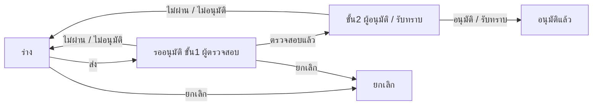

# BRD: แบบฟอร์มสรุปผลการคัดกรองโครงการเบื้องต้น (Preliminary Project Screening)

| Field | Value |
|---|---|
| BRD ID | BRD-TMP-003-001 |
| Feature | F-TMP-003 แบบฟอร์มสรุปผลการคัดกรองโครงการเบื้องต้น (รหัสชั่วคราว) |
| BRD Type | New Feature (แบบ 1 · Standalone) |
| Version | 1.0 |
| Status | **APPROVED (Prebrief Mode · Lane · unattended)** — DEC แทน Scope Lock จนมีใบเซ็นลูกค้า · มติ AI-DEFAULT 11 ข้อรอลูกค้ายืนยัน |
| Module | Business Development (ฝ่ายพัฒนาธุรกิจ) |
| Customer | แบบฟอร์มลูกค้า FM-BDM-03 Rev.00 : 01/07/2569 |
| Request | REQ-TMP-003 (ชั่วคราว — รอเลขจริงจาก F186) |
| Input | PREBRIEF_REQ-TMP-003_v2 · FORM_SPEC.json (14 ช่อง · เกณฑ์ 8 แถว · ลายเซ็น 3) · DECISIONS.lock (17 DEC · พร้อมเริ่มทำ) · feature.html (audit FAIL 0 · e2e 21/21) |
| Created / Updated | 2026-10-10 |

## Changelog
- v1.0 (2026-10-10): สร้างผ่าน brd-generator-full v2.3 Prebrief Mode (doc-master-pipeline ขั้น 7 · โหมดไม่เฝ้า)

---

## 1. Business Context
### 1.1 ปัญหา / โอกาส
ฝ่ายพัฒนาธุรกิจสรุปผลการคัดกรองโครงการ (ขั้นตอนที่ 4: คัดกรองและประเมินเบื้องต้น) ด้วยแบบฟอร์ม Excel FM-BDM-03 — คะแนนถ่วงน้ำหนักและผลเสนอคำนวณในเซลล์แต่แสดง 0 และ "ไม่เสนอให้ดำเนินการต่อ" ตั้งแต่ยังไม่ให้คะแนน · ช่องคะแนนมีรายการ ผ่าน/ไม่ผ่าน ทับรายการ 1-5 · น้ำหนักแก้ได้โดยไม่มีตรวจผลรวม · ผลการพิจารณาขัดกับคะแนนได้โดยไม่มีเหตุผล · ลงนามผู้ตรวจสอบ/ผู้อนุมัติด้วยมือ
### 1.2 เป้าหมาย
1. ขึ้นแบบฟอร์มเป็นเอกสารในระบบ ช่องตรงกระดาษ 1:1 ลูกค้าจำแบบเดิมได้ (PDF Replica 2 หน้า)
2. ระบบคำนวณคะแนนถ่วงน้ำหนัก คะแนนรวม และผลเสนอให้เอง · เกณฑ์/น้ำหนัก/เกณฑ์ผลเสนอ อ่านจาก config (ScreeningCriteria)
3. สายตรวจสอบ/อนุมัติจาก DOA กลาง (ค่าเริ่ม 2 ขั้น) แทนการเดินเอกสาร
### 1.3 ตัวชี้วัด
ไม่มีใน input → **OQ-01** (ห้ามแต่งตัวเลข)
### 1.4 ที่มา
แบบฟอร์มลูกค้า FM-BDM-03 (xlsx 1 ชีต) → FORM_SPEC 14 ช่อง (กรอก 9 · คำนวณ 3 · ระบบใส่ 2) · gate 10 หมวดตอบโดย AI ตาม unattended-policy (AI-DEFAULT ทุกหมวด)

## 2. Scope
### 2.1 In Scope
- รายการแบบสรุปผล (ค้นหา · กรอง สถานะ/ผลการพิจารณา/ฝ่าย · CSV · แบ่งหน้า) · สร้าง/แก้ร่าง wizard 3 ขั้น · ดูรายละเอียด 4 แท็บ (รายละเอียด › PDF › ลายเซ็น/อนุมัติ › ประวัติ)
- การประเมิน 8 เกณฑ์ (เกณฑ์ประเมิน · น้ำหนัก (%) จาก config) · คะแนน (1-5) · คะแนนถ่วงน้ำหนัก (คำนวณ) · เหตุผล / หลักฐาน · ความเสี่ยง / เงื่อนไข · คะแนนรวมถ่วงน้ำหนัก + ผลเสนอ (คำนวณ)
- ข้อสรุปการคัดกรอง: จุดเด่นของโครงการ · ข้อกังวลหลัก · ข้อมูลที่ต้องจัดหาเพิ่ม · ผลการพิจารณา (3 ค่า) · เงื่อนไข / ข้อสั่งการ · ข้อเสนอแนะขั้นตอนถัดไป
- ส่งอนุมัติ DOA 2 ขั้น (เลือกคนต่อขั้น) · ตรวจสอบแล้ว/อนุมัติ / รับทราบ · ไม่ผ่าน→กลับร่าง · ยกเลิก (เหตุผลบังคับ)
- แนบไฟล์ · PDF FM-BDM-03 Replica 2 หน้าทุกสถานะ · เลขที่ SCR จาก ENG-DOC-NUM · แจ้งเตือนเมื่ออนุมัติแล้วผลการพิจารณา = ไม่ดำเนินการต่อ
### 2.2 Out of Scope
- ผูกกับเอกสารโครงการ (FM-BDM-01) — กระดาษไม่มีช่อง (DEC-06 · DEC-16 → OQ-05) · สร้าง FM-BDM-04 อัตโนมัติเมื่อไม่ดำเนินการต่อ (DEC-02) · หน้าตั้งค่า ScreeningCriteria (ใช้ config กลาง → OQ-04) · ทำซ้ำเอกสาร · ประกาศเมื่ออนุมัติ
### 2.3 Assumptions
- ผู้จัดทำ/ตำแหน่ง/ฝ่ายมีใน F-EMP-001 / F-ORG-001 · ScreeningCriteria config มีหรือจะเพิ่ม (OQ-04) · ผู้ตรวจสอบ = ผู้บังคับบัญชาตรงของผู้จัดทำ
### 2.4 Scope Lock (ชั่วคราว = DECISIONS.lock · ยังไม่มีใบเซ็น → OQ-02)
| DEC | หมวด | มติ | ที่มา |
|---|---|---|---|
| DEC-01 | G1 | อนุมัติแล้วไม่เปลี่ยนค่าในระบบ | AI-DEFAULT |
| DEC-02 | G1 | ไม่ส่งต่อระบบอื่นรอบนี้ (ประกาศ event ไว้ใน FRD แต่ไม่ยิง) | AI-DEFAULT |
| DEC-03 | G2 | สายอนุมัติตั้งที่ DOA กลาง (dynamic) · ค่าเริ่ม 2 ขั้น: role-line-manager, role-gm · วงเงิน: ไม่มี | AI-DEFAULT |
| DEC-04 | G3 | เกณฑ์ 8 ข้อ + น้ำหนัก → ScreeningCriteria.items (snapshot ลงเอกสาร) · เกณฑ์ผลเสนอ ≥80/≥60/<60 → ScreeningCriteria.recommend_bands · สเกล 1-5 → ScreeningCriteria.score_max · คะแนนถ่วงน้ำหนัก = น้ำหนัก × คะแนน / 5 · คะแนนรวม = ผลรวม (เต็ม 100) · ส่งได้เมื่อให้คะแนนครบ 8 เกณฑ์ · มีเงื่อนไข → บังคับเงื่อนไข / ข้อสั่งการ · ผลพิจารณาขัดผลเสนอ = เตือน + ต้องกรอกเหตุผล | AI-DEFAULT |
| DEC-05 | G4 | เกณฑ์ประเมิน: สูงสุด 8 แถว (คงที่จาก config) · PDF อย่างน้อย 8 แถวตามกระดาษ | AI-DEFAULT |
| DEC-06 | G5 | ช่องตรงกระดาษ 1:1 · ไม่เพิ่มช่อง (เช่น หมายเหตุ) | AI-DEFAULT |
| DEC-07 | G6 | ลายเซ็นแถวล่าง 1 ช่องต่อขั้น DOA · ไม่ใช้ภาพลายมือชื่อ (ข้อความส่งในระบบ/พิจารณาในระบบ) | AI-DEFAULT |
| DEC-08 | G7 | ไม่อนุมัติ = กลับเป็นร่าง แก้แล้วส่งใหม่ · ยกเลิกได้โดย owner, admin_role สถานะ draft, pending · ต้องมีเหตุผล | AI-DEFAULT |
| DEC-09 | G8 | มองเห็น: เจ้าของ · ผู้อนุมัติเห็นหลังส่ง · admin role เห็นทั้งหมด | AI-DEFAULT |
| DEC-10 | G9 | ออกเลขเมื่อบันทึกครั้งแรก · รหัส SCR | AI-DEFAULT |
| DEC-11 | G10 | ของเสริม (กระดาษไม่มี): แนบไฟล์, ส่งออก CSV | AI-DEFAULT |
| DEC-12 | VALID | ช่องคะแนนรับเฉพาะเลขเต็ม 1-5 · ไม่ใช้รายการ ผ่าน/ไม่ผ่าน (พบ: data validation ผ่าน/ผ่านแบบมีเงื่อนไข/ต้องศึกษาเพิ่ม/ไม่ผ่าน ทับช่วงคะแนน) | FORM_SPEC |
| DEC-13 | VALID | แสดงว่างจนกว่าให้คะแนนครบ 8 เกณฑ์ · ส่งได้เมื่อให้คะแนนครบ (พบ: แสดง 0 และ "ไม่เสนอให้ดำเนินการต่อ" ตั้งแต่ยังไม่ให้คะแนน) | FORM_SPEC |
| DEC-14 | VALID | ผลการพิจารณาไม่ตรงผลเสนอ → ต้องกรอกเหตุผลใน เงื่อนไข / ข้อสั่งการ (เตือน ไม่บล็อก) | FORM_SPEC |
| DEC-15 | VALID | ผลการพิจารณา = ดำเนินการต่อแบบมีเงื่อนไข → เงื่อนไข / ข้อสั่งการ บังคับกรอก | FORM_SPEC |
| DEC-16 | VALID | ไม่เพิ่มช่องโครงการบนแบบพิมพ์ (G5 1:1) — เสนอให้ลูกค้ายืนยันการผูกกับโครงการ (FM-BDM-01) | FORM_SPEC |
| DEC-17 | VALID | ผลรวมน้ำหนักต้อง = 100 (ตรวจที่ config ไม่ให้แก้ในเอกสาร) | FORM_SPEC |

## 3. Roles & Permissions (COSO)
| Role | COSO | ทำอะไร |
|---|---|---|
| ผู้จัดทำ (ผู้เชี่ยวชาญด้านพัฒนาธุรกิจ / ผู้จัดการฝ่ายพัฒนาธุรกิจ) | Maker | สร้าง/แก้ร่าง · ส่ง · ยกเลิกของตัวเอง (ร่าง/รออนุมัติ) |
| role-line-manager (ผู้ตรวจสอบ · ผู้จัดการฝ่ายพัฒนาธุรกิจ) | Checker | ขั้น 1 ตรวจสอบแล้ว / ไม่ผ่านการตรวจสอบ |
| role-gm (ผู้อนุมัติ / รับทราบ · รองกรรมการผู้จัดการ / ผู้มีอำนาจตามตารางอำนาจอนุมัติ) | Approver | ขั้น 2 อนุมัติ / รับทราบ หรือ ไม่อนุมัติ |
| admin ฝ่ายพัฒนาธุรกิจ | Monitor | เห็นทั้งหมด · ยกเลิกได้ |

| Action | Maker | Checker | Approver | Admin |
|---|:-:|:-:|:-:|:-:|
| ดูใบ | ของตน | หลังส่ง (อยู่ในสาย) | หลังส่ง (อยู่ในสาย) | ทั้งหมด |
| สร้าง/แก้ร่าง | ✓ ของตน | – | – | – |
| ตัดสินขั้น | – | ขั้น 1 | ขั้น 2 | – |
| ยกเลิก | ✓ ของตน | – | – | ✓ |
SoD: ผู้จัดทำพิจารณาใบตัวเองไม่ได้ (BR-DOA-04) — กรณีผู้จัดทำเป็นผู้จัดการฝ่ายเอง ขั้น 1 ต้องเลือกคนอื่น · รองกรรมการผู้จัดการไม่มีใน DOA master ตรงตัว → role-gm ชั่วคราว (OQ-03)

## 4. User Journey
### 4.1 Happy Path
1. ผู้จัดทำ: สร้าง → ให้คะแนน 1-5 ครบ 8 เกณฑ์ (ระบบแสดงคะแนนถ่วงน้ำหนัก คะแนนรวม ผลเสนอสด) + เหตุผล/ความเสี่ยงต่อเกณฑ์ → สรุป จุดเด่น · ข้อกังวล · ข้อมูลที่ต้องจัดหาเพิ่ม · เลือกผลการพิจารณา · เงื่อนไข · ขั้นตอนถัดไป → แนบหลักฐาน (ไม่บังคับ) → บันทึก (ได้เลข SCR) → ส่ง เลือกคน 2 ขั้น
2. ขั้น 1 ผู้ตรวจสอบ "ตรวจสอบแล้ว" → ขั้น 2 "อนุมัติ / รับทราบ" → **อนุมัติแล้ว** · PDF เก็บสำเนา (approved_final) · ผลการพิจารณา = ไม่ดำเนินการต่อ → แจ้งผู้จัดทำให้ทำ FM-BDM-04 (scr_not_proceed_approved)
### 4.2 Alternative
- ไม่ผ่านการตรวจสอบ/ไม่อนุมัติ ขั้นใดก็ได้ → กลับร่าง เลขเดิม + เหตุผล → ผู้จัดทำแก้ ส่งใหม่ (resolve สายใหม่)
- ผลการพิจารณาไม่ตรงผลเสนอจากคะแนน → เตือน · บังคับกรอกเงื่อนไข / ข้อสั่งการ เป็นเหตุผล
- เลือก "ดำเนินการต่อแบบมีเงื่อนไข" → บังคับเงื่อนไข / ข้อสั่งการ
- ยกเลิก (ร่าง/รออนุมัติ) โดยเจ้าของหรือ admin

## 5. Data (จาก FORM_SPEC — ป้ายตามกระดาษ)
### 5.1 project_screening (header)
| ช่อง | field | ชนิด | ที่มา | บังคับ |
|---|---|---|---|:-:|
| เลขที่ (footer) | doc_no | text | auto ENG-DOC-NUM (SCR) | ✓ |
| วันที่ | doc_date | date | auto | ✓ |
| ผู้จัดทำ (ชื่อ · ตำแหน่ง) | preparer_id → snapshot | ref | system F-EMP-001 | ✓ |
| ฝ่าย | dept_snapshot | text | system F-ORG-001 | ✓ |
| คะแนนรวมถ่วงน้ำหนัก | total_score | numeric(5,2) | computed Σ weighted_score | ✓ (ตอนส่ง) |
| ผลเสนอจากคะแนน | recommendation | text | computed ตาม recommend_bands | ✓ (ตอนส่ง) |
| จุดเด่นของโครงการ | strengths | text | user | ✓ |
| ข้อกังวลหลัก | concerns | text | user | ✓ |
| ข้อมูลที่ต้องจัดหาเพิ่ม | info_needed | text | user | |
| ผลการพิจารณา | decision | enum ดำเนินการต่อ / ดำเนินการต่อแบบมีเงื่อนไข / ไม่ดำเนินการต่อ | user | ✓ |
| เงื่อนไข / ข้อสั่งการ | conditions | text | user | เมื่อมีเงื่อนไข หรือผลขัดคะแนน |
| ข้อเสนอแนะขั้นตอนถัดไป | next_steps | text | user | |
| + DOA fields | approval_status · doa_ref · approval_chain(jsonb) · approved_by · approved_at | | DOA | |
| + returned_reason · returned_by · returned_at | | | DEC-08 | |
### 5.2 project_screening_criterion (การประเมินและคัดกรองโครงการ · 8 แถวคงที่)
| ช่องบนกระดาษ | field | ชนิด | ที่มา | บังคับ |
|---|---|---|---|:-:|
| เกณฑ์ประเมิน | criterion_key · criterion_name_snapshot | text | auto (ScreeningCriteria.items) | ✓ |
| น้ำหนัก (%) | weight_pct_snapshot | smallint | auto (ScreeningCriteria.items) | ✓ |
| คะแนน (1-5) | score | smallint 1–5 | user | ✓ (ตอนส่ง) |
| คะแนนถ่วงน้ำหนัก | weighted_score | numeric(5,2) | computed weight × score / 5 | ✓ |
| เหตุผล / หลักฐาน | rationale | text | user | |
| ความเสี่ยง / เงื่อนไข | risk_condition | text | user | |
### 5.3 ค่าคงที่บนกระดาษ → config
8 เกณฑ์ + น้ำหนัก 15/15/15/20/10/10/10/5 → ScreeningCriteria.items · ≥80 / ≥60 / <60 → ScreeningCriteria.recommend_bands · สเกล 1-5 → ScreeningCriteria.score_max · ประวัติการแก้ไขแบบฟอร์ม → DocumentConfig.form_revisions (F003)
### 5.4 attachments → Document Center (ไฟล์ระดับใบ)

## 6. User Stories
| ID | Story | AC หลัก |
|---|---|---|
| S-01 | ผู้จัดทำสร้างแบบสรุปผลการคัดกรอง | 8 เกณฑ์จาก config · คะแนน 1-5 บังคับครบ · บันทึกได้เลข SCR |
| S-02 | ผู้จัดทำเห็นคะแนนถ่วงน้ำหนัก/คะแนนรวม/ผลเสนอทันที | อัปเดตสด · ว่างจนให้คะแนนครบ (ไม่แสดง 0) |
| S-03 | ผู้จัดทำสรุปผลการคัดกรอง | จุดเด่น/ข้อกังวล/ผลการพิจารณา บังคับ · มีเงื่อนไข → บังคับเงื่อนไข |
| S-04 | ผู้จัดทำเลือกผลการพิจารณาต่างจากผลเสนอ | เตือน + บังคับเหตุผลในเงื่อนไข / ข้อสั่งการ |
| S-05 | ผู้จัดทำส่งตรวจสอบ/อนุมัติ | slot 2 ขั้นค่าเริ่มจาก DOA · ผู้จัดทำไม่อยู่ในรายชื่อ · บังคับเลือกครบ |
| S-06 | ผู้ตรวจสอบ/ผู้อนุมัติตัดสิน | ปุ่มเฉพาะผู้พิจารณาขั้นปัจจุบัน · เรียงขั้น · ไม่ผ่านบังคับเหตุผล → กลับร่าง |
| S-07 | พิมพ์/ดาวน์โหลด PDF FM-BDM-03 | 2 หน้าทุกสถานะ · ลายเซ็น = ผู้จัดทำ + 1 แถวต่อขั้น DOA (dynamic) |
| S-08 | ยกเลิก | เจ้าของ/admin · ร่างหรือรออนุมัติ · เหตุผลบังคับ |
| S-09 | admin ดูทุกใบ + CSV | กรอง สถานะ/ผลการพิจารณา/ฝ่าย |
| S-10 | แจ้งเตือนผลไม่ดำเนินการต่อ | อนุมัติครบและผลการพิจารณา = ไม่ดำเนินการต่อ → แจ้งผู้จัดทำ (in-app+email) ให้ทำ FM-BDM-04 |

## 7. Status & Lifecycle
| จาก | Action | ไป | ใคร |
|---|---|---|---|
| — | บันทึกครั้งแรก | draft | Maker |
| draft | ส่ง | pending (ขั้น 1) | Maker |
| pending | ตัดสินผ่านขั้น n<N | pending (ขั้น n+1) | ผู้พิจารณาขั้น n |
| pending | ตัดสินผ่านขั้น N | approved | ขั้น N |
| pending | ไม่ผ่าน/ไม่อนุมัติ | draft (เลขเดิม · returned_*) | ผู้พิจารณาขั้นปัจจุบัน |
| draft / pending | ยกเลิก | cancelled | Maker / Admin |
approved = ล็อกแก้ไข

## 8. Business Rules + Validation
| ID | Rule | Tag | Type |
|---|---|:-:|---|
| BR-01 | คะแนนถ่วงน้ำหนัก = น้ำหนัก × คะแนน / score_max · ว่างจนให้คะแนน | FIXED | Formula (DEC-04) |
| BR-02 | คะแนนรวม = ผลรวมคะแนนถ่วงน้ำหนัก 8 เกณฑ์ · ว่างจนให้คะแนนครบ | FIXED | Formula (DEC-04 · DEC-13) |
| BR-03 | ผลเสนอจากคะแนนตาม ScreeningCriteria.recommend_bands (≥80 / ≥60 / <60) | CONFIGURABLE | Formula (DEC-04) |
| BR-04 | เกณฑ์/น้ำหนัก อ่านจาก ScreeningCriteria.items และ snapshot ลงเอกสารตอนสร้าง — ห้าม hardcode · ผลรวมน้ำหนัก = 100 ตรวจที่ config | CONFIGURABLE | Master (DEC-04 · DEC-17) |
| BR-05 | คะแนนรับเฉพาะเลขเต็ม 1..score_max (ตัดรายการ ผ่าน/ไม่ผ่าน) | FIXED | Validation (DEC-12) |
| BR-06 | ผลการพิจารณา = ดำเนินการต่อแบบมีเงื่อนไข → เงื่อนไข / ข้อสั่งการ บังคับ | CONFIGURABLE [AI-DEFAULT] | Validation (DEC-04 · DEC-15) |
| BR-07 | ผลการพิจารณาไม่ตรงผลเสนอ = เตือน ไม่บล็อก + บังคับเงื่อนไข / ข้อสั่งการ เป็นเหตุผล | CONFIGURABLE [AI-DEFAULT] | Policy (DEC-04 · DEC-14) |
| BR-08 | สายอนุมัติ resolve จาก DOA ตอนส่ง แล้ว freeze | FIXED | DOA (BR-DOA-02) |
| BR-09 | ไม่ผ่าน → draft เลขเดิม · resolve ใหม่ตอนส่งรอบถัดไป | FIXED | DEC-08 |
| BR-10 | ออกเลขตอนบันทึกครั้งแรก · no-gap ✗ | CONFIGURABLE | DOCCFG (DEC-10) |
| BR-11 | ร่างเห็นเฉพาะเจ้าของ (+ admin) | FIXED | Visibility (DEC-09) |
| BR-12 | ช่องลงชื่อใน PDF = ผู้จัดทำ + 1 แถวต่อขั้นที่ตั้งใน DOA (dynamic) · คำตัดสินตาม role | FIXED (จำนวน = DOA) | DEC-03 · DEC-07 |
| BR-13 | PDF 2 หน้าเสมอ (หน้า 1: หัว + การประเมิน 8 เกณฑ์ + คะแนนรวม · หน้า 2: ข้อสรุป + ลงชื่อ + ประวัติ) | FIXED | DEC-05 · thai-doc R10 |

| VR | ช่อง | เงื่อนไข | ข้อความ |
|---|---|---|---|
| VR-01 | score (ทุกเกณฑ์) | required 1–5 | ให้คะแนน (1-5) ให้ครบทั้ง 8 เกณฑ์ |
| VR-02 | strengths · concerns · decision | required | กรุณากรอกจุดเด่นของโครงการ / ข้อกังวลหลัก · กรุณาเลือกผลการพิจารณา |
| VR-03 | conditions | required เมื่อมีเงื่อนไข หรือผลขัดผลเสนอ | กรุณาระบุเงื่อนไข / ข้อสั่งการ |
| VR-04 | slot ผู้พิจารณา | ทุกขั้นต้องเลือก · ≠ ผู้จัดทำ | กรุณาเลือกผู้พิจารณา |
| VR-05 | เหตุผล ไม่ผ่าน/ยกเลิก | required | กรุณาระบุเหตุผล |

### 8.5 ระดับความยืดหยุ่น
BR-03/04 → ScreeningCriteria config · BR-06/07 → Policy (AI-DEFAULT รอยืนยัน) · BR-10 → F-DOCCFG · BR-12 → DOA กลาง

## 9. Edge Cases
| EC | กรณี | ผล |
|---|---|---|
| EC-01 | ยังไม่ให้คะแนนบางเกณฑ์ | ถ่วงน้ำหนักของเกณฑ์นั้นว่าง · คะแนนรวม/ผลเสนอว่าง (ไม่ใช่ 0 / ไม่ใช่ "ไม่เสนอ") |
| EC-02 | ผลการพิจารณาขัดผลเสนอ | เตือน + บังคับเหตุผล · บันทึกได้ |
| EC-03 | คะแนนรวมที่ขอบเกณฑ์ (80 / 60 พอดี) | ≥ = เข้าช่วงบน (80 = เสนอให้ดำเนินการต่อ · 60 = มีเงื่อนไข) |
| EC-04 | ผู้จัดทำเป็นผู้จัดการฝ่ายเอง (ขั้น 1 = ตัวเอง) | slot ว่าง ต้องเลือกคนอื่น |
| EC-05 | แก้ DOA ระหว่างรออนุมัติ | ใบเดิมใช้สาย snapshot |
| EC-06 | ตัดสินชนกัน (stale) | 409 → toast รีเฟรช สถานะไม่เปลี่ยน |
| EC-07 | แบบเอกสารปิดใช้ (F-DOCCFG) | ปุ่มสร้าง disabled |
| EC-08 | ScreeningCriteria เปลี่ยนน้ำหนักภายหลัง | ใบเดิมใช้ snapshot น้ำหนัก ณ ตอนสร้าง |
| EC-09 | ผลการพิจารณา = ไม่ดำเนินการต่อ | อนุมัติแล้วแจ้งผู้จัดทำทำ FM-BDM-04 เอง (ไม่สร้างอัตโนมัติ — DEC-02) |

## 10. Value Stream & Downstream Impact
Positioning: Business Development — ขั้นตอนที่ 4 (คัดกรองและประเมินเบื้องต้น) ต่อจาก FM-BDM-01/02 · ผลไม่ดำเนินการต่อ → FM-BDM-04
| ปลายทาง | ข้อมูล | Trigger | หมายเหตุ |
|---|---|---|---|
| ระบบอื่น / FM-BDM-04 | — | — | **ไม่ส่งต่อรอบนี้ (DEC-02)** — แจ้งเตือนเท่านั้น |
| ENG-NOTIFY | scr_cancelled · scr_not_proceed_approved | cancel / approved | |
| F-DOCCFG / ENG-DOC-STORE | PDF snapshot | approved_final | |

## 11. Delivery
Phase 1 = §2.1 · Phase 2 (เสนอ) = ผูกโครงการ (FM-BDM-01) · สร้าง FM-BDM-04 จากผลไม่ดำเนินการต่อ · หน้าตั้งค่า ScreeningCriteria

## 12. Dev Summary "ใบสั่ง"
- Config: ScreeningCriteria (items · score_max · recommend_bands) · DOA entry F-TMP-003 · doc_type SCR · DocumentConfig.form_revisions
- Declaration: DOA_BRIEF · NTF_BRIEF · DOCCFG_BRIEF · MDOC_BRIEF (ฉบับจริงหลัง FRD)
- Screen Inventory: P-01 รายการ · P-02 สร้าง/แก้ (drawer wide 3 ขั้น) · P-03 ดู (drawer 4 แท็บ) · M-01..05 modal ส่ง/อนุมัติ/ไม่ผ่าน/ยกเลิก/ทิ้งข้อมูล
- UI Signals: เอกสาร + พิมพ์ + ลายเซ็น = ใช่ · Q-form · ตารางเกณฑ์ในขั้น 1

## 13. Open Questions
| OQ | คำถาม | เจ้าของ | Block? |
|---|---|---|---|
| OQ-01 | ตัวชี้วัดความสำเร็จ (เช่น ระยะเวลาคัดกรองต่อโครงการ) | ลูกค้า | ไม่ |
| OQ-02 | ลูกค้าเซ็นยืนยัน DEC-01..11 (AI-DEFAULT) — โดยเฉพาะ 2 ขั้น · กลับร่าง · คำตัดสิน · admin เห็นทั้งหมด · เงื่อนไขบังคับ | Strike → ลูกค้า | ก่อน UAT |
| OQ-03 | role รองกรรมการผู้จัดการ / ผู้มีอำนาจตามตารางอำนาจอนุมัติ ไม่มีใน DOA master — ใช้ role-gm ชั่วคราว | Strike + พี่เบิร์ด | ก่อน wire |
| OQ-04 | ScreeningCriteria config มีใน Core แล้วหรือยัง / ใครดูแล | พี่เบิร์ด | ก่อน dev |
| OQ-05 | ต้องผูกแบบสรุปผลกับโครงการ (FM-BDM-01) ไหม — กระดาษไม่มีช่อง | ลูกค้า | ไม่ |
| OQ-06 | รหัส SCR ชนกับ doc_type อื่นใน F-DOCCFG ไหม · function_code taxonomy | Strike | ก่อน register |
| OQ-07 | ผลไม่ดำเนินการต่อ ต้องสร้าง FM-BDM-04 ต่ออัตโนมัติไหม | ลูกค้า | ไม่ |

## 14. Security & Compliance
Preset: Standard Internal · PII: ชื่อผู้จัดทำ/ผู้พิจารณา (snapshot) — ข้อมูลตัวอย่างใน prototype เป็นชื่อสมมติ · Audit append-only ทุก action · SoD ผู้จัดทำ≠ผู้พิจารณา · ไฟล์แนบตาม file_policy Document Center (≤20MB · pdf/doc/xls/img) · คำนวณคะแนนฝั่ง server

## 15. Health Check / Monitoring
SLA ต่อขั้น: ไม่กำหนดรอบนี้ (→ OQ-01) · KPI เสนอ: ใบรออนุมัติเกิน N วัน · สัดส่วนผลพิจารณาขัดผลเสนอ

## Appendix — Screen List
P-01 `#/project-screening` · P-02 `#/project-screening/create` · `/edit/:id` · P-03 `#/project-screening/view/:id`

## AI Review (Quality Gate)
C1–C19 ✓ · C16 ไม่มี Registry ตรง (WARN — feature ใหม่ เสนอใน _BATCH_REPORT) · C20 ✓ Scope Lock = DEC-01..17 ครบ + OQ-02 รอใบเซ็น → **APPROVED**
