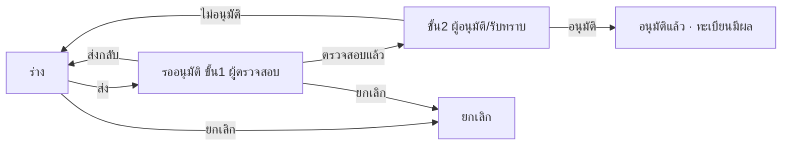

# BRD: แบบฟอร์มห้องข้อมูล มาตรฐานชื่อไฟล์ และทะเบียนควบคุมเอกสาร (Data Room Index and Document Control Register)

| Field | Value |
|---|---|
| BRD ID | BRD-IVM-IVMD-001 |
| Feature | F-TMP-006 แบบฟอร์มห้องข้อมูล มาตรฐานชื่อไฟล์ และทะเบียนควบคุมเอกสาร (รหัสชั่วคราว — รอ feature id จริง) |
| BRD Type | New Feature (แบบ 1 · ข้อมูลใหม่ทั้งหมด — ชื่อผู้จัดทำจาก F-EMP-001 · สายอนุมัติจาก DOA · มาตรฐานชื่อไฟล์/โฟลเดอร์มาตรฐานจาก config) |
| Version | 1.0 |
| Status | **APPROVED (Prebrief Mode · Lane · unattended)** — DEC แทน Scope Lock จนมีใบเซ็นลูกค้า · มติ AI-DEFAULT ทุกหมวด |
| Module | ฝ่ายบริหารการลงทุน (Investment Management) — module ใหม่ ยังไม่อยู่ใน Module Registry ของ DOA (OQ-03) |
| Customer | แบบฟอร์มลูกค้า FM-IVM-04 Rev.00 : 01/07/2569 (ขั้นตอนที่ 3 / 5 / 6 / 8: การจัดห้องข้อมูลและการควบคุมเอกสาร) |
| Request | REQ-TMP-006 (ชั่วคราว — รอเลขจริงจาก F186) |
| Input | PREBRIEF_REQ-TMP-006_v2 · FORM_SPEC.json (37 ช่อง · แถวซ้ำ 4 ชุด · ค่าคงที่ 6) · DECISIONS.lock (22 DEC · พร้อมเริ่มทำ) · feature.html (audit FAIL 0 · self_audit PASS · smoke 46/46 · jsdom 26/26 · NO-BROWSER) |
| Created / Updated | 2026-10-11 |

## Changelog
- v1.0 (2026-10-11): สร้างผ่าน brd-generator-full v2.3 Prebrief Mode (doc-master-pipeline ขั้น 7 · โหมดไม่เฝ้า)

---

## 1. Business Context
### 1.1 ปัญหา / โอกาส
ฝ่ายบริหารการลงทุนใช้ไฟล์ Excel FM-IVM-04 คุมห้องข้อมูลของแต่ละธุรกรรม — ตารางโครงสร้างโฟลเดอร์ 8 โฟลเดอร์มาตรฐาน · มาตรฐานการตั้งชื่อไฟล์ (วันที่_ชื่อเอกสาร_ฉบับ_สถานะ) · ทะเบียนสถานะเอกสารและประวัติฉบับ · บันทึกการเปลี่ยนแปลง · บันทึกสิทธิการเข้าถึง · รหัส D-/CH-/ลำดับ พิมพ์ไว้ล่วงหน้าแค่ 5 แถว · ช่องฉบับไม่มีกติกา (มาตรฐานบอก V01/V02/Final) · สถานะในชื่อไฟล์ (อังกฤษ 4 ค่า) ไม่ตรงกับ dropdown สถานะเอกสาร (ไทย 6 ค่า) · วันที่ยกเลิกสิทธิไม่ผูกกับสถานะสิทธิ · กระดาษไม่มีช่องระบุโครงการ · ตรวจทาน/อนุมัติ 3 ช่องส่งต่อด้วยมือ
### 1.2 เป้าหมาย
1. ขึ้นแบบฟอร์มเป็นเอกสารในระบบ ช่องตรงกระดาษ 1:1 (+ ชื่อโครงการ / ธุรกรรม) · PDF Replica FM-IVM-04 2 หน้า
2. มาตรฐานชื่อไฟล์และโฟลเดอร์มาตรฐานอ่านจาก config (ไม่ hardcode) · รหัสระบบรัน · ตรวจรูปแบบฉบับ · แสดงชื่อไฟล์ที่ควรเป็นตามมาตรฐาน
3. กติกาสิทธิการเข้าถึงและการเปลี่ยนแปลงที่ตรวจได้ · สายอนุมัติ 2 ขั้นจาก DOA กลาง (dynamic) · ประวัติ append-only
### 1.3 ตัวชี้วัด
ไม่มีใน input → **OQ-01** (ห้ามแต่งตัวเลข)
### 1.4 ที่มา
แบบฟอร์มลูกค้า FM-IVM-04 (xlsx · ชื่อชีต INV-FM-04) → FORM_SPEC 37 ช่อง · แถวซ้ำ 4 ชุด (8/5/5/5) · ตัวเลือก 5 ชุด (data validation D13:D20 · E44:E48 · F31:F35 · I37:I41 · J44:J48) · ค่าคงที่ 6 (มาตรฐานชื่อไฟล์ 5 + โฟลเดอร์มาตรฐาน) · anomalies 8 · gate 10 หมวด = AI-DEFAULT ทั้งหมด (โหมดไม่เฝ้า)

## 2. Scope
### 2.1 In Scope
- รายการทะเบียน (ค้นหา · กรองสถานะเอกสาร / มีเอกสารค้างตรวจทาน · CSV) · สร้าง/แก้ร่าง wizard 4 ขั้น · ดูรายละเอียด 4 แท็บ (รายละเอียด › PDF Preview › ลายเซ็น/อนุมัติ › ประวัติ)
- ชื่อโครงการ / ธุรกรรม · โครงสร้างโฟลเดอร์ 6 คอลัมน์ · มาตรฐานการตั้งชื่อไฟล์ (อ่านอย่างเดียว) · ทะเบียนเอกสาร 10 คอลัมน์ · การเปลี่ยนแปลงเอกสาร 10 คอลัมน์ · บันทึกสิทธิการเข้าถึง 10 คอลัมน์ (ไม่จำกัดแถว)
- ส่งอนุมัติ DOA 2 ขั้น (เลือกคนต่อขั้น) · ตรวจสอบแล้ว/ส่งกลับ → กลับร่าง · อนุมัติ/ไม่อนุมัติ · ยกเลิก (เหตุผลบังคับ)
- แนบไฟล์ระดับใบ · PDF FM-IVM-04 Replica 2 หน้าทุกสถานะ · เลขที่ IVMD จาก ENG-DOC-NUM
### 2.2 Out of Scope
- สร้าง/ถอนสิทธิจริงในไดรฟ์หรือห้องข้อมูลภายนอก (บันทึกเป็นทะเบียนเท่านั้น · DEC-01/02) · ตรวจชื่อไฟล์จริงในไดรฟ์ · เชื่อมแบบฟอร์มเริ่มต้นธุรกรรม FM-IVM-01 / ทะเบียนโครงการ (ชื่อโครงการกรอกเอง · OQ-05) · อัปเดตทะเบียนหลังอนุมัติโดยไม่ผ่านสายอนุมัติ (OQ-07) · ทำซ้ำเป็นฟีเจอร์ทางการ (DEC-14 ✗ — prototype มีเมนูทำซ้ำตามมาตรฐานเอกสาร แต่ไม่บังคับ dev)
### 2.3 Assumptions
- ข้อมูลพนักงาน/ตำแหน่งมีใน F-EMP-001 / F-ORG-001 · DOA กลางเพิ่ม module/role ของฝ่ายบริหารการลงทุนได้ (OQ-03) · มี config FileNamingPolicy / DataRoomPolicy (หรือสร้างใน Admin Panel · OQ-08) · ผู้รับผิดชอบ/ผู้ใช้งาน/ผู้อนุมัติในแถวเป็นข้อความ (อาจเป็นที่ปรึกษาภายนอก)
### 2.4 Scope Lock (ชั่วคราว = DECISIONS.lock · ยังไม่มีใบเซ็น → OQ-02)
| DEC | หมวด | มติ | ที่มา | ใช้ที่ |
|---|---|---|---|---|
| DEC-01 | G1 | อนุมัติแล้วไม่เปลี่ยนค่าในระบบ | AI-DEFAULT | html, thai-doc, brd, frd, tests, ntf-declaration |
| DEC-02 | G1 | ไม่ส่งต่อระบบอื่นรอบนี้ (ประกาศ event ไว้ใน FRD แต่ไม่ยิง) | AI-DEFAULT | brd, frd |
| DEC-03 | G2 | สายอนุมัติตั้งที่ DOA กลาง (dynamic) · ค่าเริ่ม 2 ขั้น: role-line-manager, role-gm · วงเงิน: ไม่มี | AI-DEFAULT | html, doa-declaration, frd, tests |
| DEC-04 | G3 | มาตรฐานชื่อไฟล์ 5 ค่า + โฟลเดอร์มาตรฐาน 8 โฟลเดอร์ อ่านจาก config · รหัส D-/CH-/ลำดับ/เลขที่โฟลเดอร์ ระบบรัน · ฉบับ Vnn/Final (บล็อก) · ฉบับสมบูรณ์ไม่ใช่ Final เตือน · แสดงชื่อไฟล์ตามมาตรฐาน · นำไปใช้แล้วต้องมีวันที่มีผล (บล็อก) · วันที่มีผลก่อนวันที่ เตือน · วันที่ยกเลิกสิทธิ ≥ วันที่ให้สิทธิ + หมดอายุ/ยกเลิกต้องมีวันที่ยกเลิกสิทธิ (บล็อก) · ≥1 โฟลเดอร์ + ≥1 เอกสาร (บล็อกตอนส่ง) · การเปลี่ยนแปลง/สิทธิ ว่างได้ (ฉบับเต็มใน DECISIONS.lock.md) | AI-DEFAULT | html, thai-doc, brd, frd, tests |
| DEC-05 | G4 | โครงสร้างโฟลเดอร์ห้องข้อมูล: ไม่จำกัดจำนวนแถว · PDF อย่างน้อย 8 แถวตามกระดาษ | AI-DEFAULT | html, thai-doc, frd |
| DEC-06 | G4 | ทะเบียนสถานะเอกสารและประวัติฉบับ: ไม่จำกัดจำนวนแถว · PDF อย่างน้อย 5 แถวตามกระดาษ | AI-DEFAULT | html, thai-doc, frd |
| DEC-07 | G4 | การเปลี่ยนแปลงเอกสาร: ไม่จำกัดจำนวนแถว · PDF อย่างน้อย 5 แถวตามกระดาษ | AI-DEFAULT | html, thai-doc, frd |
| DEC-08 | G4 | บันทึกสิทธิการเข้าถึงข้อมูล: ไม่จำกัดจำนวนแถว · PDF อย่างน้อย 5 แถวตามกระดาษ | AI-DEFAULT | html, thai-doc, frd |
| DEC-09 | G5 | ช่องตรงกระดาษ 1:1 · เพิ่ม: ชื่อโครงการ / ธุรกรรม (F01 · กระดาษไม่มีช่องระบุโครงการ) | AI-DEFAULT | html, thai-doc, brd, frd |
| DEC-10 | G6 | ลายเซ็นแถวล่าง 1 ช่องต่อขั้น DOA · ไม่ใช้ภาพลายมือชื่อ (ข้อความส่งในระบบ/พิจารณาในระบบ) | AI-DEFAULT | thai-doc, html, doccfg-declaration, frd |
| DEC-11 | G7 | ไม่อนุมัติ = กลับเป็นร่าง แก้แล้วส่งใหม่ · ยกเลิกได้โดย owner, admin_role สถานะ draft, pending · ต้องมีเหตุผล | AI-DEFAULT | html, frd, tests, doa-declaration |
| DEC-12 | G8 | มองเห็น: เจ้าของ · ผู้อนุมัติเห็นหลังส่ง · admin role เห็นทั้งหมด | AI-DEFAULT | html, frd, tests |
| DEC-13 | G9 | ออกเลขเมื่อบันทึกครั้งแรก · รหัส IVMD | AI-DEFAULT | doccfg-declaration, html, frd |
| DEC-14 | G10 | ของเสริม (กระดาษไม่มี): แนบไฟล์, ส่งออก CSV | AI-DEFAULT | html, brd, frd, ntf-declaration |
| DEC-15 | VALID | ยึด FM-IVM-04 ตาม footer เป็นรหัสแบบฟอร์ม (ชื่อชีต INV-FM-04) | FORM_SPEC | html, frd, tests |
| DEC-16 | VALID | ชื่อโครงการ / ธุรกรรม บังคับกรอก (ช่องเพิ่ม F01 · กระดาษแถว 4 ว่าง) | FORM_SPEC | html, frd, tests |
| DEC-17 | VALID | กระดาษคงโครงเดิม · ในระบบแสดงหัวย่อย "การเปลี่ยนแปลงเอกสาร" (ตาราง CH- ไม่มีหัวหมวด) | FORM_SPEC | html, frd, tests |
| DEC-18 | VALID | จับคู่สถานะ: ฉบับทำงาน→Working · รอตรวจทาน/รออนุมัติ→Review · ฉบับสมบูรณ์→Final · ส่งภายนอก→External · ยกเลิก→ไม่มี token | FORM_SPEC | html, frd, tests |
| DEC-19 | VALID | ฉบับต้องเป็น Vnn หรือ Final (บล็อก) · ฉบับสมบูรณ์ แต่ฉบับไม่ใช่ Final → เตือน | FORM_SPEC | html, frd, tests |
| DEC-20 | VALID | วันที่ยกเลิกสิทธิต้องไม่ก่อนวันที่ให้สิทธิ (บล็อก) · หมดอายุ/ยกเลิก ต้องมีวันที่ยกเลิกสิทธิ (บล็อก) | FORM_SPEC | html, frd, tests |
| DEC-21 | VALID | นำไปใช้แล้ว → ต้องมีวันที่มีผล (บล็อก) · วันที่มีผลก่อนวันที่ → เตือน | FORM_SPEC | html, frd, tests |
| DEC-22 | VALID | ตารางโฟลเดอร์ใช้ 6 คอลัมน์ตามหัวตาราง · คอลัมน์ว่าง G–J ไม่เป็นช่อง | FORM_SPEC | html, frd, tests |

## 3. Roles & Permissions (COSO)
| Role | COSO | ทำอะไร |
|---|---|---|
| ผู้จัดทำ (ผู้ประสานงานบริหารการลงทุน / ผู้รับผิดชอบที่ได้รับมอบหมาย) | Maker | สร้าง/แก้ร่าง · ส่ง · ยกเลิกของตัวเอง (ร่าง/รออนุมัติ) |
| ผู้ตรวจสอบ — role-line-manager (บนกระดาษ: ผู้จัดการฝ่ายบริหารการลงทุน) | Checker | ขั้น 1 ตรวจสอบแล้ว / ส่งกลับ |
| ผู้อนุมัติ / รับทราบ — role-gm (บนกระดาษ: รองกรรมการผู้จัดการ / กรรมการผู้จัดการ / ผู้มีอำนาจตามตารางอำนาจอนุมัติ (ถ้ามี)) | Approver | ขั้น 2 อนุมัติ / ไม่อนุมัติ |
| admin role ฝ่ายบริหารการลงทุน (เจ้าหน้าที่ดูแลห้องข้อมูล) | Monitor | เห็นทุกใบ · ยกเลิกได้ (ร่าง/รออนุมัติ) · CSV · รับแจ้งเมื่ออนุมัติเพื่อไปตั้งสิทธิจริงในไดรฟ์ |

| Action | Maker | Checker | Approver | Admin |
|---|:-:|:-:|:-:|:-:|
| ดูใบ | ของตน | หลังส่ง (อยู่ในสาย) | หลังส่ง (อยู่ในสาย) | ทั้งหมด |
| สร้าง/แก้ร่าง | ✓ ของตน | – | – | – |
| ตัดสินขั้น | – | ขั้น 1 | ขั้น 2 | – |
| ยกเลิก | ✓ ของตน | – | – | ✓ |
SoD: ผู้จัดทำพิจารณาใบตัวเองไม่ได้ (BR-DOA-04) · role จริงต้องเทียบ DOA master (OQ-03)

## 4. User Journey
### 4.1 Happy Path
1. ผู้จัดทำ: สร้าง → ใส่ชื่อโครงการ / ธุรกรรม → โครงสร้างโฟลเดอร์ (ตั้งต้น 8 โฟลเดอร์มาตรฐาน · ใส่ผู้รับผิดชอบ · ระดับสิทธิ · เอกสารที่ต้องมี) → ดูมาตรฐานการตั้งชื่อไฟล์ (อ่านอย่างเดียว) → ทะเบียนเอกสาร (ชื่อ · ผู้รับผิดชอบ · ฉบับ · วันที่ฉบับ · สถานะ · ตำแหน่งจัดเก็บ · ผู้ตรวจทาน · ผู้อนุมัติ — รหัส D- ระบบรัน · ชื่อไฟล์ตามมาตรฐานแสดงให้) → การเปลี่ยนแปลง (ถ้ามี) → สิทธิการเข้าถึง (ถ้ามี) → แนบไฟล์ → บันทึก (ได้เลข IVMD) → ส่ง เลือกคน 2 ขั้น
2. ขั้น 1 ตรวจสอบแล้ว → ขั้น 2 อนุมัติ → **อนุมัติแล้ว (ทะเบียนห้องข้อมูลมีผล)** · PDF เก็บสำเนา (approved_final) · แจ้งผู้จัดทำ + admin role (ivmd_register_approved) ให้ไปตั้งสิทธิจริงตามทะเบียน
### 4.2 Alternative
- ส่งกลับ / ไม่อนุมัติ ขั้นใดก็ได้ → กลับร่าง เลขเดิม + เหตุผล → ผู้จัดทำแก้ ส่งใหม่ (resolve สายใหม่)
- เอกสารสถานะ ฉบับสมบูรณ์ แต่ฉบับไม่ใช่ Final → เตือน ส่งได้ · วันที่มีผลก่อนวันที่บันทึกการเปลี่ยนแปลง → เตือน ส่งได้
- ยกเลิก (ร่าง/รออนุมัติ) โดยเจ้าของหรือ admin → ถ้ารออนุมัติ แจ้งผู้พิจารณาขั้นปัจจุบัน (ivmd_cancelled)

## 5. Data (จาก FORM_SPEC — ป้ายตามกระดาษ)
### 5.1 ivm_data_room (header)
| ช่องบนกระดาษ | field | ชนิด | ที่มา | บังคับ |
|---|---|---|---|:-:|
| (เลขที่ — ระบบเพิ่ม footer) | doc_no | text | auto ENG-DOC-NUM | ✓ |
| ชื่อโครงการ / ธุรกรรม (ช่องเพิ่ม · DEC-09/16) | project_name | text | user | ✓ |
| มาตรฐานการตั้งชื่อไฟล์ (5 แถว) | naming_snapshot (jsonb) | config | FileNamingPolicy ณ ออกเลข | ✓ |
| ผู้จัดทำ (ชื่อ/ตำแหน่ง) | maker_id · maker_name_snapshot · maker_position_snapshot | ref | system F-EMP-001 | ✓ |
| + DOA fields | approval_status · doa_ref · approval_chain (jsonb snapshot) · approver_role · approved_by · approved_at | | DOA | |
| + returned_reason · returned_by · returned_at · cancel_reason | | | DEC-11 | |
### 5.2 ivm_data_room_folder (โครงสร้างโฟลเดอร์ห้องข้อมูล — 6 คอลัมน์ตามกระดาษ)
| เลขที่โฟลเดอร์ `folder_no` (auto 2 หลัก) | ชื่อโฟลเดอร์ `folder_name` (✓ ตั้งต้นจาก config) | ผู้รับผิดชอบ `owner` (✓ text) | ระดับสิทธิ `access_level` (✓ enum 4) | เอกสารที่ต้องมี `required_docs` | หมายเหตุ `remark` |
### 5.3 ivm_data_room_document (ทะเบียนสถานะเอกสารและประวัติฉบับ — 10 คอลัมน์)
| รหัสเอกสาร `doc_code` (auto D-nnn) | ชื่อเอกสาร `doc_name` (✓) | ผู้รับผิดชอบ `owner` (✓) | ฉบับ `version` (✓ Vnn/Final) | วันที่ฉบับ `version_date` (✓) | สถานะเอกสาร `doc_status` (✓ enum 6) | ตำแหน่งจัดเก็บ / ลิงก์ `location` | ผู้ตรวจทาน `reviewer` | ผู้อนุมัติ `approver` | หมายเหตุ `remark` |
### 5.4 ivm_data_room_change (การเปลี่ยนแปลงเอกสาร — 10 คอลัมน์)
| รหัสการเปลี่ยนแปลง `change_code` (auto CH-nnn) | วันที่ `change_date` (✓) | ชื่อเอกสาร / ฉบับ `doc_ref` (✓) | รายละเอียดการเปลี่ยนแปลง `detail` (✓) | เหตุผล `reason` | ผลกระทบ `impact` | ผู้อนุมัติ / รับทราบ `approver` | วันที่มีผล `effective_date` | สถานะ `status` (✓ enum 4) | หมายเหตุ `remark` |
### 5.5 ivm_data_room_access (บันทึกสิทธิการเข้าถึงข้อมูล — 10 คอลัมน์)
| ลำดับ `seq` (auto) | ชื่อผู้ใช้งาน `user_name` (✓) | หน่วยงาน `org_unit` | บทบาท `role` | ระดับสิทธิ `access_level` (✓ enum 4) | ขอบเขตโฟลเดอร์ / เอกสาร `scope` (✓) | วันที่ให้สิทธิ `granted_date` (✓) | วันที่ยกเลิกสิทธิ `revoked_date` | ผู้อนุมัติ `approver` | สถานะสิทธิ `status` (✓ enum 3) |
### 5.6 attachments → Document Center (ไฟล์ระดับใบ)
### 5.7 ข้อความคงที่บนกระดาษ (ไม่ใช่ช่อง)
ใช้ในขั้นตอน · วัตถุประสงค์ · ผู้จัดทำ/ผู้ตรวจสอบ/ผู้อนุมัติ (คำอธิบาย) · หมายเหตุการใช้งาน · ประวัติการแก้ไข (= revision ของแบบฟอร์มจาก F-DOCCFG ไม่ใช่ข้อมูลใบ)

## 6. User Stories
| ID | Story | AC หลัก |
|---|---|---|
| S-01 | ผู้จัดทำสร้างทะเบียนห้องข้อมูลของโครงการ | ชื่อโครงการบังคับ · ตั้งต้น 8 โฟลเดอร์มาตรฐาน · ≥1 โฟลเดอร์ · ≥1 เอกสาร · บันทึกได้เลข IVMD |
| S-02 | ผู้จัดทำกำหนดโครงสร้างโฟลเดอร์ | ชื่อโฟลเดอร์/ผู้รับผิดชอบ/ระดับสิทธิบังคับ · เลขที่โฟลเดอร์ระบบรัน |
| S-03 | ผู้จัดทำเห็นมาตรฐานการตั้งชื่อไฟล์ | อ่านจาก config · แก้ในเอกสารไม่ได้ |
| S-04 | ผู้จัดทำบันทึกทะเบียนเอกสาร | รหัส D-nnn ระบบรัน · ฉบับ Vnn/Final · ชื่อไฟล์ตามมาตรฐานแสดงสด |
| S-05 | ผู้จัดทำบันทึกการเปลี่ยนแปลงเอกสาร | รหัส CH-nnn · นำไปใช้แล้วต้องมีวันที่มีผล |
| S-06 | ผู้จัดทำบันทึกสิทธิการเข้าถึง | วันที่ยกเลิกสิทธิ ≥ วันที่ให้สิทธิ · หมดอายุ/ยกเลิกต้องมีวันที่ยกเลิกสิทธิ |
| S-07 | ผู้จัดทำส่งอนุมัติ | slot 2 ขั้นค่าเริ่มจาก DOA · ผู้จัดทำไม่อยู่ในรายชื่อ · บังคับเลือกครบ |
| S-08 | ผู้ตรวจสอบตัดสิน | ตรวจสอบแล้ว / ส่งกลับ (เหตุผลบังคับ) → กลับร่าง |
| S-09 | ผู้อนุมัติตัดสินขั้นสุดท้าย | อนุมัติ → ทะเบียนมีผล + แจ้งผู้จัดทำ/admin · ไม่อนุมัติ → กลับร่าง |
| S-10 | พิมพ์/ดาวน์โหลด PDF FM-IVM-04 | ทุกสถานะ 2 หน้า · ≥8/5/5/5 แถว · ลายเซ็น = ผู้จัดทำ + 1 แถวต่อขั้นตาม DOA (dynamic) |
| S-11 | ยกเลิก | เจ้าของ/admin · ร่างหรือรออนุมัติ · เหตุผลบังคับ |
| S-12 | admin ดูทุกใบ + CSV | กรองสถานะ / มีเอกสารค้างตรวจทาน |

## 7. Status & Lifecycle
| จาก | Action | ไป | ใคร |
|---|---|---|---|
| — | บันทึกครั้งแรก | draft | Maker |
| draft | ส่ง | pending (ขั้น 1) | Maker |
| pending | ตรวจสอบแล้ว/อนุมัติ ขั้น n<N | pending (ขั้น n+1) | ผู้พิจารณาขั้น n |
| pending | อนุมัติขั้น N | approved | ขั้น N |
| pending | ส่งกลับ / ไม่อนุมัติ | draft (เลขเดิม · returned_*) | ผู้พิจารณาขั้นปัจจุบัน |
| draft / pending | ยกเลิก | cancelled | Maker / Admin |
approved = ล็อกแก้ไข · ปรับทะเบียนหลังอนุมัติ = ทำใบใหม่ (OQ-07)

## 8. Business Rules + Validation
| ID | Rule | Tag | Type |
|---|---|:-:|---|
| BR-01 | มาตรฐานการตั้งชื่อไฟล์ 5 ค่า อ่านจาก config FileNamingPolicy · snapshot ตอนออกเลข · แสดงอ่านอย่างเดียว | CONFIGURABLE | Config read (DEC-04) [AI-DEFAULT] |
| BR-02 | ใบใหม่ตั้งต้นโฟลเดอร์ 8 แถวจาก DataRoomPolicy.default_folders · แก้ชื่อ/เพิ่ม/ลบได้ | CONFIGURABLE | Default (DEC-04) [AI-DEFAULT] |
| BR-03 | เลขที่โฟลเดอร์ 2 หลัก · รหัสเอกสาร D-nnn · รหัสการเปลี่ยนแปลง CH-nnn · ลำดับสิทธิ — ระบบรันต่อใบตามลำดับแถว | FIXED | Auto (DEC-04) |
| BR-04 | ฉบับ = V ตามด้วยเลข 2 หลัก หรือ Final — อื่นบล็อก | FIXED | Validation (DEC-19) |
| BR-05 | สถานะ ฉบับสมบูรณ์ แต่ฉบับไม่ใช่ Final → เตือน ไม่บล็อก | CONFIGURABLE | Warning (DEC-19) [AI-DEFAULT] |
| BR-06 | ชื่อไฟล์ตามมาตรฐาน = วันที่ฉบับ (YYYYMMDD)_ชื่อเอกสาร (ช่องว่าง→_)_ฉบับ_token สถานะ · แสดงอย่างเดียว ไม่ตรวจไฟล์จริง | FIXED | Derived (DEC-04 · DEC-18) |
| BR-07 | การเปลี่ยนแปลงสถานะ นำไปใช้แล้ว ต้องมีวันที่มีผล (บล็อก) · วันที่มีผลก่อนวันที่ → เตือน | FIXED / CONFIGURABLE | Validation · Warning (DEC-21) |
| BR-08 | วันที่ยกเลิกสิทธิ ≥ วันที่ให้สิทธิ · สถานะสิทธิ หมดอายุ/ยกเลิก ต้องมีวันที่ยกเลิกสิทธิ (บล็อก) | FIXED | Validation (DEC-20) |
| BR-09 | ตัวเลือกตามแบบฟอร์ม (master list): ระดับสิทธิ 4 · สถานะเอกสาร 6 · สถานะการเปลี่ยนแปลง 4 · สถานะสิทธิ 3 | CONFIGURABLE | Master list |
| BR-10 | ต้องมีโฟลเดอร์ ≥ 1 และเอกสาร ≥ 1 ก่อนบันทึก/ส่ง · การเปลี่ยนแปลง/สิทธิ ว่างได้ | FIXED | Validation (DEC-04) |
| BR-11 | สายอนุมัติ resolve จาก DOA ตอนส่ง แล้ว freeze · ผู้จัดทำพิจารณาใบตัวเองไม่ได้ | FIXED | DOA (BR-DOA-02/04) |
| BR-12 | ส่งกลับ/ไม่อนุมัติ → draft เลขเดิม · resolve ใหม่ตอนส่งรอบถัดไป | FIXED | DEC-11 (BR-DOA-03) |
| BR-13 | ออกเลขตอนบันทึกครั้งแรก · no-gap ✗ · รหัส IVMD | CONFIGURABLE | DOCCFG (DEC-13) |
| BR-14 | ร่างเห็นเฉพาะเจ้าของ (+ admin) | FIXED | Visibility (DEC-12) |
| BR-15 | ช่องลงชื่อใน PDF = ผู้จัดทำ + 1 แถวต่อขั้นที่ตั้งใน DOA (dynamic ไม่ fix) · คำตัดสินตาม role | FIXED (จำนวน = DOA) | DEC-03 · DEC-10 |
| BR-16 | PDF แสดงโฟลเดอร์ ≥ 8 · เอกสาร ≥ 5 · การเปลี่ยนแปลง ≥ 5 · สิทธิ ≥ 5 แถว · ไม่จำกัดในระบบ · แบบพิมพ์ 2 หน้า (R10) | FIXED | DEC-05..08 |
| BR-17 | อนุมัติแล้วไม่เปลี่ยนค่าในระบบอื่น ไม่ส่งต่อ ไม่สร้างสิทธิจริงในไดรฟ์ (ประกาศ event ไว้ไม่ยิง) | FIXED | DEC-01/02 |
| BR-18 | รหัสแบบฟอร์ม FM-IVM-04 ตาม footer (ไม่ใช่ชื่อชีต INV-FM-04) | FIXED | DEC-15 |
| BR-19 | ชื่อโครงการ / ธุรกรรม บังคับ (ช่องเพิ่มจากกระดาษ) · ของเสริม: แนบไฟล์ · CSV | FIXED | DEC-09 · DEC-16 · DEC-14 [AI-DEFAULT] |
| BR-20 | ตารางโฟลเดอร์ 6 คอลัมน์ · ตาราง CH- อยู่ใต้หมวดทะเบียนเอกสาร (ในระบบมีหัวย่อย "การเปลี่ยนแปลงเอกสาร") | FIXED | DEC-17 · DEC-22 |

| VR | ช่อง | เงื่อนไข | ข้อความ |
|---|---|---|---|
| VR-01 | project_name | required | กรุณากรอกชื่อโครงการ / ธุรกรรม |
| VR-02 | folders[].folder_name · owner · access_level | required ต่อแถว | โฟลเดอร์ที่ n: กรอก ชื่อโฟลเดอร์ · ผู้รับผิดชอบ · ระดับสิทธิ |
| VR-03 | documents[].doc_name · owner · version · version_date · doc_status | required ต่อแถว | เอกสารที่ n: กรอก ชื่อเอกสาร · ผู้รับผิดชอบ · ฉบับ · วันที่ฉบับ · สถานะเอกสาร |
| VR-04 | documents[].version | V\d{2} หรือ Final | ฉบับต้องเป็น V01, V02 … หรือ Final |
| VR-05 | changes[].change_date · doc_ref · detail · status | required ต่อแถว | การเปลี่ยนแปลงที่ n: กรอก วันที่ · ชื่อเอกสาร / ฉบับ · รายละเอียดการเปลี่ยนแปลง · สถานะ |
| VR-06 | changes[].effective_date | required เมื่อ status = applied | สถานะ นำไปใช้แล้ว ต้องระบุวันที่มีผล |
| VR-07 | access[].user_name · access_level · scope · granted_date · status | required ต่อแถว | ผู้ใช้งานที่ n: กรอก ชื่อผู้ใช้งาน · ระดับสิทธิ · ขอบเขตโฟลเดอร์ / เอกสาร · วันที่ให้สิทธิ · สถานะสิทธิ |
| VR-08 | access[].revoked_date | ≥ granted_date | วันที่ยกเลิกสิทธิต้องไม่ก่อนวันที่ให้สิทธิ |
| VR-09 | access[].revoked_date | required เมื่อ status ∈ {expired, revoked} | สถานะ {หมดอายุ/ยกเลิก} ต้องระบุวันที่ยกเลิกสิทธิ |
| VR-10 | folders[] · documents[] | ≥ 1 แถว | ต้องมีโฟลเดอร์อย่างน้อย 1 รายการ / ต้องมีเอกสารอย่างน้อย 1 รายการ |
| VR-11 | slot ผู้พิจารณา | ทุกขั้นต้องเลือก · ≠ ผู้จัดทำ | กรุณาเลือกผู้พิจารณา |
| VR-12 | เหตุผล ส่งกลับ/ไม่อนุมัติ/ยกเลิก | required | กรุณาระบุเหตุผล |

### 8.5 ระดับความยืดหยุ่น
BR-01/02 → Admin Panel (FileNamingPolicy · DataRoomPolicy) · BR-05/07 (ส่วนเตือน)/09 → Admin Panel (Investment Policy) · BR-13 → F-DOCCFG · สายอนุมัติ → DOA กลาง

## 9. Edge Cases
| EC | กรณี | ผล |
|---|---|---|
| EC-01 | ฉบับ "v3" / "V3" / "Final2" | บล็อก (VR-04) |
| EC-02 | ฉบับสมบูรณ์ แต่ฉบับ V03 | เตือน ส่งได้ (BR-05) |
| EC-03 | การเปลี่ยนแปลง นำไปใช้แล้ว ไม่มีวันที่มีผล | บล็อก (VR-06) |
| EC-04 | วันที่มีผลก่อนวันที่บันทึก | เตือน ส่งได้ |
| EC-05 | วันที่ยกเลิกสิทธิก่อนวันที่ให้สิทธิ / สถานะยกเลิกไม่มีวันที่ยกเลิก | บล็อก (VR-08/09) |
| EC-06 | ลบโฟลเดอร์จนเหลือ 1 · ลบเอกสารจนเหลือ 1 | ลบแถวสุดท้ายไม่ได้ |
| EC-07 | โฟลเดอร์ > 8 / เอกสาร > 5 / การเปลี่ยนแปลง > 5 / สิทธิ > 5 | PDF หัวตารางซ้ำ · dense · 2 หน้า (ต้องยืนยันบนเครื่องที่มี browser) |
| EC-08 | สถานะเอกสาร ยกเลิก | ชื่อไฟล์ตามมาตรฐานไม่มี token สถานะ (DEC-18) |
| EC-09 | ผู้จัดทำ = ผู้จัดการฝ่าย (resolve ขั้น 1 = ตัวเอง) | slot ว่าง ต้องเลือกคนอื่น |
| EC-10 | DOA ตั้ง 6 ขั้น | PDF 7 แถวลงชื่อ · dense |
| EC-11 | ส่ง/อนุมัติชนกัน (stale) | 409 → toast รีเฟรช สถานะไม่เปลี่ยน |
| EC-12 | แบบเอกสารปิดใช้ (F-DOCCFG) | ปุ่มสร้าง disabled |
| EC-13 | config มาตรฐานชื่อไฟล์เปลี่ยนหลังออกเลข | ใบเดิมแสดง snapshot เดิม |
| EC-14 | ชื่อชีต INV-FM-04 ≠ Doc No. | ใช้ FM-IVM-04 (DEC-15) |

## 10. Value Stream & Downstream Impact
Positioning: กระบวนการบริหารการลงทุน — เริ่มต้นธุรกรรม (FM-IVM-01) → ตารางติดตามงาน (FM-IVM-02) → คำถาม-คำตอบ (FM-IVM-03) → **ขั้นตอนที่ 3/5/6/8 การจัดห้องข้อมูลและการควบคุมเอกสาร (feature นี้)** → … → ปิดงานและห้องข้อมูล (FM-IVM-11)
| ปลายทาง | ข้อมูล | Trigger | หมายเหตุ |
|---|---|---|---|
| admin role ฝ่าย (ผู้ดูแลห้องข้อมูล) | ทะเบียนสิทธิที่อนุมัติ | approved | ENG-NOTIFY ivmd_register_approved → ไปตั้งสิทธิในไดรฟ์จริง (นอกระบบ) |
| FM-IVM-11 ปิดงานและห้องข้อมูล | ทะเบียนเอกสาร + สิทธิ | approved | **ปิดรอบนี้ (DEC-02)** — ประกาศ event `ivmd.approved` ใน FRD ไม่ยิง |
| F-DOCCFG / ENG-DOC-STORE | PDF snapshot | approved_final | |
| รายงาน | เอกสารค้างตรวจทาน · สิทธิใช้งาน | — | Report area อ่าน |

## 11. Delivery
Phase 1 = ทุกอย่างใน §2.1 · Phase 2 (เสนอ) = เชื่อมทะเบียนโครงการ/FM-IVM-01 · ส่งต่อ FM-IVM-11 · ฉบับแก้ไขหลังอนุมัติ (OQ-07)

## 12. Dev Summary "ใบสั่ง"
- Config: DOA entry F-TMP-006 (2 ขั้น · role-line-manager → role-gm) · doc_type IVMD (F-DOCCFG) · FileNamingPolicy (5 ค่า) · DataRoomPolicy.default_folders (8) · master list 4 ชุด
- Declaration: DOA_BRIEF · NTF_BRIEF · DOCCFG_BRIEF · MDOC_BRIEF (ฉบับจริงหลัง FRD)
- Screen Inventory: P-01 รายการ · P-02 สร้าง/แก้ (drawer wide 4 ขั้น · ตารางกรอก 4 ชุด) · P-03 ดู (drawer 4 แท็บ) · M-01..05 modal ส่ง/อนุมัติ/ส่งกลับ/ยกเลิก/ทิ้งข้อมูล
- UI Signals: เอกสารบันทึก + พิมพ์ + ลายเซ็น = ใช่ · Q-form

## 13. Open Questions
| OQ | คำถาม | เจ้าของ | Block? |
|---|---|---|---|
| OQ-01 | ตัวชี้วัดความสำเร็จ (สัดส่วนไฟล์ตั้งชื่อตามมาตรฐาน / เวลาอนุมัติเฉลี่ย) | ลูกค้า | ไม่ |
| OQ-02 | ลูกค้าเซ็นยืนยัน DEC-01..14 (AI-DEFAULT ทั้งหมด) — โดยเฉพาะ ช่องเพิ่มชื่อโครงการ · 2 ขั้น · ส่งกลับ = กลับร่าง · ฉบับ Vnn/Final บล็อก · กติกาสิทธิ | ทีม BA → ลูกค้า | ก่อน UAT |
| OQ-03 | role ผู้จัดการฝ่ายบริหารการลงทุน / รองกรรมการผู้จัดการ / กรรมการผู้จัดการ ไม่มีใน DOA contract (ใช้ role-line-manager / role-gm แทน) · module investment ไม่อยู่ใน Module Registry | ทีม BA + พี่เบิร์ด | ก่อน wire |
| OQ-04 | admin role ของฝ่ายบริหารการลงทุน (ใครเห็นทั้งหมด/ดูแลห้องข้อมูล) — ยังไม่มี role id | ทีม BA | ก่อน dev |
| OQ-05 | ทำทะเบียนโครงการ / FM-IVM-01 เมื่อไร (เลือกโครงการแทนพิมพ์) | ทีม BA | ไม่ |
| OQ-06 | รหัส IVMD ใน F-DOCCFG · function_code / taxonomy ใน F185 · feature id จริงแทน F-TMP-006 | ทีม BA | ก่อน register |
| OQ-07 | หลังอนุมัติ การเพิ่มเอกสาร/เปลี่ยนสิทธิ ต้องทำใบใหม่ผ่านสายอนุมัติ หรือแก้ทะเบียนเดิมแบบมีฉบับได้ | ลูกค้า | ก่อน Phase 2 |
| OQ-08 | config FileNamingPolicy / DataRoomPolicy เป็นของ feature ใด (Admin Panel ฝ่ายลงทุน หรือ Policy Center) | ทีม BA | ก่อน dev |

## 14. Security & Compliance
Preset: Standard (เอกสารภายใน · ข้อมูลการลงทุน/รายชื่อผู้มีสิทธิ = Confidential) · PII: ชื่อผู้จัดทำ/ผู้รับผิดชอบ/ผู้ใช้งาน — ข้อมูลตัวอย่างใน prototype เป็นชื่อสมมติ (ไฟล์ลูกค้าไม่มีข้อมูลตัวอย่าง) · ตำแหน่งจัดเก็บ/ลิงก์ ห้ามเก็บรหัสผ่านหรือ token · Audit append-only ทุก action · SoD ผู้จัดทำ≠ผู้อนุมัติ · ไฟล์แนบตาม file_policy Document Center

## 15. Health Check / Monitoring
SLA ต่อขั้น: ไม่กำหนดรอบนี้ (→ OQ-01) · KPI เสนอ: เอกสารค้างตรวจทาน/อนุมัติ · สิทธิสถานะใช้งานของผู้ใช้ภายนอก · ใบรออนุมัติเกิน N วัน · Widget: ห้องข้อมูลที่มีเอกสารค้าง

## Appendix — Screen List
P-01 `#/ivm-data-room` · P-02 `#/ivm-data-room/create` · `/edit/:id` · P-03 `#/ivm-data-room/view/:id`

## AI Review (Quality Gate)
C1–C20 ผ่าน · C20 Scope Lock: DEC ครบ 22 ข้อจาก DECISIONS.lock + OQ-02 รอใบเซ็น → ✅ · ไม่มีตัวเลขแต่ง · ทุก BR อ้าง DEC → **APPROVED**
