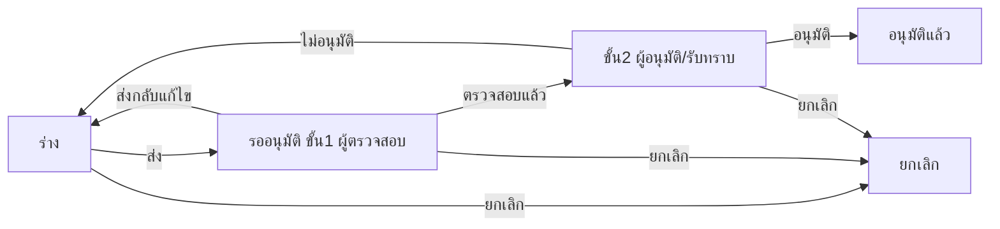

# BRD: แบบฟอร์มเริ่มต้นธุรกรรม (Transaction Initiation Form)

| Field | Value |
|---|---|
| BRD ID | BRD-TMP-001 |
| Feature | F-TMP-001 แบบฟอร์มเริ่มต้นธุรกรรม (รหัสชั่วคราว — รอรหัสจริงจาก FEATURE_REGISTRY) |
| BRD Type | New Feature (แบบ 2 · ดึงข้อมูลเดิม — ผู้รับผิดชอบจาก F-EMP-001) |
| Version | 1.0 |
| Status | **APPROVED (Prebrief Mode · Lane)** — DEC แทน Scope Lock จนมีใบเซ็นลูกค้า |
| Module | บริหารการลงทุน (ยังไม่มีใน FEATURE_REGISTRY → เสนอ module ใหม่ · DOA ใช้ module `finance` ชั่วคราว) |
| Customer | ฝ่ายบริหารการลงทุน (แบบฟอร์ม FM-IVM-01 Rev.00 : 01/07/2569) |
| Request | REQ-TMP-001 (ชั่วคราว — รอเลขจริงจาก F186) |
| Input | PREBRIEF_REQ-TMP-001_v2 · FORM_SPEC.json (18 ช่อง) · DECISIONS.lock (14 DEC · พร้อมเริ่มทำ · AI-DEFAULT 11) · feature.html (audit FAIL 0 · self_audit PASS · smoke 29/29) |
| Created / Updated | 2026-10-11 |

## Changelog
- v1.0 (2026-10-11): สร้างผ่าน brd-generator-full v2.3 Prebrief Mode (doc-master-pipeline ขั้น 7 · โหมดไม่เฝ้า)

---

## 1. Business Context
### 1.1 ปัญหา / โอกาส
ฝ่ายบริหารการลงทุนใช้แบบฟอร์ม Excel FM-IVM-01 บันทึกข้อมูลเริ่มต้นของแต่ละธุรกรรม/โครงการ (ขั้นตอนที่ 1 ของกระบวนการบริหารการลงทุน) — ไฟล์กระจายอยู่ในไดรฟ์ ไม่มีเลขที่เอกสาร · ลงนามตรวจทาน/อนุมัติบนกระดาษ · ประวัติการแก้ไขกรอกมือ · ค้นหาย้อนหลังยาก (หมายเหตุบนฟอร์มเองระบุว่าต้องเก็บไฟล์ให้ "ตรวจสอบย้อนหลังได้")
### 1.2 เป้าหมาย
1. ขึ้นแบบฟอร์มเป็นเอกสารในระบบ ช่องตรงกระดาษ 1:1 ลูกค้าจำแบบเดิมได้ (PDF Replica 2 หน้า)
2. กำหนดผู้รับผิดชอบจากรายชื่อพนักงานจริง + แจ้งผู้รับผิดชอบเมื่ออนุมัติ
3. ตรวจทาน/อนุมัติผ่านสาย DOA กลาง (ผู้ตรวจสอบ → ผู้อนุมัติ/รับทราบ) · ประวัติการแก้ไขสร้างอัตโนมัติ
### 1.3 ตัวชี้วัด
ไม่มีใน input → **OQ-01** (ห้ามแต่งตัวเลข)
### 1.4 ที่มา
แบบฟอร์มลูกค้า FM-IVM-01 (xlsx · 1 หน้า) → FORM_SPEC 18 ช่อง · gate 10 หมวดตอบโดย AI ตาม unattended-policy (AI-DEFAULT ทุกหมวด)

## 2. Scope
### 2.1 In Scope
- รายการแบบฟอร์ม (ค้นหา/กรอง สถานะ·ฝ่าย · CSV) · สร้าง/แก้ร่าง wizard 3 ขั้น · ดูรายละเอียด 4 แท็บ (รายละเอียด › PDF › ลายเซ็น/อนุมัติ › ประวัติ)
- ข้อมูลธุรกรรม 8 ช่อง + ขอบเขตงานและความพร้อมของข้อมูล 5 ช่อง ตามกระดาษ · ผู้รับผิดชอบเลือกจากพนักงาน
- ส่งอนุมัติ DOA 2 ขั้นค่าเริ่ม (เลือกคนต่อขั้น) · ตรวจสอบแล้ว/ส่งกลับแก้ไข · อนุมัติ/ไม่อนุมัติ → กลับร่างเลขเดิม · ยกเลิก (เหตุผลบังคับ)
- ประวัติการแก้ไข (ฉบับ · วันที่ · รายละเอียด · ผู้จัดทำ · ผู้อนุมัติ) สร้างจากรอบส่ง/อนุมัติ · แนบไฟล์ · PDF FM-IVM-01 Replica ทุกสถานะ · เลขที่ IVMA จาก ENG-DOC-NUM
### 2.2 Out of Scope
- แบบฟอร์มขั้นถัดไปของกระบวนการ (FM-IVM-02..11) · ทะเบียนโครงการ/ธุรกรรมกลาง (master) · ส่งต่อระบบอื่น (DEC-02) · ทำซ้ำเป็นเอกสารชุด · ประกาศ
### 2.3 Assumptions
- ข้อมูลพนักงาน/ตำแหน่ง/ฝ่ายมีใน F-EMP-001 / F-ORG-001 · ผู้ตรวจสอบ = ผู้บังคับบัญชาตรงของผู้จัดทำ (role-line-manager) · ผู้อนุมัติ/รับทราบ = role-gm (ใกล้สุดกับ "รองกรรมการผู้จัดการ / กรรมการผู้จัดการ") → OQ-03
### 2.4 Scope Lock (ชั่วคราว = DECISIONS.lock · ยังไม่มีใบเซ็น → OQ-02)
| DEC | หมวด | มติ | ที่มา |
|---|---|---|---|
| DEC-01 | G1 | อนุมัติแล้วไม่เปลี่ยนค่าในระบบ | AI-DEFAULT |
| DEC-02 | G1 | ไม่ส่งต่อระบบอื่นรอบนี้ (ประกาศ event ใน FRD ไม่ยิง) | AI-DEFAULT |
| DEC-03 | G2 | DOA dynamic ค่าเริ่ม 2 ขั้น: role-line-manager (ผู้ตรวจสอบ) → role-gm (ผู้อนุมัติ / รับทราบ) · ไม่มีวงเงิน | AI-DEFAULT |
| DEC-04 | G3 | ไม่มีสูตร/ค่าคงที่บนกระดาษ (ค่าเสนอมาตรฐาน: คำนวณอัตโนมัติ · เกินเกณฑ์ = เตือน) | AI-DEFAULT |
| DEC-05 | G4 | ประวัติการแก้ไข: ไม่จำกัดแถว · PDF ≥ 2 แถวตามกระดาษ | AI-DEFAULT |
| DEC-06 | G5 | ช่องตรงกระดาษ 1:1 · ไม่เพิ่มช่อง | AI-DEFAULT |
| DEC-07 | G6 | ลายเซ็น 1 แถวต่อขั้น DOA · ข้อความ "ส่ง/พิจารณาในระบบ" ไม่ใช้ภาพ | AI-DEFAULT |
| DEC-08 | G7 | ไม่อนุมัติ = กลับร่างเลขเดิม · ยกเลิก: เจ้าของ + admin · ร่าง/รออนุมัติ · เหตุผลบังคับ | AI-DEFAULT |
| DEC-09 | G8 | เจ้าของ · ผู้อนุมัติหลังส่ง · admin role ของฝ่ายบริหารการลงทุนเห็นทั้งหมด | AI-DEFAULT |
| DEC-10 | G9 | ออกเลขตอนบันทึกครั้งแรก · รหัส IVMA | AI-DEFAULT |
| DEC-11 | G10 | แนบไฟล์ ✓ · CSV ✓ · ทำซ้ำ ✗ · ประกาศ ✗ | AI-DEFAULT |
| DEC-12 | VALID | ยึด Doc No. FM-IVM-01 ตาม footer (ชื่อชีต INV-FM-01 ขัดกัน) | FORM_SPEC |
| DEC-13 | VALID | แถวป้ายว่างในหมวดขอบเขตงานไม่ทำเป็นช่อง · แบบพิมพ์คงแถวว่าง | FORM_SPEC |
| DEC-14 | VALID | ไม่ hardcode ผู้อนุมัติ — อ่านจาก DOA (approval_chain) · TODO: DOA engine | FORM_SPEC |

## 3. Roles & Permissions (COSO)
| Role | COSO | ทำอะไร |
|---|---|---|
| ผู้จัดทำ (ผู้ประสานงานบริหารการลงทุน / ผู้ได้รับมอบหมาย) | Maker | สร้าง/แก้ร่าง · ส่ง · ยกเลิกของตัวเอง (ร่าง/รออนุมัติ) |
| role-line-manager (ผู้ตรวจสอบ — ผจก.ฝ่ายบริหารการลงทุน) | Checker | ขั้น 1 ตรวจสอบแล้ว / ส่งกลับแก้ไข |
| role-gm (ผู้อนุมัติ / รับทราบ — รอง กก.ผจก. / กก.ผจก.) | Approver | ขั้น 2 อนุมัติ / ไม่อนุมัติ |
| admin role ฝ่ายบริหารการลงทุน | Custodian (view) | เห็นทุกใบ · ยกเลิกได้ |
| ผู้รับผิดชอบ | — (ผู้รับแจ้ง) | ได้รับแจ้งเมื่ออนุมัติ |

| Action | Maker | Checker | Approver | Admin |
|---|:-:|:-:|:-:|:-:|
| ดูใบ | ของตน | หลังส่ง (อยู่ในสาย) | หลังส่ง (อยู่ในสาย) | ทั้งหมด |
| สร้าง/แก้ร่าง | ✓ ของตน | – | – | – |
| ตัดสินขั้น | – | ขั้น 1 | ขั้น 2 | – |
| ยกเลิก | ✓ ของตน | – | – | ✓ |
SoD: ผู้จัดทำพิจารณาใบตัวเองไม่ได้ (BR-DOA-04)

## 4. User Journey
### 4.1 Happy Path
1. ผู้จัดทำ: สร้าง → กรอกข้อมูลธุรกรรม (เลือกผู้รับผิดชอบ · วันที่เริ่มโครงการ) + ขอบเขตงาน → แนบไฟล์ (ถ้ามี) → บันทึก (ได้เลข IVMA) → ส่ง เลือกคน 2 ขั้น
2. ขั้น 1 ผู้ตรวจสอบ "ตรวจสอบแล้ว" → ขั้น 2 "อนุมัติ" → **อนุมัติแล้ว** · ประวัติการแก้ไขบันทึกผู้อนุมัติ · แจ้งผู้รับผิดชอบ · PDF เก็บสำเนา (approved_final)
### 4.2 Alternative
- ส่งกลับแก้ไข / ไม่อนุมัติ ขั้นใดก็ได้ → กลับร่างเลขเดิม + เหตุผล → ผู้จัดทำแก้ ส่งใหม่ → ระบบเพิ่มฉบับถัดไป (01, 02, …) ในประวัติการแก้ไข
- ยกเลิก (ร่าง/รออนุมัติ) โดยเจ้าของหรือ admin

## 5. Data (จาก FORM_SPEC — ป้ายตามกระดาษ)
### 5.1 transaction_initiation (header)
| ช่องบนกระดาษ | field | ชนิด | ที่มา | บังคับ |
|---|---|---|---|:-:|
| (เลขที่ — ระบบเพิ่ม) | doc_no | text | auto ENG-DOC-NUM | ✓ |
| ชื่อธุรกรรม / โครงการ | txn_name | text | user | ✓ |
| เจ้าของโครงการ | project_owner | text | user | ✓ |
| แหล่งที่มาของธุรกรรม | txn_source | text | user | ✓ |
| ประเภทธุรกรรม | txn_type | text | user (ข้อความ · OQ-05 master) | ✓ |
| วันที่เริ่มโครงการ | start_date | date | user | ✓ |
| ผู้รับผิดชอบ | responsible_id → snapshot name | ref | system F-EMP-001 (เลือก) | ✓ |
| หน่วยงานภายในที่เกี่ยวข้อง | internal_units | text | user | |
| บุคคลภายนอกที่เกี่ยวข้อง | external_parties | longtext (PII) | user | |
| วัตถุประสงค์หลัก | objective | longtext | user | ✓ |
| ขอบเขตงานที่ดำเนินการ | work_scope | longtext | user | ✓ |
| ผลงานส่งมอบหลัก | deliverables | longtext | user | ✓ |
| ข้อมูลที่ได้รับ ณ วันเริ่มต้น | data_received | longtext | user | |
| ประเด็นคงค้างหรือข้อมูลที่ต้องขอเพิ่ม | open_issues | longtext | user | |
| ผู้จัดทำ (ชื่อ · ตำแหน่ง) | preparer_id · position_snapshot | ref | system F-EMP-001 | ✓ |
| + DOA fields | approval_status · doa_entry_ref · approval_chain(jsonb) · approver_role · approved_by · approved_at | | DOA | |
| + returned_reason · returned_by · returned_at | | | DEC-08 | |
### 5.2 transaction_initiation_revision (ประวัติการแก้ไข — repeat)
| ฉบับ (auto) | วันที่ (auto) | รายละเอียดการแก้ไข (auto จากเหตุผลส่งกลับ / "จัดทำครั้งแรก") | ผู้จัดทำ (auto) | ผู้อนุมัติ (auto · ขั้นสุดท้าย) |
### 5.3 attachments → Document Center (ไฟล์ระดับใบ)

## 6. User Stories
| ID | Story | AC หลัก |
|---|---|---|
| S-01 | ผู้จัดทำบันทึกข้อมูลเริ่มต้นธุรกรรม | ช่องบังคับ 9 ช่อง · ป้ายตรงกระดาษ · บันทึกได้เลข IVMA |
| S-02 | ผู้จัดทำกำหนดผู้รับผิดชอบ | เลือกจากรายชื่อพนักงาน (combobox) · ค่าเริ่ม = ผู้จัดทำ |
| S-03 | ผู้จัดทำแนบเอกสารประกอบ | ไฟล์ตาม file_policy Document Center |
| S-04 | ผู้จัดทำส่งอนุมัติ | slot ต่อขั้นค่าเริ่มจาก DOA · ผู้จัดทำไม่อยู่ในรายชื่อ · บังคับเลือกครบ |
| S-05 | ผู้ตรวจสอบตรวจทาน | ปุ่มเฉพาะผู้พิจารณาขั้นปัจจุบัน · คำ "ตรวจสอบแล้ว / ส่งกลับแก้ไข" · ส่งกลับบังคับเหตุผล |
| S-06 | ผู้อนุมัติอนุมัติ | คำ "อนุมัติ / ไม่อนุมัติ" · อนุมัติครบ → แจ้งผู้รับผิดชอบ |
| S-07 | ผู้จัดทำแก้ใบที่ถูกส่งกลับ | ร่างเลขเดิม + แถบเหตุผล · ส่งใหม่ = ฉบับถัดไปในประวัติการแก้ไข |
| S-08 | พิมพ์/ดาวน์โหลด PDF FM-IVM-01 | ทุกสถานะ · 2 หน้า · ลายเซ็น = ผู้จัดทำ + 1 แถวต่อขั้น DOA (dynamic) |
| S-09 | ยกเลิกเอกสาร | เจ้าของ/admin · ร่างหรือรออนุมัติ · เหตุผลบังคับ |
| S-10 | admin ดูทุกใบ | กรองสถานะ/ฝ่าย · ส่งออก CSV |

## 7. Status & Lifecycle
| จาก | Action | ไป | ใคร |
|---|---|---|---|
| — | บันทึกครั้งแรก | draft | Maker |
| draft | ส่ง | pending (ขั้น 1) | Maker |
| pending | ตัดสินผ่านขั้น n<N | pending (ขั้น n+1) | ผู้พิจารณาขั้น n |
| pending | อนุมัติขั้น N | approved | ขั้น N |
| pending | ส่งกลับแก้ไข / ไม่อนุมัติ | draft (เลขเดิม · returned_*) | ผู้พิจารณาขั้นปัจจุบัน |
| draft / pending | ยกเลิก | cancelled | Maker / Admin |
approved = ล็อกแก้ไข (ไม่มียกเลิก)

## 8. Business Rules + Validation
| ID | Rule | Tag | Type |
|---|---|:-:|---|
| BR-01 | ช่องตรงกระดาษ 1:1 ไม่เพิ่มช่อง · แถวป้ายว่างไม่ทำเป็นช่อง | FIXED [AI-DEFAULT] | DEC-06 · DEC-13 |
| BR-02 | ผู้รับผิดชอบต้องเป็นพนักงานในระบบ (F-EMP-001) | FIXED | Master |
| BR-03 | สายอนุมัติ resolve จาก DOA ตอนส่ง แล้ว freeze · ไม่ hardcode ผู้อนุมัติ | FIXED | DOA (BR-DOA-02) · DEC-14 |
| BR-04 | ส่งกลับ/ไม่อนุมัติ → draft เลขเดิม · resolve ใหม่ตอนส่งรอบถัดไป | FIXED | DEC-08 |
| BR-05 | ประวัติการแก้ไข: ฉบับ 00 = จัดทำครั้งแรก · ส่งใหม่หลังถูกส่งกลับ = ฉบับถัดไป (รายละเอียด = เหตุผลที่ส่งกลับ) · ผู้อนุมัติ = ผู้อนุมัติขั้นสุดท้าย | FIXED [AI-DEFAULT] | DEC-05 |
| BR-06 | ออกเลขตอนบันทึกครั้งแรก · no-gap ✗ | CONFIGURABLE | DOCCFG (DEC-10) |
| BR-07 | ร่างเห็นเฉพาะเจ้าของ (+ admin) | FIXED | Visibility (DEC-09) |
| BR-08 | ช่องลงชื่อใน PDF = ผู้จัดทำ + 1 แถวต่อขั้นที่ตั้งใน DOA · คำตัดสินตาม role | FIXED (จำนวน = DOA) | DEC-03 · DEC-07 |
| BR-09 | Doc No. บนแบบพิมพ์ = FM-IVM-01 / Rev.00 จาก print_config | CONFIGURABLE | DEC-12 |
| BR-10 | อนุมัติครบ → แจ้งผู้รับผิดชอบ (ivma_responsible_assigned) | FIXED | NTF |

| VR | ช่อง | เงื่อนไข | ข้อความ |
|---|---|---|---|
| VR-01 | ชื่อธุรกรรม · เจ้าของโครงการ · แหล่งที่มา · ประเภท | required | กรุณากรอก{ป้าย} |
| VR-02 | วันที่เริ่มโครงการ | required (ปฏิทิน พ.ศ.) | กรุณาเลือกวันที่เริ่มโครงการ |
| VR-03 | ผู้รับผิดชอบ | required · พนักงานในระบบ | กรุณาเลือกผู้รับผิดชอบ |
| VR-04 | วัตถุประสงค์หลัก · ขอบเขตงาน · ผลงานส่งมอบ | required | กรุณากรอก{ป้าย} |
| VR-05 | slot ผู้พิจารณา | ทุกขั้นต้องเลือก · ≠ ผู้จัดทำ | กรุณาเลือกผู้พิจารณา |
| VR-06 | เหตุผล ส่งกลับ/ไม่อนุมัติ/ยกเลิก | required | กรุณาระบุเหตุผล |

### 8.5 ระดับความยืดหยุ่น
BR-06 / BR-09 → F-DOCCFG · BR-03 / BR-08 → DOA กลาง (จำนวนขั้น/role)

## 9. Edge Cases
| EC | กรณี | ผล |
|---|---|---|
| EC-01 | ผู้จัดทำไม่มีผู้บังคับบัญชาในผัง | slot ขั้น 1 ว่าง ต้องเลือกเอง |
| EC-02 | ผู้จัดทำเป็น role-gm เอง | slot ขั้น 2 ไม่ใช่ตัวเอง (ระบบเลือกคนอื่น/ให้เลือก) |
| EC-03 | DOA ตั้ง 6 ขั้น | PDF 7 แถวลงนาม · layout dense · ยัง 2 หน้า |
| EC-04 | ข้อความยาวในช่องขอบเขตงาน | PDF ตัดหน้าก่อนบล็อกลงชื่อ (R10) |
| EC-05 | ส่งกลับหลายรอบ | ฉบับเพิ่มทีละ 1 · ประวัติไม่จำกัด (DEC-05) |
| EC-06 | แก้ DOA ระหว่างใบรออนุมัติ | ใบเดิมใช้สาย snapshot |
| EC-07 | อนุมัติชนกัน (stale) | 409 → toast รีเฟรช สถานะไม่เปลี่ยน |
| EC-08 | แบบเอกสารปิดใช้ (F-DOCCFG) | ปุ่มสร้าง disabled + แถบแดง |
| EC-09 | ชื่อชีตต้นฉบับ INV-FM-01 ≠ footer FM-IVM-01 | ยึด FM-IVM-01 (DEC-12) |

## 10. Value Stream & Downstream Impact
Positioning: กระบวนการบริหารการลงทุน — **ขั้นตอนที่ 1 เริ่มต้นธุรกรรม (feature นี้)** → FM-IVM-02 ตารางติดตามงานและแผนฐาน → … → FM-IVM-11 ปิดงานและห้องข้อมูล
| ปลายทาง | ข้อมูล | Trigger | หมายเหตุ |
|---|---|---|---|
| FM-IVM-02..11 (ฟอร์มขั้นถัดไป) | เลขที่ IVMA + ชื่อธุรกรรม | approved | **ปิดรอบนี้ (DEC-02)** — ผู้ใช้อ้างเลขเองจนกว่าจะเชื่อม |
| ผู้รับผิดชอบ | การมอบหมาย | approved | ENG-NOTIFY ivma_responsible_assigned |
| F-DOCCFG / ENG-DOC-STORE | PDF snapshot | approved_final | |
| รายงาน | ธุรกรรมที่เริ่มต่อเดือน / ค้างอนุมัติ | — | Report area อ่าน |

## 11. Delivery
Phase 1 = ทุกอย่างใน §2.1 · Phase 2 (เสนอ) = ทะเบียนธุรกรรมกลางให้ FM-IVM-02..11 อ้างอิง + master ประเภทธุรกรรม

## 12. Dev Summary "ใบสั่ง"
- Config: DOA entry F-TMP-001 (2 ขั้น) · doc_type IVMA + print_config (FM-IVM-01 · 2 หน้า)
- Declaration: DOA_BRIEF · NTF_BRIEF · DOCCFG_BRIEF · MDOC_BRIEF (ฉบับจริงหลัง FRD)
- Screen Inventory: P-01 รายการ · P-02 สร้าง/แก้ (drawer wide 3 ขั้น) · P-03 ดู (drawer 4 แท็บ) · M-01..05 modal ส่ง/ตัดสิน/ส่งกลับ/ยกเลิก/ทิ้งข้อมูล
- UI Signals: เอกสาร + พิมพ์ + ลายเซ็น = ใช่ · Q-form · ไม่มีเงิน

## 13. Open Questions
| OQ | คำถาม | เจ้าของ | Block? |
|---|---|---|---|
| OQ-01 | ตัวชี้วัดความสำเร็จ (เวลาเริ่มธุรกรรมถึงอนุมัติ / จำนวนธุรกรรมค้าง) | ลูกค้า | ไม่ |
| OQ-02 | ลูกค้าเซ็นยืนยัน DEC-01..11 (AI-DEFAULT) — โดยเฉพาะสาย 2 ขั้น · กลับร่าง · ฉบับอัตโนมัติ | Strike → ลูกค้า | ก่อน UAT |
| OQ-03 | role ผู้ตรวจสอบ (ผจก.ฝ่ายบริหารการลงทุน) และผู้อนุมัติ/รับทราบ (รอง กก.ผจก./กก.ผจก.) ไม่มีตรงใน DOA roles master — ใช้ role-line-manager / role-gm ชั่วคราว | Strike + พี่เบิร์ด | ก่อน wire |
| OQ-04 | module "บริหารการลงทุน" ยังไม่มีใน FEATURE_REGISTRY / DOA module registry (ใช้ finance ชั่วคราว) · feature id จริง | พี่เบิร์ด | ก่อน dev |
| OQ-05 | ประเภทธุรกรรม / แหล่งที่มา ควรเป็น master ตัวเลือกไหม (กระดาษเป็นช่องว่าง) | ลูกค้า | ไม่ |
| OQ-06 | รหัส IVMA ชนกับ doc_type อื่นใน F-DOCCFG ไหม · function_code taxonomy (ใส่ F01 ชั่วคราว) | Strike | ก่อน register |

## 14. Security & Compliance
Preset: Standard Internal · PII: ชื่อผู้จัดทำ/ผู้รับผิดชอบ/บุคคลภายนอก (pdpa) — ข้อมูลตัวอย่างใน prototype เป็นชื่อสมมติทั้งหมด · Audit append-only ทุก action · SoD ผู้จัดทำ≠ผู้อนุมัติ · ไฟล์แนบตาม file_policy Document Center (≤20MB · pdf/doc/xls/img)

## 15. Health Check / Monitoring
SLA ต่อขั้น: ไม่กำหนดรอบนี้ (WARNING → OQ-01) · KPI เสนอ: ใบรออนุมัติเกิน N วัน · จำนวนธุรกรรมเริ่มต่อเดือน · Widget: ธุรกรรมค้างตามขั้น

## AI Review (brd-generator-full v2.3 · Prebrief Mode)
C01–C23 + PE01–PE05: ผ่านทุกข้อ · C20 Scope Lock = DEC ครบ 14 ข้อ + OQ-02 รอใบเซ็น (✅ ตาม v2.3) · C22 ตัวชี้วัด = OQ-01 (ไม่แต่งตัวเลข) · PE02 SoD ผ่าน → **สถานะ: APPROVED**

## Appendix — Screen List
P-01 `#/ivm-init` · P-02 `#/ivm-init/create` · `/edit/:id` · P-03 `#/ivm-init/view/:id`
