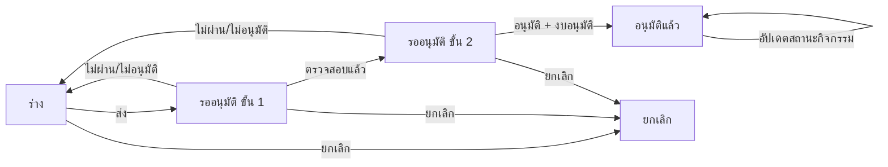

# BRD: แบบฟอร์มแผนโครงการ (Project Plan)

| Field | Value |
|---|---|
| BRD ID | BRD-PDM-PJP-001 |
| Feature | F-TMP-004 แบบฟอร์มแผนโครงการ (รหัส feature ชั่วคราว — รอลงทะเบียน) |
| BRD Type | New Feature (แบบ 1 · Standalone) |
| Version | 1.0 |
| Status | **APPROVED (Prebrief Mode · Lane)** — DEC แทน Scope Lock จนมีใบเซ็นลูกค้า |
| Module | ยังไม่มี module Project ใน FEATURE_REGISTRY → ใช้ Budget (DOA module) / เอกสารทั่วไป (MDOC) ชั่วคราว · แผนกเจ้าของแบบ: ฝ่ายพัฒนาโครงการ |
| Customer form | FM-PDM-01 Rev.00 : 01/07/2569 (xlsx · พิมพ์ 3 หน้า → แบบพิมพ์ระบบ 2 หน้า) |
| Request | REQ-TMP-004 (ชั่วคราว — รอเลขจริงจาก F186) |
| Input | PREBRIEF_REQ-TMP-004_v2 · FORM_SPEC.json (37 ช่อง · แถวซ้ำ 4 กลุ่ม) · DECISIONS.lock (18 DEC · พร้อมเริ่มทำ · AI-DEFAULT 14) · feature.html (audit FAIL 0 · self_audit PASS · e2e 21/21 + flow 17/17) |
| Created / Updated | 2026-10-11 |

## Changelog
- v1.0 (2026-10-11): สร้างผ่าน brd-generator-full v2.3 Prebrief Mode · Lane (doc-master-pipeline ขั้น 7 · unattended)

---

## 1. Business Context
### 1.1 ปัญหา / โอกาส
ฝ่ายพัฒนาโครงการเสนอโครงการด้วยไฟล์ Excel FM-PDM-01 (9 ส่วน: ข้อมูลทั่วไป · หลักการ · วัตถุประสงค์ · KPI · แผนงาน · งบประมาณ · ความเสี่ยง · ผลตอบแทน · การอนุมัติ) — ลงนามบนกระดาษ 3 ช่อง · ระยะเวลาและยอดรวมกรอกเอง · หลังอนุมัติไม่มีที่ติดตามสถานะกิจกรรมร่วมกัน
### 1.2 เป้าหมาย
1. ขึ้นแบบฟอร์มเป็นเอกสารในระบบ ช่องตรงกระดาษ 1:1 (PDF Replica FM-PDM-01 2 หน้า) ลูกค้าจำแบบเดิมได้
2. สายอนุมัติผู้ตรวจสอบ → ผู้อนุมัติ ตาม DOA กลาง (dynamic) · ผู้อนุมัติขั้นสุดท้ายกำหนดงบที่ได้รับอนุมัติต่อรายการ
3. ใช้แผนที่อนุมัติแล้วเป็นแผนควบคุม — อัปเดตสถานะกิจกรรมได้ตลอดโครงการ
### 1.3 ตัวชี้วัด
ไม่มีใน input → **OQ-01** (ห้ามแต่งตัวเลข)
### 1.4 ที่มา
แบบฟอร์มลูกค้า FM-PDM-01 (xlsx เปล่า ไม่มีข้อมูลบุคคล) → FORM_SPEC 37 ช่อง · ลายเซ็น 3 จุด · ตาราง 4 กลุ่ม (3/10/6/5 แถว) · สูตร 4 · gate 10 หมวดตอบโดย AI ตาม unattended-policy (AI-DEFAULT รอลูกค้ายืนยัน)

## 2. Scope
### 2.1 In Scope
- รายการแผนโครงการ (ค้นหา · กรองสถานะ/หน่วยงาน · CSV · ป้ายกิจกรรมล่าช้า) · สร้าง/แก้ร่าง wizard 3 ขั้น (การ์ด ①–⑧ ตามส่วนของกระดาษ) · ดูรายละเอียด 4 แท็บ (รายละเอียด › PDF Preview › ลายเซ็น/อนุมัติ › ประวัติ)
- ส่วนที่ 1–8 ครบทุกช่อง · ระยะเวลาโครงการ/กิจกรรมคำนวณ · รวมงบที่ขอ/ที่อนุมัติคำนวณ · แถวซ้ำไม่จำกัด
- ส่งอนุมัติ DOA (dynamic · ค่าเริ่ม 2 ขั้น ผู้ตรวจสอบ → ผู้อนุมัติ) · ผู้อนุมัติขั้นสุดท้ายกรอกงบที่ได้รับอนุมัติ · ไม่อนุมัติ → กลับร่าง · ยกเลิก (เหตุผลบังคับ)
- อัปเดตสถานะกิจกรรมหลังอนุมัติ (ผู้จัดทำ/ผู้รับผิดชอบหลัก) · แนบไฟล์ · PDF FM-PDM-01 ทุกสถานะ · รหัสโครงการ PJP จาก ENG-DOC-NUM
### 2.2 Out of Scope
- ตั้งงบใน Budget module / สร้างใบขอใช้งบ (DEC-01/02) · ส่งต่อระบบอื่น · รายงานความคืบหน้าโครงการ (เอกสาร FM-PDM-02 แยก — J005) · ทำซ้ำเอกสาร · ประกาศ (DEC-14) · Gantt/timeline
### 2.3 Assumptions
- ข้อมูลผู้จัดทำ/ตำแหน่ง/หน่วยงาน มีใน HR · Employee และ Organization · ผู้รับผิดชอบ = พนักงานในระบบ (lookup)
- ไม่มี module "Project" ใน FEATURE_REGISTRY → เสนอใน _BATCH_REPORT (OQ-04)
### 2.4 Scope Lock (ชั่วคราว = DECISIONS.lock · ยังไม่มีใบเซ็น → OQ-02)
| DEC | หมวด | มติ | ที่มา |
|---|---|---|---|
| DEC-01 | G1 | อนุมัติแล้วไม่เปลี่ยนค่าในระบบ | AI-DEFAULT |
| DEC-02 | G1 | ไม่ส่งต่อระบบอื่นรอบนี้ (ประกาศ event ใน FRD แต่ไม่ยิง) | AI-DEFAULT |
| DEC-03 | G2 | DOA dynamic · ค่าเริ่ม 2 ขั้น: role-line-manager (ผู้ตรวจสอบ) → role-gm (ผู้อนุมัติ) · ไม่มีวงเงิน | AI-DEFAULT |
| DEC-04 | G3 | ระยะเวลา = สิ้นสุด − เริ่ม + 1 วัน (สิ้นสุด < เริ่ม = บล็อก) · กิจกรรมนอกช่วง = เตือน · รวมงบ = ผลรวม · เงิน ≥ 0 · งบที่อนุมัติ ผู้อนุมัติขั้นสุดท้ายกรอก (ว่าง = เท่าที่ขอ · เกิน = เตือน) · ส่งได้เมื่อมีกิจกรรม/KPI/งบ ≥ 1 · หลังอนุมัติอัปเดตสถานะกิจกรรมได้ | AI-DEFAULT |
| DEC-05 | G4 | เป้าหมายและ KPI ไม่จำกัด · PDF ≥ 3 แถว | AI-DEFAULT |
| DEC-06 | G4 | แผนการดำเนินงาน ไม่จำกัด · PDF ≥ 10 แถว | AI-DEFAULT |
| DEC-07 | G4 | รายการงบประมาณ ไม่จำกัด · PDF ≥ 6 แถว | AI-DEFAULT |
| DEC-08 | G4 | ความเสี่ยง ไม่จำกัด · PDF ≥ 5 แถว | AI-DEFAULT |
| DEC-09 | G5 | ช่องตรงกระดาษ 1:1 · ไม่เพิ่มช่อง | AI-DEFAULT |
| DEC-10 | G6 | ตารางอนุมัติ 1 แถวต่อขั้น DOA · ข้อความ "ส่ง/พิจารณาในระบบ" ไม่ใช้ภาพ | AI-DEFAULT |
| DEC-11 | G7 | ไม่อนุมัติ = กลับร่างเลขเดิม · ยกเลิก: เจ้าของ + admin · ร่าง/รออนุมัติ · เหตุผลบังคับ | AI-DEFAULT |
| DEC-12 | G8 | เจ้าของ · ผู้อนุมัติหลังส่ง · admin ฝ่ายพัฒนาโครงการเห็นทั้งหมด | AI-DEFAULT |
| DEC-13 | G9 | ออกเลขตอนบันทึกครั้งแรก · รหัส PJP (= รหัสโครงการ) | AI-DEFAULT |
| DEC-14 | G10 | แนบไฟล์ ✓ · CSV ✓ · ทำซ้ำ ✗ · ประกาศ ✗ | AI-DEFAULT |
| DEC-15 | VALID | วันที่สิ้นสุด ≥ วันที่เริ่มต้น (บล็อก) · ระยะเวลา = คำนวณ | FORM_SPEC |
| DEC-16 | VALID | วันที่กิจกรรมอยู่นอกช่วงโครงการ = เตือน | FORM_SPEC |
| DEC-17 | VALID | งบที่อนุมัติ ≥ 0 · เกินงบที่ขอ = เตือน | FORM_SPEC |
| DEC-18 | VALID | ค่า dropdown ตามต้นฉบับ 1:1 (สถานะ Not Started/In Progress/Completed/Delayed · ความรุนแรง สูง/กลาง/ต่ำ) | FORM_SPEC |

## 3. Roles & Permissions (COSO)
| Role | COSO | ทำอะไร |
|---|---|---|
| ผู้จัดทำ (Prepared by · พนักงาน) | Maker | สร้าง/แก้ร่าง · ส่ง · ยกเลิกของตัวเอง (ร่าง/รออนุมัติ) · อัปเดตสถานะกิจกรรมหลังอนุมัติ |
| role-line-manager (ผู้ตรวจสอบ · Reviewed by) | Checker | ตรวจสอบแล้ว / ไม่ผ่านการตรวจสอบ |
| role-gm (ผู้อนุมัติ · Approved by) | Approver | อนุมัติ / ไม่อนุมัติ · กรอกงบที่ได้รับอนุมัติต่อรายการ |
| ผู้รับผิดชอบหลัก (Project Manager) | Operator | อัปเดตสถานะกิจกรรมหลังอนุมัติ (ถ้าไม่ใช่ผู้จัดทำ) |
| admin ฝ่ายพัฒนาโครงการ | Monitor | เห็นทุกใบ · ยกเลิกได้ (ร่าง/รออนุมัติ) — role ยังไม่อยู่ใน DOA master → OQ-03 |

| Action | ผู้จัดทำ | ผู้ตรวจสอบ | ผู้อนุมัติ | ผู้รับผิดชอบหลัก | admin |
|---|:-:|:-:|:-:|:-:|:-:|
| ดูใบ | ของตน | หลังส่ง | หลังส่ง | – (เห็นเมื่อเป็นเจ้าของ/ในสาย) | ทั้งหมด |
| สร้าง/แก้ร่าง | ✓ | – | – | – | – |
| ตัดสินขั้น | – | ✓ ขั้น 1 | ✓ ขั้น 2 | – | – |
| กรอกงบที่อนุมัติ | – | – | ✓ | – | – |
| อัปเดตสถานะกิจกรรม | ✓ (approved) | – | – | ✓ (approved) | – |
| ยกเลิก | ✓ | – | – | – | ✓ |
SoD: ผู้จัดทำพิจารณาใบตัวเองไม่ได้ (BR-DOA-04) · ผู้ตรวจสอบ ≠ ผู้อนุมัติ (resolve คนละ role)

## 4. User Journey
### 4.1 Happy Path
1. ผู้จัดทำ: สร้าง → ① ข้อมูลทั่วไป (ชื่อ · หน่วยงาน · ผู้รับผิดชอบหลัก · วันที่เริ่ม/สิ้นสุด → ระยะเวลาคำนวณ) → ② หลักการ → ③ วัตถุประสงค์ → ④ KPI → ⑤ กิจกรรม → ⑥ งบที่ขอ (รวมคำนวณ) → ⑦ ความเสี่ยง → ⑧ ผลตอบแทน → แนบไฟล์ → บันทึก (ได้รหัสโครงการ PJP) → ส่ง เลือกผู้พิจารณาต่อขั้น (ค่าเริ่มจาก DOA)
2. ผู้ตรวจสอบ: ตรวจสอบแล้ว → ขั้น 2 รอพิจารณา
3. ผู้อนุมัติ: กรอกงบที่ได้รับอนุมัติต่อรายการ (ค่าเริ่ม = ที่ขอ) → อนุมัติ → **อนุมัติแล้ว** · PDF snapshot (approved_final) · งบต่างจากที่ขอ → แจ้ง pjp_budget_adjusted
4. ระหว่างโครงการ: ผู้จัดทำ/ผู้รับผิดชอบหลัก อัปเดตสถานะกิจกรรม (Not Started → In Progress → Completed / Delayed) · Delayed → แจ้ง pjp_activity_delayed
### 4.2 Alternative
- ไม่ผ่านการตรวจสอบ / ไม่อนุมัติ → กลับร่าง เลขเดิม + เหตุผล → ผู้จัดทำแก้ ส่งใหม่ (resolve สายใหม่ · งบที่อนุมัติล้าง)
- ยกเลิก (ร่าง/รออนุมัติ) โดยเจ้าของหรือ admin → ผู้พิจารณาขั้นปัจจุบันได้รับ pjp_cancelled

## 5. Data (จาก FORM_SPEC — ป้ายตามกระดาษ)
### 5.1 project_plan (header)
| ช่องบนกระดาษ | field | ชนิด | ที่มา | บังคับ |
|---|---|---|---|:-:|
| รหัสโครงการ : Project Code | doc_no | text | auto ENG-DOC-NUM (PJP) | ✓ |
| ชื่อโครงการ : Project Name | project_name | text | user | ✓ |
| หน่วยงานเจ้าของโครงการ : Owner Department | owner_dept_id | ref OrgUnit | user (ค่าเริ่ม = หน่วยงานผู้จัดทำ) | ✓ |
| ผู้รับผิดชอบหลัก : Project Manager | project_manager_id | ref Employee | user (ค่าเริ่ม = ผู้จัดทำ) · PDPA | ✓ |
| วันที่เริ่มต้น : Start Date | start_date | date | user | ✓ |
| วันที่สิ้นสุด : End Date | end_date | date ≥ start_date | user | ✓ |
| ระยะเวลาดำเนินการ : Duration | duration_days | int | computed end − start + 1 | ✓ |
| ความเป็นมา / ปัญหาหรือโอกาสทางธุรกิจ / เหตุผลในการดำเนินโครงการ | background · problem_opportunity · justification | text | user | ✓ |
| วัตถุประสงค์หลัก / วัตถุประสงค์รอง | objective_primary · objective_secondary | text | user | ✓ / – |
| ด้านการเงิน / ด้านการดำเนินงาน / ด้านกลยุทธ์องค์กร | benefit_financial · benefit_operational · benefit_strategic | text | user | – |
| รวมงบประมาณทั้งสิ้น (ขอ / อนุมัติ) | total_requested · total_approved | money | computed SUM | ✓ / เมื่ออนุมัติ |
| (ผู้จัดทำ — ระบบ) | requester_id · position_snapshot · dept_snapshot · req_date | | system/auto | ✓ |
| + DOA fields | approval_status · doa_entry_ref · approval_chain (jsonb snapshot) · approver_role · approved_by · approved_at | | DOA (`TODO: DOA engine`) | |
| + returned_reason · returned_by · returned_at | | | DEC-11 | |
### 5.2 project_plan_goal (ส่วนที่ 4 · 3 แถวบนกระดาษ)
quantitative · qualitative · kpi (✓) · method (✓)
### 5.3 project_plan_action (ส่วนที่ 5 · 10 แถว)
seq (auto) · activity (✓) · responsible_id → Employee (✓ · PDPA) · start_date (✓) · end_date (✓ ≥ start) · duration_days (computed) · status ∈ {Not Started, In Progress, Completed, Delayed} (✓ ค่าเริ่ม Not Started)
### 5.4 project_plan_budget (ส่วนที่ 6 · 6 แถว)
item (✓) · requested (money ≥ 0 ✓) · approved (money ≥ 0 · ผู้อนุมัติขั้นสุดท้าย) · remark
### 5.5 project_plan_risk (ส่วนที่ 7 · 5 แถว)
risk · impact · severity ∈ {สูง, กลาง, ต่ำ} · mitigation · owner_id → Employee (ทุกช่อง ✓ เมื่อมีแถว · PDPA)
### 5.6 attachments → Document Center (ไฟล์ระดับใบ) · activity_status_log (append-only: ใคร · เมื่อไร · จาก → เป็น)

## 6. User Stories
| ID | Story | AC หลัก |
|---|---|---|
| S-01 | ผู้จัดทำกรอกข้อมูลทั่วไปของโครงการ | ชื่อ/หน่วยงาน/ผู้รับผิดชอบหลัก/วันที่ บังคับ · ระยะเวลาคำนวณสด · สิ้นสุด < เริ่ม = บล็อก |
| S-02 | ผู้จัดทำกรอกหลักการและวัตถุประสงค์ | ความเป็นมา/ปัญหา/เหตุผล/วัตถุประสงค์หลัก บังคับ · วัตถุประสงค์รองไม่บังคับ |
| S-03 | ผู้จัดทำกำหนดเป้าหมายและ KPI | ≥ 1 แถว · KPI + วิธีวัดผล บังคับ · ไม่จำกัดแถว |
| S-04 | ผู้จัดทำวางแผนกิจกรรม | ≥ 1 แถว · ระยะเวลาคำนวณ · นอกช่วงโครงการ = เตือน · สถานะค่าเริ่ม Not Started |
| S-05 | ผู้จัดทำขอบประมาณ | ≥ 1 รายการ · เงิน ≥ 0 · รวมสด |
| S-06 | ผู้จัดทำระบุความเสี่ยง | ไม่บังคับมีแถว · มีแถวแล้วต้องครบ 5 ช่อง · ความรุนแรง สูง/กลาง/ต่ำ |
| S-07 | ผู้จัดทำบันทึกร่าง | ได้รหัส PJP ตอนบันทึกครั้งแรก · แถวว่างทั้งแถวไม่บันทึก |
| S-08 | ผู้จัดทำส่งอนุมัติ | slot ต่อขั้นจาก DOA · ผู้จัดทำไม่อยู่ในรายชื่อ · บังคับเลือก |
| S-09 | ผู้ตรวจสอบตรวจสอบแผน | ปุ่มเฉพาะผู้พิจารณาขั้นปัจจุบัน · คำ "ตรวจสอบแล้ว / ไม่ผ่านการตรวจสอบ" |
| S-10 | ผู้อนุมัติกำหนดงบที่ได้รับอนุมัติ | ค่าเริ่ม = ที่ขอ · ≥ 0 (บล็อก) · เกินที่ขอ = เตือน · รวมสด |
| S-11 | ผู้อนุมัติอนุมัติแผน | ขั้นสุดท้าย → อนุมัติแล้ว · งบต่างจากที่ขอ → แจ้งผู้จัดทำ + ผู้รับผิดชอบหลัก |
| S-12 | ผู้พิจารณาไม่อนุมัติ | เหตุผลบังคับ → กลับร่างเลขเดิม · ผู้จัดทำเห็นเหตุผล |
| S-13 | ผู้จัดทำอัปเดตสถานะกิจกรรม | เฉพาะใบอนุมัติแล้ว · เปลี่ยนได้เฉพาะคอลัมน์สถานะ · บันทึกประวัติ · Delayed → แจ้งเตือน |
| S-14 | พิมพ์/ดาวน์โหลด PDF FM-PDM-01 | ทุกสถานะ 2 หน้า · แถวว่างครบตามกระดาษ · ตารางอนุมัติ = ผู้จัดทำ + 1 แถวต่อขั้น DOA |
| S-15 | เจ้าของ/admin ยกเลิก | ร่างหรือรออนุมัติ · เหตุผลบังคับ |
| S-16 | admin ดูทุกใบ + ส่งออก CSV | กรองสถานะ/หน่วยงาน · CSV 1 แถวต่อกิจกรรม |

## 7. Status & Lifecycle
| จาก | Action | ไป | ใคร |
|---|---|---|---|
| — | บันทึกครั้งแรก | draft | Maker |
| draft | ส่ง | pending (ขั้น 1) | Maker |
| pending | ผ่านขั้น n<N | pending (ขั้น n+1) | ผู้พิจารณาขั้น n |
| pending | อนุมัติขั้น N (+ งบที่อนุมัติ) | approved | ผู้อนุมัติ |
| pending | ไม่ผ่าน/ไม่อนุมัติ | draft (เลขเดิม · returned_*) | ผู้พิจารณาขั้นปัจจุบัน |
| approved | อัปเดตสถานะกิจกรรม | approved (log) | ผู้จัดทำ / ผู้รับผิดชอบหลัก |
| draft / pending | ยกเลิก | cancelled | Maker / admin |
approved = ล็อกแก้ไขทุกช่อง ยกเว้นสถานะกิจกรรม

## 8. Business Rules + Validation
| ID | Rule | Tag | Type |
|---|---|:-:|---|
| BR-01 | ระยะเวลาดำเนินการ = end_date − start_date + 1 (วัน) · ระยะเวลากิจกรรมสูตรเดียวกัน | FIXED | Calc (DEC-04/15) |
| BR-02 | end_date ≥ start_date (โครงการและกิจกรรม) | FIXED | Validation (DEC-15) |
| BR-03 | กิจกรรมอยู่นอกช่วงวันที่โครงการ = เตือน ไม่บล็อก | CONFIGURABLE | Policy (DEC-16) |
| BR-04 | รวมงบที่ขอ/ที่อนุมัติ = SUM รายการ · จำนวนเงิน ≥ 0 | FIXED | Calc (DEC-04) |
| BR-05 | งบที่อนุมัติกรอกโดยผู้อนุมัติขั้นสุดท้ายเท่านั้น · ว่าง = เท่าที่ขอ · เกินที่ขอ = เตือน | CONFIGURABLE | DEC-04/17 |
| BR-06 | ส่งได้เมื่อมีกิจกรรม ≥ 1 · KPI ≥ 1 · รายการงบ ≥ 1 | FIXED | Validation (DEC-04) |
| BR-07 | สายอนุมัติ resolve จาก DOA ตอนส่ง แล้ว freeze · คำตัดสินผูก role | FIXED | DOA (BR-DOA-02) |
| BR-08 | ไม่ผ่าน/ไม่อนุมัติ → draft เลขเดิม · ล้างงบที่อนุมัติ · resolve ใหม่ตอนส่งรอบถัดไป | FIXED | DEC-11 |
| BR-09 | ออกเลขตอนบันทึกครั้งแรก = รหัสโครงการ · no-gap ✗ | CONFIGURABLE | DOCCFG (DEC-13) |
| BR-10 | ร่างเห็นเฉพาะเจ้าของ (+ admin) · ผู้อนุมัติเห็นหลังส่ง | FIXED | Visibility #109 (DEC-12) |
| BR-11 | ตารางอนุมัติ PDF = ผู้จัดทำ + 1 แถวต่อขั้น DOA (dynamic) · คำตัดสินตาม role | FIXED (จำนวน = DOA) | DEC-03 · DEC-10 |
| BR-12 | หลังอนุมัติแก้ได้เฉพาะสถานะกิจกรรม · ไม่ต้องอนุมัติใหม่ · บันทึกประวัติ | FIXED | DEC-04 |
| BR-13 | ค่าสถานะกิจกรรม/ความรุนแรง ตาม dropdown ต้นฉบับ 1:1 | FIXED | DEC-18 |
| BR-14 | แถวว่างทั้งแถวไม่บันทึก · แถวที่มีข้อมูลต้องครบช่องบังคับ | FIXED | Validation |

| VR | ช่อง | เงื่อนไข | ข้อความ |
|---|---|---|---|
| VR-01 | ชื่อโครงการ · หน่วยงาน · ผู้รับผิดชอบหลัก · วันที่เริ่ม/สิ้นสุด · ความเป็นมา · ปัญหา · เหตุผล · วัตถุประสงค์หลัก | required | กรุณากรอก… / กรุณาเลือก… |
| VR-02 | end_date | ≥ start_date | วันที่สิ้นสุดต้องไม่ก่อนวันที่เริ่มต้น |
| VR-03 | goals / actions / budget | ≥ 1 แถวที่มีข้อมูล | ต้องมี…อย่างน้อย 1 รายการ |
| VR-04 | แถวที่มีข้อมูล | ช่อง * ครบ | กรอกให้ครบทุกช่องที่มี * |
| VR-05 | action.end_date | ≥ action.start_date | วันที่สิ้นสุดต้องไม่ก่อนวันที่เริ่ม |
| VR-06 | budget.requested | ตัวเลข ≥ 0 | งบประมาณที่ขอต้องเป็นตัวเลข ≥ 0 |
| VR-07 | budget.approved | ตัวเลข ≥ 0 | งบประมาณที่ได้รับอนุมัติต้องเป็นตัวเลขตั้งแต่ 0 ขึ้นไป |
| VR-08 | slot ผู้พิจารณา | ทุกขั้นต้องเลือก · ≠ ผู้จัดทำ | กรุณาเลือกผู้พิจารณา |
| VR-09 | เหตุผล ไม่อนุมัติ/ยกเลิก | required | กรุณาระบุเหตุผล |
### 8.5 ระดับความยืดหยุ่น
BR-03/05 → Admin Panel (นโยบายเตือน) · BR-09 → F-DOCCFG · สายอนุมัติ → DOA กลาง

## 9. Edge Cases
| EC | กรณี | ผล |
|---|---|---|
| EC-01 | ผู้อนุมัติปรับงบลดจากที่ขอ | รวมงบอนุมัติ < ที่ขอ · แจ้ง pjp_budget_adjusted |
| EC-02 | ผู้อนุมัติให้งบเกินที่ขอ | เตือนในช่อง · บันทึกได้ |
| EC-03 | กิจกรรม > 10 แถว / KPI > 3 / งบ > 6 / ความเสี่ยง > 5 | PDF dense ยัง 2 หน้า (ทดสอบ 12/4/8/6) |
| EC-04 | สายอนุมัติ 6 ขั้น | ตารางอนุมัติ 7 แถว ยัง 2 หน้า |
| EC-05 | ผู้จัดทำเป็นผู้จัดการทั่วไปเอง | resolve role-gm ข้ามตัวเอง · slot ต้องเลือกคนอื่น |
| EC-06 | แก้ DOA ระหว่างใบรออนุมัติ | ใบเดิมใช้สาย snapshot |
| EC-07 | ส่ง/อนุมัติชนกัน (stale) | 409 → toast รีเฟรช สถานะไม่เปลี่ยน |
| EC-08 | แบบเอกสารปิดใช้ (F-DOCCFG) | ปุ่มสร้าง disabled |
| EC-09 | ข้อความยาวมากในส่วนที่ 2–3 | PDF หน้า 1 อาจล้นเป็น 3 หน้า → ทดสอบกับข้อมูลจริงรอบ UAT (OQ-05) |
| EC-10 | ไม่มีความเสี่ยง | ส่งได้ · PDF แสดงแถวว่าง 5 แถว |

## 10. Value Stream & Downstream Impact
Positioning: ฝ่ายพัฒนาโครงการ — **เสนอ/อนุมัติแผนโครงการ (feature นี้)** → รายงานความคืบหน้าโครงการ (FM-PDM-02 · J005) → [งบโครงการใน Budget — ปิดรอบนี้]
| ปลายทาง | ข้อมูล | Trigger | หมายเหตุ |
|---|---|---|---|
| Budget (Budget Proposal / Release) | รายการงบที่อนุมัติ | approved | **ปิดรอบนี้ (DEC-01/02)** — ประกาศ event ใน FRD ไม่ยิง |
| รายงานความคืบหน้าโครงการ (FM-PDM-02) | รหัสโครงการ · กิจกรรม · KPI | — | อ้างรหัส PJP (ผู้ใช้กรอก/เลือก) — ตัดสินในงาน J005 |
| ENG-NOTIFY | pjp_cancelled · pjp_budget_adjusted · pjp_activity_delayed | ตาม NTF_BRIEF | DOA ยิง doa_pending/doa_result เอง |
| F-DOCCFG / ENG-DOC-STORE | PDF snapshot | approved_final | |

## 11. Delivery
Phase 1 = ทุกอย่างใน §2.1 · Phase 2 (เสนอ) = ส่งงบที่อนุมัติเข้า Budget module + เชื่อมรายงานความคืบหน้า + Gantt

## 12. Dev Summary "ใบสั่ง"
- Config: DOA entry F-TMP-004 (role-line-manager → role-gm) · doc_type PJP (F-DOCCFG) · role admin ฝ่ายพัฒนาโครงการ (OQ-03)
- Declaration: DOA_BRIEF · NTF_BRIEF · DOCCFG_BRIEF · MDOC_BRIEF (ฉบับจริงหลัง FRD)
- Screen Inventory: P-01 รายการ · P-02 สร้าง/แก้ (drawer wide 3 ขั้น · การ์ด ①–⑧) · P-03 ดู (drawer 4 แท็บ) · M-01 ส่ง · M-02 ตรวจสอบ/อนุมัติ (+ งบที่อนุมัติขั้นสุดท้าย) · M-03 ไม่อนุมัติ · M-04 ยกเลิก · M-05 อัปเดตสถานะกิจกรรม · M-06 ทิ้งข้อมูล
- UI Signals: เอกสาร + พิมพ์ 2 หน้า + ลายเซ็น = ใช่ · Q-form · แถวซ้ำแบบตาราง 4 กลุ่ม

## 13. Open Questions
| OQ | คำถาม | เจ้าของ | Block? |
|---|---|---|---|
| OQ-01 | ตัวชี้วัดความสำเร็จ (เช่น เวลาอนุมัติเฉลี่ย · % กิจกรรมตรงแผน) | ลูกค้า | ไม่ |
| OQ-02 | ลูกค้าเซ็นยืนยัน DEC-01..14 (AI-DEFAULT) — โดยเฉพาะ ผู้อนุมัติ = role-gm · ไม่มีวงเงิน · ไม่ส่งงบเข้า Budget · กลับร่าง | Strike → ลูกค้า | ก่อน UAT |
| OQ-03 | role admin ฝ่ายพัฒนาโครงการ ยังไม่อยู่ใน DOA roles master (14 role) — ใช้ role ใด | Strike + พี่เบิร์ด | ก่อน wire |
| OQ-04 | ไม่มี module Project ใน FEATURE_REGISTRY — ตั้ง module ใหม่หรือวางใต้ Budget · module enum MDOC ไม่มี (ใช้ "เอกสารทั่วไป") | พี่เบิร์ด | ก่อน register |
| OQ-05 | ความยาวข้อความจริงในส่วนที่ 2–3 — แบบพิมพ์ 2 หน้ารองรับ ~2–3 บรรทัดต่อช่อง | ลูกค้า | ไม่ |
| OQ-06 | รหัส feature จริง (แทน F-TMP-004) · REQ จริง · function_code taxonomy | Strike | ก่อน register |
| OQ-07 | ผู้รับผิดชอบหลักที่ไม่ใช่ผู้จัดทำ ควรเห็นใบเพื่ออัปเดตสถานะไหม (DEC-12 ยังไม่ให้เห็น) | ลูกค้า | ไม่ |

## 14. Security & Compliance
Preset: Standard Operation · PII: ชื่อผู้รับผิดชอบ/ผู้จัดทำ (pdpa) — แบบฟอร์มลูกค้าเป็นแบบเปล่า ข้อมูลตัวอย่างใน prototype/แบบพิมพ์เป็นชื่อสมมติทั้งหมด · Audit append-only ทุก action (รวมเปลี่ยนสถานะกิจกรรม) · SoD ผู้จัดทำ ≠ ผู้พิจารณา · ไฟล์แนบตาม file_policy Document Center (≤20MB) · ไม่เก็บ credential

## 15. Health Check / Monitoring
SLA ต่อขั้น: ไม่กำหนดรอบนี้ (→ OQ-01) · KPI เสนอ: ใบรออนุมัติเกิน N วัน · โครงการที่มีกิจกรรม Delayed · Widget: งบที่อนุมัติรวมตามหน่วยงาน

## 16. AI Review (Prebrief Mode · Lane)
C01–C23 + PE01–PE05: ผ่าน · C20 Scope Lock = DEC ครบ 18 ข้อ + OQ-02 รอใบเซ็น (✅ ตาม v2.3) · C22 ตัวชี้วัด → OQ-01 (ไม่แต่งตัวเลข) · C16 ไม่มี Registry module = WARN (OQ-04) · **สถานะ: APPROVED**

## Appendix — Screen List
P-01 `#/project-plan` · P-02 `#/project-plan/create` · `/edit/:id` · P-03 `#/project-plan/view/:id`
