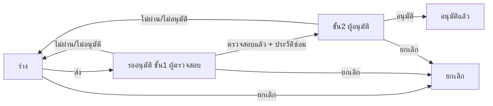

# BRD: แบบฟอร์มใบแจ้งซ่อมสินทรัพย์ (Asset Repair Request)

| Field | Value |
|---|---|
| BRD ID | BRD-ASM-RPR-001 |
| Feature | F-TMP-001 แบบฟอร์มใบแจ้งซ่อมสินทรัพย์ (รหัสชั่วคราว — รอรหัสจริงจาก FEATURE_REGISTRY) |
| BRD Type | New Feature (แบบ 2 · ดึงข้อมูลเดิม) |
| Version | 1.0 |
| Status | **APPROVED (Prebrief Mode · Lane · unattended)** — DEC แทน Scope Lock จนมีใบเซ็นลูกค้า |
| Module | Asset Management (Core Cube · Operation) — ใกล้ feature "Maintenance Schedule" (ยังไม่มีใน registry) |
| Customer | แบบฟอร์ม FM-ASM-03 (ฝ่ายบริหารสินทรัพย์) |
| Request | REQ-TMP-001 (ชั่วคราว — รอเลขจริงจาก F186) |
| Input | PREBRIEF_REQ-TMP-001_v2 · FORM_SPEC.json (14 ช่อง) · DECISIONS.lock (16 DEC · พร้อมเริ่มทำ · AI-DEFAULT 12) · feature.html (audit FAIL 0 · e2e 21/21) |
| Created / Updated | 2026-10-11 |

## Changelog
- v1.0 (2026-10-11): สร้างผ่าน brd-generator-full v2.3 Prebrief Mode (doc-master-pipeline ขั้น 7 · โหมดไม่เฝ้า)

---

## 1. Business Context
### 1.1 ปัญหา / โอกาส
พนักงานแจ้งซ่อมทรัพย์สินด้วยแบบฟอร์มกระดาษ FM-ASM-03 (Excel พิมพ์) — กรอกรายการ 10 แถว ลงชื่อผู้แจ้ง ส่งต่อมือให้ผู้ตรวจสอบเขียนประวัติการซ่อม แล้วส่งผู้อนุมัติ · ไม่มีเลขที่รัน (ช่อง "เลขที่" เว้นว่าง) · ติดตามสถานะไม่ได้ · ประวัติการซ่อมต้องค้นจากกระดาษเก่า
### 1.2 เป้าหมาย
1. ขึ้นแบบฟอร์มเป็นเอกสารในระบบ ช่องตรงกระดาษ 1:1 ลูกค้าจำแบบเดิมได้ (PDF Replica 1 หน้า)
2. เลขที่ RPR ออกอัตโนมัติ · สถานะและผู้พิจารณาเห็นได้ทันที
3. สายพิจารณา ผู้ตรวจสอบ → ผู้อนุมัติ จาก DOA กลาง (dynamic) · ผู้ตรวจสอบบันทึกประวัติการซ่อมในระบบ
### 1.3 ตัวชี้วัด
ไม่มีใน input → **OQ-01** (ห้ามแต่งตัวเลข)
### 1.4 ที่มา
แบบฟอร์มลูกค้า FM-ASM-03 (xlsx) → FORM_SPEC 14 ช่อง · แถวซ้ำ 2 กลุ่ม (รายการ 10 · ประวัติซ่อม 6) · ลายเซ็น 4 จุด · gate 10 หมวด = AI-DEFAULT ทั้งหมด (โหมดไม่เฝ้า)

## 2. Scope
### 2.1 In Scope
- รายการใบแจ้งซ่อม (แท็บ ทั้งหมด / รอฉันพิจารณา · ค้นหา · กรองสถานะ/ฝ่าย · CSV) · สร้าง/แก้ร่าง wizard 3 ขั้น · ดูรายละเอียด 4 แท็บ (รายละเอียด › PDF Preview › ลายเซ็น / อนุมัติ › ประวัติ)
- รายการแจ้งซ่อม 6 ช่องต่อแถว (รายการ · ทะเบียนสินทรัพย์ · จำนวน · อาการชำรุด · สถานที่ตั้ง · หมายเหตุ) ไม่จำกัดแถว
- ส่งขออนุมัติ DOA 2 ขั้น (เลือกคนต่อขั้น) · ผู้ตรวจสอบบันทึกประวัติการซ่อมตอนตรวจ · อนุมัติ / ไม่อนุมัติ → กลับร่าง · ยกเลิก (เหตุผลบังคับ)
- แนบไฟล์ (ภาพอาการ ใบเสนอราคาซ่อม) · PDF FM-ASM-03 Replica ทุกสถานะ · เลขที่ RPR จาก ENG-DOC-NUM
### 2.2 Out of Scope
- ทะเบียนสินทรัพย์ (Asset Master) / ตารางบำรุงรักษา (Maintenance Schedule) — ยังไม่มีในระบบ → ทะเบียนสินทรัพย์กรอกเอง · ประวัติซ่อมกรอกเอง (DEC-04)
- สั่งซ่อม/ใบงานซ่อม/จัดซื้ออะไหล่ · ปรับมูลค่าสินทรัพย์ · ส่งต่อระบบอื่น (DEC-01/02) · ทำซ้ำเอกสาร · ประกาศ (DEC-12)
### 2.3 Assumptions
- ข้อมูลผู้แจ้ง/ตำแหน่ง/ฝ่ายมีใน Employee / Position & Tier / Department · DOA กลางรู้จัก role-line-manager (relative) และ role-mgr-acc (ผู้จัดการ module asset ตาม doa-roles-contract §3)
### 2.4 Scope Lock (ชั่วคราว = DECISIONS.lock · ยังไม่มีใบเซ็น → OQ-02)
| DEC | หมวด | มติ | ที่มา |
|---|---|---|---|
| DEC-01 | G1 | อนุมัติแล้วไม่เปลี่ยนค่าในระบบ | AI-DEFAULT |
| DEC-02 | G1 | ไม่ส่งต่อระบบอื่นรอบนี้ (ประกาศ event ใน FRD แต่ไม่ยิง) | AI-DEFAULT |
| DEC-03 | G2 | DOA dynamic ค่าเริ่ม 2 ขั้น: role-line-manager (ผู้ตรวจสอบ) → role-mgr-acc (ผู้อนุมัติ) · ไม่มีวงเงิน | AI-DEFAULT |
| DEC-04 | G3 | ไม่มีสูตร/ค่าคงที่ · ≥1 แถว · จำนวน > 0 · ทะเบียนสินทรัพย์กรอกเอง (เปลี่ยนเป็นเลือกจาก Asset Master เมื่อพร้อม) · ประวัติซ่อม = ผู้ตรวจสอบกรอกตอนพิจารณา (ไม่บังคับ) · ผู้แจ้งบันทึกครั้งเดียว แสดง 2 จุดบนแบบพิมพ์ | AI-DEFAULT |
| DEC-05 | G4 | รายการ: ไม่จำกัดแถว · PDF ≥ 10 แถว | AI-DEFAULT |
| DEC-06 | G4 | ประวัติการซ่อม: ไม่จำกัดแถว · PDF ≥ 6 แถว | AI-DEFAULT |
| DEC-07 | G5 | ช่องตรงกระดาษ 1:1 · ไม่เพิ่มช่อง | AI-DEFAULT |
| DEC-08 | G6 | ลายเซ็นแถวล่าง 1 ช่องต่อขั้น DOA · ข้อความ "ส่งในระบบ/พิจารณาในระบบ" ไม่ใช้ภาพ | AI-DEFAULT |
| DEC-09 | G7 | ไม่อนุมัติ = กลับเป็นร่าง เลขเดิม แก้แล้วส่งใหม่ · ยกเลิก: เจ้าของ + admin role · ร่าง/รออนุมัติ · เหตุผลบังคับ | AI-DEFAULT |
| DEC-10 | G8 | เจ้าของ · ผู้อนุมัติเห็นหลังส่ง · admin role (ฝ่ายบริหารสินทรัพย์) เห็นทั้งหมด | AI-DEFAULT |
| DEC-11 | G9 | ออกเลขตอนบันทึกครั้งแรก · รหัส RPR | AI-DEFAULT |
| DEC-12 | G10 | แนบไฟล์ ✓ · CSV ✓ · ทำซ้ำ ✗ · ประกาศ ✗ | AI-DEFAULT |
| DEC-13 | VALID | ผู้แจ้งบันทึกครั้งเดียวตอนส่ง แสดงทั้ง 2 จุดบนแบบพิมพ์ | FORM_SPEC |
| DEC-14 | VALID | ผลพิจารณามาจาก DOA · ไม่อนุมัติต้องใส่เหตุผล | FORM_SPEC |
| DEC-15 | VALID | ≥1 รายการ · จำนวน > 0 | FORM_SPEC |
| DEC-16 | VALID | คงถ้อยคำตามกระดาษ ("สินทรัพย์" หัวกระดาษ / "ทรัพย์สิน" เนื้อความ) | FORM_SPEC |

## 3. Roles & Permissions (COSO)
| Role | COSO | ทำอะไร |
|---|---|---|
| ผู้แจ้งซ่อม (พนักงาน) | Maker | สร้าง/แก้ร่าง · ส่ง · ยกเลิกของตัวเอง (ร่าง/รออนุมัติ) |
| role-line-manager (ผู้ตรวจสอบ) | Checker | ขั้น 1 ตรวจสอบแล้ว/ไม่ผ่านการตรวจสอบ · บันทึกประวัติการซ่อม |
| role-mgr-acc (ผู้อนุมัติ) | Approver | ขั้น 2 อนุมัติ/ไม่อนุมัติ |
| admin role ฝ่ายบริหารสินทรัพย์ | Custodian (ดูแล) | เห็นทั้งหมด · ยกเลิกได้ · รับแจ้งเมื่ออนุมัติเพื่อเริ่มซ่อม |

| Action | Maker | ผู้ตรวจสอบ | ผู้อนุมัติ | Admin |
|---|:-:|:-:|:-:|:-:|
| ดูใบ | ของตน | หลังส่ง (อยู่ในสาย) | หลังส่ง (อยู่ในสาย) | ทั้งหมด |
| สร้าง/แก้ร่าง | ✓ ของตน | – | – | – |
| ตัดสินขั้น | – | ขั้น 1 | ขั้น 2 | – |
| บันทึกประวัติการซ่อม | – | ✓ (ตอนตรวจ) | – | – |
| ยกเลิก | ✓ ของตน | – | – | ✓ |
SoD: ผู้แจ้งพิจารณาใบตัวเองไม่ได้ (BR-DOA-04)

## 4. User Journey
### 4.1 Happy Path
1. ผู้แจ้ง: สร้าง → กรอกรายการ (รายการ · ทะเบียน · จำนวน · อาการ · สถานที่ · หมายเหตุ) → แนบภาพ (ถ้ามี) → บันทึก (ได้เลข RPR) → ส่ง เลือกผู้พิจารณา 2 ขั้น
2. ขั้น 1 ผู้ตรวจสอบ: กรอกประวัติการซ่อม (ซ่อมครั้งสุดท้าย · จำนวนครั้ง) → ตรวจสอบแล้ว
3. ขั้น 2 ผู้อนุมัติ: อนุมัติ → **อนุมัติแล้ว** · PDF เก็บสำเนา (approved_final) · แจ้ง admin ฝ่ายบริหารสินทรัพย์ (rpr_ready_for_repair)
### 4.2 Alternative
- ไม่ผ่านการตรวจสอบ/ไม่อนุมัติ ขั้นใดก็ได้ → กลับร่าง เลขเดิม + เหตุผล ("ตีกลับแก้ไข") → ผู้แจ้งแก้ ส่งใหม่ (resolve สายใหม่)
- ยกเลิก (ร่าง/รออนุมัติ) โดยเจ้าของหรือ admin → แจ้งผู้พิจารณาขั้นปัจจุบัน (rpr_cancelled)

## 5. Data (จาก FORM_SPEC — ป้ายตามกระดาษ)
### 5.1 asset_repair_request (header)
| ช่องบนกระดาษ | field | ชนิด | ที่มา | บังคับ |
|---|---|---|---|:-:|
| เลขที่ | doc_no | text | auto ENG-DOC-NUM (RPR) | ✓ |
| ชื่อ-นามสกุล | employee_id → name snapshot | ref | system Employee (อ่านอย่างเดียว) | ✓ |
| ตําแหน่ง | position_snapshot | text | system Position & Tier | ✓ |
| ฝ่าย/แผนก | dept_snapshot | text | system Department | ✓ |
| ลงชื่อ…ผู้แจ้งซ่อม · วันที่…เดือน…พ.ศ… | submitted_by · submitted_at | ref · timestamptz | auto ตอนส่ง (DEC-13) | ✓ เมื่อส่ง |
| + DOA fields | approval_status · doa_ref · approval_chain(jsonb) · approver_role · approved_by · approved_at | | DOA | |
| + returned_by · returned_at · returned_reason | | | DEC-09 | |
### 5.2 asset_repair_item (รายการ)
| ลําดับ (auto) | description รายการ (user ✓) | asset_code ทะเบียนสินทรัพย์ (user · ว่างได้) | qty จำนวน int >0 (user ✓) | symptom อาการชำรุด (user ✓) | location สถานที่ตั้ง (user ✓) | remark หมายเหตุ (user) |
### 5.3 asset_repair_history (ประวัติการซ่อม · ผู้ตรวจสอบกรอก)
| ลำดับ (auto) | description รายการ | last_repair_date ซ่อมครั้งสุดท้าย (date · ว่างได้) | repair_count จำนวนครั้งที่ซ่อม (int ≥0 · ว่างได้) |
### 5.4 attachments → Document Center (ไฟล์ระดับใบ)

## 6. User Stories
| ID | Story | AC หลัก |
|---|---|---|
| S-01 | ผู้แจ้งสร้างใบแจ้งซ่อม | ≥1 รายการ · รายการ/จำนวน/อาการ/สถานที่บังคับ · บันทึกได้เลข RPR |
| S-02 | ผู้แจ้งแนบภาพอาการ | ไฟล์ ≤20MB ชนิด pdf/doc/xls/img |
| S-03 | ผู้แจ้งส่งขออนุมัติ | slot = จำนวนขั้น DOA · ค่าเริ่มจาก resolve · ผู้แจ้งไม่อยู่ในรายชื่อ |
| S-04 | ผู้ตรวจสอบบันทึกประวัติการซ่อม | แถวตั้งต้นจากรายการ · วันที่ พ.ศ. · จำนวนครั้งตัวเลข · ไม่บังคับ |
| S-05 | ผู้ตรวจสอบตัดสินขั้น 1 | คำ "ตรวจสอบแล้ว/ไม่ผ่านการตรวจสอบ" · เฉพาะผู้พิจารณาขั้นปัจจุบัน |
| S-06 | ผู้อนุมัติตัดสินขั้น 2 | ครบสาย = อนุมัติแล้ว · แจ้ง admin |
| S-07 | ผู้แจ้งแก้ใบที่ถูกตีกลับ | แถบเหตุผล · เลขเดิม · ส่งใหม่ resolve สายใหม่ |
| S-08 | พิมพ์/ดาวน์โหลด PDF FM-ASM-03 | ทุกสถานะ 1 หน้า · รายการ ≥10 · ประวัติ ≥6 · ลายเซ็น = ผู้แจ้ง + 1 ช่องต่อขั้น DOA |
| S-09 | ยกเลิก | เจ้าของ/admin · ร่าง/รออนุมัติ · เหตุผลบังคับ |
| S-10 | admin ดูทุกใบ + CSV | กรองสถานะ/ฝ่าย |

## 7. Status & Lifecycle
| จาก | Action | ไป | ใคร |
|---|---|---|---|
| — | บันทึกครั้งแรก | draft | Maker |
| draft | ส่ง | pending (ขั้น 1) | Maker |
| pending | ตัดสินผ่านขั้น n<N | pending (ขั้น n+1) | ผู้พิจารณาขั้น n |
| pending | ตัดสินผ่านขั้น N | approved | ขั้น N |
| pending | ไม่ผ่าน/ไม่อนุมัติ | draft (เลขเดิม · returned_*) | ผู้พิจารณาขั้นปัจจุบัน |
| draft / pending | ยกเลิก | cancelled | Maker / Admin |
approved = ล็อกแก้ไข (ไม่มียกเลิก)

## 8. Business Rules + Validation
| ID | Rule | Tag | Type |
|---|---|:-:|---|
| BR-01 | ต้องมีรายการ ≥ 1 แถว · ทุกแถวกรอก รายการ/จำนวน/อาการชำรุด/สถานที่ตั้ง | FIXED | Validation (DEC-15) |
| BR-02 | จำนวน = จำนวนเต็ม > 0 | FIXED | Validation (DEC-15) |
| BR-03 | ทะเบียนสินทรัพย์ = ข้อความที่ผู้ใช้กรอก ว่างได้ · เมื่อมี Asset Master → เปลี่ยนเป็นเลือก (Phase 2) | CONFIGURABLE | DEC-04 [AI-DEFAULT] |
| BR-04 | ประวัติการซ่อมกรอกโดยผู้พิจารณาขั้นแรกของสาย (ผู้ตรวจสอบ) ตอนตัดสิน · ไม่บังคับ · จำนวนครั้ง = จำนวนเต็ม ≥ 0 | CONFIGURABLE | DEC-04 [AI-DEFAULT] |
| BR-05 | สายอนุมัติ resolve จาก DOA ตอนส่ง แล้ว freeze | FIXED | DOA (BR-DOA-02) |
| BR-06 | ไม่อนุมัติ → draft เลขเดิม · resolve ใหม่ตอนส่งรอบถัดไป | FIXED | DEC-09 |
| BR-07 | ออกเลขตอนบันทึกครั้งแรก · no-gap ✗ | CONFIGURABLE | DOCCFG (DEC-11) |
| BR-08 | ร่างเห็นเฉพาะเจ้าของ (+ admin) | FIXED | Visibility #109 (DEC-10) |
| BR-09 | ช่องลงชื่อใน PDF = ผู้แจ้งซ่อม + 1 ช่องต่อขั้นที่ตั้งใน DOA (dynamic) · แถวละ ≤4 · คำตัดสินตาม role | FIXED (จำนวน = DOA) | DEC-03 · DEC-08 |
| BR-10 | ผู้แจ้งบันทึกครั้งเดียวตอนส่ง → แสดงทั้งบรรทัด "ลงชื่อ…ผู้แจ้งซ่อม/วันที่…" และช่องลงชื่อล่าง | FIXED | DEC-13 |
| BR-11 | คงถ้อยคำตามกระดาษทุกป้าย | FIXED | DEC-07 · DEC-16 |

| VR | ช่อง | เงื่อนไข | ข้อความ |
|---|---|---|---|
| VR-01 | items[] | ≥1 แถว · description/symptom/location required | กรอกรายการ · อาการชำรุด · สถานที่ตั้ง |
| VR-02 | items[].qty | จำนวนเต็ม > 0 | จำนวนต้องเป็นตัวเลขมากกว่า 0 |
| VR-03 | slot ผู้พิจารณา | ทุกขั้นต้องเลือก · ≠ ผู้แจ้ง | กรุณาเลือกผู้พิจารณา |
| VR-04 | เหตุผล ไม่อนุมัติ/ยกเลิก | required | กรุณาระบุเหตุผล |
| VR-05 | history[].repair_count | ว่าง หรือ จำนวนเต็ม ≥ 0 | จำนวนครั้งที่ซ่อมต้องเป็นตัวเลข |

### 8.5 ระดับความยืดหยุ่น
BR-03 → เปลี่ยนเมื่อ Asset Master พร้อม · BR-04 → ขั้นที่กรอกประวัติ (ค่าเริ่ม = ขั้นแรก) · BR-07 → F-DOCCFG · สายอนุมัติ → DOA กลาง
### 9.5 Marker
🤖 BR-03/BR-04 (AI-DEFAULT ระดับสูง — ลง OQ-02/OQ-04 แล้ว) · ✅ BR-01/02/05–11

## 9. Edge Cases
| EC | กรณี | ผล |
|---|---|---|
| EC-01 | ทรัพย์สินไม่มีทะเบียน (ของสิ้นเปลือง เช่น หลอดไฟ) | เว้นทะเบียนว่างได้ (BR-03) |
| EC-02 | รายการ > 10 แถว / ประวัติ > 6 แถว | PDF dense ยัง 1 หน้า (ทดสอบ 14 + 8 แถว) |
| EC-03 | ผู้แจ้งเป็นผู้ถือ role-mgr-acc เอง | slot ขั้นนั้นว่าง ต้องเลือกคนอื่น (BR-DOA-04) |
| EC-04 | แก้ DOA ระหว่างใบรออนุมัติ | ใบเดิมใช้สาย snapshot |
| EC-05 | ส่ง/อนุมัติชนกัน (stale) | 409 → toast รีเฟรช สถานะไม่เปลี่ยน |
| EC-06 | แบบเอกสารปิดใช้ (F-DOCCFG) | ปุ่มสร้าง disabled + แถบแดง |
| EC-07 | ตั้ง DOA 1/3/6 ขั้น | ช่องลงชื่อ 2/4/7 ช่อง · ประวัติซ่อมยังกรอกที่ขั้นแรก |
| EC-08 | ทรัพย์สินเดียวแจ้งซ้ำหลายใบ | ไม่ตรวจรอบนี้ (ไม่มี Asset Master) → OQ-04 |
| EC-09 | ผู้ตรวจสอบไม่กรอกประวัติ | ผ่านได้ · PDF ตารางประวัติว่าง 6 แถว |

## 10. Value Stream & Downstream Impact
Positioning: Asset lifecycle — ใช้งาน → **แจ้งซ่อม (feature นี้)** → [ใบงานซ่อม / จัดซื้ออะไหล่ / ปรับทะเบียน — ปิดรอบนี้]
| ปลายทาง | ข้อมูล | Trigger | หมายเหตุ |
|---|---|---|---|
| ผู้ดูแลงานซ่อม (admin ฝ่ายบริหารสินทรัพย์) | ใบที่อนุมัติ | approved | ENG-NOTIFY rpr_ready_for_repair |
| Maintenance Schedule / Asset Master | ประวัติซ่อม · ทะเบียน | approved | **ปิดรอบนี้ (DEC-02)** — ประกาศ event `rpr.approved` ใน FRD ไม่ยิง |
| F-DOCCFG / ENG-DOC-STORE | PDF snapshot | approved_final | |
| รายงาน | ใบค้าง / ทรัพย์สินซ่อมบ่อย | — | Report area อ่าน |

## 11. Delivery
Phase 1 = ทุกอย่างใน §2.1 · Phase 2 (เสนอ) = เชื่อม Asset Master (เลือกทะเบียน · ดึงสถานที่ตั้ง · กันแจ้งซ้ำ) + Maintenance Schedule (ดึงประวัติซ่อมอัตโนมัติ)

## 12. Dev Summary "ใบสั่ง"
- Config: DOA entry F-TMP-001 (DOA-RPR-01) · doc_type RPR (print_config FM-ASM-03)
- Declaration: DOA_BRIEF · NTF_BRIEF · DOCCFG_BRIEF · MDOC_BRIEF (ฉบับจริงหลัง FRD)
- Screen Inventory: P-01 รายการ · P-02 สร้าง/แก้ (drawer wide 3 ขั้น) · P-03 ดู (drawer 4 แท็บ) · M-01..05 modal ส่ง/ตรวจสอบ-อนุมัติ(+ประวัติซ่อม)/ไม่อนุมัติ/ยกเลิก/ทิ้งข้อมูล
- UI Signals: เอกสาร + พิมพ์ + ลายเซ็น = ใช่ · Q-form

## 13. Open Questions
| OQ | คำถาม | เจ้าของ | Block? |
|---|---|---|---|
| OQ-01 | ตัวชี้วัดความสำเร็จ (เวลาเฉลี่ยแจ้ง→อนุมัติ · % ใบค้าง) | ลูกค้า | ไม่ |
| OQ-02 | ลูกค้าเซ็นยืนยัน DEC-01..12 (AI-DEFAULT) — โดยเฉพาะ 2 ขั้น · ผู้ตรวจสอบ = ผู้บังคับบัญชา · ผู้อนุมัติ = role-mgr-acc · กลับร่าง · ประวัติซ่อมกรอกโดยผู้ตรวจสอบ | Strike → ลูกค้า | ก่อน UAT |
| OQ-03 | ผู้ตรวจสอบจริงคือ "หัวหน้างานของผู้แจ้ง" หรือ "เจ้าหน้าที่บริหารสินทรัพย์/ช่าง" — ถ้าเป็นอย่างหลังต้องเพิ่ม role ใน DOA master | Strike + พี่เบิร์ด | ก่อน wire |
| OQ-04 | Asset Master / Maintenance Schedule จะทำเมื่อไร (เลือกทะเบียน · ประวัติซ่อมอัตโนมัติ · กันแจ้งซ้ำ) | Strike | ไม่ |
| OQ-05 | รหัส feature จริง (แทน F-TMP-001) · function_code taxonomy ของ RPR | Strike | ก่อน register |
| OQ-06 | Rev. ของแบบฟอร์ม (กระดาษไม่มี) | ลูกค้า | ไม่ |

## 14. Security & Compliance
Preset: Standard Internal · PII: ชื่อผู้แจ้ง (pdpa) — ข้อมูลตัวอย่างใน prototype เป็นชื่อสมมติ · Audit append-only ทุก action · SoD ผู้แจ้ง≠ผู้พิจารณา · ไฟล์แนบตาม file_policy Document Center (≤20MB · pdf/doc/xls/img)

## 15. Health Check / Monitoring
SLA ต่อขั้น: ไม่กำหนดรอบนี้ (WARNING → OQ-01) · KPI เสนอ: ใบรอพิจารณาเกิน N วัน · ทรัพย์สินที่แจ้งซ่อม ≥ 3 ครั้ง/ปี · Widget: ใบแจ้งซ่อมค้างตามฝ่าย

## Appendix — Screen List
P-01 `#/asset-repair` · P-02 `#/asset-repair/create` · `/edit/:id` · P-03 `#/asset-repair/view/:id`

---

## AI Review Report — brd-generator-full v2.3 (Prebrief Mode)
| ข้อ | ผล | หมายเหตุ |
|---|:-:|---|
| C01 Objective | ✅ | §1.2 · ตัวชี้วัดลง OQ-01 (ห้ามแต่ง) |
| C02 Roles | ✅ | §3 Maker/Checker/Approver/Admin |
| C03–C09 Stories/Journey/Data | ✅ | S-01..10 ไม่มี "และ" ในชื่อ story · data ตาม FORM_SPEC 14 ช่อง |
| C10 Tag ทุก rule | ✅ | BR-01..11 ติด FIXED/CONFIGURABLE |
| C13 Edge cases | ✅ | EC-01..09 |
| C16 Registry | ⚠️→✅ | ไม่มี feature ใน FEATURE_REGISTRY (Asset ยังไม่มี) = WARN ตาม v2.3 · ลง OQ-05 |
| C18 WARNING มีแผน | ✅ | OQ-01..06 มีเจ้าของ |
| C19 ใบสั่ง | ✅ | §12 |
| C20 Scope Lock | ✅ | DEC-01..16 ครบ + OQ-02 รอใบเซ็น |
| C21 Value Stream | ✅ | §10 |
| C22 ตัวชี้วัด | ✅ | ไม่มีใน input → OQ-01 (กติกา Prebrief Mode) |
| C23 Marker 🤖/✅ | ✅ | §9.5 |
| PE01–PE05 | ✅ | COSO ครบทุก step · SoD · Security preset · Monitoring §15 |
สถานะ: **APPROVED** — พร้อมเข้า frd-generator-v6
