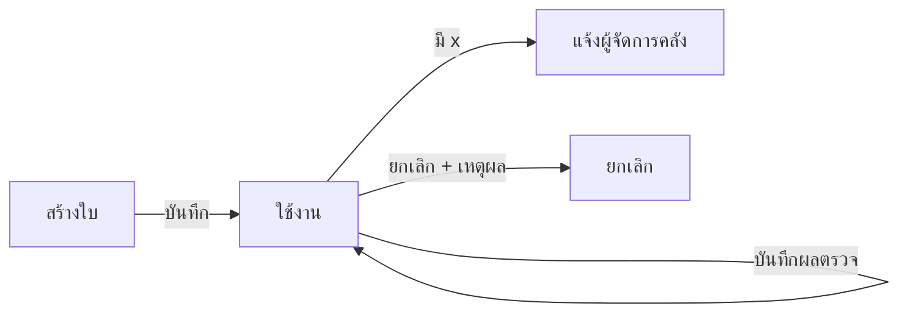

# BRD: ใบตรวจเช็คถังดับเพลิง (Fire Extinguisher Inspection Card)

| Field | Value |
|---|---|
| BRD ID | BRD-WHS-FEC-001 |
| Feature | F-TMP-001 ใบตรวจเช็คถังดับเพลิง (รหัสชั่วคราว — รอรหัสจริงจาก FEATURE_REGISTRY) |
| BRD Type | New Feature (แบบ 2 · ดึงข้อมูลเดิม — สถานที่ + ผู้ตรวจอ่านจากระบบ) |
| Version | 1.0 |
| Status | **APPROVED (Prebrief Mode · Lane · unattended)** — DEC แทน Scope Lock จนมีใบเซ็นลูกค้า |
| Module | Inventory / Warehouse (Core Cube · แผนกคลังสินค้า) |
| Customer | Credence (แบบฟอร์ม FM-WHS-03 Rev.00 :01/07/2569) |
| Request | REQ-TMP-001 (ชั่วคราว — รอเลขจริงจาก F186) |
| Input | PREBRIEF_REQ-TMP-001_v2 · FORM_SPEC.json (7 ช่อง) · DECISIONS.lock (13 DEC · พร้อมเริ่มทำ) · feature.html (audit FAIL 0 · self_audit PASS · jsdom smoke 27/27) |
| Created / Updated | 2026-10-10 |

## Changelog
- v1.0 (2026-10-10): สร้างผ่าน brd-generator-full v2.3 Prebrief Mode (doc-master-pipeline ขั้น 7 · โหมดไม่เฝ้า)

---

## 1. Business Context
### 1.1 ปัญหา / โอกาส
แผนกคลังสินค้าใช้การ์ดกระดาษ FM-WHS-03 แขวนที่ถังดับเพลิงแต่ละจุด — บันทึกด้วยมือ (วันที่ · มาตรวัด · ซีล/สลัก · สายฉีด · สภาพถัง · ผู้ตรวจ) · ไม่มีภาพรวมว่าจุดไหนตรวจล่าสุดเมื่อไร · พบถังผิดปกติแล้วไม่มีการแจ้งผู้รับผิดชอบอัตโนมัติ (การ์ดเขียนแค่ "หากพบเครื่องดับเพลิงผิดปกติ ติดต่อผู้จำหน่ายเพื่อแก้ไข") · ไฟล์ Excel ต้นฉบับวาง 2 การ์ดในแผ่นเดียว พิมพ์แล้วล้นไปหน้า 2
### 1.2 เป้าหมาย
1. ขึ้นการ์ดเป็นเอกสารในระบบ ช่องตรงกระดาษ 1:1 · พิมพ์แบบเดิมได้ (PDF Replica 1 ใบ = 1 จุดติดตั้ง)
2. บันทึกผลตรวจรายครั้งในระบบ — เห็นผลล่าสุดของทุกจุดในหน้าเดียว
3. พบผิดปกติ → แจ้งผู้จัดการคลังสินค้าทันที (ENG-NOTIFY)
### 1.3 ตัวชี้วัด
ไม่มีใน input → **OQ-01** (ห้ามแต่งตัวเลข)
### 1.4 ที่มา
แบบฟอร์มลูกค้า FM-WHS-03 (xlsx) → FORM_SPEC 7 ช่อง · gate 10 หมวดตอบเองตาม unattended-policy → ทุกข้อเป็น AI-DEFAULT

## 2. Scope
### 2.1 In Scope
- รายการใบตรวจ (ค้นหา · กรองสถานะ/ผลตรวจล่าสุด/โซน · CSV) · สร้างใบตรวจ wizard 3 ขั้น · ดูรายละเอียด 3 แท็บ (รายละเอียด › PDF Preview › ประวัติ)
- บันทึกผลตรวจรายครั้ง (เพิ่มแถว) · แก้แถวของตัวเองภายในวันเดียวกัน · ยกเลิกใบ (เหตุผลบังคับ)
- แจ้งผู้จัดการคลังเมื่อพบผิดปกติ · แนบไฟล์ · PDF FM-WHS-03 Replica · เลขที่ FEC จาก ENG-DOC-NUM
### 2.2 Out of Scope
- ขั้นพิจารณา/ลงนาม (กระดาษไม่มี — DEC-03 · DEC-07) · เปิดงานซ่อม/ติดต่อผู้จำหน่ายในระบบ · ทะเบียนถังดับเพลิง (Asset) · ตารางนัดตรวจ/เตือนถึงรอบ · ทำซ้ำเอกสาร
### 2.3 Assumptions
- จุดติดตั้งมีใน Warehouse Location master (ยังไม่มีรหัส feature → OQ-04) · พนักงานมีใน F-EMP-001 · role-mgr-wh มีใน DOA master
### 2.4 Scope Lock (ชั่วคราว = DECISIONS.lock · ยังไม่มีใบเซ็น → OQ-02)
| DEC | หมวด | มติ | ที่มา |
|---|---|---|---|
| DEC-01 | G1 | ไม่เปลี่ยนค่าในระบบ | AI-DEFAULT |
| DEC-02 | G1 | ไม่ส่งต่อระบบอื่นรอบนี้ (ประกาศ event ไว้ใน FRD) | AI-DEFAULT |
| DEC-03 | G2 | ไม่มีขั้นพิจารณา (กระดาษไม่มีช่องลงชื่อผู้พิจารณา) | AI-DEFAULT |
| DEC-04 | G3 | เลือกครบ 4 หัวข้อ / หรือ x · มี x = แถวผิดปกติ → แจ้ง role-mgr-wh · 1 ใบ = 1 จุดติดตั้ง · ผู้ตรวจ = ผู้บันทึก · วันที่ห้ามอนาคต · แก้แถวได้เฉพาะผู้บันทึกวันเดียวกัน | AI-DEFAULT |
| DEC-05 | G4 | รายการตรวจไม่จำกัดแถว · PDF ≥ 12 แถว | AI-DEFAULT |
| DEC-06 | G5 | ช่อง 1:1 · ไม่เพิ่มช่อง (ไม่มีหมายเหตุ) | AI-DEFAULT |
| DEC-07 | G6 | ไม่มีช่องลงชื่อ · ผู้ตรวจแสดงเป็นข้อความต่อแถว · ไม่ใช้ภาพลายมือชื่อ | AI-DEFAULT |
| DEC-08 | G8 | เจ้าของ · พนักงานคลังเห็นทั้งหมด · role-mgr-wh เห็นทั้งหมด | AI-DEFAULT |
| DEC-09 | G9 | ออกเลขตอนบันทึกครั้งแรก · รหัส FEC | AI-DEFAULT |
| DEC-10 | G10 | แนบไฟล์ ✓ · CSV ✓ · ทำซ้ำ ✗ · ประกาศ ✗ | AI-DEFAULT |
| DEC-11 | VALID | 1 ใบ = 1 สถานที่ · พิมพ์เต็มหน้า A4 (ต้นฉบับ 2 การ์ดล้นหน้า) | FORM_SPEC |
| DEC-12 | VALID | แก้คำสะกด "ผู้จำหนาย" → "ผู้จำหน่าย" · ยืนยันใน signoff | FORM_SPEC |
| DEC-13 | VALID | มี x ต้องแจ้งผู้รับผิดชอบ (ไม่เพิ่มช่องบนกระดาษ) | FORM_SPEC |

## 3. Roles & Permissions (COSO)
| Role | COSO | ทำอะไร |
|---|---|---|
| เจ้าหน้าที่คลังสินค้า (ผู้ตรวจ) | Maker | สร้างใบ · บันทึกผลตรวจ · แก้แถวตัวเองวันเดียวกัน · ยกเลิกใบของตน |
| role-mgr-wh ผู้จัดการคลังสินค้า | Checker (รับแจ้งผิดปกติ) + Admin | เห็นทั้งหมด · รับแจ้ง fec_abnormal_found · ยกเลิกได้ทุกใบ |
| พนักงานนอกแผนก | Maker (จำกัด) | เห็น/บันทึกเฉพาะใบที่ตนสร้าง |

| Action | ผู้ตรวจ (คลัง) | ผจก.คลัง | นอกแผนก |
|---|:-:|:-:|:-:|
| ดูใบ | ทั้งหมด | ทั้งหมด | ของตน |
| สร้างใบ | ✓ | ✓ | ✓ |
| บันทึกผลตรวจ | ใบที่เห็น · ใช้งาน | ✓ | ของตน |
| แก้แถวผลตรวจ | ของตน วันเดียวกัน | ของตน วันเดียวกัน | ของตน วันเดียวกัน |
| ยกเลิกใบ | ของตน | ✓ ทุกใบ | ของตน |
SoD: ไม่มีขั้นพิจารณา (DEC-03) — control = แจ้งผู้จัดการทันทีเมื่อผิดปกติ + ประวัติ append-only

## 4. User Journey
### 4.1 Happy Path
1. ผู้ตรวจ: สร้างใบ → เลือกสถานที่ → บันทึกผลตรวจครั้งแรก (หรือสร้างใบเปล่าไปติดที่ถัง) → บันทึก (ได้เลข FEC) → พิมพ์ PDF ติดที่ถัง
2. ทุกรอบตรวจ: เปิดใบ → บันทึกผลตรวจ (วันที่ · 4 หัวข้อ) → ผลล่าสุดแสดงในรายการ
### 4.2 Alternative
- มีหัวข้อ x → แถวผิดปกติ · แถบแดงในใบ · แจ้ง role-mgr-wh (fec_abnormal_found บังคับ)
- สถานที่มีใบใช้งานอยู่แล้ว → สร้างไม่ได้ · ลิงก์เปิดใบเดิม
- ย้าย/ซ้ำ → ยกเลิกใบ (เหตุผลบังคับ) → แจ้ง role-mgr-wh (fec_cancelled)

## 5. Data (จาก FORM_SPEC — ป้ายตามกระดาษ)
### 5.1 fire_ext_card (header)
| ช่องบนกระดาษ | field | ชนิด | ที่มา | บังคับ |
|---|---|---|---|:-:|
| (ไม่มีบนกระดาษ) เลขที่ | doc_no | text | auto ENG-DOC-NUM | ✓ |
| สถานที่ | location_id → location_name_snapshot | ref | system WarehouseLocation (อ่านอย่างเดียว) | ✓ |
| หัวกระดาษบริษัท | header_snapshot | jsonb | Organization ณ ออกเลข | ✓ |
| Doc. No. / Rev. | — | — | F-DOCCFG print_config | — |
### 5.2 fire_ext_check (แถวซ้ำ "รายการตรวจ")
| ช่องบนกระดาษ | field | ชนิด | ที่มา | บังคับ |
|---|---|---|---|:-:|
| วันที่ | check_date | date | user (≤ วันนี้) | ✓ |
| มาตรวัด | gauge | enum normal/abnormal (/ · x) | user | ✓ |
| ซีล/สลัก | seal_pin | enum | user | ✓ |
| สายฉีด | hose | enum | user | ✓ |
| สภาพถัง | body | enum | user | ✓ |
| ผู้ตรวจ | inspector_id → inspector_name_snapshot | ref | system F-EMP-001 (ผู้บันทึก) | ✓ |
### 5.3 attachments → Document Center (ไฟล์ระดับใบ)

## 6. User Stories
| ID | Story | AC หลัก |
|---|---|---|
| S-01 | ผู้ตรวจสร้างใบตรวจของจุดติดตั้ง | สถานที่บังคับ · 1 จุดมีใบใช้งานได้ใบเดียว · บันทึกได้เลข FEC |
| S-02 | ผู้ตรวจสร้างใบเปล่าไปติดที่ถัง | ไม่บังคับผลตรวจ · PDF 12 แถวว่าง |
| S-03 | ผู้ตรวจบันทึกผลตรวจรายครั้ง | วันที่ ≤ วันนี้ · ไม่ซ้ำวันในใบเดียวกัน · เลือกครบ 4 หัวข้อ |
| S-04 | ผู้จัดการคลังรับแจ้งเมื่อพบผิดปกติ | มี x → แจ้งทันที (บังคับ) · แถบแดงในใบ · ผลล่าสุด "ผิดปกติ" |
| S-05 | ผู้ตรวจแก้แถวที่บันทึกผิด | เฉพาะแถวของตน · ภายในวันเดียวกัน · ประวัติบันทึก |
| S-06 | ผู้ใช้พิมพ์การ์ด FM-WHS-03 | 1 หน้า A4 · ≥ 12 แถว · ผู้ตรวจเป็นข้อความ |
| S-07 | เจ้าของใบยกเลิกใบ | เหตุผลบังคับ · บันทึกผลตรวจต่อไม่ได้ |
| S-08 | ผู้จัดการคลังดูทุกจุดพร้อมส่งออก CSV | กรองสถานะ/ผลล่าสุด/โซน |

## 7. Status & Lifecycle
| จาก | Action | ไป | ใคร |
|---|---|---|---|
| — | บันทึกครั้งแรก | active (ใช้งาน) | Maker |
| active | บันทึกผลตรวจ / แก้แถววันเดียวกัน | active | ผู้มีสิทธิ์เห็น |
| active | ยกเลิก + เหตุผล | cancelled | เจ้าของ / role-mgr-wh |
cancelled = ล็อกการบันทึก (ไม่มีกู้คืนรอบนี้)

## 8. Business Rules + Validation
| ID | Rule | Tag | Type |
|---|---|:-:|---|
| BR-01 | ทุกแถวต้องเลือกครบ 4 หัวข้อ เป็น / หรือ x | FIXED [AI-DEFAULT] | Validation (DEC-04) |
| BR-02 | แถวมี x อย่างน้อย 1 หัวข้อ = ผิดปกติ · ผลล่าสุดของใบ = ผลของแถววันที่ล่าสุด | FIXED | Formula (DEC-04) |
| BR-03 | ผิดปกติ → ENG-NOTIFY fec_abnormal_found ถึง role-mgr-wh (บังคับ) | CONFIGURABLE (ผู้รับ = role) | Notify (DEC-13) |
| BR-04 | 1 จุดติดตั้งมีใบสถานะใช้งานได้ 1 ใบ | FIXED [AI-DEFAULT] | Uniqueness (DEC-11) |
| BR-05 | วันที่ตรวจห้ามเป็นอนาคต · ไม่ซ้ำวันในใบเดียวกัน | FIXED [AI-DEFAULT] | Validation (DEC-04) |
| BR-06 | ผู้ตรวจ = ผู้บันทึกแถว (ระบบใส่ · ไม่ให้เลือก) | FIXED | Data (DEC-04 · DEC-07) |
| BR-07 | แก้แถวได้เฉพาะผู้บันทึกภายในวันที่บันทึก · หลังจากนั้นล็อก | CONFIGURABLE [AI-DEFAULT] | Control (DEC-04) |
| BR-08 | ออกเลขตอนบันทึกครั้งแรก · no-gap ✗ | CONFIGURABLE | DOCCFG (DEC-09) |
| BR-09 | การมองเห็นตาม §3 · ใบไม่มีสิทธิ์ = 404 | FIXED | Visibility (DEC-08) |
| BR-10 | PDF 1 ใบ = 1 สถานที่ · ≥ 12 แถว · > 12 แถว = dense ยัง 1 หน้า · ไม่มีช่องลงชื่อ | FIXED | Print (DEC-05 · DEC-07 · DEC-11) |
| BR-11 | ข้อความท้ายการ์ด "หากพบเครื่องดับเพลิงผิดปกติ ติดต่อผู้จำหน่ายเพื่อแก้ไข" (แก้คำสะกด) | FIXED [AI-DEFAULT] | Content (DEC-12) |
| BR-12 | ยกเลิกต้องมีเหตุผล · เจ้าของหรือ role-mgr-wh · สถานะใช้งานเท่านั้น | FIXED | Control |

| VR | ช่อง | เงื่อนไข | ข้อความ |
|---|---|---|---|
| VR-01 | สถานที่ | required | กรุณาเลือกสถานที่ |
| VR-02 | สถานที่ | ไม่มีใบใช้งานอยู่ | สถานที่นี้มีใบตรวจที่ใช้งานอยู่แล้ว |
| VR-03 | วันที่ | ≤ วันนี้ | วันที่ตรวจห้ามเป็นวันในอนาคต |
| VR-04 | วันที่ | ไม่ซ้ำในใบ | วันที่นี้บันทึกผลตรวจแล้ว |
| VR-05 | 4 หัวข้อ | เลือกครบ | เลือกผลให้ครบทั้ง 4 หัวข้อ |
| VR-06 | เหตุผลยกเลิก | required | กรุณาระบุเหตุผล |

### 8.5 ระดับความยืดหยุ่น
BR-03 ผู้รับ → ntf config · BR-07 ช่วงเวลาแก้ → Admin Panel (เสนอ) · BR-08 → F-DOCCFG

## 9. Edge Cases
| EC | กรณี | ผล |
|---|---|---|
| EC-01 | ใบเปล่า (ยังไม่ตรวจ) | ผลล่าสุด "ยังไม่ตรวจ" · PDF 12 แถวว่าง |
| EC-02 | ตรวจเกิน 12 ครั้ง (ทดสอบ 24) | PDF dense ยัง 1 หน้า |
| EC-03 | ย้ายถังไปจุดอื่น | ยกเลิกใบเดิม → สร้างใบที่จุดใหม่ |
| EC-04 | บันทึกย้อนหลัง (วันก่อนหน้า) | อนุญาต · เรียงแถวตามวันที่ |
| EC-05 | แก้แถวข้ามวัน | ไม่มีปุ่มแก้ · API 403 |
| EC-06 | บันทึกพร้อมกัน 2 คน (stale) | 409 → toast รีเฟรช ข้อมูลไม่เปลี่ยน |
| EC-07 | แบบเอกสารปิดใช้ (F-DOCCFG) | ปุ่มสร้าง disabled + แถบแดง |
| EC-08 | ต้นฉบับ 2 การ์ดต่อแผ่น | ระบบพิมพ์ 1 การ์ดต่อหน้า (DEC-11) |

## 10. Value Stream & Downstream Impact
Positioning: Warehouse Safety — จุดติดตั้ง (Warehouse Location) → **ใบตรวจเช็คถังดับเพลิง (feature นี้)** → [งานซ่อม/ผู้จำหน่าย — ปิดรอบนี้]
| ปลายทาง | ข้อมูล | Trigger | หมายเหตุ |
|---|---|---|---|
| ผู้จัดการคลังสินค้า | แถวผิดปกติ | บันทึกแถวมี x | ENG-NOTIFY fec_abnormal_found |
| Asset / Maintenance | ถังผิดปกติ → งานซ่อม | — | **ปิดรอบนี้ (DEC-02)** → OQ-05 |
| F-DOCCFG / ENG-DOC-STORE | PDF | — | ไม่เก็บสำเนาอัตโนมัติ (ไม่มีจุดอนุมัติ/ส่งออก) |
| รายงาน | จุดผิดปกติ / จุดที่เลยรอบตรวจ | — | Report area อ่าน |

## 11. Delivery
Phase 1 = ทุกอย่างใน §2.1 · Phase 2 (เสนอ) = ทะเบียนถัง (Asset) + รอบตรวจ/เตือนเลยรอบ + เปิดงานซ่อมจากแถวผิดปกติ

## 12. Dev Summary "ใบสั่ง"
- Config: doc_type FEC (F-DOCCFG) · ntf fec_abnormal_found / fec_cancelled · Warehouse Location master
- Declaration: NTF_BRIEF · DOCCFG_BRIEF · MDOC_BRIEF (ไม่มี DOA_BRIEF — DEC-03)
- Screen Inventory: P-01 รายการ · P-02 สร้าง (drawer wide 3 ขั้น) · P-03 ดู (drawer 920 · 3 แท็บ) · M-01 บันทึกผลตรวจ · M-02 ยกเลิก · M-03 ทิ้งข้อมูล
- UI Signals: เอกสาร + พิมพ์ = ใช่ · ลายเซ็น/ขั้นพิจารณา = ไม่ · archetype Q-form-noapproval

## 13. Open Questions
| OQ | คำถาม | เจ้าของ | Block? |
|---|---|---|---|
| OQ-01 | ตัวชี้วัด (รอบตรวจ/เดือน · % จุดที่ตรวจตรงรอบ · เวลาแก้ไขถังผิดปกติ) | ลูกค้า Credence | ไม่ |
| OQ-02 | ลูกค้าเซ็นยืนยัน DEC-01..13 (AI-DEFAULT ทั้งหมด) — โดยเฉพาะ ไม่มีขั้นพิจารณา · 1 ใบต่อจุด · แก้แถววันเดียวกัน · แก้คำสะกด | Strike → ลูกค้า | ก่อน UAT |
| OQ-03 | archetype Q-form-noapproval — ทีมยืนยันใช้โครง Q2 แบบไม่มี DOA (ชุดตรวจ Q-form บังคับ DOA) | พี่เบิร์ด / Chin | ก่อน dev |
| OQ-04 | Warehouse Location master มีหรือยัง · รหัส feature จริงของ F-TMP-001 | พี่เบิร์ด | ก่อน dev |
| OQ-05 | ต้องเปิดงานซ่อม/ติดตามผู้จำหน่ายจากแถวผิดปกติไหม (Phase 2) | ลูกค้า | ไม่ |
| OQ-06 | function_code taxonomy ของ FEC (ใส่ F01 ชั่วคราว) | Strike | ก่อน register |

## 14. Security & Compliance
Preset: Standard Operation · PII: ชื่อผู้ตรวจ (pdpa) — ข้อมูลตัวอย่างใน prototype เป็นชื่อสมมติ · Audit append-only ทุก action · ไฟล์แนบตาม file_policy Document Center (≤20MB · pdf/doc/xls/img)

## 15. Health Check / Monitoring
SLA: ไม่กำหนดรอบนี้ (→ OQ-01) · KPI เสนอ: จุดที่ผลล่าสุดผิดปกติ · จุดที่ไม่ได้ตรวจเกิน 35 วัน (ค่าเสนอ — รอยืนยัน) · Widget: ผลล่าสุดตามโซน

## AI Review
C01–C23 + PE01–PE05: ผ่าน (C20 = DEC ครบ 13 ข้อ + OQ-02 รอใบเซ็น · C22 ตัวชี้วัด → OQ-01 · PE02 SoD = ไม่มีขั้นพิจารณาโดยมติ DEC-03) → **APPROVED**

## Appendix — Screen List
P-01 `#/fire-extinguisher-check` · P-02 `#/fire-extinguisher-check/create` · P-03 `#/fire-extinguisher-check/view/:id`
